# DDTA — Ontologia CORE: architettura concettuale e classi fondamentali

Questo documento costituisce la **guida di definizione del DDTA CORE**. Il vocabolario autorevole è dichiarato nelle schede mediante blocchi `yaml ddta-ontology`; i vincoli documentali specifici sono dichiarati mediante `yaml ontology-validation`. Le rappresentazioni Turtle degli Shape, le query SPARQL, i grafici Mermaid e gli esempi servono a spiegare e verificare il modello: **non sono dichiarazioni aggiuntive da fondere nell'ontologia**.

## 1. Architettura concettuale

DDTA distingue due livelli complementari:

- **Logico — COSA:** capacità, requisiti, contratti, interazioni previste, risorse e confini logici.
- **Realizzativo — COME:** processi e attività attraverso i quali le capacità possono essere realizzate.

Questa distinzione riguarda il contenuto semantico, non l'ordine di documenti MR, Decision e FR. Una descrizione può contenere informazioni appartenenti a entrambi i livelli.

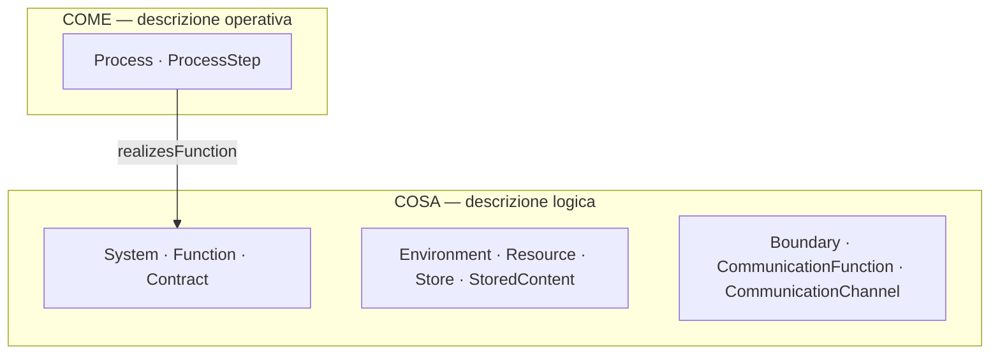

### 1.1 Modello funzionale

Un `System` offre funzioni tramite `providesFunction`, con ruoli specificabili attraverso `hasPrimaryFunction` e `hasSupportFunction`. L'associazione `hasOperationalEnvironment` indica il contesto operativo previsto. `Environment` rende disponibili `Resource` mediante `makesAvailable`, senza implicare che un sistema le utilizzi, che esse siano operative o che appartengano automaticamente a un suo confine.

Una `Function` identifica una capacità o responsabilità, indipendentemente dal processo che la realizza. Può essere decomposta mediante `hasSubFunction`; le precedenze obbligatorie tra sottofunzioni dirette sono espresse da `mustPrecede`. I contratti di ingresso e uscita sono associati mediante `hasInputContract` e `hasOutputContract`.

### 1.2 Contratti, contenuti e memorizzazione

`Contract` specifica requisiti relativi agli ingressi o alle uscite attese di una `Function`; i suoi `ContractElement` possono descrivere elementi richiesti o facoltativi tramite `minOccurs` e `maxOccurs`. Un contratto non coincide con il contenuto concretamente scambiato, con una codifica o con un protocollo. I contratti non sono associati direttamente al canale.

`Store` è una sottoclasse di `Resource` e rappresenta un deposito logico, indipendentemente da persistenza, tecnologia o supporto fisico. La proprietà `stores` collega uno `Store` sia a un altro `Store` sia a uno `StoredContent`. `StoredContent` identifica un contenuto e non è una sottoclasse di `Store`. `stores` non è transitiva.

### 1.3 Comunicazione e confini

`CommunicationFunction` è una specializzazione di `Function` e descrive la capacità di comunicare. `CommunicationChannel` è una specializzazione di `Resource` e rappresenta un collegamento direzionale previsto. La prima si associa al secondo tramite `usesChannel`; `hasSource` e `hasDestination` identificano le risorse alle estremità del canale. Un canale A→B non implica l'esistenza di B→A e non rappresenta un evento già avvenuto.

`Boundary` è un confine logico associato a un `System` mediante `hasBoundary`. La relazione `encloses` elenca le `Resource` incluse esplicitamente nel confine; più confini possono sovrapporsi. L'appartenenza a un `Boundary` non si propaga automaticamente attraverso `stores` e non garantisce proprietà crittografiche o altre misure di sicurezza. Per l'analisi dei confini si può applicare la convenzione locale di completezza definita nella scheda 11, distinta dalla semantica OWL Open World.

### 1.4 Modello dei processi

Un `Process` descrive l'organizzazione operativa prevista e non una singola esecuzione. `realizesFunction` indica quale funzione è destinato a realizzare, senza dimostrare conformità ai contratti. `hasStep` collega il processo ai suoi `ProcessStep`; `hasNextStep` descrive possibili successioni dirette. La struttura degli Step non è necessariamente uno-a-uno con la decomposizione delle funzioni.

Il CORE **non definisce** le guardie, la semantica di alternative o parallelismo, la sincronizzazione di rami, l'attivazione dei processi o un modello di esecuzione. Queste informazioni potranno essere aggiunte da un'ontologia specializzata che riutilizzi gli stessi processi e Step. Riferimenti al codice e alle implementazioni concrete richiedono ulteriore modellazione, senza presupporre una proprietà `implementedBy` nel vocabolario corrente.

### 1.5 Principi di interpretazione

- Le identità logiche di funzioni, processi, risorse e contenuti rimangono distinte.
- Una relazione documentata non prova l'esecuzione o la conformità operativa.
- Dominio e range OWL consentono inferenze di appartenenza di classe; i controlli SHACL verificano soltanto gli obblighi documentali esplicitamente dichiarati.
- L'assenza di una tripla RDF non dimostra in generale la falsità dell'affermazione; eventuali convenzioni locali di completezza devono essere dichiarate.
- Ogni proprietà viene definita in una sola scheda. Le altre schede possono citarla e interrogarla senza ridefinirla.

### 1.6 Il micro-CORE

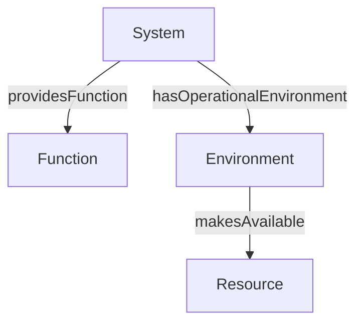

| Soggetto | Relazione | Oggetto |
|---|---|---|
| `System` | `providesFunction` | `Function` |
| `System` | `hasOperationalEnvironment` | `Environment` |
| `Environment` | `makesAvailable` | `Resource` |

Il diagramma del micro-CORE evidenzia tre collegamenti fondamentali, senza esaurire le proprietà delle schede 2–5.

---

## 2. Scheda ontologica — `System`

### 2.1 Identificazione e definizione

```yaml ddta-ontology
record: class
module: core
iri: ddta:System
status: approved
label:
  en: System
  it: Sistema
definition:
  en: >-
    An identifiable set of organized elements that provides
    or supports capabilities. A system is distinct from the
    environment in which it operates.
  it: >-
    Un insieme identificabile di elementi organizzati per
    offrire o supportare capacità. Il sistema è distinto
    dall'ambiente nel quale opera.
```

### 2.2 Relazioni

```yaml ddta-ontology
record: object-properties
module: core
owner: ddta:System
properties:
  - iri: ddta:providesFunction
    status: approved
    domain: ddta:System
    range: ddta:Function
    label:
      en: provides function
      it: offre una funzione
    definition:
      en: >-
        Relates a system to a capability it provides.
      it: >-
        Collega un sistema a una capacità che esso offre.

  - iri: ddta:hasPrimaryFunction
    status: approved
    subPropertyOf: ddta:providesFunction
    domain: ddta:System
    range: ddta:Function
    label:
      en: has primary function
      it: ha una funzione primaria
    definition:
      en: >-
        Relates a system to a function that has a primary role
        for that system.
      it: >-
        Collega un sistema a una funzione che svolge un ruolo
        primario rispetto a quel sistema.

  - iri: ddta:hasSupportFunction
    status: approved
    subPropertyOf: ddta:providesFunction
    domain: ddta:System
    range: ddta:Function
    label:
      en: has support function
      it: ha una funzione di supporto
    definition:
      en: >-
        Relates a system to a function that has a supporting
        role for that system.
      it: >-
        Collega un sistema a una funzione che svolge un ruolo
        di supporto rispetto a quel sistema.

  - iri: ddta:hasOperationalEnvironment
    status: approved
    domain: ddta:System
    range: ddta:Environment
    label:
      en: has operational environment
      it: ha un ambiente operativo
    definition:
      en: >-
        Relates a system to an environment in which it is
        intended to operate, without asserting actual execution.
      it: >-
        Collega un sistema a un ambiente nel quale è previsto
        che operi, senza affermare un'esecuzione effettiva.
```

**Lettura delle relazioni.** `providesFunction` rappresenta la relazione generale attraverso cui un `System` offre una `Function`. `hasPrimaryFunction` e `hasSupportFunction` specializzano questa relazione mediante `rdfs:subPropertyOf`, distinguendo rispettivamente le funzioni primarie e quelle di supporto. Entrambe implicano `providesFunction` secondo la semantica RDFS.

I ruoli *primario* e *di supporto* sono relativi alla relazione tra `System` e `Function`, non costituiscono caratteristiche intrinseche della funzione. La stessa `Function` può quindi assumere ruoli differenti rispetto a sistemi diversi, senza richiedere classi separate `PrimaryFunction` e `SupportFunction`.

`hasOperationalEnvironment` associa un `System` all'`Environment` nel quale è previsto il suo funzionamento. Questa relazione non implica contenimento, proprietà delle risorse, disponibilità operativa effettiva o avvenuta esecuzione del sistema.

### 2.3 Interrogazioni SPARQL

Le interrogazioni SPARQL recuperano le relazioni funzionali e ambientali dichiarate per un individuo della classe `System`.

Le query utilizzano il prefisso `ddta:` e l'individuo `ex:ExampleSystem` come soggetto di esempio. L'IRI di quest'ultimo viene sostituito con quello del sistema interrogato.

#### Q-SYS-01 — Funzioni offerte dal sistema

**Scopo:** recuperare tutte le funzioni offerte dal sistema, comprese quelle dichiarate come primarie o di supporto.

```sparql
PREFIX ddta: <https://w3id.org/ddta/core#>
PREFIX ex: <https://example.org/ddta/test#>

SELECT DISTINCT ?function
WHERE {
    ex:ExampleSystem
        (ddta:providesFunction|
         ddta:hasPrimaryFunction|
         ddta:hasSupportFunction) ?function .
}
```

La query utilizza un *property path* SPARQL che considera esplicitamente le tre proprietà. Il risultato non dipende dalla materializzazione delle inferenze `rdfs:subPropertyOf`.

#### Q-SYS-02 — Funzioni primarie

**Scopo:** recuperare le funzioni dichiarate come primarie rispetto al sistema.

```sparql
PREFIX ddta: <https://w3id.org/ddta/core#>
PREFIX ex: <https://example.org/ddta/test#>

SELECT DISTINCT ?function
WHERE {
    ex:ExampleSystem ddta:hasPrimaryFunction ?function .
}
```

#### Q-SYS-03 — Funzioni di supporto

**Scopo:** recuperare le funzioni dichiarate come funzioni di supporto rispetto al sistema.

```sparql
PREFIX ddta: <https://w3id.org/ddta/core#>
PREFIX ex: <https://example.org/ddta/test#>

SELECT DISTINCT ?function
WHERE {
    ex:ExampleSystem ddta:hasSupportFunction ?function .
}
```

#### Q-SYS-04 — Ambienti operativi

**Scopo:** recuperare gli ambienti operativi associati al sistema.

```sparql
PREFIX ddta: <https://w3id.org/ddta/core#>
PREFIX ex: <https://example.org/ddta/test#>

SELECT DISTINCT ?environment
WHERE {
    ex:ExampleSystem
        ddta:hasOperationalEnvironment ?environment .
}
```

#### Interpretazione dei risultati

Le query restituiscono i collegamenti presenti nel grafo RDF interrogato. I risultati possono comprendere anche relazioni inferite quando il motore SPARQL opera su un grafo che contiene tali inferenze o utilizza un regime di entailment appropriato.

L'assenza di risultati non dimostra l'inesistenza delle relazioni nel sistema reale. Indica che le corrispondenti informazioni non sono disponibili nel grafo interrogato, secondo la semantica adottata.

Le interrogazioni sono parte della documentazione verificabile dell'ontologia. I blocchi `sparql` sono distinti dalle dichiarazioni ontologiche e non contribuiscono alla generazione del Turtle.

### 2.4 Vincoli di completezza documentale

| Controllo | Cardinalità | Stato |
|---|---|---|
| Funzioni primarie di `System` | `1..*` | Obbligatorio |
| Funzioni di supporto di `System` | `0..*` | Facoltativo |
| Ambienti operativi associati | Non definita | Nessun vincolo di presenza |

La presenza di almeno una funzione primaria soddisfa anche il requisito di almeno una funzione offerta, poiché `hasPrimaryFunction` è sottoproprietà di `providesFunction`.

#### Controllo SHACL

Il vincolo obbligatorio è identificato da `SYS-PRIMARY-01` e verifica che ogni individuo di `System` dichiari almeno una relazione `hasPrimaryFunction`.

**Dichiarazione strutturata per la generazione SHACL:**

```yaml ontology-validation
kind: OntologyValidation
target: ddta:System
engine: SHACL

constraints:
  - id: SYS-PRIMARY-01
    path: ddta:hasPrimaryFunction
    minCount: 1
```

**Shape SHACL risultante** (generata dalla dichiarazione strutturata):

```turtle
@prefix ddta: <https://w3id.org/ddta/core#> .
@prefix sh: <http://www.w3.org/ns/shacl#> .

ddta:SystemShape
    a sh:NodeShape ;
    sh:targetClass ddta:System ;
    sh:property [
        sh:path ddta:hasPrimaryFunction ;
        sh:minCount 1 ;
        sh:message
            "System must declare at least one primary function."@en
    ] .
```

Il controllo è soddisfatto quando il grafo documentale contiene almeno una relazione `hasPrimaryFunction` per ciascun individuo di `System`. Non è necessaria la materializzazione delle inferenze RDFS.

### 2.5 Esempio illustrativo (escluso dal TTL generato)

L'esempio rappresenta `DermaTriage` come individuo di `System`, associandolo alla funzione primaria `DermatologicalTriageEvaluation` e all'ambiente operativo `DermaTriageEnvironment`.

```turtle
@prefix ddta: <https://w3id.org/ddta/core#> .
@prefix derma: <https://example.org/dermatriage#> .

derma:DermaTriage a ddta:System ;
    ddta:hasPrimaryFunction derma:DermatologicalTriageEvaluation ;
    ddta:hasOperationalEnvironment derma:DermaTriageEnvironment .
```

Dalla relazione `hasPrimaryFunction` e dall'assioma `rdfs:subPropertyOf` si ricava:

```turtle
derma:DermaTriage
    ddta:providesFunction derma:DermatologicalTriageEvaluation .
```

L'associazione all'ambiente operativo non implica che DermaTriage sia effettivamente in esecuzione.

Le dichiarazioni dell'esempio sono separate da quelle dell'ontologia CORE e non vengono incluse nel `core.ttl` generato.


---

## 3. Scheda ontologica — `Function`

### 3.1 Identificazione e definizione

```yaml ddta-ontology
record: class
module: core
iri: ddta:Function
status: approved
label:
  en: Function
  it: Funzione
definition:
  en: >-
    An identifiable capability or responsibility defined
    in terms of expected behavior or outcome, independently
    of the processes and technical components used to
    realize it. A function may be recursively decomposed
    into other functions and may participate in functional
    precedence constraints.
  it: >-
    Una capacità o responsabilità identificabile, definita
    in termini di comportamento o risultato atteso,
    indipendentemente dai processi e dai componenti tecnici
    utilizzati per realizzarla. Una funzione può essere
    decomposta ricorsivamente in altre funzioni e
    partecipare a vincoli di precedenza funzionale.
```

Una `Function` rappresenta una capacità logica del sistema, indipendente dalla particolare modalità utilizzata per realizzarla.

La stessa funzione può essere realizzata da processi differenti, mantenendo la propria identità funzionale purché rimangano invariati il significato della capacità e i requisiti che la definiscono.

Le funzioni possono essere primarie o di supporto rispetto a un `System`. Tali ruoli sono rappresentati dalle relazioni `hasPrimaryFunction` e `hasSupportFunction`, definite nella scheda `System`, e non costituiscono sottoclassi di `Function`.

### 3.2 Relazioni

```yaml ddta-ontology
record: object-properties
module: core
owner: ddta:Function
properties:
  - iri: ddta:hasSubFunction
    status: approved
    domain: ddta:Function
    range: ddta:Function
    label:
      en: has subfunction
      it: ha una sottofunzione
    definition:
      en: >-
        Relates a function to one of its direct
        constituent functions within a functional
        decomposition.
      it: >-
        Collega una funzione a una delle funzioni
        che costituiscono direttamente la sua
        decomposizione funzionale.

  - iri: ddta:mustPrecede
    status: approved
    domain: ddta:Function
    range: ddta:Function
    label:
      en: must precede
      it: deve precedere
    definition:
      en: >-
        Specifies a mandatory functional precedence
        between two functions belonging directly
        to at least one common functional decomposition.
      it: >-
        Specifica una precedenza funzionale obbligatoria
        tra due funzioni appartenenti direttamente
        ad almeno una stessa decomposizione funzionale.

  - iri: ddta:hasInputContract
    status: approved
    domain: ddta:Function
    range: ddta:Contract
    label:
      en: has input contract
      it: ha un contratto di ingresso
    definition:
      en: >-
        Relates a function to a contract specifying
        requirements and constraints on its inputs.
      it: >-
        Collega una funzione a un contratto che
        specifica requisiti e vincoli relativi
        ai suoi ingressi.

  - iri: ddta:hasOutputContract
    status: approved
    domain: ddta:Function
    range: ddta:Contract
    label:
      en: has output contract
      it: ha un contratto di uscita
    definition:
      en: >-
        Relates a function to a contract specifying
        requirements and constraints on its
        expected outputs.
      it: >-
        Collega una funzione a un contratto che
        specifica requisiti e vincoli relativi
        alle sue uscite attese.
```


**Lettura delle relazioni.**

`hasSubFunction` rappresenta la decomposizione diretta di una `Function` in altre funzioni. La decomposizione può essere ricorsiva: una sottofunzione può essere a sua volta decomposta.

La proprietà non è transitiva. Se `A` contiene direttamente `B` e `B` contiene direttamente `C`, non viene inferito `A hasSubFunction C`. Questa scelta preserva la distinzione tra i livelli della decomposizione. L'insieme delle sottofunzioni dirette e indirette può essere recuperato mediante percorsi SPARQL.

`mustPrecede` rappresenta un vincolo di precedenza funzionale obbligatorio tra due sottofunzioni dirette di almeno una stessa funzione composta. Non rappresenta la sequenza operativa degli Step di un `Process`, né descrive un'esecuzione effettivamente avvenuta.

La proprietà non è transitiva. La sua applicazione è soggetta ai vincoli strutturali descritti nella sezione 3.4.

La relazione `mustPrecede` collega direttamente le identità delle funzioni. L'appartenenza a una decomposizione comune viene verificata mediante SHACL, ma il contesto della decomposizione non è rappresentato esplicitamente nella tripla RDF. Di conseguenza, quando gli stessi individui di `Function` sono riutilizzati in più decomposizioni, la relazione non può esprimere vincoli di precedenza differenti per ciascun contesto.

`hasInputContract` e `hasOutputContract` collegano una `Function` ai contratti che specificano rispettivamente i requisiti sugli ingressi e sulle uscite attese.

I contratti appartengono alla specifica funzionale e definiscono gli elementi obbligatori, quelli facoltativi e gli eventuali vincoli applicabili. Non rappresentano i dati concretamente elaborati durante un'esecuzione.

Gli ingressi e le uscite operative dei processi sono distinti dai contratti della funzione, ma devono essere compatibili con essi affinché la realizzazione sia conforme.

La relazione `realizesFunction`, definita nella scheda `Process`, collega un processo alla funzione che è destinato a realizzare. La navigazione inversa permette di recuperare i processi associati a una funzione senza introdurre una proprietà inversa aggiuntiva.

La stessa `Function` può essere realizzata da processi differenti, che adottano modalità operative, algoritmi e implementazioni tecniche diverse, mantenendo invariati i requisiti funzionali definiti dai contratti.

Ogni `Process` che realizza una `Function` deve rispettarne i contratti di ingresso e di uscita per costituire una realizzazione conforme.

I processi possono differire negli ingressi effettivamente utilizzati e nelle uscite prodotte, purché tali differenze siano ammesse dai rispettivi contratti. Un processo può, ad esempio, non utilizzare un elemento facoltativo del contratto di ingresso oppure omettere un elemento facoltativo del contratto di uscita, a condizione che siano rispettati tutti i vincoli applicabili, comprese le eventuali condizioni associate alla presenza degli elementi facoltativi.

La dichiarazione `realizesFunction` identifica la funzione che il processo è destinato a realizzare, ma non costituisce, da sola, una prova di conformità. La conformità deve essere verificata rispetto ai contratti applicabili.

Processi conformi alla stessa `Function` possono comunque presentare caratteristiche differenti di prestazione, robustezza e sicurezza. La conformità funzionale non implica quindi equivalenza delle implementazioni né equivalenza delle loro proprietà non funzionali.


### 3.3 Interrogazioni SPARQL

Le interrogazioni SPARQL recuperano la decomposizione funzionale, le precedenze, i contratti e i processi associati a una funzione.

Le query utilizzano il prefisso `ddta:` e l'individuo `ex:ExampleFunction` come soggetto di esempio. L'IRI viene sostituito con quello della funzione interrogata.

#### Q-FUN-01 — Sottofunzioni dirette

**Scopo:** recuperare le sottofunzioni direttamente associate alla funzione.

```sparql
PREFIX ddta: <https://w3id.org/ddta/core#>
PREFIX ex: <https://example.org/ddta/test#>

SELECT DISTINCT ?subFunction
WHERE {
    ex:ExampleFunction
        ddta:hasSubFunction ?subFunction .
}
```

#### Q-FUN-02 — Decomposizione funzionale completa

**Scopo:** recuperare tutte le sottofunzioni raggiungibili attraverso uno o più livelli di decomposizione.

```sparql
PREFIX ddta: <https://w3id.org/ddta/core#>
PREFIX ex: <https://example.org/ddta/test#>

SELECT DISTINCT ?subFunction
WHERE {
    ex:ExampleFunction
        ddta:hasSubFunction+ ?subFunction .
}
```

Il property path `hasSubFunction+` percorre ricorsivamente la decomposizione senza richiedere la transitività della proprietà OWL.

#### Q-FUN-03 — Precedenze funzionali

**Scopo:** recuperare le funzioni che devono precedere o seguire direttamente la funzione interrogata.

```sparql
PREFIX ddta: <https://w3id.org/ddta/core#>
PREFIX ex: <https://example.org/ddta/test#>

SELECT DISTINCT ?relation ?function
WHERE {
    {
        ex:ExampleFunction
            ddta:mustPrecede ?function .
        BIND("successor" AS ?relation)
    }
    UNION
    {
        ?function
            ddta:mustPrecede ex:ExampleFunction .
        BIND("predecessor" AS ?relation)
    }
}
```

La query restituisce le precedenze esplicitamente rappresentate. Non calcola automaticamente la chiusura transitiva della relazione.

#### Q-FUN-04 — Contratti di ingresso

**Scopo:** recuperare i contratti che specificano gli ingressi della funzione.

```sparql
PREFIX ddta: <https://w3id.org/ddta/core#>
PREFIX ex: <https://example.org/ddta/test#>

SELECT DISTINCT ?contract
WHERE {
    ex:ExampleFunction
        ddta:hasInputContract ?contract .
}
```

#### Q-FUN-05 — Contratti di uscita

**Scopo:** recuperare i contratti che specificano le uscite attese della funzione.

```sparql
PREFIX ddta: <https://w3id.org/ddta/core#>
PREFIX ex: <https://example.org/ddta/test#>

SELECT DISTINCT ?contract
WHERE {
    ex:ExampleFunction
        ddta:hasOutputContract ?contract .
}
```

#### Q-FUN-06 — Processi che realizzano la funzione

**Scopo:** recuperare i processi che dichiarano di realizzare la funzione.

```sparql
PREFIX ddta: <https://w3id.org/ddta/core#>
PREFIX ex: <https://example.org/ddta/test#>

SELECT DISTINCT ?process
WHERE {
    ?process
        ddta:realizesFunction ex:ExampleFunction .
}
```

#### Interpretazione dei risultati

Le query restituiscono le relazioni disponibili nel grafo RDF interrogato, comprese eventuali inferenze rese disponibili dal sistema di interrogazione.

La decomposizione funzionale e le precedenze rappresentano relazioni logiche, non attività concretamente eseguite.

La presenza di un contratto non dimostra che un processo lo rispetti.

La presenza di `realizesFunction` documenta l'associazione fra processo e funzione, ma non dimostra l'avvenuta esecuzione o la conformità dell'implementazione.

### 3.4 Vincoli di completezza e coerenza documentale

#### Cardinalità

| Relazione | Cardinalità | Stato |
|---|---|---|
| Sottofunzioni dirette | `0..*` | Facoltativo |
| Contratti di ingresso | `0..*` | Facoltativo |
| Contratti di uscita | `0..*` | Facoltativo |
| Precedenze funzionali | `0..*` | Facoltativo |
| Processi realizzativi | `0..*` | Nessun vincolo di presenza |

Non sono imposte cardinalità minime universali per queste relazioni.

Una funzione può essere elementare, non richiedere ingressi informativi, non produrre uscite informative e non avere ancora un processo realizzativo dichiarato.

#### Controlli SHACL

| ID | Controllo |
|---|---|
| `FUN-02` | La decomposizione `hasSubFunction` non contiene cicli diretti o indiretti |
| `FUN-04` | Le precedenze `mustPrecede` non contengono cicli diretti o indiretti |
| `FUN-05` | Le funzioni collegate da `mustPrecede` sono sottofunzioni dirette di almeno una stessa funzione |
| `FUN-06` | `hasInputContract` e `hasOutputContract` collegano individui della classe `Contract` |

I controlli sui cicli comprendono anche i collegamenti di una funzione verso sé stessa.

#### Dichiarazione strutturata per la generazione SHACL

```yaml ontology-validation
kind: OntologyValidation
target: ddta:Function
engine: SHACL

constraints:
  - id: FUN-02
    type: sparql
    message:
      en: Functional decomposition contains a cycle.
      it: La decomposizione funzionale contiene un ciclo.
    select: |-
      PREFIX ddta: <https://w3id.org/ddta/core#>
      SELECT $this
      WHERE {
        $this ddta:hasSubFunction+ $this .
      }

  - id: FUN-04
    type: sparql
    message:
      en: Functional precedence contains a cycle.
      it: La precedenza funzionale contiene un ciclo.
    select: |-
      PREFIX ddta: <https://w3id.org/ddta/core#>
      SELECT $this
      WHERE {
        $this ddta:mustPrecede+ $this .
      }

  - id: FUN-05
    type: sparql
    message:
      en: Precedence requires a common direct parent function.
      it: La precedenza richiede una funzione
          composta diretta comune.
    select: |-
      PREFIX ddta: <https://w3id.org/ddta/core#>
      SELECT $this ?value
      WHERE {
        $this ddta:mustPrecede ?value .
        FILTER NOT EXISTS {
          ?parent ddta:hasSubFunction $this .
          ?parent ddta:hasSubFunction ?value .
        }
      }

  - id: FUN-06
    type: property-class
    properties:
      - path: ddta:hasInputContract
        class: ddta:Contract
      - path: ddta:hasOutputContract
        class: ddta:Contract
```

#### Shape SHACL risultante

La dichiarazione strutturata produce il seguente Shape, rappresentato in Turtle.

```turtle
@prefix ddta: <https://w3id.org/ddta/core#> .
@prefix sh: <http://www.w3.org/ns/shacl#> .

ddta:FunctionShape
    a sh:NodeShape ;
    sh:targetClass ddta:Function ;

    sh:sparql [
        sh:message
            "Functional decomposition contains a cycle."@en ;
        sh:select """
            PREFIX ddta: <https://w3id.org/ddta/core#>
            SELECT $this
            WHERE {
                $this ddta:hasSubFunction+ $this .
            }
        """
    ] ;

    sh:sparql [
        sh:message
            "Functional precedence contains a cycle."@en ;
        sh:select """
            PREFIX ddta: <https://w3id.org/ddta/core#>
            SELECT $this
            WHERE {
                $this ddta:mustPrecede+ $this .
            }
        """
    ] ;

    sh:sparql [
        sh:message
            "Precedence requires a common direct parent function."@en ;
        sh:select """
            PREFIX ddta: <https://w3id.org/ddta/core#>
            SELECT $this ?value
            WHERE {
                $this ddta:mustPrecede ?value .
                FILTER NOT EXISTS {
                    ?parent ddta:hasSubFunction $this .
                    ?parent ddta:hasSubFunction ?value .
                }
            }
        """
    ] ;

    sh:property [
        sh:path ddta:hasInputContract ;
        sh:class ddta:Contract
    ] ;

    sh:property [
        sh:path ddta:hasOutputContract ;
        sh:class ddta:Contract
    ] .
```

I controlli `FUN-02` e `FUN-04` individuano percorsi circolari nelle rispettive relazioni.

`FUN-05` verifica che le due funzioni collegate da una precedenza appartengano direttamente ad almeno una stessa decomposizione funzionale.

`FUN-06` verifica che i contratti collegati siano classificati come individui di `Contract` nel grafo utilizzato dalla validazione.

Gli Shape SHACL non vengono inclusi nel `core.ttl` dell'ontologia OWL, ma nel grafo separato destinato alla validazione.

### 3.5 Esempio illustrativo (escluso dal TTL generato)

L'esempio rappresenta `ImagePreparation` come funzione composta dalle seguenti sottofunzioni:

- `ImageCropping`: ritaglio dell'immagine.
- `GrayscaleConversion`: conversione in scala di grigi.
- `ImageVectorization`: vettorizzazione dell'immagine.

La vettorizzazione deve essere preceduta sia dal ritaglio sia dalla conversione in scala di grigi. Non viene imposto un ordine reciproco fra queste ultime due funzioni.

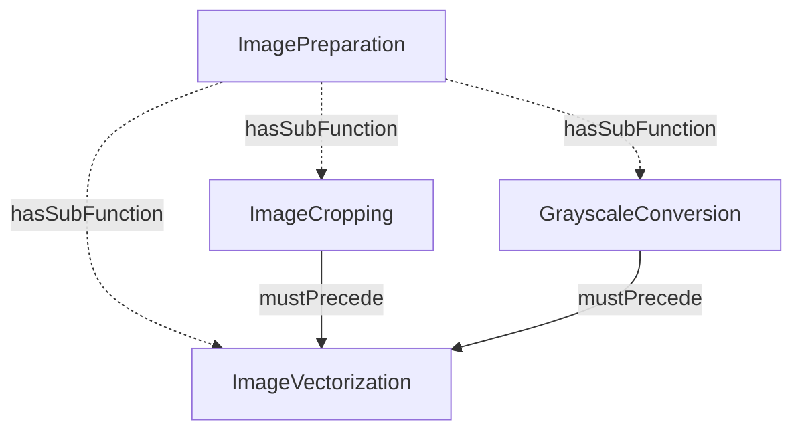

**Rappresentazione Turtle:**

```turtle
@prefix ddta: <https://w3id.org/ddta/core#> .
@prefix ex: <https://example.org/ddta/test#> .

ex:ImagePreparation
    a ddta:Function ;
    ddta:hasSubFunction
        ex:ImageCropping,
        ex:GrayscaleConversion,
        ex:ImageVectorization .

ex:ImageCropping
    a ddta:Function ;
    ddta:mustPrecede ex:ImageVectorization .

ex:GrayscaleConversion
    a ddta:Function ;
    ddta:mustPrecede ex:ImageVectorization .

ex:ImageVectorization
    a ddta:Function .
```

L'esempio soddisfa i controlli `FUN-02`, `FUN-04` e `FUN-05`: non presenta cicli di decomposizione o precedenza e le funzioni coinvolte nelle precedenze sono sottofunzioni dirette di `ImagePreparation`.

Un processo che realizza `ImagePreparation` può adottare l'ordine operativo:

`ImageCropping → GrayscaleConversion → ImageVectorization`

Anche l'ordine:

`GrayscaleConversion → ImageCropping → ImageVectorization`

rispetta i vincoli funzionali dichiarati.

La decomposizione delle funzioni non impone che il processo contenga un numero corrispondente di Step.

La verifica che tutti i percorsi del processo rispettino le precedenze richiede un controllo del flusso operativo distinto dai vincoli SHACL sulla struttura funzionale.

Le dichiarazioni dell'esempio sono separate dall'ontologia CORE e non contribuiscono alla generazione del `core.ttl`.

---

## 4. Scheda ontologica — `Environment`

### 4.1 Identificazione e definizione

```yaml ddta-ontology
record: class
module: core
iri: ddta:Environment
status: approved
label:
  en: Environment
  it: Ambiente operativo
definition:
  en: >-
    An identifiable operational context that makes
    resources available to one or more systems.
    An environment is distinct from the systems
    associated with it and from their logical
    boundaries. Resource availability does not
    imply actual use or operational readiness.
  it: >-
    Un contesto operativo identificabile che rende
    disponibili risorse a uno o più sistemi.
    Un ambiente è distinto dai sistemi a esso
    associati e dai relativi confini logici.
    La disponibilità delle risorse non implica
    il loro utilizzo effettivo o la loro
    disponibilità operativa verificata.
```

Un `Environment` rappresenta il contesto operativo nel quale uno o più sistemi sono destinati a funzionare. Il medesimo ambiente può essere associato a sistemi differenti e un sistema può essere associato a più ambienti.

L'identità dell'ambiente è indipendente dall'identità dei sistemi che vi operano. Un ambiente può essere descritto senza affermare che i sistemi associati siano stati avviati o siano effettivamente in esecuzione.

### 4.2 Relazioni

```yaml ddta-ontology
record: object-properties
module: core
owner: ddta:Environment
properties:
  - iri: ddta:makesAvailable
    status: approved
    domain: ddta:Environment
    range: ddta:Resource
    label:
      en: makes available
      it: rende disponibile
    definition:
      en: >-
        Relates an environment to a resource
        made available within its operational
        context, without asserting actual use,
        ownership or operational readiness.
      it: >-
        Collega un ambiente a una risorsa resa
        disponibile nel suo contesto operativo,
        senza affermarne l'utilizzo effettivo,
        la proprietà o la disponibilità
        operativa verificata.
```

**Lettura delle relazioni.**

`makesAvailable` collega un `Environment` alle risorse che esso rende disponibili. La relazione esprime la disponibilità nel contesto operativo, senza implicare che un particolare `System` utilizzi effettivamente tali risorse.

La disponibilità non implica proprietà, installazione, contenimento fisico o funzionamento verificato. Una stessa `Resource` può essere resa disponibile da più ambienti, purché rappresenti la medesima entità logica. Risorse o installazioni differenti sono rappresentate mediante individui distinti.

La relazione `hasOperationalEnvironment`, definita nella scheda `System`, associa un sistema al proprio ambiente operativo. La navigazione inversa permette di individuare i sistemi associati a un ambiente senza introdurre una proprietà inversa aggiuntiva.

`Environment` e `Boundary` rappresentano concetti distinti. L'ambiente descrive il contesto operativo e la disponibilità delle risorse, mentre il `Boundary` identifica il confine logico che racchiude un sistema. La condivisione dello stesso ambiente non determina automaticamente l'appartenenza allo stesso confine.


### 4.3 Interrogazioni SPARQL

Le interrogazioni SPARQL recuperano le risorse rese disponibili da un ambiente e i sistemi a esso associati.

Le query utilizzano `ex:ExampleEnvironment` come individuo di esempio.

#### Q-ENV-01 — Risorse disponibili

**Scopo:** recuperare le risorse rese disponibili dall'ambiente.

```sparql
PREFIX ddta: <https://w3id.org/ddta/core#>
PREFIX ex: <https://example.org/ddta/test#>

SELECT DISTINCT ?resource
WHERE {
    ex:ExampleEnvironment
        ddta:makesAvailable ?resource .
}
```

#### Q-ENV-02 — Sistemi associati all'ambiente

**Scopo:** recuperare i sistemi che dichiarano l'ambiente come proprio contesto operativo.

```sparql
PREFIX ddta: <https://w3id.org/ddta/core#>
PREFIX ex: <https://example.org/ddta/test#>

SELECT DISTINCT ?system
WHERE {
    ?system
        ddta:hasOperationalEnvironment
        ex:ExampleEnvironment .
}
```

#### Q-ENV-03 — Risorse e ambienti che le rendono disponibili

**Scopo:** recuperare, per ciascuna risorsa dell'ambiente interrogato, gli altri ambienti che rendono disponibile la stessa risorsa.

```sparql
PREFIX ddta: <https://w3id.org/ddta/core#>
PREFIX ex: <https://example.org/ddta/test#>

SELECT DISTINCT ?resource ?environment
WHERE {
    ex:ExampleEnvironment
        ddta:makesAvailable ?resource .

    ?environment
        ddta:makesAvailable ?resource .
}
```

Il risultato comprende anche l'ambiente interrogato. L'identità della risorsa è determinata dall'individuo RDF utilizzato, senza dedurre automaticamente che risorse con nomi uguali siano identiche.

#### Interpretazione dei risultati

Le query restituiscono le relazioni disponibili nel grafo RDF interrogato.

Una risorsa restituita tramite `makesAvailable` è dichiarata disponibile nell'ambiente, ma il risultato non dimostra che un sistema la utilizzi o che essa sia operativamente pronta.

La presenza di più sistemi associati allo stesso ambiente non implica che condividano tutte le risorse, che comunichino tra loro o che appartengano allo stesso `Boundary`.

### 4.4 Vincoli di completezza e coerenza documentale

#### Cardinalità

| Relazione | Cardinalità | Stato |
|---|---|---|
| Risorse rese disponibili tramite `makesAvailable` | `0..*` | Facoltativo |
| Sistemi associati all'ambiente | `0..*` | Nessun vincolo di presenza |

Un ambiente può essere dichiarato anche senza specificare risorse disponibili o sistemi associati.

#### Controllo SHACL

| ID | Controllo |
|---|---|
| `ENV-01` | Gli oggetti collegati mediante `makesAvailable` appartengono alla classe `Resource` |

**Dichiarazione strutturata per la generazione SHACL:**

```yaml ontology-validation
kind: OntologyValidation
target: ddta:Environment
engine: SHACL

constraints:
  - id: ENV-01
    type: property-class
    properties:
      - path: ddta:makesAvailable
        class: ddta:Resource
```

#### Shape SHACL risultante

```turtle
@prefix ddta: <https://w3id.org/ddta/core#> .
@prefix sh: <http://www.w3.org/ns/shacl#> .

ddta:EnvironmentShape
    a sh:NodeShape ;
    sh:targetClass ddta:Environment ;

    sh:property [
        sh:path ddta:makesAvailable ;
        sh:class ddta:Resource ;
        sh:message
            "Resources made available by an environment must be classified as Resource."@en
    ] .
```

Il controllo `ENV-01` verifica il tipo delle entità collegate mediante `makesAvailable`. Non impone la presenza di almeno una risorsa.

La validazione è effettuata sul grafo documentale, tenendo conto delle dichiarazioni di tipo e delle eventuali inferenze disponibili durante il controllo.

### 4.5 Esempio illustrativo (escluso dal TTL generato)

L'esempio rappresenta due sistemi associati allo stesso ambiente operativo. L'ambiente rende disponibile una risorsa, senza implicare che entrambi i sistemi la utilizzino.

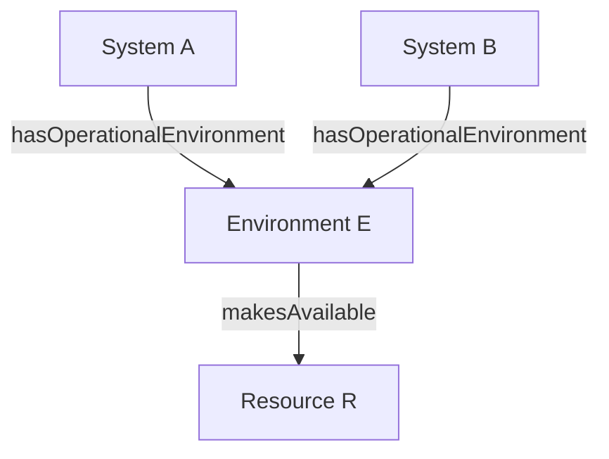

**Rappresentazione Turtle:**

```turtle
@prefix ddta: <https://w3id.org/ddta/core#> .
@prefix ex: <https://example.org/ddta/test#> .

ex:SystemA
    a ddta:System ;
    ddta:hasOperationalEnvironment
        ex:EnvironmentE .

ex:SystemB
    a ddta:System ;
    ddta:hasOperationalEnvironment
        ex:EnvironmentE .

ex:EnvironmentE
    a ddta:Environment ;
    ddta:makesAvailable ex:ResourceR .

ex:ResourceR
    a ddta:Resource .
```

L'esempio soddisfa il controllo `ENV-01`, poiché l'entità collegata mediante `makesAvailable` è dichiarata come individuo di `Resource`.

La disponibilità di `ResourceR` non implica che `SystemA` e `SystemB` utilizzino entrambi la risorsa. Non vengono inoltre dichiarate relazioni di proprietà, contenimento o appartenenza a un `Boundary`.

Le dichiarazioni dell'esempio sono separate da quelle dell'ontologia CORE e non contribuiscono alla generazione del `core.ttl`.

---


## 5. Scheda ontologica — `Resource`

### 5.1 Identificazione e definizione

```yaml ddta-ontology
record: class
module: core
iri: ddta:Resource
status: approved
label:
  en: Resource
  it: Risorsa
definition:
  en: >-
    An identifiable entity that can be made available
    by an environment to support the functions and
    realizations of one or more systems. A resource
    is not necessarily a physical or software component,
    and its availability does not imply actual use,
    ownership or operational readiness.
  it: >-
    Un'entità identificabile che può essere resa
    disponibile da un ambiente per supportare le
    funzioni e le realizzazioni di uno o più sistemi.
    Una risorsa non è necessariamente un componente
    fisico o software e la sua disponibilità non
    implica utilizzo effettivo, proprietà o
    funzionamento verificato.
```

Una `Resource` rappresenta un'entità utilizzabile nell'ambito di un contesto operativo. La classe comprende risorse fisiche, software, informative e logiche, senza imporre una specifica classificazione tecnologica.

L'identità di una risorsa è distinta dall'identità dell'ambiente che la rende disponibile. La stessa risorsa può essere associata a più ambienti quando si tratta della medesima entità identificabile. Copie o installazioni distinte sono rappresentate mediante individui distinti.

`Store` è una specializzazione di `Resource`, formalizzata mediante `rdfs:subClassOf` nella relativa scheda ontologica.

### 5.2 Relazioni

`Resource` non introduce Object Properties proprie.

La disponibilità delle risorse è rappresentata mediante la proprietà `makesAvailable`, definita nella scheda `Environment`:

`Environment → makesAvailable → Resource`

La navigazione inversa permette di individuare gli ambienti che rendono disponibile una risorsa senza introdurre una seconda proprietà OWL.

**Lettura delle relazioni.**

La presenza di `makesAvailable` indica che la risorsa è dichiarata disponibile nel contesto dell'ambiente associato.

La relazione non implica che uno specifico `System` utilizzi la risorsa, che ne sia proprietario o che la risorsa sia effettivamente operativa.

L'appartenenza alla classe `Resource` non richiede che la risorsa sia già collegata a un `Environment`.

La specializzazione `Store rdfs:subClassOf Resource` consente di classificare ogni individuo di `Store` anche come `Resource`.

### 5.3 Interrogazioni SPARQL

Le interrogazioni SPARQL recuperano gli ambienti che rendono disponibile una risorsa e le eventuali classificazioni ontologiche associate.

Le query utilizzano `ex:ExampleResource` come individuo di esempio.

#### Q-RES-01 — Ambienti che rendono disponibile la risorsa

**Scopo:** recuperare gli ambienti che dichiarano disponibile la risorsa.

```sparql
PREFIX ddta: <https://w3id.org/ddta/core#>
PREFIX ex: <https://example.org/ddta/test#>

SELECT DISTINCT ?environment
WHERE {
    ?environment
        ddta:makesAvailable ex:ExampleResource .
}
```

#### Q-RES-02 — Classificazioni della risorsa

**Scopo:** recuperare i tipi RDF dichiarati per la risorsa.

```sparql
PREFIX rdf: <http://www.w3.org/1999/02/22-rdf-syntax-ns#>
PREFIX ex: <https://example.org/ddta/test#>

SELECT DISTINCT ?type
WHERE {
    ex:ExampleResource rdf:type ?type .
}
```

Il risultato comprende i tipi esplicitamente dichiarati e gli eventuali tipi inferiti disponibili nel grafo interrogato.

#### Q-RES-03 — Risorse classificate come Store

**Scopo:** recuperare le risorse classificate come `Store`.

```sparql
PREFIX ddta: <https://w3id.org/ddta/core#>

SELECT DISTINCT ?resource
WHERE {
    ?resource a ddta:Store .
}
```

In presenza dell'assioma `Store rdfs:subClassOf Resource`, ogni individuo di `Store` appartiene anche alla classe `Resource`. La query recupera gli individui classificati come `Store` nel grafo interrogato.

#### Interpretazione dei risultati

Le query restituiscono le informazioni disponibili nel grafo RDF.

L'assenza di ambienti associati non implica che la risorsa non possa essere utilizzata, ma indica che non è presente una corrispondente relazione `makesAvailable` nel grafo interrogato.

Le classificazioni RDF descrivono l'identità ontologica della risorsa e non costituiscono una verifica della sua disponibilità operativa.

### 5.4 Vincoli di completezza e coerenza documentale

#### Cardinalità

| Controllo | Cardinalità | Stato |
|---|---|---|
| Ambienti che rendono disponibile la risorsa | `0..*` | Facoltativo |
| Specializzazioni ontologiche della risorsa | `0..*` | Facoltativo |
| Sistemi che utilizzano la risorsa | Non definita | Nessun vincolo di presenza |

Una `Resource` può essere dichiarata senza specificare un ambiente che la renda disponibile, senza associarla a un sistema e senza attribuirle una sottoclasse specializzata.

#### Controlli SHACL

Non sono definiti controlli SHACL specifici per la classe `Resource`.

Il controllo sul tipo degli oggetti di `makesAvailable` è definito nella scheda `Environment` mediante `ENV-01`.

Non viene generato uno `sh:NodeShape` specifico per `Resource`.

### 5.5 Esempio illustrativo (escluso dal TTL generato)

L'esempio rappresenta una risorsa di archiviazione resa disponibile da un ambiente operativo.

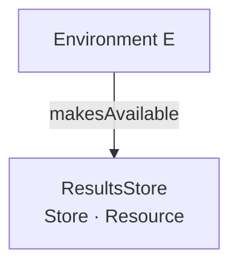

**Rappresentazione Turtle:**

```turtle
@prefix ddta: <https://w3id.org/ddta/core#> .
@prefix ex: <https://example.org/ddta/test#> .

ex:EnvironmentE
    a ddta:Environment ;
    ddta:makesAvailable ex:ResultsStore .

ex:ResultsStore
    a ddta:Store .
```

Poiché `Store` è sottoclasse di `Resource`, un reasoner può inferire:

```turtle
ex:ResultsStore a ddta:Resource .
```

L'esempio non dichiara quali sistemi utilizzino `ResultsStore`, né specifica la tecnologia di archiviazione, la persistenza dei dati o la disponibilità operativa verificata.

Le dichiarazioni dell'esempio sono separate dall'ontologia CORE e non contribuiscono alla generazione del `core.ttl`.


---


## 6. Espansione del micro-CORE

Il micro-CORE DDTA comprende quattro classi fondamentali: `System`, `Function`, `Environment` e `Resource`. Le schede 2–5 ne definiscono identità, relazioni e vincoli.

L'espansione introduce i contratti funzionali, la rappresentazione logica della memorizzazione, i confini, la comunicazione e i processi. **Le definizioni normative sono i blocchi `yaml ddta-ontology` delle singole schede.** Le query SPARQL, gli Shape SHACL illustrativi e gli esempi Turtle/Mermaid non introducono ulteriori dichiarazioni nell'ontologia CORE.

### 6.1 Classi dell'espansione

| Sezione | Classe | Relazione con il modello |
|---|---|---|
| 7 | `Contract` | Vincoli su ingressi e uscite di `Function` |
| 8 | `ContractElement` | Elementi descrittivi del `Contract` |
| 9 | `Store` | Sottoclasse di `Resource`; memorizzazione logica |
| 10 | `StoredContent` | Contenuto identificabile, distinto da `Store` |
| 11 | `Boundary` | Confine associato a un `System`, che racchiude `Resource` |
| 12 | `CommunicationFunction` | Sottoclasse di `Function` |
| 13 | `CommunicationChannel` | Sottoclasse di `Resource`; collegamento direzionale |
| 14 | `Process` | Organizzazione operativa che realizza `Function` |
| 15 | `ProcessStep` | Attività del flusso appartenente a un `Process` |

### 6.2 Rappresentazione delle relazioni principali

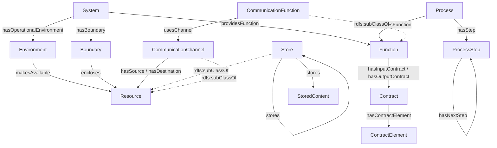

Il diagramma è una vista di sintesi delle relazioni, non un sostituto delle definizioni delle singole schede. Per chiarezza non mostra tutte le proprietà, incluse `hasPrimaryFunction`, `hasSupportFunction`, `hasSubFunction`, `mustPrecede`, `minOccurs` e `maxOccurs`.

### 6.3 Estensibilità e limiti deliberati

Il CORE definisce identità e relazioni generali. Le ontologie specializzate possono importarlo e arricchire le **medesime entità**, senza richiederne la duplicazione.

Un'ontologia dei processi potrà specificare guardie, condizioni di attivazione, alternative, parallelismo e sincronizzazione. Il CORE rappresenta gli Step e i collegamenti `hasNextStep`, ma **non stabilisce** se due rami vadano eseguiti alternativamente o in parallelo, né definisce la semantica delle attese o delle condizioni di avvio.

Ontologie dedicate allo storage, all'AI e alla sicurezza potranno descrivere proprietà specialistiche, vincoli e verifiche. Il CORE non deduce automaticamente requisiti di sicurezza dall'appartenenza a un `Boundary` o dalla realizzazione di una `Function`.

### 6.4 Organizzazione delle schede

Le sezioni 7–13 completano il livello logico; le sezioni 14–15 descrivono il livello operativo di base. Gli esempi integrativi nelle sezioni successive mostrano come utilizzare le definizioni senza introdurre ulteriori classi o proprietà del CORE.

---

## 7. Scheda ontologica — `Contract`

### 7.1 Identificazione e definizione

```yaml ddta-ontology
record: class
module: core
iri: ddta:Contract
status: approved
label:
  en: Contract
  it: Contratto
definition:
  en: >-
    An identifiable specification of requirements
    and constraints applicable to the inputs or
    expected outputs of a Function. A contract
    defines the conditions that a conforming
    realization of the function must satisfy,
    independently of the processes and technologies
    used to realize it.
  it: >-
    Una specifica identificabile di requisiti e
    vincoli applicabili agli ingressi o alle uscite
    attese di una Function. Un contratto definisce
    le condizioni che una realizzazione conforme
    della funzione deve rispettare, indipendentemente
    dai processi e dalle tecnologie utilizzati
    per realizzarla.
```

Un `Contract` specifica i requisiti e i vincoli relativi agli ingressi o alle uscite attese di una `Function`.

I contratti di ingresso e di uscita sono collegati alla funzione rispettivamente mediante `hasInputContract` e `hasOutputContract`.

Un contratto può definire la struttura del contenuto, le cardinalità degli elementi, le condizioni e i requisiti comportamentali applicabili agli ingressi o alle uscite.

Il contratto appartiene alla specifica logica della funzione e non descrive i dati concretamente elaborati, il formato di serializzazione o il protocollo utilizzato.

Processi differenti possono realizzare la stessa funzione, purché rispettino i contratti applicabili. La dichiarazione `realizesFunction` non costituisce, da sola, una prova di conformità.

La stessa istanza di `Contract` può essere utilizzata da più funzioni quando queste condividono i medesimi requisiti contrattuali.

`Contract` non è una sottoclasse di `Resource`: la specifica dei requisiti è distinta dalle risorse utilizzate per rappresentarla o conservarla.

### 7.2 Relazioni

```yaml ddta-ontology
record: object-properties
module: core
owner: ddta:Contract
properties:
  - iri: ddta:hasContractElement
    status: approved
    domain: ddta:Contract
    range: ddta:ContractElement
    label:
      en: has contract element
      it: ha un elemento contrattuale
    definition:
      en: >-
        Relates a contract to an identifiable
        element specifying a requirement or
        constraint of that contract.
      it: >-
        Collega un contratto a un elemento
        identificabile che specifica un requisito
        o vincolo del contratto.
```

**Lettura delle relazioni.**

`hasContractElement` rappresenta la composizione di un `Contract` mediante elementi contrattuali identificabili.

Un `ContractElement` specifica un requisito o vincolo relativo agli ingressi o alle uscite descritti dal contratto. Può definire elementi obbligatori, facoltativi o ripetibili, secondo le cardinalità e le condizioni applicabili.

La presenza di `hasContractElement` non implica che il relativo elemento sia stato concretamente ricevuto, elaborato o prodotto.

Un contratto può specificare condizioni o requisiti comportamentali senza necessariamente essere composto da `ContractElement`. La composizione mediante elementi è pertanto facoltativa.

Le relazioni `hasInputContract` e `hasOutputContract`, definite nella scheda `Function`, collegano una funzione ai contratti che specificano rispettivamente i requisiti sugli ingressi e sulle uscite attese.

La stessa istanza di `Contract` può essere associata a più funzioni mediante tali relazioni.

La composizione contrattuale è rappresentata mediante `hasContractElement`.

### 7.3 Interrogazioni SPARQL

Le interrogazioni SPARQL recuperano gli elementi che compongono un contratto e le funzioni alle quali esso è associato, distinguendo i contratti di ingresso da quelli di uscita.

Le query utilizzano `ex:ExampleContract` come individuo di esempio.

#### Q-CON-01 — Elementi del contratto

**Scopo:** recuperare gli elementi direttamente associati al contratto.

```sparql
PREFIX ddta: <https://w3id.org/ddta/core#>
PREFIX ex: <https://example.org/ddta/test#>

SELECT DISTINCT ?element
WHERE {
    ex:ExampleContract
        ddta:hasContractElement ?element .
}
```

#### Q-CON-02 — Funzioni associate al contratto in ingresso

**Scopo:** recuperare le funzioni per le quali il contratto specifica i requisiti di ingresso.

```sparql
PREFIX ddta: <https://w3id.org/ddta/core#>
PREFIX ex: <https://example.org/ddta/test#>

SELECT DISTINCT ?function
WHERE {
    ?function
        ddta:hasInputContract ex:ExampleContract .
}
```

#### Q-CON-03 — Funzioni associate al contratto in uscita

**Scopo:** recuperare le funzioni per le quali il contratto specifica i requisiti delle uscite attese.

```sparql
PREFIX ddta: <https://w3id.org/ddta/core#>
PREFIX ex: <https://example.org/ddta/test#>

SELECT DISTINCT ?function
WHERE {
    ?function
        ddta:hasOutputContract ex:ExampleContract .
}
```

#### Interpretazione dei risultati

Le query restituiscono le relazioni disponibili nel grafo RDF interrogato, comprese eventuali inferenze rese disponibili dal sistema di interrogazione.

`Q-CON-01` recupera gli elementi della specifica contrattuale, non le loro occorrenze nei dati concretamente elaborati.

`Q-CON-02` e `Q-CON-03` distinguono il ruolo del contratto rispetto alle funzioni associate. Una stessa istanza di `Contract` può comparire in entrambe le interrogazioni quando è utilizzata in ruoli differenti.

La presenza di una relazione contrattuale non dimostra che un processo o una sua implementazione soddisfi i requisiti del contratto.

### 7.4 Vincoli di completezza e coerenza documentale

#### Cardinalità

| Relazione | Cardinalità | Stato |
|---|---|---|
| Elementi associati mediante `hasContractElement` | `0..*` | Facoltativo |
| Funzioni che utilizzano il contratto in ingresso | `0..*` | Nessun vincolo di presenza |
| Funzioni che utilizzano il contratto in uscita | `0..*` | Nessun vincolo di presenza |

Un `Contract` può essere definito senza specificare elementi contrattuali, per esempio quando esprime condizioni o requisiti comportamentali applicabili agli ingressi o alle uscite di una funzione.

Non sono imposte cardinalità minime universali sulle relazioni inverse con `Function`.

#### Controlli SHACL

Non sono definiti controlli SHACL specifici per la classe `Contract`.

La proprietà `hasContractElement` è definita mediante:

- `rdfs:domain ddta:Contract`
- `rdfs:range ddta:ContractElement`

Gli assiomi RDFS/OWL consentono di inferire la classificazione dei soggetti e degli oggetti collegati mediante `hasContractElement`. Non costituiscono, da soli, controlli di validazione sulla presenza di dichiarazioni di tipo esplicite.

Non viene generato uno `sh:NodeShape` specifico per `Contract`.

Le verifiche sulle cardinalità e sui vincoli dei singoli elementi sono definite nella scheda `ContractElement`.

### 7.5 Esempio illustrativo (escluso dal TTL generato)

L'esempio rappresenta la funzione `ImagePreparation`, associata a un contratto di ingresso e a un contratto di uscita.

Il contratto di ingresso richiede un'immagine e ammette facoltativamente una regione di ritaglio. Il contratto di uscita richiede un'immagine preparata.

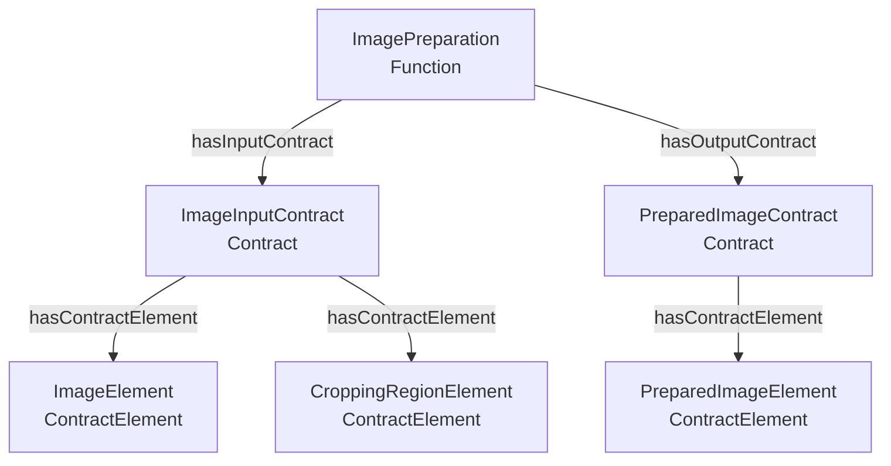

**Rappresentazione Turtle:**

```turtle
@prefix ddta: <https://w3id.org/ddta/core#> .
@prefix ex: <https://example.org/ddta/test#> .
@prefix xsd: <http://www.w3.org/2001/XMLSchema#> .

ex:ImagePreparation
    a ddta:Function ;
    ddta:hasInputContract ex:ImageInputContract ;
    ddta:hasOutputContract ex:PreparedImageContract .

ex:ImageInputContract
    a ddta:Contract ;
    ddta:hasContractElement
        ex:ImageElement,
        ex:CroppingRegionElement .

ex:PreparedImageContract
    a ddta:Contract ;
    ddta:hasContractElement ex:PreparedImageElement .

ex:ImageElement
    a ddta:ContractElement ;
    ddta:minOccurs 1 ;
    ddta:maxOccurs 1 .

ex:CroppingRegionElement
    a ddta:ContractElement ;
    ddta:minOccurs 0 ;
    ddta:maxOccurs 1 .

ex:PreparedImageElement
    a ddta:ContractElement ;
    ddta:minOccurs 1 ;
    ddta:maxOccurs 1 .
```

Le cardinalità dell'esempio specificano:

| Elemento | Cardinalità | Significato |
|---|---|---|
| `ImageElement` | `1..1` | Immagine obbligatoria |
| `CroppingRegionElement` | `0..1` | Regione di ritaglio facoltativa |
| `PreparedImageElement` | `1..1` | Immagine preparata obbligatoria |

I contratti descrivono i requisiti della funzione, non i dati concretamente ricevuti o prodotti.

Processi differenti possono realizzare `ImagePreparation` mediante modalità operative diverse, purché rispettino i contratti di ingresso e di uscita.

L'eventuale presenza di `CroppingRegionElement` nell'ingresso concreto deve rispettare i vincoli applicabili. La sua assenza è consentita dalla cardinalità dichiarata.

La presenza dei collegamenti contrattuali non dimostra, da sola, la conformità dei processi.

Le dichiarazioni dell'esempio sono separate da quelle dell'ontologia CORE e non contribuiscono alla generazione del `core.ttl`.

---


## 8. Scheda ontologica — `ContractElement`

### 8.1 Identificazione e definizione

```yaml ddta-ontology
record: class
module: core
iri: ddta:ContractElement
status: approved
label:
  en: Contract Element
  it: Elemento contrattuale
definition:
  en: >-
    An identifiable specification of an individual
    input or output element required or permitted
    by a Contract. It describes the requirement
    associated with the element, rather than
    a concrete value received or produced.
  it: >-
    Una specifica identificabile di un singolo
    elemento di ingresso o di uscita richiesto
    o ammesso da un Contract. Descrive il requisito
    associato all'elemento, anziché un valore
    concreto ricevuto o prodotto.
```

Un `ContractElement` rappresenta un elemento previsto dal contratto di ingresso o di uscita di una `Function`.

L'elemento descrive ciò che è richiesto o ammesso dalla specifica funzionale, senza rappresentare il valore concretamente ricevuto o prodotto durante l'esecuzione.

Ad esempio, un elemento `PatientBirthDate` può specificare la presenza della data di nascita del paziente, senza rappresentare una particolare data.

La stessa informazione può essere soggetta a requisiti differenti in contratti diversi. In questi casi, i requisiti sono rappresentati mediante individui distinti di `ContractElement`.

### 8.2 Proprietà e relazioni

#### Datatype Properties

```yaml ddta-ontology
record: datatype-properties
module: core
owner: ddta:ContractElement
properties:
  - iri: ddta:minOccurs
    status: approved
    domain: ddta:ContractElement
    range: xsd:nonNegativeInteger
    label:
      en: minimum occurrences
      it: occorrenze minime
    definition:
      en: >-
        Specifies the minimum number of occurrences
        required for an element by its contract.
      it: >-
        Specifica il numero minimo di occorrenze
        richieste per un elemento dal relativo
        contratto.

  - iri: ddta:maxOccurs
    status: approved
    domain: ddta:ContractElement
    range: xsd:nonNegativeInteger
    label:
      en: maximum occurrences
      it: occorrenze massime
    definition:
      en: >-
        Specifies the maximum number of occurrences
        permitted for an element by its contract.
      it: >-
        Specifica il numero massimo di occorrenze
        ammesse per un elemento dal relativo
        contratto.
```

**Lettura delle proprietà.**

`minOccurs` e `maxOccurs` specificano le cardinalità dell'elemento nel contratto.

Le cardinalità riguardano le occorrenze richieste o ammesse dalla specifica funzionale, non il numero di individui `ContractElement` presenti nel grafo RDF.

| `minOccurs` | `maxOccurs` | Significato |
|---|---|---|
| `0` | `1` | Elemento facoltativo, ammesso al massimo una volta |
| `1` | `1` | Elemento obbligatorio, esattamente una volta |
| `0` | `3` | Da zero a tre occorrenze |
| `1` | `3` | Da una a tre occorrenze |

L'obbligatorietà è espressa mediante `minOccurs` e non richiede una proprietà booleana aggiuntiva.

Quando una cardinalità non è dichiarata, il relativo limite non è specificato nella documentazione. L'assenza di `minOccurs` non equivale a dichiarare zero; l'assenza di `maxOccurs` non equivale a dichiarare un massimo illimitato.

#### Object Properties

`ContractElement` non introduce Object Properties proprie.

La relazione di appartenenza a un contratto è rappresentata mediante `hasContractElement`, definita nella scheda `Contract`:

`Contract → hasContractElement → ContractElement`

La navigazione inversa consente di individuare i contratti associati a un elemento senza introdurre una proprietà inversa aggiuntiva.

**Lettura delle relazioni.**

Un `ContractElement` è identificato indipendentemente dal contratto che lo utilizza, ma le sue cardinalità e i suoi vincoli appartengono alla specifica contrattuale rappresentata.

Quando due contratti richiedono la stessa informazione con cardinalità o condizioni differenti, utilizzano individui `ContractElement` distinti.

Lo stesso individuo può essere riutilizzato in più contratti quando rappresenta il medesimo requisito, con gli stessi vincoli.

### 8.3 Interrogazioni SPARQL

Le interrogazioni SPARQL recuperano i contratti associati a un elemento e le cardinalità dichiarate.

Le query utilizzano `ex:ExampleContractElement` come individuo di esempio.

#### Q-CEL-01 — Contratti associati all'elemento

**Scopo:** recuperare i contratti che comprendono l'elemento.

```sparql
PREFIX ddta: <https://w3id.org/ddta/core#>
PREFIX ex: <https://example.org/ddta/test#>

SELECT DISTINCT ?contract
WHERE {
    ?contract
        ddta:hasContractElement
        ex:ExampleContractElement .
}
```

#### Q-CEL-02 — Cardinalità dell'elemento

**Scopo:** recuperare le cardinalità minime e massime dichiarate per l'elemento.

```sparql
PREFIX ddta: <https://w3id.org/ddta/core#>
PREFIX ex: <https://example.org/ddta/test#>

SELECT ?minOccurs ?maxOccurs
WHERE {
    OPTIONAL {
        ex:ExampleContractElement
            ddta:minOccurs ?minOccurs .
    }

    OPTIONAL {
        ex:ExampleContractElement
            ddta:maxOccurs ?maxOccurs .
    }
}
```

#### Q-CEL-03 — Elementi e cardinalità di un contratto

**Scopo:** recuperare gli elementi di un contratto e le rispettive cardinalità dichiarate.

```sparql
PREFIX ddta: <https://w3id.org/ddta/core#>
PREFIX ex: <https://example.org/ddta/test#>

SELECT ?element ?minOccurs ?maxOccurs
WHERE {
    ex:ExampleContract
        ddta:hasContractElement ?element .

    OPTIONAL {
        ?element ddta:minOccurs ?minOccurs .
    }

    OPTIONAL {
        ?element ddta:maxOccurs ?maxOccurs .
    }
}
ORDER BY ?element
```

#### Interpretazione dei risultati

`Q-CEL-01` recupera i contratti che fanno riferimento all'elemento mediante `hasContractElement`.

`Q-CEL-02` restituisce i limiti dichiarati per l'elemento. Una variabile non valorizzata indica che il corrispondente limite non è specificato nel grafo interrogato.

`Q-CEL-03` consente di esaminare gli elementi di un contratto insieme alle rispettive cardinalità.

Le interrogazioni descrivono la specifica contrattuale. Non verificano il numero di occorrenze effettivamente presenti nei dati ricevuti o prodotti da un processo.

### 8.4 Vincoli di completezza e coerenza documentale

#### Cardinalità

| Proprietà o relazione | Cardinalità | Stato |
|---|---|---|
| `minOccurs` | `0..1` | Facoltativo |
| `maxOccurs` | `0..1` | Facoltativo |
| Contratti associati mediante `hasContractElement` | `0..*` | Nessun vincolo di presenza |

Un `ContractElement` può essere dichiarato senza specificare immediatamente tutte le sue cardinalità.

Quando entrambe le cardinalità sono presenti, il valore minimo non deve superare il massimo.

#### Controlli SHACL

| ID | Controllo |
|---|---|
| `CEL-01` | `minOccurs` non deve essere maggiore di `maxOccurs` quando entrambi sono dichiarati |

Il controllo riguarda la coerenza dei valori della specifica contrattuale.

Il tipo `xsd:nonNegativeInteger` è già indicato nel range delle due Datatype Properties. Non viene aggiunto un controllo SHACL che ripeta sistematicamente il range dichiarato nell'ontologia.

#### Dichiarazione strutturata per la generazione SHACL

```yaml ontology-validation
kind: OntologyValidation
target: ddta:ContractElement
engine: SHACL

constraints:
  - id: CEL-01
    type: sparql
    message:
      en: >-
        Minimum occurrences must not exceed
        maximum occurrences.
      it: >-
        Il numero minimo di occorrenze non deve
        superare il numero massimo.
    select: |-
      PREFIX ddta: <https://w3id.org/ddta/core#>
      SELECT $this
      WHERE {
        $this ddta:minOccurs ?min .
        $this ddta:maxOccurs ?max .
        FILTER(?min > ?max)
      }
```

#### Shape SHACL risultante

La dichiarazione strutturata produce il seguente Shape, rappresentato in Turtle.

```turtle
@prefix ddta: <https://w3id.org/ddta/core#> .
@prefix sh: <http://www.w3.org/ns/shacl#> .

ddta:ContractElementShape
    a sh:NodeShape ;
    sh:targetClass ddta:ContractElement ;

    sh:sparql [
        sh:message
            "Minimum occurrences must not exceed maximum occurrences."@en ;
        sh:select """
            PREFIX ddta: <https://w3id.org/ddta/core#>
            SELECT $this
            WHERE {
                $this ddta:minOccurs ?min .
                $this ddta:maxOccurs ?max .
                FILTER(?min > ?max)
            }
        """
    ] .
```

Il controllo `CEL-01` identifica gli elementi per i quali è dichiarato un minimo maggiore del massimo.

Se uno dei due valori non è presente, il confronto non viene effettuato.

Lo Shape è generato dalla dichiarazione strutturata e appartiene al grafo SHACL separato, non al `core.ttl` dell'ontologia OWL.

### 8.5 Esempio illustrativo (escluso dal TTL generato)

L'esempio considera due contratti di ingresso che richiedono informazioni relative a un'immagine. Nel primo contratto la regione di ritaglio è facoltativa; nel secondo è obbligatoria. I requisiti sono rappresentati da individui `ContractElement` distinti.

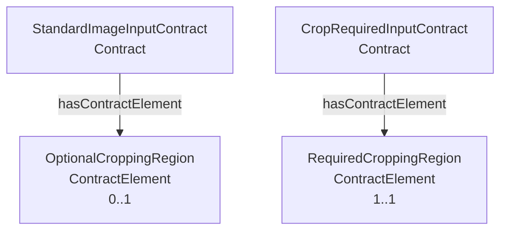

**Rappresentazione Turtle:**

```turtle
@prefix ddta: <https://w3id.org/ddta/core#> .
@prefix ex: <https://example.org/ddta/test#> .
@prefix xsd: <http://www.w3.org/2001/XMLSchema#> .

ex:StandardImageInputContract
    a ddta:Contract ;
    ddta:hasContractElement ex:OptionalCroppingRegion .

ex:CropRequiredInputContract
    a ddta:Contract ;
    ddta:hasContractElement ex:RequiredCroppingRegion .

ex:OptionalCroppingRegion
    a ddta:ContractElement ;
    ddta:minOccurs "0"^^xsd:nonNegativeInteger ;
    ddta:maxOccurs "1"^^xsd:nonNegativeInteger .

ex:RequiredCroppingRegion
    a ddta:ContractElement ;
    ddta:minOccurs "1"^^xsd:nonNegativeInteger ;
    ddta:maxOccurs "1"^^xsd:nonNegativeInteger .
```

Entrambi gli elementi descrivono una regione di ritaglio, ma impongono requisiti differenti. L'esempio non modella alcun valore concreto della regione, né richiede di definire un tipo tecnico per rappresentarla.

Le cardinalità dichiarate sono coerenti e soddisfano il controllo `CEL-01`.

Le dichiarazioni dell'esempio sono separate da quelle dell'ontologia CORE e non contribuiscono alla generazione del `core.ttl`.


---

## 9. Scheda ontologica — `Store`

### 9.1 Identificazione e definizione

```yaml ddta-ontology
record: class
module: core
iri: ddta:Store
status: approved
subClassOf: ddta:Resource
label:
  en: Store
  it: Deposito logico
definition:
  en: >-
    An identifiable logical storage entity that
    can hold other stores or stored content.
    A store is independent of the underlying
    storage technology and does not imply
    persistence or a dedicated physical device.
  it: >-
    Un'entità di memorizzazione logica identificabile
    che può contenere altri depositi o contenuti
    memorizzati. Uno Store è indipendente dalla
    tecnologia di memorizzazione sottostante e
    non implica persistenza né un dispositivo
    fisico dedicato.
```

`Store` rappresenta un deposito logico nel quale possono essere conservati contenuti identificabili.

La classe è una specializzazione di `Resource`, mediante `rdfs:subClassOf`. Ogni individuo di `Store` appartiene quindi anche alla classe `Resource`.

Uno `Store` può contenere altri Store logici, permettendo di rappresentare strutture di memorizzazione annidate.

L'identità dello Store è indipendente dalla tecnologia utilizzata. Store differenti possono condividere lo stesso dispositivo fisico, mentre uno Store logico può essere realizzato utilizzando più risorse tecniche.

La definizione non impone una particolare tecnologia, né distingue memorizzazione persistente e volatile. Tali caratteristiche possono essere specificate mediante ontologie specializzate.

### 9.2 Relazioni

```yaml ddta-ontology
record: object-properties
module: core
owner: ddta:Store
properties:
  - iri: ddta:stores
    status: approved
    domain: ddta:Store
    range:
      unionOf:
        - ddta:Store
        - ddta:StoredContent
    label:
      en: stores
      it: memorizza
    definition:
      en: >-
        Relates a store to another store or to
        identifiable content directly held within
        its logical storage structure.
      it: >-
        Collega uno Store a un altro Store oppure
        a un contenuto identificabile conservato
        direttamente nella sua struttura di
        memorizzazione logica.
```

**Lettura delle relazioni.**

`stores` rappresenta il contenimento diretto all'interno della struttura logica di memorizzazione.

La proprietà può collegare:

- uno `Store` a un altro `Store`;
- uno `Store` a uno `StoredContent`.

La relazione non rappresenta un'operazione di scrittura o lettura, né un evento di trasferimento.

Il dominio della proprietà è `Store`, mentre il range è l'unione delle classi `Store` e `StoredContent`.

L'unione è espressa mediante `owl:unionOf`, senza introdurre una nuova classe nominata.

#### Annidamento degli Store

Uno Store può contenere altri Store, permettendo di organizzare logicamente i contenuti su più livelli.

Ad esempio:

`StoreA → stores → ClinicalImagesStore → stores → Image001`

La relazione `stores` non è dichiarata transitiva. Di conseguenza, dall'esistenza dei due collegamenti non viene inferita automaticamente la relazione diretta:

`StoreA → stores → Image001`

La struttura completa può comunque essere percorsa mediante query SPARQL che utilizzano il property path `stores+`.

Uno Store annidato conserva la propria identità. La relazione di contenimento non implica che gli Store coinvolti utilizzino dispositivi fisici differenti.

#### Collegamento con Environment

La relazione `makesAvailable`, definita nella scheda `Environment`, permette di dichiarare uno Store come risorsa disponibile in un ambiente operativo.

`Environment → makesAvailable → Store`

La disponibilità dello Store non implica che uno specifico sistema lo utilizzi effettivamente.

#### Distinzione dalle funzioni

`Store` rappresenta una risorsa, non una capacità funzionale.

Le operazioni di lettura, scrittura e gestione dei contenuti appartengono alle funzioni e ai processi che utilizzano lo Store.

#### Proprietà di sicurezza

Le proprietà di sicurezza applicabili a uno Store non sono automaticamente attribuite agli Store o ai contenuti annidati.

Ad esempio, un requisito di crittografia associato a uno Store non dimostra, da solo, che ogni suo contenuto sia effettivamente crittografato.

La rappresentazione dei requisiti di protezione, dei meccanismi adottati e del loro ambito di applicazione appartiene alle ontologie specializzate.

### 9.3 Interrogazioni SPARQL

Le interrogazioni SPARQL recuperano gli Store e i contenuti direttamente conservati, la struttura di memorizzazione annidata e gli ambienti che rendono disponibile uno Store.

Le query utilizzano `ex:ExampleStore` come individuo di esempio.

#### Q-STO-01 — Store direttamente contenuti

**Scopo:** recuperare gli Store direttamente contenuti nello Store interrogato.

```sparql
PREFIX ddta: <https://w3id.org/ddta/core#>
PREFIX ex: <https://example.org/ddta/test#>

SELECT DISTINCT ?store
WHERE {
    ex:ExampleStore ddta:stores ?store .
    ?store a ddta:Store .
}
```

La query recupera gli Store direttamente collegati, senza attraversare ulteriori livelli di annidamento.

#### Q-STO-02 — Contenuti direttamente memorizzati

**Scopo:** recuperare i contenuti direttamente conservati nello Store interrogato.

```sparql
PREFIX ddta: <https://w3id.org/ddta/core#>
PREFIX ex: <https://example.org/ddta/test#>

SELECT DISTINCT ?content
WHERE {
    ex:ExampleStore ddta:stores ?content .
    ?content a ddta:StoredContent .
}
```

La query distingue i contenuti identificabili dagli Store logici annidati.

#### Q-STO-03 — Struttura completa dello Store

**Scopo:** recuperare gli Store e i contenuti raggiungibili attraverso uno o più livelli di memorizzazione.

```sparql
PREFIX ddta: <https://w3id.org/ddta/core#>
PREFIX ex: <https://example.org/ddta/test#>

SELECT DISTINCT ?element
WHERE {
    ex:ExampleStore ddta:stores+ ?element .
}
```

Il property path `stores+` permette di attraversare ricorsivamente la struttura senza dichiarare transitiva la proprietà OWL.

La query recupera sia gli Store annidati sia i contenuti identificabili raggiungibili.

#### Q-STO-04 — Store contenitori

**Scopo:** recuperare gli Store che contengono direttamente lo Store interrogato.

```sparql
PREFIX ddta: <https://w3id.org/ddta/core#>
PREFIX ex: <https://example.org/ddta/test#>

SELECT DISTINCT ?parentStore
WHERE {
    ?parentStore ddta:stores ex:ExampleStore .
}
```

La query utilizza la relazione `stores` in direzione inversa, senza richiedere una proprietà OWL aggiuntiva.

#### Q-STO-05 — Ambienti che rendono disponibile lo Store

**Scopo:** recuperare gli ambienti operativi che dichiarano disponibile lo Store.

```sparql
PREFIX ddta: <https://w3id.org/ddta/core#>
PREFIX ex: <https://example.org/ddta/test#>

SELECT DISTINCT ?environment
WHERE {
    ?environment
        ddta:makesAvailable ex:ExampleStore .
}
```

#### Interpretazione dei risultati

Le query restituiscono le relazioni disponibili nel grafo RDF interrogato, comprese eventuali inferenze rese disponibili dal sistema di interrogazione.

`Q-STO-01` e `Q-STO-02` distinguono gli Store logici annidati dai contenuti direttamente conservati.

`Q-STO-03` recupera l'intera struttura raggiungibile mediante `stores`, senza introdurre nuove relazioni dirette tra lo Store iniziale e i contenuti indiretti.

`Q-STO-04` identifica gli Store contenitori, mentre `Q-STO-05` individua gli ambienti che rendono disponibile lo Store.

Le interrogazioni descrivono la struttura logica dichiarata. Non dimostrano la presenza fisica dei contenuti, l'effettivo funzionamento del deposito o l'applicazione di misure di sicurezza.

### 9.4 Vincoli di completezza e coerenza documentale

#### Cardinalità

| Relazione | Cardinalità | Stato |
|---|---|---|
| Store direttamente contenuti mediante `stores` | `0..*` | Facoltativo |
| Contenuti direttamente memorizzati mediante `stores` | `0..*` | Facoltativo |
| Store contenitori | `0..*` | Nessun vincolo di presenza |
| Ambienti che rendono disponibile lo Store | `0..*` | Nessun vincolo di presenza |

Uno `Store` può essere dichiarato senza specificare immediatamente i propri contenuti o altri Store annidati.

Non è obbligatorio che uno Store sia contenuto in un altro Store.

Non sono imposte cardinalità minime universali.

#### Controlli SHACL

Non sono definiti controlli SHACL specifici per la classe `Store`.

La proprietà `stores` è definita mediante:

- `rdfs:domain ddta:Store`;
- `rdfs:range` espresso come unione OWL di `ddta:Store` e `ddta:StoredContent`.

Gli assiomi RDFS/OWL descrivono la semantica della proprietà e consentono le relative inferenze di classificazione. Non costituiscono, da soli, controlli sulla presenza di dichiarazioni di tipo esplicite.

Non viene generato uno `sh:NodeShape` specifico per `Store`.

### 9.5 Esempio illustrativo (escluso dal TTL generato)

L'esempio rappresenta uno Store logico generale che contiene due Store specializzati nell'organizzazione dei contenuti: uno dedicato alle immagini cliniche e uno ai modelli AI.

Entrambi possono utilizzare lo stesso dispositivo fisico, senza che tale dispositivo debba essere rappresentato nel modello logico.

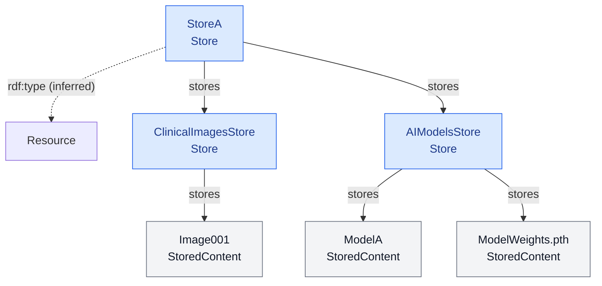

**Rappresentazione Turtle:**

```turtle
@prefix ddta: <https://w3id.org/ddta/core#> .
@prefix ex: <https://example.org/ddta/test#> .

ex:StoreA
    a ddta:Store ;
    ddta:stores
        ex:ClinicalImagesStore,
        ex:AIModelsStore .

ex:ClinicalImagesStore
    a ddta:Store ;
    ddta:stores ex:Image001 .

ex:AIModelsStore
    a ddta:Store ;
    ddta:stores
        ex:ModelA,
        ex:ModelWeights .

ex:Image001
    a ddta:StoredContent .

ex:ModelA
    a ddta:StoredContent .

ex:ModelWeights
    a ddta:StoredContent .
```

Poiché `Store` è sottoclasse di `Resource`, un reasoner può inferire:

```turtle
ex:StoreA a ddta:Resource .
ex:ClinicalImagesStore a ddta:Resource .
ex:AIModelsStore a ddta:Resource .
```

Il modello identifica due Store logici annidati e tre contenuti specifici.

La presenza di `ModelWeights` permette di identificare il file dei pesi come elemento distinto, ad esempio per analizzare una sua modifica non autorizzata.

L'esempio non specifica il formato dei file, il dispositivo fisico utilizzato, la persistenza della memorizzazione o i meccanismi di protezione applicati.

La struttura logica consente di distinguere i requisiti riferiti allo Store complessivo, ai singoli Store annidati e ai contenuti identificabili.

Le dichiarazioni dell'esempio sono separate da quelle dell'ontologia CORE e non contribuiscono alla generazione del `core.ttl`.

---

## 10. Scheda ontologica — `StoredContent`

### 10.1 Identificazione e definizione

```yaml ddta-ontology
record: class
module: core
iri: ddta:StoredContent
status: approved
label:
  en: Stored Content
  it: Contenuto memorizzato
definition:
  en: >-
    An identifiable content entity that can be
    held in a Store. Stored content is distinct
    from the logical storage entity that holds it
    and does not depend on a particular data
    format or storage technology.
  it: >-
    Un'entità di contenuto identificabile che può
    essere conservata in uno Store. Il contenuto
    memorizzato è distinto dal deposito logico
    che lo conserva e non dipende da uno specifico
    formato dei dati o da una tecnologia di
    memorizzazione.
```

`StoredContent` rappresenta un contenuto identificabile che può essere conservato in uno `Store`.

La classe permette di rappresentare contenuti individuali, come una specifica immagine o un file dei pesi di un modello AI, senza introdurre nel CORE classi dipendenti dal dominio applicativo.

L'identità del contenuto è distinta dall'identità dello Store che lo conserva.

Un contenuto può essere identificato indipendentemente dallo Store nel quale è conservato. La medesima entità di contenuto può essere associata a più Store, senza implicare che le copie fisiche siano identiche o sincronizzate.

`StoredContent` non è una sottoclasse di `Store` né di `Resource`. Le tre classi rappresentano concetti distinti.

Le caratteristiche specifiche dei contenuti, come formato, struttura, versioni o proprietà dei modelli AI, possono essere rappresentate mediante ontologie specializzate.

### 10.2 Relazioni

`StoredContent` non introduce Object Properties proprie.

La relazione tra uno Store e i contenuti che conserva è rappresentata mediante `stores`, definita nella scheda `Store`:

`Store → stores → StoredContent`

La stessa proprietà permette inoltre di rappresentare l'annidamento degli Store:

`Store → stores → Store`

**Lettura delle relazioni.**

`stores` identifica i contenuti direttamente conservati in uno Store logico.

Un contenuto può essere raggiungibile attraverso più livelli di annidamento. Ad esempio:

`StoreA → stores → ModelStore → stores → ModelWeights`

In questo caso `ModelWeights` è direttamente conservato in `ModelStore` ed è raggiungibile da `StoreA` attraverso la struttura di memorizzazione.

La proprietà `stores` non è transitiva. Il collegamento indiretto non implica automaticamente una relazione diretta tra `StoreA` e `ModelWeights`.

Uno stesso `StoredContent` può essere collegato a più Store, senza che questo implichi l'esistenza di un unico file fisico condiviso.

L'identificazione di un contenuto non ne garantisce l'integrità, l'autenticità o la disponibilità operativa.

La distinzione tra identità del contenuto, copie, versioni e stato effettivo può essere specificata mediante ontologie specializzate, senza modificare la definizione generale della classe.

### 10.3 Interrogazioni SPARQL

Le interrogazioni SPARQL recuperano gli Store che conservano un contenuto e permettono di risalire alla struttura logica di memorizzazione.

Le query utilizzano `ex:ExampleStoredContent` come individuo di esempio.

#### Q-SCT-01 — Store che conserva direttamente il contenuto

**Scopo:** recuperare gli Store che dichiarano di conservare direttamente il contenuto.

```sparql
PREFIX ddta: <https://w3id.org/ddta/core#>
PREFIX ex: <https://example.org/ddta/test#>

SELECT DISTINCT ?store
WHERE {
    ?store
        ddta:stores ex:ExampleStoredContent .

    ?store a ddta:Store .
}
```

#### Q-SCT-02 — Store dai quali il contenuto è raggiungibile

**Scopo:** recuperare tutti gli Store dai quali il contenuto è raggiungibile attraverso uno o più livelli della relazione `stores`.

```sparql
PREFIX ddta: <https://w3id.org/ddta/core#>
PREFIX ex: <https://example.org/ddta/test#>

SELECT DISTINCT ?store
WHERE {
    ?store
        ddta:stores+ ex:ExampleStoredContent .

    ?store a ddta:Store .
}
```

Il property path `stores+` comprende gli Store che conservano direttamente il contenuto e quelli che lo raggiungono attraverso altri Store annidati.

La query non richiede che `stores` sia dichiarata transitiva nell'ontologia OWL.

#### Q-SCT-03 — Contenuti conservati in più Store

**Scopo:** individuare i contenuti associati direttamente a più Store distinti.

```sparql
PREFIX ddta: <https://w3id.org/ddta/core#>

SELECT DISTINCT ?content ?storeA ?storeB
WHERE {
    ?storeA ddta:stores ?content .
    ?storeB ddta:stores ?content .

    ?storeA a ddta:Store .
    ?storeB a ddta:Store .
    ?content a ddta:StoredContent .

    FILTER(STR(?storeA) < STR(?storeB))
}
```

La query restituisce coppie di Store con IRI differenti che dichiarano di conservare il medesimo individuo `StoredContent`.

L'utilizzo dello stesso individuo identifica lo stesso contenuto logico, senza dimostrare l'identità dei dati fisicamente conservati.

#### Interpretazione dei risultati

`Q-SCT-01` recupera gli Store direttamente collegati al contenuto.

`Q-SCT-02` recupera anche gli Store che contengono indirettamente il contenuto attraverso altri Store logici.

`Q-SCT-03` individua contenuti associati a più Store, permettendo di esaminare situazioni di memorizzazione condivisa o replicata.

Le query descrivono la struttura logica dichiarata nel grafo RDF. Non verificano la presenza fisica dei file, l'uguaglianza delle copie o lo stato di integrità dei contenuti.

### 10.4 Vincoli di completezza e coerenza documentale

#### Cardinalità

| Relazione | Cardinalità | Stato |
|---|---|---|
| Store che conservano direttamente il contenuto | `0..*` | Nessun vincolo di presenza |
| Store dai quali il contenuto è raggiungibile indirettamente | `0..*` | Nessun vincolo di presenza |

Un `StoredContent` può essere dichiarato senza specificare immediatamente lo Store nel quale viene conservato.

Non è richiesto che un contenuto sia conservato in un unico Store.

Non sono imposte cardinalità minime universali.

#### Controlli SHACL

Non sono definiti controlli SHACL specifici per la classe `StoredContent`.

La relazione `stores` è definita nella scheda `Store` mediante:

- `rdfs:domain ddta:Store`;
- `rdfs:range` costituito dall'unione OWL di `ddta:Store` e `ddta:StoredContent`.

Il range consente che l'oggetto della relazione sia uno Store oppure uno StoredContent.

L'appartenenza a tale unione non determina automaticamente quale delle due classi debba essere assegnata all'oggetto. La classificazione specifica può essere dichiarata esplicitamente o derivare da ulteriori assiomi.

Non viene generato uno `sh:NodeShape` specifico per `StoredContent`.

### 10.5 Esempio illustrativo (escluso dal TTL generato)

L'esempio rappresenta uno Store generale che contiene due Store logici: uno dedicato alle immagini e uno ai modelli AI.

La struttura permette di identificare singoli contenuti, compreso un file dei pesi di un modello.

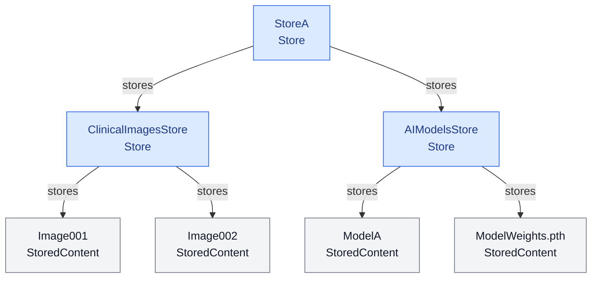

**Rappresentazione Turtle:**

```turtle
@prefix ddta: <https://w3id.org/ddta/core#> .
@prefix ex: <https://example.org/ddta/test#> .

ex:StoreA
    a ddta:Store ;
    ddta:stores
        ex:ClinicalImagesStore,
        ex:AIModelsStore .

ex:ClinicalImagesStore
    a ddta:Store ;
    ddta:stores
        ex:Image001,
        ex:Image002 .

ex:AIModelsStore
    a ddta:Store ;
    ddta:stores
        ex:ModelA,
        ex:ModelWeights .

ex:Image001
    a ddta:StoredContent .

ex:Image002
    a ddta:StoredContent .

ex:ModelA
    a ddta:StoredContent .

ex:ModelWeights
    a ddta:StoredContent .
```

In questa rappresentazione `ModelWeights` è un contenuto distinto, identificabile indipendentemente dagli altri contenuti conservati nello stesso Store.

Questo permette, ad esempio, di riferire un'analisi di sicurezza a un possibile intervento non autorizzato sul file dei pesi, senza dover modellare individualmente tutti i contenuti dello Store.

Il collegamento tra `ModelA` e `ModelWeights` come modello e relativi pesi non è rappresentato dalla relazione `stores`: tale relazione esprime esclusivamente l'organizzazione logica della memorizzazione.

La rappresentazione specifica dei modelli AI e delle relazioni tra modelli, pesi e versioni appartiene alle ontologie specializzate.

L'esempio non afferma che i contenuti siano effettivamente integri, che siano utilizzati da un processo o che siano protetti mediante particolari meccanismi di sicurezza.

Le dichiarazioni dell'esempio sono separate da quelle dell'ontologia CORE e non contribuiscono alla generazione del `core.ttl`.

---

## 11. Scheda ontologica — `Boundary`

### 11.1 Identificazione e definizione

```yaml ddta-ontology
record: class
module: core
iri: ddta:Boundary
status: approved
label:
  en: Boundary
  it: Confine logico
definition:
  en: >-
    An identifiable logical boundary associated
    with a system that delineates a set of
    resources. A resource may belong to multiple
    boundaries, and boundaries may overlap
    without implying a hierarchy or a specific
    protection mechanism.
  it: >-
    Un confine logico identificabile associato
    a un sistema che delimita un insieme di
    risorse. Una risorsa può appartenere a più
    confini e i confini possono sovrapporsi,
    senza implicare una gerarchia o uno
    specifico meccanismo di protezione.
```

Un `Boundary` rappresenta un confine logico associato a un `System`, utilizzato per delimitare un insieme di risorse.

Un sistema può avere più Boundary, ciascuno dei quali identifica un ambito logico distinto.

La stessa risorsa può appartenere a più Boundary. Di conseguenza, i confini possono sovrapporsi senza essere necessariamente disgiunti o organizzati gerarchicamente.

L'appartenenza di una risorsa a un Boundary è indipendente dall'ambiente operativo che la rende disponibile e dalle relazioni di memorizzazione tra risorse.

Un Boundary non rappresenta necessariamente un confine fisico o geografico e non implica, da solo, l'esistenza di particolari requisiti o meccanismi di sicurezza.

### 11.2 Relazioni

```yaml ddta-ontology
record: object-properties
module: core
owner: ddta:Boundary
properties:
  - iri: ddta:hasBoundary
    status: approved
    domain: ddta:System
    range: ddta:Boundary
    label:
      en: has boundary
      it: ha un confine
    definition:
      en: >-
        Relates a system to one of its
        associated logical boundaries.
      it: >-
        Collega un sistema a uno dei
        confini logici a esso associati.

  - iri: ddta:encloses
    status: approved
    domain: ddta:Boundary
    range: ddta:Resource
    label:
      en: encloses
      it: racchiude
    definition:
      en: >-
        Relates a logical boundary to a
        resource explicitly included within
        that boundary.
      it: >-
        Collega un confine logico a una
        risorsa esplicitamente inclusa
        nel confine.
```

**Lettura delle relazioni.**

`hasBoundary` associa un `System` ai suoi confini logici.

La relazione non implica che il sistema abbia un solo Boundary. Più confini possono essere associati allo stesso sistema.

`encloses` identifica le risorse esplicitamente incluse in un determinato Boundary.

Poiché `Store` è una sottoclasse di `Resource`, uno Store può essere racchiuso in un Boundary senza richiedere una proprietà aggiuntiva.

Analogamente, altre specializzazioni di `Resource` possono essere incluse nei confini.

La stessa risorsa può essere collegata mediante `encloses` a più Boundary. Tale appartenenza multipla non rende i Boundary equivalenti.

Non viene definita una relazione di contenimento tra Boundary. I confini non sono quindi rappresentati mediante una gerarchia di annidamento.

#### Indipendenza dalla struttura di memorizzazione

L'appartenenza a un Boundary è indipendente dalla relazione `stores`.

Ad esempio:

`StoreA → stores → StoreB`

non implica che i due Store appartengano allo stesso Boundary.

Se un Boundary racchiude `StoreA`, l'appartenenza di `StoreB` deve essere dichiarata separatamente.

La relazione `encloses` non è transitiva e non propaga automaticamente l'appartenenza lungo le relazioni di memorizzazione.

#### Indipendenza dalle proprietà di sicurezza

Un Boundary delimita un ambito logico, ma non definisce automaticamente le proprietà di sicurezza delle risorse racchiuse.

Ad esempio, l'appartenenza a un Boundary non dimostra che le risorse siano cifrate, anonimizzate o protette mediante altri meccanismi.

I requisiti di sicurezza e le relative condizioni di applicazione possono essere descritti attraverso ontologie specializzate.

### 11.3 Interrogazioni SPARQL

Le interrogazioni SPARQL recuperano i Boundary associati a un sistema, le risorse racchiuse e gli eventuali confini condivisi.

Le query utilizzano gli individui `ex:ExampleSystem`, `ex:ExampleBoundary` ed `ex:ExampleResource` come riferimenti illustrativi.

#### Q-BND-01 — Boundary associati a un sistema

**Scopo:** recuperare tutti i confini logici associati al sistema.

```sparql
PREFIX ddta: <https://w3id.org/ddta/core#>
PREFIX ex: <https://example.org/ddta/test#>

SELECT DISTINCT ?boundary
WHERE {
    ex:ExampleSystem
        ddta:hasBoundary ?boundary .
}
```

#### Q-BND-02 — Risorse racchiuse in un Boundary

**Scopo:** recuperare le risorse esplicitamente incluse in un determinato confine.

```sparql
PREFIX ddta: <https://w3id.org/ddta/core#>
PREFIX ex: <https://example.org/ddta/test#>

SELECT DISTINCT ?resource
WHERE {
    ex:ExampleBoundary
        ddta:encloses ?resource .
}
```

#### Q-BND-03 — Boundary che racchiudono una risorsa

**Scopo:** recuperare tutti i confini ai quali una risorsa appartiene.

```sparql
PREFIX ddta: <https://w3id.org/ddta/core#>
PREFIX ex: <https://example.org/ddta/test#>

SELECT DISTINCT ?boundary
WHERE {
    ?boundary
        ddta:encloses ex:ExampleResource .
}
```

La query permette di identificare risorse appartenenti contemporaneamente a più Boundary.

#### Q-BND-04 — Risorse condivise tra due Boundary

**Scopo:** individuare le risorse esplicitamente racchiuse da due confini distinti.

```sparql
PREFIX ddta: <https://w3id.org/ddta/core#>
PREFIX ex: <https://example.org/ddta/test#>

SELECT DISTINCT ?resource
WHERE {
    ex:BoundaryA
        ddta:encloses ?resource .

    ex:BoundaryB
        ddta:encloses ?resource .
}
```

La query restituisce le risorse appartenenti all'intersezione dei due Boundary.

#### Q-BND-05 — Confronto di appartenenza di due risorse

**Scopo:** confrontare l'appartenenza dichiarata di due risorse ai Boundary associati a un sistema.

```sparql
PREFIX ddta: <https://w3id.org/ddta/core#>
PREFIX ex: <https://example.org/ddta/test#>

SELECT DISTINCT ?boundary ?sourceInside ?destinationInside
WHERE {
    ex:ExampleSystem
        ddta:hasBoundary ?boundary .

    BIND(
        EXISTS {
            ?boundary ddta:encloses ex:SourceResource .
        }
        AS ?sourceInside
    )

    BIND(
        EXISTS {
            ?boundary ddta:encloses ex:DestinationResource .
        }
        AS ?destinationInside
    )
}
```

La query permette di verificare, per ogni Boundary associato al sistema, se le due risorse sono esplicitamente dichiarate al suo interno.

Il confronto delle appartenenze costituisce una base per individuare possibili attraversamenti di confine nelle comunicazioni.

#### Interpretazione dei risultati

Le query restituiscono le relazioni disponibili nel grafo RDF interrogato.

`Q-BND-01` recupera i confini associati al sistema.

`Q-BND-02` e `Q-BND-03` permettono di navigare la relazione `encloses` nelle due direzioni.

`Q-BND-04` individua le risorse condivise tra Boundary distinti, senza introdurre una relazione gerarchica tra i confini.

`Q-BND-05` confronta le appartenenze dichiarate di due risorse. Un valore `false` indica l'assenza della corrispondente tripla nel grafo interrogato, non dimostra in senso OWL che la risorsa sia esterna.

Per l'analisi degli attraversamenti viene adottata una convenzione locale: rispetto a un Boundary, una risorsa è considerata interna quando l'appartenenza è dichiarata, ed esterna quando non risulta dichiarata nel grafo assunto completo per quella verifica.

Tale convenzione è distinta dalla semantica aperta di OWL.

Il confronto delle appartenenze non dimostra che una comunicazione sia effettivamente avvenuta né che sia sicura.

### 11.4 Vincoli di completezza e coerenza documentale

#### Cardinalità

| Relazione | Cardinalità | Stato |
|---|---|---|
| Boundary associati a un `System` | `0..*` | Facoltativo |
| Risorse racchiuse mediante `encloses` | `0..*` | Facoltativo |
| Boundary che racchiudono una stessa risorsa | `0..*` | Nessun vincolo di unicità |

Un sistema può essere descritto senza specificare immediatamente i propri Boundary.

Un Boundary può essere dichiarato senza elencare immediatamente tutte le risorse che racchiude.

Una risorsa può appartenere a più Boundary.

Non sono imposte cardinalità minime universali.

#### Controlli SHACL

Non sono definiti controlli SHACL specifici per la classe `Boundary`.

Le proprietà sono definite mediante:

- `hasBoundary`: `rdfs:domain ddta:System` e `rdfs:range ddta:Boundary`;
- `encloses`: `rdfs:domain ddta:Boundary` e `rdfs:range ddta:Resource`.

Gli assiomi RDFS/OWL permettono di inferire le classificazioni associate alle due proprietà.

Non viene introdotto uno Shape SHACL che ripeta sistematicamente i controlli di dominio e range.

Non viene generato uno `sh:NodeShape` specifico per `Boundary`.

L'interpretazione locale dell'appartenenza ai confini utilizzata nelle analisi di sicurezza non costituisce un assioma OWL né un controllo SHACL di questa scheda.

### 11.5 Esempio illustrativo (escluso dal TTL generato)

L'esempio rappresenta un sistema con due Boundary indipendenti e parzialmente sovrapposti.

Il primo delimita un ambito logico di protezione crittografica; il secondo un ambito logico relativo all'anonimizzazione.

Queste denominazioni servono a distinguere i confini e non dichiarano automaticamente meccanismi di protezione.

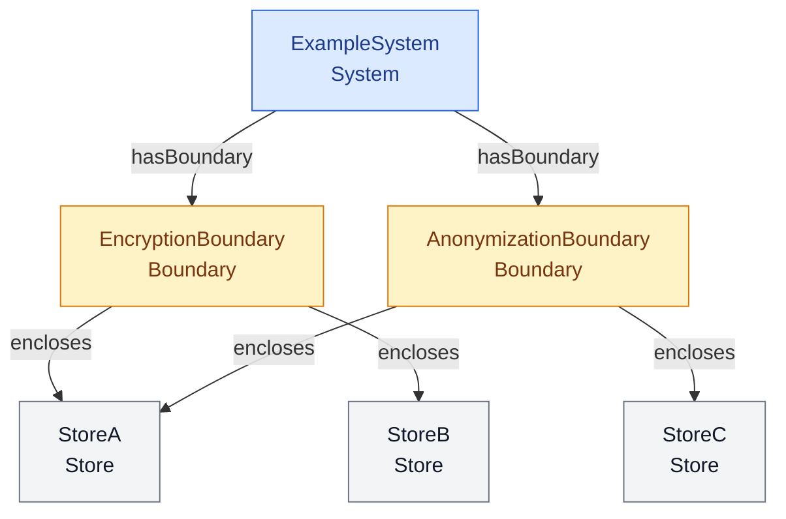

**Rappresentazione Turtle:**

```turtle
@prefix ddta: <https://w3id.org/ddta/core#> .
@prefix ex: <https://example.org/ddta/test#> .

ex:ExampleSystem
    a ddta:System ;
    ddta:hasBoundary
        ex:EncryptionBoundary,
        ex:AnonymizationBoundary .

ex:EncryptionBoundary
    a ddta:Boundary ;
    ddta:encloses
        ex:StoreA,
        ex:StoreB .

ex:AnonymizationBoundary
    a ddta:Boundary ;
    ddta:encloses
        ex:StoreA,
        ex:StoreC .

ex:StoreA
    a ddta:Store .

ex:StoreB
    a ddta:Store .

ex:StoreC
    a ddta:Store .
```

Poiché `Store` è sottoclasse di `Resource`, un reasoner può inferire che `StoreA`, `StoreB` e `StoreC` appartengono anche alla classe `Resource`.

Nel grafo dichiarato:

| Risorsa | EncryptionBoundary | AnonymizationBoundary |
|---|---|---|
| `StoreA` | Interna | Interna |
| `StoreB` | Interna | Non dichiarata interna |
| `StoreC` | Non dichiarata interna | Interna |

Applicando la convenzione locale di analisi, le appartenenze non dichiarate vengono trattate come esterne rispetto al Boundary considerato.

Si considerino due comunicazioni previste:

- `StoreA → StoreB`
- `StoreA → StoreC`

Il confronto produce:

| Comunicazione | EncryptionBoundary | AnonymizationBoundary |
|---|---|---|
| `StoreA → StoreB` | Nessun attraversamento | Attraversamento |
| `StoreA → StoreC` | Attraversamento | Nessun attraversamento |

La tabella illustra il risultato dell'analisi delle appartenenze. Non introduce nel CORE le relazioni necessarie a rappresentare formalmente le comunicazioni, che vengono trattate nelle successive schede.

L'attraversamento di un Boundary non implica automaticamente una violazione di sicurezza.

Le eventuali condizioni di protezione applicabili al passaggio tra ambiti differenti devono essere specificate separatamente.

L'esempio non dichiara che gli Store siano effettivamente cifrati o che i contenuti siano anonimizzati.

Le dichiarazioni dell'esempio sono separate da quelle dell'ontologia CORE e non contribuiscono alla generazione del `core.ttl`.

---

## 12. Scheda ontologica — `CommunicationFunction`

### 12.1 Identificazione e definizione

```yaml ddta-ontology
record: class
module: core
iri: ddta:CommunicationFunction
status: approved
subClassOf: ddta:Function
label:
  en: Communication Function
  it: Funzione di comunicazione
definition:
  en: >-
    A Function that specifies the capability to
    communicate content between entities according
    to functional requirements and contracts,
    independently of the processes and technical
    mechanisms used to realize the communication.
  it: >-
    Una Function che specifica la capacità di
    comunicare contenuti tra entità secondo
    requisiti e contratti funzionali,
    indipendentemente dai processi e dai
    meccanismi tecnici utilizzati per
    realizzare la comunicazione.
```

`CommunicationFunction` rappresenta una capacità funzionale di comunicazione tra entità.

È una specializzazione di `Function`, mediante `rdfs:subClassOf`, e ne mantiene le caratteristiche fondamentali.

Una comunicazione può interessare entità appartenenti allo stesso sistema oppure a sistemi differenti.

La funzione definisce la capacità di comunicare e i requisiti funzionali applicabili, senza identificarsi con un singolo scambio concretamente eseguito.

La stessa `CommunicationFunction` può essere realizzata mediante processi e tecnologie differenti, purché siano rispettati i contratti funzionali applicabili.

`CommunicationFunction` è distinta da `CommunicationChannel`: la prima rappresenta la capacità, mentre il secondo rappresenta il canale previsto per la comunicazione.

### 12.2 Relazioni

```yaml ddta-ontology
record: object-properties
module: core
owner: ddta:CommunicationFunction
properties:
  - iri: ddta:usesChannel
    status: approved
    domain: ddta:CommunicationFunction
    range: ddta:CommunicationChannel
    label:
      en: uses channel
      it: utilizza un canale
    definition:
      en: >-
        Relates a communication function to a
        channel specified for realizing its
        communication capability, without
        asserting that communication has
        actually occurred.
      it: >-
        Collega una funzione di comunicazione
        a un canale previsto per realizzare
        la capacità comunicativa, senza
        affermare che una comunicazione
        sia effettivamente avvenuta.
```

**Lettura delle relazioni.**

`usesChannel` associa una `CommunicationFunction` a un `CommunicationChannel` previsto nella descrizione architetturale.

La relazione non rappresenta un trasferimento effettivamente eseguito e non implica che il canale sia operativamente disponibile.

Una funzione può essere associata a più canali, senza richiedere che tutti siano utilizzati contemporaneamente.

La presenza di `usesChannel` non modifica l'identità funzionale della comunicazione. Processi differenti possono realizzare la stessa capacità comunicativa utilizzando modalità operative diverse, nel rispetto dei contratti applicabili.

#### Relazioni ereditate da Function

In quanto sottoclasse di `Function`, `CommunicationFunction` può utilizzare le relazioni definite nella scheda generale:

- `hasInputContract`: specifica i requisiti sui contenuti in ingresso;
- `hasOutputContract`: specifica i requisiti sui contenuti in uscita;
- `hasSubFunction`: permette la decomposizione funzionale;
- `mustPrecede`: rappresenta vincoli di precedenza funzionale.

Queste proprietà non vengono ridefinite nella presente scheda.

La relazione `realizesFunction`, definita nella scheda `Process`, consente di associare una realizzazione operativa alla funzione di comunicazione.

#### Distinzione da CommunicationChannel

`CommunicationFunction` e `CommunicationChannel` rappresentano concetti distinti.

La funzione descrive la capacità di comunicare secondo requisiti funzionali.

Il canale descrive il collegamento utilizzabile per la comunicazione. Le caratteristiche del canale, comprese la direzione e le estremità della comunicazione, appartengono alla sua descrizione.

Una stessa funzione può essere associata a più canali e uno stesso canale può essere utilizzato da più funzioni di comunicazione.

#### Relazione con Boundary

La presenza di una funzione di comunicazione non implica automaticamente l'attraversamento di un `Boundary`.

L'eventuale attraversamento dipende dalle risorse coinvolte nella comunicazione e dalla loro appartenenza ai confini logici dichiarati.

La valutazione dell'attraversamento richiede quindi di combinare la descrizione del canale con le relazioni `encloses` definite nella scheda `Boundary`.

L'attraversamento di un confine non implica, da solo, una violazione di sicurezza.

### 12.3 Interrogazioni SPARQL

Le interrogazioni SPARQL recuperano i canali associati alla funzione, i contratti funzionali e i processi che dichiarano di realizzarla.

Le query utilizzano `ex:ExampleCommunicationFunction` come individuo di esempio.

#### Q-CMF-01 — Canali associati alla funzione

**Scopo:** recuperare i canali previsti per la funzione di comunicazione.

```sparql
PREFIX ddta: <https://w3id.org/ddta/core#>
PREFIX ex: <https://example.org/ddta/test#>

SELECT DISTINCT ?channel
WHERE {
    ex:ExampleCommunicationFunction
        ddta:usesChannel ?channel .
}
```

#### Q-CMF-02 — Contratti di ingresso

**Scopo:** recuperare i contratti che specificano i requisiti sugli ingressi della funzione di comunicazione.

```sparql
PREFIX ddta: <https://w3id.org/ddta/core#>
PREFIX ex: <https://example.org/ddta/test#>

SELECT DISTINCT ?contract
WHERE {
    ex:ExampleCommunicationFunction
        ddta:hasInputContract ?contract .
}
```

#### Q-CMF-03 — Contratti di uscita

**Scopo:** recuperare i contratti che specificano i requisiti sulle uscite attese della funzione di comunicazione.

```sparql
PREFIX ddta: <https://w3id.org/ddta/core#>
PREFIX ex: <https://example.org/ddta/test#>

SELECT DISTINCT ?contract
WHERE {
    ex:ExampleCommunicationFunction
        ddta:hasOutputContract ?contract .
}
```

#### Q-CMF-04 — Processi che realizzano la funzione

**Scopo:** recuperare i processi che dichiarano di realizzare la funzione di comunicazione.

```sparql
PREFIX ddta: <https://w3id.org/ddta/core#>
PREFIX ex: <https://example.org/ddta/test#>

SELECT DISTINCT ?process
WHERE {
    ?process
        ddta:realizesFunction
        ex:ExampleCommunicationFunction .
}
```

#### Q-CMF-05 — Funzioni associate a un canale

**Scopo:** recuperare le funzioni di comunicazione associate a uno specifico canale.

```sparql
PREFIX ddta: <https://w3id.org/ddta/core#>
PREFIX ex: <https://example.org/ddta/test#>

SELECT DISTINCT ?function
WHERE {
    ?function
        ddta:usesChannel ex:ExampleChannel .
}
```

#### Interpretazione dei risultati

`Q-CMF-01` recupera i canali dichiarati nella specifica architetturale della funzione.

`Q-CMF-02` e `Q-CMF-03` recuperano i contratti funzionali senza rappresentare i contenuti concretamente scambiati.

`Q-CMF-04` permette di individuare le realizzazioni operative dichiarate. La presenza di `realizesFunction` non dimostra che il processo sia conforme ai contratti né che sia stato eseguito.

`Q-CMF-05` permette di individuare le funzioni che condividono lo stesso canale.

Le interrogazioni restituiscono le relazioni disponibili nel grafo RDF interrogato. Non dimostrano l'avvenuta comunicazione, la disponibilità operativa dei canali o la sicurezza degli scambi.

### 12.4 Vincoli di completezza e coerenza documentale

#### Cardinalità

| Relazione | Cardinalità | Stato |
|---|---|---|
| Canali associati mediante `usesChannel` | `0..*` | Facoltativo |
| Contratti di ingresso | `0..*` | Facoltativo |
| Contratti di uscita | `0..*` | Facoltativo |
| Sottofunzioni | `0..*` | Facoltativo |
| Processi realizzativi | `0..*` | Nessun vincolo di presenza |

Una `CommunicationFunction` può essere descritta prima di specificare il canale utilizzato o il processo che la realizza.

La funzione può prevedere più canali senza che sia necessario dichiararne uno come unico canale obbligatorio.

I vincoli strutturali generali delle funzioni, compresi quelli relativi alla decomposizione e alle precedenze funzionali, rimangono applicabili anche agli individui di `CommunicationFunction`.

#### Controlli SHACL

Non sono definiti controlli SHACL aggiuntivi specifici per `CommunicationFunction`.

La proprietà `usesChannel` è definita mediante:

- `rdfs:domain ddta:CommunicationFunction`;
- `rdfs:range ddta:CommunicationChannel`.

Gli assiomi RDFS/OWL definiscono la semantica della proprietà e consentono le relative inferenze di classificazione.

I controlli SHACL già definiti per `Function` rimangono applicabili agli individui della sottoclasse `CommunicationFunction`, quando la validazione riconosce la gerarchia `rdfs:subClassOf`.

Non viene generato uno `sh:NodeShape` aggiuntivo specifico per `CommunicationFunction`.

### 12.5 Esempio illustrativo (escluso dal TTL generato)

L'esempio rappresenta una funzione che consente di comunicare i risultati di un'analisi dermatologica a un servizio destinatario.

La funzione è associata a un contratto di ingresso, a un contratto di uscita e a un canale di comunicazione previsto.

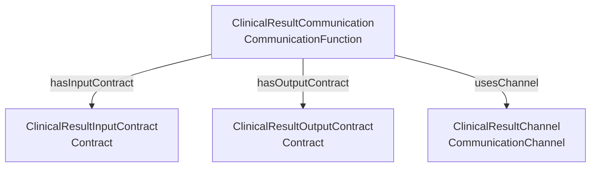

**Rappresentazione Turtle:**

```turtle
@prefix ddta: <https://w3id.org/ddta/core#> .
@prefix ex: <https://example.org/ddta/test#> .

ex:ClinicalResultCommunication
    a ddta:CommunicationFunction ;
    ddta:hasInputContract
        ex:ClinicalResultInputContract ;
    ddta:hasOutputContract
        ex:ClinicalResultOutputContract ;
    ddta:usesChannel
        ex:ClinicalResultChannel .

ex:ClinicalResultInputContract
    a ddta:Contract .

ex:ClinicalResultOutputContract
    a ddta:Contract .

ex:ClinicalResultChannel
    a ddta:CommunicationChannel .
```

Poiché `CommunicationFunction` è una sottoclasse di `Function`, un reasoner può inferire:

```turtle
ex:ClinicalResultCommunication
    a ddta:Function .
```

L'esempio distingue la capacità funzionale di comunicazione dal canale previsto e dai contratti che specificano gli ingressi e le uscite.

Non vengono rappresentate operazioni concretamente eseguite, protocolli tecnici o eventi di trasferimento.

Il canale è identificato senza specificarne in questo esempio le estremità e la direzione, che vengono trattate nella scheda `CommunicationChannel`.

La presenza del canale non dimostra che la comunicazione sia stata effettuata, né che abbia attraversato un Boundary o rispettato particolari requisiti di sicurezza.

Le dichiarazioni dell'esempio sono separate da quelle dell'ontologia CORE e non contribuiscono alla generazione del `core.ttl`.

---
## 13. Scheda ontologica — `CommunicationChannel`

### 13.1 Identificazione e definizione

```yaml ddta-ontology
record: class
module: core
iri: ddta:CommunicationChannel
status: approved
subClassOf: ddta:Resource
label:
  en: Communication Channel
  it: Canale di comunicazione
definition:
  en: >-
    An identifiable directional communication
    resource that connects a source resource
    to a destination resource. A communication
    channel represents a planned communication
    connection without asserting actual
    transmission or requiring a particular
    protocol or technical implementation.
  it: >-
    Una risorsa di comunicazione direzionale
    identificabile che collega una risorsa
    sorgente a una risorsa destinazione.
    Un canale di comunicazione rappresenta
    un collegamento previsto senza affermare
    l'avvenuta trasmissione né richiedere
    uno specifico protocollo o una particolare
    implementazione tecnica.
```

`CommunicationChannel` rappresenta un collegamento direzionale previsto tra due risorse.

La classe è una specializzazione di `Resource`, mediante `rdfs:subClassOf`. Ogni individuo di `CommunicationChannel` appartiene quindi anche alla classe `Resource`.

Il canale identifica la sorgente e la destinazione della comunicazione, senza rappresentare il contenuto concretamente trasmesso o un evento di comunicazione effettivamente avvenuto.

Un canale può collegare risorse appartenenti allo stesso sistema oppure a sistemi differenti, indipendentemente dagli ambienti operativi nei quali tali risorse sono disponibili.

L'identità del canale è distinta dalla capacità di comunicazione rappresentata da `CommunicationFunction`.

La descrizione del canale non richiede di specificare un protocollo, un dispositivo fisico o una particolare tecnologia di trasporto.

### 13.2 Relazioni

```yaml ddta-ontology
record: object-properties
module: core
owner: ddta:CommunicationChannel
properties:
  - iri: ddta:hasSource
    status: approved
    domain: ddta:CommunicationChannel
    range: ddta:Resource
    label:
      en: has source
      it: ha una sorgente
    definition:
      en: >-
        Relates a communication channel to
        the resource from which the communication
        is directed.
      it: >-
        Collega un canale di comunicazione
        alla risorsa dalla quale è diretta
        la comunicazione.

  - iri: ddta:hasDestination
    status: approved
    domain: ddta:CommunicationChannel
    range: ddta:Resource
    label:
      en: has destination
      it: ha una destinazione
    definition:
      en: >-
        Relates a communication channel to
        the resource toward which the
        communication is directed.
      it: >-
        Collega un canale di comunicazione
        alla risorsa verso la quale è diretta
        la comunicazione.
```

**Lettura delle relazioni.**

`hasSource` identifica la risorsa dalla quale è prevista la comunicazione.

`hasDestination` identifica la risorsa alla quale è diretta la comunicazione.

Le due proprietà definiscono la direzione del canale.

Un canale da `ResourceA` a `ResourceB` è distinto da un canale da `ResourceB` a `ResourceA`.

La presenza di entrambi i canali consente di rappresentare una comunicazione bidirezionale senza introdurre una proprietà aggiuntiva.

Sorgente e destinazione possono coincidere. Tale possibilità non viene esclusa mediante vincoli ontologici.

#### Collegamento con CommunicationFunction

La proprietà `usesChannel`, definita nella scheda `CommunicationFunction`, associa una funzione di comunicazione ai canali previsti per la sua realizzazione.

`CommunicationFunction → usesChannel → CommunicationChannel`

Uno stesso canale può essere associato a più funzioni e una funzione può prevedere più canali.

Il canale non specifica autonomamente i contenuti che devono essere comunicati. I relativi requisiti sono definiti dai contratti di ingresso e di uscita delle funzioni.

La presenza di `usesChannel` non dimostra che il canale sia stato effettivamente utilizzato durante un'esecuzione.

#### Direzione e precedenza funzionale

La direzione del canale è distinta dall'ordine delle comunicazioni.

`hasSource` e `hasDestination` non stabiliscono quale comunicazione debba avvenire per prima.

Quando una sequenza è funzionalmente obbligatoria, il vincolo può essere rappresentato mediante `mustPrecede` tra le funzioni coinvolte, nel rispetto delle regole di decomposizione definite nella scheda `Function`.

Non vengono introdotte proprietà `initiatedBy`, `firstSender` o altre relazioni temporali specifiche del canale.

#### Relazione con Boundary

Le risorse sorgente e destinazione possono appartenere a Boundary differenti.

L'attraversamento di un Boundary viene valutato confrontando le appartenenze delle due risorse mediante la proprietà `encloses`, definita nella scheda `Boundary`.

La stessa comunicazione può attraversare un determinato Boundary senza attraversarne un altro.

L'appartenenza ai Boundary non viene inferita dalla presenza del canale.

L'attraversamento di un confine non implica automaticamente una violazione di sicurezza.

### 13.3 Interrogazioni SPARQL

Le interrogazioni SPARQL recuperano le estremità del canale, le funzioni che lo utilizzano e le appartenenze ai Boundary delle risorse collegate.

Le query utilizzano `ex:ExampleChannel` come individuo di esempio.

#### Q-CHN-01 — Sorgente e destinazione del canale

**Scopo:** recuperare le due estremità del canale e la relativa direzione.

```sparql
PREFIX ddta: <https://w3id.org/ddta/core#>
PREFIX ex: <https://example.org/ddta/test#>

SELECT ?source ?destination
WHERE {
    ex:ExampleChannel
        ddta:hasSource ?source ;
        ddta:hasDestination ?destination .
}
```

#### Q-CHN-02 — Funzioni associate al canale

**Scopo:** recuperare le funzioni di comunicazione che dichiarano di utilizzare il canale.

```sparql
PREFIX ddta: <https://w3id.org/ddta/core#>
PREFIX ex: <https://example.org/ddta/test#>

SELECT DISTINCT ?function
WHERE {
    ?function
        ddta:usesChannel ex:ExampleChannel .
}
```

#### Q-CHN-03 — Canali tra due risorse

**Scopo:** recuperare i canali direzionali dichiarati tra due risorse specifiche.

```sparql
PREFIX ddta: <https://w3id.org/ddta/core#>
PREFIX ex: <https://example.org/ddta/test#>

SELECT DISTINCT ?channel
WHERE {
    ?channel
        ddta:hasSource ex:ResourceA ;
        ddta:hasDestination ex:ResourceB .
}
```

La query considera soltanto la direzione da `ResourceA` a `ResourceB`.

I canali nella direzione opposta non vengono restituiti.

#### Q-CHN-04 — Appartenenza delle estremità ai Boundary

**Scopo:** confrontare, per ogni Boundary associato a un sistema, l'appartenenza dichiarata delle risorse sorgente e destinazione del canale.

```sparql
PREFIX ddta: <https://w3id.org/ddta/core#>
PREFIX ex: <https://example.org/ddta/test#>

SELECT DISTINCT
    ?boundary
    ?source
    ?destination
    ?sourceInside
    ?destinationInside
WHERE {
    ex:ExampleChannel
        ddta:hasSource ?source ;
        ddta:hasDestination ?destination .

    ex:ExampleSystem
        ddta:hasBoundary ?boundary .

    BIND(
        EXISTS {
            ?boundary ddta:encloses ?source .
        }
        AS ?sourceInside
    )

    BIND(
        EXISTS {
            ?boundary ddta:encloses ?destination .
        }
        AS ?destinationInside
    )
}
```

La query confronta le appartenenze esplicitamente disponibili nel grafo RDF.

Un valore `true` indica che la risorsa è dichiarata interna al Boundary.

Un valore `false` indica che la corrispondente relazione `encloses` non è presente nel grafo interrogato.

Applicando la convenzione locale di analisi definita nella scheda `Boundary`, un valore `false` viene interpretato come appartenenza esterna rispetto al grafo assunto completo per la verifica.

Quando i due valori sono differenti, il canale rappresenta un possibile attraversamento del Boundary considerato.

#### Interpretazione dei risultati

`Q-CHN-01` recupera le estremità e la direzione del canale.

`Q-CHN-02` identifica le funzioni che prevedono il canale nella propria descrizione architetturale.

`Q-CHN-03` recupera i collegamenti dichiarati in una direzione specifica.

`Q-CHN-04` permette di confrontare le appartenenze delle due estremità ai Boundary del sistema.

Le query restituiscono informazioni presenti nel grafo RDF, comprese eventuali inferenze disponibili durante l'interrogazione.

L'assenza di una relazione non dimostra, secondo la semantica OWL, che essa sia falsa.

La convenzione locale utilizzata per l'analisi dei Boundary è distinta dalla semantica aperta di OWL.

Le interrogazioni descrivono comunicazioni previste, senza dimostrare che siano state eseguite o che rispettino particolari requisiti di sicurezza.

### 13.4 Vincoli di completezza e coerenza documentale

#### Cardinalità

| Relazione | Cardinalità | Stato |
|---|---|---|
| `hasSource` | `1..1` | Obbligatorio |
| `hasDestination` | `1..1` | Obbligatorio |
| Funzioni associate mediante `usesChannel` | `0..*` | Nessun vincolo di presenza |
| Boundary che racchiudono la sorgente | `0..*` | Nessun vincolo di presenza |
| Boundary che racchiudono la destinazione | `0..*` | Nessun vincolo di presenza |

Ogni individuo di `CommunicationChannel` deve dichiarare esattamente una sorgente e una destinazione.

Non è richiesto che le due risorse siano differenti.

Un canale può essere identificato senza specificare immediatamente una funzione che lo utilizza.

Non sono imposti vincoli di presenza sui Boundary associati alle estremità.

#### Controlli SHACL

| ID | Controllo |
|---|---|
| `CHN-01` | Ogni CommunicationChannel deve avere esattamente una sorgente |
| `CHN-02` | Ogni CommunicationChannel deve avere esattamente una destinazione |

I controlli verificano la completezza documentale dei collegamenti direzionali.

Le proprietà `hasSource` e `hasDestination` utilizzano `rdfs:range ddta:Resource`.

Non vengono introdotti ulteriori controlli SHACL che ripetano sistematicamente il range OWL.

#### Dichiarazione strutturata per la generazione SHACL

```yaml ontology-validation
kind: OntologyValidation
target: ddta:CommunicationChannel
engine: SHACL

constraints:
  - id: CHN-01
    path: ddta:hasSource
    minCount: 1
    maxCount: 1
    message:
      en: >-
        A communication channel must declare
        exactly one source.
      it: >-
        Un canale di comunicazione deve
        dichiarare esattamente una sorgente.

  - id: CHN-02
    path: ddta:hasDestination
    minCount: 1
    maxCount: 1
    message:
      en: >-
        A communication channel must declare
        exactly one destination.
      it: >-
        Un canale di comunicazione deve
        dichiarare esattamente una destinazione.
```

#### Shape SHACL risultante

La dichiarazione strutturata produce il seguente Shape, rappresentato in Turtle.

```turtle
@prefix ddta: <https://w3id.org/ddta/core#> .
@prefix sh: <http://www.w3.org/ns/shacl#> .

ddta:CommunicationChannelShape
    a sh:NodeShape ;
    sh:targetClass ddta:CommunicationChannel ;

    sh:property [
        sh:path ddta:hasSource ;
        sh:minCount 1 ;
        sh:maxCount 1 ;
        sh:message
            "A communication channel must declare exactly one source."@en
    ] ;

    sh:property [
        sh:path ddta:hasDestination ;
        sh:minCount 1 ;
        sh:maxCount 1 ;
        sh:message
            "A communication channel must declare exactly one destination."@en
    ] .
```

`CHN-01` verifica che il canale dichiari una sola risorsa sorgente.

`CHN-02` verifica che il canale dichiari una sola risorsa destinazione.

I controlli riguardano le relazioni presenti nel grafo documentale e non implicano che la comunicazione sia effettivamente avvenuta.

Lo Shape appartiene al grafo SHACL separato e non viene incluso nel `core.ttl` dell'ontologia OWL.

### 13.5 Esempio illustrativo (escluso dal TTL generato)

L'esempio rappresenta due funzioni di comunicazione che utilizzano due canali direzionali opposti tra `StoreA` e `StoreB`.

Le due risorse appartengono a Boundary differenti.

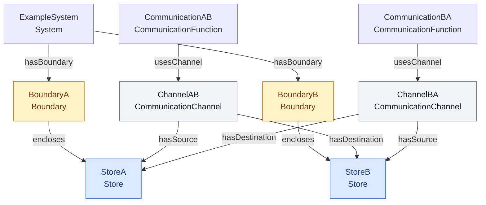

**Rappresentazione Turtle:**

```turtle
@prefix ddta: <https://w3id.org/ddta/core#> .
@prefix ex: <https://example.org/ddta/test#> .

ex:ExampleSystem
    a ddta:System ;
    ddta:hasBoundary
        ex:BoundaryA,
        ex:BoundaryB .

ex:BoundaryA
    a ddta:Boundary ;
    ddta:encloses ex:StoreA .

ex:BoundaryB
    a ddta:Boundary ;
    ddta:encloses ex:StoreB .

ex:StoreA
    a ddta:Store .

ex:StoreB
    a ddta:Store .

ex:ChannelAB
    a ddta:CommunicationChannel ;
    ddta:hasSource ex:StoreA ;
    ddta:hasDestination ex:StoreB .

ex:ChannelBA
    a ddta:CommunicationChannel ;
    ddta:hasSource ex:StoreB ;
    ddta:hasDestination ex:StoreA .

ex:CommunicationAB
    a ddta:CommunicationFunction ;
    ddta:usesChannel ex:ChannelAB .

ex:CommunicationBA
    a ddta:CommunicationFunction ;
    ddta:usesChannel ex:ChannelBA .
```

Poiché `CommunicationChannel` è sottoclasse di `Resource`, un reasoner può inferire:

```turtle
ex:ChannelAB a ddta:Resource .
ex:ChannelBA a ddta:Resource .
```

Analogamente, `StoreA` e `StoreB` appartengono alla classe `Resource` mediante la specializzazione `Store`.

I due canali identificano direzioni differenti e soddisfano i controlli `CHN-01` e `CHN-02`.

Applicando la convenzione locale di appartenenza ai Boundary, entrambi i canali rappresentano comunicazioni che attraversano `BoundaryA` e `BoundaryB`, con direzioni opposte.

Non è dichiarata alcuna precedenza funzionale tra `CommunicationAB` e `CommunicationBA`. La presenza di due canali opposti non impone un ordine di comunicazione.

Le funzioni non specificano in questo esempio i propri contratti di ingresso e di uscita. Tali contratti possono essere associati mediante le proprietà definite nella scheda `Function`.

L'esempio non descrive comunicazioni effettivamente eseguite, protocolli o meccanismi di protezione.

Le dichiarazioni dell'esempio sono separate da quelle dell'ontologia CORE e non contribuiscono alla generazione del `core.ttl`.

---

## 14. Scheda ontologica — `Process`

### 14.1 Identificazione e definizione

```yaml ddta-ontology
record: class
module: core
iri: ddta:Process
status: approved
label:
  en: Process
  it: Processo
definition:
  en: >-
    An identifiable specification of the operational
    organization through which one or more functions
    can be realized. A process may define activities,
    execution order, alternatives and conditions.
    It is distinct from the functions it realizes
    and from individual executions of the process.
  it: >-
    Una specifica identificabile dell'organizzazione
    operativa attraverso la quale possono essere
    realizzate una o più funzioni. Un processo può
    definire attività e collegamenti operativi;
    ontologie specializzate possono precisare
    alternative e condizioni. È distinto dalle
    funzioni che realizza e dalle singole
    esecuzioni del processo.
```

Un `Process` rappresenta l'organizzazione operativa attraverso cui vengono realizzate le capacità definite dalle `Function`.

La funzione definisce il comportamento o risultato atteso, mentre il processo specifica le modalità operative previste per ottenerlo.

Un processo può comprendere attività e collegamenti di flusso. La semantica di diramazioni, condizioni, parallelismo e percorsi di gestione degli errori può essere specificata attraverso un’ontologia specializzata dei processi, senza cambiare l’identità del processo.

La descrizione di un `Process` non rappresenta una singola esecuzione effettivamente avvenuta. Il processo mantiene la propria identità attraverso le eventuali esecuzioni.

La stessa `Function` può essere realizzata da processi differenti. Tali processi possono adottare algoritmi, strutture operative e tecnologie diverse, mantenendo il medesimo obiettivo funzionale.

Processi che realizzano la stessa funzione possono presentare caratteristiche differenti di prestazione, robustezza e sicurezza.

### 14.2 Relazioni

```yaml ddta-ontology
record: object-properties
module: core
owner: ddta:Process
properties:
  - iri: ddta:realizesFunction
    status: approved
    domain: ddta:Process
    range: ddta:Function
    label:
      en: realizes function
      it: realizza una funzione
    definition:
      en: >-
        Relates a process to a function that
        the process is intended to realize.
        The relation does not establish
        conformance with the function's contracts.
      it: >-
        Collega un processo a una funzione
        che il processo è destinato a realizzare.
        La relazione non dimostra la conformità
        ai contratti della funzione.

  - iri: ddta:hasStep
    status: approved
    domain: ddta:Process
    range: ddta:ProcessStep
    label:
      en: has step
      it: ha un passo
    definition:
      en: >-
        Relates a process to an activity
        belonging directly to its operational
        structure.
      it: >-
        Collega un processo a un'attività
        appartenente direttamente alla sua
        struttura operativa.
```

**Lettura delle relazioni.**

`realizesFunction` collega un `Process` alla `Function` che è destinato a realizzare.

La stessa funzione può essere associata a processi differenti e un processo può essere destinato a realizzare più funzioni.

La dichiarazione `realizesFunction` non dimostra che il processo rispetti i contratti della funzione.

Per costituire una realizzazione conforme, il processo deve rispettare i requisiti definiti dai contratti di ingresso e di uscita applicabili.

Processi differenti possono utilizzare ingressi facoltativi o produrre uscite facoltative in modi diversi, purché tali differenze siano ammesse dai contratti.

Il rispetto dei contratti funzionali non implica equivalenza delle caratteristiche non funzionali dei processi.

#### Composizione operativa

`hasStep` collega un processo alle attività che costituiscono direttamente la sua struttura operativa.

Gli Step rappresentano attività collocate nel processo e non coincidono necessariamente con le sottofunzioni della funzione realizzata.

La decomposizione funzionale e quella operativa sono indipendenti.

Una funzione composta da più sottofunzioni non richiede necessariamente un processo con un numero corrispondente di Step.

Analogamente, un processo può comprendere più Step per realizzare una singola funzione non ulteriormente decomposta.

L'esistenza di `hasStep` non definisce l'ordine operativo delle attività. Le relazioni di flusso tra gli Step sono descritte nella scheda `ProcessStep`.

Un processo può essere identificato senza specificare immediatamente tutti i propri Step.

#### Relazione con le precedenze funzionali

La proprietà `mustPrecede`, definita nella scheda `Function`, rappresenta un vincolo di precedenza tra funzioni.

Le sequenze operative del processo sono distinte da tali vincoli.

Un processo può adottare un ordine operativo più specifico, purché rispetti le precedenze funzionali applicabili.

La corrispondenza tra precedenze funzionali e percorsi operativi non viene inferita automaticamente dalla presenza di `realizesFunction`.

#### Distinzione tra processo e implementazione

Un `Process` descrive l'organizzazione operativa prevista, indipendentemente dai singoli elementi software o tecnici che possono implementarla.

La medesima organizzazione operativa può essere realizzata mediante implementazioni differenti.

Il riferimento all'implementazione può riguardare il processo nel suo insieme oppure singoli Step, quando sono disponibili informazioni sufficienti per identificare tali collegamenti.

La descrizione del processo non richiede di rappresentare il grafo delle chiamate tra file o moduli software.

### 14.3 Interrogazioni SPARQL

Le interrogazioni SPARQL recuperano le funzioni realizzate da un processo, gli Step che lo compongono e gli eventuali processi alternativi associati alla stessa funzione.

Le query utilizzano `ex:ExampleProcess` come individuo di esempio.

#### Q-PRC-01 — Funzioni realizzate dal processo

**Scopo:** recuperare le funzioni che il processo dichiara di realizzare.

```sparql
PREFIX ddta: <https://w3id.org/ddta/core#>
PREFIX ex: <https://example.org/ddta/test#>

SELECT DISTINCT ?function
WHERE {
    ex:ExampleProcess
        ddta:realizesFunction ?function .
}
```

#### Q-PRC-02 — Step del processo

**Scopo:** recuperare gli Step direttamente appartenenti al processo.

```sparql
PREFIX ddta: <https://w3id.org/ddta/core#>
PREFIX ex: <https://example.org/ddta/test#>

SELECT DISTINCT ?step
WHERE {
    ex:ExampleProcess
        ddta:hasStep ?step .
}
```

La query restituisce le attività appartenenti al processo, senza determinarne l'ordine operativo.

#### Q-PRC-03 — Processi che realizzano la stessa funzione

**Scopo:** recuperare gli altri processi che dichiarano di realizzare almeno una delle funzioni associate al processo interrogato.

```sparql
PREFIX ddta: <https://w3id.org/ddta/core#>
PREFIX ex: <https://example.org/ddta/test#>

SELECT DISTINCT ?function ?otherProcess
WHERE {
    ex:ExampleProcess
        ddta:realizesFunction ?function .

    ?otherProcess
        ddta:realizesFunction ?function .

    FILTER(?otherProcess != ex:ExampleProcess)
}
```

La query permette di individuare processi alternativi o concorrenti associati alla stessa funzione.

La presenza di più processi non implica che siano equivalenti, conformi o utilizzati contemporaneamente.

#### Q-PRC-04 — Processo di appartenenza di uno Step

**Scopo:** recuperare i processi che dichiarano uno specifico Step come parte della propria struttura operativa.

```sparql
PREFIX ddta: <https://w3id.org/ddta/core#>
PREFIX ex: <https://example.org/ddta/test#>

SELECT DISTINCT ?process
WHERE {
    ?process
        ddta:hasStep ex:ExampleStep .
}
```

La query utilizza la navigazione inversa di `hasStep`, senza introdurre una Object Property aggiuntiva.

#### Interpretazione dei risultati

`Q-PRC-01` identifica le funzioni che un processo è destinato a realizzare.

`Q-PRC-02` recupera le attività direttamente associate al processo.

`Q-PRC-03` individua processi che condividono almeno una funzione realizzata, senza affermare che adottino la stessa organizzazione operativa.

`Q-PRC-04` recupera i processi ai quali uno Step risulta associato.

Le interrogazioni restituiscono le relazioni disponibili nel grafo RDF interrogato, comprese eventuali inferenze rese disponibili dal sistema di interrogazione.

La presenza di `realizesFunction` non costituisce una verifica della conformità del processo ai contratti funzionali.

La presenza degli Step non dimostra che tutte le attività siano state eseguite o che tutti i percorsi operativi rispettino i vincoli applicabili.

### 14.4 Vincoli di completezza e coerenza documentale

#### Cardinalità

| Relazione | Cardinalità | Stato |
|---|---|---|
| Funzioni realizzate mediante `realizesFunction` | `0..*` | Nessun vincolo di presenza |
| Step direttamente associati mediante `hasStep` | `0..*` | Facoltativo |
| Processi che realizzano una stessa funzione | `0..*` | Nessun vincolo di unicità |

Non sono imposte cardinalità minime universali.

Un processo può essere identificato prima di completare la descrizione delle funzioni realizzate o dei propri Step.

La stessa funzione può essere associata a più processi.

Un processo può essere descritto senza decomporlo in Step.

#### Controlli SHACL

Non sono definiti controlli SHACL specifici aggiuntivi per la classe `Process`.

Le proprietà sono definite mediante:

- `realizesFunction`: `rdfs:domain ddta:Process` e `rdfs:range ddta:Function`;
- `hasStep`: `rdfs:domain ddta:Process` e `rdfs:range ddta:ProcessStep`.

Gli assiomi RDFS/OWL definiscono la semantica delle proprietà e consentono le relative inferenze di classificazione.

Non vengono introdotti controlli SHACL che ripetano sistematicamente i rispettivi domini e range.

La conformità del processo ai contratti funzionali e il rispetto delle precedenze richiedono verifiche che considerino il comportamento e il flusso operativo, non soltanto le relazioni `realizesFunction` e `hasStep`.

Non viene generato uno `sh:NodeShape` specifico per `Process`.

### 14.5 Esempio illustrativo (escluso dal TTL generato)

L'esempio rappresenta una funzione di riconoscimento delle cifre realizzabile mediante due processi differenti.

La funzione `DigitRecognition` specifica la capacità di riconoscere una cifra a partire da un'immagine e produrre un risultato conforme ai contratti applicabili.

Il processo `CNNRecognitionProcess` utilizza un'organizzazione operativa basata su una rete neurale convoluzionale.

Il processo `SVMRecognitionProcess` utilizza un'organizzazione operativa basata su una Support Vector Machine.

Entrambi dichiarano di realizzare la stessa funzione.

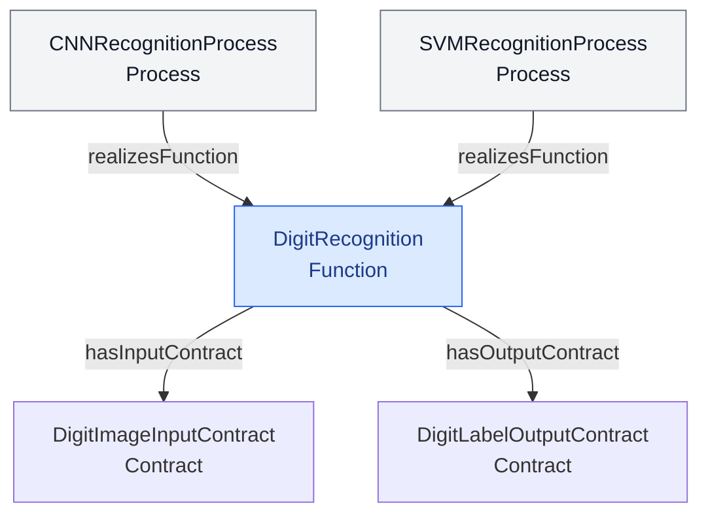

**Rappresentazione Turtle:**

```turtle
@prefix ddta: <https://w3id.org/ddta/core#> .
@prefix ex: <https://example.org/ddta/test#> .

ex:DigitRecognition
    a ddta:Function ;
    ddta:hasInputContract
        ex:DigitImageInputContract ;
    ddta:hasOutputContract
        ex:DigitLabelOutputContract .

ex:DigitImageInputContract
    a ddta:Contract .

ex:DigitLabelOutputContract
    a ddta:Contract .

ex:CNNRecognitionProcess
    a ddta:Process ;
    ddta:realizesFunction ex:DigitRecognition .

ex:SVMRecognitionProcess
    a ddta:Process ;
    ddta:realizesFunction ex:DigitRecognition .
```

I due processi condividono la funzione che dichiarano di realizzare, ma mantengono identità operative distinte.

La rappresentazione non afferma che i processi siano equivalenti per accuratezza, prestazioni, robustezza o sicurezza.

Ad esempio, i due processi possono presentare sensibilità differenti a perturbazioni degli ingressi o a modifiche non autorizzate dei rispettivi elementi tecnici.

La dichiarazione di una funzione comune non implica quindi che i due processi siano soggetti alle stesse minacce o che reagiscano nello stesso modo a un attacco.

Entrambi devono rispettare i contratti funzionali applicabili per costituire realizzazioni conformi.

L'esempio non introduce Step, poiché la distinzione tra funzione e processi alternativi può essere rappresentata anche senza descrivere il flusso operativo interno.

Le dichiarazioni dell'esempio sono separate dall'ontologia CORE e non contribuiscono alla generazione del `core.ttl`.

---

## 15. Scheda ontologica — `ProcessStep`

### 15.1 Identificazione e definizione

```yaml ddta-ontology
record: class
module: core
iri: ddta:ProcessStep
status: approved
label:
  en: Process Step
  it: Passo di processo
definition:
  en: >-
    An identifiable activity positioned within
    the operational structure of a Process.
    A process step may be connected to other
    steps to describe possible operational
    paths, without representing an actual
    execution or a function in itself.
  it: >-
    Un'attività identificabile collocata nella
    struttura operativa di un Process.
    Un passo può essere collegato ad altri
    passi per descrivere possibili percorsi
    operativi, senza rappresentare una
    esecuzione effettiva né costituire
    di per sé una funzione.
```

Un `ProcessStep` rappresenta un'attività appartenente alla struttura operativa di un `Process`.

Gli Step permettono di descrivere le attività e i collegamenti che costituiscono il flusso previsto del processo.

Uno Step non coincide con una `Function`. La funzione definisce una capacità logica, mentre lo Step rappresenta un'attività attraverso cui un processo contribuisce alla sua realizzazione.

La decomposizione funzionale e quella operativa sono indipendenti. Una funzione può essere realizzata attraverso più Step e uno Step non deve necessariamente corrispondere a una specifica sottofunzione.

Uno Step non rappresenta un'esecuzione effettivamente avvenuta, né coincide con un file o un modulo software utilizzato per implementare l'attività.

### 15.2 Relazioni

```yaml ddta-ontology
record: object-properties
module: core
owner: ddta:ProcessStep
properties:
  - iri: ddta:hasNextStep
    status: approved
    domain: ddta:ProcessStep
    range: ddta:ProcessStep
    label:
      en: has next step
      it: ha un passo successivo
    definition:
      en: >-
        Relates a process step to another step
        that may directly follow it in the
        declared operational flow of a process.
        The relation does not assert that the
        transition has actually occurred.
      it: >-
        Collega un passo di processo a un altro
        passo che può seguirlo direttamente
        nel flusso operativo dichiarato.
        La relazione non afferma che la
        transizione sia effettivamente avvenuta.
```

**Lettura delle relazioni.**

`hasNextStep` rappresenta un collegamento diretto tra due attività del flusso operativo.

La relazione indica che uno Step può essere seguito da un altro Step, secondo la struttura dichiarata del processo.

Non afferma che la transizione sia stata effettivamente eseguita.

Uno Step può avere più successori o più predecessori.

Questa possibilità consente di rappresentare strutture operative che comprendono sequenze, diramazioni, convergenze e cicli.

La relazione `hasNextStep` non è transitiva.

Se `StepA` è collegato a `StepB` e `StepB` è collegato a `StepC`, non viene inferita automaticamente una relazione diretta tra `StepA` e `StepC`.

La raggiungibilità attraverso più Step può essere interrogata mediante percorsi SPARQL.

#### Appartenenza al processo

La proprietà `hasStep`, definita nella scheda `Process`, collega un processo agli Step che appartengono direttamente alla sua struttura operativa:

`Process → hasStep → ProcessStep`

La navigazione inversa permette di individuare il processo associato a uno Step senza introdurre una Object Property aggiuntiva.

L'appartenenza al processo e i collegamenti di flusso sono due informazioni distinte.

`hasStep` identifica le attività appartenenti al processo, mentre `hasNextStep` specifica i collegamenti operativi dichiarati tra tali attività.

#### Diramazioni e cicli

Uno Step può avere più collegamenti `hasNextStep`.

Questi collegamenti identificano possibili continuazioni del flusso, senza imporre che tutti i successori siano sempre eseguiti.

La relazione non specifica autonomamente se più rami siano alternativi, paralleli o subordinati a condizioni.

La presenza di un ciclo non è considerata automaticamente un errore: un processo può prevedere la ripetizione di attività.

L'assenza di predecessori o successori non determina automaticamente il ruolo di uno Step come punto iniziale o finale del processo. Tale interpretazione dipende dalla struttura del flusso documentato.

#### Distinzione dalle precedenze funzionali

`hasNextStep` e `mustPrecede` descrivono relazioni differenti.

`mustPrecede` rappresenta una precedenza obbligatoria tra funzioni appartenenti a una decomposizione funzionale.

`hasNextStep` rappresenta invece un collegamento operativo possibile tra Step.

Una precedenza funzionale non determina automaticamente una specifica sequenza di Step.

Analogamente, un collegamento tra Step non introduce automaticamente una precedenza funzionale.

I processi che realizzano una funzione devono rispettare i vincoli funzionali applicabili, indipendentemente dalla struttura operativa utilizzata.

### 15.3 Interrogazioni SPARQL

Le interrogazioni SPARQL recuperano i processi associati a uno Step, i collegamenti operativi diretti e le attività raggiungibili attraverso il flusso.

Le query utilizzano `ex:ExampleStep` come individuo di esempio.

#### Q-PST-01 — Processi associati allo Step

**Scopo:** recuperare i processi che comprendono direttamente lo Step.

```sparql
PREFIX ddta: <https://w3id.org/ddta/core#>
PREFIX ex: <https://example.org/ddta/test#>

SELECT DISTINCT ?process
WHERE {
    ?process ddta:hasStep ex:ExampleStep .
}
```

#### Q-PST-02 — Step successivi diretti

**Scopo:** recuperare gli Step direttamente successivi a quello interrogato.

```sparql
PREFIX ddta: <https://w3id.org/ddta/core#>
PREFIX ex: <https://example.org/ddta/test#>

SELECT DISTINCT ?nextStep
WHERE {
    ex:ExampleStep ddta:hasNextStep ?nextStep .
}
```

#### Q-PST-03 — Step precedenti diretti

**Scopo:** recuperare gli Step che possono precedere direttamente quello interrogato.

```sparql
PREFIX ddta: <https://w3id.org/ddta/core#>
PREFIX ex: <https://example.org/ddta/test#>

SELECT DISTINCT ?previousStep
WHERE {
    ?previousStep ddta:hasNextStep ex:ExampleStep .
}
```

La query utilizza la relazione `hasNextStep` in direzione inversa, senza richiedere la definizione di `hasPreviousStep`.

#### Q-PST-04 — Step raggiungibili

**Scopo:** recuperare gli Step raggiungibili attraverso uno o più collegamenti del flusso operativo.

```sparql
PREFIX ddta: <https://w3id.org/ddta/core#>
PREFIX ex: <https://example.org/ddta/test#>

SELECT DISTINCT ?reachableStep
WHERE {
    ex:ExampleStep
        ddta:hasNextStep+ ?reachableStep .
}
```

Il property path `hasNextStep+` attraversa ricorsivamente il flusso senza richiedere la transitività della proprietà OWL.

In presenza di cicli, la query può restituire anche lo Step iniziale, quando esso risulta raggiungibile mediante uno o più collegamenti.

#### Q-PST-05 — Collegamenti operativi di un processo

**Scopo:** recuperare le transizioni dichiarate tra gli Step appartenenti direttamente al processo.

```sparql
PREFIX ddta: <https://w3id.org/ddta/core#>
PREFIX ex: <https://example.org/ddta/test#>

SELECT DISTINCT ?sourceStep ?destinationStep
WHERE {
    ex:ExampleProcess ddta:hasStep ?sourceStep .
    ex:ExampleProcess ddta:hasStep ?destinationStep .

    ?sourceStep
        ddta:hasNextStep ?destinationStep .
}
```

La query recupera i collegamenti diretti tra attività dichiarate appartenenti al processo interrogato.

#### Interpretazione dei risultati

`Q-PST-01` individua i processi ai quali lo Step è associato.

`Q-PST-02` e `Q-PST-03` recuperano rispettivamente successori e predecessori diretti.

`Q-PST-04` identifica gli Step raggiungibili attraverso il flusso dichiarato.

`Q-PST-05` recupera i collegamenti operativi tra Step appartenenti al medesimo processo.

La presenza di un collegamento `hasNextStep` indica una possibile continuazione del flusso e non dimostra che la transizione sia stata effettivamente eseguita.

La raggiungibilità non implica che tutti gli Step attraversati siano eseguiti in ogni percorso del processo.

Le interrogazioni descrivono la struttura operativa presente nel grafo RDF.

### 15.4 Vincoli di completezza e coerenza documentale

#### Cardinalità

| Relazione | Cardinalità | Stato |
|---|---|---|
| Processi associati mediante `hasStep` | `0..*` | Nessun vincolo di presenza |
| Successori mediante `hasNextStep` | `0..*` | Facoltativo |
| Predecessori mediante `hasNextStep` inversa | `0..*` | Facoltativo |

Uno `ProcessStep` può essere identificato senza specificare immediatamente tutti i suoi collegamenti operativi.

Non è obbligatorio che ogni Step abbia un predecessore o un successore.

Un processo può comprendere Step collegati mediante percorsi differenti.

Non vengono imposti vincoli di aciclicità, poiché la ripetizione di attività può appartenere alla struttura operativa prevista.

#### Controlli SHACL

Non sono definiti controlli SHACL specifici per la classe `ProcessStep`.

La proprietà `hasNextStep` è definita mediante:

- `rdfs:domain ddta:ProcessStep`;
- `rdfs:range ddta:ProcessStep`.

Gli assiomi RDFS/OWL descrivono la semantica della proprietà e consentono le relative inferenze di classificazione.

Non vengono introdotti controlli SHACL che ripetano sistematicamente dominio e range.

Non vengono imposti vincoli universali sul numero di successori o predecessori.

Non viene generato uno `sh:NodeShape` specifico per `ProcessStep`.

### 15.5 Esempio illustrativo (escluso dal TTL generato)

L'esempio rappresenta un flusso lineare di preparazione dell'immagine. È una delle possibili organizzazioni operative della funzione `ImagePreparation`; non impone un ordinamento universale per tutte le realizzazioni della funzione.

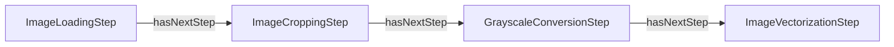

**Rappresentazione Turtle:**

```turtle
@prefix ddta: <https://w3id.org/ddta/core#> .
@prefix ex: <https://example.org/ddta/test#> .

ex:ImagePreparationProcess a ddta:Process ;
    ddta:realizesFunction ex:ImagePreparation ;
    ddta:hasStep ex:ImageLoadingStep,
        ex:ImageCroppingStep,
        ex:GrayscaleConversionStep,
        ex:ImageVectorizationStep .

ex:ImagePreparation a ddta:Function .
ex:ImageLoadingStep a ddta:ProcessStep ;
    ddta:hasNextStep ex:ImageCroppingStep .
ex:ImageCroppingStep a ddta:ProcessStep ;
    ddta:hasNextStep ex:GrayscaleConversionStep .
ex:GrayscaleConversionStep a ddta:ProcessStep ;
    ddta:hasNextStep ex:ImageVectorizationStep .
ex:ImageVectorizationStep a ddta:ProcessStep .
```

Gli Step appartengono al processo tramite `hasStep`; `hasNextStep` ne descrive la successione diretta prevista. La sequenza non dimostra l'esecuzione effettiva, né la conformità a tutti i contratti della funzione. Il CORE non impone una corrispondenza uno-a-uno tra Step e sottofunzioni.

L'esempio è separato dalle dichiarazioni normative e non contribuisce alla generazione del `core.ttl`.

---

## 16. Esempi integrativi del modello CORE

Gli esempi seguenti sono istanze illustrative, **separate dai blocchi normativi `ddta-ontology`**. Non introducono nuove classi, proprietà o Shape. Le dichiarazioni Turtle degli esempi non confluiscono in `core.ttl`.

### 16.1 Due processi per la stessa funzione

Una funzione `DigitRecognition` specifica una capacità di riconoscimento, indipendente dall'algoritmo adottato. Due processi distinti possono dichiarare di realizzarla, senza risultare per questo equivalenti o conformi.

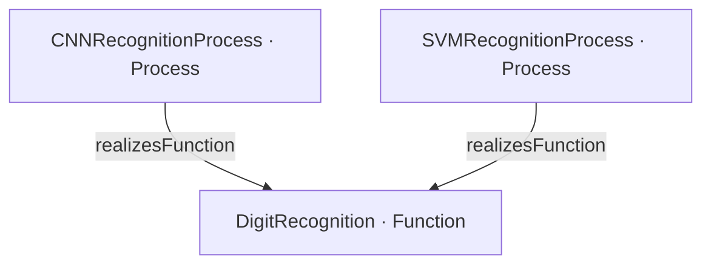

```turtle
@prefix ddta: <https://w3id.org/ddta/core#> .
@prefix ex: <https://example.org/ddta/test#> .

ex:DigitRecognition a ddta:Function .
ex:CNNRecognitionProcess a ddta:Process ;
    ddta:realizesFunction ex:DigitRecognition .
ex:SVMRecognitionProcess a ddta:Process ;
    ddta:realizesFunction ex:DigitRecognition .
```

La comparazione tra i processi può riguardare accuratezza, prestazioni, robustezza o superfici di attacco, ma tali caratteristiche non vengono dedotte dalla sola relazione `realizesFunction`.

### 16.2 Due canali direzionali e attraversamento dei confini

Un sistema definisce due confini logici. `StoreA` appartiene al primo e `StoreB` al secondo. Due canali collegano le risorse in direzioni opposte; i contratti, quando presenti, appartengono alle rispettive `CommunicationFunction`, non ai canali.

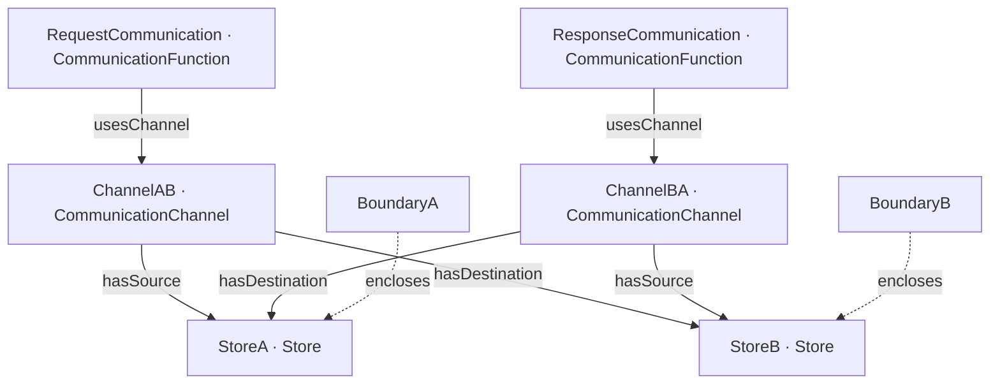

```turtle
@prefix ddta: <https://w3id.org/ddta/core#> .
@prefix ex: <https://example.org/ddta/test#> .

ex:ExampleSystem a ddta:System ;
    ddta:hasPrimaryFunction ex:RequestCommunication ;
    ddta:hasBoundary ex:BoundaryA, ex:BoundaryB .
ex:BoundaryA a ddta:Boundary ; ddta:encloses ex:StoreA .
ex:BoundaryB a ddta:Boundary ; ddta:encloses ex:StoreB .
ex:StoreA a ddta:Store .
ex:StoreB a ddta:Store .
ex:RequestCommunication a ddta:CommunicationFunction ;
    ddta:usesChannel ex:ChannelAB .
ex:ResponseCommunication a ddta:CommunicationFunction ;
    ddta:usesChannel ex:ChannelBA .
ex:ChannelAB a ddta:CommunicationChannel ;
    ddta:hasSource ex:StoreA ; ddta:hasDestination ex:StoreB .
ex:ChannelBA a ddta:CommunicationChannel ;
    ddta:hasSource ex:StoreB ; ddta:hasDestination ex:StoreA .
```

Entrambi i canali soddisfano i vincoli di sorgente e destinazione. Il sistema soddisfa il vincolo relativo alla funzione primaria. L'analisi di attraversamento applica le regole di appartenenza della scheda 11 a ciascun Boundary, senza attribuire automaticamente proprietà di sicurezza.

### 16.3 Due organizzazioni operative compatibili con la stessa precedenza funzionale

La funzione `ImagePreparation` richiede che il ritaglio e la conversione in scala di grigi precedano la vettorizzazione, ma non impone un ordine reciproco tra le prime due sottofunzioni.

Un processo può prevedere l'ordine `ImageCroppingStep → GrayscaleConversionStep → ImageVectorizationStep`; un altro può prevedere `GrayscaleConversionStep → ImageCroppingStep → ImageVectorizationStep`. Le due successioni illustrate non dimostrano da sole la conformità completa: è necessario verificare che i rispettivi Step realizzino effettivamente il comportamento richiesto.

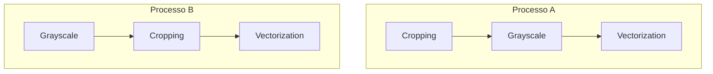

### 16.4 Limiti del flusso nel CORE

Il CORE può dichiarare `StepA hasNextStep StepB` e `StepA hasNextStep StepC`. **Questi due archi non specificano se B e C siano alternativi o concorrenti.** Non specificano neppure guardie, condizioni di attivazione o attesa del completamento di tutti i rami.

Questi aspetti appartengono a una possibile ontologia specializzata dei processi, capace di aggiungere informazioni agli stessi individui di `Process` e `ProcessStep`. La mancanza di tale semantica nel CORE non deve essere nascosta attribuendo a `hasNextStep` un significato che non possiede.

## 17. Esempi di estensione e analisi di sicurezza

### 17.1 Scenario relativo alla funzione: manipolazione dell'input

Per `DigitRecognition`, uno scenario ipotetico è la perturbazione intenzionale dell'immagine di ingresso. Due processi realizzativi possono mostrare comportamenti differenti in prove comparabili. Il CORE descrive la funzione e i processi; non possiede classi per esprimere risultati di valutazione, metriche, evidenze o vulnerabilità accertate. Questi elementi possono appartenere a un'ontologia Security.

La condivisione della stessa funzione non garantisce prestazioni o sicurezza equivalenti. Una valutazione è significativa soltanto in relazione a uno scenario, a condizioni di prova e a una specifica realizzazione.

### 17.2 Scenario introdotto dal processo: gradienti condivisi

Una funzione `ModelTraining` può essere realizzata mediante un processo di addestramento centralizzato oppure mediante un processo federato. Se il secondo rende osservabili aggiornamenti o gradienti a soggetti potenzialmente non fidati, introduce una superficie di esposizione assente nel primo **nell'ipotesi descritta**.

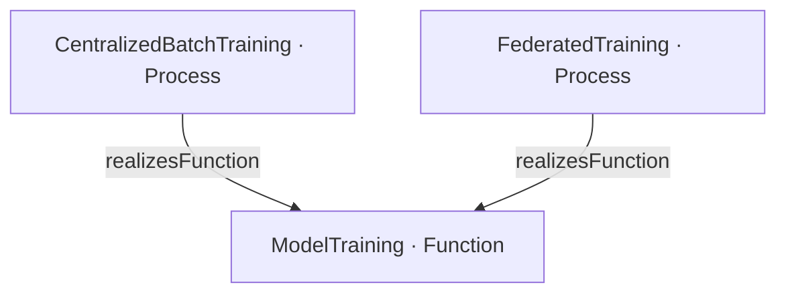

Ciò non prova una vulnerabilità del processo federato né l'assenza di altre minacce nel processo centralizzato. L'applicabilità dello scenario dipende dalla presenza del canale e dalle capacità dell'avversario; l'effettiva vulnerabilità richiede analisi distinta. Nessuna proprietà di attacco viene aggiunta al CORE da questo esempio.

## 18. Delimitazione e verifiche successive

Il CORE contiene **13 classi** documentate nelle sezioni 2–5 e 7–15. Il documento definisce il vocabolario e i vincoli esprimibili nella presente modellazione; non afferma di dimostrare la correttezza o la completezza di ogni descrizione DDTA.

Prima di utilizzare i file generati, occorrerà verificare separatamente: la corrispondenza tra dichiarazioni YAML e TTL OWL; l'esecuzione dei controlli SHACL; la validità e i risultati delle query SPARQL; le proprietà di inferenza; e la coerenza degli esempi con la semantica delle classi e delle proprietà.

L'ontologia specializzata dei processi potrà introdurre condizioni, guardie, alternative, parallelismo e sincronizzazione senza modificare l'identità degli individui già descritti nel CORE. Gli aspetti tecnici dell'implementazione e i collegamenti al codice rimangono estensioni da definire esplicitamente.
