# DDTA — Process Ontology: guida di definizione e schede ontologiche

Questo documento costituisce la **definizione di riferimento della DDTA Process Ontology**, estensione modulare del documento normativo `DDTA_CORE.md`. I blocchi `yaml ddta-ontology` dichiarano le classi e proprietà dell'estensione; i blocchi `yaml ontology-validation` dichiarano controlli documentali. I diagrammi Mermaid, le query SPARQL, gli esempi Turtle e le rappresentazioni SHACL non sono dichiarazioni aggiuntive del vocabolario e **non** confluiscono automaticamente nel Turtle generato.

**Namespace dell'estensione:** `process: <https://w3id.org/ddta/process#>`; `ddta: <https://w3id.org/ddta/core#>` resta riservato al CORE. Si tratta di IRI adottati nella specifica, senza assumere che esista una pubblicazione web o registrazione esterna già attiva.

**Regola di autorialità:** ogni classe e proprietà è dichiarata in una sola scheda. Ogni blocco `yaml ddta-ontology` deve essere selezionato tramite l'info-string esatto; i blocchi didattici sono esclusi. I valori `status: approved` esprimono l'approvazione **nel documento di definizione**, non lo stato dei file `core.ttl` / `process.ttl` presenti nel repository.

## 1. Scopo e confini

La DDTA Process Ontology **estende** il DDTA CORE per descrivere **COME** un processo è organizzato: transizioni, condizioni, diramazioni, concorrenza logica, sincronizzazioni, composizione e riferimenti granulari al codice e alla configurazione. Non ridefinisce il **COSA**: le capacità funzionali e i relativi contratti restano nel CORE.

Il modello rappresenta il **comportamento previsto**, non singole esecuzioni avvenute. Non assegna lo stato `RUNNING`, `WAITING` o `STOPPED` direttamente a `ddta:Process`; un'eventuale ontologia delle esecuzioni potrà distinguere istanze operative, eventi e stati osservati. Nella Process Ontology si possono descrivere percorsi che *continuano*, *attendono* oppure *terminano* senza affermare che una particolare esecuzione li abbia percorsi.

Sono rappresentabili nel modello: **sequenzialità**, **scelte XOR**, **concorrenza logica**, **sincronizzazione ALL/ANY/N-of-M**, **cicli**, **condizioni composte**, **sottoprocessi richiamati** e **collegamenti granulari al codice**. Il parallelismo fisico (processori, worker, thread, code, scheduling), gli stati effettivi e il grafo delle chiamate software restano specializzazioni possibili.

### 1.1 Riutilizzo del CORE

| Classe o proprietà del CORE | Utilizzo nell'estensione |
|---|---|
| `ddta:Process` | Identità della descrizione operativa |
| `ddta:ProcessStep` | Attività o punto operativo appartenente a un processo |
| `ddta:hasStep` | Appartenenza diretta degli Step a un Process |
| `ddta:hasNextStep` | Collegamento diretto possibile tra Step, senza guardie |
| `ddta:realizesFunction` | Process → Function; non dimostra conformità |
| `ddta:Function`, `ddta:Contract`, `ddta:ContractElement` | Specifica funzionale, distinta dal processo |
| `ddta:Resource` | Risorse tecniche, implementative e di configurazione |

`ddta:ProcessStep` **non è** sottoclasse di `ddta:Process`. Anche i nodi di controllo sono Step, non processi autonomi. La ricorsione operativa può essere ottenuta associando uno Step a un processo richiamato, senza trasformare ogni Step in un processo.

### 1.2 Classi dell’estensione

| Sezione | Classe | Relazione con CORE / estensione |
|---|---|---|
| 4 | `ProcessTransition` | Oggetto che dettaglia un collegamento tra Step |
| 5 | `Condition` | Criterio identificabile, indipendente dalla valutazione avvenuta |
| 6 | `AtomicCondition` | Sottoclasse di Condition |
| 7 | `CompositeCondition` | Sottoclasse di Condition |
| 8 | `Operand` | Riferimento semantico a un valore o a una specifica |
| 9 | `ControlNode` | Sottoclasse di `ddta:ProcessStep` |
| 10 | `SynchronizationNode` | Sottoclasse di ControlNode |
| 11 | `CodeReference` | Riferimento granulare al codice; **non** sottoclasse di Resource |
| 12 | Composizione e richiamo | Proprietà `hasSubProcess`, `hasInitialStep` e `invokesProcess` |

### 1.3 Diagramma complessivo

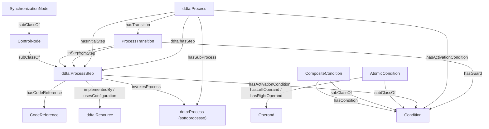

*Le frecce `subClassOf` raffigurano relazioni tra classi, non tra individui. Le restanti frecce rappresentano proprietà dell’estensione. I collegamenti a CodeReference e Resource valgono anche per Process, dove indicato nelle rispettive schede.*

## 2. Principi di interpretazione

1. **COSA / COME:** `Function` e contratti descrivono la capacità e i requisiti; `Process` e i suoi Step descrivono l'organizzazione operativa. Nessuna corrispondenza uno-a-uno obbligatoria.
2. **Descrizione / esecuzione:** una transizione prevista non è una transizione avvenuta; una condizione descritta non è automaticamente vera; un End non documenta un'esecuzione terminata.
3. **Concorrenza logica / parallelismo fisico:** rami concorrenti possono procedere indipendentemente senza richiedere thread, macchine o tempi effettivamente sovrapposti.
4. **Assenza / falsità:** l'assenza di un fatto RDF non prova che il fatto sia falso (OWL open-world); i controlli SHACL operano sul grafo validato con criteri documentali espliciti.
5. **Estensibilità:** processi distribuiti, code, agenti, telemetria, sicurezza e analisi del codice potranno estendere le identità esistenti.
6. **Configurazione:** il parametro concreto può mutare mantenendo l'identità semantica del criterio; una variazione del parametro può però modificare il comportamento richiesto e deve essere tracciabile.
7. **Controllo non equivale a garanzia operativa:** i grafi modellano il comportamento previsto. Cancellazione effettiva, atomicità, scheduling e completamento fisico richiedono una semantica esecutiva specifica.

## 3. Convenzioni di authoring e verificabilità

- Gli IRI della Process Ontology utilizzano `process:` negli esempi; `ddta:` designa esclusivamente le entità del CORE.
- Le definizioni bilingui sono incluse nei blocchi `yaml ddta-ontology` con `module: process`, `status: approved` e `owner` per le proprietà.
- Si dichiara **una sola volta** ciascuna Object Property / Datatype Property. Le altre schede la richiamano senza ridichiarla.
- Le cardinalità documentali devono essere specificate separatamente dagli assiomi OWL. La generazione degli Shape SHACL è una fase successiva.
- I controlli obbligatori sono definiti come requisiti della prima implementazione; non si presume che il generatore attuale li implementi già.
- Tutti gli esempi sono separati dai dati normativi e non contribuiscono alla generazione dei TTL.

---

## 4. Scheda ontologica — `ProcessTransition`

### 4.1 Identificazione e definizione

```yaml ddta-ontology
record: class
module: process
iri: process:ProcessTransition
status: approved
label:
  en: Process Transition
  it: Transizione di processo
definition:
  en: >-
    An identifiable planned direct flow connection between
    two process steps, which may be qualified by a guard.
    It does not represent an executed transition.
  it: >-
    Un collegamento diretto e pianificato tra due passi
    di processo, eventualmente qualificato da una guardia.
    Non rappresenta una transizione effettivamente eseguita.
```

### 4.2 Relazioni

```yaml ddta-ontology
record: object-properties
module: process
owner: process:ProcessTransition
properties:
  - iri: process:hasTransition
    status: approved
    domain: ddta:Process
    range: process:ProcessTransition
    label: {en: has transition, it: ha una transizione}
    definition:
      en: Relates a process to one of its planned transitions.
      it: Collega un processo a una delle transizioni pianificate.
  - iri: process:fromStep
    status: approved
    domain: process:ProcessTransition
    range: ddta:ProcessStep
    label: {en: from step, it: dal passo}
    definition:
      en: Identifies the source step of a transition.
      it: Identifica il passo sorgente di una transizione.
  - iri: process:toStep
    status: approved
    domain: process:ProcessTransition
    range: ddta:ProcessStep
    label: {en: to step, it: al passo}
    definition:
      en: Identifies the destination step of a transition.
      it: Identifica il passo destinazione di una transizione.
  - iri: process:hasGuard
    status: approved
    domain: process:ProcessTransition
    range: process:Condition
    label: {en: has guard, it: ha una guardia}
    definition:
      en: Relates a transition to the condition guarding its enablement.
      it: Collega una transizione alla condizione che ne governa l'abilitazione.
```

Le relazioni `fromStep` e `toStep` hanno cardinalità documentale **1..1**; `hasGuard` **0..1** nel modello, così non resta ambiguo come combinare più guardie (per più condizioni si usa `CompositeCondition`). Una transizione appartiene a un solo processo proprietario tramite `hasTransition`; il processo dichiara gli Step con `ddta:hasStep`.

**Compatibilità con il CORE:** una transizione `T` da `A` a `B` dettaglia `A ddta:hasNextStep B`. Il collegamento CORE è ricavabile mediante una proiezione SPARQL `CONSTRUCT`, **non automaticamente da OWL**. `hasNextStep` può essere presente anche senza una transizione specializzata; tale assenza non significa “senza guardia”.

### 4.3 Interrogazioni SPARQL

```sparql
PREFIX ddta: <https://w3id.org/ddta/core#>
PREFIX process: <https://w3id.org/ddta/process#>
SELECT ?transition ?source ?destination ?guard
WHERE {
  ?process process:hasTransition ?transition .
  ?transition process:fromStep ?source ; process:toStep ?destination .
  OPTIONAL { ?transition process:hasGuard ?guard . }
}
```

**Proiezione verso `hasNextStep`, da eseguire esplicitamente nel sistema di generazione/materializzazione:**

```sparql
PREFIX ddta: <https://w3id.org/ddta/core#>
PREFIX process: <https://w3id.org/ddta/process#>
CONSTRUCT { ?source ddta:hasNextStep ?destination . }
WHERE {
  ?p process:hasTransition ?t .
  ?p ddta:hasStep ?source, ?destination .
  ?t process:fromStep ?source ; process:toStep ?destination .
}
```

### 4.4 Vincoli di validazione

| ID | Requisito | Prima implementazione |
|---|---|---|
| `PRC-TRANS-01` | Per **ogni** Process che dichiara una transizione, sorgente e destinazione devono appartenere tramite `hasStep` a quel medesimo Process | **Obbligatorio** |
| `PRC-TRANS-02` | Esattamente un `fromStep` e un `toStep` | **Obbligatorio** |
| `PRC-TRANS-03` | Al massimo una guardia per transizione (eventuale combinazione tramite `CompositeCondition`) | **Obbligatorio** |
| `PRC-TRANS-04` | Ogni transizione specializzata è dichiarata da un unico processo proprietario nel grafo validato | **Obbligatorio** |

**Dichiarazione strutturata di validazione:**

```yaml ontology-validation
kind: OntologyValidation
target: process:ProcessTransition
engine: SHACL
constraints:
  - id: PRC-TRANS-02
    type: property-count
    properties:
      - {path: process:fromStep, minCount: 1, maxCount: 1}
      - {path: process:toStep, minCount: 1, maxCount: 1}
  - id: PRC-TRANS-03
    path: process:hasGuard
    maxCount: 1
```

**`PRC-TRANS-01` richiede un controllo anche sui Process proprietari**, non soltanto sul singolo oggetto Transition. Esempio di query SHACL-SPARQL sulla shape `ddta:Process`:

```sparql
PREFIX ddta: <https://w3id.org/ddta/core#>
PREFIX process: <https://w3id.org/ddta/process#>
SELECT $this ?value
WHERE {
  $this process:hasTransition ?value .
  FILTER NOT EXISTS {
    ?value process:fromStep ?from ; process:toStep ?to .
    $this ddta:hasStep ?from, ?to .
  }
}
```

Questa query segnala anche transizioni con estremità mancanti; il controllo di cardinalità fornisce la diagnostica specifica. La relazione proprietaria `hasTransition` deve essere univoca nel grafo documentato (`PRC-TRANS-04`), così una transizione non è accidentalmente condivisa fra processi differenti. La forma YAML del controllo SPARQL sarà consolidata insieme al generatore.

**Vincoli sulla proprietà del processo e sull’unicità del proprietario:**

```yaml ontology-validation
kind: OntologyValidation
target: ddta:Process
engine: SHACL
constraints:
  - id: PRC-TRANS-01
    type: sparql
    message:
      en: Transition endpoints must belong to the process declaring the transition.
      it: Le estremità della transizione devono appartenere al processo che la dichiara.
    select: |-
      PREFIX ddta: <https://w3id.org/ddta/core#>
      PREFIX process: <https://w3id.org/ddta/process#>
      SELECT $this ?value
      WHERE {
        $this process:hasTransition ?value .
        FILTER NOT EXISTS {
          ?value process:fromStep ?source ; process:toStep ?target .
          $this ddta:hasStep ?source, ?target .
        }
      }
```

```yaml ontology-validation
kind: OntologyValidation
target: process:ProcessTransition
engine: SHACL
constraints:
  - id: PRC-TRANS-04
    type: sparql
    message:
      en: A transition must have exactly one owning process.
      it: Una transizione deve avere esattamente un processo proprietario.
    select: |-
      PREFIX process: <https://w3id.org/ddta/process#>
      SELECT $this
      WHERE {
        { FILTER NOT EXISTS { ?owner process:hasTransition $this . } }
        UNION
        {
          ?ownerA process:hasTransition $this .
          ?ownerB process:hasTransition $this .
          FILTER(?ownerA != ?ownerB)
        }
      }
```

### 4.5 Esempio illustrativo

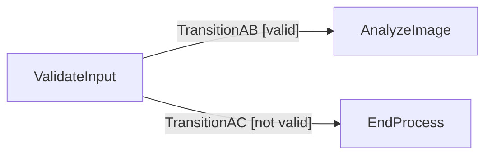

```turtle
@prefix ddta: <https://w3id.org/ddta/core#> .
@prefix process: <https://w3id.org/ddta/process#> .
@prefix ex: <https://example.org/ddta/process-example#> .
ex:ExampleProcess a ddta:Process ;
    ddta:hasStep ex:ValidateInput, ex:AnalyzeImage, ex:EndProcess ;
    process:hasTransition ex:TransitionAB, ex:TransitionAC .
ex:ValidateInput a ddta:ProcessStep .
ex:AnalyzeImage a ddta:ProcessStep .
ex:EndProcess a process:ControlNode ; process:controlKind "END_PROCESS" .
ex:TransitionAB a process:ProcessTransition ;
    process:fromStep ex:ValidateInput ; process:toStep ex:AnalyzeImage ;
    process:hasGuard ex:InputValid .
ex:TransitionAC a process:ProcessTransition ;
    process:fromStep ex:ValidateInput ; process:toStep ex:EndProcess ;
    process:hasGuard ex:InputInvalid .
ex:InputValid a process:Condition .
ex:InputInvalid a process:Condition .
```

---

## 5. Scheda ontologica — `Condition`

### 5.1 Identificazione e definizione

```yaml ddta-ontology
record: class
module: process
iri: process:Condition
status: approved
label: {en: Condition, it: Condizione}
definition:
  en: >-
    An identifiable criterion that can be evaluated to
    determine whether a planned process behavior is enabled.
    Its declaration does not assert its current truth value.
  it: >-
    Un criterio identificabile valutabile per determinare
    se un comportamento previsto del processo è abilitato.
    La dichiarazione non afferma il suo valore di verità attuale.
```

Una condizione possiede un **significato identificabile**: ad esempio `CandidateModelAcceptanceCriterion`. L'espressione valutativa e i parametri concreti non costituiscono necessariamente l'identità della condizione. Una modifica della soglia può cambiare il comportamento richiesto e deve restare tracciabile tramite specifica/configurazione.

Non introduciamo una classe separata `ProcessTrigger` nella Process Ontology. Un evento e una condizione di stato non sono identici, ma un'attivazione descritta come criterio è sufficiente per questa versione; un'ontologia degli eventi potrà specializzare la distinzione.

### 5.2 Relazioni

```yaml ddta-ontology
record: object-properties
module: process
owner: process:Condition
properties:
  - iri: process:hasActivationCondition
    status: approved
    domain:
      unionOf: [ddta:Process, ddta:ProcessStep]
    range: process:Condition
    label: {en: has activation condition, it: ha condizione di attivazione}
    definition:
      en: Relates a process or step to its enabling criterion.
      it: Collega un processo o passo al relativo criterio abilitante.
```

La proprietà **unica** `hasActivationCondition` è applicabile a `Process` e `ProcessStep`. Il dominio in OWL è una **unione**, non due `rdfs:domain` (che implicherebbero l'intersezione). Una condizione su una singola transizione usa invece `hasGuard` (sezione 4), perché una guardia riguarda uno specifico collegamento.

L'assenza di condizioni dichiarate non significa che l'attivazione sia sempre permessa: indica soltanto che la specifica non ha aggiunto vincoli in questo modello. La distinzione fra `true`, `false` e `unknown` riguarda la **valutazione**, non l'identità ontologica del criterio.

### 5.3 Interrogazioni SPARQL

```sparql
PREFIX process: <https://w3id.org/ddta/process#>
PREFIX ex: <https://example.org/ddta/process-example#>
SELECT DISTINCT ?condition WHERE {
  ex:ExampleProcess process:hasActivationCondition ?condition .
}
```

```sparql
PREFIX process: <https://w3id.org/ddta/process#>
PREFIX ex: <https://example.org/ddta/process-example#>
SELECT DISTINCT ?transition WHERE {
  ?transition process:hasGuard ex:ExampleCondition .
}
```

### 5.4 Vincoli e interpretazione

Cardinalità di `hasActivationCondition`: **0..1** per Process o ProcessStep nel modello; una composizione AND/OR/NOT si rappresenta mediante una `CompositeCondition`. Eventuali condizioni che non possono essere formalizzate sono ammesse come criteri documentati, ma non si dichiara che siano valutabili automaticamente.

Per i requisiti funzionali espressi nei contratti, la condizione operativa può fare riferimento agli elementi contrattuali pertinenti, senza affermare che tutta la semantica del contratto sia già verificata automaticamente.

**Validazione del criterio di attivazione (unica condizione per Process/Step):**

```yaml ontology-validation
kind: OntologyValidation
target: ddta:Process
engine: SHACL
constraints:
  - id: PRC-COND-01
    type: property-count
    properties:
      - {path: process:hasActivationCondition, maxCount: 1}
```

```yaml ontology-validation
kind: OntologyValidation
target: ddta:ProcessStep
engine: SHACL
constraints:
  - id: PRC-COND-02
    type: property-count
    properties:
      - {path: process:hasActivationCondition, maxCount: 1}
```

### 5.5 Esempio illustrativo

`ModelAdaptationProcess` è abilitabile quando il criterio `EnoughClinicalReviews` è soddisfatto. La dichiarazione non afferma che il processo sia stato avviato.

```turtle
@prefix ddta: <https://w3id.org/ddta/core#> .
@prefix process: <https://w3id.org/ddta/process#> .
@prefix ex: <https://example.org/ddta/process-example#> .
ex:ModelAdaptationProcess a ddta:Process ;
    process:hasActivationCondition ex:EnoughClinicalReviews .
ex:EnoughClinicalReviews a process:Condition .
```

---

## 6. Scheda ontologica — `AtomicCondition`

### 6.1 Identificazione e definizione

```yaml ddta-ontology
record: class
module: process
iri: process:AtomicCondition
status: approved
subClassOf: process:Condition
label: {en: Atomic Condition, it: Condizione atomica}
definition:
  en: >-
    A condition specifying a single binary comparison between
    semantically identified operands.
  it: >-
    Una condizione che specifica un confronto binario elementare
    fra operandi identificati semanticamente.
```

### 6.2 Relazioni

```yaml ddta-ontology
record: object-properties
module: process
owner: process:AtomicCondition
properties:
  - iri: process:hasLeftOperand
    status: approved
    domain: process:AtomicCondition
    range: process:Operand
    label: {en: has left operand, it: ha operando sinistro}
    definition:
      en: Identifies the evaluated operand of an atomic comparison.
      it: Identifica l'operando valutato in un confronto atomico.
  - iri: process:hasRightOperand
    status: approved
    domain: process:AtomicCondition
    range: process:Operand
    label: {en: has right operand, it: ha operando destro}
    definition:
      en: Identifies the reference operand of an atomic comparison.
      it: Identifica l'operando di riferimento di un confronto atomico.
```

```yaml ddta-ontology
record: datatype-properties
module: process
owner: process:AtomicCondition
properties:
  - iri: process:comparisonOperator
    status: approved
    domain: process:AtomicCondition
    range: xsd:string
    label: {en: comparison operator, it: operatore di confronto}
    definition:
      en: Controlled identifier of the comparison operation.
      it: Identificatore controllato dell'operazione di confronto.
```

Operatori di confronto definiti: `EQ`, `NE`, `LT`, `LE`, `GT`, `GE`; ulteriori operatori richiederanno una definizione semantica esplicita. Un criterio non riconducibile a un confronto binario resta documentabile come `Condition` generale: **non inventiamo un'espressione formalmente valutabile dove manca la semantica**.

### 6.3 Interrogazione SPARQL

```sparql
PREFIX process: <https://w3id.org/ddta/process#>
SELECT ?condition ?left ?op ?right WHERE {
  ?condition a process:AtomicCondition ;
    process:hasLeftOperand ?left ;
    process:comparisonOperator ?op ;
    process:hasRightOperand ?right .
}
```

### 6.4 Vincoli

Cardinalità documentale **1..1** per ciascun operando e per `comparisonOperator` quando un individuo è classificato come `AtomicCondition`; valori dell'operatore limitati all'insieme controllato. Si tratta di **validazioni SHACL**, non di assiomi che determinano la verità del predicato.

**Controlli documentali per una condizione formalizzata:**

```yaml ontology-validation
kind: OntologyValidation
target: process:AtomicCondition
engine: SHACL
constraints:
  - id: PRC-ATOM-01
    type: property-count
    properties:
      - {path: process:hasLeftOperand, minCount: 1, maxCount: 1}
      - {path: process:hasRightOperand, minCount: 1, maxCount: 1}
      - {path: process:comparisonOperator, minCount: 1, maxCount: 1}
  - id: PRC-ATOM-02
    type: sparql
    message:
      en: Comparison operator must belong to the defined vocabulary.
      it: L'operatore di confronto deve appartenere al vocabolario definito.
    select: |-
      PREFIX process: <https://w3id.org/ddta/process#>
      SELECT $this WHERE {
        $this process:comparisonOperator ?op .
        FILTER(?op NOT IN ("EQ", "NE", "LT", "LE", "GT", "GE"))
      }
```

### 6.5 Esempio illustrativo

`CandidateAccuracyAcceptable` descrive `CandidateAccuracy >= MinimumRequiredAccuracy`. La soglia numerica non viene incorporata nell'identità della condizione.

```turtle
@prefix process: <https://w3id.org/ddta/process#> .
@prefix ex: <https://example.org/ddta/process-example#> .
ex:CandidateAccuracyAcceptable a process:AtomicCondition ;
    process:hasLeftOperand ex:CandidateAccuracyOperand ;
    process:comparisonOperator "GE" ;
    process:hasRightOperand ex:RequiredAccuracyOperand .
```

---

## 7. Scheda ontologica — `CompositeCondition`

### 7.1 Identificazione e definizione

```yaml ddta-ontology
record: class
module: process
iri: process:CompositeCondition
status: approved
subClassOf: process:Condition
label: {en: Composite Condition, it: Condizione composta}
definition:
  en: >-
    A condition combining other conditions by a declared
    Boolean operator, without recording their actual evaluation.
  it: >-
    Una condizione che combina altre condizioni mediante
    un operatore booleano dichiarato, senza registrare
    il risultato della loro valutazione effettiva.
```

### 7.2 Relazioni

```yaml ddta-ontology
record: object-properties
module: process
owner: process:CompositeCondition
properties:
  - iri: process:hasCondition
    status: approved
    domain: process:CompositeCondition
    range: process:Condition
    label: {en: has condition, it: comprende una condizione}
    definition:
      en: Relates a composite condition to a directly included condition.
      it: Collega una condizione composta a una condizione inclusa direttamente.
```

```yaml ddta-ontology
record: datatype-properties
module: process
owner: process:CompositeCondition
properties:
  - iri: process:logicalOperator
    status: approved
    domain: process:CompositeCondition
    range: xsd:string
    label: {en: logical operator, it: operatore logico}
    definition:
      en: Boolean combination operator of a composite condition.
      it: Operatore di combinazione booleana di una condizione composta.
```

Operatori previsti: `AND`, `OR`, `NOT`. `NOT` richiede esattamente una condizione componente; `AND` e `OR` richiedono almeno due componenti. La struttura delle condizioni composte deve essere **aciclica**. `hasCondition` non è transitiva.

### 7.3 Interrogazioni SPARQL

```sparql
PREFIX process: <https://w3id.org/ddta/process#>
SELECT ?composite ?operator ?member WHERE {
  ?composite a process:CompositeCondition ;
      process:logicalOperator ?operator ;
      process:hasCondition ?member .
}
```

### 7.4 Vincoli

Controlli SHACL richiesti: un `logicalOperator`, numero di componenti coerente con l'operatore e assenza di cicli su `hasCondition+`. Le condizioni possono includere altre condizioni composte, senza imporre un limite universale alla profondità.

**Controlli documentali:**

```yaml ontology-validation
kind: OntologyValidation
target: process:CompositeCondition
engine: SHACL
constraints:
  - id: PRC-COMP-COND-01
    type: property-count
    properties:
      - {path: process:logicalOperator, minCount: 1, maxCount: 1}
  - id: PRC-COMP-COND-02
    type: sparql
    message:
      en: Condition composition contains a cycle.
      it: La composizione delle condizioni contiene un ciclo.
    select: |-
      PREFIX process: <https://w3id.org/ddta/process#>
      SELECT $this WHERE { $this process:hasCondition+ $this . }
  - id: PRC-COMP-COND-03
    type: sparql
    message:
      en: Boolean operator and number of component conditions are incompatible.
      it: Operatore booleano e numero di condizioni componenti non compatibili.
    select: |-
      PREFIX process: <https://w3id.org/ddta/process#>
      SELECT $this WHERE {
        $this process:logicalOperator ?op .
        {
          SELECT $this (COUNT(DISTINCT ?part) AS ?members)
          WHERE { OPTIONAL { $this process:hasCondition ?part . } }
          GROUP BY $this
        }
        FILTER(
          ?op NOT IN ("AND", "OR", "NOT") ||
          (?op = "NOT" && ?members != 1) ||
          (?op IN ("AND", "OR") && ?members < 2)
        )
      }
```

### 7.5 Esempio illustrativo

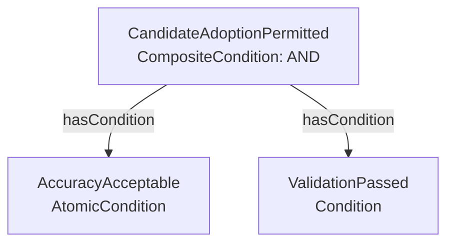

```turtle
@prefix process: <https://w3id.org/ddta/process#> .
@prefix ex: <https://example.org/ddta/process-example#> .
ex:CandidateAdoptionPermitted a process:CompositeCondition ;
    process:logicalOperator "AND" ;
    process:hasCondition ex:CandidateAccuracyAcceptable, ex:ValidationPassed .
ex:ValidationPassed a process:Condition .
```

---

## 8. Scheda ontologica — `Operand`

### 8.1 Identificazione e definizione

```yaml ddta-ontology
record: class
module: process
iri: process:Operand
status: approved
label: {en: Operand, it: Operando}
definition:
  en: >-
    An identifiable operand in a process condition, used to
    refer to a functional specification element, a parameter,
    an operational value or a literal without conflating them.
  it: >-
    Un operando identificabile in una condizione di processo,
    utilizzato per riferirsi a un elemento di specifica
    funzionale, un parametro, un valore operativo o un
    letterale senza confondere tali identità.
```

`Operand` **non** è sottoclasse di `ddta:ContractElement`: quest'ultimo rappresenta un elemento richiesto o ammesso da un contratto; l'operando rappresenta il suo **ruolo nell'espressione**. Un riferimento a un elemento contrattuale non ne crea un duplicato e non prova che il processo produca effettivamente un valore conforme.

### 8.2 Relazioni

```yaml ddta-ontology
record: object-properties
module: process
owner: process:Operand
properties:
  - iri: process:referencesContractElement
    status: approved
    domain: process:Operand
    range: ddta:ContractElement
    label: {en: references contract element, it: fa riferimento a elemento contrattuale}
    definition:
      en: Identifies a functionally specified element referenced by an operand.
      it: Identifica l'elemento funzionalmente specificato cui si riferisce l'operando.
  - iri: process:referencesResource
    status: approved
    domain: process:Operand
    range: ddta:Resource
    label: {en: references resource, it: fa riferimento a risorsa}
    definition:
      en: Identifies a resource from which an operand may be resolved.
      it: Identifica una risorsa da cui un operando può essere risolto.
```

```yaml ddta-ontology
record: datatype-properties
module: process
owner: process:Operand
properties:
  - iri: process:literalValue
    status: approved
    domain: process:Operand
    range: rdfs:Literal
    label: {en: literal value, it: valore letterale}
    definition:
      en: Constant literal used as an operand when explicitly defined.
      it: Costante letterale utilizzata come operando quando esplicitamente definita.
  - iri: process:valueLocator
    status: approved
    domain: process:Operand
    range: xsd:string
    label: {en: value locator, it: localizzatore del valore}
    definition:
      en: Logical locator of the value within a named resource or operational context.
      it: Localizzatore logico del valore in una risorsa o contesto operativo identificato.
```

**Disciplina dei riferimenti.** Un operando può riferirsi a un elemento contrattuale, a un valore di configurazione, a uno stato operativo o a una costante. Per una condizione automaticamente valutabile è necessario che il riferimento sia risolvibile e abbia semantica e tipo del valore noti. `valueLocator` non è un linguaggio di query standardizzato: la sua sintassi e interpretazione appartengono alla specializzazione o al valutatore, non sono inferite dall’ontologia. Non viene inferita una variabile di codice a partire dal nome di un `ContractElement`.

### 8.3 Interrogazione SPARQL

```sparql
PREFIX process: <https://w3id.org/ddta/process#>
SELECT ?operand ?contractElement ?resource ?locator ?literal WHERE {
  ?operand a process:Operand .
  OPTIONAL { ?operand process:referencesContractElement ?contractElement . }
  OPTIONAL { ?operand process:referencesResource ?resource . }
  OPTIONAL { ?operand process:valueLocator ?locator . }
  OPTIONAL { ?operand process:literalValue ?literal . }
}
```

### 8.4 Vincoli

Un operando per cui è prevista una valutazione automatica deve avere un meccanismo di risoluzione non ambiguo. La mutua esclusione esatta tra `literalValue` e riferimenti esterni, nonché la tipizzazione e la semantica di `valueLocator`, sono criteri che richiedono un valutatore specializzato e non costituiscono vincoli SHACL universali. Non imponiamo ora che ogni `Operand` sia esclusivamente un letterale o esclusivamente un riferimento, perché alcuni parametri possono avere valore predefinito e riferimento configurabile.

### 8.5 Esempio illustrativo

```turtle
@prefix ddta: <https://w3id.org/ddta/core#> .
@prefix process: <https://w3id.org/ddta/process#> .
@prefix ex: <https://example.org/ddta/process-example#> .
ex:CandidateAccuracyOperand a process:Operand ;
    process:referencesContractElement ex:CandidateAccuracyElement .
ex:RequiredAccuracyOperand a process:Operand ;
    process:referencesResource ex:EvaluationSettings ;
    process:valueLocator "minimum_required_accuracy" .
ex:CandidateAccuracyElement a ddta:ContractElement .
ex:EvaluationSettings a ddta:Resource .
```

---

## 9. Scheda ontologica — `ControlNode`

### 9.1 Identificazione e definizione

```yaml ddta-ontology
record: class
module: process
iri: process:ControlNode
status: approved
subClassOf: ddta:ProcessStep
label: {en: Control Node, it: Nodo di controllo}
definition:
  en: >-
    A process step whose role is to govern planned control
    flow rather than to represent an application activity.
  it: >-
    Un passo di processo il cui ruolo consiste nel governare
    il flusso previsto anziché rappresentare un'attività applicativa.
```

### 9.2 Relazioni

```yaml ddta-ontology
record: datatype-properties
module: process
owner: process:ControlNode
properties:
  - iri: process:controlKind
    status: approved
    domain: process:ControlNode
    range: xsd:string
    label: {en: control kind, it: tipo di controllo}
    definition:
      en: Controlled identifier of a control node's behavior.
      it: Identificatore controllato del comportamento di un nodo di controllo.
```

Valori controllati: `XOR_SPLIT`, `XOR_MERGE`, `CONCURRENT_SPLIT`, `WAIT`, `END_BRANCH`, `END_PROCESS`. `SynchronizationNode` rappresenta invece un controllo specializzato di ricongiungimento. `CONTINUE` non richiede un nodo dedicato: è rappresentabile tramite normale transizione.

**Semantica da preservare:**

- `XOR_SPLIT`: abilita **una sola** alternativa scelta secondo guardie o regola di selezione esplicita; guardie sovrapposte o nessuna guardia soddisfatta richiedono una politica documentata.
- `XOR_MERGE`: ricongiunge percorsi alternativi senza introdurre una barriera che attenda rami non selezionati.
- `CONCURRENT_SPLIT`: abilita più rami logicamente indipendenti; non afferma esecuzione simultanea fisica.
- `WAIT`: rappresenta una sospensione prevista fino a una condizione di prosecuzione; non registra lo stato attuale di un'esecuzione.
- `END_BRANCH`: termina il ramo logico rappresentato; non implica la terminazione di tutti gli altri rami.
- `END_PROCESS`: prescrive la terminazione del processo descritto secondo la semantica della futura esecuzione; **non certifica** che worker in corso siano già stati fisicamente interrotti.

### 9.3 Interrogazione SPARQL

```sparql
PREFIX process: <https://w3id.org/ddta/process#>
SELECT ?node ?kind WHERE {
  ?node a process:ControlNode ; process:controlKind ?kind .
}
```

### 9.4 Vincoli

Un `ControlNode` ordinario deve avere esattamente un `controlKind` riconosciuto. Per `SynchronizationNode` il tipo di controllo è definito tramite `joinPolicy`, senza imporre anche `controlKind`. La coerenza tra tipo di controllo e numero di ingressi/uscite sarà soggetta a SHACL e, per aspetti dinamici, a verifica del flusso. Non si impone che ogni `ProcessStep` sia un nodo di controllo.

**Controllo del tipo per nodi non specializzati come join:**

```yaml ontology-validation
kind: OntologyValidation
target: process:ControlNode
engine: SHACL
constraints:
  - id: PRC-CTRL-01
    type: sparql
    message:
      en: Non-synchronization control nodes need one recognized control kind.
      it: I nodi di controllo non di sincronizzazione richiedono un tipo riconosciuto.
    select: |-
      PREFIX process: <https://w3id.org/ddta/process#>
      SELECT $this WHERE {
        FILTER NOT EXISTS { $this a process:SynchronizationNode . }
        {
          FILTER NOT EXISTS { $this process:controlKind ?kind . }
        } UNION {
          $this process:controlKind ?kind .
          FILTER(?kind NOT IN
            ("XOR_SPLIT", "XOR_MERGE", "CONCURRENT_SPLIT",
             "WAIT", "END_BRANCH", "END_PROCESS"))
        } UNION {
          $this process:controlKind ?kind1, ?kind2 .
          FILTER(?kind1 != ?kind2)
        }
      }
```

Il nodo ordinario deve possedere **esattamente un** `controlKind`; l'insieme dei valori ammissibili è elencato nella scheda. La specializzazione `SynchronizationNode` utilizza invece `joinPolicy` senza obbligo di `controlKind`.

### 9.5 Esempio illustrativo

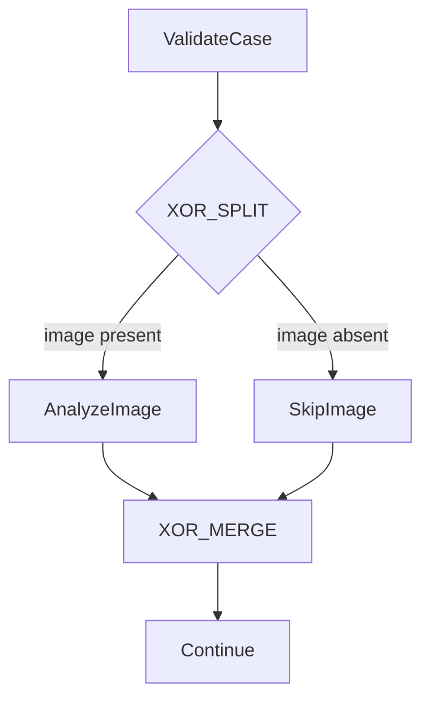

---

## 10. Scheda ontologica — `SynchronizationNode`

### 10.1 Identificazione e definizione

```yaml ddta-ontology
record: class
module: process
iri: process:SynchronizationNode
status: approved
subClassOf: process:ControlNode
label: {en: Synchronization Node, it: Nodo di sincronizzazione}
definition:
  en: >-
    A control node that enables a continuation according
    to a declared rule over completion of participating branches,
    independently of physical parallel execution.
  it: >-
    Un nodo di controllo che abilita una prosecuzione secondo
    una regola dichiarata sul completamento dei rami partecipanti,
    indipendentemente dall'esecuzione fisicamente parallela.
```

### 10.2 Proprietà

```yaml ddta-ontology
record: datatype-properties
module: process
owner: process:SynchronizationNode
properties:
  - iri: process:joinPolicy
    status: approved
    domain: process:SynchronizationNode
    range: xsd:string
    label: {en: join policy, it: politica di sincronizzazione}
    definition:
      en: Synchronization rule ALL, ANY or N_OF_M.
      it: Regola di sincronizzazione ALL, ANY o N_OF_M.
  - iri: process:requiredCount
    status: approved
    domain: process:SynchronizationNode
    range: xsd:positiveInteger
    label: {en: required count, it: numero richiesto}
    definition:
      en: Minimum count of eligible completed branches for N_OF_M.
      it: Numero minimo di rami completati ammissibili per N_OF_M.
  - iri: process:completionCriterion
    status: approved
    domain: process:SynchronizationNode
    range: xsd:string
    label: {en: completion criterion, it: criterio di completamento}
    definition:
      en: Declares which kind of branch completion contributes to the threshold.
      it: Dichiara quale genere di completamento di ramo contribuisce alla soglia.
```

Politiche previste: `ALL`, `ANY`, `N_OF_M`; criteri iniziali: `TERMINATED`, `SUCCESS`. Gli archi `ProcessTransition` in ingresso identificano **i rami partecipanti** al join. `M` è il numero dei partecipanti identificati nel grafo documentato; `N` è `requiredCount` nel caso `N_OF_M`, con `1 <= N <= M`.

Per `ALL` non serve `requiredCount` (`N=M`); per `ANY` non serve `requiredCount` (`N=1`). Per `N_OF_M` è obbligatorio. Un ramo non viene contato più volte nella medesima istanza logica della sincronizzazione; la semantica della valutazione di cicli e delle singole esecuzioni appartiene a un ulteriore livello di modellazione.

**Non attribuiamo una politica implicita ai rami residui.** La soglia raggiunta significa che la continuazione è abilitabile; l'eventuale terminazione di rami, cancellazione, attesa o gestione dei risultati tardivi richiede attività o regole esplicite. `END_BRANCH` e `END_PROCESS` sono controlli di flusso, non stati osservati di un'esecuzione.

### 10.3 Interrogazione SPARQL

```sparql
PREFIX process: <https://w3id.org/ddta/process#>
SELECT ?join ?policy ?n (COUNT(DISTINCT ?transition) AS ?m)
WHERE {
  ?join a process:SynchronizationNode ; process:joinPolicy ?policy .
  OPTIONAL { ?join process:requiredCount ?n . }
  OPTIONAL { ?transition process:toStep ?join . }
}
GROUP BY ?join ?policy ?n
```

### 10.4 Vincoli SHACL previsti

| ID | Controllo |
|---|---|
| `PRC-SYNC-01` | Politica presente e appartenente all'insieme ALL, ANY, N_OF_M |
| `PRC-SYNC-02` | `requiredCount` obbligatorio e positivo soltanto per N_OF_M |
| `PRC-SYNC-03` | `requiredCount <= M`, con M numero di transizioni partecipanti in ingresso; M >= 1 |
| `PRC-SYNC-04` | `completionCriterion` esplicito, limitato ai valori controllati |
| `PRC-SYNC-05` | Un join appartiene al processo che dichiara le relative transizioni, nel rispetto di `PRC-TRANS-01` |

SHACL può verificare cardinalità e coerenza dei riferimenti **nel grafo documentato**. La correttezza dei percorsi in presenza di cicli, diramazioni alternative o completion multiple richiede analisi ulteriori; non dichiariamo che `N_OF_M` sia eseguibile automaticamente solo in virtù del TTL.

**Dichiarazioni documentali:**

```yaml ontology-validation
kind: OntologyValidation
target: process:SynchronizationNode
engine: SHACL
constraints:
  - id: PRC-SYNC-01
    type: property-count
    properties:
      - {path: process:joinPolicy, minCount: 1, maxCount: 1}
  - id: PRC-SYNC-04
    type: property-count
    properties:
      - {path: process:completionCriterion, minCount: 1, maxCount: 1}
  - id: PRC-SYNC-02
    type: sparql
    message:
      en: N-of-M requires one positive count; other policies do not use it.
      it: N-of-M richiede un numero positivo; le altre politiche non lo utilizzano.
    select: |-
      PREFIX process: <https://w3id.org/ddta/process#>
      SELECT $this WHERE {
        $this process:joinPolicy ?policy .
        OPTIONAL { $this process:requiredCount ?count . }
        FILTER(
          (?policy = "N_OF_M" && (!BOUND(?count) || ?count < 1)) ||
          (?policy IN ("ALL", "ANY") && BOUND(?count)) ||
          ?policy NOT IN ("ALL", "ANY", "N_OF_M")
        )
      }
  - id: PRC-SYNC-03
    type: sparql
    message:
      en: The N-of-M threshold exceeds incoming participating transitions.
      it: La soglia N-of-M supera le transizioni partecipanti in ingresso.
    select: |-
      PREFIX ddta: <https://w3id.org/ddta/core#>
      PREFIX process: <https://w3id.org/ddta/process#>
      SELECT $this WHERE {
        $this process:joinPolicy ?policy .
        OPTIONAL { $this process:requiredCount ?required . }
        {
          SELECT $this (COUNT(DISTINCT ?transition) AS ?participants)
          WHERE {
            OPTIONAL {
              ?owner ddta:hasStep $this ;
                     process:hasTransition ?transition .
              ?transition process:toStep $this .
            }
          }
          GROUP BY $this
        }
        FILTER(?participants < 1 ||
          (?policy = "N_OF_M" && BOUND(?required) && ?required > ?participants))
      }
```

La validazione del vocabolario di `completionCriterion` (`TERMINATED` / `SUCCESS`) e del tipo dei numeri (`xsd:positiveInteger`) è obbligatoria, anche qualora sia implementata da vincoli di datatype o da regole di validazione aggiuntive. `PRC-SYNC-05` deriva dai controlli di appartenenza `PRC-TRANS-01` e `PRC-COMP-02` sul proprietario dello Step di join.

### 10.5 Esempio illustrativo

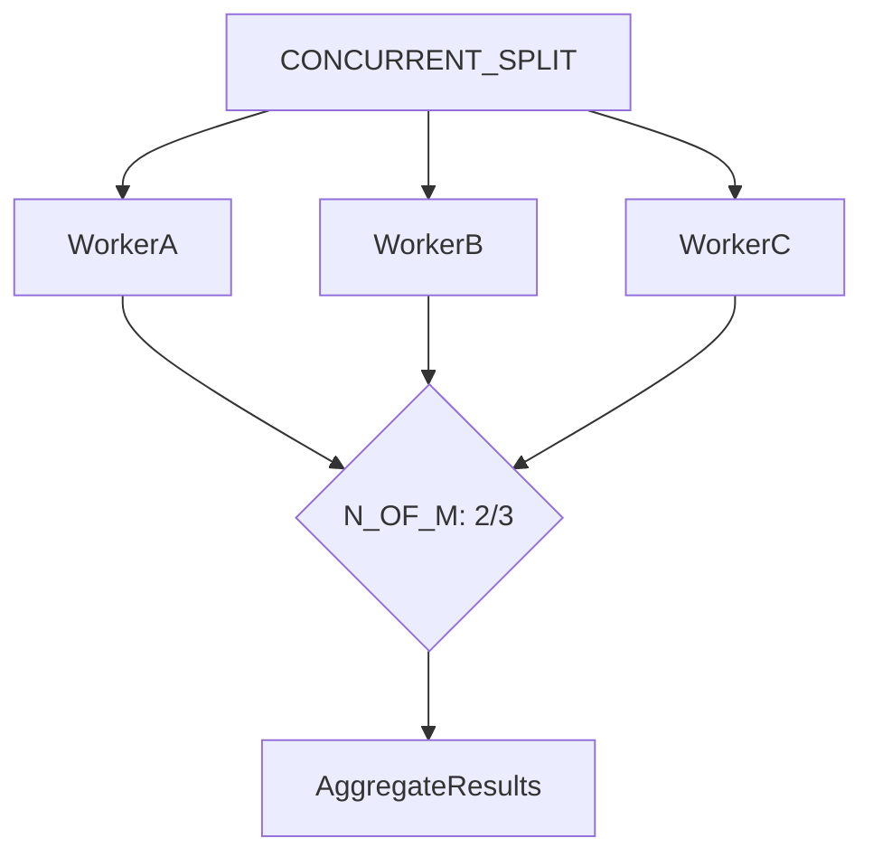

```turtle
@prefix process: <https://w3id.org/ddta/process#> .
@prefix ex: <https://example.org/ddta/process-example#> .
ex:JoinTwoOfThree a process:SynchronizationNode ;
    process:joinPolicy "N_OF_M" ;
    process:requiredCount 2 ;
    process:completionCriterion "SUCCESS" .
```

---

## 11. Scheda ontologica — `CodeReference`

### 11.1 Identificazione e definizione

```yaml ddta-ontology
record: class
module: process
iri: process:CodeReference
status: approved
label: {en: Code Reference, it: Riferimento al codice}
definition:
  en: >-
    An identifiable reference locating a source-code unit
    such as a file, module, class, function or method.
    It is not the resource that necessarily runs the code.
  it: >-
    Un riferimento identificabile che localizza un'unità
    di codice sorgente, come file, modulo, classe, funzione
    o metodo. Non coincide necessariamente con la risorsa
    che esegue tale codice.
```

`CodeReference` **non** è sottoclasse di `ddta:Resource`. Distinguere la navigazione del sorgente dall'implementazione effettiva è essenziale: codice in un repository, artefatto distribuibile, servizio attivo e configurazione possono essere entità differenti; il riferimento al sorgente non dimostra quale build o istanza sia stata eseguita.

### 11.2 Relazioni

```yaml ddta-ontology
record: object-properties
module: process
owner: process:CodeReference
properties:
  - iri: process:hasCodeReference
    status: approved
    domain:
      unionOf: [ddta:Process, ddta:ProcessStep]
    range: process:CodeReference
    label: {en: has code reference, it: ha riferimento al codice}
    definition:
      en: Associates a process or step with relevant identifiable source code.
      it: Associa un processo o passo al codice sorgente identificabile pertinente.
  - iri: process:implementedBy
    status: approved
    domain:
      unionOf: [ddta:Process, ddta:ProcessStep]
    range: ddta:Resource
    label: {en: implemented by, it: implementato da}
    definition:
      en: Associates a process or step with a technical implementing resource.
      it: Associa un processo o passo a una risorsa tecnica implementativa.
  - iri: process:usesConfiguration
    status: approved
    domain:
      unionOf: [ddta:Process, ddta:ProcessStep]
    range: ddta:Resource
    label: {en: uses configuration, it: utilizza configurazione}
    definition:
      en: Associates a process or step with a configuration resource.
      it: Associa un processo o passo a una risorsa di configurazione.
```

```yaml ddta-ontology
record: datatype-properties
module: process
owner: process:CodeReference
properties:
  - iri: process:repositoryLocator
    status: approved
    domain: process:CodeReference
    range: xsd:string
    label: {en: repository locator, it: localizzatore del repository}
    definition:
      en: Identifies the repository containing the referenced source code.
      it: Identifica il repository del codice sorgente riferito.
  - iri: process:sourcePath
    status: approved
    domain: process:CodeReference
    range: xsd:string
    label: {en: source path, it: percorso sorgente}
    definition:
      en: Relative path of the referenced file or module.
      it: Percorso relativo del file o modulo riferito.
  - iri: process:symbolIdentifier
    status: approved
    domain: process:CodeReference
    range: xsd:string
    label: {en: symbol identifier, it: identificatore del simbolo}
    definition:
      en: Qualified symbol name for a class, function or method.
      it: Nome qualificato del simbolo di classe, funzione o metodo.
  - iri: process:codeElementKind
    status: approved
    domain: process:CodeReference
    range: xsd:string
    label: {en: code element kind, it: tipo elemento di codice}
    definition:
      en: Controlled category such as file, module, class, function or method.
      it: Categoria controllata come file, modulo, classe, funzione o metodo.
  - iri: process:sourceRevision
    status: approved
    domain: process:CodeReference
    range: xsd:string
    label: {en: source revision, it: revisione del sorgente}
    definition:
      en: Optional immutable source revision identifier such as a Git commit.
      it: Identificatore facoltativo di revisione immutabile come un commit Git.
```

`hasCodeReference` e `implementedBy` **non implicano l'una l'altra**. `usesConfiguration` riguarda la risorsa che parametrizza il comportamento. Gli identificatori dei file non richiedono la modellazione delle chiamate tra simboli. Una futura **DDTA Code Ontology** potrà approfondire file, classi, metodi, build, dipendenze e deployment senza modificare questa identità.

### 11.3 Interrogazioni SPARQL

```sparql
PREFIX process: <https://w3id.org/ddta/process#>
SELECT ?activity ?ref ?path ?symbol ?revision WHERE {
  ?activity process:hasCodeReference ?ref .
  OPTIONAL { ?ref process:sourcePath ?path . }
  OPTIONAL { ?ref process:symbolIdentifier ?symbol . }
  OPTIONAL { ?ref process:sourceRevision ?revision . }
}
```

### 11.4 Vincoli

Per un riferimento di codice navigabile, `repositoryLocator` e `sourcePath` dovrebbero essere valorizzati; `symbolIdentifier` è facoltativo per il file intero, mentre una categoria `method` o `function` richiede la localizzazione del simbolo. Una revisione specifica è raccomandata per analisi riproducibili, ma non obbligatoria universalmente. Le regole precise su identificatori, URI, linguaggio e versioni saranno definite dalla futura Code Ontology.

### 11.5 Esempio illustrativo

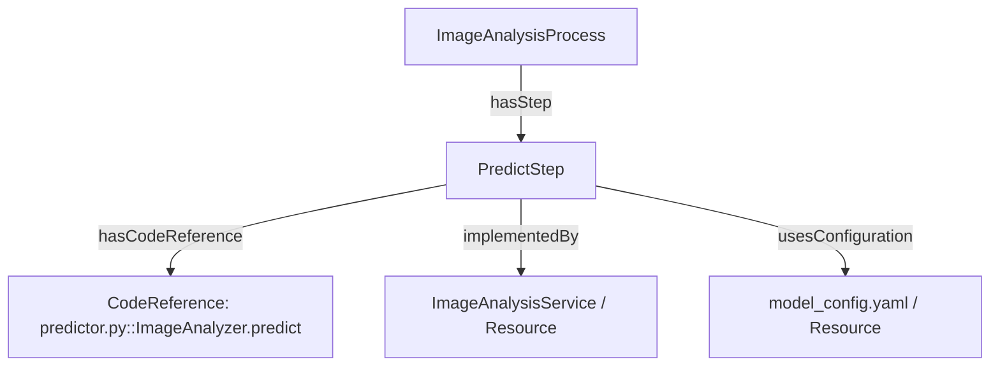

```turtle
@prefix ddta: <https://w3id.org/ddta/core#> .
@prefix process: <https://w3id.org/ddta/process#> .
@prefix ex: <https://example.org/ddta/process-example#> .
ex:PredictStep a ddta:ProcessStep ;
    process:hasCodeReference ex:PredictCodeRef ;
    process:implementedBy ex:ImageAnalysisService ;
    process:usesConfiguration ex:ModelConfiguration .
ex:PredictCodeRef a process:CodeReference ;
    process:repositoryLocator "documentation-driven-threat-analysis" ;
    process:sourcePath "src/pipeline/predictor.py" ;
    process:symbolIdentifier "ImageAnalyzer.predict" ;
    process:codeElementKind "method" .
ex:ImageAnalysisService a ddta:Resource .
ex:ModelConfiguration a ddta:Resource .
```

---

## 12. Scheda ontologica — composizione e richiamo dei processi

### 12.1 Identificazione e definizione

La composizione strutturale è distinta dall'attivazione prevista nel flusso: un `ddta:Process` può comprendere direttamente altri Process mediante `hasSubProcess`; un `ddta:ProcessStep` può rappresentare il punto nel flusso che richiama un Process mediante `invokesProcess`. Nessuna delle due relazioni implica che il processo richiamato sia già stato eseguito. `ProcessStep` **non** è una sottoclasse di `Process`.

`hasSubProcess` non è transitiva; la struttura dichiarata di composizione non deve essere ciclica. Un processo può essere riutilizzato mediante `invokesProcess`, anche da un processo diverso dal suo proprietario strutturale: **richiamo e contenimento non si inferiscono reciprocamente**. Un ciclo di richiamo, se espressamente previsto, non è automaticamente un ciclo di composizione.

Per rendere ricostruibile la navigazione del flusso senza ricorrere a un ordinamento artificiale, `hasInitialStep` individua gli ingressi previsti del flusso di un processo. Può essercene più di uno, per processi con avvii indipendenti. L'assenza della proprietà in una documentazione parziale non deve essere interpretata come assenza di avvio.

### 12.2 Relazioni

```yaml ddta-ontology
record: object-properties
module: process
owner: ddta:Process
properties:
  - iri: process:hasSubProcess
    status: approved
    domain: ddta:Process
    range: ddta:Process
    label: {en: has subprocess, it: ha un sottoprocesso}
    definition:
      en: >-
        Relates a process to a process belonging directly to its structural
        decomposition; it neither determines invocation nor execution order.
      it: >-
        Collega un processo a un processo appartenente direttamente alla sua
        decomposizione strutturale; non ne determina il richiamo né l'ordine.
  - iri: process:hasInitialStep
    status: approved
    domain: ddta:Process
    range: ddta:ProcessStep
    label: {en: has initial step, it: ha un passo iniziale}
    definition:
      en: >-
        Identifies an entry step of the declared flow of a process,
        without recording an actual execution.
      it: >-
        Identifica un passo di ingresso del flusso dichiarato di un processo,
        senza registrare un'esecuzione effettiva.
```

```yaml ddta-ontology
record: object-properties
module: process
owner: ddta:ProcessStep
properties:
  - iri: process:invokesProcess
    status: approved
    domain: ddta:ProcessStep
    range: ddta:Process
    label: {en: invokes process, it: richiama un processo}
    definition:
      en: >-
        Identifies the process whose planned activation is represented
        by this step; the assertion is not an execution event.
      it: >-
        Identifica il processo il cui richiamo previsto è rappresentato
        dal passo; la dichiarazione non è un evento eseguito.
```

**Cardinalità documentali:** `hasSubProcess` 0..*, `hasInitialStep` 0..*, `invokesProcess` 0..1 per Step nella definizione di base. L'eventuale invocazione di più processi distinti richiede Step o controlli distinti, per non lasciare ambigua la semantica. Un `hasInitialStep` deve riferirsi a uno Step appartenente direttamente allo stesso processo mediante `ddta:hasStep`.

### 12.3 Interrogazioni SPARQL

**Individuare le funzioni realizzate dai sottoprocessi, anche a profondità arbitraria:**

```sparql
PREFIX ddta: <https://w3id.org/ddta/core#>
PREFIX process: <https://w3id.org/ddta/process#>
SELECT DISTINCT ?subprocess ?function WHERE {
  ?root process:hasSubProcess+ ?subprocess .
  ?subprocess ddta:realizesFunction ?function .
}
```

**Ricostruire la funzione realizzata da un passo e i contenuti del relativo contratto di output:**

```sparql
PREFIX ddta: <https://w3id.org/ddta/core#>
PREFIX process: <https://w3id.org/ddta/process#>
SELECT ?step ?subprocess ?function ?contract ?element WHERE {
  ?parent ddta:hasStep ?step .
  ?step process:invokesProcess ?subprocess .
  ?subprocess ddta:realizesFunction ?function .
  OPTIONAL {
    ?function ddta:hasOutputContract ?contract .
    OPTIONAL { ?contract ddta:hasContractElement ?element . }
  }
}
```

### 12.4 Vincoli di validazione

| ID | Controllo | Requisito |
|---|---|---|
| `PRC-COMP-01` | La decomposizione strutturale `hasSubProcess+` non presenta cicli | Obbligatorio |
| `PRC-COMP-02` | Ogni `hasInitialStep` appartiene allo stesso processo via `hasStep` | Obbligatorio |
| `PRC-COMP-03` | Uno Step dichiara al massimo un `invokesProcess` | Obbligatorio |

```yaml ontology-validation
kind: OntologyValidation
target: ddta:Process
engine: SHACL
constraints:
  - id: PRC-COMP-01
    type: sparql
    message:
      en: Subprocess composition contains a cycle.
      it: La decomposizione dei processi contiene un ciclo.
    select: |-
      PREFIX process: <https://w3id.org/ddta/process#>
      SELECT $this WHERE { $this process:hasSubProcess+ $this . }
  - id: PRC-COMP-02
    type: sparql
    message:
      en: An initial step must directly belong to the declaring process.
      it: Il passo iniziale deve appartenere direttamente al processo che lo dichiara.
    select: |-
      PREFIX ddta: <https://w3id.org/ddta/core#>
      PREFIX process: <https://w3id.org/ddta/process#>
      SELECT $this ?value WHERE {
        $this process:hasInitialStep ?value .
        FILTER NOT EXISTS { $this ddta:hasStep ?value . }
      }
```

```yaml ontology-validation
kind: OntologyValidation
target: ddta:ProcessStep
engine: SHACL
constraints:
  - id: PRC-COMP-03
    type: property-count
    properties:
      - {path: process:invokesProcess, maxCount: 1}
```

I controlli SPARQL devono essere tradotti e verificati come `sh:sparql`; l'esistenza del blocco YAML non implica che il generatore corrente li supporti già. L'informazione `hasInitialStep` è obbligatoria **per le viste di sequenza complete**, non per l'identificazione parziale di un processo.

### 12.5 Esempio illustrativo (escluso dal TTL generato)

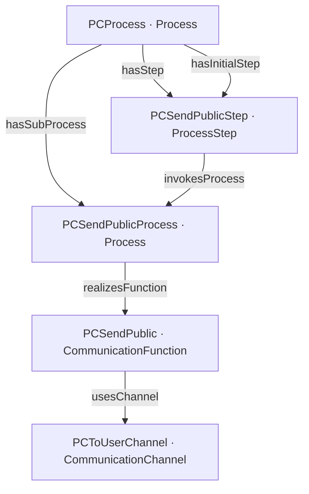

```turtle
@prefix ddta: <https://w3id.org/ddta/core#> .
@prefix process: <https://w3id.org/ddta/process#> .
@prefix ex: <https://example.org/ddta/dh#> .
ex:PCProcess a ddta:Process ;
    process:hasSubProcess ex:PCSendPublicProcess ;
    ddta:hasStep ex:PCSendPublicStep ;
    process:hasInitialStep ex:PCSendPublicStep .
ex:PCSendPublicStep a ddta:ProcessStep ;
    process:invokesProcess ex:PCSendPublicProcess .
ex:PCSendPublicProcess a ddta:Process ;
    ddta:realizesFunction ex:PCSendPublic .
ex:PCSendPublic a ddta:CommunicationFunction ;
    ddta:usesChannel ex:PCToUserChannel .
```

---

## 13. Esempi integrati di funzionamento

### 13.1 Esempio A — Sequenzialità senza nodi speciali

La struttura lineare del CORE è sufficiente per una sequenza semplice.

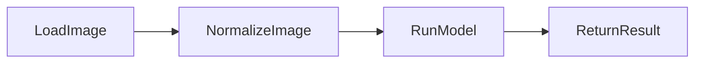

Una versione Process aggiunge transizioni esplicite soltanto quando servono dettagli, come guardie o identificatori di passaggio. Gli Step sono attività operative e **non** sottofunzioni per necessità.

### 13.2 Esempio B — Immagine facoltativa in un processo di triage

L'ingresso funzionale può prevedere un elemento immagine facoltativo. Il processo sceglie il ramo in funzione della condizione che verifica la presenza dell'immagine.

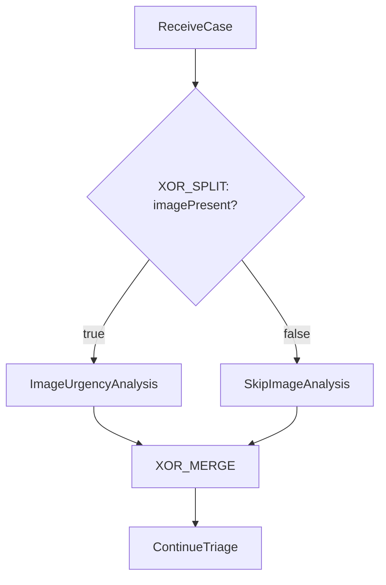

`imagePresent` può fare riferimento, tramite un Operand, al corrispondente `ContractElement` dell'ingresso funzionale. Non si assume che un `ContractElement` contenga il valore concreto di una esecuzione. Le guardie delle transizioni descrivono il criterio di scelta, non la storia di un caso già elaborato.

### 13.3 Esempio C — Accettazione del modello candidato

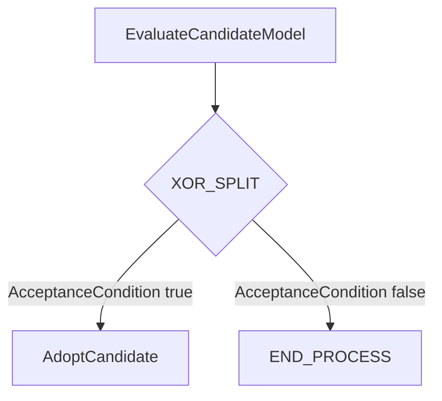

Il criterio `CandidateAcceptanceCondition` può essere composto da `CandidateAccuracyAcceptable AND ValidationPassed`. Il valore configurabile `MinimumRequiredAccuracy` non costituisce da solo l'identità funzionale del criterio. **La produzione di una versione candidata non ne determina automaticamente l'adozione.** Questo esempio illustra il comportamento previsto, non una specifica esecuzione effettuata.

### 13.4 Esempio D — Concorrenza e sincronizzazione N-of-M

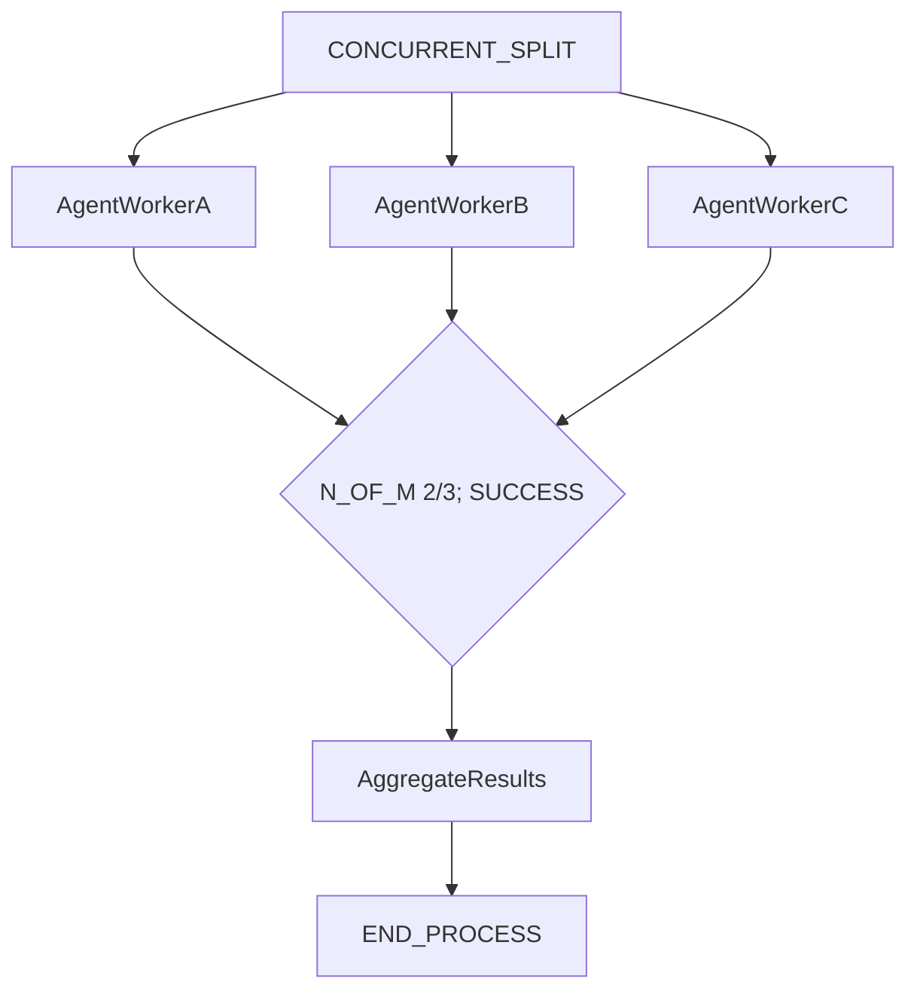

Il join abilita la prosecuzione quando **due rami partecipanti** soddisfano il criterio previsto. Il modello **non** dichiara che il terzo worker sia stato cancellato, prosegua o abbia terminato: quelle sono caratteristiche ulteriori da modellare quando rilevanti. Un nodo `END_PROCESS` nel flusso previsto non è la registrazione dello stato `STOPPED` di un'esecuzione reale.

### 13.5 Esempio E — Ricorsione e codice granulare

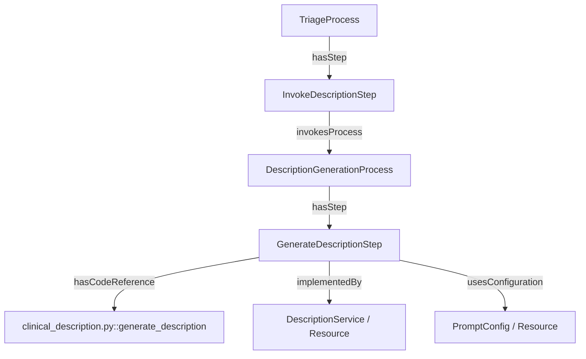

Non si inferisce che il file nominato sia la build distribuita o che il servizio sia effettivamente in esecuzione. Il processo richiamato mantiene la propria identità e può avere transizioni e condizioni autonome.

### 13.6 Esempio F — Condizione di attivazione, attesa e terminazione di ramo

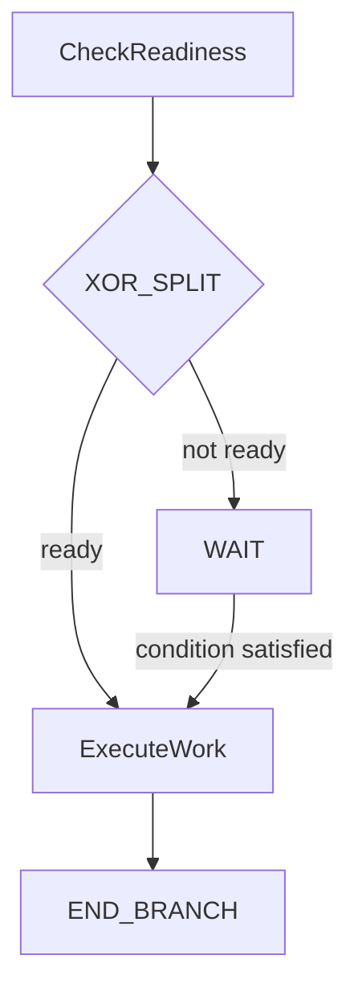

Il nodo `WAIT` è una scelta prevista nella struttura del processo; non è uno stato osservato. `END_BRANCH` termina il ramo in questione, senza affermare la terminazione di altri rami concorrenti.

---

## 14. Verifiche di integrazione CORE ↔ Process

| Verifica | Risultato atteso / controllo |
|---|---|
| Riutilizzo delle identità | Nessuna ridefinizione di classi/proprietà CORE |
| Classificazione | `ControlNode ⊑ ProcessStep`; `SynchronizationNode ⊑ ControlNode` |
| Process ≠ ProcessStep | Nessuna inferenza `ProcessStep ⊑ Process` |
| Guardie | Le guardie qualificano transizioni, non `hasNextStep` generico |
| Proprietà di base | Le transizioni possono materializzare `hasNextStep`, non viceversa in modo automatico |
| `PRC-TRANS-01` | Le estremità appartengono a **ogni** processo che dichiara la transizione |
| Specifica funzionale | `ContractElement` resta una specifica, non un valore osservato |
| Configurazione | I valori di soglia si riferiscono a una configurazione identificabile |
| Concorrenza | Non implica parallelismo fisico |
| Join N-of-M | Soglia, partecipanti e criterio di completamento documentati |
| Codice | `CodeReference` distinta da `Resource`; nessuna inferenza da codice a componente eseguito |
| Stato | Nessuno `hasState` reale su `ddta:Process` |
| Esempi | Turtle e diagrammi esclusi dalla generazione del TTL |

## 15. Requisiti di implementazione e compatibilità

### 15.1 Vocabolario approvato e artefatti

Le dichiarazioni marcate `approved` in questo documento costituiscono il **vocabolario dell'estensione Process**. La scrittura del Turtle OWL e degli Shape SHACL è un'operazione di generazione da eseguire in modo deterministico, con verifica dei relativi file. Il presente documento non comporta sovrascrittura né approvazione dei Turtle `core.ttl` e `process.ttl` già presenti sul filesystem.

- Le dichiarazioni sono selezionate esclusivamente da blocchi con info-string esatto `yaml ddta-ontology`.
- `module: process` evita l'emissione accidentale di dichiarazioni nel CORE.
- I riferimenti a classi e proprietà `ddta:` sono **riusi**, non nuove dichiarazioni.
- Eventuali proprietà con unione di domini rappresentano una vera `owl:unionOf`: non devono essere trasformate in più `rdfs:domain` indipendenti.
- La validazione SHACL non viene sostituita da inferenza OWL: dominio e range non sono controlli di integrità.

### 15.2 Controlli documentali

Il generatore e il validatore devono includere i controlli documentali dichiarati nelle singole schede. I controlli minimi con identificatore esplicito sono:

| Identificatore | Oggetto della verifica |
|---|---|
| `PRC-TRANS-01` | Entrambe le estremità di ogni transizione appartengono al processo che la dichiara |
| `PRC-TRANS-02` | Ogni transizione ha esattamente sorgente e destinazione |
| `PRC-TRANS-03` | Una sola guardia per transizione |
| `PRC-TRANS-04` | Una transizione ha un unico processo proprietario nel grafo validato |
| `PRC-COMP-01` | Composizione `hasSubProcess` aciclica |
| `PRC-COMP-02` | Gli Step iniziali sono Step diretti del processo |
| `PRC-COMP-03` | Al massimo un sottoprocesso richiamato per Step |
| `PRC-SYNC-01..05` | Coerenza delle sincronizzazioni ALL/ANY/N-of-M |
| `PRC-COND-01..02` | Cardinalità delle condizioni di attivazione |
| `PRC-ATOM-01..02` | Forma delle condizioni atomiche e operatori ammessi |
| `PRC-COMP-COND-01..03` | Struttura e aciclicità delle condizioni composte |
| `PRC-CTRL-01` | Tipi riconosciuti dei nodi di controllo |

Per gli altri vincoli di cardinalità e operatori descritti nelle schede, valgono i requisiti testuali e le eventuali dichiarazioni strutturate presenti. Gli Shape devono essere testati con casi validi e negativi; **i test Python del caso Diffie-Hellman non sono equivalenti a una validazione SHACL completa**.

### 15.3 Cosa non rappresenta questa ontologia

La DDTA Process Ontology descrive **il funzionamento previsto**, non lo stato osservato di un'esecuzione. Non introduce `ProcessExecution`, `RUNNING`, `WAITING`, `STOPPED`, né una semantica generale di gestione dei worker residui; non prova il rispetto dei contratti, l'autenticità dei dati comunicati o la sicurezza di un protocollo. Le lacune documentali rappresentate dal **`?` cerchiato rosso** sono annotazioni dell'authoring e del renderer, non individui fittizi `ProcessStep` né rami con comportamento inventato. Il tracciamento e la formalizzazione delle lacune sono competenza della documentazione DDTA, distinta dal vocabolario dei processi.

Una futura DDTA Code Ontology può approfondire sorgenti, build, servizi e deployment; una Execution Ontology può descrivere le istanze reali e gli stati di avanzamento; una Security Ontology può rappresentare minacce, ipotesi di attacco e contromisure. Le nuove ontologie possono riutilizzare le identità definite qui senza reimpostarle.

---

## 16. Verifica di espressività: protocollo Diffie-Hellman

La prova Diffie-Hellman conservata sotto `ontology/case-studies/diffie-hellman/` è **un caso di studio e non una seconda fonte normativa**. È utilizzata per verificare la possibilità di modellare separatamente due sistemi/ambienti, le relative funzioni e i contratti, i processi autonomi, i canali direzionali e i Boundary. Il modello di istanza R5A mantiene alcuni metadati ausiliari `viz:` che non entrano nel vocabolario Process di questa scheda.

### 16.1 Dalla struttura al contenuto comunicato

La navigazione seguente utilizza soltanto relazioni del CORE e della Process Ontology:

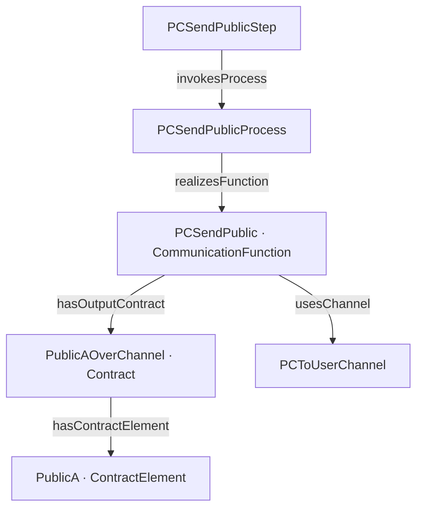

L'identità del contratto `PublicAOverChannel` è **riutilizzata intenzionalmente** come output della funzione emittente e input della funzione ricevente. La correlazione univoca, in questo caso ristretto, permette di individuare l'informazione `A` e il canale. L'uso della stessa identità non costituisce una regola generale di correlazione di comunicazioni ripetute e non prova che l'informazione ricevuta coincida con quella inviata.

### 16.2 Condizione sull'esito della validazione

Il controllo nominale sulla prosecuzione riguarda l'esito `ValidityA` / `ValidityB` della rispettiva sottofunzione di validazione, **non la mera presenza** del valore remoto ricevuto. Una rappresentazione strutturata possibile è:

```turtle
@prefix ddta: <https://w3id.org/ddta/core#> .
@prefix process: <https://w3id.org/ddta/process#> .
@prefix ex: <https://example.org/ddta/dh#> .
ex:PeerPublicValid a process:AtomicCondition ;
    process:hasLeftOperand ex:ValidationResultOperand ;
    process:comparisonOperator "EQ" ;
    process:hasRightOperand ex:TrueOperand .
ex:ValidationResultOperand a process:Operand ;
    process:referencesContractElement ex:ValidityB .
ex:TrueOperand a process:Operand ; process:literalValue true .
ex:ValidityB a ddta:ContractElement .
```

L'esempio mostra la **struttura della condizione**; non afferma che un valore ricevuto sia matematicamente valido o autentico.

