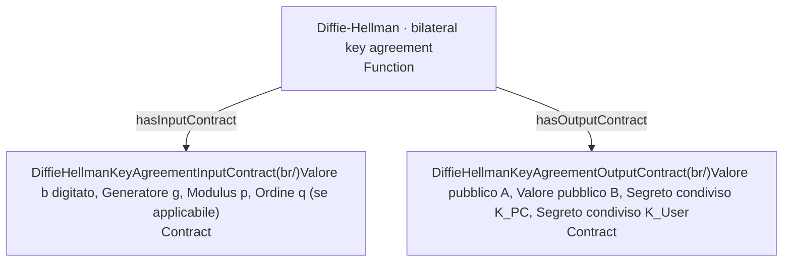

# Diffie-Hellman R5 — contratti derivati dal Turtle

Fonte unica: `dh_r5.ttl`. Il renderer non legge l’elenco degli elementi da Python.

I contratti descrivono **specifiche**: non sono eventi runtime, non autenticano il peer e non descrivono i rami di errore.

## Funzione complessiva

## PCSystem — funzione primaria e sottofunzioni

```mermaid
flowchart TB
    x_PCSystem["PCSystem<br/>System"]
    x_PCKeyAgreement["PCKeyAgreement<br/>Function"]
    x_PCKeyAgreementInputContract["PCKeyAgreementInputContract(br/)Generatore g, Modulus p, Valore pubblico B, Ordine q (se applicabile)<br/>Contract"]
    x_PCKeyAgreement -->|"hasInputContract"| x_PCKeyAgreementInputContract
    x_PCKeyAgreementOutputContract["PCKeyAgreementOutputContract(br/)Valore pubblico A, Segreto condiviso K_PC<br/>Contract"]
    x_PCKeyAgreement -->|"hasOutputContract"| x_PCKeyAgreementOutputContract
    x_PCCalculatePublic["Calcola A<br/>Function"]
    x_PCCalculatePublicInputContract["PCCalculatePublicInputContract(br/)Generatore g, Modulus p, Segreto privato a<br/>Contract"]
    x_PCCalculatePublic -->|"hasInputContract"| x_PCCalculatePublicInputContract
    x_PCCalculatePublicOutputContract["PCCalculatePublicOutputContract(br/)Valore pubblico A<br/>Contract"]
    x_PCCalculatePublic -->|"hasOutputContract"| x_PCCalculatePublicOutputContract
    x_PCDeriveSecret["Deriva K_PC<br/>Function"]
    x_PCDeriveSecretInputContract["PCDeriveSecretInputContract(br/)B_r accettato (richiesto), Modulus p, Segreto privato a<br/>Contract"]
    x_PCDeriveSecret -->|"hasInputContract"| x_PCDeriveSecretInputContract
    x_PCDeriveSecretOutputContract["PCDeriveSecretOutputContract(br/)Segreto condiviso K_PC<br/>Contract"]
    x_PCDeriveSecret -->|"hasOutputContract"| x_PCDeriveSecretOutputContract
    x_PCGeneratePrivate["Genera segreto a<br/>Function"]
    x_PCGeneratePrivateInputContract["PCGeneratePrivateInputContract(br/)Materiale casuale imprevedibile, Modulus p, Ordine q (se applicabile)<br/>Contract"]
    x_PCGeneratePrivate -->|"hasInputContract"| x_PCGeneratePrivateInputContract
    x_PCGeneratePrivateOutputContract["PCGeneratePrivateOutputContract(br/)Segreto privato a<br/>Contract"]
    x_PCGeneratePrivate -->|"hasOutputContract"| x_PCGeneratePrivateOutputContract
    x_PCReceivePublic["Riceve B<br/>Function"]
    x_PublicBOverChannel["PublicBOverChannel(br/)Valore pubblico B<br/>Contract"]
    x_PCReceivePublic -->|"hasInputContract"| x_PublicBOverChannel
    x_PCReceivePublicOutputContract["PCReceivePublicOutputContract(br/)Valore ricevuto B_r<br/>Contract"]
    x_PCReceivePublic -->|"hasOutputContract"| x_PCReceivePublicOutputContract
    x_PCSendPublic["Invia A<br/>Function"]
    x_PCSendPublicInputContract["PCSendPublicInputContract(br/)Valore pubblico A<br/>Contract"]
    x_PCSendPublic -->|"hasInputContract"| x_PCSendPublicInputContract
    x_PublicAOverChannel["PublicAOverChannel(br/)Valore pubblico A<br/>Contract"]
    x_PCSendPublic -->|"hasOutputContract"| x_PublicAOverChannel
    x_PCValidatePublic["Verifica validità B<br/>Function"]
    x_PCValidatePublicInputContract["PCValidatePublicInputContract(br/)Generatore g, Modulus p, Valore ricevuto B_r, Ordine q (se applicabile)<br/>Contract"]
    x_PCValidatePublic -->|"hasInputContract"| x_PCValidatePublicInputContract
    x_PCValidatePublicOutputContract["PCValidatePublicOutputContract(br/)B_r accettato (se valido), Esito validità B_r<br/>Contract"]
    x_PCValidatePublic -->|"hasOutputContract"| x_PCValidatePublicOutputContract
    x_PCSystem -->|"hasPrimaryFunction"| x_PCKeyAgreement
    x_PCKeyAgreement -->|"hasSubFunction"| x_PCCalculatePublic
    x_PCKeyAgreement -->|"hasSubFunction"| x_PCDeriveSecret
    x_PCKeyAgreement -->|"hasSubFunction"| x_PCGeneratePrivate
    x_PCKeyAgreement -->|"hasSubFunction"| x_PCReceivePublic
    x_PCKeyAgreement -->|"hasSubFunction"| x_PCSendPublic
    x_PCKeyAgreement -->|"hasSubFunction"| x_PCValidatePublic
```

| Funzione | Contratto di input | Input (ContractElement) | Contratto di output | Output (ContractElement) |
|---|---|---|---|---|
| PCKeyAgreement | PCKeyAgreementInputContract | Generatore g, Modulus p, Valore pubblico B, Ordine q (se applicabile) (0..1) | PCKeyAgreementOutputContract | Valore pubblico A, Segreto condiviso K_PC |
| PCCalculatePublic | PCCalculatePublicInputContract | Generatore g, Modulus p, Segreto privato a | PCCalculatePublicOutputContract | Valore pubblico A |
| PCDeriveSecret | PCDeriveSecretInputContract | B_r accettato (richiesto), Modulus p, Segreto privato a | PCDeriveSecretOutputContract | Segreto condiviso K_PC |
| PCGeneratePrivate | PCGeneratePrivateInputContract | Materiale casuale imprevedibile, Modulus p, Ordine q (se applicabile) (0..1) | PCGeneratePrivateOutputContract | Segreto privato a |
| PCReceivePublic | PublicBOverChannel | Valore pubblico B | PCReceivePublicOutputContract | Valore ricevuto B_r |
| PCSendPublic | PCSendPublicInputContract | Valore pubblico A | PublicAOverChannel | Valore pubblico A |
| PCValidatePublic | PCValidatePublicInputContract | Generatore g, Modulus p, Valore ricevuto B_r, Ordine q (se applicabile) (0..1) | PCValidatePublicOutputContract | B_r accettato (se valido) (0..1), Esito validità B_r |

## UserSystem — funzione primaria e sottofunzioni

```mermaid
flowchart TB
    x_UserSystem["UserSystem<br/>System"]
    x_UserKeyAgreement["UserKeyAgreement<br/>Function"]
    x_UserKeyAgreementInputContract["UserKeyAgreementInputContract(br/)Valore b digitato, Generatore g, Modulus p, Valore pubblico A, Ordine q (se applicabile)<br/>Contract"]
    x_UserKeyAgreement -->|"hasInputContract"| x_UserKeyAgreementInputContract
    x_UserKeyAgreementOutputContract["UserKeyAgreementOutputContract(br/)Valore pubblico B, Segreto condiviso K_User<br/>Contract"]
    x_UserKeyAgreement -->|"hasOutputContract"| x_UserKeyAgreementOutputContract
    x_UserAcquirePrivate["Acquisisce segreto b<br/>Function"]
    x_UserAcquirePrivateInputContract["UserAcquirePrivateInputContract(br/)Valore b digitato, Modulus p, Ordine q (se applicabile)<br/>Contract"]
    x_UserAcquirePrivate -->|"hasInputContract"| x_UserAcquirePrivateInputContract
    x_UserAcquirePrivateOutputContract["UserAcquirePrivateOutputContract(br/)Segreto privato b<br/>Contract"]
    x_UserAcquirePrivate -->|"hasOutputContract"| x_UserAcquirePrivateOutputContract
    x_UserCalculatePublic["Calcola B<br/>Function"]
    x_UserCalculatePublicInputContract["UserCalculatePublicInputContract(br/)Generatore g, Modulus p, Segreto privato b<br/>Contract"]
    x_UserCalculatePublic -->|"hasInputContract"| x_UserCalculatePublicInputContract
    x_UserCalculatePublicOutputContract["UserCalculatePublicOutputContract(br/)Valore pubblico B<br/>Contract"]
    x_UserCalculatePublic -->|"hasOutputContract"| x_UserCalculatePublicOutputContract
    x_UserDeriveSecret["Deriva K_User<br/>Function"]
    x_UserDeriveSecretInputContract["UserDeriveSecretInputContract(br/)A_r accettato (richiesto), Modulus p, Segreto privato b<br/>Contract"]
    x_UserDeriveSecret -->|"hasInputContract"| x_UserDeriveSecretInputContract
    x_UserDeriveSecretOutputContract["UserDeriveSecretOutputContract(br/)Segreto condiviso K_User<br/>Contract"]
    x_UserDeriveSecret -->|"hasOutputContract"| x_UserDeriveSecretOutputContract
    x_UserReceivePublic["Riceve A<br/>Function"]
    x_PublicAOverChannel["PublicAOverChannel(br/)Valore pubblico A<br/>Contract"]
    x_UserReceivePublic -->|"hasInputContract"| x_PublicAOverChannel
    x_UserReceivePublicOutputContract["UserReceivePublicOutputContract(br/)Valore ricevuto A_r<br/>Contract"]
    x_UserReceivePublic -->|"hasOutputContract"| x_UserReceivePublicOutputContract
    x_UserSendPublic["Invia B<br/>Function"]
    x_UserSendPublicInputContract["UserSendPublicInputContract(br/)Valore pubblico B<br/>Contract"]
    x_UserSendPublic -->|"hasInputContract"| x_UserSendPublicInputContract
    x_PublicBOverChannel["PublicBOverChannel(br/)Valore pubblico B<br/>Contract"]
    x_UserSendPublic -->|"hasOutputContract"| x_PublicBOverChannel
    x_UserValidatePublic["Verifica validità A<br/>Function"]
    x_UserValidatePublicInputContract["UserValidatePublicInputContract(br/)Generatore g, Modulus p, Valore ricevuto A_r, Ordine q (se applicabile)<br/>Contract"]
    x_UserValidatePublic -->|"hasInputContract"| x_UserValidatePublicInputContract
    x_UserValidatePublicOutputContract["UserValidatePublicOutputContract(br/)A_r accettato (se valido), Esito validità A_r<br/>Contract"]
    x_UserValidatePublic -->|"hasOutputContract"| x_UserValidatePublicOutputContract
    x_UserSystem -->|"hasPrimaryFunction"| x_UserKeyAgreement
    x_UserKeyAgreement -->|"hasSubFunction"| x_UserAcquirePrivate
    x_UserKeyAgreement -->|"hasSubFunction"| x_UserCalculatePublic
    x_UserKeyAgreement -->|"hasSubFunction"| x_UserDeriveSecret
    x_UserKeyAgreement -->|"hasSubFunction"| x_UserReceivePublic
    x_UserKeyAgreement -->|"hasSubFunction"| x_UserSendPublic
    x_UserKeyAgreement -->|"hasSubFunction"| x_UserValidatePublic
```

| Funzione | Contratto di input | Input (ContractElement) | Contratto di output | Output (ContractElement) |
|---|---|---|---|---|
| UserKeyAgreement | UserKeyAgreementInputContract | Valore b digitato, Generatore g, Modulus p, Valore pubblico A, Ordine q (se applicabile) (0..1) | UserKeyAgreementOutputContract | Valore pubblico B, Segreto condiviso K_User |
| UserAcquirePrivate | UserAcquirePrivateInputContract | Valore b digitato, Modulus p, Ordine q (se applicabile) (0..1) | UserAcquirePrivateOutputContract | Segreto privato b |
| UserCalculatePublic | UserCalculatePublicInputContract | Generatore g, Modulus p, Segreto privato b | UserCalculatePublicOutputContract | Valore pubblico B |
| UserDeriveSecret | UserDeriveSecretInputContract | A_r accettato (richiesto), Modulus p, Segreto privato b | UserDeriveSecretOutputContract | Segreto condiviso K_User |
| UserReceivePublic | PublicAOverChannel | Valore pubblico A | UserReceivePublicOutputContract | Valore ricevuto A_r |
| UserSendPublic | UserSendPublicInputContract | Valore pubblico B | PublicBOverChannel | Valore pubblico B |
| UserValidatePublic | UserValidatePublicInputContract | Generatore g, Modulus p, Valore ricevuto A_r, Ordine q (se applicabile) (0..1) | UserValidatePublicOutputContract | A_r accettato (se valido) (0..1), Esito validità A_r |

## Funzione complessiva: contratti

| Funzione | Input | Output |
|---|---|---|
| DiffieHellmanKeyAgreement | Valore b digitato, Generatore g, Modulus p, Ordine q (se applicabile) | Valore pubblico A, Valore pubblico B, Segreto condiviso K_PC, Segreto condiviso K_User |

## Comunicazioni ricostruite dai contratti condivisi

| Mittente | Ricevente | Canale | Contratto in comune | Elementi trasmessi secondo specifica |
|---|---|---|---|---|
| PCSendPublic | UserReceivePublic | PCToUserChannel | PublicAOverChannel | Valore pubblico A |
| UserSendPublic | PCReceivePublic | UserToPCChannel | PublicBOverChannel | Valore pubblico B |

## Limiti documentali da mantenere

- `ReceivedA` e `ReceivedB` descrivono valori ricevuti, non necessariamente quelli trasmessi: il canale non implica integrità/autenticità.
- `ValidityA/B` rappresentano l’esito della validazione matematica, non l’identità del mittente.
- `AcceptedA/BOptional` (0..1) e `AcceptedA/BRequired` (1..1) sono ContractElement distinti: il CORE non può assegnare cardinalità differenti alla stessa identità.
- L’eventuale corrispondenza informativa fra questi due ruoli è ancora da formalizzare, senza inventarla nell’interrogazione.
- I contratti delle funzioni primarie esprimono input/output del comportamento nominale; nessun ramo di errore è stato inventato.
- Il comportamento per valore privato digitato non valido rimane un gap `?` non ancora rappresentato nel grafo dei Process R4.
- Il predicato completo di validazione e la condizione che abilita la derivazione non sono ancora collegati formalmente.
- Modulo `p`, generatore `g` e ordine `q` non sono stati introdotti come nuovi Resource: qui sono elementi di specifica contrattuale.
