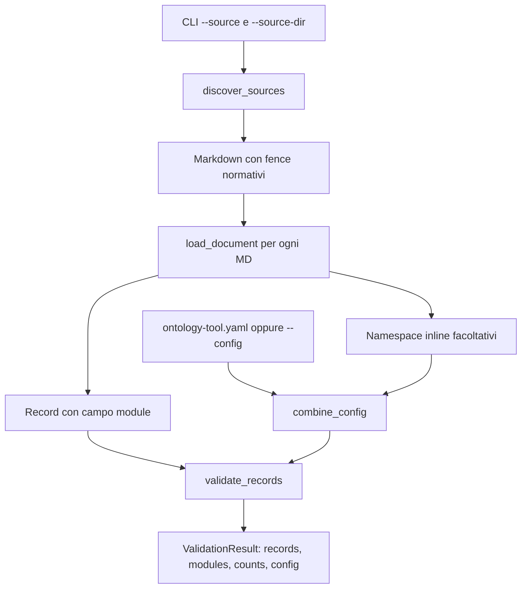
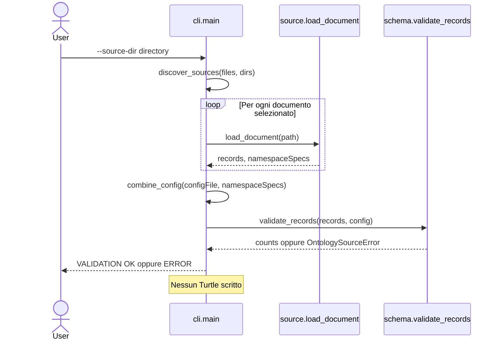
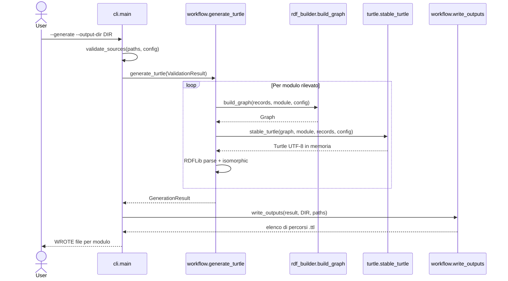
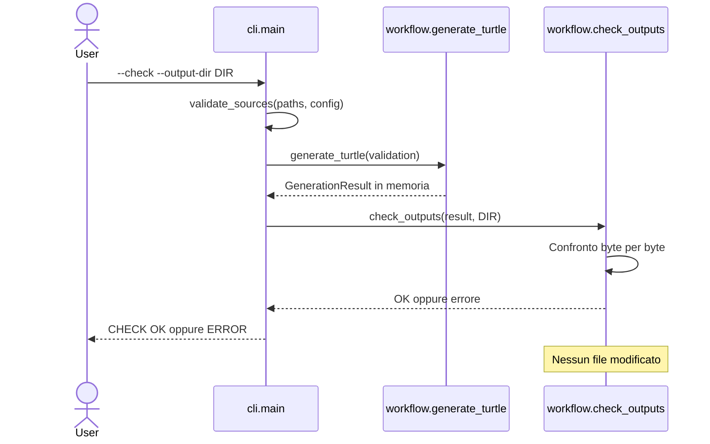
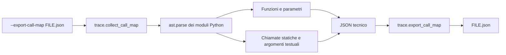
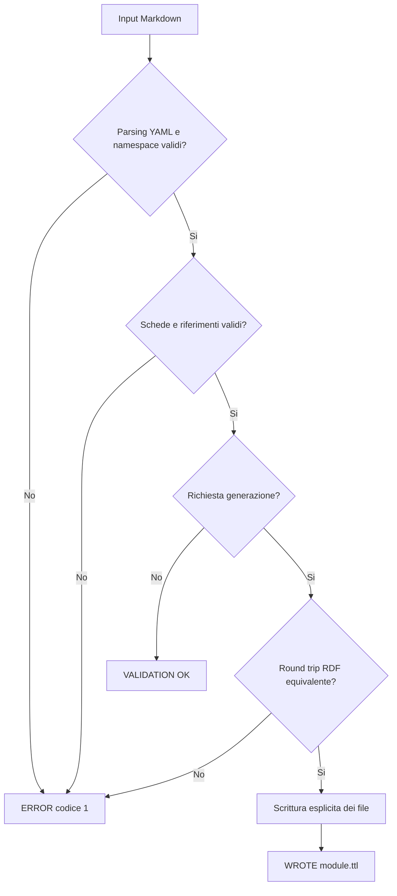

# Ontology Markdown Tool — Specifica tecnica

## 1. Obiettivo e perimetro

Questo documento descrive un'applicazione Python indipendente dalla posizione dei documenti: valida schede ontologiche dichiarate in Markdown e può convertirle in RDF/OWL serializzato come Turtle leggibile. È pensato come una libreria mantenibile, eseguibile da CLI e riutilizzabile da altri programmi.

**Regola operativa:** validazione senza scrittura per impostazione predefinita; generazione esclusivamente con `--generate` e destinazione esplicita. Il programma non modifica i Markdown. Il modulo `trace.py` analizza il codice tramite AST senza eseguirlo e senza creare una mappa normativa del CORE.

## 2. Struttura e dipendenze

| File | Funzione | Dipendenza esterna principale |
|---|---|---|
| `ontology_from_md.py` | Richiama `cli.main()` | — |
| `ddta_ontology/cli.py` | Argomenti, help, errori, codici di uscita | `argparse` (standard) |
| `config.py` | Namespace dei moduli, configurazione runtime | PyYAML tramite `yaml_support` |
| `source.py` | Cerca MD, estrae i blocchi normativi | `markdown-it-py` |
| `yaml_support.py` | Parsing YAML sicuro e chiavi univoche | `PyYAML` |
| `models.py` | Struttura dati `Record` | `dataclasses` |
| `schema.py` | Campi, stati, tipi, QName, riferimenti incrociati | RDFLib (`URIRef`) |
| `rdf_builder.py` | Grafo RDF/OWL per modulo | `RDFLib` |
| `turtle.py` | Serializer deterministico, sezioni per classe | `RDFLib` |
| `workflow.py` | Coordinamento, output in memoria, scrittura e confronto | `RDFLib` |
| `trace.py` | Estrae funzioni/call/argomenti dal codice | `ast` (standard) |
| `function_model.yaml` | Descrizione logica DDTA candidata | Nessuna esecuzione diretta |

Ogni funzione pubblica contiene una docstring con parametri, ritorni e limiti; le funzioni con prefisso `_` sono ausiliarie interne. Il pacchetto espone l'API principale tramite `__init__.py`.

## 3. Come vengono selezionati i moduli

Un modulo **non** è una cartella e **non** deriva dal nome del file. L'identità è il campo `module` nelle schede YAML. I file possono trovarsi ovunque e più file possono contribuire a un modulo. La configurazione dei namespace è separata dalla selezione dei documenti.



### Namespace

Il registro predefinito è distribuito anche come risorsa interna al pacchetto, così resta disponibile dopo una normale installazione Python. `ontology-tool.yaml` può mappare `modules.<nome>.prefix` e `modules.<nome>.namespace`. Oppure un Markdown può dichiarare:

````markdown
```yaml ddta-namespace
module: example
prefix: example
namespace: https://example.org/ontology/example#
ontologyIRI: https://example.org/ontology/example
```
````

`ontologyIRI` è opzionale; se omesso, l'IRI dell'ontologia si ottiene dal namespace senza il `#` o `/` finale. Eventuali definizioni duplicate devono coincidere esattamente. I prefissi standard `rdf:`, `rdfs:`, `owl:` e `xsd:` sono già disponibili e non possono essere ridefiniti come moduli applicativi.

Una nuova classe/proprietà deve usare il prefisso del proprio modulo; può riferirsi ad altre classi dichiarate nei Markdown selezionati tramite i loro prefissi. I riferimenti esterni non definiti non sono completati automaticamente.

## 4. Flussi operativi

### 4.1 Validazione (modalità predefinita)



### 4.2 Generazione su richiesta



La verifica `isomorphic` conferma che il testo Turtle serializzato conserva il medesimo grafo RDF, anche con espressioni anonime `owl:unionOf`. La forma testuale raggruppa classi e proprietà secondo l'owner YAML, ma l'ordine non ha significato semantico RDF.

### 4.3 Confronto dei Turtle esistenti



### 4.4 Mappa statica delle chiamate Python



L'AST non ricostruisce il runtime, non risolve tutte le chiamate dinamiche e non equivale a `ddta:hasSubFunction`.

### 4.5 Comportamento in caso di errore



Gli errori CLI prima dell'avvio (`--generate` senza destinazione, opzioni conflittuali) restituiscono codice `2`, secondo il comportamento di `argparse`.

## 5. API pubblica

| Funzione | Parametri | Risultato | Scrive file? |
|---|---|---|---|
| `discover_sources(files, directories)` | Liste di `Path` | `list[Path]` | No |
| `load_config_file(path)` | YAML esterno oppure `None` | `dict[str, ModuleSpec]` | No |
| `validate_sources(paths, file_specs)` | Percorsi MD e registrazioni | `ValidationResult` | No |
| `generate_turtle(validation)` | `ValidationResult` | `GenerationResult` | No |
| `check_outputs(result, dir)` | Turtle in memoria e directory | Eccezione se diversi | No |
| `write_outputs(result, dir, paths)` | Risultato e destinazione | `list[Path]` | **Sì** |
| `collect_call_map(package_dir=None)` | Package Python | Dizionario compatibile JSON | No |
| `export_call_map(destination, package_dir=None)` | Percorso JSON | `Path` | **Sì** |

Esempio di integrazione con un altro programma Python:

```python
from pathlib import Path
from ddta_ontology import (
    discover_sources, load_config_file, validate_sources,
    generate_turtle, write_outputs,
)

paths = discover_sources([], [Path('my-ontologies')])
config = load_config_file(Path('ontology-tool.yaml'))
validated = validate_sources(paths, config)
print(validated.modules)

# Solo se si desidera generare:
result = generate_turtle(validated)
written = write_outputs(result, Path('my-generated-output'), paths)
```

## 6. Contratto di validazione

L'input riconosciuto è un fence Markdown con info-string *esatta* `yaml ddta-ontology`. I record correnti sono `class`, `object-properties`, `datatype-properties` e `named-individuals`. Il campo `status` deve essere `approved` ove previsto. Il generatore controlla le chiavi ammesse e obbligatorie, i label e le definizioni bilingui, gli IRI, `subClassOf`, `subPropertyOf`, `domain`, `range`, `unionOf` e i riferimenti fra record.

Tutte le schede selezionate vengono validate in un unico vocabolario: la risoluzione delle dipendenze è globale, mentre il Turtle viene serializzato un modulo alla volta. Questo permette un modulo esteso che introduce proprietà il cui `owner` è una classe dichiarata in un altro modulo, senza creare una nuova definizione di quella classe.

**Non viene eseguita una validazione integrale di tutto il Markdown.** SHACL, matrici, spiegazioni e blocchi esempio rimangono fuori dall'ambito dell'implementazione corrente. Le regole OWL più avanzate, i record nuovi e altri schemi di label richiederanno estensioni controllate.

## 7. Sicurezza delle operazioni e riproducibilità

- L'input YAML viene interpretato con SafeLoader e chiavi duplicate rifiutate.
- Durante la validazione non vengono creati o modificati file.
- La CLI non sceglie automaticamente una directory di output.
- La scrittura viene rifiutata se la destinazione coincide con la directory di un Markdown sorgente selezionato.
- Con `--check` i file esistenti vengono solo letti.
- Il serializer produce contenuto deterministico per lo stesso insieme di dichiarazioni e namespace; gli input sono ordinati indipendentemente dall'ordine delle cartelle.
- Un errore di I/O durante la scrittura multipla non costituisce una transazione atomica: il risultato può richiedere una nuova generazione. Non usare la cartella delle specifiche normative come destinazione dei TTL sperimentali.

## 8. Estensione del sistema

Per aggiungere una nuova ontologia nel **formato già supportato** basta aggiungere uno o più `.md` con il campo `module` e un binding del relativo namespace. Non occorre cambiare `config.py`, `workflow.py` o il serializer. Il programma genera automaticamente `nome-modulo.ttl`.

Se la nuova ontologia usa un modello di record diverso (per esempio nuovi tipi OWL non previsti), questo è un ampliamento della grammatica, distinto dall'aggiunta di un modulo: andranno aggiornati schema, builder, serializer e test.

## 9. Test e manutenzione

```powershell
python -m unittest discover -s tests -v
```

I test inclusi usano documenti temporanei e una quarta ontologia di esempio: validano namespace inline, namespace da configurazione, più file per modulo, riferimenti incrociati, rifiuto di IRI duplicate e stato non approvato, determinismo RDF, assenza di scrittura in validazione e confronto non distruttivo. Per un test aggiuntivo con un corpus Markdown esterno si può impostare la variabile `DDTA_TEST_DOCS` al percorso di quella cartella; non è necessario per il normale utilizzo.

## 10. Rappresentazione futura del codice

`function_model.yaml` dichiara una **vista logica candidata** basata sui concetti `System`, `Function`, `Contract` e `ContractElement`. `trace.py` crea una **vista tecnica** del codice Python tramite AST. La corrispondenza fra le due non è un'assunzione automatica di `hasSubFunction` o di altre relazioni normative. Per i diagrammi futuri sono preservati il nome delle funzioni, le firme, gli argomenti testuali e le chiamate individuabili staticamente.
