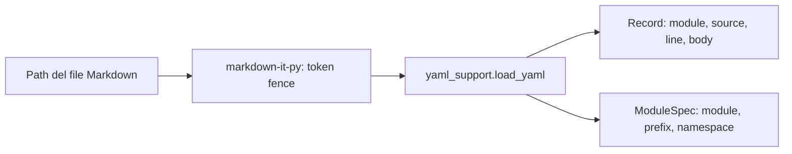
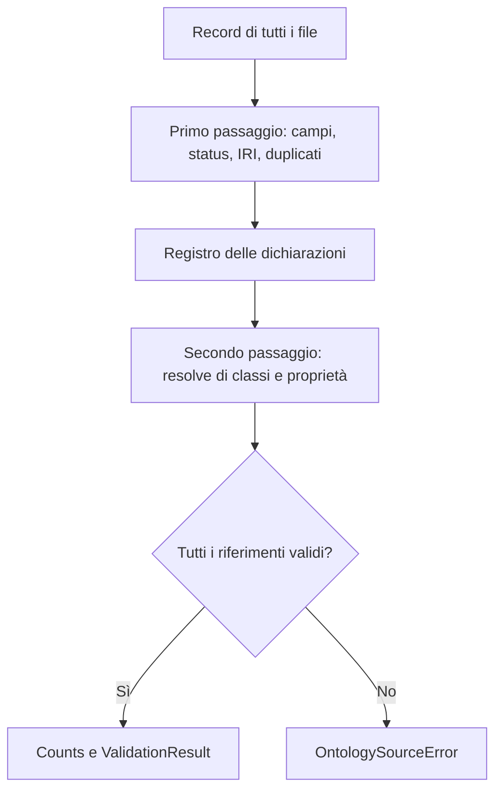
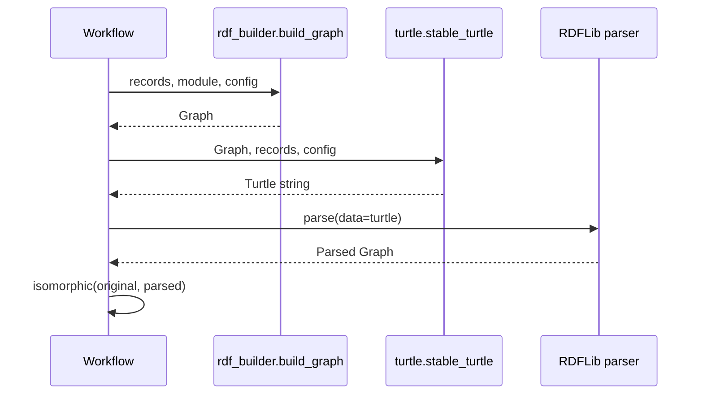

# Leggere il codice Python dell'Ontology Markdown Tool

Questa guida accompagna la [documentazione tecnica](ARCHITECTURE.md). È pensata per chi ha già programmato in passato e desidera riprendere Python leggendo un'applicazione concreta, un file alla volta.

## 1. Dove inizia il programma

Il punto di ingresso è `ontology_from_md.py`:

```python
from ddta_ontology.cli import main

if __name__ == "__main__":
    raise SystemExit(main())
```

`from ... import ...` rende disponibile una funzione definita in un altro file. Quando il file è lanciato direttamente, Python assegna alla variabile speciale `__name__` il valore `"__main__"`. La funzione `main()` è dunque la prima funzione applicativa invocata esplicitamente. Restituisce un codice di uscita che `SystemExit` consegna alla shell.

`ddta_ontology/__init__.py` è **l'inizializzazione di un pacchetto**, non il punto di ingresso. Espone i nomi dell'API pubblica e viene eseguito durante l'importazione. Non va confuso con il metodo `__init__(self, ...)` usato dalle classi per inizializzare le istanze.

## 2. Modulo, pacchetto, funzione, classe, oggetto

- Un file `.py` importabile è un **modulo**.
- Una directory Python con `__init__.py` è un **pacchetto** ordinario.
- `def` definisce una **funzione**; `return` ne restituisce il risultato.
- `class` definisce un tipo; un'istanza è un **oggetto**.
- `@dataclass` genera automaticamente metodi come `__init__()` per classi usate soprattutto come contenitori di dati.
- `Path` dal modulo standard `pathlib` rappresenta i percorsi senza dover concatenare stringhe dipendenti dal sistema operativo.

Il nostro `Record` è un oggetto immutabile in superficie:

```python
@dataclass(frozen=True)
class Record:
    module: str
    source: Path
    ordinal: int
    line: int
    body: dict[str, Any]
```

La notazione `module: str` è un'annotazione di tipo. `frozen=True` blocca la riassegnazione dei campi ma **non** trasforma automaticamente in oggetti immutabili i dizionari memorizzati dentro i campi.

## 3. Prima tappa: `cli.py`

Apri `ddta_ontology/cli.py` e cerca `main()`.

```mermaid
sequenceDiagram
    participant Shell as PowerShell
    participant Entry as ontology_from_md.py
    participant CLI as cli.main
    participant WF as workflow.validate_sources
    Shell->>Entry: python ontology_from_md.py --source-dir DIR
    Entry->>CLI: main()
    CLI->>CLI: make_parser(); parse_args(argv)
    CLI->>WF: validate_sources(paths, file_specs)
    WF-->>CLI: ValidationResult
    CLI-->>Shell: return 0 o 1
```

`argparse` converte le opzioni digitate in un oggetto `args` contenente attributi come `args.source_dir` e `args.generate`. Un controllo `if` verifica che la richiesta sia coerente. Il costrutto `try/except` cattura gli errori attesi e li rende leggibili senza confonderli con un errore di sintassi CLI.

## 4. Seconda tappa: `source.py`

`discover_sources(files, directories)` riceve due liste di percorsi: file espliciti e directory da scandire. Converte i percorsi in `Path`, legge i Markdown e seleziona quelli con blocchi normativi. Il codice non ricava il nome del modulo da directory o file.

`load_document(path)` utilizza `MarkdownIt('commonmark')` per riconoscere i veri fenced code block, evitando di interpretare come schede stringhe Markdown non pertinenti. Riconosce `yaml ddta-ontology` e, facoltativamente, `yaml ddta-namespace`.



L'oggetto `Record` conserva la posizione della scheda per spiegare gli errori con file e numero di riga.

## 5. Terza tappa: `config.py` e `schema.py`

`config.py` conosce **la struttura** di una dichiarazione namespace, non l'elenco di tutti i moduli possibili. `load_config_file` legge le definizioni opzionali da un file YAML; `combine_config` unisce queste con le definizioni presenti nei Markdown e segnala i conflitti.

`schema.validate_records(records, config)` esegue due passaggi: registra le definizioni e poi risolve i riferimenti. Questa scelta è importante perché una scheda può riferirsi a classi dichiarate in altri documenti letti successivamente.



Una funzione il cui nome inizia con `_`, ad esempio `_fields`, è considerata interna per convenzione. In Python non è privata in senso stretto.

## 6. Quarta tappa: `rdf_builder.py` e `turtle.py`

`rdf_builder.build_graph(records, module, config)` crea un oggetto `Graph` di RDFLib e aggiunge triple RDF. Per esempio, l'operazione concettuale:

```python
graph.add((subject, RDF.type, OWL.Class))
```

rappresenta una tripla con soggetto, predicato `rdf:type` e oggetto `owl:Class`.

`turtle.stable_turtle(graph, module, records, config)` non decide la semantica, ma la **forma del testo**. Ordina le classi, raggruppa le loro proprietà e rende le `owl:unionOf` come espressioni Turtle compatte. La generazione controlla poi che RDFLib rileggendo il testo produca un grafo equivalente.



## 7. Quinta tappa: `workflow.py`

Questo file coordina le fasi e tiene distinta la generazione in memoria dalla scrittura su disco:

| Chiamata | Ruolo |
|---|---|
| `validate_sources(paths, file_specs)` | Carica e controlla tutti i record selezionati |
| `generate_turtle(validation)` | Costruisce stringhe Turtle in memoria |
| `write_outputs(generated, dir, paths)` | Scrive i file `.ttl` quando richiesto |
| `check_outputs(generated, dir)` | Confronta byte, senza scrivere |

Un `dict[str, str]` è un dizionario che associa stringhe a stringhe; qui `GenerationResult.turtle` associa il nome di ciascun modulo al proprio testo Turtle. Un `tuple[Record, ...]` è una sequenza immutabile di record.

## 8. `trace.py`: analisi del codice, non del runtime

Python offre `ast`, una libreria standard capace di costruire un albero della struttura sintattica del codice. Il nostro analizzatore produce un JSON con nomi di funzione, firme, righe del codice, chiamate staticamente riconoscibili e argomenti come espressioni testuali.

Non conosce i valori runtime, non risolve tutti i metodi dinamici e non ha il diritto di dichiarare automaticamente una relazione `ddta:hasSubFunction`. È una vista tecnica candidata da collegare successivamente alla descrizione funzionale DDTA.

## 9. Come riprendere a usare il debugger

In VS Code apri `ontology_from_md.py`, usa **Ctrl+clic** su `main`, imposta un breakpoint e avvia il programma con `--source` oppure `--source-dir`. Nella sezione Variabili osserva `args`, poi `paths`, `validated.modules`, `validated.counts`. Usa *Step Into* per entrare in `validate_sources`, *Step Over* per passare alla riga successiva e *Step Out* per tornare al chiamante.

Per esercitarti senza scrivere Turtle usa una directory temporanea con soltanto il documento `tests/fixtures/NETWORK_SAMPLE.md` e lancia la validazione senza `--generate`.

## 10. Esercizi consigliati

1. In `cli.py` trova perché `--output-dir` senza `--generate` produce un errore.
2. In `source.py` segui il campo `module` da un blocco YAML fino all'oggetto `Record`.
3. In `schema.py` trova il controllo su IRI duplicate e `status: approved`.
4. In `workflow.py` verifica quale funzione modifica realmente il file system.
5. In `turtle.py` osserva perché `rdfs:label` viene visualizzato vicino alla classe e perché `owl:unionOf` non richiede una sequenza visibile di triple `rdf:first` e `rdf:rest`.
6. Aggiungi un'altra classe al fixture di rete in una nuova scheda Markdown e verifica che la sua definizione appaia nel TTL senza cambiare Python.

Questi esercizi separano l'analisi del **codice eseguito** dall'interpretazione **funzionale** attraverso l'ontologia CORE.
