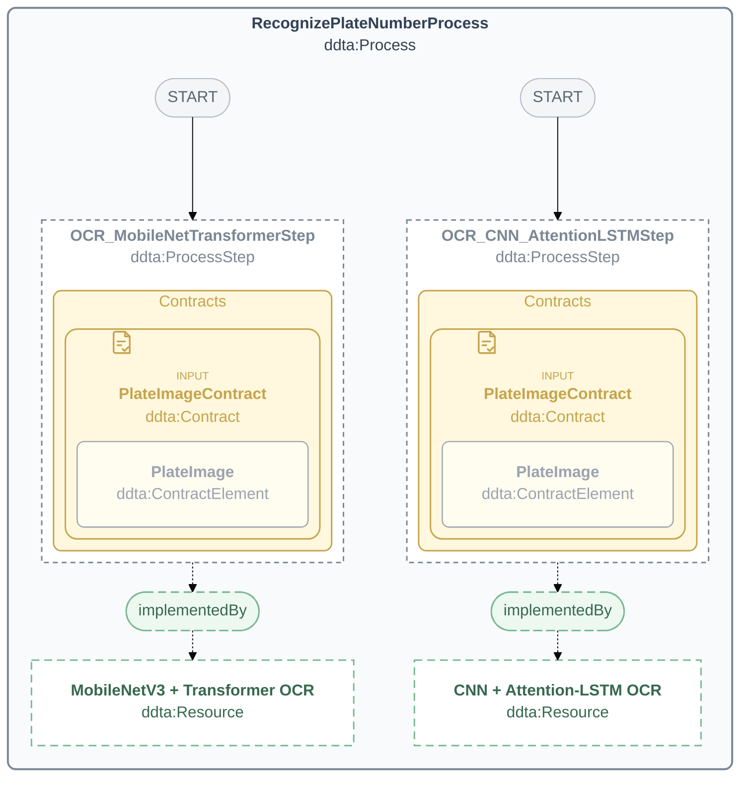

# Caso targa e cancello — costruzione progressiva CORE + PROCESS + DATA

**Stato:** passi 01–13 consolidati; passi 14 e 15 candidati in revisione. Il presente Markdown è l’unico documento dell’esempio da conservare in `tesiStabile`. Lo Spinoff S01 resta indipendente dal modello principale.
**Obiettivo:** costruire un esempio RDF coerente dal contesto generale fino ai processi, controllando a ogni passo la semantica e la rappresentazione grafica.
**Riferimenti:** ontologia `DDTA_CORE.md` e guida `DDTA_CORE_VISUALIZATION.md` stabilizzate; PROCESS è introdotta con i processi; DATA è introdotta al passo 14.

## Come leggere questo documento

Ogni passo resta consultabile e contiene:

1. l'**ambito**: che cosa decidiamo e che cosa non decidiamo;
2. il **Turtle cumulativo**, autonomo e utilizzabile dal renderer;
3. il **Mermaid generato da Python**, non disegnato manualmente;
4. i **commenti ontologici**, che motivano i costrutti e chiariscono i limiti della rappresentazione.

Ogni passo conserverà la propria sezione; quando correggiamo un passo non approvato, manteniamo la versione precedente in archivio: potremo confrontare il modello in momenti diversi. I Turtle sono **dati di esempio**: non sono dichiarazioni da aggiungere al vocabolario normativo CORE, PROCESS o DATA.

---

## Passo 01 — I tre ambienti operativi

### 01.1 Ambito

Identifichiamo tre contesti operativi:

| Identificativo RDF | Significato nell'esempio |
|---|---|
| `ex:CameraEnvironment` | Ambiente nel quale opera la parte dedicata alla telecamera |
| `ex:ProcessingEnvironment` | Ambiente nel quale opera l'elaboratore che tratta le informazioni |
| `ex:GateEnvironment` | Ambiente nel quale opera la parte dedicata al cancello |

Per adesso **non** introduciamo `ddta:System`, funzioni, risorse, canali, processi o contratti. Non stabiliamo ancora alcun collegamento fra i tre ambienti.

### 01.2 Turtle cumulativo — sorgente del passo

```turtle
@prefix ddta: <https://w3id.org/ddta/core#> .
@prefix ex: <https://example.org/ddta/plate-gate#> .

ex:CameraEnvironment a ddta:Environment .
ex:ProcessingEnvironment a ddta:Environment .
ex:GateEnvironment a ddta:Environment .
```

### 01.3 Mermaid generato dal renderer CORE

```mermaid
%%{init: {"htmlLabels":true,"theme":"base","layout":"elk"}}%%
flowchart TB
    O_8cc24092aafe0d["<div style='display:inline-block;text-align:center;white-space:nowrap;line-height:1.4;padding:8px 12px;background:transparent;opacity:1;color:#45845B'><span style='display:block;text-align:center;font-size:17px;font-weight:700;color:#45845B'>CameraEnvironment</span><span style='display:block;text-align:center;font-size:12px;font-weight:400;color:#45845B'>ddta:Environment</span></div>"]
    O_731aad715aaf14["<div style='display:inline-block;text-align:center;white-space:nowrap;line-height:1.4;padding:8px 12px;background:transparent;opacity:1;color:#45845B'><span style='display:block;text-align:center;font-size:17px;font-weight:700;color:#45845B'>GateEnvironment</span><span style='display:block;text-align:center;font-size:12px;font-weight:400;color:#45845B'>ddta:Environment</span></div>"]
    O_42e723dd2793d6["<div style='display:inline-block;text-align:center;white-space:nowrap;line-height:1.4;padding:8px 12px;background:transparent;opacity:1;color:#45845B'><span style='display:block;text-align:center;font-size:17px;font-weight:700;color:#45845B'>ProcessingEnvironment</span><span style='display:block;text-align:center;font-size:12px;font-weight:400;color:#45845B'>ddta:Environment</span></div>"]
    classDef DDTA_C_47a0c203a3c4 fill:#EAF5EC,stroke:#45845B,color:#45845B,stroke-width:1.5px
    class O_42e723dd2793d6,O_731aad715aaf14,O_8cc24092aafe0d DDTA_C_47a0c203a3c4
```



### 01.4 Commenti sulle scelte ontologiche

- **Perché `ddta:Environment`:** nel CORE questa classe identifica un *contesto operativo*. Non coincide con il dispositivo telecamera, con il computer o con il cancello fisico. Tali elementi potranno essere descritti con altre entità, solo quando avremo chiarito i loro ruoli.
- **Perché tre individui:** i tre IRI permettono di riferirsi separatamente ai rispettivi contesti. Non abbiamo tuttavia aggiunto un vincolo OWL esplicito di differenza fra individui.
- **Perché non compare `hasOperationalEnvironment`:** nel CORE è una proprietà diretta da `ddta:System` verso `ddta:Environment`. In questo passo non esistono ancora individui `ddta:System`, quindi non c'è un soggetto legittimo a cui associare la relazione.
- **Perché non compare `makesAvailable`:** non abbiamo ancora identificato le risorse disponibili in ciascun ambiente. Dichiararle ora richiederebbe scelte ulteriori.
- **Perché il grafico non contiene frecce:** il Turtle contiene soltanto le tre asserzioni di tipo. Introdurre archi nel Mermaid sarebbe un'informazione non presente nei dati RDF.
- **Perché i nodi sono verdi:** lo stile di `ddta:Environment` proviene dalla guida grafica CORE. Il renderer mostra inizialmente nodi semplici; eventuali contenitori con sistemi e risorse avranno senso quando saranno presenti le relative dichiarazioni.

### 01.5 Controllo del passo

- 3 individui RDF di tipo `ddta:Environment`;
- 3 triple RDF, nessuna proprietà oggetto fra gli individui;
- 3 nodi Mermaid e nessun arco;
- generazione effettuata con il renderer Python CORE e le sue regole YAML (31 regole caricate, nessun avviso).

**Decisione successiva (passo 02):** associare direttamente ai tre ambienti le risorse-canale previste, senza ancora definire sistemi, funzioni o flussi effettivi.


---

---

## Passo 02 — Quattro canali previsti nei tre ambienti (struttura parziale)

### 02.1 Ambito e decisione adottata

Introduciamo **quattro individui `ddta:CommunicationChannel`**, organizzati per ambiente e per direzione prevista. Poiché `CommunicationChannel` è una sottoclasse di `ddta:Resource`, un `Environment` può renderlo disponibile direttamente tramite `ddta:makesAvailable`. **Non aggiungiamo risorse astratte intermedie** come nel precedente tentativo.

| Ambiente | Canale reso disponibile | Verso previsto dal nome |
|---|---|---|
| `CameraEnvironment` | `CameraToProcessingChannel` | Telecamera → Elaboratore |
| `ProcessingEnvironment` | `ProcessingToCameraChannel` | Elaboratore → Telecamera |
| `ProcessingEnvironment` | `ProcessingToGateChannel` | Elaboratore → Cancello |
| `GateEnvironment` | `GateToProcessingChannel` | Cancello → Elaboratore |

**Punto importante:** in questa versione i versi indicati in tabella sono una **intenzione progettuale espressa dai nomi**, non ancora relazioni RDF di direzione. Nel CORE la direzione di ciascun canale viene definita da `ddta:hasSource` e `ddta:hasDestination`, che richiedono come oggetti delle `ddta:Resource`. Non colleghiamo direttamente `Environment` come sorgente o destinazione.

Non stiamo ancora dichiarando `System`, `Function`, `CommunicationFunction`, contratti, processi o scambi eseguiti. Non introduciamo neppure una proprietà `connectedTo` tra canali: la sua eventuale necessità sarà valutata soltanto dopo aver analizzato il collegamento funzionale, senza inventare nuove proprietà ora.

### 02.2 Turtle cumulativo — sorgente del passo

Il codice ripete i tre ambienti del passo 01 e aggiunge **quattro asserzioni di disponibilità** e **quattro individui canale**.

```turtle
@prefix ddta: <https://w3id.org/ddta/core#> .
@prefix ex: <https://example.org/ddta/plate-gate#> .

# Passo 01: tre ambienti distinti.
ex:CameraEnvironment a ddta:Environment ;
    ddta:makesAvailable ex:CameraToProcessingChannel .

ex:ProcessingEnvironment a ddta:Environment ;
    ddta:makesAvailable ex:ProcessingToCameraChannel ,
                        ex:ProcessingToGateChannel .

ex:GateEnvironment a ddta:Environment ;
    ddta:makesAvailable ex:GateToProcessingChannel .

# Passo 02: quattro risorse-canale, distinte per verso previsto.
# Le estremita hasSource e hasDestination NON sono ancora definite.
ex:CameraToProcessingChannel a ddta:CommunicationChannel .
ex:ProcessingToCameraChannel a ddta:CommunicationChannel .
ex:ProcessingToGateChannel a ddta:CommunicationChannel .
ex:GateToProcessingChannel a ddta:CommunicationChannel .
```

### 02.3 Mermaid prodotto dal renderer CORE

Questo Mermaid è stato generato automaticamente con le **31 regole YAML della guida CORE stabilizzata** e la **correzione del renderer già approvata e verificata** che rende univoci gli ID dei sottogruppi grafici. Non vi sono stati inseriti nodi o archi a mano.

```mermaid
%%{init: {"htmlLabels":true,"theme":"base","layout":"elk"}}%%
flowchart TB
    subgraph O_8cc24092aafe0d["<div style='display:inline-block;text-align:center;white-space:nowrap;line-height:1.4;padding:8px 12px;background:transparent;opacity:1;color:#45845B'><span style='display:block;text-align:center;font-size:17px;font-weight:700;color:#45845B'>CameraEnvironment</span><span style='display:block;text-align:center;font-size:12px;font-weight:400;color:#45845B'>ddta:Environment</span></div>"]
        direction TB
        subgraph G_a564abef3307d6["Available Resources"]
            direction TB
            subgraph G_f4853b6649a912[" "]
                direction TB
                O_f5305fb5412b16("<div style='display:inline-block;text-align:center;white-space:nowrap;line-height:1.4;padding:8px 12px;background:transparent;opacity:1;color:#8870B5'><span style='display:block;text-align:center;font-size:17px;font-weight:700;color:#8870B5'>CameraToProcessingChannel</span><span style='display:block;text-align:center;font-size:12px;font-weight:400;color:#8870B5'>ddta:CommunicationChannel</span></div>")
                G_c2eef80df6888f["<img src='data:image/svg+xml;base64,PHN2ZyB4bWxucz0iaHR0cDovL3d3dy53My5vcmcvMjAwMC9zdmciIHdpZHRoPSIyOCIgaGVpZ2h0PSIyOCIgdmlld0JveD0iMCAwIDI0IDI0IiBmaWxsPSJub25lIiBzdHJva2U9IiM0NTg0NUIiIHN0cm9rZS13aWR0aD0iMS43NSIgc3Ryb2tlLWxpbmVjYXA9InJvdW5kIiBzdHJva2UtbGluZWpvaW49InJvdW5kIj48cmVjdCB4PSI5IiB5PSIyIiB3aWR0aD0iNiIgaGVpZ2h0PSI2IiByeD0iMSIvPjxyZWN0IHg9IjIiIHk9IjE2IiB3aWR0aD0iNiIgaGVpZ2h0PSI2IiByeD0iMSIvPjxyZWN0IHg9IjE2IiB5PSIxNiIgd2lkdGg9IjYiIGhlaWdodD0iNiIgcng9IjEiLz48cGF0aCBkPSJNMTIgOHY0TTUgMTZ2LTRoMTR2NCIvPjwvc3ZnPg==' width='32' height='32'/>Communication Channels"]
                O_f5305fb5412b16 ~~~ G_c2eef80df6888f
            end
        end
    end
    subgraph O_731aad715aaf14["<div style='display:inline-block;text-align:center;white-space:nowrap;line-height:1.4;padding:8px 12px;background:transparent;opacity:1;color:#45845B'><span style='display:block;text-align:center;font-size:17px;font-weight:700;color:#45845B'>GateEnvironment</span><span style='display:block;text-align:center;font-size:12px;font-weight:400;color:#45845B'>ddta:Environment</span></div>"]
        direction TB
        subgraph G_5a6ea6c99dda08["Available Resources"]
            direction TB
            subgraph G_3523164c443ba1[" "]
                direction TB
                O_dc6da10a7850ba("<div style='display:inline-block;text-align:center;white-space:nowrap;line-height:1.4;padding:8px 12px;background:transparent;opacity:1;color:#8870B5'><span style='display:block;text-align:center;font-size:17px;font-weight:700;color:#8870B5'>GateToProcessingChannel</span><span style='display:block;text-align:center;font-size:12px;font-weight:400;color:#8870B5'>ddta:CommunicationChannel</span></div>")
                G_a23fc2ef483dd3["<img src='data:image/svg+xml;base64,PHN2ZyB4bWxucz0iaHR0cDovL3d3dy53My5vcmcvMjAwMC9zdmciIHdpZHRoPSIyOCIgaGVpZ2h0PSIyOCIgdmlld0JveD0iMCAwIDI0IDI0IiBmaWxsPSJub25lIiBzdHJva2U9IiM0NTg0NUIiIHN0cm9rZS13aWR0aD0iMS43NSIgc3Ryb2tlLWxpbmVjYXA9InJvdW5kIiBzdHJva2UtbGluZWpvaW49InJvdW5kIj48cmVjdCB4PSI5IiB5PSIyIiB3aWR0aD0iNiIgaGVpZ2h0PSI2IiByeD0iMSIvPjxyZWN0IHg9IjIiIHk9IjE2IiB3aWR0aD0iNiIgaGVpZ2h0PSI2IiByeD0iMSIvPjxyZWN0IHg9IjE2IiB5PSIxNiIgd2lkdGg9IjYiIGhlaWdodD0iNiIgcng9IjEiLz48cGF0aCBkPSJNMTIgOHY0TTUgMTZ2LTRoMTR2NCIvPjwvc3ZnPg==' width='32' height='32'/>Communication Channels"]
                O_dc6da10a7850ba ~~~ G_a23fc2ef483dd3
            end
        end
    end
    subgraph O_42e723dd2793d6["<div style='display:inline-block;text-align:center;white-space:nowrap;line-height:1.4;padding:8px 12px;background:transparent;opacity:1;color:#45845B'><span style='display:block;text-align:center;font-size:17px;font-weight:700;color:#45845B'>ProcessingEnvironment</span><span style='display:block;text-align:center;font-size:12px;font-weight:400;color:#45845B'>ddta:Environment</span></div>"]
        direction TB
        subgraph G_54985ffecd798a["Available Resources"]
            direction TB
            subgraph G_626b9200fa765d[" "]
                direction TB
                O_3298dad280a8af("<div style='display:inline-block;text-align:center;white-space:nowrap;line-height:1.4;padding:8px 12px;background:transparent;opacity:1;color:#8870B5'><span style='display:block;text-align:center;font-size:17px;font-weight:700;color:#8870B5'>ProcessingToCameraChannel</span><span style='display:block;text-align:center;font-size:12px;font-weight:400;color:#8870B5'>ddta:CommunicationChannel</span></div>")
                O_f4758b5add7b96("<div style='display:inline-block;text-align:center;white-space:nowrap;line-height:1.4;padding:8px 12px;background:transparent;opacity:1;color:#8870B5'><span style='display:block;text-align:center;font-size:17px;font-weight:700;color:#8870B5'>ProcessingToGateChannel</span><span style='display:block;text-align:center;font-size:12px;font-weight:400;color:#8870B5'>ddta:CommunicationChannel</span></div>")
                G_e8b686005a7b46["<img src='data:image/svg+xml;base64,PHN2ZyB4bWxucz0iaHR0cDovL3d3dy53My5vcmcvMjAwMC9zdmciIHdpZHRoPSIyOCIgaGVpZ2h0PSIyOCIgdmlld0JveD0iMCAwIDI0IDI0IiBmaWxsPSJub25lIiBzdHJva2U9IiM0NTg0NUIiIHN0cm9rZS13aWR0aD0iMS43NSIgc3Ryb2tlLWxpbmVjYXA9InJvdW5kIiBzdHJva2UtbGluZWpvaW49InJvdW5kIj48cmVjdCB4PSI5IiB5PSIyIiB3aWR0aD0iNiIgaGVpZ2h0PSI2IiByeD0iMSIvPjxyZWN0IHg9IjIiIHk9IjE2IiB3aWR0aD0iNiIgaGVpZ2h0PSI2IiByeD0iMSIvPjxyZWN0IHg9IjE2IiB5PSIxNiIgd2lkdGg9IjYiIGhlaWdodD0iNiIgcng9IjEiLz48cGF0aCBkPSJNMTIgOHY0TTUgMTZ2LTRoMTR2NCIvPjwvc3ZnPg==' width='32' height='32'/>Communication Channels"]
                O_f4758b5add7b96 ~~~ G_e8b686005a7b46
            end
        end
    end
    classDef DDTA_C_47a0c203a3c4 fill:#EAF5EC,stroke:#45845B,color:#45845B,stroke-width:1.5px
    class G_54985ffecd798a,G_5a6ea6c99dda08,G_a564abef3307d6,O_42e723dd2793d6,O_731aad715aaf14,O_8cc24092aafe0d DDTA_C_47a0c203a3c4
    classDef DDTA_C_f87c22e49ae1 fill:#EAF5EC,stroke:#45845B,color:#45845B,stroke-width:1.5px,stroke-dasharray:5 4
    class G_3523164c443ba1,G_626b9200fa765d,G_f4853b6649a912 DDTA_C_f87c22e49ae1
    classDef DDTA_C_1ae4e3c918ad fill:#F0EBFA,stroke:#8870B5,color:#8870B5,stroke-width:1.5px,rx:12px,ry:12px
    class O_3298dad280a8af,O_dc6da10a7850ba,O_f4758b5add7b96,O_f5305fb5412b16 DDTA_C_1ae4e3c918ad
    classDef DDTA_C_dd44c4d967c8 fill:transparent,stroke:transparent,stroke-width:0px
    class G_a23fc2ef483dd3,G_c2eef80df6888f,G_e8b686005a7b46 DDTA_C_dd44c4d967c8
    linkStyle 0 stroke:transparent,stroke-width:0px,opacity:0
    linkStyle 1 stroke:transparent,stroke-width:0px,opacity:0
    linkStyle 2 stroke:transparent,stroke-width:0px,opacity:0
```



### 02.4 Perché usiamo questi costrutti

- **`ddta:CommunicationChannel`:** è una `ddta:Resource` per specializzazione ontologica. Perciò il canale può essere associato direttamente all'ambiente che lo rende disponibile, senza un secondo individuo `Resource` artificiale.
- **`ddta:makesAvailable`:** indica che la risorsa-canale è disponibile nel contesto dell'ambiente. **Non** prova installazione fisica, proprietà, utilizzo da parte di un sistema o comunicazione effettivamente avvenuta.
- **Quattro canali distinti:** distinguiamo le due direzioni previste fra telecamera ed elaboratore, e le due direzioni previste fra elaboratore e cancello. L'ontologia non attribuisce bidirezionalità a un singolo canale.
- **Estremità ancora mancanti:** i vincoli documentali di CORE richiedono per ogni canale `hasSource` **1..1** e `hasDestination` **1..1**. Per ora questo passo è una **bozza RDF intenzionalmente incompleta**, non un esempio che supera la verifica di completezza CORE.
- **Nessuna freccia tra gli ambienti:** il renderer non può dedurre direzioni dalle sole etichette dei canali. Le frecce semantiche appariranno soltanto quando avremo dichiarato le corrispondenti relazioni nel Turtle.
- **Distinzione grafica:** un canale compare nell'ambiente mediante la regola visiva di `makesAvailable`; la collocazione nel contenitore Mermaid non è una dichiarazione RDF di contenimento fisico.

### 02.5 Verifica del passo e limite grafico noto

- **11 triple RDF:** 3 dichiarazioni `Environment`, 4 relazioni `makesAvailable`, 4 dichiarazioni `CommunicationChannel`.
- **7 individui RDF:** 3 ambienti e 4 canali.
- **4 canali senza estremità:** mancano intenzionalmente 4 `hasSource` e 4 `hasDestination` (da definire in seguito).
- **31 regole grafiche CORE caricate**, 0 warning e 0 info dal motore; due esecuzioni producono Mermaid **identico byte per byte**.
- **Tre ambienti indipendenti:** 9 dichiarazioni `subgraph` con 9 ID univoci, strutturate come tre gruppi radice (`Environment`), ciascuno con `Available Resources` e il sottogruppo dei canali. Nessun contenitore comune aggiuntivo nel Mermaid.
- **Correzione grafica approvata:** la precedente versione del renderer riutilizzava lo stesso ID Mermaid per “Available Resources” nei tre ambienti, provocando raggruppamento e sovrapposizione delle intestazioni. La correzione è stata approvata visivamente e il renderer `render_mermaid.py` è stato aggiornato in `TESI`; il test R3 ha confermato targa e regressione 26/26 CORE. Il Turtle e la guida non sono stati modificati da questa correzione.

**Passo successivo adottato:** introdurre i sistemi nei rispettivi ambienti (passo 03), prima delle funzioni, dei contratti e dei collegamenti. La completezza delle estremità `hasSource`/`hasDestination` resta da affrontare separatamente.


---

## Sequenza dei passi approvata per la revisione

| Passo | Elementi introdotti | Relazioni introdotte | Non introdotti in questo passo |
|---|---|---|---|
| 01 | `Environment` ×3 | Nessuna | Sistemi, funzioni e canali |
| 02 | `CommunicationChannel` ×4 | `makesAvailable` | Sistemi e funzioni; direzione formale `hasSource`/`hasDestination` |
| 03 | `System` ×3 | `hasOperationalEnvironment` | Funzioni, contratti, collegamenti di comunicazione |
| 04 | `CommunicationFunction` ×2 | `hasSupportFunction` | Contratti e collegamenti con i canali |
| 05 | `Contract` e `ContractElement` per l'immagine | `hasContractElement` | Associazioni funzionali ai contratti e al canale |
| 06 | Nessun nuovo individuo | `hasOutputContract`, `hasInputContract`, `usesChannelForOutput`, `usesChannelForInput` | Credenziali, funzioni del cancello, PROCESS |
| 07 | Due `CommunicationFunction`, un `Contract` e un `ContractElement` | Invio/ricezione del numero di targa tramite `ProcessingToGateChannel` | Riconoscimento, autorizzazione, apertura |
| 08 | `RecognizePlateNumber` come `Function` primaria | `hasPrimaryFunction`, contratti di ingresso/uscita, `mustPrecede` e interfacce informative delle funzioni adiacenti | Processo ML, verifica autorizzazione, apertura |

**Nota metodologica:** nella fase 03 i sistemi sono volutamente privi di funzione; la guida CORE prescrive però almeno una funzione primaria per ogni `System` completo. Nelle fasi 04–06 sono espresse solo funzioni di supporto alla comunicazione. Per questo **nessuno di questi passi è ancora una descrizione documentale completa**. Non introduciamo funzioni primarie fittizie solo per soddisfare il vincolo.

---

---

## Passo 03 — Sistemi nei rispettivi ambienti

### 03.1 Ambito e motivazioni

Definiamo tre `ddta:System` distinti, ognuno associato con `ddta:hasOperationalEnvironment` all'ambiente già definito al passo 01. La relazione viene visualizzata attraverso il gruppo **Associated Systems** dell'ambiente; il rettangolo è una proiezione grafica, non un nuovo assioma di contenimento fisico.

| System | Environment |
|---|---|
| `CameraSystem` | `CameraEnvironment` |
| `PlateRecognitionSystem` | `ProcessingEnvironment` |
| `GateControlSystem` | `GateEnvironment` |

**Limite temporaneo:** nessun sistema dichiara ancora una `hasPrimaryFunction` o altra funzione. È una fase intenzionalmente incompleta rispetto a `SYS-PRIMARY-01`; la verifica di questo vincolo andrà ripetuta quando verranno modellate le funzioni primarie. Nessuna nuova funzione o contratto in questo passo.

### 03.2 Turtle cumulativo

Le triple dei passi precedenti sono ripetute qui per consentire la rigenerazione autonoma del diagramma.

```turtle
@prefix ddta: <https://w3id.org/ddta/core#> .
@prefix ex: <https://example.org/ddta/plate-gate#> .

# Passo 01 - ambienti.
ex:CameraEnvironment a ddta:Environment ;
    ddta:makesAvailable ex:CameraToProcessingChannel .

ex:ProcessingEnvironment a ddta:Environment ;
    ddta:makesAvailable ex:ProcessingToCameraChannel, ex:ProcessingToGateChannel .

ex:GateEnvironment a ddta:Environment ;
    ddta:makesAvailable ex:GateToProcessingChannel .

# Passo 02 - canali previsti, privi per ora delle estremita hasSource/hasDestination.
ex:CameraToProcessingChannel a ddta:CommunicationChannel .
ex:ProcessingToCameraChannel a ddta:CommunicationChannel .
ex:ProcessingToGateChannel a ddta:CommunicationChannel .
ex:GateToProcessingChannel a ddta:CommunicationChannel .

# Passo 03 - sistemi nei tre ambienti.
ex:CameraSystem a ddta:System ;
    ddta:hasOperationalEnvironment ex:CameraEnvironment .

ex:PlateRecognitionSystem a ddta:System ;
    ddta:hasOperationalEnvironment ex:ProcessingEnvironment .

ex:GateControlSystem a ddta:System ;
    ddta:hasOperationalEnvironment ex:GateEnvironment .
```

### 03.3 Mermaid generato da Python (renderer CORE)

Questo Mermaid è stato generato automaticamente dalla guida grafica CORE, con la correzione del renderer per gli identificativi dei gruppi già approvata e verificata in `TESI`. Non contiene archi o individui aggiunti manualmente.



```mermaid
%%{init: {"htmlLabels":true,"theme":"base","layout":"elk"}}%%
flowchart TB
    subgraph O_8cc24092aafe0d["<div style='display:inline-block;text-align:center;white-space:nowrap;line-height:1.4;padding:8px 12px;background:transparent;opacity:1;color:#45845B'><span style='display:block;text-align:center;font-size:17px;font-weight:700;color:#45845B'>CameraEnvironment</span><span style='display:block;text-align:center;font-size:12px;font-weight:400;color:#45845B'>ddta:Environment</span></div>"]
        direction TB
        subgraph G_151b5d64d17738["Associated Systems"]
            direction TB
            O_f9936e3a487831["<div style='display:inline-block;text-align:center;white-space:nowrap;line-height:1.4;padding:8px 12px;background:transparent;opacity:1;color:#2563EB'><span style='display:block;text-align:center;font-size:17px;font-weight:700;color:#2563EB'>CameraSystem</span><span style='display:block;text-align:center;font-size:12px;font-weight:400;color:#2563EB'>ddta:System</span></div>"]
        end
        subgraph G_a564abef3307d6["Available Resources"]
            direction TB
            subgraph G_f4853b6649a912[" "]
                direction TB
                O_f5305fb5412b16("<div style='display:inline-block;text-align:center;white-space:nowrap;line-height:1.4;padding:8px 12px;background:transparent;opacity:1;color:#8870B5'><span style='display:block;text-align:center;font-size:17px;font-weight:700;color:#8870B5'>CameraToProcessingChannel</span><span style='display:block;text-align:center;font-size:12px;font-weight:400;color:#8870B5'>ddta:CommunicationChannel</span></div>")
                G_c2eef80df6888f["<img src='data:image/svg+xml;base64,PHN2ZyB4bWxucz0iaHR0cDovL3d3dy53My5vcmcvMjAwMC9zdmciIHdpZHRoPSIyOCIgaGVpZ2h0PSIyOCIgdmlld0JveD0iMCAwIDI0IDI0IiBmaWxsPSJub25lIiBzdHJva2U9IiM0NTg0NUIiIHN0cm9rZS13aWR0aD0iMS43NSIgc3Ryb2tlLWxpbmVjYXA9InJvdW5kIiBzdHJva2UtbGluZWpvaW49InJvdW5kIj48cmVjdCB4PSI5IiB5PSIyIiB3aWR0aD0iNiIgaGVpZ2h0PSI2IiByeD0iMSIvPjxyZWN0IHg9IjIiIHk9IjE2IiB3aWR0aD0iNiIgaGVpZ2h0PSI2IiByeD0iMSIvPjxyZWN0IHg9IjE2IiB5PSIxNiIgd2lkdGg9IjYiIGhlaWdodD0iNiIgcng9IjEiLz48cGF0aCBkPSJNMTIgOHY0TTUgMTZ2LTRoMTR2NCIvPjwvc3ZnPg==' width='32' height='32'/>Communication Channels"]
                O_f5305fb5412b16 ~~~ G_c2eef80df6888f
            end
        end
    end
    subgraph O_731aad715aaf14["<div style='display:inline-block;text-align:center;white-space:nowrap;line-height:1.4;padding:8px 12px;background:transparent;opacity:1;color:#45845B'><span style='display:block;text-align:center;font-size:17px;font-weight:700;color:#45845B'>GateEnvironment</span><span style='display:block;text-align:center;font-size:12px;font-weight:400;color:#45845B'>ddta:Environment</span></div>"]
        direction TB
        subgraph G_f3452157ced52a["Associated Systems"]
            direction TB
            O_68836698654545["<div style='display:inline-block;text-align:center;white-space:nowrap;line-height:1.4;padding:8px 12px;background:transparent;opacity:1;color:#2563EB'><span style='display:block;text-align:center;font-size:17px;font-weight:700;color:#2563EB'>GateControlSystem</span><span style='display:block;text-align:center;font-size:12px;font-weight:400;color:#2563EB'>ddta:System</span></div>"]
        end
        subgraph G_5a6ea6c99dda08["Available Resources"]
            direction TB
            subgraph G_3523164c443ba1[" "]
                direction TB
                O_dc6da10a7850ba("<div style='display:inline-block;text-align:center;white-space:nowrap;line-height:1.4;padding:8px 12px;background:transparent;opacity:1;color:#8870B5'><span style='display:block;text-align:center;font-size:17px;font-weight:700;color:#8870B5'>GateToProcessingChannel</span><span style='display:block;text-align:center;font-size:12px;font-weight:400;color:#8870B5'>ddta:CommunicationChannel</span></div>")
                G_a23fc2ef483dd3["<img src='data:image/svg+xml;base64,PHN2ZyB4bWxucz0iaHR0cDovL3d3dy53My5vcmcvMjAwMC9zdmciIHdpZHRoPSIyOCIgaGVpZ2h0PSIyOCIgdmlld0JveD0iMCAwIDI0IDI0IiBmaWxsPSJub25lIiBzdHJva2U9IiM0NTg0NUIiIHN0cm9rZS13aWR0aD0iMS43NSIgc3Ryb2tlLWxpbmVjYXA9InJvdW5kIiBzdHJva2UtbGluZWpvaW49InJvdW5kIj48cmVjdCB4PSI5IiB5PSIyIiB3aWR0aD0iNiIgaGVpZ2h0PSI2IiByeD0iMSIvPjxyZWN0IHg9IjIiIHk9IjE2IiB3aWR0aD0iNiIgaGVpZ2h0PSI2IiByeD0iMSIvPjxyZWN0IHg9IjE2IiB5PSIxNiIgd2lkdGg9IjYiIGhlaWdodD0iNiIgcng9IjEiLz48cGF0aCBkPSJNMTIgOHY0TTUgMTZ2LTRoMTR2NCIvPjwvc3ZnPg==' width='32' height='32'/>Communication Channels"]
                O_dc6da10a7850ba ~~~ G_a23fc2ef483dd3
            end
        end
    end
    subgraph O_42e723dd2793d6["<div style='display:inline-block;text-align:center;white-space:nowrap;line-height:1.4;padding:8px 12px;background:transparent;opacity:1;color:#45845B'><span style='display:block;text-align:center;font-size:17px;font-weight:700;color:#45845B'>ProcessingEnvironment</span><span style='display:block;text-align:center;font-size:12px;font-weight:400;color:#45845B'>ddta:Environment</span></div>"]
        direction TB
        subgraph G_e079639b614261["Associated Systems"]
            direction TB
            O_a8c46c1a19fad5["<div style='display:inline-block;text-align:center;white-space:nowrap;line-height:1.4;padding:8px 12px;background:transparent;opacity:1;color:#2563EB'><span style='display:block;text-align:center;font-size:17px;font-weight:700;color:#2563EB'>PlateRecognitionSystem</span><span style='display:block;text-align:center;font-size:12px;font-weight:400;color:#2563EB'>ddta:System</span></div>"]
        end
        subgraph G_54985ffecd798a["Available Resources"]
            direction TB
            subgraph G_626b9200fa765d[" "]
                direction TB
                O_3298dad280a8af("<div style='display:inline-block;text-align:center;white-space:nowrap;line-height:1.4;padding:8px 12px;background:transparent;opacity:1;color:#8870B5'><span style='display:block;text-align:center;font-size:17px;font-weight:700;color:#8870B5'>ProcessingToCameraChannel</span><span style='display:block;text-align:center;font-size:12px;font-weight:400;color:#8870B5'>ddta:CommunicationChannel</span></div>")
                O_f4758b5add7b96("<div style='display:inline-block;text-align:center;white-space:nowrap;line-height:1.4;padding:8px 12px;background:transparent;opacity:1;color:#8870B5'><span style='display:block;text-align:center;font-size:17px;font-weight:700;color:#8870B5'>ProcessingToGateChannel</span><span style='display:block;text-align:center;font-size:12px;font-weight:400;color:#8870B5'>ddta:CommunicationChannel</span></div>")
                G_e8b686005a7b46["<img src='data:image/svg+xml;base64,PHN2ZyB4bWxucz0iaHR0cDovL3d3dy53My5vcmcvMjAwMC9zdmciIHdpZHRoPSIyOCIgaGVpZ2h0PSIyOCIgdmlld0JveD0iMCAwIDI0IDI0IiBmaWxsPSJub25lIiBzdHJva2U9IiM0NTg0NUIiIHN0cm9rZS13aWR0aD0iMS43NSIgc3Ryb2tlLWxpbmVjYXA9InJvdW5kIiBzdHJva2UtbGluZWpvaW49InJvdW5kIj48cmVjdCB4PSI5IiB5PSIyIiB3aWR0aD0iNiIgaGVpZ2h0PSI2IiByeD0iMSIvPjxyZWN0IHg9IjIiIHk9IjE2IiB3aWR0aD0iNiIgaGVpZ2h0PSI2IiByeD0iMSIvPjxyZWN0IHg9IjE2IiB5PSIxNiIgd2lkdGg9IjYiIGhlaWdodD0iNiIgcng9IjEiLz48cGF0aCBkPSJNMTIgOHY0TTUgMTZ2LTRoMTR2NCIvPjwvc3ZnPg==' width='32' height='32'/>Communication Channels"]
                O_f4758b5add7b96 ~~~ G_e8b686005a7b46
            end
        end
    end
    classDef DDTA_C_ec3c1934ce4a fill:#E8F1FF,stroke:#2563EB,color:#2563EB,stroke-width:1.5px
    class O_68836698654545,O_a8c46c1a19fad5,O_f9936e3a487831 DDTA_C_ec3c1934ce4a
    classDef DDTA_C_47a0c203a3c4 fill:#EAF5EC,stroke:#45845B,color:#45845B,stroke-width:1.5px
    class G_151b5d64d17738,G_54985ffecd798a,G_5a6ea6c99dda08,G_a564abef3307d6,G_e079639b614261,G_f3452157ced52a,O_42e723dd2793d6,O_731aad715aaf14,O_8cc24092aafe0d DDTA_C_47a0c203a3c4
    classDef DDTA_C_f87c22e49ae1 fill:#EAF5EC,stroke:#45845B,color:#45845B,stroke-width:1.5px,stroke-dasharray:5 4
    class G_3523164c443ba1,G_626b9200fa765d,G_f4853b6649a912 DDTA_C_f87c22e49ae1
    classDef DDTA_C_1ae4e3c918ad fill:#F0EBFA,stroke:#8870B5,color:#8870B5,stroke-width:1.5px,rx:12px,ry:12px
    class O_3298dad280a8af,O_dc6da10a7850ba,O_f4758b5add7b96,O_f5305fb5412b16 DDTA_C_1ae4e3c918ad
    classDef DDTA_C_dd44c4d967c8 fill:transparent,stroke:transparent,stroke-width:0px
    class G_a23fc2ef483dd3,G_c2eef80df6888f,G_e8b686005a7b46 DDTA_C_dd44c4d967c8
    linkStyle 0 stroke:transparent,stroke-width:0px,opacity:0
    linkStyle 1 stroke:transparent,stroke-width:0px,opacity:0
    linkStyle 2 stroke:transparent,stroke-width:0px,opacity:0
```

### 03.4 Verifica automatica e limiti

- **17 triple RDF**, **10 individui RDF**.
- **31 regole grafiche CORE** caricate; **due generazioni Mermaid identiche byte per byte**.
- Diagnostici del renderer: **0 warning**, **0 info**. La mancanza di warning grafici non implica conformità ai vincoli documentali della ontologia.
- Nessuna modifica all'ontologia, al renderer in repository o alla guida grafica.

---

## Passo 04 — Funzioni per lo scambio dell’immagine

### 04.1 Ambito e motivazioni

Inseriamo **solo due funzioni** di tipo `ddta:CommunicationFunction`, in due diversi sistemi.

| System | Relazione CORE | Function |
|---|---|---|
| `CameraSystem` | `hasSupportFunction` | `SendPlateImage` |
| `PlateRecognitionSystem` | `hasSupportFunction` | `ReceivePlateImage` |

Il gruppo **Support Functions** dentro il rettangolo di ciascun `System` deriva dalle relazioni RDF, non da un posizionamento manuale. `GateControlSystem` rimane senza funzioni perché in questo stadio descriviamo *solo* lo scambio dell'immagine.

**Scelta candidata sul ruolo:** invio e ricezione dell'immagine sono classificati come **supporto**, perché servono alle capacità di acquisizione/riconoscimento da definire successivamente. Non dichiariamo `hasPrimaryFunction` per nessuno dei tre sistemi, e non assumiamo che "funzione visibile nel grafico" significhi "funzione primaria". Questa classificazione va approvata come parte della revisione.

In questa fase non associamo ancora né contratti né canali alle funzioni.

### 04.2 Turtle cumulativo

Le triple dei passi precedenti sono ripetute qui per consentire la rigenerazione autonoma del diagramma.

```turtle
@prefix ddta: <https://w3id.org/ddta/core#> .
@prefix ex: <https://example.org/ddta/plate-gate#> .

# Passo 01 - ambienti.
ex:CameraEnvironment a ddta:Environment ;
    ddta:makesAvailable ex:CameraToProcessingChannel .

ex:ProcessingEnvironment a ddta:Environment ;
    ddta:makesAvailable ex:ProcessingToCameraChannel, ex:ProcessingToGateChannel .

ex:GateEnvironment a ddta:Environment ;
    ddta:makesAvailable ex:GateToProcessingChannel .

# Passo 02 - canali previsti, privi per ora delle estremita hasSource/hasDestination.
ex:CameraToProcessingChannel a ddta:CommunicationChannel .
ex:ProcessingToCameraChannel a ddta:CommunicationChannel .
ex:ProcessingToGateChannel a ddta:CommunicationChannel .
ex:GateToProcessingChannel a ddta:CommunicationChannel .

# Passo 03 - sistemi nei tre ambienti.
ex:CameraSystem a ddta:System ;
    ddta:hasOperationalEnvironment ex:CameraEnvironment .

ex:PlateRecognitionSystem a ddta:System ;
    ddta:hasOperationalEnvironment ex:ProcessingEnvironment .

ex:GateControlSystem a ddta:System ;
    ddta:hasOperationalEnvironment ex:GateEnvironment .

# Passo 04 - soltanto le due funzioni per lo scambio dell'immagine.
# Ruolo di supporto, provvisorio e da approvare rispetto all'architettura completa.
ex:CameraSystem ddta:hasSupportFunction ex:SendPlateImage .
ex:PlateRecognitionSystem ddta:hasSupportFunction ex:ReceivePlateImage .

ex:SendPlateImage a ddta:CommunicationFunction .
ex:ReceivePlateImage a ddta:CommunicationFunction .
```

### 04.3 Mermaid generato da Python (renderer CORE)

Questo Mermaid è stato generato automaticamente dalla guida grafica CORE, con la correzione del renderer per gli identificativi dei gruppi già approvata e verificata in `TESI`. Non contiene archi o individui aggiunti manualmente.



```mermaid
%%{init: {"htmlLabels":true,"theme":"base","layout":"elk"}}%%
flowchart TB
    subgraph O_8cc24092aafe0d["<div style='display:inline-block;text-align:center;white-space:nowrap;line-height:1.4;padding:8px 12px;background:transparent;opacity:1;color:#45845B'><span style='display:block;text-align:center;font-size:17px;font-weight:700;color:#45845B'>CameraEnvironment</span><span style='display:block;text-align:center;font-size:12px;font-weight:400;color:#45845B'>ddta:Environment</span></div>"]
        direction TB
        subgraph G_151b5d64d17738["Associated Systems"]
            direction TB
            subgraph O_f9936e3a487831["<div style='display:inline-block;text-align:center;white-space:nowrap;line-height:1.4;padding:8px 12px;background:transparent;opacity:1;color:#2563EB'><span style='display:block;text-align:center;font-size:17px;font-weight:700;color:#2563EB'>CameraSystem</span><span style='display:block;text-align:center;font-size:12px;font-weight:400;color:#2563EB'>ddta:System</span></div>"]
                direction LR
                subgraph G_6bd81b7e370fc1["Support Functions"]
                    direction LR
                    O_eb03cc3ee60495("<div style='display:inline-block;text-align:center;white-space:nowrap;line-height:1.4;padding:8px 12px;background:transparent;opacity:1;color:#8870B5'><span style='display:block;text-align:center;font-size:17px;font-weight:700;color:#8870B5'>SendPlateImage</span><span style='display:block;text-align:center;font-size:12px;font-weight:400;color:#8870B5'>ddta:CommunicationFunction</span></div>")
                end
            end
        end
        subgraph G_a564abef3307d6["Available Resources"]
            direction TB
            subgraph G_f4853b6649a912[" "]
                direction TB
                O_f5305fb5412b16("<div style='display:inline-block;text-align:center;white-space:nowrap;line-height:1.4;padding:8px 12px;background:transparent;opacity:1;color:#8870B5'><span style='display:block;text-align:center;font-size:17px;font-weight:700;color:#8870B5'>CameraToProcessingChannel</span><span style='display:block;text-align:center;font-size:12px;font-weight:400;color:#8870B5'>ddta:CommunicationChannel</span></div>")
                G_c2eef80df6888f["<img src='data:image/svg+xml;base64,PHN2ZyB4bWxucz0iaHR0cDovL3d3dy53My5vcmcvMjAwMC9zdmciIHdpZHRoPSIyOCIgaGVpZ2h0PSIyOCIgdmlld0JveD0iMCAwIDI0IDI0IiBmaWxsPSJub25lIiBzdHJva2U9IiM0NTg0NUIiIHN0cm9rZS13aWR0aD0iMS43NSIgc3Ryb2tlLWxpbmVjYXA9InJvdW5kIiBzdHJva2UtbGluZWpvaW49InJvdW5kIj48cmVjdCB4PSI5IiB5PSIyIiB3aWR0aD0iNiIgaGVpZ2h0PSI2IiByeD0iMSIvPjxyZWN0IHg9IjIiIHk9IjE2IiB3aWR0aD0iNiIgaGVpZ2h0PSI2IiByeD0iMSIvPjxyZWN0IHg9IjE2IiB5PSIxNiIgd2lkdGg9IjYiIGhlaWdodD0iNiIgcng9IjEiLz48cGF0aCBkPSJNMTIgOHY0TTUgMTZ2LTRoMTR2NCIvPjwvc3ZnPg==' width='32' height='32'/>Communication Channels"]
                O_f5305fb5412b16 ~~~ G_c2eef80df6888f
            end
        end
    end
    subgraph O_731aad715aaf14["<div style='display:inline-block;text-align:center;white-space:nowrap;line-height:1.4;padding:8px 12px;background:transparent;opacity:1;color:#45845B'><span style='display:block;text-align:center;font-size:17px;font-weight:700;color:#45845B'>GateEnvironment</span><span style='display:block;text-align:center;font-size:12px;font-weight:400;color:#45845B'>ddta:Environment</span></div>"]
        direction TB
        subgraph G_f3452157ced52a["Associated Systems"]
            direction TB
            O_68836698654545["<div style='display:inline-block;text-align:center;white-space:nowrap;line-height:1.4;padding:8px 12px;background:transparent;opacity:1;color:#2563EB'><span style='display:block;text-align:center;font-size:17px;font-weight:700;color:#2563EB'>GateControlSystem</span><span style='display:block;text-align:center;font-size:12px;font-weight:400;color:#2563EB'>ddta:System</span></div>"]
        end
        subgraph G_5a6ea6c99dda08["Available Resources"]
            direction TB
            subgraph G_3523164c443ba1[" "]
                direction TB
                O_dc6da10a7850ba("<div style='display:inline-block;text-align:center;white-space:nowrap;line-height:1.4;padding:8px 12px;background:transparent;opacity:1;color:#8870B5'><span style='display:block;text-align:center;font-size:17px;font-weight:700;color:#8870B5'>GateToProcessingChannel</span><span style='display:block;text-align:center;font-size:12px;font-weight:400;color:#8870B5'>ddta:CommunicationChannel</span></div>")
                G_a23fc2ef483dd3["<img src='data:image/svg+xml;base64,PHN2ZyB4bWxucz0iaHR0cDovL3d3dy53My5vcmcvMjAwMC9zdmciIHdpZHRoPSIyOCIgaGVpZ2h0PSIyOCIgdmlld0JveD0iMCAwIDI0IDI0IiBmaWxsPSJub25lIiBzdHJva2U9IiM0NTg0NUIiIHN0cm9rZS13aWR0aD0iMS43NSIgc3Ryb2tlLWxpbmVjYXA9InJvdW5kIiBzdHJva2UtbGluZWpvaW49InJvdW5kIj48cmVjdCB4PSI5IiB5PSIyIiB3aWR0aD0iNiIgaGVpZ2h0PSI2IiByeD0iMSIvPjxyZWN0IHg9IjIiIHk9IjE2IiB3aWR0aD0iNiIgaGVpZ2h0PSI2IiByeD0iMSIvPjxyZWN0IHg9IjE2IiB5PSIxNiIgd2lkdGg9IjYiIGhlaWdodD0iNiIgcng9IjEiLz48cGF0aCBkPSJNMTIgOHY0TTUgMTZ2LTRoMTR2NCIvPjwvc3ZnPg==' width='32' height='32'/>Communication Channels"]
                O_dc6da10a7850ba ~~~ G_a23fc2ef483dd3
            end
        end
    end
    subgraph O_42e723dd2793d6["<div style='display:inline-block;text-align:center;white-space:nowrap;line-height:1.4;padding:8px 12px;background:transparent;opacity:1;color:#45845B'><span style='display:block;text-align:center;font-size:17px;font-weight:700;color:#45845B'>ProcessingEnvironment</span><span style='display:block;text-align:center;font-size:12px;font-weight:400;color:#45845B'>ddta:Environment</span></div>"]
        direction TB
        subgraph G_e079639b614261["Associated Systems"]
            direction TB
            subgraph O_a8c46c1a19fad5["<div style='display:inline-block;text-align:center;white-space:nowrap;line-height:1.4;padding:8px 12px;background:transparent;opacity:1;color:#2563EB'><span style='display:block;text-align:center;font-size:17px;font-weight:700;color:#2563EB'>PlateRecognitionSystem</span><span style='display:block;text-align:center;font-size:12px;font-weight:400;color:#2563EB'>ddta:System</span></div>"]
                direction LR
                subgraph G_7bbf2827435d3c["Support Functions"]
                    direction LR
                    O_dcb9975278316b("<div style='display:inline-block;text-align:center;white-space:nowrap;line-height:1.4;padding:8px 12px;background:transparent;opacity:1;color:#8870B5'><span style='display:block;text-align:center;font-size:17px;font-weight:700;color:#8870B5'>ReceivePlateImage</span><span style='display:block;text-align:center;font-size:12px;font-weight:400;color:#8870B5'>ddta:CommunicationFunction</span></div>")
                end
            end
        end
        subgraph G_54985ffecd798a["Available Resources"]
            direction TB
            subgraph G_626b9200fa765d[" "]
                direction TB
                O_3298dad280a8af("<div style='display:inline-block;text-align:center;white-space:nowrap;line-height:1.4;padding:8px 12px;background:transparent;opacity:1;color:#8870B5'><span style='display:block;text-align:center;font-size:17px;font-weight:700;color:#8870B5'>ProcessingToCameraChannel</span><span style='display:block;text-align:center;font-size:12px;font-weight:400;color:#8870B5'>ddta:CommunicationChannel</span></div>")
                O_f4758b5add7b96("<div style='display:inline-block;text-align:center;white-space:nowrap;line-height:1.4;padding:8px 12px;background:transparent;opacity:1;color:#8870B5'><span style='display:block;text-align:center;font-size:17px;font-weight:700;color:#8870B5'>ProcessingToGateChannel</span><span style='display:block;text-align:center;font-size:12px;font-weight:400;color:#8870B5'>ddta:CommunicationChannel</span></div>")
                G_e8b686005a7b46["<img src='data:image/svg+xml;base64,PHN2ZyB4bWxucz0iaHR0cDovL3d3dy53My5vcmcvMjAwMC9zdmciIHdpZHRoPSIyOCIgaGVpZ2h0PSIyOCIgdmlld0JveD0iMCAwIDI0IDI0IiBmaWxsPSJub25lIiBzdHJva2U9IiM0NTg0NUIiIHN0cm9rZS13aWR0aD0iMS43NSIgc3Ryb2tlLWxpbmVjYXA9InJvdW5kIiBzdHJva2UtbGluZWpvaW49InJvdW5kIj48cmVjdCB4PSI5IiB5PSIyIiB3aWR0aD0iNiIgaGVpZ2h0PSI2IiByeD0iMSIvPjxyZWN0IHg9IjIiIHk9IjE2IiB3aWR0aD0iNiIgaGVpZ2h0PSI2IiByeD0iMSIvPjxyZWN0IHg9IjE2IiB5PSIxNiIgd2lkdGg9IjYiIGhlaWdodD0iNiIgcng9IjEiLz48cGF0aCBkPSJNMTIgOHY0TTUgMTZ2LTRoMTR2NCIvPjwvc3ZnPg==' width='32' height='32'/>Communication Channels"]
                O_f4758b5add7b96 ~~~ G_e8b686005a7b46
            end
        end
    end
    classDef DDTA_C_ec3c1934ce4a fill:#E8F1FF,stroke:#2563EB,color:#2563EB,stroke-width:1.5px
    class O_68836698654545,O_a8c46c1a19fad5,O_f9936e3a487831 DDTA_C_ec3c1934ce4a
    classDef DDTA_C_764b3983e628 fill:#E8F1FF,stroke:#2563EB,color:#2563EB,stroke-width:1.5px,stroke-dasharray:5 4
    class G_6bd81b7e370fc1,G_7bbf2827435d3c DDTA_C_764b3983e628
    classDef DDTA_C_47a0c203a3c4 fill:#EAF5EC,stroke:#45845B,color:#45845B,stroke-width:1.5px
    class G_151b5d64d17738,G_54985ffecd798a,G_5a6ea6c99dda08,G_a564abef3307d6,G_e079639b614261,G_f3452157ced52a,O_42e723dd2793d6,O_731aad715aaf14,O_8cc24092aafe0d DDTA_C_47a0c203a3c4
    classDef DDTA_C_f87c22e49ae1 fill:#EAF5EC,stroke:#45845B,color:#45845B,stroke-width:1.5px,stroke-dasharray:5 4
    class G_3523164c443ba1,G_626b9200fa765d,G_f4853b6649a912 DDTA_C_f87c22e49ae1
    classDef DDTA_C_1ae4e3c918ad fill:#F0EBFA,stroke:#8870B5,color:#8870B5,stroke-width:1.5px,rx:12px,ry:12px
    class O_3298dad280a8af,O_dc6da10a7850ba,O_f4758b5add7b96,O_f5305fb5412b16 DDTA_C_1ae4e3c918ad
    classDef DDTA_C_8f7a37e1c601 fill:#FFFFFF,stroke:#8870B5,color:#8870B5,stroke-width:2px,rx:14px,ry:14px
    class O_dcb9975278316b,O_eb03cc3ee60495 DDTA_C_8f7a37e1c601
    classDef DDTA_C_dd44c4d967c8 fill:transparent,stroke:transparent,stroke-width:0px
    class G_a23fc2ef483dd3,G_c2eef80df6888f,G_e8b686005a7b46 DDTA_C_dd44c4d967c8
    linkStyle 0 stroke:transparent,stroke-width:0px,opacity:0
    linkStyle 1 stroke:transparent,stroke-width:0px,opacity:0
    linkStyle 2 stroke:transparent,stroke-width:0px,opacity:0
```

### 04.4 Verifica automatica e limiti

- **21 triple RDF**, **12 individui RDF**.
- **31 regole grafiche CORE** caricate; **due generazioni Mermaid identiche byte per byte**.
- Diagnostici del renderer: **0 warning**, **0 info**. La mancanza di warning grafici non implica conformità ai vincoli documentali della ontologia.
- Nessuna modifica all'ontologia, al renderer in repository o alla guida grafica.

---

## Passo 05 — Contratto dell’immagine

### 05.1 Ambito e motivazioni

Definiamo un singolo individuo `ddta:Contract` chiamato `PlateImageContract`, con un elemento `PlateImage` di tipo `ddta:ContractElement`, collegati da `ddta:hasContractElement`.

Questo passo identifica il **contenuto logico** della comunicazione, senza inventare un formato binario, un protocollo o attributi di sicurezza. Non associamo il contratto alle funzioni: `hasInputContract` e `hasOutputContract` saranno introdotte soltanto nel passo 06. Lo stesso individuo contratto sarà riutilizzato sui due lati dello scambio.

### 05.2 Turtle cumulativo

Le triple dei passi precedenti sono ripetute qui per consentire la rigenerazione autonoma del diagramma.

```turtle
@prefix ddta: <https://w3id.org/ddta/core#> .
@prefix ex: <https://example.org/ddta/plate-gate#> .

# Passo 01 - ambienti.
ex:CameraEnvironment a ddta:Environment ;
    ddta:makesAvailable ex:CameraToProcessingChannel .

ex:ProcessingEnvironment a ddta:Environment ;
    ddta:makesAvailable ex:ProcessingToCameraChannel, ex:ProcessingToGateChannel .

ex:GateEnvironment a ddta:Environment ;
    ddta:makesAvailable ex:GateToProcessingChannel .

# Passo 02 - canali previsti, privi per ora delle estremita hasSource/hasDestination.
ex:CameraToProcessingChannel a ddta:CommunicationChannel .
ex:ProcessingToCameraChannel a ddta:CommunicationChannel .
ex:ProcessingToGateChannel a ddta:CommunicationChannel .
ex:GateToProcessingChannel a ddta:CommunicationChannel .

# Passo 03 - sistemi nei tre ambienti.
ex:CameraSystem a ddta:System ;
    ddta:hasOperationalEnvironment ex:CameraEnvironment .

ex:PlateRecognitionSystem a ddta:System ;
    ddta:hasOperationalEnvironment ex:ProcessingEnvironment .

ex:GateControlSystem a ddta:System ;
    ddta:hasOperationalEnvironment ex:GateEnvironment .

# Passo 04 - soltanto le due funzioni per lo scambio dell'immagine.
# Ruolo di supporto, provvisorio e da approvare rispetto all'architettura completa.
ex:CameraSystem ddta:hasSupportFunction ex:SendPlateImage .
ex:PlateRecognitionSystem ddta:hasSupportFunction ex:ReceivePlateImage .

ex:SendPlateImage a ddta:CommunicationFunction .
ex:ReceivePlateImage a ddta:CommunicationFunction .

# Passo 05 - un contratto per l'immagine e un elemento, non ancora associati a funzioni.
ex:PlateImageContract a ddta:Contract ;
    ddta:hasContractElement ex:PlateImage .
ex:PlateImage a ddta:ContractElement .
```

### 05.3 Mermaid generato da Python (renderer CORE)

Questo Mermaid è stato generato automaticamente dalla guida grafica CORE, con la correzione del renderer per gli identificativi dei gruppi già approvata e verificata in `TESI`. Non contiene archi o individui aggiunti manualmente.



```mermaid
%%{init: {"htmlLabels":true,"theme":"base","layout":"elk"}}%%
flowchart TB
    subgraph O_8cc24092aafe0d["<div style='display:inline-block;text-align:center;white-space:nowrap;line-height:1.4;padding:8px 12px;background:transparent;opacity:1;color:#45845B'><span style='display:block;text-align:center;font-size:17px;font-weight:700;color:#45845B'>CameraEnvironment</span><span style='display:block;text-align:center;font-size:12px;font-weight:400;color:#45845B'>ddta:Environment</span></div>"]
        direction TB
        subgraph G_151b5d64d17738["Associated Systems"]
            direction TB
            subgraph O_f9936e3a487831["<div style='display:inline-block;text-align:center;white-space:nowrap;line-height:1.4;padding:8px 12px;background:transparent;opacity:1;color:#2563EB'><span style='display:block;text-align:center;font-size:17px;font-weight:700;color:#2563EB'>CameraSystem</span><span style='display:block;text-align:center;font-size:12px;font-weight:400;color:#2563EB'>ddta:System</span></div>"]
                direction LR
                subgraph G_6bd81b7e370fc1["Support Functions"]
                    direction LR
                    O_eb03cc3ee60495("<div style='display:inline-block;text-align:center;white-space:nowrap;line-height:1.4;padding:8px 12px;background:transparent;opacity:1;color:#8870B5'><span style='display:block;text-align:center;font-size:17px;font-weight:700;color:#8870B5'>SendPlateImage</span><span style='display:block;text-align:center;font-size:12px;font-weight:400;color:#8870B5'>ddta:CommunicationFunction</span></div>")
                end
            end
        end
        subgraph G_a564abef3307d6["Available Resources"]
            direction TB
            subgraph G_f4853b6649a912[" "]
                direction TB
                O_f5305fb5412b16("<div style='display:inline-block;text-align:center;white-space:nowrap;line-height:1.4;padding:8px 12px;background:transparent;opacity:1;color:#8870B5'><span style='display:block;text-align:center;font-size:17px;font-weight:700;color:#8870B5'>CameraToProcessingChannel</span><span style='display:block;text-align:center;font-size:12px;font-weight:400;color:#8870B5'>ddta:CommunicationChannel</span></div>")
                G_c2eef80df6888f["<img src='data:image/svg+xml;base64,PHN2ZyB4bWxucz0iaHR0cDovL3d3dy53My5vcmcvMjAwMC9zdmciIHdpZHRoPSIyOCIgaGVpZ2h0PSIyOCIgdmlld0JveD0iMCAwIDI0IDI0IiBmaWxsPSJub25lIiBzdHJva2U9IiM0NTg0NUIiIHN0cm9rZS13aWR0aD0iMS43NSIgc3Ryb2tlLWxpbmVjYXA9InJvdW5kIiBzdHJva2UtbGluZWpvaW49InJvdW5kIj48cmVjdCB4PSI5IiB5PSIyIiB3aWR0aD0iNiIgaGVpZ2h0PSI2IiByeD0iMSIvPjxyZWN0IHg9IjIiIHk9IjE2IiB3aWR0aD0iNiIgaGVpZ2h0PSI2IiByeD0iMSIvPjxyZWN0IHg9IjE2IiB5PSIxNiIgd2lkdGg9IjYiIGhlaWdodD0iNiIgcng9IjEiLz48cGF0aCBkPSJNMTIgOHY0TTUgMTZ2LTRoMTR2NCIvPjwvc3ZnPg==' width='32' height='32'/>Communication Channels"]
                O_f5305fb5412b16 ~~~ G_c2eef80df6888f
            end
        end
    end
    subgraph O_731aad715aaf14["<div style='display:inline-block;text-align:center;white-space:nowrap;line-height:1.4;padding:8px 12px;background:transparent;opacity:1;color:#45845B'><span style='display:block;text-align:center;font-size:17px;font-weight:700;color:#45845B'>GateEnvironment</span><span style='display:block;text-align:center;font-size:12px;font-weight:400;color:#45845B'>ddta:Environment</span></div>"]
        direction TB
        subgraph G_f3452157ced52a["Associated Systems"]
            direction TB
            O_68836698654545["<div style='display:inline-block;text-align:center;white-space:nowrap;line-height:1.4;padding:8px 12px;background:transparent;opacity:1;color:#2563EB'><span style='display:block;text-align:center;font-size:17px;font-weight:700;color:#2563EB'>GateControlSystem</span><span style='display:block;text-align:center;font-size:12px;font-weight:400;color:#2563EB'>ddta:System</span></div>"]
        end
        subgraph G_5a6ea6c99dda08["Available Resources"]
            direction TB
            subgraph G_3523164c443ba1[" "]
                direction TB
                O_dc6da10a7850ba("<div style='display:inline-block;text-align:center;white-space:nowrap;line-height:1.4;padding:8px 12px;background:transparent;opacity:1;color:#8870B5'><span style='display:block;text-align:center;font-size:17px;font-weight:700;color:#8870B5'>GateToProcessingChannel</span><span style='display:block;text-align:center;font-size:12px;font-weight:400;color:#8870B5'>ddta:CommunicationChannel</span></div>")
                G_a23fc2ef483dd3["<img src='data:image/svg+xml;base64,PHN2ZyB4bWxucz0iaHR0cDovL3d3dy53My5vcmcvMjAwMC9zdmciIHdpZHRoPSIyOCIgaGVpZ2h0PSIyOCIgdmlld0JveD0iMCAwIDI0IDI0IiBmaWxsPSJub25lIiBzdHJva2U9IiM0NTg0NUIiIHN0cm9rZS13aWR0aD0iMS43NSIgc3Ryb2tlLWxpbmVjYXA9InJvdW5kIiBzdHJva2UtbGluZWpvaW49InJvdW5kIj48cmVjdCB4PSI5IiB5PSIyIiB3aWR0aD0iNiIgaGVpZ2h0PSI2IiByeD0iMSIvPjxyZWN0IHg9IjIiIHk9IjE2IiB3aWR0aD0iNiIgaGVpZ2h0PSI2IiByeD0iMSIvPjxyZWN0IHg9IjE2IiB5PSIxNiIgd2lkdGg9IjYiIGhlaWdodD0iNiIgcng9IjEiLz48cGF0aCBkPSJNMTIgOHY0TTUgMTZ2LTRoMTR2NCIvPjwvc3ZnPg==' width='32' height='32'/>Communication Channels"]
                O_dc6da10a7850ba ~~~ G_a23fc2ef483dd3
            end
        end
    end
    subgraph O_14205b06ade5ef["<img src='data:image/svg+xml;base64,PHN2ZyB4bWxucz0iaHR0cDovL3d3dy53My5vcmcvMjAwMC9zdmciIHdpZHRoPSIyOCIgaGVpZ2h0PSIyOCIgdmlld0JveD0iMCAwIDI4IDI4IiBmaWxsPSJub25lIiBzdHJva2U9IiNDNkEzNEQiIHN0cm9rZS13aWR0aD0iMS44IiBzdHJva2UtbGluZWNhcD0icm91bmQiIHN0cm9rZS1saW5lam9pbj0icm91bmQiPjxwYXRoIGQ9Ik03IDIuN2gxMGw1IDV2MTcuNUg3YTIgMiAwIDAgMS0yLTJWNC43YTIgMiAwIDAgMSAyLTJaIi8+PHBhdGggZD0iTTE3IDIuN3Y1aDVNOSAxM2g4TTkgMTdoNE0xNC41IDIxbDIgMiA0LTQiLz48L3N2Zz4=' width='27' height='27'/><div style='display:inline-block;text-align:center;white-space:nowrap;line-height:1.4;padding:8px 12px;background:transparent;opacity:1;color:#C6A34D'><span style='display:block;text-align:center;font-size:17px;font-weight:700;color:#C6A34D'>PlateImageContract</span><span style='display:block;text-align:center;font-size:12px;font-weight:400;color:#C6A34D'>ddta:Contract</span></div>"]
        direction TB
        O_fc3e8f13f97456("<div style='display:inline-block;text-align:center;white-space:nowrap;line-height:1.4;padding:8px 12px;background:transparent;opacity:1;color:#9CA3AF'><span style='display:block;text-align:center;font-size:17px;font-weight:700;color:#9CA3AF'>PlateImage</span><span style='display:block;text-align:center;font-size:12px;font-weight:400;color:#9CA3AF'>ddta:ContractElement</span></div>")
    end
    subgraph O_42e723dd2793d6["<div style='display:inline-block;text-align:center;white-space:nowrap;line-height:1.4;padding:8px 12px;background:transparent;opacity:1;color:#45845B'><span style='display:block;text-align:center;font-size:17px;font-weight:700;color:#45845B'>ProcessingEnvironment</span><span style='display:block;text-align:center;font-size:12px;font-weight:400;color:#45845B'>ddta:Environment</span></div>"]
        direction TB
        subgraph G_e079639b614261["Associated Systems"]
            direction TB
            subgraph O_a8c46c1a19fad5["<div style='display:inline-block;text-align:center;white-space:nowrap;line-height:1.4;padding:8px 12px;background:transparent;opacity:1;color:#2563EB'><span style='display:block;text-align:center;font-size:17px;font-weight:700;color:#2563EB'>PlateRecognitionSystem</span><span style='display:block;text-align:center;font-size:12px;font-weight:400;color:#2563EB'>ddta:System</span></div>"]
                direction LR
                subgraph G_7bbf2827435d3c["Support Functions"]
                    direction LR
                    O_dcb9975278316b("<div style='display:inline-block;text-align:center;white-space:nowrap;line-height:1.4;padding:8px 12px;background:transparent;opacity:1;color:#8870B5'><span style='display:block;text-align:center;font-size:17px;font-weight:700;color:#8870B5'>ReceivePlateImage</span><span style='display:block;text-align:center;font-size:12px;font-weight:400;color:#8870B5'>ddta:CommunicationFunction</span></div>")
                end
            end
        end
        subgraph G_54985ffecd798a["Available Resources"]
            direction TB
            subgraph G_626b9200fa765d[" "]
                direction TB
                O_3298dad280a8af("<div style='display:inline-block;text-align:center;white-space:nowrap;line-height:1.4;padding:8px 12px;background:transparent;opacity:1;color:#8870B5'><span style='display:block;text-align:center;font-size:17px;font-weight:700;color:#8870B5'>ProcessingToCameraChannel</span><span style='display:block;text-align:center;font-size:12px;font-weight:400;color:#8870B5'>ddta:CommunicationChannel</span></div>")
                O_f4758b5add7b96("<div style='display:inline-block;text-align:center;white-space:nowrap;line-height:1.4;padding:8px 12px;background:transparent;opacity:1;color:#8870B5'><span style='display:block;text-align:center;font-size:17px;font-weight:700;color:#8870B5'>ProcessingToGateChannel</span><span style='display:block;text-align:center;font-size:12px;font-weight:400;color:#8870B5'>ddta:CommunicationChannel</span></div>")
                G_e8b686005a7b46["<img src='data:image/svg+xml;base64,PHN2ZyB4bWxucz0iaHR0cDovL3d3dy53My5vcmcvMjAwMC9zdmciIHdpZHRoPSIyOCIgaGVpZ2h0PSIyOCIgdmlld0JveD0iMCAwIDI0IDI0IiBmaWxsPSJub25lIiBzdHJva2U9IiM0NTg0NUIiIHN0cm9rZS13aWR0aD0iMS43NSIgc3Ryb2tlLWxpbmVjYXA9InJvdW5kIiBzdHJva2UtbGluZWpvaW49InJvdW5kIj48cmVjdCB4PSI5IiB5PSIyIiB3aWR0aD0iNiIgaGVpZ2h0PSI2IiByeD0iMSIvPjxyZWN0IHg9IjIiIHk9IjE2IiB3aWR0aD0iNiIgaGVpZ2h0PSI2IiByeD0iMSIvPjxyZWN0IHg9IjE2IiB5PSIxNiIgd2lkdGg9IjYiIGhlaWdodD0iNiIgcng9IjEiLz48cGF0aCBkPSJNMTIgOHY0TTUgMTZ2LTRoMTR2NCIvPjwvc3ZnPg==' width='32' height='32'/>Communication Channels"]
                O_f4758b5add7b96 ~~~ G_e8b686005a7b46
            end
        end
    end
    classDef DDTA_C_ec3c1934ce4a fill:#E8F1FF,stroke:#2563EB,color:#2563EB,stroke-width:1.5px
    class O_68836698654545,O_a8c46c1a19fad5,O_f9936e3a487831 DDTA_C_ec3c1934ce4a
    classDef DDTA_C_764b3983e628 fill:#E8F1FF,stroke:#2563EB,color:#2563EB,stroke-width:1.5px,stroke-dasharray:5 4
    class G_6bd81b7e370fc1,G_7bbf2827435d3c DDTA_C_764b3983e628
    classDef DDTA_C_47a0c203a3c4 fill:#EAF5EC,stroke:#45845B,color:#45845B,stroke-width:1.5px
    class G_151b5d64d17738,G_54985ffecd798a,G_5a6ea6c99dda08,G_a564abef3307d6,G_e079639b614261,G_f3452157ced52a,O_42e723dd2793d6,O_731aad715aaf14,O_8cc24092aafe0d DDTA_C_47a0c203a3c4
    classDef DDTA_C_f87c22e49ae1 fill:#EAF5EC,stroke:#45845B,color:#45845B,stroke-width:1.5px,stroke-dasharray:5 4
    class G_3523164c443ba1,G_626b9200fa765d,G_f4853b6649a912 DDTA_C_f87c22e49ae1
    classDef DDTA_C_1ae4e3c918ad fill:#F0EBFA,stroke:#8870B5,color:#8870B5,stroke-width:1.5px,rx:12px,ry:12px
    class O_3298dad280a8af,O_dc6da10a7850ba,O_f4758b5add7b96,O_f5305fb5412b16 DDTA_C_1ae4e3c918ad
    classDef DDTA_C_79f0ec56fa96 fill:#FFF8DE,stroke:#C6A34D,color:#C6A34D,stroke-width:1.5px,rx:12px,ry:12px
    class O_14205b06ade5ef DDTA_C_79f0ec56fa96
    classDef DDTA_C_e3649365f865 fill:#FFFCF0,stroke:#9CA3AF,color:#9CA3AF,stroke-width:1.2px,rx:7px,ry:7px
    class O_fc3e8f13f97456 DDTA_C_e3649365f865
    classDef DDTA_C_8f7a37e1c601 fill:#FFFFFF,stroke:#8870B5,color:#8870B5,stroke-width:2px,rx:14px,ry:14px
    class O_dcb9975278316b,O_eb03cc3ee60495 DDTA_C_8f7a37e1c601
    classDef DDTA_C_dd44c4d967c8 fill:transparent,stroke:transparent,stroke-width:0px
    class G_a23fc2ef483dd3,G_c2eef80df6888f,G_e8b686005a7b46 DDTA_C_dd44c4d967c8
    linkStyle 0 stroke:transparent,stroke-width:0px,opacity:0
    linkStyle 1 stroke:transparent,stroke-width:0px,opacity:0
    linkStyle 2 stroke:transparent,stroke-width:0px,opacity:0
```

### 05.4 Verifica automatica e limiti

- **24 triple RDF**, **14 individui RDF**.
- **31 regole grafiche CORE** caricate; **due generazioni Mermaid identiche byte per byte**.
- Diagnostici del renderer: **0 warning**, **0 info**. La mancanza di warning grafici non implica conformità ai vincoli documentali della ontologia.
- Nessuna modifica all'ontologia, al renderer in repository o alla guida grafica.

---

## Passo 06 — Collegamenti tra funzioni, contratto e canale

### 06.1 Ambito e motivazioni

Completiamo lo **scambio funzionale dell'immagine** usando soltanto le proprietà CORE previste:

| Sorgente funzionale | Relazione | Oggetto |
|---|---|---|
| `SendPlateImage` | `hasOutputContract` | `PlateImageContract` |
| `ReceivePlateImage` | `hasInputContract` | `PlateImageContract` |
| `SendPlateImage` | `usesChannelForOutput` | `CameraToProcessingChannel` |
| `ReceivePlateImage` | `usesChannelForInput` | `CameraToProcessingChannel` |

Nella vista grafica **functional-flow**, il canale comune riceve un arco **OUTPUT** dalla funzione d'invio e produce un arco **INPUT** verso la funzione di ricezione. Non c'è un'asserzione RDF diretta `Function → Function`: la comunicazione si descrive attraverso l'identità del canale e i ruoli espliciti delle due funzioni.

`ProcessingToCameraChannel` e i due canali da/per il cancello rimangono disponibili ma non collegati a funzioni. **Non** introdurremo ancora username, password, funzioni del cancello o processi.

**Limite CORE ancora presente:** per i quattro canali non sono state dichiarate `hasSource` e `hasDestination`; i loro vincoli documentali rimangono insoddisfatti. Le frecce INPUT/OUTPUT non sostituiscono la direzione topologica del `CommunicationChannel`. Anche le funzioni primarie dei tre sistemi restano da specificare.

### 06.2 Turtle cumulativo

Le triple dei passi precedenti sono ripetute qui per consentire la rigenerazione autonoma del diagramma.

```turtle
@prefix ddta: <https://w3id.org/ddta/core#> .
@prefix ex: <https://example.org/ddta/plate-gate#> .

# Passo 01 - ambienti.
ex:CameraEnvironment a ddta:Environment ;
    ddta:makesAvailable ex:CameraToProcessingChannel .

ex:ProcessingEnvironment a ddta:Environment ;
    ddta:makesAvailable ex:ProcessingToCameraChannel, ex:ProcessingToGateChannel .

ex:GateEnvironment a ddta:Environment ;
    ddta:makesAvailable ex:GateToProcessingChannel .

# Passo 02 - canali previsti, privi per ora delle estremita hasSource/hasDestination.
ex:CameraToProcessingChannel a ddta:CommunicationChannel .
ex:ProcessingToCameraChannel a ddta:CommunicationChannel .
ex:ProcessingToGateChannel a ddta:CommunicationChannel .
ex:GateToProcessingChannel a ddta:CommunicationChannel .

# Passo 03 - sistemi nei tre ambienti.
ex:CameraSystem a ddta:System ;
    ddta:hasOperationalEnvironment ex:CameraEnvironment .

ex:PlateRecognitionSystem a ddta:System ;
    ddta:hasOperationalEnvironment ex:ProcessingEnvironment .

ex:GateControlSystem a ddta:System ;
    ddta:hasOperationalEnvironment ex:GateEnvironment .

# Passo 04 - soltanto le due funzioni per lo scambio dell'immagine.
# Ruolo di supporto, provvisorio e da approvare rispetto all'architettura completa.
ex:CameraSystem ddta:hasSupportFunction ex:SendPlateImage .
ex:PlateRecognitionSystem ddta:hasSupportFunction ex:ReceivePlateImage .

ex:SendPlateImage a ddta:CommunicationFunction .
ex:ReceivePlateImage a ddta:CommunicationFunction .

# Passo 05 - un contratto per l'immagine e un elemento, non ancora associati a funzioni.
ex:PlateImageContract a ddta:Contract ;
    ddta:hasContractElement ex:PlateImage .
ex:PlateImage a ddta:ContractElement .

# Passo 06 - collegamenti: stessa risorsa-canale, ruoli OUTPUT/INPUT espliciti.
# Colleghiamo inoltre lo stesso contratto alle due funzioni, nei ruoli opposti.
ex:SendPlateImage
    ddta:usesChannelForOutput ex:CameraToProcessingChannel ;
    ddta:hasOutputContract ex:PlateImageContract .
ex:ReceivePlateImage
    ddta:usesChannelForInput ex:CameraToProcessingChannel ;
    ddta:hasInputContract ex:PlateImageContract .
```

### 06.3 Mermaid generato da Python (renderer CORE)

Questo Mermaid è stato generato automaticamente dalla guida grafica CORE, con la correzione del renderer per gli identificativi dei gruppi già approvata e verificata in `TESI`. Non contiene archi o individui aggiunti manualmente.



```mermaid
%%{init: {"htmlLabels":true,"theme":"base","layout":"elk"}}%%
flowchart TB
    subgraph O_8cc24092aafe0d["<div style='display:inline-block;text-align:center;white-space:nowrap;line-height:1.4;padding:8px 12px;background:transparent;opacity:1;color:#45845B'><span style='display:block;text-align:center;font-size:17px;font-weight:700;color:#45845B'>CameraEnvironment</span><span style='display:block;text-align:center;font-size:12px;font-weight:400;color:#45845B'>ddta:Environment</span></div>"]
        direction TB
        subgraph G_151b5d64d17738["Associated Systems"]
            direction TB
            subgraph O_f9936e3a487831["<div style='display:inline-block;text-align:center;white-space:nowrap;line-height:1.4;padding:8px 12px;background:transparent;opacity:1;color:#2563EB'><span style='display:block;text-align:center;font-size:17px;font-weight:700;color:#2563EB'>CameraSystem</span><span style='display:block;text-align:center;font-size:12px;font-weight:400;color:#2563EB'>ddta:System</span></div>"]
                direction LR
                subgraph G_6bd81b7e370fc1["Support Functions"]
                    direction LR
                    subgraph O_eb03cc3ee60495["<div style='display:inline-block;text-align:center;white-space:nowrap;line-height:1.4;padding:8px 12px;background:transparent;opacity:1;color:#8870B5'><span style='display:block;text-align:center;font-size:17px;font-weight:700;color:#8870B5'>SendPlateImage</span><span style='display:block;text-align:center;font-size:12px;font-weight:400;color:#8870B5'>ddta:CommunicationFunction</span></div>"]
                        direction TB
                        subgraph G_91cd537e4d29bc["Contracts"]
                            direction LR
                            subgraph O_b75c5af13e0d4a["<img src='data:image/svg+xml;base64,PHN2ZyB4bWxucz0iaHR0cDovL3d3dy53My5vcmcvMjAwMC9zdmciIHdpZHRoPSIyOCIgaGVpZ2h0PSIyOCIgdmlld0JveD0iMCAwIDI4IDI4IiBmaWxsPSJub25lIiBzdHJva2U9IiNDNkEzNEQiIHN0cm9rZS13aWR0aD0iMS44IiBzdHJva2UtbGluZWNhcD0icm91bmQiIHN0cm9rZS1saW5lam9pbj0icm91bmQiPjxwYXRoIGQ9Ik03IDIuN2gxMGw1IDV2MTcuNUg3YTIgMiAwIDAgMS0yLTJWNC43YTIgMiAwIDAgMSAyLTJaIi8+PHBhdGggZD0iTTE3IDIuN3Y1aDVNOSAxM2g4TTkgMTdoNE0xNC41IDIxbDIgMiA0LTQiLz48L3N2Zz4=' width='27' height='27'/><div style='display:inline-block;text-align:center;white-space:nowrap;line-height:1.4;padding:8px 12px;background:transparent;opacity:1;color:#C6A34D'><span style='display:block;text-align:center;font-size:17px;font-weight:700;color:#C6A34D'>PlateImageContract</span><span style='display:block;text-align:center;font-size:12px;font-weight:400;color:#C6A34D'>ddta:Contract · OUTPUT</span></div>"]
                                direction TB
                                O_78d3e17e46881d("<div style='display:inline-block;text-align:center;white-space:nowrap;line-height:1.4;padding:8px 12px;background:transparent;opacity:1;color:#9CA3AF'><span style='display:block;text-align:center;font-size:17px;font-weight:700;color:#9CA3AF'>PlateImage</span><span style='display:block;text-align:center;font-size:12px;font-weight:400;color:#9CA3AF'>ddta:ContractElement</span></div>")
                            end
                        end
                    end
                end
            end
        end
        subgraph G_a564abef3307d6["Available Resources"]
            direction TB
            subgraph G_f4853b6649a912[" "]
                direction TB
                O_f5305fb5412b16("<div style='display:inline-block;text-align:center;white-space:nowrap;line-height:1.4;padding:8px 12px;background:transparent;opacity:1;color:#8870B5'><span style='display:block;text-align:center;font-size:17px;font-weight:700;color:#8870B5'>CameraToProcessingChannel</span><span style='display:block;text-align:center;font-size:12px;font-weight:400;color:#8870B5'>ddta:CommunicationChannel</span></div>")
                G_c2eef80df6888f["<img src='data:image/svg+xml;base64,PHN2ZyB4bWxucz0iaHR0cDovL3d3dy53My5vcmcvMjAwMC9zdmciIHdpZHRoPSIyOCIgaGVpZ2h0PSIyOCIgdmlld0JveD0iMCAwIDI0IDI0IiBmaWxsPSJub25lIiBzdHJva2U9IiM0NTg0NUIiIHN0cm9rZS13aWR0aD0iMS43NSIgc3Ryb2tlLWxpbmVjYXA9InJvdW5kIiBzdHJva2UtbGluZWpvaW49InJvdW5kIj48cmVjdCB4PSI5IiB5PSIyIiB3aWR0aD0iNiIgaGVpZ2h0PSI2IiByeD0iMSIvPjxyZWN0IHg9IjIiIHk9IjE2IiB3aWR0aD0iNiIgaGVpZ2h0PSI2IiByeD0iMSIvPjxyZWN0IHg9IjE2IiB5PSIxNiIgd2lkdGg9IjYiIGhlaWdodD0iNiIgcng9IjEiLz48cGF0aCBkPSJNMTIgOHY0TTUgMTZ2LTRoMTR2NCIvPjwvc3ZnPg==' width='32' height='32'/>Communication Channels"]
                O_f5305fb5412b16 ~~~ G_c2eef80df6888f
            end
        end
    G_8f47d3feade33a(["OUTPUT"])
    O_eb03cc3ee60495 --- G_8f47d3feade33a --> O_f5305fb5412b16
    end
    subgraph O_731aad715aaf14["<div style='display:inline-block;text-align:center;white-space:nowrap;line-height:1.4;padding:8px 12px;background:transparent;opacity:1;color:#45845B'><span style='display:block;text-align:center;font-size:17px;font-weight:700;color:#45845B'>GateEnvironment</span><span style='display:block;text-align:center;font-size:12px;font-weight:400;color:#45845B'>ddta:Environment</span></div>"]
        direction TB
        subgraph G_f3452157ced52a["Associated Systems"]
            direction TB
            O_68836698654545["<div style='display:inline-block;text-align:center;white-space:nowrap;line-height:1.4;padding:8px 12px;background:transparent;opacity:1;color:#2563EB'><span style='display:block;text-align:center;font-size:17px;font-weight:700;color:#2563EB'>GateControlSystem</span><span style='display:block;text-align:center;font-size:12px;font-weight:400;color:#2563EB'>ddta:System</span></div>"]
        end
        subgraph G_5a6ea6c99dda08["Available Resources"]
            direction TB
            subgraph G_3523164c443ba1[" "]
                direction TB
                O_dc6da10a7850ba("<div style='display:inline-block;text-align:center;white-space:nowrap;line-height:1.4;padding:8px 12px;background:transparent;opacity:1;color:#8870B5'><span style='display:block;text-align:center;font-size:17px;font-weight:700;color:#8870B5'>GateToProcessingChannel</span><span style='display:block;text-align:center;font-size:12px;font-weight:400;color:#8870B5'>ddta:CommunicationChannel</span></div>")
                G_a23fc2ef483dd3["<img src='data:image/svg+xml;base64,PHN2ZyB4bWxucz0iaHR0cDovL3d3dy53My5vcmcvMjAwMC9zdmciIHdpZHRoPSIyOCIgaGVpZ2h0PSIyOCIgdmlld0JveD0iMCAwIDI0IDI0IiBmaWxsPSJub25lIiBzdHJva2U9IiM0NTg0NUIiIHN0cm9rZS13aWR0aD0iMS43NSIgc3Ryb2tlLWxpbmVjYXA9InJvdW5kIiBzdHJva2UtbGluZWpvaW49InJvdW5kIj48cmVjdCB4PSI5IiB5PSIyIiB3aWR0aD0iNiIgaGVpZ2h0PSI2IiByeD0iMSIvPjxyZWN0IHg9IjIiIHk9IjE2IiB3aWR0aD0iNiIgaGVpZ2h0PSI2IiByeD0iMSIvPjxyZWN0IHg9IjE2IiB5PSIxNiIgd2lkdGg9IjYiIGhlaWdodD0iNiIgcng9IjEiLz48cGF0aCBkPSJNMTIgOHY0TTUgMTZ2LTRoMTR2NCIvPjwvc3ZnPg==' width='32' height='32'/>Communication Channels"]
                O_dc6da10a7850ba ~~~ G_a23fc2ef483dd3
            end
        end
    end
    subgraph O_42e723dd2793d6["<div style='display:inline-block;text-align:center;white-space:nowrap;line-height:1.4;padding:8px 12px;background:transparent;opacity:1;color:#45845B'><span style='display:block;text-align:center;font-size:17px;font-weight:700;color:#45845B'>ProcessingEnvironment</span><span style='display:block;text-align:center;font-size:12px;font-weight:400;color:#45845B'>ddta:Environment</span></div>"]
        direction TB
        subgraph G_e079639b614261["Associated Systems"]
            direction TB
            subgraph O_a8c46c1a19fad5["<div style='display:inline-block;text-align:center;white-space:nowrap;line-height:1.4;padding:8px 12px;background:transparent;opacity:1;color:#2563EB'><span style='display:block;text-align:center;font-size:17px;font-weight:700;color:#2563EB'>PlateRecognitionSystem</span><span style='display:block;text-align:center;font-size:12px;font-weight:400;color:#2563EB'>ddta:System</span></div>"]
                direction LR
                subgraph G_7bbf2827435d3c["Support Functions"]
                    direction LR
                    subgraph O_dcb9975278316b["<div style='display:inline-block;text-align:center;white-space:nowrap;line-height:1.4;padding:8px 12px;background:transparent;opacity:1;color:#8870B5'><span style='display:block;text-align:center;font-size:17px;font-weight:700;color:#8870B5'>ReceivePlateImage</span><span style='display:block;text-align:center;font-size:12px;font-weight:400;color:#8870B5'>ddta:CommunicationFunction</span></div>"]
                        direction TB
                        subgraph G_0e87df92c2f8f5["Contracts"]
                            direction LR
                            subgraph O_471e63b057f9be["<img src='data:image/svg+xml;base64,PHN2ZyB4bWxucz0iaHR0cDovL3d3dy53My5vcmcvMjAwMC9zdmciIHdpZHRoPSIyOCIgaGVpZ2h0PSIyOCIgdmlld0JveD0iMCAwIDI4IDI4IiBmaWxsPSJub25lIiBzdHJva2U9IiNDNkEzNEQiIHN0cm9rZS13aWR0aD0iMS44IiBzdHJva2UtbGluZWNhcD0icm91bmQiIHN0cm9rZS1saW5lam9pbj0icm91bmQiPjxwYXRoIGQ9Ik03IDIuN2gxMGw1IDV2MTcuNUg3YTIgMiAwIDAgMS0yLTJWNC43YTIgMiAwIDAgMSAyLTJaIi8+PHBhdGggZD0iTTE3IDIuN3Y1aDVNOSAxM2g4TTkgMTdoNE0xNC41IDIxbDIgMiA0LTQiLz48L3N2Zz4=' width='27' height='27'/><div style='display:inline-block;text-align:center;white-space:nowrap;line-height:1.4;padding:8px 12px;background:transparent;opacity:1;color:#C6A34D'><span style='display:block;text-align:center;font-size:17px;font-weight:700;color:#C6A34D'>PlateImageContract</span><span style='display:block;text-align:center;font-size:12px;font-weight:400;color:#C6A34D'>ddta:Contract · INPUT</span></div>"]
                                direction TB
                                O_ac80b434b5ac71("<div style='display:inline-block;text-align:center;white-space:nowrap;line-height:1.4;padding:8px 12px;background:transparent;opacity:1;color:#9CA3AF'><span style='display:block;text-align:center;font-size:17px;font-weight:700;color:#9CA3AF'>PlateImage</span><span style='display:block;text-align:center;font-size:12px;font-weight:400;color:#9CA3AF'>ddta:ContractElement</span></div>")
                            end
                        end
                    end
                end
            end
        end
        subgraph G_54985ffecd798a["Available Resources"]
            direction TB
            subgraph G_626b9200fa765d[" "]
                direction TB
                O_3298dad280a8af("<div style='display:inline-block;text-align:center;white-space:nowrap;line-height:1.4;padding:8px 12px;background:transparent;opacity:1;color:#8870B5'><span style='display:block;text-align:center;font-size:17px;font-weight:700;color:#8870B5'>ProcessingToCameraChannel</span><span style='display:block;text-align:center;font-size:12px;font-weight:400;color:#8870B5'>ddta:CommunicationChannel</span></div>")
                O_f4758b5add7b96("<div style='display:inline-block;text-align:center;white-space:nowrap;line-height:1.4;padding:8px 12px;background:transparent;opacity:1;color:#8870B5'><span style='display:block;text-align:center;font-size:17px;font-weight:700;color:#8870B5'>ProcessingToGateChannel</span><span style='display:block;text-align:center;font-size:12px;font-weight:400;color:#8870B5'>ddta:CommunicationChannel</span></div>")
                G_e8b686005a7b46["<img src='data:image/svg+xml;base64,PHN2ZyB4bWxucz0iaHR0cDovL3d3dy53My5vcmcvMjAwMC9zdmciIHdpZHRoPSIyOCIgaGVpZ2h0PSIyOCIgdmlld0JveD0iMCAwIDI0IDI0IiBmaWxsPSJub25lIiBzdHJva2U9IiM0NTg0NUIiIHN0cm9rZS13aWR0aD0iMS43NSIgc3Ryb2tlLWxpbmVjYXA9InJvdW5kIiBzdHJva2UtbGluZWpvaW49InJvdW5kIj48cmVjdCB4PSI5IiB5PSIyIiB3aWR0aD0iNiIgaGVpZ2h0PSI2IiByeD0iMSIvPjxyZWN0IHg9IjIiIHk9IjE2IiB3aWR0aD0iNiIgaGVpZ2h0PSI2IiByeD0iMSIvPjxyZWN0IHg9IjE2IiB5PSIxNiIgd2lkdGg9IjYiIGhlaWdodD0iNiIgcng9IjEiLz48cGF0aCBkPSJNMTIgOHY0TTUgMTZ2LTRoMTR2NCIvPjwvc3ZnPg==' width='32' height='32'/>Communication Channels"]
                O_f4758b5add7b96 ~~~ G_e8b686005a7b46
            end
        end
    end
    G_e0190b8600d905(["INPUT"])
    O_f5305fb5412b16 --- G_e0190b8600d905 --> O_dcb9975278316b
    classDef DDTA_C_ec3c1934ce4a fill:#E8F1FF,stroke:#2563EB,color:#2563EB,stroke-width:1.5px
    class O_68836698654545,O_a8c46c1a19fad5,O_f9936e3a487831 DDTA_C_ec3c1934ce4a
    classDef DDTA_C_764b3983e628 fill:#E8F1FF,stroke:#2563EB,color:#2563EB,stroke-width:1.5px,stroke-dasharray:5 4
    class G_6bd81b7e370fc1,G_7bbf2827435d3c DDTA_C_764b3983e628
    classDef DDTA_C_47a0c203a3c4 fill:#EAF5EC,stroke:#45845B,color:#45845B,stroke-width:1.5px
    class G_151b5d64d17738,G_54985ffecd798a,G_5a6ea6c99dda08,G_a564abef3307d6,G_e079639b614261,G_f3452157ced52a,O_42e723dd2793d6,O_731aad715aaf14,O_8cc24092aafe0d DDTA_C_47a0c203a3c4
    classDef DDTA_C_f87c22e49ae1 fill:#EAF5EC,stroke:#45845B,color:#45845B,stroke-width:1.5px,stroke-dasharray:5 4
    class G_3523164c443ba1,G_626b9200fa765d,G_f4853b6649a912 DDTA_C_f87c22e49ae1
    classDef DDTA_C_1ae4e3c918ad fill:#F0EBFA,stroke:#8870B5,color:#8870B5,stroke-width:1.5px,rx:12px,ry:12px
    class G_8f47d3feade33a,G_e0190b8600d905,O_3298dad280a8af,O_dc6da10a7850ba,O_f4758b5add7b96,O_f5305fb5412b16 DDTA_C_1ae4e3c918ad
    classDef DDTA_C_79f0ec56fa96 fill:#FFF8DE,stroke:#C6A34D,color:#C6A34D,stroke-width:1.5px,rx:12px,ry:12px
    class O_471e63b057f9be,O_b75c5af13e0d4a DDTA_C_79f0ec56fa96
    classDef DDTA_C_64f33d7120fc fill:#FFF8DE,stroke:#C6A34D,color:#C6A34D,stroke-width:1.5px,rx:8px,ry:8px
    class G_0e87df92c2f8f5,G_91cd537e4d29bc DDTA_C_64f33d7120fc
    classDef DDTA_C_e3649365f865 fill:#FFFCF0,stroke:#9CA3AF,color:#9CA3AF,stroke-width:1.2px,rx:7px,ry:7px
    class O_78d3e17e46881d,O_ac80b434b5ac71 DDTA_C_e3649365f865
    classDef DDTA_C_8f7a37e1c601 fill:#FFFFFF,stroke:#8870B5,color:#8870B5,stroke-width:2px,rx:14px,ry:14px
    class O_dcb9975278316b,O_eb03cc3ee60495 DDTA_C_8f7a37e1c601
    classDef DDTA_C_dd44c4d967c8 fill:transparent,stroke:transparent,stroke-width:0px
    class G_a23fc2ef483dd3,G_c2eef80df6888f,G_e8b686005a7b46 DDTA_C_dd44c4d967c8
    linkStyle 0 stroke:transparent,stroke-width:0px,opacity:0
    linkStyle 1,2 stroke:#8870B5,stroke-width:2px
    linkStyle 3 stroke:transparent,stroke-width:0px,opacity:0
    linkStyle 4 stroke:transparent,stroke-width:0px,opacity:0
    linkStyle 5,6 stroke:#8870B5,stroke-width:2px
```

### 06.4 Verifica automatica e limiti

- **28 triple RDF**, **14 individui RDF**.
- **31 regole grafiche CORE** caricate; **due generazioni Mermaid identiche byte per byte**.
- Diagnostici del renderer: **0 warning**, **2 info**. La mancanza di warning grafici non implica conformità ai vincoli documentali della ontologia.
- Nessuna modifica all'ontologia, al renderer in repository o alla guida grafica.


---

## Spinoff S01 — Riuso del canale per la conferma di login (non cumulativo)

### S01.1 Ambito dello spinoff

Questo esempio **deriva dal passo 06** per verificare il **riuso dello stesso canale direzionale** in due scambi distinti tra le funzioni dei sistemi già definiti:

| Invio (`CameraSystem`) | Canale condiviso | Ricezione (`PlateRecognitionSystem`) | Contratto |
|---|---|---|---|
| `SendPlateImage` | `CameraToProcessingChannel` | `ReceivePlateImage` | `PlateImageContract` |
| `SendLoginSuccessConfirmation` | `CameraToProcessingChannel` | `ReceiveLoginSuccessConfirmation` | `LoginSuccessConfirmationContract` |

Le due nuove funzioni sono classificate **provvisoriamente di supporto**, come quelle del passo 04. Il nuovo contratto ha un elemento `LoginSuccessConfirmation`, che identifica la **risposta positiva prevista**; non prova che un login sia realmente avvenuto. Non modelliamo qui le funzioni di invio delle credenziali, la validazione del login, i vincoli temporali o l'ordine tra i due scambi.

**Regola di continuità:** lo spinoff **non diventa parte della sequenza principale**. Eventuali futuri passi 07, 08, ecc. devono ripartire dal **Turtle cumulativo del passo 06**, non dal Turtle S01. `CameraToProcessingChannel` rimane un unico individuo RDF e non viene duplicato.

### S01.2 Turtle dello spinoff — passo 06 + sole nuove dichiarazioni

Nel blocco seguente le dichiarazioni del passo 06 sono ripetute per rendere lo spinoff eseguibile in modo autonomo. Le **nuove** triple sono quelle successive al commento `# Spinoff S01`.

```turtle
@prefix ddta: <https://w3id.org/ddta/core#> .
@prefix ex: <https://example.org/ddta/plate-gate#> .

# Passo 01 - ambienti.
ex:CameraEnvironment a ddta:Environment ;
    ddta:makesAvailable ex:CameraToProcessingChannel .

ex:ProcessingEnvironment a ddta:Environment ;
    ddta:makesAvailable ex:ProcessingToCameraChannel, ex:ProcessingToGateChannel .

ex:GateEnvironment a ddta:Environment ;
    ddta:makesAvailable ex:GateToProcessingChannel .

# Passo 02 - canali previsti, privi per ora delle estremita hasSource/hasDestination.
ex:CameraToProcessingChannel a ddta:CommunicationChannel .
ex:ProcessingToCameraChannel a ddta:CommunicationChannel .
ex:ProcessingToGateChannel a ddta:CommunicationChannel .
ex:GateToProcessingChannel a ddta:CommunicationChannel .

# Passo 03 - sistemi nei tre ambienti.
ex:CameraSystem a ddta:System ;
    ddta:hasOperationalEnvironment ex:CameraEnvironment .

ex:PlateRecognitionSystem a ddta:System ;
    ddta:hasOperationalEnvironment ex:ProcessingEnvironment .

ex:GateControlSystem a ddta:System ;
    ddta:hasOperationalEnvironment ex:GateEnvironment .

# Passo 04 - soltanto le due funzioni per lo scambio dell'immagine.
# Ruolo di supporto, provvisorio e da approvare rispetto all'architettura completa.
ex:CameraSystem ddta:hasSupportFunction ex:SendPlateImage .
ex:PlateRecognitionSystem ddta:hasSupportFunction ex:ReceivePlateImage .

ex:SendPlateImage a ddta:CommunicationFunction .
ex:ReceivePlateImage a ddta:CommunicationFunction .

# Passo 05 - un contratto per l'immagine e un elemento, non ancora associati a funzioni.
ex:PlateImageContract a ddta:Contract ;
    ddta:hasContractElement ex:PlateImage .
ex:PlateImage a ddta:ContractElement .

# Passo 06 - collegamenti: stessa risorsa-canale, ruoli OUTPUT/INPUT espliciti.
# Colleghiamo inoltre lo stesso contratto alle due funzioni, nei ruoli opposti.
ex:SendPlateImage
    ddta:usesChannelForOutput ex:CameraToProcessingChannel ;
    ddta:hasOutputContract ex:PlateImageContract .
ex:ReceivePlateImage
    ddta:usesChannelForInput ex:CameraToProcessingChannel ;
    ddta:hasInputContract ex:PlateImageContract .

# Spinoff S01 (ramo autonomo derivato dal passo 06).
# Un secondo scambio, risposta positiva di login, usa lo STESSO canale.
# Non si modella alcuna esecuzione effettiva o verifica delle credenziali.
ex:CameraSystem ddta:hasSupportFunction ex:SendLoginSuccessConfirmation .
ex:PlateRecognitionSystem ddta:hasSupportFunction ex:ReceiveLoginSuccessConfirmation .

ex:SendLoginSuccessConfirmation a ddta:CommunicationFunction ;
    ddta:usesChannelForOutput ex:CameraToProcessingChannel ;
    ddta:hasOutputContract ex:LoginSuccessConfirmationContract .

ex:ReceiveLoginSuccessConfirmation a ddta:CommunicationFunction ;
    ddta:usesChannelForInput ex:CameraToProcessingChannel ;
    ddta:hasInputContract ex:LoginSuccessConfirmationContract .

ex:LoginSuccessConfirmationContract a ddta:Contract ;
    ddta:hasContractElement ex:LoginSuccessConfirmation .
ex:LoginSuccessConfirmation a ddta:ContractElement .
```

### S01.3 Mermaid generato dal renderer Python CORE

Il Mermaid deriva dal Turtle S01 e dalle regole YAML CORE; **non è stato disegnato manualmente**. Le due coppie di funzioni usano il medesimo `CameraToProcessingChannel`, con `usesChannelForOutput` per gli invii e `usesChannelForInput` per le ricezioni.

```mermaid
%%{init: {"htmlLabels":true,"theme":"base","layout":"elk"}}%%
flowchart TB
    subgraph O_8cc24092aafe0d["<div style='display:inline-block;text-align:center;white-space:nowrap;line-height:1.4;padding:8px 12px;background:transparent;opacity:1;color:#45845B'><span style='display:block;text-align:center;font-size:17px;font-weight:700;color:#45845B'>CameraEnvironment</span><span style='display:block;text-align:center;font-size:12px;font-weight:400;color:#45845B'>ddta:Environment</span></div>"]
        direction TB
        subgraph G_151b5d64d17738["Associated Systems"]
            direction TB
            subgraph O_f9936e3a487831["<div style='display:inline-block;text-align:center;white-space:nowrap;line-height:1.4;padding:8px 12px;background:transparent;opacity:1;color:#2563EB'><span style='display:block;text-align:center;font-size:17px;font-weight:700;color:#2563EB'>CameraSystem</span><span style='display:block;text-align:center;font-size:12px;font-weight:400;color:#2563EB'>ddta:System</span></div>"]
                direction LR
                subgraph G_3cd8a1abf96ce0["Support Functions"]
                    direction LR
                    subgraph O_ea043b263d226b["<div style='display:inline-block;text-align:center;white-space:nowrap;line-height:1.4;padding:8px 12px;background:transparent;opacity:1;color:#8870B5'><span style='display:block;text-align:center;font-size:17px;font-weight:700;color:#8870B5'>SendLoginSuccessConfirmation</span><span style='display:block;text-align:center;font-size:12px;font-weight:400;color:#8870B5'>ddta:CommunicationFunction</span></div>"]
                        direction TB
                        subgraph G_3b3fe5a541a19c["Contracts"]
                            direction LR
                            subgraph O_1ad28eae8e99e8["<div style='display:inline-block;text-align:center;white-space:nowrap;line-height:1.4;padding:8px 12px;background:transparent;opacity:1;color:#C6A34D'><span style='display:block;text-align:center;font-size:17px;font-weight:700;color:#C6A34D'>LoginSuccessConfirmationContract</span><span style='display:block;text-align:center;font-size:12px;font-weight:400;color:#C6A34D'>ddta:Contract · OUTPUT</span></div>"]
                                direction TB
                                O_ab64b6c1be2e5c("<div style='display:inline-block;text-align:center;white-space:nowrap;line-height:1.4;padding:8px 12px;background:transparent;opacity:1;color:#9CA3AF'><span style='display:block;text-align:center;font-size:17px;font-weight:700;color:#9CA3AF'>LoginSuccessConfirmation</span><span style='display:block;text-align:center;font-size:12px;font-weight:400;color:#9CA3AF'>ddta:ContractElement</span></div>")
                            end
                        end
                    end
                    subgraph O_eb03cc3ee60495["<div style='display:inline-block;text-align:center;white-space:nowrap;line-height:1.4;padding:8px 12px;background:transparent;opacity:1;color:#8870B5'><span style='display:block;text-align:center;font-size:17px;font-weight:700;color:#8870B5'>SendPlateImage</span><span style='display:block;text-align:center;font-size:12px;font-weight:400;color:#8870B5'>ddta:CommunicationFunction</span></div>"]
                        direction TB
                        subgraph G_91cd537e4d29bc["Contracts"]
                            direction LR
                            subgraph O_b75c5af13e0d4a["<div style='display:inline-block;text-align:center;white-space:nowrap;line-height:1.4;padding:8px 12px;background:transparent;opacity:1;color:#C6A34D'><span style='display:block;text-align:center;font-size:17px;font-weight:700;color:#C6A34D'>PlateImageContract</span><span style='display:block;text-align:center;font-size:12px;font-weight:400;color:#C6A34D'>ddta:Contract · OUTPUT</span></div>"]
                                direction TB
                                O_78d3e17e46881d("<div style='display:inline-block;text-align:center;white-space:nowrap;line-height:1.4;padding:8px 12px;background:transparent;opacity:1;color:#9CA3AF'><span style='display:block;text-align:center;font-size:17px;font-weight:700;color:#9CA3AF'>PlateImage</span><span style='display:block;text-align:center;font-size:12px;font-weight:400;color:#9CA3AF'>ddta:ContractElement</span></div>")
                            end
                        end
                    end
                end
            end
        end
        subgraph G_a564abef3307d6["Available Resources"]
            direction TB
            subgraph G_f4853b6649a912[" "]
                direction TB
                O_f5305fb5412b16("<div style='display:inline-block;text-align:center;white-space:nowrap;line-height:1.4;padding:8px 12px;background:transparent;opacity:1;color:#8870B5'><span style='display:block;text-align:center;font-size:17px;font-weight:700;color:#8870B5'>CameraToProcessingChannel</span><span style='display:block;text-align:center;font-size:12px;font-weight:400;color:#8870B5'>ddta:CommunicationChannel</span></div>")
                G_c2eef80df6888f["Communication Channels"]
                O_f5305fb5412b16 ~~~ G_c2eef80df6888f
            end
        end
    G_8185ee31380371(["OUTPUT"])
    O_ea043b263d226b --- G_8185ee31380371 --> O_f5305fb5412b16
    G_8f47d3feade33a(["OUTPUT"])
    O_eb03cc3ee60495 --- G_8f47d3feade33a --> O_f5305fb5412b16
    end
    subgraph O_731aad715aaf14["<div style='display:inline-block;text-align:center;white-space:nowrap;line-height:1.4;padding:8px 12px;background:transparent;opacity:1;color:#45845B'><span style='display:block;text-align:center;font-size:17px;font-weight:700;color:#45845B'>GateEnvironment</span><span style='display:block;text-align:center;font-size:12px;font-weight:400;color:#45845B'>ddta:Environment</span></div>"]
        direction TB
        subgraph G_f3452157ced52a["Associated Systems"]
            direction TB
            O_68836698654545["<div style='display:inline-block;text-align:center;white-space:nowrap;line-height:1.4;padding:8px 12px;background:transparent;opacity:1;color:#2563EB'><span style='display:block;text-align:center;font-size:17px;font-weight:700;color:#2563EB'>GateControlSystem</span><span style='display:block;text-align:center;font-size:12px;font-weight:400;color:#2563EB'>ddta:System</span></div>"]
        end
        subgraph G_5a6ea6c99dda08["Available Resources"]
            direction TB
            subgraph G_3523164c443ba1[" "]
                direction TB
                O_dc6da10a7850ba("<div style='display:inline-block;text-align:center;white-space:nowrap;line-height:1.4;padding:8px 12px;background:transparent;opacity:1;color:#8870B5'><span style='display:block;text-align:center;font-size:17px;font-weight:700;color:#8870B5'>GateToProcessingChannel</span><span style='display:block;text-align:center;font-size:12px;font-weight:400;color:#8870B5'>ddta:CommunicationChannel</span></div>")
                G_a23fc2ef483dd3["Communication Channels"]
                O_dc6da10a7850ba ~~~ G_a23fc2ef483dd3
            end
        end
    end
    subgraph O_42e723dd2793d6["<div style='display:inline-block;text-align:center;white-space:nowrap;line-height:1.4;padding:8px 12px;background:transparent;opacity:1;color:#45845B'><span style='display:block;text-align:center;font-size:17px;font-weight:700;color:#45845B'>ProcessingEnvironment</span><span style='display:block;text-align:center;font-size:12px;font-weight:400;color:#45845B'>ddta:Environment</span></div>"]
        direction TB
        subgraph G_e079639b614261["Associated Systems"]
            direction TB
            subgraph O_a8c46c1a19fad5["<div style='display:inline-block;text-align:center;white-space:nowrap;line-height:1.4;padding:8px 12px;background:transparent;opacity:1;color:#2563EB'><span style='display:block;text-align:center;font-size:17px;font-weight:700;color:#2563EB'>PlateRecognitionSystem</span><span style='display:block;text-align:center;font-size:12px;font-weight:400;color:#2563EB'>ddta:System</span></div>"]
                direction LR
                subgraph G_89089515e0166f["Support Functions"]
                    direction LR
                    subgraph O_7769953c96d7e8["<div style='display:inline-block;text-align:center;white-space:nowrap;line-height:1.4;padding:8px 12px;background:transparent;opacity:1;color:#8870B5'><span style='display:block;text-align:center;font-size:17px;font-weight:700;color:#8870B5'>ReceiveLoginSuccessConfirmation</span><span style='display:block;text-align:center;font-size:12px;font-weight:400;color:#8870B5'>ddta:CommunicationFunction</span></div>"]
                        direction TB
                        subgraph G_0232ad919b819d["Contracts"]
                            direction LR
                            subgraph O_e6221304d46afa["<div style='display:inline-block;text-align:center;white-space:nowrap;line-height:1.4;padding:8px 12px;background:transparent;opacity:1;color:#C6A34D'><span style='display:block;text-align:center;font-size:17px;font-weight:700;color:#C6A34D'>LoginSuccessConfirmationContract</span><span style='display:block;text-align:center;font-size:12px;font-weight:400;color:#C6A34D'>ddta:Contract · INPUT</span></div>"]
                                direction TB
                                O_b11cac74f731a1("<div style='display:inline-block;text-align:center;white-space:nowrap;line-height:1.4;padding:8px 12px;background:transparent;opacity:1;color:#9CA3AF'><span style='display:block;text-align:center;font-size:17px;font-weight:700;color:#9CA3AF'>LoginSuccessConfirmation</span><span style='display:block;text-align:center;font-size:12px;font-weight:400;color:#9CA3AF'>ddta:ContractElement</span></div>")
                            end
                        end
                    end
                    subgraph O_dcb9975278316b["<div style='display:inline-block;text-align:center;white-space:nowrap;line-height:1.4;padding:8px 12px;background:transparent;opacity:1;color:#8870B5'><span style='display:block;text-align:center;font-size:17px;font-weight:700;color:#8870B5'>ReceivePlateImage</span><span style='display:block;text-align:center;font-size:12px;font-weight:400;color:#8870B5'>ddta:CommunicationFunction</span></div>"]
                        direction TB
                        subgraph G_0e87df92c2f8f5["Contracts"]
                            direction LR
                            subgraph O_471e63b057f9be["<div style='display:inline-block;text-align:center;white-space:nowrap;line-height:1.4;padding:8px 12px;background:transparent;opacity:1;color:#C6A34D'><span style='display:block;text-align:center;font-size:17px;font-weight:700;color:#C6A34D'>PlateImageContract</span><span style='display:block;text-align:center;font-size:12px;font-weight:400;color:#C6A34D'>ddta:Contract · INPUT</span></div>"]
                                direction TB
                                O_ac80b434b5ac71("<div style='display:inline-block;text-align:center;white-space:nowrap;line-height:1.4;padding:8px 12px;background:transparent;opacity:1;color:#9CA3AF'><span style='display:block;text-align:center;font-size:17px;font-weight:700;color:#9CA3AF'>PlateImage</span><span style='display:block;text-align:center;font-size:12px;font-weight:400;color:#9CA3AF'>ddta:ContractElement</span></div>")
                            end
                        end
                    end
                end
            end
        end
        subgraph G_54985ffecd798a["Available Resources"]
            direction TB
            subgraph G_626b9200fa765d[" "]
                direction TB
                O_3298dad280a8af("<div style='display:inline-block;text-align:center;white-space:nowrap;line-height:1.4;padding:8px 12px;background:transparent;opacity:1;color:#8870B5'><span style='display:block;text-align:center;font-size:17px;font-weight:700;color:#8870B5'>ProcessingToCameraChannel</span><span style='display:block;text-align:center;font-size:12px;font-weight:400;color:#8870B5'>ddta:CommunicationChannel</span></div>")
                O_f4758b5add7b96("<div style='display:inline-block;text-align:center;white-space:nowrap;line-height:1.4;padding:8px 12px;background:transparent;opacity:1;color:#8870B5'><span style='display:block;text-align:center;font-size:17px;font-weight:700;color:#8870B5'>ProcessingToGateChannel</span><span style='display:block;text-align:center;font-size:12px;font-weight:400;color:#8870B5'>ddta:CommunicationChannel</span></div>")
                G_e8b686005a7b46["Communication Channels"]
                O_f4758b5add7b96 ~~~ G_e8b686005a7b46
            end
        end
    end
    G_06e1f266682f5b(["INPUT"])
    O_f5305fb5412b16 --- G_06e1f266682f5b --> O_7769953c96d7e8
    G_e0190b8600d905(["INPUT"])
    O_f5305fb5412b16 --- G_e0190b8600d905 --> O_dcb9975278316b
    classDef DDTA_C_ec3c1934ce4a fill:#E8F1FF,stroke:#2563EB,color:#2563EB,stroke-width:1.5px
    class O_68836698654545,O_a8c46c1a19fad5,O_f9936e3a487831 DDTA_C_ec3c1934ce4a
    classDef DDTA_C_764b3983e628 fill:#E8F1FF,stroke:#2563EB,color:#2563EB,stroke-width:1.5px,stroke-dasharray:5 4
    class G_3cd8a1abf96ce0,G_89089515e0166f DDTA_C_764b3983e628
    classDef DDTA_C_47a0c203a3c4 fill:#EAF5EC,stroke:#45845B,color:#45845B,stroke-width:1.5px
    class G_151b5d64d17738,G_54985ffecd798a,G_5a6ea6c99dda08,G_a564abef3307d6,G_e079639b614261,G_f3452157ced52a,O_42e723dd2793d6,O_731aad715aaf14,O_8cc24092aafe0d DDTA_C_47a0c203a3c4
    classDef DDTA_C_f87c22e49ae1 fill:#EAF5EC,stroke:#45845B,color:#45845B,stroke-width:1.5px,stroke-dasharray:5 4
    class G_3523164c443ba1,G_626b9200fa765d,G_f4853b6649a912 DDTA_C_f87c22e49ae1
    classDef DDTA_C_1ae4e3c918ad fill:#F0EBFA,stroke:#8870B5,color:#8870B5,stroke-width:1.5px,rx:12px,ry:12px
    class G_06e1f266682f5b,G_8185ee31380371,G_8f47d3feade33a,G_e0190b8600d905,O_3298dad280a8af,O_dc6da10a7850ba,O_f4758b5add7b96,O_f5305fb5412b16 DDTA_C_1ae4e3c918ad
    classDef DDTA_C_79f0ec56fa96 fill:#FFF8DE,stroke:#C6A34D,color:#C6A34D,stroke-width:1.5px,rx:12px,ry:12px
    class O_1ad28eae8e99e8,O_471e63b057f9be,O_b75c5af13e0d4a,O_e6221304d46afa DDTA_C_79f0ec56fa96
    classDef DDTA_C_64f33d7120fc fill:#FFF8DE,stroke:#C6A34D,color:#C6A34D,stroke-width:1.5px,rx:8px,ry:8px
    class G_0232ad919b819d,G_0e87df92c2f8f5,G_3b3fe5a541a19c,G_91cd537e4d29bc DDTA_C_64f33d7120fc
    classDef DDTA_C_e3649365f865 fill:#FFFCF0,stroke:#9CA3AF,color:#9CA3AF,stroke-width:1.2px,rx:7px,ry:7px
    class O_78d3e17e46881d,O_ab64b6c1be2e5c,O_ac80b434b5ac71,O_b11cac74f731a1 DDTA_C_e3649365f865
    classDef DDTA_C_8f7a37e1c601 fill:#FFFFFF,stroke:#8870B5,color:#8870B5,stroke-width:2px,rx:14px,ry:14px
    class O_7769953c96d7e8,O_dcb9975278316b,O_ea043b263d226b,O_eb03cc3ee60495 DDTA_C_8f7a37e1c601
    classDef DDTA_C_dd44c4d967c8 fill:transparent,stroke:transparent,stroke-width:0px
    class G_a23fc2ef483dd3,G_c2eef80df6888f,G_e8b686005a7b46 DDTA_C_dd44c4d967c8
    linkStyle 0 stroke:transparent,stroke-width:0px,opacity:0
    linkStyle 1,2 stroke:#8870B5,stroke-width:2px
    linkStyle 3,4 stroke:#8870B5,stroke-width:2px
    linkStyle 5 stroke:transparent,stroke-width:0px,opacity:0
    linkStyle 6 stroke:transparent,stroke-width:0px,opacity:0
    linkStyle 7,8 stroke:#8870B5,stroke-width:2px
    linkStyle 9,10 stroke:#8870B5,stroke-width:2px
```

### S01.4 Osservazioni e limiti

- Il riuso del canale è espresso con la ripetizione dello **stesso IRI** `ex:CameraToProcessingChannel` nelle relazioni delle quattro funzioni, non creando un nuovo canale.
- I contratti **distinguono i contenuti**: l'immagine usa `PlateImageContract`, la conferma positiva usa `LoginSuccessConfirmationContract`.
- I collegamenti della funzione al canale e al contratto sono dichiarazioni distinte. Il modello non introduce una nuova relazione RDF diretta `Function → Function` né un accoppiamento universale canale–contratto.
- `hasSource` e `hasDestination` dei canali rimangono non dichiarati come nel passo 06: il riuso funzionale non elimina questa incompletezza documentale CORE.
- Non si afferma che il login sia avvenuto o che i dati siano stati realmente trasmessi: si descrive la **comunicazione prevista in caso di esito positivo**.
- Lo spinoff è **concluso qui e non sarà sviluppato nei passi principali**.

**Verifica automatica:** 39 triple RDF; quattro funzioni di comunicazione; due contratti; quattro canali complessivi, senza nuovi canali; Mermaid rigenerato due volte in modo identico. Nessuna modifica ai repository.

---

## Passo 07 — Invio del numero di targa riconosciuto al sistema del cancello

### 07.1 Ambito e decisione

Ripartiamo **esclusivamente dal Turtle cumulativo del passo 06**. Questo passo **non incorpora lo Spinoff S01** e non modifica lo scambio dell'immagine già rappresentato.

Il `PlateRecognitionSystem` deve comunicare al `GateControlSystem` il **numero di targa riconosciuto**, inteso come dato logico ottenuto dall'immagine. Non trasferiamo una seconda immagine e non assumiamo un formato del testo, un protocollo, una verifica autorizzativa o un comando di apertura.

| Sistema | Funzione (`ddta:CommunicationFunction`) | Ruolo provvisorio | Relazione al canale | Contratto |
|---|---|---|---|---|
| `PlateRecognitionSystem` | `SendPlateNumber` | `hasSupportFunction` | `usesChannelForOutput` → `ProcessingToGateChannel` | `hasOutputContract` → `PlateNumberContract` |
| `GateControlSystem` | `ReceivePlateNumber` | `hasSupportFunction` | `usesChannelForInput` → `ProcessingToGateChannel` | `hasInputContract` → `PlateNumberContract` |

Definiamo inoltre `PlateNumberContract` (`ddta:Contract`) con l'elemento `PlateNumber` (`ddta:ContractElement`), mediante `hasContractElement`. Il contratto viene **riutilizzato come singolo individuo RDF** dalle funzioni di invio e ricezione. La distinzione fra l'immagine e il valore riconosciuto è quindi esplicita:

- Telecamera → elaboratore: `PlateImageContract`, `CameraToProcessingChannel` (già nel passo 06).
- Elaboratore → cancello: `PlateNumberContract`, `ProcessingToGateChannel` (nuovo collegamento del passo 07).

La classificazione delle nuove funzioni come **supporto è provvisoria**, coerente con il passo 04; non determina le funzioni primarie dei sistemi.

### 07.2 Turtle cumulativo — passo 06 + aggiunte del passo 07

Il seguente Turtle è **autonomo**. Tutte le nuove triple sono nella sezione finale `# Passo 07`. Il Turtle principale passa da 28 a 39 triple.

```turtle
@prefix ddta: <https://w3id.org/ddta/core#> .
@prefix ex: <https://example.org/ddta/plate-gate#> .

# Passo 01 - ambienti.
ex:CameraEnvironment a ddta:Environment ;
    ddta:makesAvailable ex:CameraToProcessingChannel .

ex:ProcessingEnvironment a ddta:Environment ;
    ddta:makesAvailable ex:ProcessingToCameraChannel, ex:ProcessingToGateChannel .

ex:GateEnvironment a ddta:Environment ;
    ddta:makesAvailable ex:GateToProcessingChannel .

# Passo 02 - canali previsti, privi per ora delle estremita hasSource/hasDestination.
ex:CameraToProcessingChannel a ddta:CommunicationChannel .
ex:ProcessingToCameraChannel a ddta:CommunicationChannel .
ex:ProcessingToGateChannel a ddta:CommunicationChannel .
ex:GateToProcessingChannel a ddta:CommunicationChannel .

# Passo 03 - sistemi nei tre ambienti.
ex:CameraSystem a ddta:System ;
    ddta:hasOperationalEnvironment ex:CameraEnvironment .

ex:PlateRecognitionSystem a ddta:System ;
    ddta:hasOperationalEnvironment ex:ProcessingEnvironment .

ex:GateControlSystem a ddta:System ;
    ddta:hasOperationalEnvironment ex:GateEnvironment .

# Passo 04 - soltanto le due funzioni per lo scambio dell'immagine.
# Ruolo di supporto, provvisorio e da approvare rispetto all'architettura completa.
ex:CameraSystem ddta:hasSupportFunction ex:SendPlateImage .
ex:PlateRecognitionSystem ddta:hasSupportFunction ex:ReceivePlateImage .

ex:SendPlateImage a ddta:CommunicationFunction .
ex:ReceivePlateImage a ddta:CommunicationFunction .

# Passo 05 - un contratto per l'immagine e un elemento, non ancora associati a funzioni.
ex:PlateImageContract a ddta:Contract ;
    ddta:hasContractElement ex:PlateImage .
ex:PlateImage a ddta:ContractElement .

# Passo 06 - collegamenti: stessa risorsa-canale, ruoli OUTPUT/INPUT espliciti.
# Colleghiamo inoltre lo stesso contratto alle due funzioni, nei ruoli opposti.
ex:SendPlateImage
    ddta:usesChannelForOutput ex:CameraToProcessingChannel ;
    ddta:hasOutputContract ex:PlateImageContract .
ex:ReceivePlateImage
    ddta:usesChannelForInput ex:CameraToProcessingChannel ;
    ddta:hasInputContract ex:PlateImageContract .

# Passo 07 - dal riconoscimento della targa al sistema di controllo del cancello.
# Si comunica il NUMERO di targa riconosciuto (dato logico), non l'immagine.
# Il riconoscimento stesso, l'autorizzazione e l'apertura non sono modellati qui.
ex:PlateRecognitionSystem ddta:hasSupportFunction ex:SendPlateNumber .
ex:GateControlSystem ddta:hasSupportFunction ex:ReceivePlateNumber .

ex:SendPlateNumber a ddta:CommunicationFunction ;
    ddta:usesChannelForOutput ex:ProcessingToGateChannel ;
    ddta:hasOutputContract ex:PlateNumberContract .

ex:ReceivePlateNumber a ddta:CommunicationFunction ;
    ddta:usesChannelForInput ex:ProcessingToGateChannel ;
    ddta:hasInputContract ex:PlateNumberContract .

ex:PlateNumberContract a ddta:Contract ;
    ddta:hasContractElement ex:PlateNumber .
ex:PlateNumber a ddta:ContractElement .
```

### 07.3 Mermaid generato dal renderer Python CORE

Il diagramma seguente è stato generato dal Turtle precedente con `ddta_viz.pipeline --view functional-flow` e le regole YAML CORE. Gli archi non sono stati aggiunti manualmente.

```mermaid
%%{init: {"htmlLabels":true,"theme":"base","layout":"elk"}}%%
flowchart TB
    subgraph O_8cc24092aafe0d["<div style='display:inline-block;text-align:center;white-space:nowrap;line-height:1.4;padding:8px 12px;background:transparent;opacity:1;color:#45845B'><span style='display:block;text-align:center;font-size:17px;font-weight:700;color:#45845B'>CameraEnvironment</span><span style='display:block;text-align:center;font-size:12px;font-weight:400;color:#45845B'>ddta:Environment</span></div>"]
        direction TB
        subgraph G_151b5d64d17738["Associated Systems"]
            direction TB
            subgraph O_f9936e3a487831["<div style='display:inline-block;text-align:center;white-space:nowrap;line-height:1.4;padding:8px 12px;background:transparent;opacity:1;color:#2563EB'><span style='display:block;text-align:center;font-size:17px;font-weight:700;color:#2563EB'>CameraSystem</span><span style='display:block;text-align:center;font-size:12px;font-weight:400;color:#2563EB'>ddta:System</span></div>"]
                direction LR
                subgraph G_6bd81b7e370fc1["Support Functions"]
                    direction LR
                    subgraph O_eb03cc3ee60495["<div style='display:inline-block;text-align:center;white-space:nowrap;line-height:1.4;padding:8px 12px;background:transparent;opacity:1;color:#8870B5'><span style='display:block;text-align:center;font-size:17px;font-weight:700;color:#8870B5'>SendPlateImage</span><span style='display:block;text-align:center;font-size:12px;font-weight:400;color:#8870B5'>ddta:CommunicationFunction</span></div>"]
                        direction TB
                        subgraph G_91cd537e4d29bc["Contracts"]
                            direction LR
                            subgraph O_b75c5af13e0d4a["<div style='display:inline-block;text-align:center;white-space:nowrap;line-height:1.4;padding:8px 12px;background:transparent;opacity:1;color:#C6A34D'><span style='display:block;text-align:center;font-size:17px;font-weight:700;color:#C6A34D'>PlateImageContract</span><span style='display:block;text-align:center;font-size:12px;font-weight:400;color:#C6A34D'>ddta:Contract · OUTPUT</span></div>"]
                                direction TB
                                O_78d3e17e46881d("<div style='display:inline-block;text-align:center;white-space:nowrap;line-height:1.4;padding:8px 12px;background:transparent;opacity:1;color:#9CA3AF'><span style='display:block;text-align:center;font-size:17px;font-weight:700;color:#9CA3AF'>PlateImage</span><span style='display:block;text-align:center;font-size:12px;font-weight:400;color:#9CA3AF'>ddta:ContractElement</span></div>")
                            end
                        end
                    end
                end
            end
        end
        subgraph G_a564abef3307d6["Available Resources"]
            direction TB
            subgraph G_f4853b6649a912[" "]
                direction TB
                O_f5305fb5412b16("<div style='display:inline-block;text-align:center;white-space:nowrap;line-height:1.4;padding:8px 12px;background:transparent;opacity:1;color:#8870B5'><span style='display:block;text-align:center;font-size:17px;font-weight:700;color:#8870B5'>CameraToProcessingChannel</span><span style='display:block;text-align:center;font-size:12px;font-weight:400;color:#8870B5'>ddta:CommunicationChannel</span></div>")
                G_c2eef80df6888f["Communication Channels"]
                O_f5305fb5412b16 ~~~ G_c2eef80df6888f
            end
        end
    G_8f47d3feade33a(["OUTPUT"])
    O_eb03cc3ee60495 --- G_8f47d3feade33a --> O_f5305fb5412b16
    end
    subgraph O_731aad715aaf14["<div style='display:inline-block;text-align:center;white-space:nowrap;line-height:1.4;padding:8px 12px;background:transparent;opacity:1;color:#45845B'><span style='display:block;text-align:center;font-size:17px;font-weight:700;color:#45845B'>GateEnvironment</span><span style='display:block;text-align:center;font-size:12px;font-weight:400;color:#45845B'>ddta:Environment</span></div>"]
        direction TB
        subgraph G_f3452157ced52a["Associated Systems"]
            direction TB
            subgraph O_68836698654545["<div style='display:inline-block;text-align:center;white-space:nowrap;line-height:1.4;padding:8px 12px;background:transparent;opacity:1;color:#2563EB'><span style='display:block;text-align:center;font-size:17px;font-weight:700;color:#2563EB'>GateControlSystem</span><span style='display:block;text-align:center;font-size:12px;font-weight:400;color:#2563EB'>ddta:System</span></div>"]
                direction LR
                subgraph G_467bca86d903cb["Support Functions"]
                    direction LR
                    subgraph O_21d8cde5d3d2d1["<div style='display:inline-block;text-align:center;white-space:nowrap;line-height:1.4;padding:8px 12px;background:transparent;opacity:1;color:#8870B5'><span style='display:block;text-align:center;font-size:17px;font-weight:700;color:#8870B5'>ReceivePlateNumber</span><span style='display:block;text-align:center;font-size:12px;font-weight:400;color:#8870B5'>ddta:CommunicationFunction</span></div>"]
                        direction TB
                        subgraph G_f8b62cb7b56baf["Contracts"]
                            direction LR
                            subgraph O_72f17b7e406dcc["<div style='display:inline-block;text-align:center;white-space:nowrap;line-height:1.4;padding:8px 12px;background:transparent;opacity:1;color:#C6A34D'><span style='display:block;text-align:center;font-size:17px;font-weight:700;color:#C6A34D'>PlateNumberContract</span><span style='display:block;text-align:center;font-size:12px;font-weight:400;color:#C6A34D'>ddta:Contract · INPUT</span></div>"]
                                direction TB
                                O_db3c9dfe9bb7e4("<div style='display:inline-block;text-align:center;white-space:nowrap;line-height:1.4;padding:8px 12px;background:transparent;opacity:1;color:#9CA3AF'><span style='display:block;text-align:center;font-size:17px;font-weight:700;color:#9CA3AF'>PlateNumber</span><span style='display:block;text-align:center;font-size:12px;font-weight:400;color:#9CA3AF'>ddta:ContractElement</span></div>")
                            end
                        end
                    end
                end
            end
        end
        subgraph G_5a6ea6c99dda08["Available Resources"]
            direction TB
            subgraph G_3523164c443ba1[" "]
                direction TB
                O_dc6da10a7850ba("<div style='display:inline-block;text-align:center;white-space:nowrap;line-height:1.4;padding:8px 12px;background:transparent;opacity:1;color:#8870B5'><span style='display:block;text-align:center;font-size:17px;font-weight:700;color:#8870B5'>GateToProcessingChannel</span><span style='display:block;text-align:center;font-size:12px;font-weight:400;color:#8870B5'>ddta:CommunicationChannel</span></div>")
                G_a23fc2ef483dd3["Communication Channels"]
                O_dc6da10a7850ba ~~~ G_a23fc2ef483dd3
            end
        end
    end
    subgraph O_42e723dd2793d6["<div style='display:inline-block;text-align:center;white-space:nowrap;line-height:1.4;padding:8px 12px;background:transparent;opacity:1;color:#45845B'><span style='display:block;text-align:center;font-size:17px;font-weight:700;color:#45845B'>ProcessingEnvironment</span><span style='display:block;text-align:center;font-size:12px;font-weight:400;color:#45845B'>ddta:Environment</span></div>"]
        direction TB
        subgraph G_e079639b614261["Associated Systems"]
            direction TB
            subgraph O_a8c46c1a19fad5["<div style='display:inline-block;text-align:center;white-space:nowrap;line-height:1.4;padding:8px 12px;background:transparent;opacity:1;color:#2563EB'><span style='display:block;text-align:center;font-size:17px;font-weight:700;color:#2563EB'>PlateRecognitionSystem</span><span style='display:block;text-align:center;font-size:12px;font-weight:400;color:#2563EB'>ddta:System</span></div>"]
                direction LR
                subgraph G_de3d6e23dc078f["Support Functions"]
                    direction LR
                    subgraph O_dcb9975278316b["<div style='display:inline-block;text-align:center;white-space:nowrap;line-height:1.4;padding:8px 12px;background:transparent;opacity:1;color:#8870B5'><span style='display:block;text-align:center;font-size:17px;font-weight:700;color:#8870B5'>ReceivePlateImage</span><span style='display:block;text-align:center;font-size:12px;font-weight:400;color:#8870B5'>ddta:CommunicationFunction</span></div>"]
                        direction TB
                        subgraph G_0e87df92c2f8f5["Contracts"]
                            direction LR
                            subgraph O_471e63b057f9be["<div style='display:inline-block;text-align:center;white-space:nowrap;line-height:1.4;padding:8px 12px;background:transparent;opacity:1;color:#C6A34D'><span style='display:block;text-align:center;font-size:17px;font-weight:700;color:#C6A34D'>PlateImageContract</span><span style='display:block;text-align:center;font-size:12px;font-weight:400;color:#C6A34D'>ddta:Contract · INPUT</span></div>"]
                                direction TB
                                O_ac80b434b5ac71("<div style='display:inline-block;text-align:center;white-space:nowrap;line-height:1.4;padding:8px 12px;background:transparent;opacity:1;color:#9CA3AF'><span style='display:block;text-align:center;font-size:17px;font-weight:700;color:#9CA3AF'>PlateImage</span><span style='display:block;text-align:center;font-size:12px;font-weight:400;color:#9CA3AF'>ddta:ContractElement</span></div>")
                            end
                        end
                    end
                    subgraph O_19a8229249f3f4["<div style='display:inline-block;text-align:center;white-space:nowrap;line-height:1.4;padding:8px 12px;background:transparent;opacity:1;color:#8870B5'><span style='display:block;text-align:center;font-size:17px;font-weight:700;color:#8870B5'>SendPlateNumber</span><span style='display:block;text-align:center;font-size:12px;font-weight:400;color:#8870B5'>ddta:CommunicationFunction</span></div>"]
                        direction TB
                        subgraph G_b90fbb80e18e5f["Contracts"]
                            direction LR
                            subgraph O_f737a27bbc1555["<div style='display:inline-block;text-align:center;white-space:nowrap;line-height:1.4;padding:8px 12px;background:transparent;opacity:1;color:#C6A34D'><span style='display:block;text-align:center;font-size:17px;font-weight:700;color:#C6A34D'>PlateNumberContract</span><span style='display:block;text-align:center;font-size:12px;font-weight:400;color:#C6A34D'>ddta:Contract · OUTPUT</span></div>"]
                                direction TB
                                O_b0d0b15c54891c("<div style='display:inline-block;text-align:center;white-space:nowrap;line-height:1.4;padding:8px 12px;background:transparent;opacity:1;color:#9CA3AF'><span style='display:block;text-align:center;font-size:17px;font-weight:700;color:#9CA3AF'>PlateNumber</span><span style='display:block;text-align:center;font-size:12px;font-weight:400;color:#9CA3AF'>ddta:ContractElement</span></div>")
                            end
                        end
                    end
                end
            end
        end
        subgraph G_54985ffecd798a["Available Resources"]
            direction TB
            subgraph G_626b9200fa765d[" "]
                direction TB
                O_3298dad280a8af("<div style='display:inline-block;text-align:center;white-space:nowrap;line-height:1.4;padding:8px 12px;background:transparent;opacity:1;color:#8870B5'><span style='display:block;text-align:center;font-size:17px;font-weight:700;color:#8870B5'>ProcessingToCameraChannel</span><span style='display:block;text-align:center;font-size:12px;font-weight:400;color:#8870B5'>ddta:CommunicationChannel</span></div>")
                O_f4758b5add7b96("<div style='display:inline-block;text-align:center;white-space:nowrap;line-height:1.4;padding:8px 12px;background:transparent;opacity:1;color:#8870B5'><span style='display:block;text-align:center;font-size:17px;font-weight:700;color:#8870B5'>ProcessingToGateChannel</span><span style='display:block;text-align:center;font-size:12px;font-weight:400;color:#8870B5'>ddta:CommunicationChannel</span></div>")
                G_e8b686005a7b46["Communication Channels"]
                O_f4758b5add7b96 ~~~ G_e8b686005a7b46
            end
        end
    G_2342803daf46d4(["OUTPUT"])
    O_19a8229249f3f4 --- G_2342803daf46d4 --> O_f4758b5add7b96
    end
    G_e0190b8600d905(["INPUT"])
    O_f5305fb5412b16 --- G_e0190b8600d905 --> O_dcb9975278316b
    G_b154b7cfbc1bce(["INPUT"])
    O_f4758b5add7b96 --- G_b154b7cfbc1bce --> O_21d8cde5d3d2d1
    classDef DDTA_C_ec3c1934ce4a fill:#E8F1FF,stroke:#2563EB,color:#2563EB,stroke-width:1.5px
    class O_68836698654545,O_a8c46c1a19fad5,O_f9936e3a487831 DDTA_C_ec3c1934ce4a
    classDef DDTA_C_764b3983e628 fill:#E8F1FF,stroke:#2563EB,color:#2563EB,stroke-width:1.5px,stroke-dasharray:5 4
    class G_467bca86d903cb,G_6bd81b7e370fc1,G_de3d6e23dc078f DDTA_C_764b3983e628
    classDef DDTA_C_47a0c203a3c4 fill:#EAF5EC,stroke:#45845B,color:#45845B,stroke-width:1.5px
    class G_151b5d64d17738,G_54985ffecd798a,G_5a6ea6c99dda08,G_a564abef3307d6,G_e079639b614261,G_f3452157ced52a,O_42e723dd2793d6,O_731aad715aaf14,O_8cc24092aafe0d DDTA_C_47a0c203a3c4
    classDef DDTA_C_f87c22e49ae1 fill:#EAF5EC,stroke:#45845B,color:#45845B,stroke-width:1.5px,stroke-dasharray:5 4
    class G_3523164c443ba1,G_626b9200fa765d,G_f4853b6649a912 DDTA_C_f87c22e49ae1
    classDef DDTA_C_1ae4e3c918ad fill:#F0EBFA,stroke:#8870B5,color:#8870B5,stroke-width:1.5px,rx:12px,ry:12px
    class G_2342803daf46d4,G_8f47d3feade33a,G_b154b7cfbc1bce,G_e0190b8600d905,O_3298dad280a8af,O_dc6da10a7850ba,O_f4758b5add7b96,O_f5305fb5412b16 DDTA_C_1ae4e3c918ad
    classDef DDTA_C_79f0ec56fa96 fill:#FFF8DE,stroke:#C6A34D,color:#C6A34D,stroke-width:1.5px,rx:12px,ry:12px
    class O_471e63b057f9be,O_72f17b7e406dcc,O_b75c5af13e0d4a,O_f737a27bbc1555 DDTA_C_79f0ec56fa96
    classDef DDTA_C_64f33d7120fc fill:#FFF8DE,stroke:#C6A34D,color:#C6A34D,stroke-width:1.5px,rx:8px,ry:8px
    class G_0e87df92c2f8f5,G_91cd537e4d29bc,G_b90fbb80e18e5f,G_f8b62cb7b56baf DDTA_C_64f33d7120fc
    classDef DDTA_C_e3649365f865 fill:#FFFCF0,stroke:#9CA3AF,color:#9CA3AF,stroke-width:1.2px,rx:7px,ry:7px
    class O_78d3e17e46881d,O_ac80b434b5ac71,O_b0d0b15c54891c,O_db3c9dfe9bb7e4 DDTA_C_e3649365f865
    classDef DDTA_C_8f7a37e1c601 fill:#FFFFFF,stroke:#8870B5,color:#8870B5,stroke-width:2px,rx:14px,ry:14px
    class O_19a8229249f3f4,O_21d8cde5d3d2d1,O_dcb9975278316b,O_eb03cc3ee60495 DDTA_C_8f7a37e1c601
    classDef DDTA_C_dd44c4d967c8 fill:transparent,stroke:transparent,stroke-width:0px
    class G_a23fc2ef483dd3,G_c2eef80df6888f,G_e8b686005a7b46 DDTA_C_dd44c4d967c8
    linkStyle 0 stroke:transparent,stroke-width:0px,opacity:0
    linkStyle 1,2 stroke:#8870B5,stroke-width:2px
    linkStyle 3 stroke:transparent,stroke-width:0px,opacity:0
    linkStyle 4 stroke:transparent,stroke-width:0px,opacity:0
    linkStyle 5,6 stroke:#8870B5,stroke-width:2px
    linkStyle 7,8 stroke:#8870B5,stroke-width:2px
    linkStyle 9,10 stroke:#8870B5,stroke-width:2px
```

### 07.4 Verifica e limiti

- **39 triple RDF**, **18 individui dichiarati**; **11 triple nuove** rispetto al passo 06.
- Due funzioni nuove (`SendPlateNumber`, `ReceivePlateNumber`) e **un solo nuovo contratto** (`PlateNumberContract` con elemento `PlateNumber`). Non viene creato un altro canale.
- Due generazioni Mermaid **identiche byte per byte**, con 30 identificativi di `subgraph` distinti e senza duplicazioni.
- La comunicazione è descritta tramite l'uso dello **stesso** `ProcessingToGateChannel` da parte delle due funzioni nei ruoli OUTPUT e INPUT. **Non esiste un arco RDF diretto `Function → Function`**.
- Le relazioni dei canali `hasSource`/`hasDestination` e le funzioni primarie obbligatorie dei sistemi **rimangono da definire**, come nel passo 06; un successo del renderer non equivale a validazione documentale completa.
- Il modello **non verifica se una targa è autorizzata** e **non apre il cancello**. Descrive soltanto la consegna prevista del dato riconosciuto.
- **Continuità del modello:** i passi successivi devono partire dal Turtle di questo passo 07. Lo Spinoff S01 resta un ramo indipendente nato dal passo 06 e **non diventa parte del Turtle principale**.


---

## Passo 08 — Funzione primaria di riconoscimento del numero di targa

### 08.1 Obiettivo e scelta funzionale

Partiamo **soltanto dal Turtle cumulativo del passo 07**. Le comunicazioni già modellate restano invariate, e lo **Spinoff S01** non è incorporato.

Introduciamo `ex:RecognizePlateNumber`, un individuo `ddta:Function`, come funzione **primaria** di `ex:PlateRecognitionSystem` tramite `ddta:hasPrimaryFunction`.

La capacità specificata è: **ricavare il numero di targa da un'immagine ricevuta**, rendendo il numero disponibile per la funzione di invio al cancello. Il funzionamento previsto comprende un modello ML, ma l'identità funzionale è indipendente dalla tecnologia: cambiare modello non deve necessariamente cambiare l'identità di `RecognizePlateNumber`.

| Funzione | Ruolo nel sistema | Input logico | Output logico |
|---|---|---|---|
| `ReceivePlateImage` | Supporto, già definita | `PlateImageContract` dal canale | `PlateImageContract` verso riconoscimento (nuovo) |
| `RecognizePlateNumber` | **Primaria, nuova** | `PlateImageContract` | `PlateNumberContract` |
| `SendPlateNumber` | Supporto, già definita | `PlateNumberContract` dal riconoscimento (nuovo) | `PlateNumberContract` per invio sul canale |

Le relazioni esplicite che inseriamo per la funzione primaria sono:

- `PlateRecognitionSystem hasPrimaryFunction RecognizePlateNumber`;
- `RecognizePlateNumber hasInputContract PlateImageContract`;
- `RecognizePlateNumber hasOutputContract PlateNumberContract`;
- `ReceivePlateImage mustPrecede RecognizePlateNumber`;
- `RecognizePlateNumber mustPrecede SendPlateNumber`;
- `ReceivePlateImage hasOutputContract PlateImageContract`, per esprimere il dato disponibile dopo la ricezione;
- `SendPlateNumber hasInputContract PlateNumberContract`, per esprimere il dato atteso dalla funzione di invio.

**Importante:** `mustPrecede` definisce un ordine funzionale obbligatorio, ma non dichiara il trasferimento di un dato specifico. Il riuso dello **stesso individuo RDF** dei contratti permette di descrivere input/output compatibili, ma non dimostra automaticamente che il valore ricevuto da una funzione venga passato alla successiva. Non introduciamo archi di trasferimento dati non presenti in CORE.

### 08.2 Turtle cumulativo — passo 07 + aggiunte del passo 08

Il Turtle seguente è autonomo, e contiene i 7 passi precedenti più le sole 8 triple del passo 08. **Non** contiene lo spinoff.

```turtle
@prefix ddta: <https://w3id.org/ddta/core#> .
@prefix ex: <https://example.org/ddta/plate-gate#> .

# Passo 01 - ambienti.
ex:CameraEnvironment a ddta:Environment ;
    ddta:makesAvailable ex:CameraToProcessingChannel .

ex:ProcessingEnvironment a ddta:Environment ;
    ddta:makesAvailable ex:ProcessingToCameraChannel, ex:ProcessingToGateChannel .

ex:GateEnvironment a ddta:Environment ;
    ddta:makesAvailable ex:GateToProcessingChannel .

# Passo 02 - canali previsti, privi per ora delle estremita hasSource/hasDestination.
ex:CameraToProcessingChannel a ddta:CommunicationChannel .
ex:ProcessingToCameraChannel a ddta:CommunicationChannel .
ex:ProcessingToGateChannel a ddta:CommunicationChannel .
ex:GateToProcessingChannel a ddta:CommunicationChannel .

# Passo 03 - sistemi nei tre ambienti.
ex:CameraSystem a ddta:System ;
    ddta:hasOperationalEnvironment ex:CameraEnvironment .

ex:PlateRecognitionSystem a ddta:System ;
    ddta:hasOperationalEnvironment ex:ProcessingEnvironment .

ex:GateControlSystem a ddta:System ;
    ddta:hasOperationalEnvironment ex:GateEnvironment .

# Passo 04 - soltanto le due funzioni per lo scambio dell'immagine.
# Ruolo di supporto, provvisorio e da approvare rispetto all'architettura completa.
ex:CameraSystem ddta:hasSupportFunction ex:SendPlateImage .
ex:PlateRecognitionSystem ddta:hasSupportFunction ex:ReceivePlateImage .

ex:SendPlateImage a ddta:CommunicationFunction .
ex:ReceivePlateImage a ddta:CommunicationFunction .

# Passo 05 - un contratto per l'immagine e un elemento, non ancora associati a funzioni.
ex:PlateImageContract a ddta:Contract ;
    ddta:hasContractElement ex:PlateImage .
ex:PlateImage a ddta:ContractElement .

# Passo 06 - collegamenti: stessa risorsa-canale, ruoli OUTPUT/INPUT espliciti.
# Colleghiamo inoltre lo stesso contratto alle due funzioni, nei ruoli opposti.
ex:SendPlateImage
    ddta:usesChannelForOutput ex:CameraToProcessingChannel ;
    ddta:hasOutputContract ex:PlateImageContract .
ex:ReceivePlateImage
    ddta:usesChannelForInput ex:CameraToProcessingChannel ;
    ddta:hasInputContract ex:PlateImageContract .

# Passo 07 - dal riconoscimento della targa al sistema di controllo del cancello.
# Si comunica il NUMERO di targa riconosciuto (dato logico), non l'immagine.
# Il riconoscimento stesso, l'autorizzazione e l'apertura non sono modellati qui.
ex:PlateRecognitionSystem ddta:hasSupportFunction ex:SendPlateNumber .
ex:GateControlSystem ddta:hasSupportFunction ex:ReceivePlateNumber .

ex:SendPlateNumber a ddta:CommunicationFunction ;
    ddta:usesChannelForOutput ex:ProcessingToGateChannel ;
    ddta:hasOutputContract ex:PlateNumberContract .

ex:ReceivePlateNumber a ddta:CommunicationFunction ;
    ddta:usesChannelForInput ex:ProcessingToGateChannel ;
    ddta:hasInputContract ex:PlateNumberContract .

ex:PlateNumberContract a ddta:Contract ;
    ddta:hasContractElement ex:PlateNumber .
ex:PlateNumber a ddta:ContractElement .

# Passo 08 - funzione primaria di riconoscimento, tra la ricezione e l'invio.
# I contratti sono gli stessi individui gia presenti nei passi 05 e 07.
# mustPrecede e' un vincolo funzionale, NON un trasferimento di dati.
# Il modello ML appartiene alla successiva descrizione realizzativa (PROCESS).
ex:PlateRecognitionSystem ddta:hasPrimaryFunction ex:RecognizePlateNumber .
ex:RecognizePlateNumber a ddta:Function ;
    ddta:hasInputContract ex:PlateImageContract ;
    ddta:hasOutputContract ex:PlateNumberContract ;
    ddta:mustPrecede ex:SendPlateNumber .
ex:ReceivePlateImage ddta:mustPrecede ex:RecognizePlateNumber ;
    ddta:hasOutputContract ex:PlateImageContract .
ex:SendPlateNumber ddta:hasInputContract ex:PlateNumberContract .
```

### 08.3 Mermaid generato dal renderer CORE

Il seguente grafico proviene dall'effettiva pipeline `ddta_viz.pipeline --view functional-flow`. Non sono stati inseriti a mano archi o nodi grafici.

```mermaid
%%{init: {"htmlLabels":true,"theme":"base","layout":"elk"}}%%
flowchart TB
    subgraph O_8cc24092aafe0d["<div style='display:inline-block;text-align:center;white-space:nowrap;line-height:1.4;padding:8px 12px;background:transparent;opacity:1;color:#45845B'><span style='display:block;text-align:center;font-size:17px;font-weight:700;color:#45845B'>CameraEnvironment</span><span style='display:block;text-align:center;font-size:12px;font-weight:400;color:#45845B'>ddta:Environment</span></div>"]
        direction TB
        subgraph G_151b5d64d17738["Associated Systems"]
            direction TB
            subgraph O_f9936e3a487831["<div style='display:inline-block;text-align:center;white-space:nowrap;line-height:1.4;padding:8px 12px;background:transparent;opacity:1;color:#2563EB'><span style='display:block;text-align:center;font-size:17px;font-weight:700;color:#2563EB'>CameraSystem</span><span style='display:block;text-align:center;font-size:12px;font-weight:400;color:#2563EB'>ddta:System</span></div>"]
                direction LR
                subgraph G_6bd81b7e370fc1["Support Functions"]
                    direction LR
                    subgraph O_eb03cc3ee60495["<div style='display:inline-block;text-align:center;white-space:nowrap;line-height:1.4;padding:8px 12px;background:transparent;opacity:1;color:#8870B5'><span style='display:block;text-align:center;font-size:17px;font-weight:700;color:#8870B5'>SendPlateImage</span><span style='display:block;text-align:center;font-size:12px;font-weight:400;color:#8870B5'>ddta:CommunicationFunction</span></div>"]
                        direction TB
                        subgraph G_91cd537e4d29bc["Contracts"]
                            direction LR
                            subgraph O_b75c5af13e0d4a["<div style='display:inline-block;text-align:center;white-space:nowrap;line-height:1.4;padding:8px 12px;background:transparent;opacity:1;color:#C6A34D'><span style='display:block;text-align:center;font-size:17px;font-weight:700;color:#C6A34D'>PlateImageContract</span><span style='display:block;text-align:center;font-size:12px;font-weight:400;color:#C6A34D'>ddta:Contract · OUTPUT</span></div>"]
                                direction TB
                                O_78d3e17e46881d("<div style='display:inline-block;text-align:center;white-space:nowrap;line-height:1.4;padding:8px 12px;background:transparent;opacity:1;color:#9CA3AF'><span style='display:block;text-align:center;font-size:17px;font-weight:700;color:#9CA3AF'>PlateImage</span><span style='display:block;text-align:center;font-size:12px;font-weight:400;color:#9CA3AF'>ddta:ContractElement</span></div>")
                            end
                        end
                    end
                end
            end
        end
        subgraph G_a564abef3307d6["Available Resources"]
            direction TB
            subgraph G_f4853b6649a912[" "]
                direction TB
                O_f5305fb5412b16("<div style='display:inline-block;text-align:center;white-space:nowrap;line-height:1.4;padding:8px 12px;background:transparent;opacity:1;color:#8870B5'><span style='display:block;text-align:center;font-size:17px;font-weight:700;color:#8870B5'>CameraToProcessingChannel</span><span style='display:block;text-align:center;font-size:12px;font-weight:400;color:#8870B5'>ddta:CommunicationChannel</span></div>")
                G_c2eef80df6888f["Communication Channels"]
                O_f5305fb5412b16 ~~~ G_c2eef80df6888f
            end
        end
    G_8f47d3feade33a(["OUTPUT"])
    O_eb03cc3ee60495 --- G_8f47d3feade33a --> O_f5305fb5412b16
    end
    subgraph O_731aad715aaf14["<div style='display:inline-block;text-align:center;white-space:nowrap;line-height:1.4;padding:8px 12px;background:transparent;opacity:1;color:#45845B'><span style='display:block;text-align:center;font-size:17px;font-weight:700;color:#45845B'>GateEnvironment</span><span style='display:block;text-align:center;font-size:12px;font-weight:400;color:#45845B'>ddta:Environment</span></div>"]
        direction TB
        subgraph G_f3452157ced52a["Associated Systems"]
            direction TB
            subgraph O_68836698654545["<div style='display:inline-block;text-align:center;white-space:nowrap;line-height:1.4;padding:8px 12px;background:transparent;opacity:1;color:#2563EB'><span style='display:block;text-align:center;font-size:17px;font-weight:700;color:#2563EB'>GateControlSystem</span><span style='display:block;text-align:center;font-size:12px;font-weight:400;color:#2563EB'>ddta:System</span></div>"]
                direction LR
                subgraph G_467bca86d903cb["Support Functions"]
                    direction LR
                    subgraph O_21d8cde5d3d2d1["<div style='display:inline-block;text-align:center;white-space:nowrap;line-height:1.4;padding:8px 12px;background:transparent;opacity:1;color:#8870B5'><span style='display:block;text-align:center;font-size:17px;font-weight:700;color:#8870B5'>ReceivePlateNumber</span><span style='display:block;text-align:center;font-size:12px;font-weight:400;color:#8870B5'>ddta:CommunicationFunction</span></div>"]
                        direction TB
                        subgraph G_f8b62cb7b56baf["Contracts"]
                            direction LR
                            subgraph O_72f17b7e406dcc["<div style='display:inline-block;text-align:center;white-space:nowrap;line-height:1.4;padding:8px 12px;background:transparent;opacity:1;color:#C6A34D'><span style='display:block;text-align:center;font-size:17px;font-weight:700;color:#C6A34D'>PlateNumberContract</span><span style='display:block;text-align:center;font-size:12px;font-weight:400;color:#C6A34D'>ddta:Contract · INPUT</span></div>"]
                                direction TB
                                O_db3c9dfe9bb7e4("<div style='display:inline-block;text-align:center;white-space:nowrap;line-height:1.4;padding:8px 12px;background:transparent;opacity:1;color:#9CA3AF'><span style='display:block;text-align:center;font-size:17px;font-weight:700;color:#9CA3AF'>PlateNumber</span><span style='display:block;text-align:center;font-size:12px;font-weight:400;color:#9CA3AF'>ddta:ContractElement</span></div>")
                            end
                        end
                    end
                end
            end
        end
        subgraph G_5a6ea6c99dda08["Available Resources"]
            direction TB
            subgraph G_3523164c443ba1[" "]
                direction TB
                O_dc6da10a7850ba("<div style='display:inline-block;text-align:center;white-space:nowrap;line-height:1.4;padding:8px 12px;background:transparent;opacity:1;color:#8870B5'><span style='display:block;text-align:center;font-size:17px;font-weight:700;color:#8870B5'>GateToProcessingChannel</span><span style='display:block;text-align:center;font-size:12px;font-weight:400;color:#8870B5'>ddta:CommunicationChannel</span></div>")
                G_a23fc2ef483dd3["Communication Channels"]
                O_dc6da10a7850ba ~~~ G_a23fc2ef483dd3
            end
        end
    end
    subgraph O_42e723dd2793d6["<div style='display:inline-block;text-align:center;white-space:nowrap;line-height:1.4;padding:8px 12px;background:transparent;opacity:1;color:#45845B'><span style='display:block;text-align:center;font-size:17px;font-weight:700;color:#45845B'>ProcessingEnvironment</span><span style='display:block;text-align:center;font-size:12px;font-weight:400;color:#45845B'>ddta:Environment</span></div>"]
        direction TB
        subgraph G_e079639b614261["Associated Systems"]
            direction TB
            subgraph O_a8c46c1a19fad5["<div style='display:inline-block;text-align:center;white-space:nowrap;line-height:1.4;padding:8px 12px;background:transparent;opacity:1;color:#2563EB'><span style='display:block;text-align:center;font-size:17px;font-weight:700;color:#2563EB'>PlateRecognitionSystem</span><span style='display:block;text-align:center;font-size:12px;font-weight:400;color:#2563EB'>ddta:System</span></div>"]
                direction LR
                subgraph G_601799f3af2a35["Primary Functions"]
                    direction LR
                    subgraph O_01dbd3fa27e474["<div style='display:inline-block;text-align:center;white-space:nowrap;line-height:1.4;padding:8px 12px;background:transparent;opacity:1;color:#374151'><span style='display:block;text-align:center;font-size:17px;font-weight:700;color:#374151'>RecognizePlateNumber</span><span style='display:block;text-align:center;font-size:12px;font-weight:400;color:#374151'>ddta:Function</span></div>"]
                        direction TB
                        subgraph G_5b05e62edd4eef["Contracts"]
                            direction LR
                            subgraph O_1d97a87c956f3d["<div style='display:inline-block;text-align:center;white-space:nowrap;line-height:1.4;padding:8px 12px;background:transparent;opacity:1;color:#C6A34D'><span style='display:block;text-align:center;font-size:17px;font-weight:700;color:#C6A34D'>PlateImageContract</span><span style='display:block;text-align:center;font-size:12px;font-weight:400;color:#C6A34D'>ddta:Contract · INPUT</span></div>"]
                                direction TB
                                O_b5c3e3f2446ed2("<div style='display:inline-block;text-align:center;white-space:nowrap;line-height:1.4;padding:8px 12px;background:transparent;opacity:1;color:#9CA3AF'><span style='display:block;text-align:center;font-size:17px;font-weight:700;color:#9CA3AF'>PlateImage</span><span style='display:block;text-align:center;font-size:12px;font-weight:400;color:#9CA3AF'>ddta:ContractElement</span></div>")
                            end
                            subgraph O_095c809288e03c["<div style='display:inline-block;text-align:center;white-space:nowrap;line-height:1.4;padding:8px 12px;background:transparent;opacity:1;color:#C6A34D'><span style='display:block;text-align:center;font-size:17px;font-weight:700;color:#C6A34D'>PlateNumberContract</span><span style='display:block;text-align:center;font-size:12px;font-weight:400;color:#C6A34D'>ddta:Contract · OUTPUT</span></div>"]
                                direction TB
                                O_7eb0d0138efee2("<div style='display:inline-block;text-align:center;white-space:nowrap;line-height:1.4;padding:8px 12px;background:transparent;opacity:1;color:#9CA3AF'><span style='display:block;text-align:center;font-size:17px;font-weight:700;color:#9CA3AF'>PlateNumber</span><span style='display:block;text-align:center;font-size:12px;font-weight:400;color:#9CA3AF'>ddta:ContractElement</span></div>")
                            end
                        end
                    end
                end
                subgraph G_de3d6e23dc078f["Support Functions"]
                    direction LR
                    subgraph O_dcb9975278316b["<div style='display:inline-block;text-align:center;white-space:nowrap;line-height:1.4;padding:8px 12px;background:transparent;opacity:1;color:#8870B5'><span style='display:block;text-align:center;font-size:17px;font-weight:700;color:#8870B5'>ReceivePlateImage</span><span style='display:block;text-align:center;font-size:12px;font-weight:400;color:#8870B5'>ddta:CommunicationFunction</span></div>"]
                        direction TB
                        subgraph G_ee06c0babd4495["Contracts"]
                            direction LR
                            subgraph O_471e63b057f9be["<div style='display:inline-block;text-align:center;white-space:nowrap;line-height:1.4;padding:8px 12px;background:transparent;opacity:1;color:#C6A34D'><span style='display:block;text-align:center;font-size:17px;font-weight:700;color:#C6A34D'>PlateImageContract</span><span style='display:block;text-align:center;font-size:12px;font-weight:400;color:#C6A34D'>ddta:Contract · INPUT</span></div>"]
                                direction TB
                                O_ac80b434b5ac71("<div style='display:inline-block;text-align:center;white-space:nowrap;line-height:1.4;padding:8px 12px;background:transparent;opacity:1;color:#9CA3AF'><span style='display:block;text-align:center;font-size:17px;font-weight:700;color:#9CA3AF'>PlateImage</span><span style='display:block;text-align:center;font-size:12px;font-weight:400;color:#9CA3AF'>ddta:ContractElement</span></div>")
                            end
                            subgraph O_e6524757e8b574["<div style='display:inline-block;text-align:center;white-space:nowrap;line-height:1.4;padding:8px 12px;background:transparent;opacity:1;color:#C6A34D'><span style='display:block;text-align:center;font-size:17px;font-weight:700;color:#C6A34D'>PlateImageContract</span><span style='display:block;text-align:center;font-size:12px;font-weight:400;color:#C6A34D'>ddta:Contract · OUTPUT</span></div>"]
                                direction TB
                                O_322a038ad657cf("<div style='display:inline-block;text-align:center;white-space:nowrap;line-height:1.4;padding:8px 12px;background:transparent;opacity:1;color:#9CA3AF'><span style='display:block;text-align:center;font-size:17px;font-weight:700;color:#9CA3AF'>PlateImage</span><span style='display:block;text-align:center;font-size:12px;font-weight:400;color:#9CA3AF'>ddta:ContractElement</span></div>")
                            end
                        end
                    end
                    subgraph O_19a8229249f3f4["<div style='display:inline-block;text-align:center;white-space:nowrap;line-height:1.4;padding:8px 12px;background:transparent;opacity:1;color:#8870B5'><span style='display:block;text-align:center;font-size:17px;font-weight:700;color:#8870B5'>SendPlateNumber</span><span style='display:block;text-align:center;font-size:12px;font-weight:400;color:#8870B5'>ddta:CommunicationFunction</span></div>"]
                        direction TB
                        subgraph G_9dc979a91d43ea["Contracts"]
                            direction LR
                            subgraph O_c4a05035d0af35["<div style='display:inline-block;text-align:center;white-space:nowrap;line-height:1.4;padding:8px 12px;background:transparent;opacity:1;color:#C6A34D'><span style='display:block;text-align:center;font-size:17px;font-weight:700;color:#C6A34D'>PlateNumberContract</span><span style='display:block;text-align:center;font-size:12px;font-weight:400;color:#C6A34D'>ddta:Contract · INPUT</span></div>"]
                                direction TB
                                O_43c006beac46f8("<div style='display:inline-block;text-align:center;white-space:nowrap;line-height:1.4;padding:8px 12px;background:transparent;opacity:1;color:#9CA3AF'><span style='display:block;text-align:center;font-size:17px;font-weight:700;color:#9CA3AF'>PlateNumber</span><span style='display:block;text-align:center;font-size:12px;font-weight:400;color:#9CA3AF'>ddta:ContractElement</span></div>")
                            end
                            subgraph O_f737a27bbc1555["<div style='display:inline-block;text-align:center;white-space:nowrap;line-height:1.4;padding:8px 12px;background:transparent;opacity:1;color:#C6A34D'><span style='display:block;text-align:center;font-size:17px;font-weight:700;color:#C6A34D'>PlateNumberContract</span><span style='display:block;text-align:center;font-size:12px;font-weight:400;color:#C6A34D'>ddta:Contract · OUTPUT</span></div>"]
                                direction TB
                                O_b0d0b15c54891c("<div style='display:inline-block;text-align:center;white-space:nowrap;line-height:1.4;padding:8px 12px;background:transparent;opacity:1;color:#9CA3AF'><span style='display:block;text-align:center;font-size:17px;font-weight:700;color:#9CA3AF'>PlateNumber</span><span style='display:block;text-align:center;font-size:12px;font-weight:400;color:#9CA3AF'>ddta:ContractElement</span></div>")
                            end
                        end
                    end
                end
    G_2edce33ff6d7f0(["mustPrecede"])
    O_dcb9975278316b --- G_2edce33ff6d7f0 --> O_01dbd3fa27e474
    G_cb06100f051f92(["mustPrecede"])
    O_01dbd3fa27e474 --- G_cb06100f051f92 --> O_19a8229249f3f4
            end
        end
        subgraph G_54985ffecd798a["Available Resources"]
            direction TB
            subgraph G_626b9200fa765d[" "]
                direction TB
                O_3298dad280a8af("<div style='display:inline-block;text-align:center;white-space:nowrap;line-height:1.4;padding:8px 12px;background:transparent;opacity:1;color:#8870B5'><span style='display:block;text-align:center;font-size:17px;font-weight:700;color:#8870B5'>ProcessingToCameraChannel</span><span style='display:block;text-align:center;font-size:12px;font-weight:400;color:#8870B5'>ddta:CommunicationChannel</span></div>")
                O_f4758b5add7b96("<div style='display:inline-block;text-align:center;white-space:nowrap;line-height:1.4;padding:8px 12px;background:transparent;opacity:1;color:#8870B5'><span style='display:block;text-align:center;font-size:17px;font-weight:700;color:#8870B5'>ProcessingToGateChannel</span><span style='display:block;text-align:center;font-size:12px;font-weight:400;color:#8870B5'>ddta:CommunicationChannel</span></div>")
                G_e8b686005a7b46["Communication Channels"]
                O_f4758b5add7b96 ~~~ G_e8b686005a7b46
            end
        end
    G_2342803daf46d4(["OUTPUT"])
    O_19a8229249f3f4 --- G_2342803daf46d4 --> O_f4758b5add7b96
    end
    G_e0190b8600d905(["INPUT"])
    O_f5305fb5412b16 --- G_e0190b8600d905 --> O_dcb9975278316b
    G_b154b7cfbc1bce(["INPUT"])
    O_f4758b5add7b96 --- G_b154b7cfbc1bce --> O_21d8cde5d3d2d1
    classDef DDTA_C_ec3c1934ce4a fill:#E8F1FF,stroke:#2563EB,color:#2563EB,stroke-width:1.5px
    class O_68836698654545,O_a8c46c1a19fad5,O_f9936e3a487831 DDTA_C_ec3c1934ce4a
    classDef DDTA_C_764b3983e628 fill:#E8F1FF,stroke:#2563EB,color:#2563EB,stroke-width:1.5px,stroke-dasharray:5 4
    class G_467bca86d903cb,G_601799f3af2a35,G_6bd81b7e370fc1,G_de3d6e23dc078f DDTA_C_764b3983e628
    classDef DDTA_C_47a0c203a3c4 fill:#EAF5EC,stroke:#45845B,color:#45845B,stroke-width:1.5px
    class G_151b5d64d17738,G_54985ffecd798a,G_5a6ea6c99dda08,G_a564abef3307d6,G_e079639b614261,G_f3452157ced52a,O_42e723dd2793d6,O_731aad715aaf14,O_8cc24092aafe0d DDTA_C_47a0c203a3c4
    classDef DDTA_C_f87c22e49ae1 fill:#EAF5EC,stroke:#45845B,color:#45845B,stroke-width:1.5px,stroke-dasharray:5 4
    class G_3523164c443ba1,G_626b9200fa765d,G_f4853b6649a912 DDTA_C_f87c22e49ae1
    classDef DDTA_C_1ae4e3c918ad fill:#F0EBFA,stroke:#8870B5,color:#8870B5,stroke-width:1.5px,rx:12px,ry:12px
    class G_2342803daf46d4,G_8f47d3feade33a,G_b154b7cfbc1bce,G_e0190b8600d905,O_3298dad280a8af,O_dc6da10a7850ba,O_f4758b5add7b96,O_f5305fb5412b16 DDTA_C_1ae4e3c918ad
    classDef DDTA_C_e3db535a2f49 fill:#F3F4F6,stroke:#374151,color:#374151,rx:12px,ry:12px
    class G_2edce33ff6d7f0,G_cb06100f051f92 DDTA_C_e3db535a2f49
    classDef DDTA_C_79f0ec56fa96 fill:#FFF8DE,stroke:#C6A34D,color:#C6A34D,stroke-width:1.5px,rx:12px,ry:12px
    class O_095c809288e03c,O_1d97a87c956f3d,O_471e63b057f9be,O_72f17b7e406dcc,O_b75c5af13e0d4a,O_c4a05035d0af35,O_e6524757e8b574,O_f737a27bbc1555 DDTA_C_79f0ec56fa96
    classDef DDTA_C_64f33d7120fc fill:#FFF8DE,stroke:#C6A34D,color:#C6A34D,stroke-width:1.5px,rx:8px,ry:8px
    class G_5b05e62edd4eef,G_91cd537e4d29bc,G_9dc979a91d43ea,G_ee06c0babd4495,G_f8b62cb7b56baf DDTA_C_64f33d7120fc
    classDef DDTA_C_e3649365f865 fill:#FFFCF0,stroke:#9CA3AF,color:#9CA3AF,stroke-width:1.2px,rx:7px,ry:7px
    class O_322a038ad657cf,O_43c006beac46f8,O_78d3e17e46881d,O_7eb0d0138efee2,O_ac80b434b5ac71,O_b0d0b15c54891c,O_b5c3e3f2446ed2,O_db3c9dfe9bb7e4 DDTA_C_e3649365f865
    classDef DDTA_C_bfb810e84373 fill:#FFFFFF,stroke:#374151,color:#374151,stroke-width:1.5px,rx:14px,ry:14px
    class O_01dbd3fa27e474 DDTA_C_bfb810e84373
    classDef DDTA_C_8f7a37e1c601 fill:#FFFFFF,stroke:#8870B5,color:#8870B5,stroke-width:2px,rx:14px,ry:14px
    class O_19a8229249f3f4,O_21d8cde5d3d2d1,O_dcb9975278316b,O_eb03cc3ee60495 DDTA_C_8f7a37e1c601
    classDef DDTA_C_dd44c4d967c8 fill:transparent,stroke:transparent,stroke-width:0px
    class G_a23fc2ef483dd3,G_c2eef80df6888f,G_e8b686005a7b46 DDTA_C_dd44c4d967c8
    linkStyle 0 stroke:transparent,stroke-width:0px,opacity:0
    linkStyle 1,2 stroke:#8870B5,stroke-width:2px
    linkStyle 3 stroke:transparent,stroke-width:0px,opacity:0
    linkStyle 4,5 stroke:#374151,stroke-width:1.8px,stroke-dasharray:6 4
    linkStyle 6,7 stroke:#374151,stroke-width:1.8px,stroke-dasharray:6 4
    linkStyle 8 stroke:transparent,stroke-width:0px,opacity:0
    linkStyle 9,10 stroke:#8870B5,stroke-width:2px
    linkStyle 11,12 stroke:#8870B5,stroke-width:2px
    linkStyle 13,14 stroke:#8870B5,stroke-width:2px
```

### 08.4 Il ruolo del modello ML e i limiti CORE

L'utilizzo previsto di **machine learning** è un requisito realizzativo da descrivere in una successiva fase con PROCESS e, se necessario, con un modulo specializzato per i modelli AI. In questo passo **non** dichiariamo un individuo `Resource`, `StoredContent` o `Process` solo per simulare una relazione `usesML` che CORE non contiene. Non affermiamo quale modello, versione, formato, prestazioni o modalità di inferenza siano adottati.

- Triple RDF principali: **47**, di cui **8 nuove** rispetto al passo 07.
- `PlateRecognitionSystem` ha ora una `hasPrimaryFunction` esplicita; gli altri sistemi restano per ora incompleti rispetto alle funzioni primarie previste dal CORE.
- I contratti `PlateImageContract` e `PlateNumberContract` sono **riutilizzati**, senza crearne altri.
- Le precedenze `mustPrecede` non sostituiscono i contratti né costituiscono uno schema di passi PROCESS.
- La disponibilità del numero per `SendPlateNumber` è un collegamento logico previsto, non un trasferimento dati formalmente verificato dalla sola ontologia CORE.
- Il modello principale continua dal **passo 08**; **Spinoff S01 resta indipendente e concluso**.
- Le estremità obbligatorie dei canali `hasSource` / `hasDestination` non sono ancora state specificate, come nei passi precedenti.

---

## Passo 09 — Associazione della funzione primaria al processo realizzativo

### 09.1 Ambito e distinzione COSA / COME

Proseguiamo **soltanto dal Turtle principale del passo 08**. Lo Spinoff S01 rimane un esperimento separato e non entra in questo modello.

La funzione primaria `ex:RecognizePlateNumber` è già specificata nel CORE: ha come input `PlateImageContract` e come output `PlateNumberContract`. Ora identifichiamo un processo destinato a realizzarla:

- **`ex:RecognizePlateNumber`**, di tipo `ddta:Function`, rappresenta **COSA** il sistema deve ottenere;
- **`ex:RecognizePlateNumberProcess`**, di tipo `ddta:Process`, rappresenta l'identità del **COME** operativo previsto;
- **`ddta:realizesFunction`** collega il processo alla funzione con direzione RDF **Process → Function**.

La classe `ddta:Process` e la proprietà `ddta:realizesFunction` sono **già nel CORE**: l'introduzione dell'individuo non richiede ancora una proprietà o classe aggiuntiva del namespace `process:`. Useremo l'ontologia PROCESS per definire le attività operative e l'eventuale articolazione del funzionamento ML.

**Questo passo aggiunge esattamente due triple** rispetto al passo 08: il tipo del processo e la sua relazione di realizzazione. Non aggiunge `ProcessStep`, modelli, risorse o nuovi contratti. Il processo non rappresenta una singola esecuzione avvenuta.

### 09.2 Turtle cumulativo — passo 08 + sole aggiunte del passo 09

```turtle
@prefix ddta: <https://w3id.org/ddta/core#> .
@prefix ex: <https://example.org/ddta/plate-gate#> .

# Passo 01 - ambienti.
ex:CameraEnvironment a ddta:Environment ;
    ddta:makesAvailable ex:CameraToProcessingChannel .

ex:ProcessingEnvironment a ddta:Environment ;
    ddta:makesAvailable ex:ProcessingToCameraChannel, ex:ProcessingToGateChannel .

ex:GateEnvironment a ddta:Environment ;
    ddta:makesAvailable ex:GateToProcessingChannel .

# Passo 02 - canali previsti, privi per ora delle estremita hasSource/hasDestination.
ex:CameraToProcessingChannel a ddta:CommunicationChannel .
ex:ProcessingToCameraChannel a ddta:CommunicationChannel .
ex:ProcessingToGateChannel a ddta:CommunicationChannel .
ex:GateToProcessingChannel a ddta:CommunicationChannel .

# Passo 03 - sistemi nei tre ambienti.
ex:CameraSystem a ddta:System ;
    ddta:hasOperationalEnvironment ex:CameraEnvironment .

ex:PlateRecognitionSystem a ddta:System ;
    ddta:hasOperationalEnvironment ex:ProcessingEnvironment .

ex:GateControlSystem a ddta:System ;
    ddta:hasOperationalEnvironment ex:GateEnvironment .

# Passo 04 - soltanto le due funzioni per lo scambio dell'immagine.
# Ruolo di supporto, provvisorio e da approvare rispetto all'architettura completa.
ex:CameraSystem ddta:hasSupportFunction ex:SendPlateImage .
ex:PlateRecognitionSystem ddta:hasSupportFunction ex:ReceivePlateImage .

ex:SendPlateImage a ddta:CommunicationFunction .
ex:ReceivePlateImage a ddta:CommunicationFunction .

# Passo 05 - un contratto per l'immagine e un elemento, non ancora associati a funzioni.
ex:PlateImageContract a ddta:Contract ;
    ddta:hasContractElement ex:PlateImage .
ex:PlateImage a ddta:ContractElement .

# Passo 06 - collegamenti: stessa risorsa-canale, ruoli OUTPUT/INPUT espliciti.
# Colleghiamo inoltre lo stesso contratto alle due funzioni, nei ruoli opposti.
ex:SendPlateImage
    ddta:usesChannelForOutput ex:CameraToProcessingChannel ;
    ddta:hasOutputContract ex:PlateImageContract .
ex:ReceivePlateImage
    ddta:usesChannelForInput ex:CameraToProcessingChannel ;
    ddta:hasInputContract ex:PlateImageContract .

# Passo 07 - dal riconoscimento della targa al sistema di controllo del cancello.
# Si comunica il NUMERO di targa riconosciuto (dato logico), non l'immagine.
# Il riconoscimento stesso, l'autorizzazione e l'apertura non sono modellati qui.
ex:PlateRecognitionSystem ddta:hasSupportFunction ex:SendPlateNumber .
ex:GateControlSystem ddta:hasSupportFunction ex:ReceivePlateNumber .

ex:SendPlateNumber a ddta:CommunicationFunction ;
    ddta:usesChannelForOutput ex:ProcessingToGateChannel ;
    ddta:hasOutputContract ex:PlateNumberContract .

ex:ReceivePlateNumber a ddta:CommunicationFunction ;
    ddta:usesChannelForInput ex:ProcessingToGateChannel ;
    ddta:hasInputContract ex:PlateNumberContract .

ex:PlateNumberContract a ddta:Contract ;
    ddta:hasContractElement ex:PlateNumber .
ex:PlateNumber a ddta:ContractElement .

# Passo 08 - funzione primaria di riconoscimento, tra la ricezione e l'invio.
# I contratti sono gli stessi individui gia presenti nei passi 05 e 07.
# mustPrecede e' un vincolo funzionale, NON un trasferimento di dati.
# Il modello ML appartiene alla successiva descrizione realizzativa (PROCESS).
ex:PlateRecognitionSystem ddta:hasPrimaryFunction ex:RecognizePlateNumber .
ex:RecognizePlateNumber a ddta:Function ;
    ddta:hasInputContract ex:PlateImageContract ;
    ddta:hasOutputContract ex:PlateNumberContract ;
    ddta:mustPrecede ex:SendPlateNumber .
ex:ReceivePlateImage ddta:mustPrecede ex:RecognizePlateNumber ;
    ddta:hasOutputContract ex:PlateImageContract .
ex:SendPlateNumber ddta:hasInputContract ex:PlateNumberContract .

# Passo 09 - specifica del processo destinato a realizzare la funzione primaria.
# In questo passo non e' definito alcun ProcessStep e non si dichiara un modello ML.
ex:RecognizePlateNumberProcess
    a ddta:Process ;
    ddta:realizesFunction ex:RecognizePlateNumber .
```

### 09.3 Mermaid generato dal renderer CORE

Questo grafico deriva dalla pipeline Python CORE con vista `functional-flow`, senza disegnare manualmente i collegamenti. Il processo appare in corrispondenza della funzione realizzata, con il simbolo ed etichetta `realizesFunction` prescritti dalla guida.

```mermaid
%%{init: {"htmlLabels":true,"theme":"base","layout":"elk"}}%%
flowchart TB
    subgraph O_8cc24092aafe0d["<div style='display:inline-block;text-align:center;white-space:nowrap;line-height:1.4;padding:8px 12px;background:transparent;opacity:1;color:#45845B'><span style='display:block;text-align:center;font-size:17px;font-weight:700;color:#45845B'>CameraEnvironment</span><span style='display:block;text-align:center;font-size:12px;font-weight:400;color:#45845B'>ddta:Environment</span></div>"]
        direction TB
        subgraph G_151b5d64d17738["Associated Systems"]
            direction TB
            subgraph O_f9936e3a487831["<div style='display:inline-block;text-align:center;white-space:nowrap;line-height:1.4;padding:8px 12px;background:transparent;opacity:1;color:#2563EB'><span style='display:block;text-align:center;font-size:17px;font-weight:700;color:#2563EB'>CameraSystem</span><span style='display:block;text-align:center;font-size:12px;font-weight:400;color:#2563EB'>ddta:System</span></div>"]
                direction LR
                subgraph G_6bd81b7e370fc1["Support Functions"]
                    direction LR
                    subgraph O_eb03cc3ee60495["<div style='display:inline-block;text-align:center;white-space:nowrap;line-height:1.4;padding:8px 12px;background:transparent;opacity:1;color:#8870B5'><span style='display:block;text-align:center;font-size:17px;font-weight:700;color:#8870B5'>SendPlateImage</span><span style='display:block;text-align:center;font-size:12px;font-weight:400;color:#8870B5'>ddta:CommunicationFunction</span></div>"]
                        direction TB
                        subgraph G_91cd537e4d29bc["Contracts"]
                            direction LR
                            subgraph O_b75c5af13e0d4a["<div style='display:inline-block;text-align:center;white-space:nowrap;line-height:1.4;padding:8px 12px;background:transparent;opacity:1;color:#C6A34D'><span style='display:block;text-align:center;font-size:17px;font-weight:700;color:#C6A34D'>PlateImageContract</span><span style='display:block;text-align:center;font-size:12px;font-weight:400;color:#C6A34D'>ddta:Contract · OUTPUT</span></div>"]
                                direction TB
                                O_78d3e17e46881d("<div style='display:inline-block;text-align:center;white-space:nowrap;line-height:1.4;padding:8px 12px;background:transparent;opacity:1;color:#9CA3AF'><span style='display:block;text-align:center;font-size:17px;font-weight:700;color:#9CA3AF'>PlateImage</span><span style='display:block;text-align:center;font-size:12px;font-weight:400;color:#9CA3AF'>ddta:ContractElement</span></div>")
                            end
                        end
                    end
                end
            end
        end
        subgraph G_a564abef3307d6["Available Resources"]
            direction TB
            subgraph G_f4853b6649a912[" "]
                direction TB
                O_f5305fb5412b16("<div style='display:inline-block;text-align:center;white-space:nowrap;line-height:1.4;padding:8px 12px;background:transparent;opacity:1;color:#8870B5'><span style='display:block;text-align:center;font-size:17px;font-weight:700;color:#8870B5'>CameraToProcessingChannel</span><span style='display:block;text-align:center;font-size:12px;font-weight:400;color:#8870B5'>ddta:CommunicationChannel</span></div>")
                G_c2eef80df6888f["Communication Channels"]
                O_f5305fb5412b16 ~~~ G_c2eef80df6888f
            end
        end
    G_8f47d3feade33a(["OUTPUT"])
    O_eb03cc3ee60495 --- G_8f47d3feade33a --> O_f5305fb5412b16
    end
    subgraph O_731aad715aaf14["<div style='display:inline-block;text-align:center;white-space:nowrap;line-height:1.4;padding:8px 12px;background:transparent;opacity:1;color:#45845B'><span style='display:block;text-align:center;font-size:17px;font-weight:700;color:#45845B'>GateEnvironment</span><span style='display:block;text-align:center;font-size:12px;font-weight:400;color:#45845B'>ddta:Environment</span></div>"]
        direction TB
        subgraph G_f3452157ced52a["Associated Systems"]
            direction TB
            subgraph O_68836698654545["<div style='display:inline-block;text-align:center;white-space:nowrap;line-height:1.4;padding:8px 12px;background:transparent;opacity:1;color:#2563EB'><span style='display:block;text-align:center;font-size:17px;font-weight:700;color:#2563EB'>GateControlSystem</span><span style='display:block;text-align:center;font-size:12px;font-weight:400;color:#2563EB'>ddta:System</span></div>"]
                direction LR
                subgraph G_467bca86d903cb["Support Functions"]
                    direction LR
                    subgraph O_21d8cde5d3d2d1["<div style='display:inline-block;text-align:center;white-space:nowrap;line-height:1.4;padding:8px 12px;background:transparent;opacity:1;color:#8870B5'><span style='display:block;text-align:center;font-size:17px;font-weight:700;color:#8870B5'>ReceivePlateNumber</span><span style='display:block;text-align:center;font-size:12px;font-weight:400;color:#8870B5'>ddta:CommunicationFunction</span></div>"]
                        direction TB
                        subgraph G_f8b62cb7b56baf["Contracts"]
                            direction LR
                            subgraph O_72f17b7e406dcc["<div style='display:inline-block;text-align:center;white-space:nowrap;line-height:1.4;padding:8px 12px;background:transparent;opacity:1;color:#C6A34D'><span style='display:block;text-align:center;font-size:17px;font-weight:700;color:#C6A34D'>PlateNumberContract</span><span style='display:block;text-align:center;font-size:12px;font-weight:400;color:#C6A34D'>ddta:Contract · INPUT</span></div>"]
                                direction TB
                                O_db3c9dfe9bb7e4("<div style='display:inline-block;text-align:center;white-space:nowrap;line-height:1.4;padding:8px 12px;background:transparent;opacity:1;color:#9CA3AF'><span style='display:block;text-align:center;font-size:17px;font-weight:700;color:#9CA3AF'>PlateNumber</span><span style='display:block;text-align:center;font-size:12px;font-weight:400;color:#9CA3AF'>ddta:ContractElement</span></div>")
                            end
                        end
                    end
                end
            end
        end
        subgraph G_5a6ea6c99dda08["Available Resources"]
            direction TB
            subgraph G_3523164c443ba1[" "]
                direction TB
                O_dc6da10a7850ba("<div style='display:inline-block;text-align:center;white-space:nowrap;line-height:1.4;padding:8px 12px;background:transparent;opacity:1;color:#8870B5'><span style='display:block;text-align:center;font-size:17px;font-weight:700;color:#8870B5'>GateToProcessingChannel</span><span style='display:block;text-align:center;font-size:12px;font-weight:400;color:#8870B5'>ddta:CommunicationChannel</span></div>")
                G_a23fc2ef483dd3["Communication Channels"]
                O_dc6da10a7850ba ~~~ G_a23fc2ef483dd3
            end
        end
    end
    subgraph O_42e723dd2793d6["<div style='display:inline-block;text-align:center;white-space:nowrap;line-height:1.4;padding:8px 12px;background:transparent;opacity:1;color:#45845B'><span style='display:block;text-align:center;font-size:17px;font-weight:700;color:#45845B'>ProcessingEnvironment</span><span style='display:block;text-align:center;font-size:12px;font-weight:400;color:#45845B'>ddta:Environment</span></div>"]
        direction TB
        subgraph G_e079639b614261["Associated Systems"]
            direction TB
            subgraph O_a8c46c1a19fad5["<div style='display:inline-block;text-align:center;white-space:nowrap;line-height:1.4;padding:8px 12px;background:transparent;opacity:1;color:#2563EB'><span style='display:block;text-align:center;font-size:17px;font-weight:700;color:#2563EB'>PlateRecognitionSystem</span><span style='display:block;text-align:center;font-size:12px;font-weight:400;color:#2563EB'>ddta:System</span></div>"]
                direction LR
                subgraph G_7298c792608a7d["Primary Functions"]
                    direction LR
                    subgraph G_a595d5845268bc[" "]
                        direction TB
                        subgraph O_01dbd3fa27e474["<div style='display:inline-block;text-align:center;white-space:nowrap;line-height:1.4;padding:8px 12px;background:transparent;opacity:1;color:#374151'><span style='display:block;text-align:center;font-size:17px;font-weight:700;color:#374151'>RecognizePlateNumber</span><span style='display:block;text-align:center;font-size:12px;font-weight:400;color:#374151'>ddta:Function</span></div>"]
                            direction TB
                            subgraph G_5b05e62edd4eef["Contracts"]
                                direction LR
                                subgraph O_1d97a87c956f3d["<div style='display:inline-block;text-align:center;white-space:nowrap;line-height:1.4;padding:8px 12px;background:transparent;opacity:1;color:#C6A34D'><span style='display:block;text-align:center;font-size:17px;font-weight:700;color:#C6A34D'>PlateImageContract</span><span style='display:block;text-align:center;font-size:12px;font-weight:400;color:#C6A34D'>ddta:Contract · INPUT</span></div>"]
                                    direction TB
                                    O_b5c3e3f2446ed2("<div style='display:inline-block;text-align:center;white-space:nowrap;line-height:1.4;padding:8px 12px;background:transparent;opacity:1;color:#9CA3AF'><span style='display:block;text-align:center;font-size:17px;font-weight:700;color:#9CA3AF'>PlateImage</span><span style='display:block;text-align:center;font-size:12px;font-weight:400;color:#9CA3AF'>ddta:ContractElement</span></div>")
                                end
                                subgraph O_095c809288e03c["<div style='display:inline-block;text-align:center;white-space:nowrap;line-height:1.4;padding:8px 12px;background:transparent;opacity:1;color:#C6A34D'><span style='display:block;text-align:center;font-size:17px;font-weight:700;color:#C6A34D'>PlateNumberContract</span><span style='display:block;text-align:center;font-size:12px;font-weight:400;color:#C6A34D'>ddta:Contract · OUTPUT</span></div>"]
                                    direction TB
                                    O_7eb0d0138efee2("<div style='display:inline-block;text-align:center;white-space:nowrap;line-height:1.4;padding:8px 12px;background:transparent;opacity:1;color:#9CA3AF'><span style='display:block;text-align:center;font-size:17px;font-weight:700;color:#9CA3AF'>PlateNumber</span><span style='display:block;text-align:center;font-size:12px;font-weight:400;color:#9CA3AF'>ddta:ContractElement</span></div>")
                                end
                            end
                        end
                        subgraph G_cddacc742ae429[" "]
                            direction TB
                            G_d0b5440e98284e@{ img: "", h: 42, constraint: "on" }
                            G_448543c7cc983e(["realizesFunction"])
                            G_d0b5440e98284e ~~~ G_448543c7cc983e
                        end
                        O_40f946d7f07392("<div style='display:inline-block;text-align:center;white-space:nowrap;line-height:1.4;padding:8px 12px;background:transparent;opacity:1;color:#7B8794'><span style='display:block;text-align:center;font-size:17px;font-weight:700;color:#7B8794'>RecognizePlateNumberProcess</span><span style='display:block;text-align:center;font-size:12px;font-weight:400;color:#7B8794'>ddta:Process</span></div>")
                        O_01dbd3fa27e474 ~~~ G_cddacc742ae429
                        G_cddacc742ae429 ~~~ O_40f946d7f07392
                    end
                end
                subgraph G_de3d6e23dc078f["Support Functions"]
                    direction LR
                    subgraph O_dcb9975278316b["<div style='display:inline-block;text-align:center;white-space:nowrap;line-height:1.4;padding:8px 12px;background:transparent;opacity:1;color:#8870B5'><span style='display:block;text-align:center;font-size:17px;font-weight:700;color:#8870B5'>ReceivePlateImage</span><span style='display:block;text-align:center;font-size:12px;font-weight:400;color:#8870B5'>ddta:CommunicationFunction</span></div>"]
                        direction TB
                        subgraph G_ee06c0babd4495["Contracts"]
                            direction LR
                            subgraph O_471e63b057f9be["<div style='display:inline-block;text-align:center;white-space:nowrap;line-height:1.4;padding:8px 12px;background:transparent;opacity:1;color:#C6A34D'><span style='display:block;text-align:center;font-size:17px;font-weight:700;color:#C6A34D'>PlateImageContract</span><span style='display:block;text-align:center;font-size:12px;font-weight:400;color:#C6A34D'>ddta:Contract · INPUT</span></div>"]
                                direction TB
                                O_ac80b434b5ac71("<div style='display:inline-block;text-align:center;white-space:nowrap;line-height:1.4;padding:8px 12px;background:transparent;opacity:1;color:#9CA3AF'><span style='display:block;text-align:center;font-size:17px;font-weight:700;color:#9CA3AF'>PlateImage</span><span style='display:block;text-align:center;font-size:12px;font-weight:400;color:#9CA3AF'>ddta:ContractElement</span></div>")
                            end
                            subgraph O_e6524757e8b574["<div style='display:inline-block;text-align:center;white-space:nowrap;line-height:1.4;padding:8px 12px;background:transparent;opacity:1;color:#C6A34D'><span style='display:block;text-align:center;font-size:17px;font-weight:700;color:#C6A34D'>PlateImageContract</span><span style='display:block;text-align:center;font-size:12px;font-weight:400;color:#C6A34D'>ddta:Contract · OUTPUT</span></div>"]
                                direction TB
                                O_322a038ad657cf("<div style='display:inline-block;text-align:center;white-space:nowrap;line-height:1.4;padding:8px 12px;background:transparent;opacity:1;color:#9CA3AF'><span style='display:block;text-align:center;font-size:17px;font-weight:700;color:#9CA3AF'>PlateImage</span><span style='display:block;text-align:center;font-size:12px;font-weight:400;color:#9CA3AF'>ddta:ContractElement</span></div>")
                            end
                        end
                    end
                    subgraph O_19a8229249f3f4["<div style='display:inline-block;text-align:center;white-space:nowrap;line-height:1.4;padding:8px 12px;background:transparent;opacity:1;color:#8870B5'><span style='display:block;text-align:center;font-size:17px;font-weight:700;color:#8870B5'>SendPlateNumber</span><span style='display:block;text-align:center;font-size:12px;font-weight:400;color:#8870B5'>ddta:CommunicationFunction</span></div>"]
                        direction TB
                        subgraph G_9dc979a91d43ea["Contracts"]
                            direction LR
                            subgraph O_c4a05035d0af35["<div style='display:inline-block;text-align:center;white-space:nowrap;line-height:1.4;padding:8px 12px;background:transparent;opacity:1;color:#C6A34D'><span style='display:block;text-align:center;font-size:17px;font-weight:700;color:#C6A34D'>PlateNumberContract</span><span style='display:block;text-align:center;font-size:12px;font-weight:400;color:#C6A34D'>ddta:Contract · INPUT</span></div>"]
                                direction TB
                                O_43c006beac46f8("<div style='display:inline-block;text-align:center;white-space:nowrap;line-height:1.4;padding:8px 12px;background:transparent;opacity:1;color:#9CA3AF'><span style='display:block;text-align:center;font-size:17px;font-weight:700;color:#9CA3AF'>PlateNumber</span><span style='display:block;text-align:center;font-size:12px;font-weight:400;color:#9CA3AF'>ddta:ContractElement</span></div>")
                            end
                            subgraph O_f737a27bbc1555["<div style='display:inline-block;text-align:center;white-space:nowrap;line-height:1.4;padding:8px 12px;background:transparent;opacity:1;color:#C6A34D'><span style='display:block;text-align:center;font-size:17px;font-weight:700;color:#C6A34D'>PlateNumberContract</span><span style='display:block;text-align:center;font-size:12px;font-weight:400;color:#C6A34D'>ddta:Contract · OUTPUT</span></div>"]
                                direction TB
                                O_b0d0b15c54891c("<div style='display:inline-block;text-align:center;white-space:nowrap;line-height:1.4;padding:8px 12px;background:transparent;opacity:1;color:#9CA3AF'><span style='display:block;text-align:center;font-size:17px;font-weight:700;color:#9CA3AF'>PlateNumber</span><span style='display:block;text-align:center;font-size:12px;font-weight:400;color:#9CA3AF'>ddta:ContractElement</span></div>")
                            end
                        end
                    end
                end
    G_2edce33ff6d7f0(["mustPrecede"])
    O_dcb9975278316b --- G_2edce33ff6d7f0 --> O_01dbd3fa27e474
    G_cb06100f051f92(["mustPrecede"])
    O_01dbd3fa27e474 --- G_cb06100f051f92 --> O_19a8229249f3f4
            end
        end
        subgraph G_54985ffecd798a["Available Resources"]
            direction TB
            subgraph G_626b9200fa765d[" "]
                direction TB
                O_3298dad280a8af("<div style='display:inline-block;text-align:center;white-space:nowrap;line-height:1.4;padding:8px 12px;background:transparent;opacity:1;color:#8870B5'><span style='display:block;text-align:center;font-size:17px;font-weight:700;color:#8870B5'>ProcessingToCameraChannel</span><span style='display:block;text-align:center;font-size:12px;font-weight:400;color:#8870B5'>ddta:CommunicationChannel</span></div>")
                O_f4758b5add7b96("<div style='display:inline-block;text-align:center;white-space:nowrap;line-height:1.4;padding:8px 12px;background:transparent;opacity:1;color:#8870B5'><span style='display:block;text-align:center;font-size:17px;font-weight:700;color:#8870B5'>ProcessingToGateChannel</span><span style='display:block;text-align:center;font-size:12px;font-weight:400;color:#8870B5'>ddta:CommunicationChannel</span></div>")
                G_e8b686005a7b46["Communication Channels"]
                O_f4758b5add7b96 ~~~ G_e8b686005a7b46
            end
        end
    G_2342803daf46d4(["OUTPUT"])
    O_19a8229249f3f4 --- G_2342803daf46d4 --> O_f4758b5add7b96
    end
    G_e0190b8600d905(["INPUT"])
    O_f5305fb5412b16 --- G_e0190b8600d905 --> O_dcb9975278316b
    G_b154b7cfbc1bce(["INPUT"])
    O_f4758b5add7b96 --- G_b154b7cfbc1bce --> O_21d8cde5d3d2d1
    classDef DDTA_C_ec3c1934ce4a fill:#E8F1FF,stroke:#2563EB,color:#2563EB,stroke-width:1.5px
    class O_68836698654545,O_a8c46c1a19fad5,O_f9936e3a487831 DDTA_C_ec3c1934ce4a
    classDef DDTA_C_764b3983e628 fill:#E8F1FF,stroke:#2563EB,color:#2563EB,stroke-width:1.5px,stroke-dasharray:5 4
    class G_467bca86d903cb,G_6bd81b7e370fc1,G_7298c792608a7d,G_de3d6e23dc078f DDTA_C_764b3983e628
    classDef DDTA_C_47a0c203a3c4 fill:#EAF5EC,stroke:#45845B,color:#45845B,stroke-width:1.5px
    class G_151b5d64d17738,G_54985ffecd798a,G_5a6ea6c99dda08,G_a564abef3307d6,G_e079639b614261,G_f3452157ced52a,O_42e723dd2793d6,O_731aad715aaf14,O_8cc24092aafe0d DDTA_C_47a0c203a3c4
    classDef DDTA_C_f87c22e49ae1 fill:#EAF5EC,stroke:#45845B,color:#45845B,stroke-width:1.5px,stroke-dasharray:5 4
    class G_3523164c443ba1,G_626b9200fa765d,G_f4853b6649a912 DDTA_C_f87c22e49ae1
    classDef DDTA_C_1ae4e3c918ad fill:#F0EBFA,stroke:#8870B5,color:#8870B5,stroke-width:1.5px,rx:12px,ry:12px
    class G_2342803daf46d4,G_8f47d3feade33a,G_b154b7cfbc1bce,G_e0190b8600d905,O_3298dad280a8af,O_dc6da10a7850ba,O_f4758b5add7b96,O_f5305fb5412b16 DDTA_C_1ae4e3c918ad
    classDef DDTA_C_e3db535a2f49 fill:#F3F4F6,stroke:#374151,color:#374151,rx:12px,ry:12px
    class G_2edce33ff6d7f0,G_cb06100f051f92 DDTA_C_e3db535a2f49
    classDef DDTA_C_db520d489522 fill:#F8FAFC,stroke:#7B8794,color:#7B8794,stroke-width:2px
    class O_40f946d7f07392 DDTA_C_db520d489522
    classDef DDTA_C_79f0ec56fa96 fill:#FFF8DE,stroke:#C6A34D,color:#C6A34D,stroke-width:1.5px,rx:12px,ry:12px
    class O_095c809288e03c,O_1d97a87c956f3d,O_471e63b057f9be,O_72f17b7e406dcc,O_b75c5af13e0d4a,O_c4a05035d0af35,O_e6524757e8b574,O_f737a27bbc1555 DDTA_C_79f0ec56fa96
    classDef DDTA_C_64f33d7120fc fill:#FFF8DE,stroke:#C6A34D,color:#C6A34D,stroke-width:1.5px,rx:8px,ry:8px
    class G_5b05e62edd4eef,G_91cd537e4d29bc,G_9dc979a91d43ea,G_ee06c0babd4495,G_f8b62cb7b56baf DDTA_C_64f33d7120fc
    classDef DDTA_C_e3649365f865 fill:#FFFCF0,stroke:#9CA3AF,color:#9CA3AF,stroke-width:1.2px,rx:7px,ry:7px
    class O_322a038ad657cf,O_43c006beac46f8,O_78d3e17e46881d,O_7eb0d0138efee2,O_ac80b434b5ac71,O_b0d0b15c54891c,O_b5c3e3f2446ed2,O_db3c9dfe9bb7e4 DDTA_C_e3649365f865
    classDef DDTA_C_bfb810e84373 fill:#FFFFFF,stroke:#374151,color:#374151,stroke-width:1.5px,rx:14px,ry:14px
    class O_01dbd3fa27e474 DDTA_C_bfb810e84373
    classDef DDTA_C_8f7a37e1c601 fill:#FFFFFF,stroke:#8870B5,color:#8870B5,stroke-width:2px,rx:14px,ry:14px
    class O_19a8229249f3f4,O_21d8cde5d3d2d1,O_dcb9975278316b,O_eb03cc3ee60495 DDTA_C_8f7a37e1c601
    classDef DDTA_C_8158d1a47075 fill:#FFFFFF,stroke:transparent,color:#7B8794,stroke-width:0px
    class G_448543c7cc983e DDTA_C_8158d1a47075
    classDef DDTA_C_dd44c4d967c8 fill:transparent,stroke:transparent,stroke-width:0px
    class G_a23fc2ef483dd3,G_a595d5845268bc,G_c2eef80df6888f,G_cddacc742ae429,G_d0b5440e98284e,G_e8b686005a7b46 DDTA_C_dd44c4d967c8
    linkStyle 0 stroke:transparent,stroke-width:0px,opacity:0
    linkStyle 1,2 stroke:#8870B5,stroke-width:2px
    linkStyle 3 stroke:transparent,stroke-width:0px,opacity:0
    linkStyle 4 stroke:transparent,stroke-width:0px,opacity:0
    linkStyle 5 stroke:transparent,stroke-width:0px,opacity:0
    linkStyle 6 stroke:transparent,stroke-width:0px,opacity:0
    linkStyle 7,8 stroke:#374151,stroke-width:1.8px,stroke-dasharray:6 4
    linkStyle 9,10 stroke:#374151,stroke-width:1.8px,stroke-dasharray:6 4
    linkStyle 11 stroke:transparent,stroke-width:0px,opacity:0
    linkStyle 12,13 stroke:#8870B5,stroke-width:2px
    linkStyle 14,15 stroke:#8870B5,stroke-width:2px
    linkStyle 16,17 stroke:#8870B5,stroke-width:2px
```

### 09.4 Semantica e verifiche

- Il processo realizza **la funzione primaria già definita**, non le due `CommunicationFunction` adiacenti (`ReceivePlateImage` e `SendPlateNumber`).
- Gli input/output sono specificati dai contratti della funzione, **non duplicati** sul processo. La relazione di realizzazione non dimostra la conformità a tali contratti.
- La scelta di un approccio ML è l'intenzione progettuale già descritta nel passo 08. **Non abbiamo ancora identificato un modello, una versione, un artefatto software o gli Step di inferenza**: saranno dichiarati soltanto quando procederemo con il dettaglio operativo.
- Il collegamento `realizesFunction` non dichiara l'avvenuta esecuzione del processo, né un trasferimento di dati dall'output di `ReceivePlateImage` all'input della funzione.
- Le precedenze funzionali `mustPrecede` del passo 08 restano invariate e **non diventano automaticamente** `hasNextStep` tra attività del processo.
- Le incompletezze pregresse sulle estremità dei canali e sulle funzioni primarie degli altri sistemi rimangono inalterate.
- **49 triple RDF principali:** 47 preesistenti più 2 nuove; **nessuna tripla dello Spinoff S01**; Mermaid riprodotto due volte con output identico.

---

## Decisioni lasciate alla prossima revisione

- Decomporre `RecognizePlateNumberProcess` in `ProcessStep` quando avremo concordato le attività previste (compreso il modello ML), senza dedurle automaticamente dalla `Function`.
- Confermare o modificare il ruolo **di supporto** scelto provvisoriamente per `SendPlateImage` e `ReceivePlateImage`. Non abbiamo dedotto il ruolo dalle etichette o dalla posizione grafica.
- La funzione primaria `RecognizePlateNumber` è stata introdotta nel passo 08. Restano da definire le funzioni primarie di `CameraSystem` e `GateControlSystem`, senza anticipare ulteriori responsabilità non discusse.
- Valutare separatamente il vincolo CORE `hasSource`/`hasDestination` dei canali (range `Resource`) senza aggiungere endpoint artificiali. I collegamenti funzionali OUTPUT/INPUT non soddisfano quel vincolo.
- Verificare graficamente la disposizione di `System`, `Support Functions`, `Contract` e delle frecce funzionali in VS Code prima di qualsiasi promozione del modello.

---

## Passo 10 — Due riconoscitori OCR nel processo (vista selettiva)

### 10.1 Ambito

Proseguiamo dal **Turtle principale del passo 09**. All'interno di `RecognizePlateNumberProcess` identifichiamo due `ddta:ProcessStep` che impiegano tecnologie OCR diverse: un modello con caratteristiche CNN + Attention-LSTM e un modello MobileNetV3 + Transformer. Sono **due risorse implementative** distinte, associate ai rispettivi Step tramite `process:implementedBy`.

Lo scopo è rendere possibile in futuro un'analisi differenziata delle vulnerabilità per componente, senza introdurre adesso un'ontologia di sicurezza e senza attribuire fragilità come fatti. La letteratura supporta il confronto fra questi tipi di OCR, ma **non autorizza automaticamente** la conclusione che il primo sia debole alle ombre e il secondo ai watermark.

Questa è una **descrizione ancora parziale**: le due `process:hasInitialStep` indicano ingressi previsti, non un XOR, una sincronizzazione o un trasferimento dei dati. Le modalità d'uso dei due risultati, e l'eventuale verifica incrociata, saranno definite dopo.

### 10.2 Turtle cumulativo — passi 01–10 (senza Spinoff S01)

```turtle
@prefix ddta: <https://w3id.org/ddta/core#> .
@prefix ex: <https://example.org/ddta/plate-gate#> .

# Passo 01 - ambienti.
ex:CameraEnvironment a ddta:Environment ;
    ddta:makesAvailable ex:CameraToProcessingChannel .

ex:ProcessingEnvironment a ddta:Environment ;
    ddta:makesAvailable ex:ProcessingToCameraChannel, ex:ProcessingToGateChannel .

ex:GateEnvironment a ddta:Environment ;
    ddta:makesAvailable ex:GateToProcessingChannel .

# Passo 02 - canali previsti, privi per ora delle estremita hasSource/hasDestination.
ex:CameraToProcessingChannel a ddta:CommunicationChannel .
ex:ProcessingToCameraChannel a ddta:CommunicationChannel .
ex:ProcessingToGateChannel a ddta:CommunicationChannel .
ex:GateToProcessingChannel a ddta:CommunicationChannel .

# Passo 03 - sistemi nei tre ambienti.
ex:CameraSystem a ddta:System ;
    ddta:hasOperationalEnvironment ex:CameraEnvironment .

ex:PlateRecognitionSystem a ddta:System ;
    ddta:hasOperationalEnvironment ex:ProcessingEnvironment .

ex:GateControlSystem a ddta:System ;
    ddta:hasOperationalEnvironment ex:GateEnvironment .

# Passo 04 - soltanto le due funzioni per lo scambio dell'immagine.
# Ruolo di supporto, provvisorio e da approvare rispetto all'architettura completa.
ex:CameraSystem ddta:hasSupportFunction ex:SendPlateImage .
ex:PlateRecognitionSystem ddta:hasSupportFunction ex:ReceivePlateImage .

ex:SendPlateImage a ddta:CommunicationFunction .
ex:ReceivePlateImage a ddta:CommunicationFunction .

# Passo 05 - un contratto per l'immagine e un elemento, non ancora associati a funzioni.
ex:PlateImageContract a ddta:Contract ;
    ddta:hasContractElement ex:PlateImage .
ex:PlateImage a ddta:ContractElement .

# Passo 06 - collegamenti: stessa risorsa-canale, ruoli OUTPUT/INPUT espliciti.
# Colleghiamo inoltre lo stesso contratto alle due funzioni, nei ruoli opposti.
ex:SendPlateImage
    ddta:usesChannelForOutput ex:CameraToProcessingChannel ;
    ddta:hasOutputContract ex:PlateImageContract .
ex:ReceivePlateImage
    ddta:usesChannelForInput ex:CameraToProcessingChannel ;
    ddta:hasInputContract ex:PlateImageContract .

# Passo 07 - dal riconoscimento della targa al sistema di controllo del cancello.
# Si comunica il NUMERO di targa riconosciuto (dato logico), non l'immagine.
# Il riconoscimento stesso, l'autorizzazione e l'apertura non sono modellati qui.
ex:PlateRecognitionSystem ddta:hasSupportFunction ex:SendPlateNumber .
ex:GateControlSystem ddta:hasSupportFunction ex:ReceivePlateNumber .

ex:SendPlateNumber a ddta:CommunicationFunction ;
    ddta:usesChannelForOutput ex:ProcessingToGateChannel ;
    ddta:hasOutputContract ex:PlateNumberContract .

ex:ReceivePlateNumber a ddta:CommunicationFunction ;
    ddta:usesChannelForInput ex:ProcessingToGateChannel ;
    ddta:hasInputContract ex:PlateNumberContract .

ex:PlateNumberContract a ddta:Contract ;
    ddta:hasContractElement ex:PlateNumber .
ex:PlateNumber a ddta:ContractElement .

# Passo 08 - funzione primaria di riconoscimento, tra la ricezione e l'invio.
# I contratti sono gli stessi individui gia presenti nei passi 05 e 07.
# mustPrecede e' un vincolo funzionale, NON un trasferimento di dati.
# Il modello ML appartiene alla successiva descrizione realizzativa (PROCESS).
ex:PlateRecognitionSystem ddta:hasPrimaryFunction ex:RecognizePlateNumber .
ex:RecognizePlateNumber a ddta:Function ;
    ddta:hasInputContract ex:PlateImageContract ;
    ddta:hasOutputContract ex:PlateNumberContract ;
    ddta:mustPrecede ex:SendPlateNumber .
ex:ReceivePlateImage ddta:mustPrecede ex:RecognizePlateNumber ;
    ddta:hasOutputContract ex:PlateImageContract .
ex:SendPlateNumber ddta:hasInputContract ex:PlateNumberContract .

# Passo 09 - specifica del processo destinato a realizzare la funzione primaria.
# In questo passo non e' definito alcun ProcessStep e non si dichiara un modello ML.
ex:RecognizePlateNumberProcess
    a ddta:Process ;
    ddta:realizesFunction ex:RecognizePlateNumber .


# Passo 10 - due OCR di architetture diverse, descritti come Step del processo.
# L'ordine e il criterio di scelta/concorrenza non sono ancora dichiarati.
# Le implementazioni sono risorse tecniche, non presunte vulnerabilita provate.
@prefix process: <https://w3id.org/ddta/process#> .
@prefix rdfs: <http://www.w3.org/2000/01/rdf-schema#> .

ex:RecognizePlateNumberProcess
    ddta:hasStep ex:OCR_CNN_AttentionLSTMStep, ex:OCR_MobileNetTransformerStep ;
    process:hasInitialStep ex:OCR_CNN_AttentionLSTMStep, ex:OCR_MobileNetTransformerStep .

ex:OCR_CNN_AttentionLSTMStep
    a ddta:ProcessStep ;
    process:declaresInputContract ex:PlateImageContract ;
    process:implementedBy ex:CNN_AttentionLSTM_OCR .

ex:OCR_MobileNetTransformerStep
    a ddta:ProcessStep ;
    process:declaresInputContract ex:PlateImageContract ;
    process:implementedBy ex:MobileNetV3_Transformer_OCR .

ex:CNN_AttentionLSTM_OCR
    a ddta:Resource ;
    rdfs:label "CNN + Attention-LSTM OCR"@it .

ex:MobileNetV3_Transformer_OCR
    a ddta:Resource ;
    rdfs:label "MobileNetV3 + Transformer OCR"@it .
```

### 10.3 Query SPARQL — processo e contenuto

La query `solo_processo.rq` parte da `RecognizePlateNumberProcess`, segue esclusivamente relazioni strutturali e di dettaglio dichiarate e omette `realizesFunction`, perché la vista riguarda il **COME** del processo, non il sistema esterno. La stessa query già sperimentata nel passo 09 continua a funzionare senza cambiarne il testo.

```sparql
PREFIX ddta: <https://w3id.org/ddta/core#>
PREFIX process: <https://w3id.org/ddta/process#>
PREFIX ex: <https://example.org/ddta/plate-gate#>

# Sottografo relativo a RecognizePlateNumberProcess.
# Nessuna aggiunta o modifica al Turtle sorgente.
SELECT DISTINCT ?s ?p ?o
WHERE {
  ex:RecognizePlateNumberProcess
    (
      ddta:hasStep
      | process:hasSubProcess
      | process:invokesProcess
      | process:hasInitialStep
      | process:hasTrueNextStep
      | process:hasFalseNextStep
      | process:hasParticipantStep
      | process:evaluatesCondition
      | process:hasLeftOperand
      | process:hasRightOperand
      | process:declaresInputContract
      | process:declaresOutputContract
      | ddta:hasContractElement
      | ddta:hasPart
      | process:hasCodeReference
      | process:referencesContractElement
      | process:referencesResource
      | process:implementedBy
      | process:usesConfiguration
    )* ?s .
  ?s ?p ?o .
  # realizesFunction rimane nel TTL completo; nella vista locale
  # disegniamo solo il contenuto del processo.
  FILTER(?p != ddta:realizesFunction)
}
ORDER BY ?s ?p ?o
```

### 10.4 Mermaid della vista PROCESS (generato dal proiettore R7)

Il seguente Mermaid proviene dal renderer PROCESS, applicato al sottografo RDF estratto via query. L'intestazione Mermaid è un involucro grafico per rendere il frammento autonomo, non introduce relazioni RDF.



### 10.5 Provenienza, rischi ipotetici e limiti

| Oggetto | Modellazione | Perché è distinto |
|---|---|---|
| `OCR_CNN_AttentionLSTMStep` | `ddta:ProcessStep` | Una fase OCR del processo, con il proprio input e risorsa implementativa |
| `CNN_AttentionLSTM_OCR` | `ddta:Resource` | Implementazione tecnica candidata, distinta dalla funzione primaria |
| `OCR_MobileNetTransformerStep` | `ddta:ProcessStep` | Seconda fase OCR dello stesso processo |
| `MobileNetV3_Transformer_OCR` | `ddta:Resource` | Seconda implementazione candidata, con architettura differente |
| `PlateImageContract` | `ddta:Contract` esistente | Lo stesso dato di ingresso viene dichiarato per entrambi gli Step |

I disturbi **luce, riflessi e ombre** sono un possibile scenario di test di robustezza; i **watermark/overlay avversari** sono un diverso scenario di integrità degli input. Per attribuire rischi specifici alle nostre implementazioni occorreranno misure su modelli e dati esplicitamente identificati. Nel CORE/PROCESS qui non è presente una proprietà semantica che dichiari vulnerabilità: questa annotazione resta documentale, in attesa del modulo SECURITY.

**Riferimenti bibliografici:** Lee e Park (2026), *Sensors*, https://doi.org/10.3390/s26041208; Plavac et al. (2024), https://doi.org/10.2352/J.ImagingSci.Technol.2024.68.6.060401; *Deep learning adversarial attacks and defenses on license plate recognition system* (2024), https://doi.org/10.1007/s10586-024-04513-4.

**Controlli riproducibili:** 63 triple RDF complete (49 + 14), 18 triple nella vista selettiva, 1 processo, 2 Step, 2 risorse implementative, nessuna transizione dichiarata, nessuno spinoff. Mermaid generato dal renderer PROCESS; due esecuzioni identiche.

---

---

## Passo 11 — Due OCR concorrenti; proseguire solo dopo entrambi i risultati

### 11.1 Decisione e significato

Il processo `RecognizePlateNumberProcess` avvia **logicamente in parallelo** i due Step già definiti:

- `OCR_CNN_AttentionLSTMStep`, realizzato dalla risorsa `CNN_AttentionLSTM_OCR`;
- `OCR_MobileNetTransformerStep`, realizzato dalla risorsa `MobileNetV3_Transformer_OCR`.

Un unico `process:ControlNode` (`ParallelOCRControl`) con `process:controlKind "CONCURRENT_SPLIT"` contiene le due partecipazioni `process:hasParticipantStep`. La regola `process:joinPolicy "ALL"` assieme a `process:completionCriterion "SUCCESS"` impone che il **passo successivo possa essere abilitato solo dopo l'esito positivo di entrambi i partecipanti**. Questo è il significato pianificato: non certifica che le due inferenze inizino nello stesso istante fisico, né che terminino sempre con successo. In caso di fallimento non è ancora definita una politica di recupero.

Il passo successivo è denominato `EvaluateOCRResultsStep` **solo per identificarne la responsabilità**; come confrontare, selezionare o fondere i due numeri di targa **rimane da definire**. Introduciamo due contratti di risultato distinti, uno per ogni OCR, e li dichiariamo come input di tale passo. I contratti descrivono la disponibilità attesa dei dati, senza asserire trasferimenti reali.

**Aggiornamento rispetto al passo 10:** i due `process:hasInitialStep` che puntavano direttamente agli OCR sono sostituiti da un unico `process:hasInitialStep ex:ParallelOCRControl`. I Turtle storici dei passi 01–10 restano intatti nel documento, ma quello che segue è l'**unico stato cumulativo corrente**. Lo Spinoff S01 resta dove era stato introdotto, dopo il passo 06, ed è escluso.

### 11.2 Turtle cumulativo — stato principale al passo 11

```turtle
@prefix ddta: <https://w3id.org/ddta/core#> .
@prefix ex: <https://example.org/ddta/plate-gate#> .

# Passo 01 - ambienti.
ex:CameraEnvironment a ddta:Environment ;
    ddta:makesAvailable ex:CameraToProcessingChannel .

ex:ProcessingEnvironment a ddta:Environment ;
    ddta:makesAvailable ex:ProcessingToCameraChannel, ex:ProcessingToGateChannel .

ex:GateEnvironment a ddta:Environment ;
    ddta:makesAvailable ex:GateToProcessingChannel .

# Passo 02 - canali previsti, privi per ora delle estremita hasSource/hasDestination.
ex:CameraToProcessingChannel a ddta:CommunicationChannel .
ex:ProcessingToCameraChannel a ddta:CommunicationChannel .
ex:ProcessingToGateChannel a ddta:CommunicationChannel .
ex:GateToProcessingChannel a ddta:CommunicationChannel .

# Passo 03 - sistemi nei tre ambienti.
ex:CameraSystem a ddta:System ;
    ddta:hasOperationalEnvironment ex:CameraEnvironment .

ex:PlateRecognitionSystem a ddta:System ;
    ddta:hasOperationalEnvironment ex:ProcessingEnvironment .

ex:GateControlSystem a ddta:System ;
    ddta:hasOperationalEnvironment ex:GateEnvironment .

# Passo 04 - soltanto le due funzioni per lo scambio dell'immagine.
# Ruolo di supporto, provvisorio e da approvare rispetto all'architettura completa.
ex:CameraSystem ddta:hasSupportFunction ex:SendPlateImage .
ex:PlateRecognitionSystem ddta:hasSupportFunction ex:ReceivePlateImage .

ex:SendPlateImage a ddta:CommunicationFunction .
ex:ReceivePlateImage a ddta:CommunicationFunction .

# Passo 05 - un contratto per l'immagine e un elemento, non ancora associati a funzioni.
ex:PlateImageContract a ddta:Contract ;
    ddta:hasContractElement ex:PlateImage .
ex:PlateImage a ddta:ContractElement .

# Passo 06 - collegamenti: stessa risorsa-canale, ruoli OUTPUT/INPUT espliciti.
# Colleghiamo inoltre lo stesso contratto alle due funzioni, nei ruoli opposti.
ex:SendPlateImage
    ddta:usesChannelForOutput ex:CameraToProcessingChannel ;
    ddta:hasOutputContract ex:PlateImageContract .
ex:ReceivePlateImage
    ddta:usesChannelForInput ex:CameraToProcessingChannel ;
    ddta:hasInputContract ex:PlateImageContract .

# Passo 07 - dal riconoscimento della targa al sistema di controllo del cancello.
# Si comunica il NUMERO di targa riconosciuto (dato logico), non l'immagine.
# Il riconoscimento stesso, l'autorizzazione e l'apertura non sono modellati qui.
ex:PlateRecognitionSystem ddta:hasSupportFunction ex:SendPlateNumber .
ex:GateControlSystem ddta:hasSupportFunction ex:ReceivePlateNumber .

ex:SendPlateNumber a ddta:CommunicationFunction ;
    ddta:usesChannelForOutput ex:ProcessingToGateChannel ;
    ddta:hasOutputContract ex:PlateNumberContract .

ex:ReceivePlateNumber a ddta:CommunicationFunction ;
    ddta:usesChannelForInput ex:ProcessingToGateChannel ;
    ddta:hasInputContract ex:PlateNumberContract .

ex:PlateNumberContract a ddta:Contract ;
    ddta:hasContractElement ex:PlateNumber .
ex:PlateNumber a ddta:ContractElement .

# Passo 08 - funzione primaria di riconoscimento, tra la ricezione e l'invio.
# I contratti sono gli stessi individui gia presenti nei passi 05 e 07.
# mustPrecede e' un vincolo funzionale, NON un trasferimento di dati.
# Il modello ML appartiene alla successiva descrizione realizzativa (PROCESS).
ex:PlateRecognitionSystem ddta:hasPrimaryFunction ex:RecognizePlateNumber .
ex:RecognizePlateNumber a ddta:Function ;
    ddta:hasInputContract ex:PlateImageContract ;
    ddta:hasOutputContract ex:PlateNumberContract ;
    ddta:mustPrecede ex:SendPlateNumber .
ex:ReceivePlateImage ddta:mustPrecede ex:RecognizePlateNumber ;
    ddta:hasOutputContract ex:PlateImageContract .
ex:SendPlateNumber ddta:hasInputContract ex:PlateNumberContract .

# Passo 09 - specifica del processo destinato a realizzare la funzione primaria.
# In questo passo non e' definito alcun ProcessStep e non si dichiara un modello ML.
ex:RecognizePlateNumberProcess
    a ddta:Process ;
    ddta:realizesFunction ex:RecognizePlateNumber .


# Passo 10 - due OCR di architetture diverse, descritti come Step del processo.
# L'ordine e il criterio di scelta/concorrenza non sono ancora dichiarati.
# Le implementazioni sono risorse tecniche, non presunte vulnerabilita provate.
@prefix process: <https://w3id.org/ddta/process#> .
@prefix rdfs: <http://www.w3.org/2000/01/rdf-schema#> .

ex:RecognizePlateNumberProcess
    ddta:hasStep ex:OCR_CNN_AttentionLSTMStep, ex:OCR_MobileNetTransformerStep,
                 ex:ParallelOCRControl, ex:EvaluateOCRResultsStep ;
    process:hasInitialStep ex:ParallelOCRControl .

ex:OCR_CNN_AttentionLSTMStep
    a ddta:ProcessStep ;
    process:declaresInputContract ex:PlateImageContract ;
    process:implementedBy ex:CNN_AttentionLSTM_OCR .

ex:OCR_MobileNetTransformerStep
    a ddta:ProcessStep ;
    process:declaresInputContract ex:PlateImageContract ;
    process:implementedBy ex:MobileNetV3_Transformer_OCR .

ex:CNN_AttentionLSTM_OCR
    a ddta:Resource ;
    rdfs:label "CNN + Attention-LSTM OCR"@it .

ex:MobileNetV3_Transformer_OCR
    a ddta:Resource ;
    rdfs:label "MobileNetV3 + Transformer OCR"@it .

# Passo 11 - esecuzione LOGICAMENTE concorrente dei due OCR, con attesa di entrambi.
# Un solo controllo composto: gli OCR sono partecipanti, non successori sequenziali.
# ALL + SUCCESS: EvaluateOCRResultsStep e' abilitato solo dopo esito positivo di entrambi.
# Questo non garantisce l'avvio nel medesimo istante fisico o risultati runtime reali.
ex:ParallelOCRControl
    a process:ControlNode, ddta:ProcessStep ;
    process:controlKind "CONCURRENT_SPLIT" ;
    process:hasParticipantStep ex:OCR_CNN_AttentionLSTMStep,
                               ex:OCR_MobileNetTransformerStep ;
    process:joinPolicy "ALL" ;
    process:completionCriterion "SUCCESS" ;
    ddta:hasNextStep ex:EvaluateOCRResultsStep .

# Il passo di valutazione e' definito solo come destinatario dei due risultati.
# La logica concreta di confronto/aggregazione resta da definire.
ex:EvaluateOCRResultsStep
    a ddta:ProcessStep ;
    process:declaresInputContract ex:CNN_OCRResultContract,
                                  ex:Transformer_OCRResultContract .

# DUE contratti di risultato distinti: identificano le uscite dei due Step.
ex:OCR_CNN_AttentionLSTMStep
    process:declaresOutputContract ex:CNN_OCRResultContract .
ex:OCR_MobileNetTransformerStep
    process:declaresOutputContract ex:Transformer_OCRResultContract .

ex:CNN_OCRResultContract
    a ddta:Contract ;
    ddta:hasContractElement ex:CNN_RecognizedPlateNumber .
ex:CNN_RecognizedPlateNumber a ddta:ContractElement .

ex:Transformer_OCRResultContract
    a ddta:Contract ;
    ddta:hasContractElement ex:Transformer_RecognizedPlateNumber .
ex:Transformer_RecognizedPlateNumber a ddta:ContractElement .
```

### 11.3 Vista SPARQL del solo processo

La query è **identica a quella del passo 10**: seleziona soltanto le triple collegate al processo attraverso le relazioni documentate. Il Turtle completo non viene ridotto né modificato. La query è conservata anche come file `solo_processo.rq` nello ZIP.

```sparql
PREFIX ddta: <https://w3id.org/ddta/core#>
PREFIX process: <https://w3id.org/ddta/process#>
PREFIX ex: <https://example.org/ddta/plate-gate#>

# Sottografo relativo a RecognizePlateNumberProcess.
# Nessuna aggiunta o modifica al Turtle sorgente.
SELECT DISTINCT ?s ?p ?o
WHERE {
  ex:RecognizePlateNumberProcess
    (
      ddta:hasStep
      | process:hasSubProcess
      | process:invokesProcess
      | process:hasInitialStep
      | process:hasTrueNextStep
      | process:hasFalseNextStep
      | process:hasParticipantStep
      | process:evaluatesCondition
      | process:hasLeftOperand
      | process:hasRightOperand
      | process:declaresInputContract
      | process:declaresOutputContract
      | ddta:hasContractElement
      | ddta:hasPart
      | process:hasCodeReference
      | process:referencesContractElement
      | process:referencesResource
      | process:implementedBy
      | process:usesConfiguration
    )* ?s .
  ?s ?p ?o .
  # realizesFunction rimane nel TTL completo; nella vista locale
  # disegniamo solo il contenuto del processo.
  FILTER(?p != ddta:realizesFunction)
}
ORDER BY ?s ?p ?o
```

### 11.4 Mermaid generato dal renderer PROCESS (vista selettiva)

Non è un diagramma disegnato a mano: proviene dal renderer PROCESS candidato, sulla selezione SPARQL del Turtle cumulativo.

```mermaid
%%{init: {"htmlLabels":true,"theme":"base","layout":"elk"}}%%
flowchart TB
    subgraph PX_139ee4d0d45b["<div style='display:inline-block;text-align:center;white-space:nowrap;line-height:1.4;padding:6px 10px;background:transparent'><span style='display:block;font-size:16px;font-weight:700;color:#334155'>RecognizePlateNumberProcess</span><span style='display:block;font-size:11px;color:#334155'>ddta:Process</span></div>"]
        direction TB
        subgraph PX_2d19dfd11f17["<div style='display:inline-block;text-align:center;white-space:nowrap;line-height:1.4;padding:6px 10px;background:transparent'><span style='display:block;font-size:16px;font-weight:700;color:#2563EB'>ParallelOCRControl · ALL · SUCCESS</span><span style='display:block;font-size:11px;color:#2563EB'>process:ControlNode</span></div>"]
            direction TB
            PX_b82b727f1bc7(("∥"))
            subgraph PX_81af3a7e4af2[" "]
                direction LR
                subgraph PX_e009e1232e5a[" "]
                    direction TB
                    subgraph PX_d1c03e66acf7[" "]
                        direction TB
                        subgraph PX_694b1d62462f["<div style='display:inline-block;text-align:center;white-space:nowrap;line-height:1.4;padding:6px 10px;background:transparent'><span style='display:block;font-size:16px;font-weight:700;color:#334155'>OCR_CNN_AttentionLSTMStep</span><span style='display:block;font-size:11px;color:#334155'>ddta:ProcessStep</span></div>"]
                            direction TB
                            subgraph PX_e8cc53ae2e4c["Contracts"]
                                direction LR
                                subgraph PX_1e04f4ad3b84["<img src='data:image/svg+xml;base64,PHN2ZyB4bWxucz0iaHR0cDovL3d3dy53My5vcmcvMjAwMC9zdmciIHdpZHRoPSIyOCIgaGVpZ2h0PSIyOCIgdmlld0JveD0iMCAwIDI4IDI4IiBmaWxsPSJub25lIiBzdHJva2U9IiNDNkEzNEQiIHN0cm9rZS13aWR0aD0iMS44IiBzdHJva2UtbGluZWNhcD0icm91bmQiIHN0cm9rZS1saW5lam9pbj0icm91bmQiPjxwYXRoIGQ9Ik03IDIuN2gxMGw1IDV2MTcuNUg3YTIgMiAwIDAgMS0yLTJWNC43YTIgMiAwIDAgMSAyLTJaIi8+PHBhdGggZD0iTTE3IDIuN3Y1aDVNOSAxM2g4TTkgMTdoNE0xNC41IDIxbDIgMiA0LTQiLz48L3N2Zz4=' width='27' height='27'/><div style='display:inline-block;text-align:center;line-height:1.4;padding:6px 10px;color:#C6A34D'><span style='display:block;font-size:11px;color:#C6A34D'>INPUT</span><span style='display:block;font-size:16px;font-weight:700;color:#C6A34D'>PlateImageContract</span><span style='display:block;font-size:11px;color:#C6A34D'>ddta:Contract</span></div>"]
                                    direction TB
                                    PX_1b448e147af5["<div style='display:inline-block;text-align:center;white-space:nowrap;line-height:1.4;padding:6px 10px;background:transparent'><span style='display:block;font-size:16px;font-weight:700;color:#9CA3AF'>PlateImage</span><span style='display:block;font-size:11px;color:#9CA3AF'>ddta:ContractElement</span></div>"]
                                end
                                subgraph PX_917e666e8725["<img src='data:image/svg+xml;base64,PHN2ZyB4bWxucz0iaHR0cDovL3d3dy53My5vcmcvMjAwMC9zdmciIHdpZHRoPSIyOCIgaGVpZ2h0PSIyOCIgdmlld0JveD0iMCAwIDI4IDI4IiBmaWxsPSJub25lIiBzdHJva2U9IiNDNkEzNEQiIHN0cm9rZS13aWR0aD0iMS44IiBzdHJva2UtbGluZWNhcD0icm91bmQiIHN0cm9rZS1saW5lam9pbj0icm91bmQiPjxwYXRoIGQ9Ik03IDIuN2gxMGw1IDV2MTcuNUg3YTIgMiAwIDAgMS0yLTJWNC43YTIgMiAwIDAgMSAyLTJaIi8+PHBhdGggZD0iTTE3IDIuN3Y1aDVNOSAxM2g4TTkgMTdoNE0xNC41IDIxbDIgMiA0LTQiLz48L3N2Zz4=' width='27' height='27'/><div style='display:inline-block;text-align:center;line-height:1.4;padding:6px 10px;color:#C6A34D'><span style='display:block;font-size:11px;color:#C6A34D'>OUTPUT</span><span style='display:block;font-size:16px;font-weight:700;color:#C6A34D'>CNN_OCRResultContract</span><span style='display:block;font-size:11px;color:#C6A34D'>ddta:Contract</span></div>"]
                                    direction TB
                                    PX_4727bd01ecff["<div style='display:inline-block;text-align:center;white-space:nowrap;line-height:1.4;padding:6px 10px;background:transparent'><span style='display:block;font-size:16px;font-weight:700;color:#9CA3AF'>CNN_RecognizedPlateNumber</span><span style='display:block;font-size:11px;color:#9CA3AF'>ddta:ContractElement</span></div>"]
                                end
                            end
                        end
                        PX_703f304dc5cd(["implementedBy"])
                        PX_ddc38d92013d["<div style='display:inline-block;text-align:center;white-space:nowrap;line-height:1.4;padding:6px 10px;background:transparent'><span style='display:block;font-size:16px;font-weight:700;color:#37694E'>CNN + Attention-LSTM OCR</span><span style='display:block;font-size:11px;color:#37694E'>ddta:Resource</span></div>"]
                        PX_694b1d62462f -.-> PX_703f304dc5cd -.-> PX_ddc38d92013d
                    end
                end
                subgraph PX_1dd8c484496d[" "]
                    direction TB
                    subgraph PX_dc0fc62d5ac8[" "]
                        direction TB
                        subgraph PX_976c9583b938["<div style='display:inline-block;text-align:center;white-space:nowrap;line-height:1.4;padding:6px 10px;background:transparent'><span style='display:block;font-size:16px;font-weight:700;color:#334155'>OCR_MobileNetTransformerStep</span><span style='display:block;font-size:11px;color:#334155'>ddta:ProcessStep</span></div>"]
                            direction TB
                            subgraph PX_4c63769ff1b2["Contracts"]
                                direction LR
                                subgraph PX_6212b858ee94["<img src='data:image/svg+xml;base64,PHN2ZyB4bWxucz0iaHR0cDovL3d3dy53My5vcmcvMjAwMC9zdmciIHdpZHRoPSIyOCIgaGVpZ2h0PSIyOCIgdmlld0JveD0iMCAwIDI4IDI4IiBmaWxsPSJub25lIiBzdHJva2U9IiNDNkEzNEQiIHN0cm9rZS13aWR0aD0iMS44IiBzdHJva2UtbGluZWNhcD0icm91bmQiIHN0cm9rZS1saW5lam9pbj0icm91bmQiPjxwYXRoIGQ9Ik03IDIuN2gxMGw1IDV2MTcuNUg3YTIgMiAwIDAgMS0yLTJWNC43YTIgMiAwIDAgMSAyLTJaIi8+PHBhdGggZD0iTTE3IDIuN3Y1aDVNOSAxM2g4TTkgMTdoNE0xNC41IDIxbDIgMiA0LTQiLz48L3N2Zz4=' width='27' height='27'/><div style='display:inline-block;text-align:center;line-height:1.4;padding:6px 10px;color:#C6A34D'><span style='display:block;font-size:11px;color:#C6A34D'>INPUT</span><span style='display:block;font-size:16px;font-weight:700;color:#C6A34D'>PlateImageContract</span><span style='display:block;font-size:11px;color:#C6A34D'>ddta:Contract</span></div>"]
                                    direction TB
                                    PX_61477b84436f["<div style='display:inline-block;text-align:center;white-space:nowrap;line-height:1.4;padding:6px 10px;background:transparent'><span style='display:block;font-size:16px;font-weight:700;color:#9CA3AF'>PlateImage</span><span style='display:block;font-size:11px;color:#9CA3AF'>ddta:ContractElement</span></div>"]
                                end
                                subgraph PX_5c1ca76ddf58["<img src='data:image/svg+xml;base64,PHN2ZyB4bWxucz0iaHR0cDovL3d3dy53My5vcmcvMjAwMC9zdmciIHdpZHRoPSIyOCIgaGVpZ2h0PSIyOCIgdmlld0JveD0iMCAwIDI4IDI4IiBmaWxsPSJub25lIiBzdHJva2U9IiNDNkEzNEQiIHN0cm9rZS13aWR0aD0iMS44IiBzdHJva2UtbGluZWNhcD0icm91bmQiIHN0cm9rZS1saW5lam9pbj0icm91bmQiPjxwYXRoIGQ9Ik03IDIuN2gxMGw1IDV2MTcuNUg3YTIgMiAwIDAgMS0yLTJWNC43YTIgMiAwIDAgMSAyLTJaIi8+PHBhdGggZD0iTTE3IDIuN3Y1aDVNOSAxM2g4TTkgMTdoNE0xNC41IDIxbDIgMiA0LTQiLz48L3N2Zz4=' width='27' height='27'/><div style='display:inline-block;text-align:center;line-height:1.4;padding:6px 10px;color:#C6A34D'><span style='display:block;font-size:11px;color:#C6A34D'>OUTPUT</span><span style='display:block;font-size:16px;font-weight:700;color:#C6A34D'>Transformer_OCRResultContract</span><span style='display:block;font-size:11px;color:#C6A34D'>ddta:Contract</span></div>"]
                                    direction TB
                                    PX_d2d968b570df["<div style='display:inline-block;text-align:center;white-space:nowrap;line-height:1.4;padding:6px 10px;background:transparent'><span style='display:block;font-size:16px;font-weight:700;color:#9CA3AF'>Transformer_RecognizedPlateNumber</span><span style='display:block;font-size:11px;color:#9CA3AF'>ddta:ContractElement</span></div>"]
                                end
                            end
                        end
                        PX_d271ff82ce9c(["implementedBy"])
                        PX_32f51abb19fb["<div style='display:inline-block;text-align:center;white-space:nowrap;line-height:1.4;padding:6px 10px;background:transparent'><span style='display:block;font-size:16px;font-weight:700;color:#37694E'>MobileNetV3 + Transformer OCR</span><span style='display:block;font-size:11px;color:#37694E'>ddta:Resource</span></div>"]
                        PX_976c9583b938 -.-> PX_d271ff82ce9c -.-> PX_32f51abb19fb
                    end
                end
            end
            PX_03a7d65c63d1(["hasParticipantStep"])
            style PX_03a7d65c63d1 fill:#EFF6FF,stroke:#2563EB,color:#2563EB,stroke-width:1.5px,stroke-dasharray:5 4,rx:12px,ry:12px
            PX_b82b727f1bc7 --- PX_03a7d65c63d1 --> PX_694b1d62462f
            PX_069a14057b04(["hasParticipantStep"])
            style PX_069a14057b04 fill:#EFF6FF,stroke:#2563EB,color:#2563EB,stroke-width:1.5px,stroke-dasharray:5 4,rx:12px,ry:12px
            PX_b82b727f1bc7 --- PX_069a14057b04 --> PX_976c9583b938
        end
        subgraph PX_d16e54b1f4dd["<div style='display:inline-block;text-align:center;white-space:nowrap;line-height:1.4;padding:6px 10px;background:transparent'><span style='display:block;font-size:16px;font-weight:700;color:#334155'>EvaluateOCRResultsStep</span><span style='display:block;font-size:11px;color:#334155'>ddta:ProcessStep</span></div>"]
            direction TB
            subgraph PX_97340cae1f74["Contracts"]
                direction LR
                subgraph PX_14db49354d5b["<img src='data:image/svg+xml;base64,PHN2ZyB4bWxucz0iaHR0cDovL3d3dy53My5vcmcvMjAwMC9zdmciIHdpZHRoPSIyOCIgaGVpZ2h0PSIyOCIgdmlld0JveD0iMCAwIDI4IDI4IiBmaWxsPSJub25lIiBzdHJva2U9IiNDNkEzNEQiIHN0cm9rZS13aWR0aD0iMS44IiBzdHJva2UtbGluZWNhcD0icm91bmQiIHN0cm9rZS1saW5lam9pbj0icm91bmQiPjxwYXRoIGQ9Ik03IDIuN2gxMGw1IDV2MTcuNUg3YTIgMiAwIDAgMS0yLTJWNC43YTIgMiAwIDAgMSAyLTJaIi8+PHBhdGggZD0iTTE3IDIuN3Y1aDVNOSAxM2g4TTkgMTdoNE0xNC41IDIxbDIgMiA0LTQiLz48L3N2Zz4=' width='27' height='27'/><div style='display:inline-block;text-align:center;line-height:1.4;padding:6px 10px;color:#C6A34D'><span style='display:block;font-size:11px;color:#C6A34D'>INPUT</span><span style='display:block;font-size:16px;font-weight:700;color:#C6A34D'>CNN_OCRResultContract</span><span style='display:block;font-size:11px;color:#C6A34D'>ddta:Contract</span></div>"]
                    direction TB
                    PX_569fb1e9b2aa["<div style='display:inline-block;text-align:center;white-space:nowrap;line-height:1.4;padding:6px 10px;background:transparent'><span style='display:block;font-size:16px;font-weight:700;color:#9CA3AF'>CNN_RecognizedPlateNumber</span><span style='display:block;font-size:11px;color:#9CA3AF'>ddta:ContractElement</span></div>"]
                end
                subgraph PX_eab0464cea10["<img src='data:image/svg+xml;base64,PHN2ZyB4bWxucz0iaHR0cDovL3d3dy53My5vcmcvMjAwMC9zdmciIHdpZHRoPSIyOCIgaGVpZ2h0PSIyOCIgdmlld0JveD0iMCAwIDI4IDI4IiBmaWxsPSJub25lIiBzdHJva2U9IiNDNkEzNEQiIHN0cm9rZS13aWR0aD0iMS44IiBzdHJva2UtbGluZWNhcD0icm91bmQiIHN0cm9rZS1saW5lam9pbj0icm91bmQiPjxwYXRoIGQ9Ik03IDIuN2gxMGw1IDV2MTcuNUg3YTIgMiAwIDAgMS0yLTJWNC43YTIgMiAwIDAgMSAyLTJaIi8+PHBhdGggZD0iTTE3IDIuN3Y1aDVNOSAxM2g4TTkgMTdoNE0xNC41IDIxbDIgMiA0LTQiLz48L3N2Zz4=' width='27' height='27'/><div style='display:inline-block;text-align:center;line-height:1.4;padding:6px 10px;color:#C6A34D'><span style='display:block;font-size:11px;color:#C6A34D'>INPUT</span><span style='display:block;font-size:16px;font-weight:700;color:#C6A34D'>Transformer_OCRResultContract</span><span style='display:block;font-size:11px;color:#C6A34D'>ddta:Contract</span></div>"]
                    direction TB
                    PX_0d092339f6c3["<div style='display:inline-block;text-align:center;white-space:nowrap;line-height:1.4;padding:6px 10px;background:transparent'><span style='display:block;font-size:16px;font-weight:700;color:#9CA3AF'>Transformer_RecognizedPlateNumber</span><span style='display:block;font-size:11px;color:#9CA3AF'>ddta:ContractElement</span></div>"]
                end
            end
        end
        PX_f4884906095e(["START"])
        style PX_f4884906095e fill:#F3F5F7,stroke:#B6BEC8,color:#596674
        PX_f4884906095e --> PX_2d19dfd11f17
        PX_b119cbc0cde8(["hasNextStep"])
        style PX_b119cbc0cde8 fill:#F3F4F6,stroke:#374151,color:#374151,rx:12px,ry:12px
        PX_2d19dfd11f17 --- PX_b119cbc0cde8 --> PX_d16e54b1f4dd
    end
    classDef PROC_process fill:#F8FAFC,stroke:#7B8794,color:#334155,stroke-width:2px,rx:8px,ry:8px
    class PX_139ee4d0d45b PROC_process
    classDef PROC_region fill:#FFFFFF,stroke:#2563EB,color:#2563EB,stroke-width:2px,stroke-dasharray:6 4
    class PX_2d19dfd11f17 PROC_region
    classDef PROC_branchsolid fill:#FFFFFF,stroke:#2563EB,color:#2563EB,stroke-width:1.5px
    class PX_1dd8c484496d,PX_e009e1232e5a PROC_branchsolid
    classDef PROC_controlsolid fill:#FFFFFF,stroke:#2563EB,color:#2563EB,stroke-width:2px
    class PX_b82b727f1bc7 PROC_controlsolid
    classDef PROC_invisible fill:transparent,stroke:transparent,stroke-width:0px
    class PX_81af3a7e4af2,PX_d1c03e66acf7,PX_dc0fc62d5ac8 PROC_invisible
    classDef PROC_impllabel fill:#EDF8F0,stroke:#79B991,color:#37694E,stroke-width:1.5px,stroke-dasharray:8 5
    class PX_703f304dc5cd,PX_d271ff82ce9c PROC_impllabel
    classDef PROC_resource fill:#FFFFFF,stroke:#79B991,color:#37694E,stroke-width:1.5px,stroke-dasharray:8 5
    class PX_32f51abb19fb,PX_ddc38d92013d PROC_resource
    classDef PROC_coreContract fill:#FFF8DE,stroke:#C6A34D,color:#C6A34D,stroke-width:1.5px,rx:12px,ry:12px
    class PX_14db49354d5b,PX_1e04f4ad3b84,PX_5c1ca76ddf58,PX_6212b858ee94,PX_917e666e8725,PX_eab0464cea10 PROC_coreContract
    classDef PROC_coreContractElement fill:#FFFCF0,stroke:#9CA3AF,color:#9CA3AF,stroke-width:1.2px,rx:7px,ry:7px
    class PX_0d092339f6c3,PX_1b448e147af5,PX_4727bd01ecff,PX_569fb1e9b2aa,PX_61477b84436f,PX_d2d968b570df PROC_coreContractElement
    classDef PROC_coreContractGroup fill:#FFF8DE,stroke:#C6A34D,color:#C6A34D,stroke-width:1.5px,rx:8px,ry:8px
    class PX_4c63769ff1b2,PX_97340cae1f74,PX_e8cc53ae2e4c PROC_coreContractGroup
    classDef PROC_coreProcessStep fill:#FFFFFF,stroke:#7B8794,color:#7B8794,stroke-width:1.5px,stroke-dasharray:5 4
    class PX_694b1d62462f,PX_976c9583b938,PX_d16e54b1f4dd PROC_coreProcessStep
```



### 11.5 Verifica e limiti

| Controllo | Esito |
|---|---|
| Triple RDF complessive | **83** |
| Triple della vista SPARQL | **38** |
| Processi / Step nella vista | **1 / 4** (2 OCR, 1 controllo, 1 valutazione) |
| Regola di sincronizzazione | `ALL` + `SUCCESS` |
| Input del passo di valutazione | **2 contratti di risultati distinti** |
| Implementazioni OCR | **2**, distinte |
| Diagnostica renderer | **0** |
| Contenuti Spinoff S01 nel Turtle principale | **0** |
| Generazione Mermaid | **deterministica** |

Per la descrizione di una esecuzione reale occorrerà in futuro distinguere piano del processo, stati di esecuzione e risultati effettivamente prodotti. La relazione `hasParticipantStep` indica partecipazione e non è un collegamento diretto di trasferimento dati fra Step. La semantica del controllo è conforme al modulo PROCESS, senza estensioni o proprietà inventate.

---

## Passo 12 — Confronto esclusivo dei due numeri OCR e conclusione in caso di accordo

### 12.1 Decisione funzionale

Dopo la sincronizzazione `ALL` + `SUCCESS`, `EvaluateOCRResultsStep` riceve i due risultati
tramite `CNN_OCRResultContract` e `Transformer_OCRResultContract` (definiti al passo 11).
Questo stesso Step è adesso anche un `process:ControlNode` con `controlKind "XOR_SPLIT"`:
valuta un'unica `process:AtomicCondition` con operatore `EQ` tra due `process:Operand`,
ciascuno riferito al `ContractElement` del rispettivo OCR.

**I rami sono esclusivi:**

- **TRUE / verde — i numeri sono uguali.** `ReturnMatchingPlateNumberStep` dichiara come
  output `PlateNumberContract`, già presente dal passo 07. Poiché i due valori coincidono,
  uno qualunque è sufficiente come unico numero di targa restituito. Il processo
  termina mediante `PlateRecognitionEndStep` (`controlKind "END_PROCESS"`). Non si decide
  ancora quale implementazione fornisca materialmente il valore di uscita.
- **FALSE / rosso — i numeri sono diversi.** `HandleOCRDisagreementStep` rappresenta
  soltanto un **punto di estensione**; non gli attribuiamo algoritmo, contratti di output,
  successore o terminazione. Specificheremo quel ramo nei passi successivi.

La selezione TRUE/FALSE è un criterio di flusso *pianificato*, non la registrazione
che un confronto sia stato effettivamente eseguito. L'identità fra gli elementi di
contratto non certifica i valori a runtime: il confronto usa i valori risolti dal sistema.

**Il modello attivo rimane cumulativo**: le 83 triple RDF del passo 11 non vengono
eliminate. Introduciamo 24 nuove triple, arrivando a 107. Lo Spinoff S01 rimane
immediatamente dopo il passo 06 nel documento ed è escluso dal Turtle principale.

### 12.2 Turtle cumulativo — stato principale al passo 12

```turtle
@prefix ddta: <https://w3id.org/ddta/core#> .
@prefix ex: <https://example.org/ddta/plate-gate#> .

# Passo 01 - ambienti.
ex:CameraEnvironment a ddta:Environment ;
    ddta:makesAvailable ex:CameraToProcessingChannel .

ex:ProcessingEnvironment a ddta:Environment ;
    ddta:makesAvailable ex:ProcessingToCameraChannel, ex:ProcessingToGateChannel .

ex:GateEnvironment a ddta:Environment ;
    ddta:makesAvailable ex:GateToProcessingChannel .

# Passo 02 - canali previsti, privi per ora delle estremita hasSource/hasDestination.
ex:CameraToProcessingChannel a ddta:CommunicationChannel .
ex:ProcessingToCameraChannel a ddta:CommunicationChannel .
ex:ProcessingToGateChannel a ddta:CommunicationChannel .
ex:GateToProcessingChannel a ddta:CommunicationChannel .

# Passo 03 - sistemi nei tre ambienti.
ex:CameraSystem a ddta:System ;
    ddta:hasOperationalEnvironment ex:CameraEnvironment .

ex:PlateRecognitionSystem a ddta:System ;
    ddta:hasOperationalEnvironment ex:ProcessingEnvironment .

ex:GateControlSystem a ddta:System ;
    ddta:hasOperationalEnvironment ex:GateEnvironment .

# Passo 04 - soltanto le due funzioni per lo scambio dell'immagine.
# Ruolo di supporto, provvisorio e da approvare rispetto all'architettura completa.
ex:CameraSystem ddta:hasSupportFunction ex:SendPlateImage .
ex:PlateRecognitionSystem ddta:hasSupportFunction ex:ReceivePlateImage .

ex:SendPlateImage a ddta:CommunicationFunction .
ex:ReceivePlateImage a ddta:CommunicationFunction .

# Passo 05 - un contratto per l'immagine e un elemento, non ancora associati a funzioni.
ex:PlateImageContract a ddta:Contract ;
    ddta:hasContractElement ex:PlateImage .
ex:PlateImage a ddta:ContractElement .

# Passo 06 - collegamenti: stessa risorsa-canale, ruoli OUTPUT/INPUT espliciti.
# Colleghiamo inoltre lo stesso contratto alle due funzioni, nei ruoli opposti.
ex:SendPlateImage
    ddta:usesChannelForOutput ex:CameraToProcessingChannel ;
    ddta:hasOutputContract ex:PlateImageContract .
ex:ReceivePlateImage
    ddta:usesChannelForInput ex:CameraToProcessingChannel ;
    ddta:hasInputContract ex:PlateImageContract .

# Passo 07 - dal riconoscimento della targa al sistema di controllo del cancello.
# Si comunica il NUMERO di targa riconosciuto (dato logico), non l'immagine.
# Il riconoscimento stesso, l'autorizzazione e l'apertura non sono modellati qui.
ex:PlateRecognitionSystem ddta:hasSupportFunction ex:SendPlateNumber .
ex:GateControlSystem ddta:hasSupportFunction ex:ReceivePlateNumber .

ex:SendPlateNumber a ddta:CommunicationFunction ;
    ddta:usesChannelForOutput ex:ProcessingToGateChannel ;
    ddta:hasOutputContract ex:PlateNumberContract .

ex:ReceivePlateNumber a ddta:CommunicationFunction ;
    ddta:usesChannelForInput ex:ProcessingToGateChannel ;
    ddta:hasInputContract ex:PlateNumberContract .

ex:PlateNumberContract a ddta:Contract ;
    ddta:hasContractElement ex:PlateNumber .
ex:PlateNumber a ddta:ContractElement .

# Passo 08 - funzione primaria di riconoscimento, tra la ricezione e l'invio.
# I contratti sono gli stessi individui gia presenti nei passi 05 e 07.
# mustPrecede e' un vincolo funzionale, NON un trasferimento di dati.
# Il modello ML appartiene alla successiva descrizione realizzativa (PROCESS).
ex:PlateRecognitionSystem ddta:hasPrimaryFunction ex:RecognizePlateNumber .
ex:RecognizePlateNumber a ddta:Function ;
    ddta:hasInputContract ex:PlateImageContract ;
    ddta:hasOutputContract ex:PlateNumberContract ;
    ddta:mustPrecede ex:SendPlateNumber .
ex:ReceivePlateImage ddta:mustPrecede ex:RecognizePlateNumber ;
    ddta:hasOutputContract ex:PlateImageContract .
ex:SendPlateNumber ddta:hasInputContract ex:PlateNumberContract .

# Passo 09 - specifica del processo destinato a realizzare la funzione primaria.
# In questo passo non e' definito alcun ProcessStep e non si dichiara un modello ML.
ex:RecognizePlateNumberProcess
    a ddta:Process ;
    ddta:realizesFunction ex:RecognizePlateNumber .


# Passo 10 - due OCR di architetture diverse, descritti come Step del processo.
# L'ordine e il criterio di scelta/concorrenza non sono ancora dichiarati.
# Le implementazioni sono risorse tecniche, non presunte vulnerabilita provate.
@prefix process: <https://w3id.org/ddta/process#> .
@prefix rdfs: <http://www.w3.org/2000/01/rdf-schema#> .

ex:RecognizePlateNumberProcess
    ddta:hasStep ex:OCR_CNN_AttentionLSTMStep, ex:OCR_MobileNetTransformerStep,
                 ex:ParallelOCRControl, ex:EvaluateOCRResultsStep ;
    process:hasInitialStep ex:ParallelOCRControl .

ex:OCR_CNN_AttentionLSTMStep
    a ddta:ProcessStep ;
    process:declaresInputContract ex:PlateImageContract ;
    process:implementedBy ex:CNN_AttentionLSTM_OCR .

ex:OCR_MobileNetTransformerStep
    a ddta:ProcessStep ;
    process:declaresInputContract ex:PlateImageContract ;
    process:implementedBy ex:MobileNetV3_Transformer_OCR .

ex:CNN_AttentionLSTM_OCR
    a ddta:Resource ;
    rdfs:label "CNN + Attention-LSTM OCR"@it .

ex:MobileNetV3_Transformer_OCR
    a ddta:Resource ;
    rdfs:label "MobileNetV3 + Transformer OCR"@it .

# Passo 11 - esecuzione LOGICAMENTE concorrente dei due OCR, con attesa di entrambi.
# Un solo controllo composto: gli OCR sono partecipanti, non successori sequenziali.
# ALL + SUCCESS: EvaluateOCRResultsStep e' abilitato solo dopo esito positivo di entrambi.
# Questo non garantisce l'avvio nel medesimo istante fisico o risultati runtime reali.
ex:ParallelOCRControl
    a process:ControlNode, ddta:ProcessStep ;
    process:controlKind "CONCURRENT_SPLIT" ;
    process:hasParticipantStep ex:OCR_CNN_AttentionLSTMStep,
                               ex:OCR_MobileNetTransformerStep ;
    process:joinPolicy "ALL" ;
    process:completionCriterion "SUCCESS" ;
    ddta:hasNextStep ex:EvaluateOCRResultsStep .

# Il passo di valutazione e' definito solo come destinatario dei due risultati.
# La logica concreta di confronto/aggregazione resta da definire.
ex:EvaluateOCRResultsStep
    a ddta:ProcessStep ;
    process:declaresInputContract ex:CNN_OCRResultContract,
                                  ex:Transformer_OCRResultContract .

# DUE contratti di risultato distinti: identificano le uscite dei due Step.
ex:OCR_CNN_AttentionLSTMStep
    process:declaresOutputContract ex:CNN_OCRResultContract .
ex:OCR_MobileNetTransformerStep
    process:declaresOutputContract ex:Transformer_OCRResultContract .

ex:CNN_OCRResultContract
    a ddta:Contract ;
    ddta:hasContractElement ex:CNN_RecognizedPlateNumber .
ex:CNN_RecognizedPlateNumber a ddta:ContractElement .

ex:Transformer_OCRResultContract
    a ddta:Contract ;
    ddta:hasContractElement ex:Transformer_RecognizedPlateNumber .
ex:Transformer_RecognizedPlateNumber a ddta:ContractElement .

# Passo 12 - dopo i due OCR, scelta XOR tra concordanza e discordanza.
# Il ControlNode gia denominato EvaluateOCRResultsStep valuta l'uguaglianza dei due valori.
# TRUE: si restituisce UN numero di targa (i valori coincidono) e termina il processo.
# FALSE: il ramo rimane da specificare; non si inventa una politica di recupero.
ex:RecognizePlateNumberProcess
    ddta:hasStep ex:ReturnMatchingPlateNumberStep,
                 ex:HandleOCRDisagreementStep,
                 ex:PlateRecognitionEndStep .

ex:EvaluateOCRResultsStep
    a process:ControlNode ;
    process:controlKind "XOR_SPLIT" ;
    process:evaluatesCondition ex:OCRNumbersEqualCondition ;
    process:hasTrueNextStep ex:ReturnMatchingPlateNumberStep ;
    process:hasFalseNextStep ex:HandleOCRDisagreementStep .

# Confronto formale dei due elementi di contratto (i dati reali dipendono dall'esecuzione).
ex:OCRNumbersEqualCondition
    a process:AtomicCondition ;
    process:hasLeftOperand ex:CNNPlateNumberOperand ;
    process:comparisonOperator "EQ" ;
    process:hasRightOperand ex:TransformerPlateNumberOperand .

ex:CNNPlateNumberOperand
    a process:Operand ;
    process:referencesContractElement ex:CNN_RecognizedPlateNumber .

ex:TransformerPlateNumberOperand
    a process:Operand ;
    process:referencesContractElement ex:Transformer_RecognizedPlateNumber .

# TRUE: i due valori sono equivalenti per il confronto; si restituisce una sola targa.
# Non si sceglie in questa fase quale OCR fornisca concretamente il valore restituito.
ex:ReturnMatchingPlateNumberStep
    a ddta:ProcessStep ;
    process:declaresOutputContract ex:PlateNumberContract ;
    ddta:hasNextStep ex:PlateRecognitionEndStep .

ex:PlateRecognitionEndStep
    a process:ControlNode, ddta:ProcessStep ;
    process:controlKind "END_PROCESS" .

# FALSE: punto di estensione aperto. La politica di risoluzione verra' definita dopo.
ex:HandleOCRDisagreementStep
    a ddta:ProcessStep ;
    rdfs:label "Gestione targhe discordanti — da specificare"@it .
```

### 12.3 Query SPARQL — soltanto il processo e il suo contenuto

La selezione resta identica al passo 11: il nuovo ramo e la sua condizione
compaiono perché sono collegati al processo attraverso relazioni RDF esplicite.
Il Turtle di origine rimane intatto.

```sparql
PREFIX ddta: <https://w3id.org/ddta/core#>
PREFIX process: <https://w3id.org/ddta/process#>
PREFIX ex: <https://example.org/ddta/plate-gate#>

# Sottografo relativo a RecognizePlateNumberProcess.
# Nessuna aggiunta o modifica al Turtle sorgente.
SELECT DISTINCT ?s ?p ?o
WHERE {
  ex:RecognizePlateNumberProcess
    (
      ddta:hasStep
      | process:hasSubProcess
      | process:invokesProcess
      | process:hasInitialStep
      | process:hasTrueNextStep
      | process:hasFalseNextStep
      | process:hasParticipantStep
      | process:evaluatesCondition
      | process:hasLeftOperand
      | process:hasRightOperand
      | process:declaresInputContract
      | process:declaresOutputContract
      | ddta:hasContractElement
      | ddta:hasPart
      | process:hasCodeReference
      | process:referencesContractElement
      | process:referencesResource
      | process:implementedBy
      | process:usesConfiguration
    )* ?s .
  ?s ?p ?o .
  # realizesFunction rimane nel TTL completo; nella vista locale
  # disegniamo solo il contenuto del processo.
  FILTER(?p != ddta:realizesFunction)
}
ORDER BY ?s ?p ?o
```

### 12.4 Mermaid generato dal renderer PROCESS — vista selettiva

I colori delle due uscite non sono inseriti arbitrariamente: `linkStyle` usa
il **verde TRUE** e il **rosso FALSE** restituiti dal renderer e dalle regole
YAML PROCESS. Il file autonomo è `PASSO_12_SOLO_PROCESSO.md`.

```mermaid
%%{init: {"htmlLabels":true,"theme":"base","layout":"elk"}}%%
flowchart TB
    subgraph PX_139ee4d0d45b["<div style='display:inline-block;text-align:center;white-space:nowrap;line-height:1.4;padding:6px 10px;background:transparent'><span style='display:block;font-size:16px;font-weight:700;color:#334155'>RecognizePlateNumberProcess</span><span style='display:block;font-size:11px;color:#334155'>ddta:Process</span></div>"]
        direction TB
        subgraph PX_2d19dfd11f17["<div style='display:inline-block;text-align:center;white-space:nowrap;line-height:1.4;padding:6px 10px;background:transparent'><span style='display:block;font-size:16px;font-weight:700;color:#2563EB'>ParallelOCRControl · ALL · SUCCESS</span><span style='display:block;font-size:11px;color:#2563EB'>process:ControlNode</span></div>"]
            direction TB
            PX_b82b727f1bc7(("∥"))
            subgraph PX_81af3a7e4af2[" "]
                direction LR
                subgraph PX_e009e1232e5a[" "]
                    direction TB
                    subgraph PX_d1c03e66acf7[" "]
                        direction TB
                        subgraph PX_694b1d62462f["<div style='display:inline-block;text-align:center;white-space:nowrap;line-height:1.4;padding:6px 10px;background:transparent'><span style='display:block;font-size:16px;font-weight:700;color:#334155'>OCR_CNN_AttentionLSTMStep</span><span style='display:block;font-size:11px;color:#334155'>ddta:ProcessStep</span></div>"]
                            direction TB
                            subgraph PX_e8cc53ae2e4c["Contracts"]
                                direction LR
                                subgraph PX_1e04f4ad3b84["<div style='display:inline-block;text-align:center;line-height:1.4;padding:6px 10px;color:#C6A34D'><span style='display:block;font-size:11px;color:#C6A34D'>INPUT</span><span style='display:block;font-size:16px;font-weight:700;color:#C6A34D'>PlateImageContract</span><span style='display:block;font-size:11px;color:#C6A34D'>ddta:Contract</span></div>"]
                                    direction TB
                                    PX_1b448e147af5["<div style='display:inline-block;text-align:center;white-space:nowrap;line-height:1.4;padding:6px 10px;background:transparent'><span style='display:block;font-size:16px;font-weight:700;color:#9CA3AF'>PlateImage</span><span style='display:block;font-size:11px;color:#9CA3AF'>ddta:ContractElement</span></div>"]
                                end
                                subgraph PX_917e666e8725["<div style='display:inline-block;text-align:center;line-height:1.4;padding:6px 10px;color:#C6A34D'><span style='display:block;font-size:11px;color:#C6A34D'>OUTPUT</span><span style='display:block;font-size:16px;font-weight:700;color:#C6A34D'>CNN_OCRResultContract</span><span style='display:block;font-size:11px;color:#C6A34D'>ddta:Contract</span></div>"]
                                    direction TB
                                    PX_4727bd01ecff["<div style='display:inline-block;text-align:center;white-space:nowrap;line-height:1.4;padding:6px 10px;background:transparent'><span style='display:block;font-size:16px;font-weight:700;color:#9CA3AF'>CNN_RecognizedPlateNumber</span><span style='display:block;font-size:11px;color:#9CA3AF'>ddta:ContractElement</span></div>"]
                                end
                            end
                        end
                        PX_703f304dc5cd(["implementedBy"])
                        PX_ddc38d92013d["<div style='display:inline-block;text-align:center;white-space:nowrap;line-height:1.4;padding:6px 10px;background:transparent'><span style='display:block;font-size:16px;font-weight:700;color:#37694E'>CNN + Attention-LSTM OCR</span><span style='display:block;font-size:11px;color:#37694E'>ddta:Resource</span></div>"]
                        PX_694b1d62462f -.-> PX_703f304dc5cd -.-> PX_ddc38d92013d
                    end
                end
                subgraph PX_1dd8c484496d[" "]
                    direction TB
                    subgraph PX_dc0fc62d5ac8[" "]
                        direction TB
                        subgraph PX_976c9583b938["<div style='display:inline-block;text-align:center;white-space:nowrap;line-height:1.4;padding:6px 10px;background:transparent'><span style='display:block;font-size:16px;font-weight:700;color:#334155'>OCR_MobileNetTransformerStep</span><span style='display:block;font-size:11px;color:#334155'>ddta:ProcessStep</span></div>"]
                            direction TB
                            subgraph PX_4c63769ff1b2["Contracts"]
                                direction LR
                                subgraph PX_6212b858ee94["<div style='display:inline-block;text-align:center;line-height:1.4;padding:6px 10px;color:#C6A34D'><span style='display:block;font-size:11px;color:#C6A34D'>INPUT</span><span style='display:block;font-size:16px;font-weight:700;color:#C6A34D'>PlateImageContract</span><span style='display:block;font-size:11px;color:#C6A34D'>ddta:Contract</span></div>"]
                                    direction TB
                                    PX_61477b84436f["<div style='display:inline-block;text-align:center;white-space:nowrap;line-height:1.4;padding:6px 10px;background:transparent'><span style='display:block;font-size:16px;font-weight:700;color:#9CA3AF'>PlateImage</span><span style='display:block;font-size:11px;color:#9CA3AF'>ddta:ContractElement</span></div>"]
                                end
                                subgraph PX_5c1ca76ddf58["<div style='display:inline-block;text-align:center;line-height:1.4;padding:6px 10px;color:#C6A34D'><span style='display:block;font-size:11px;color:#C6A34D'>OUTPUT</span><span style='display:block;font-size:16px;font-weight:700;color:#C6A34D'>Transformer_OCRResultContract</span><span style='display:block;font-size:11px;color:#C6A34D'>ddta:Contract</span></div>"]
                                    direction TB
                                    PX_d2d968b570df["<div style='display:inline-block;text-align:center;white-space:nowrap;line-height:1.4;padding:6px 10px;background:transparent'><span style='display:block;font-size:16px;font-weight:700;color:#9CA3AF'>Transformer_RecognizedPlateNumber</span><span style='display:block;font-size:11px;color:#9CA3AF'>ddta:ContractElement</span></div>"]
                                end
                            end
                        end
                        PX_d271ff82ce9c(["implementedBy"])
                        PX_32f51abb19fb["<div style='display:inline-block;text-align:center;white-space:nowrap;line-height:1.4;padding:6px 10px;background:transparent'><span style='display:block;font-size:16px;font-weight:700;color:#37694E'>MobileNetV3 + Transformer OCR</span><span style='display:block;font-size:11px;color:#37694E'>ddta:Resource</span></div>"]
                        PX_976c9583b938 -.-> PX_d271ff82ce9c -.-> PX_32f51abb19fb
                    end
                end
            end
            PX_03a7d65c63d1(["hasParticipantStep"])
            style PX_03a7d65c63d1 fill:#EFF6FF,stroke:#2563EB,color:#2563EB,stroke-width:1.5px,stroke-dasharray:5 4,rx:12px,ry:12px
            PX_b82b727f1bc7 --- PX_03a7d65c63d1 --> PX_694b1d62462f
            PX_069a14057b04(["hasParticipantStep"])
            style PX_069a14057b04 fill:#EFF6FF,stroke:#2563EB,color:#2563EB,stroke-width:1.5px,stroke-dasharray:5 4,rx:12px,ry:12px
            PX_b82b727f1bc7 --- PX_069a14057b04 --> PX_976c9583b938
        end
        subgraph PX_f8697d36dc4c["<div style='display:inline-block;text-align:center;white-space:nowrap;line-height:1.4;padding:6px 10px;background:transparent'><span style='display:block;font-size:16px;font-weight:700;color:#2563EB'>EvaluateOCRResultsStep</span><span style='display:block;font-size:11px;color:#2563EB'>process:ControlNode</span></div>"]
            direction TB
            subgraph PX_ca23eb26ca95["<div style='display:inline-block;text-align:center;white-space:nowrap;line-height:1.4;padding:6px 10px;background:transparent'><span style='display:block;font-size:16px;font-weight:700;color:#A67C00'>OCRNumbersEqualCondition</span><span style='display:block;font-size:11px;color:#A67C00'>process:AtomicCondition</span></div>"]
                direction LR
                PX_1136decc1861{"EQ"}
                subgraph PX_e92265792baa["<div style='display:inline-block;text-align:center;white-space:nowrap;line-height:1.4;padding:6px 10px;background:transparent'><span style='display:block;font-size:16px;font-weight:700;color:#334155'>CNNPlateNumberOperand</span><span style='display:block;font-size:11px;color:#334155'>process:Operand</span></div>"]
                    direction TB
                    PX_46d79c76c39f["<div style='display:inline-block;text-align:center;line-height:1.4;padding:6px 10px;color:#C6A34D'><span style='display:block;font-size:11px;color:#C6A34D'>INPUT</span><span style='display:block;font-size:16px;font-weight:700;color:#C6A34D'>CNN_OCRResultContract</span><span style='display:block;font-size:11px;color:#C6A34D'>ddta:Contract</span></div>"]
                end
                subgraph PX_0c151b24aade["<div style='display:inline-block;text-align:center;white-space:nowrap;line-height:1.4;padding:6px 10px;background:transparent'><span style='display:block;font-size:16px;font-weight:700;color:#334155'>TransformerPlateNumberOperand</span><span style='display:block;font-size:11px;color:#334155'>process:Operand</span></div>"]
                    direction TB
                    PX_55a16f602664["<div style='display:inline-block;text-align:center;line-height:1.4;padding:6px 10px;color:#C6A34D'><span style='display:block;font-size:11px;color:#C6A34D'>INPUT</span><span style='display:block;font-size:16px;font-weight:700;color:#C6A34D'>Transformer_OCRResultContract</span><span style='display:block;font-size:11px;color:#C6A34D'>ddta:Contract</span></div>"]
                end
                PX_e92265792baa ~~~ PX_1136decc1861 ~~~ PX_0c151b24aade
            end
            subgraph PX_35292a24f2bc[" "]
                direction LR
                subgraph PX_4e6dbeb5894d[" "]
                    direction TB
                    subgraph PX_d6c8bd3a20c8["<div style='display:inline-block;text-align:center;white-space:nowrap;line-height:1.4;padding:6px 10px;background:transparent'><span style='display:block;font-size:16px;font-weight:700;color:#334155'>ReturnMatchingPlateNumberStep</span><span style='display:block;font-size:11px;color:#334155'>ddta:ProcessStep</span></div>"]
                        direction TB
                        subgraph PX_e365f6dd6a0c["Contracts"]
                            direction LR
                            subgraph PX_50a7873ba1fd["<div style='display:inline-block;text-align:center;line-height:1.4;padding:6px 10px;color:#C6A34D'><span style='display:block;font-size:11px;color:#C6A34D'>OUTPUT</span><span style='display:block;font-size:16px;font-weight:700;color:#C6A34D'>PlateNumberContract</span><span style='display:block;font-size:11px;color:#C6A34D'>ddta:Contract</span></div>"]
                                direction TB
                                PX_b1ed60cba04f["<div style='display:inline-block;text-align:center;white-space:nowrap;line-height:1.4;padding:6px 10px;background:transparent'><span style='display:block;font-size:16px;font-weight:700;color:#9CA3AF'>PlateNumber</span><span style='display:block;font-size:11px;color:#9CA3AF'>ddta:ContractElement</span></div>"]
                            end
                        end
                    end
                    PX_a8ff57592914(["END_PROCESS"])
                    PX_6a17c36197bc(["hasNextStep"])
                    style PX_6a17c36197bc fill:#F3F4F6,stroke:#374151,color:#374151,rx:12px,ry:12px
                    PX_d6c8bd3a20c8 --- PX_6a17c36197bc --> PX_a8ff57592914
                end
                subgraph PX_fdc27d8bc984[" "]
                    direction TB
                    PX_fd7690ab3fa7["<div style='display:inline-block;text-align:center;white-space:nowrap;line-height:1.4;padding:6px 10px;background:transparent'><span style='display:block;font-size:16px;font-weight:700;color:#334155'>HandleOCRDisagreementStep</span><span style='display:block;font-size:11px;color:#334155'>ddta:ProcessStep</span></div>"]
                end
            end
        end
        PX_f4884906095e(["START"])
        style PX_f4884906095e fill:#F3F5F7,stroke:#B6BEC8,color:#596674
        PX_f4884906095e --> PX_2d19dfd11f17
        PX_5a530dfe9274(["hasNextStep"])
        style PX_5a530dfe9274 fill:#F3F4F6,stroke:#374151,color:#374151,rx:12px,ry:12px
        PX_2d19dfd11f17 --- PX_5a530dfe9274 --> PX_f8697d36dc4c
    end
    PX_ca23eb26ca95 --> PX_fd7690ab3fa7
    PX_ca23eb26ca95 --> PX_d6c8bd3a20c8
    classDef PROC_step fill:#FFFFFF,stroke:#7B8794,color:#334155,stroke-width:1.5px,stroke-dasharray:5 4
    class PX_fd7690ab3fa7 PROC_step
    classDef PROC_process fill:#F8FAFC,stroke:#7B8794,color:#334155,stroke-width:2px,rx:8px,ry:8px
    class PX_139ee4d0d45b PROC_process
    classDef PROC_region fill:#FFFFFF,stroke:#2563EB,color:#2563EB,stroke-width:2px,stroke-dasharray:6 4
    class PX_2d19dfd11f17,PX_f8697d36dc4c PROC_region
    classDef PROC_branchsolid fill:#FFFFFF,stroke:#2563EB,color:#2563EB,stroke-width:1.5px
    class PX_1dd8c484496d,PX_e009e1232e5a PROC_branchsolid
    classDef PROC_branchdashed fill:#FFFFFF,stroke:#2563EB,color:#2563EB,stroke-width:1.5px,stroke-dasharray:6 4
    class PX_4e6dbeb5894d,PX_fdc27d8bc984 PROC_branchdashed
    classDef PROC_controlsolid fill:#FFFFFF,stroke:#2563EB,color:#2563EB,stroke-width:2px
    class PX_b82b727f1bc7 PROC_controlsolid
    classDef PROC_terminal fill:#F1F5F9,stroke:#7B8794,color:#334155,stroke-width:1.5px
    class PX_a8ff57592914 PROC_terminal
    classDef PROC_invisible fill:transparent,stroke:transparent,stroke-width:0px
    class PX_35292a24f2bc,PX_81af3a7e4af2,PX_d1c03e66acf7,PX_dc0fc62d5ac8 PROC_invisible
    classDef PROC_condition fill:#FFFFFF,stroke:#D6A100,color:#A67C00,stroke-width:2px
    class PX_ca23eb26ca95 PROC_condition
    classDef PROC_operator fill:#FFFFFF,stroke:#D6A100,color:#A67C00,stroke-width:1.5px
    class PX_1136decc1861 PROC_operator
    classDef PROC_component fill:#FFFFFF,stroke:#7B8794,color:#334155,stroke-width:1.5px
    class PX_0c151b24aade,PX_e92265792baa PROC_component
    classDef PROC_impllabel fill:#EDF8F0,stroke:#79B991,color:#37694E,stroke-width:1.5px,stroke-dasharray:8 5
    class PX_703f304dc5cd,PX_d271ff82ce9c PROC_impllabel
    classDef PROC_resource fill:#FFFFFF,stroke:#79B991,color:#37694E,stroke-width:1.5px,stroke-dasharray:8 5
    class PX_32f51abb19fb,PX_ddc38d92013d PROC_resource
    classDef PROC_coreContract fill:#FFF8DE,stroke:#C6A34D,color:#C6A34D,stroke-width:1.5px,rx:12px,ry:12px
    class PX_1e04f4ad3b84,PX_46d79c76c39f,PX_50a7873ba1fd,PX_55a16f602664,PX_5c1ca76ddf58,PX_6212b858ee94,PX_917e666e8725 PROC_coreContract
    classDef PROC_coreContractElement fill:#FFFCF0,stroke:#9CA3AF,color:#9CA3AF,stroke-width:1.2px,rx:7px,ry:7px
    class PX_1b448e147af5,PX_4727bd01ecff,PX_61477b84436f,PX_b1ed60cba04f,PX_d2d968b570df PROC_coreContractElement
    classDef PROC_coreContractGroup fill:#FFF8DE,stroke:#C6A34D,color:#C6A34D,stroke-width:1.5px,rx:8px,ry:8px
    class PX_4c63769ff1b2,PX_e365f6dd6a0c,PX_e8cc53ae2e4c PROC_coreContractGroup
    classDef PROC_coreProcessStep fill:#FFFFFF,stroke:#7B8794,color:#7B8794,stroke-width:1.5px,stroke-dasharray:5 4
    class PX_694b1d62462f,PX_976c9583b938,PX_d6c8bd3a20c8 PROC_coreProcessStep
    linkStyle 0 stroke:#79B991,stroke-width:2.5px
    linkStyle 1 stroke:#79B991,stroke-width:2.5px
    linkStyle 2 stroke:#79B991,stroke-width:2.5px
    linkStyle 3 stroke:#79B991,stroke-width:2.5px
    linkStyle 4 stroke:#2563EB,stroke-width:1.8px,stroke-dasharray:6 4
    linkStyle 5 stroke:#2563EB,stroke-width:1.8px,stroke-dasharray:6 4
    linkStyle 6 stroke:#2563EB,stroke-width:1.8px,stroke-dasharray:6 4
    linkStyle 7 stroke:#2563EB,stroke-width:1.8px,stroke-dasharray:6 4
    linkStyle 10 stroke:#374151,stroke-width:1.8px,stroke-dasharray:6 4
    linkStyle 11 stroke:#374151,stroke-width:1.8px,stroke-dasharray:6 4
    linkStyle 13 stroke:#374151,stroke-width:1.8px,stroke-dasharray:6 4
    linkStyle 14 stroke:#374151,stroke-width:1.8px,stroke-dasharray:6 4
    linkStyle 15 stroke:#C62828,stroke-width:2.5px
    linkStyle 16 stroke:#238636,stroke-width:2.5px
```

### 12.5 Verifica e questioni non ancora modellate

| Verifica | Risultato |
|---|---|
| Triple RDF cumulative | **107** |
| Nuove triple rispetto al passo 11 | **24** |
| Triple della vista selettiva | **65** |
| Processi / Step nella vista | **1 / 7** |
| Confronto | `EQ` tra i risultati degli OCR |
| Uscite `XOR_SPLIT` | **2**, esclusive |
| Ramo TRUE | restituisce `PlateNumberContract` e termina |
| Ramo FALSE | **aperto**, comportamento da specificare |
| Avvisi del renderer | **0** |
| Determinismo Mermaid | **PASS**, due generazioni byte-identiche |

Non è stata definita la gestione di un OCR che fallisce prima del join `ALL + SUCCESS`.
Non è stata definita la scelta di implementazione del valore restituito in caso di accordo.
Nessuna di queste assenze deve essere mascherata con relazioni o funzioni inventate.


### 12.6 Audit automatico START / END_PROCESS (nessuna modifica al Turtle)

Questa verifica rende **leggibili e controllabili da macchina** i marcatori
grafici esistenti: `START` deriva da `process:hasInitialStep`, mentre
`END_PROCESS` corrisponde a un `process:ControlNode` con
`process:controlKind "END_PROCESS"` appartenente a
`RecognizePlateNumberProcess` tramite `ddta:hasStep`. Il nodo terminale
non è un'attività operativa distinta. Il renderer non deve inventare
terminazioni per completare il disegno.

**Risultato sul Turtle cumulativo del passo 12 (107 triple):**

| Percorso selezionato | Verifica | Stato documentale |
|---|---|---|
| `ParallelOCRControl → EvaluateOCRResultsStep → ReturnMatchingPlateNumberStep → PlateRecognitionEndStep` | Il controllo terminale porta `END_PROCESS` | Completo |
| `ParallelOCRControl → EvaluateOCRResultsStep → HandleOCRDisagreementStep` | Nessuna prosecuzione né `END_PROCESS` dichiarati | **Incompleto (previsto)** |

L'audit usa gli archi `hasNextStep`, `hasTrueNextStep` e `hasFalseNextStep`.
`hasParticipantStep` è una relazione di partecipazione concorrente: i due
OCR non devono essere interpretati come foglie isolate. Nei cicli, il
validatore segnala l'assenza di vie di uscita verso `END_PROCESS`, ma una
via di uscita non garantisce la terminazione reale di tutte le esecuzioni.
La scelta del comportamento del ramo FALSE resta volutamente aperta.

L'audit è eseguibile con `VERIFICA_PASSO12_END_PROCESS.ps1`; il risultato
JSON/Markdown risiede in `OUTPUT_AUDIT`. Non vengono introdotte nuove
proprietà ontologiche o modificate le 107 triple, la query SPARQL di vista
né i Mermaid dei passi 01–12. Anche lo Spinoff S01 rimane nella sezione
originaria dopo il passo 06 e non entra nel Turtle principale.


---

## Passo 13 — OCR discordanti: invocazione della revisione umana

### 13.1 Obiettivo e decisione

Il ramo **FALSE** di `EvaluateOCRResultsStep` è percorso se i due OCR hanno
prodotto numeri di targa differenti. In questa situazione `HandleOCRDisagreementStep`
prevede l'escalation verso un **sistema distinto**, nel quale l'immagine originale viene esaminata per identificare un numero di targa.

La struttura introduce:

| Livello | Nuovo elemento | Ruolo |
|---|---|---|
| Ambiente | `HumanReviewEnvironment` | Contesto operativo della revisione umana |
| Sistema | `HumanReviewSystem` | Offre ricezione (supporto) e revisione umana (primaria) |
| Canale | `ProcessingToHumanReviewChannel` | Direzione prevista: elaboratore → revisione umana |
| Funzione mittente | `SendPlateImageForReview` | Comunicazione di supporto nel sistema di riconoscimento |
| Funzione ricevente | `ReceivePlateImageForReview` | Comunicazione di supporto nel sistema di revisione |
| Funzione primaria | `ImageHumanReview` | Riceve l'immagine e produce il numero della targa identificato da un umano |
| Processo richiamato | `ImageHumanReviewProcess` | Realizza la funzione di revisione umana; senza Step interni |

**Conserviamo `PlateImageContract` e `PlateImage`: sono gli stessi individui RDF
introdotti al passo 05.** Il sistema di revisione riceve l'immagine, non i risultati
numerici dei due OCR. Il contratto non viene duplicato. L'uso dello stesso
contratto da più funzioni non prova una trasmissione già effettuata.

Il ponte fra il livello PROCESS e la comunicazione CORE si dichiara usando
proprietà esistenti: `HandleOCRDisagreementStep process:invokesProcess
ImageHumanReviewProcess` e `ImageHumanReviewProcess
 ddta:realizesFunction ImageHumanReview`. Non confondiamo uno Step con
una Function: il richiamo indica un'azione prevista, non il suo completamento.

**Limite intenzionale:** la funzione primaria di revisione umana produce
il numero di targa, ma non decomponiamo il processo in ulteriori Step e non
modelliamo l'identità dell'operatore, i tempi di attesa, la trasmissione della
risposta, l'autorizzazione ad aprire il cancello o il ritorno nel processo OCR. `HandleOCRDisagreementStep` non raggiunge ancora
`END_PROCESS`; il validatore deve continuare a segnalarlo come incompleto.

**Nota sul canale:** come per gli altri canali dell'esempio, il verso
`ProcessingToHumanReviewChannel` è per ora identificato da nome e ruoli
`usesChannelForOutput` / `usesChannelForInput`. Le sue estremità
`hasSource` / `hasDestination` non sono state dichiarate.

### 13.2 Turtle cumulativo — stato principale al passo 13

Ricomprende tutte le **107 triple del passo 12** più le nuove dichiarazioni.
Lo Spinoff S01 resta nella sua posizione dopo il passo 06 ma è escluso
completamente dal Turtle cumulativo.

```turtle
@prefix ddta: <https://w3id.org/ddta/core#> .
@prefix ex: <https://example.org/ddta/plate-gate#> .

# Passo 01 - ambienti.
ex:CameraEnvironment a ddta:Environment ;
    ddta:makesAvailable ex:CameraToProcessingChannel .

ex:ProcessingEnvironment a ddta:Environment ;
    ddta:makesAvailable ex:ProcessingToCameraChannel, ex:ProcessingToGateChannel .

ex:GateEnvironment a ddta:Environment ;
    ddta:makesAvailable ex:GateToProcessingChannel .

# Passo 02 - canali previsti, privi per ora delle estremita hasSource/hasDestination.
ex:CameraToProcessingChannel a ddta:CommunicationChannel .
ex:ProcessingToCameraChannel a ddta:CommunicationChannel .
ex:ProcessingToGateChannel a ddta:CommunicationChannel .
ex:GateToProcessingChannel a ddta:CommunicationChannel .

# Passo 03 - sistemi nei tre ambienti.
ex:CameraSystem a ddta:System ;
    ddta:hasOperationalEnvironment ex:CameraEnvironment .

ex:PlateRecognitionSystem a ddta:System ;
    ddta:hasOperationalEnvironment ex:ProcessingEnvironment .

ex:GateControlSystem a ddta:System ;
    ddta:hasOperationalEnvironment ex:GateEnvironment .

# Passo 04 - soltanto le due funzioni per lo scambio dell'immagine.
# Ruolo di supporto, provvisorio e da approvare rispetto all'architettura completa.
ex:CameraSystem ddta:hasSupportFunction ex:SendPlateImage .
ex:PlateRecognitionSystem ddta:hasSupportFunction ex:ReceivePlateImage .

ex:SendPlateImage a ddta:CommunicationFunction .
ex:ReceivePlateImage a ddta:CommunicationFunction .

# Passo 05 - un contratto per l'immagine e un elemento, non ancora associati a funzioni.
ex:PlateImageContract a ddta:Contract ;
    ddta:hasContractElement ex:PlateImage .
ex:PlateImage a ddta:ContractElement .

# Passo 06 - collegamenti: stessa risorsa-canale, ruoli OUTPUT/INPUT espliciti.
# Colleghiamo inoltre lo stesso contratto alle due funzioni, nei ruoli opposti.
ex:SendPlateImage
    ddta:usesChannelForOutput ex:CameraToProcessingChannel ;
    ddta:hasOutputContract ex:PlateImageContract .
ex:ReceivePlateImage
    ddta:usesChannelForInput ex:CameraToProcessingChannel ;
    ddta:hasInputContract ex:PlateImageContract .

# Passo 07 - dal riconoscimento della targa al sistema di controllo del cancello.
# Si comunica il NUMERO di targa riconosciuto (dato logico), non l'immagine.
# Il riconoscimento stesso, l'autorizzazione e l'apertura non sono modellati qui.
ex:PlateRecognitionSystem ddta:hasSupportFunction ex:SendPlateNumber .
ex:GateControlSystem ddta:hasSupportFunction ex:ReceivePlateNumber .

ex:SendPlateNumber a ddta:CommunicationFunction ;
    ddta:usesChannelForOutput ex:ProcessingToGateChannel ;
    ddta:hasOutputContract ex:PlateNumberContract .

ex:ReceivePlateNumber a ddta:CommunicationFunction ;
    ddta:usesChannelForInput ex:ProcessingToGateChannel ;
    ddta:hasInputContract ex:PlateNumberContract .

ex:PlateNumberContract a ddta:Contract ;
    ddta:hasContractElement ex:PlateNumber .
ex:PlateNumber a ddta:ContractElement .

# Passo 08 - funzione primaria di riconoscimento, tra la ricezione e l'invio.
# I contratti sono gli stessi individui gia presenti nei passi 05 e 07.
# mustPrecede e' un vincolo funzionale, NON un trasferimento di dati.
# Il modello ML appartiene alla successiva descrizione realizzativa (PROCESS).
ex:PlateRecognitionSystem ddta:hasPrimaryFunction ex:RecognizePlateNumber .
ex:RecognizePlateNumber a ddta:Function ;
    ddta:hasInputContract ex:PlateImageContract ;
    ddta:hasOutputContract ex:PlateNumberContract ;
    ddta:mustPrecede ex:SendPlateNumber .
ex:ReceivePlateImage ddta:mustPrecede ex:RecognizePlateNumber ;
    ddta:hasOutputContract ex:PlateImageContract .
ex:SendPlateNumber ddta:hasInputContract ex:PlateNumberContract .

# Passo 09 - specifica del processo destinato a realizzare la funzione primaria.
# In questo passo non e' definito alcun ProcessStep e non si dichiara un modello ML.
ex:RecognizePlateNumberProcess
    a ddta:Process ;
    ddta:realizesFunction ex:RecognizePlateNumber .


# Passo 10 - due OCR di architetture diverse, descritti come Step del processo.
# L'ordine e il criterio di scelta/concorrenza non sono ancora dichiarati.
# Le implementazioni sono risorse tecniche, non presunte vulnerabilita provate.
@prefix process: <https://w3id.org/ddta/process#> .
@prefix rdfs: <http://www.w3.org/2000/01/rdf-schema#> .

ex:RecognizePlateNumberProcess
    ddta:hasStep ex:OCR_CNN_AttentionLSTMStep, ex:OCR_MobileNetTransformerStep,
                 ex:ParallelOCRControl, ex:EvaluateOCRResultsStep ;
    process:hasInitialStep ex:ParallelOCRControl .

ex:OCR_CNN_AttentionLSTMStep
    a ddta:ProcessStep ;
    process:declaresInputContract ex:PlateImageContract ;
    process:implementedBy ex:CNN_AttentionLSTM_OCR .

ex:OCR_MobileNetTransformerStep
    a ddta:ProcessStep ;
    process:declaresInputContract ex:PlateImageContract ;
    process:implementedBy ex:MobileNetV3_Transformer_OCR .

ex:CNN_AttentionLSTM_OCR
    a ddta:Resource ;
    rdfs:label "CNN + Attention-LSTM OCR"@it .

ex:MobileNetV3_Transformer_OCR
    a ddta:Resource ;
    rdfs:label "MobileNetV3 + Transformer OCR"@it .

# Passo 11 - esecuzione LOGICAMENTE concorrente dei due OCR, con attesa di entrambi.
# Un solo controllo composto: gli OCR sono partecipanti, non successori sequenziali.
# ALL + SUCCESS: EvaluateOCRResultsStep e' abilitato solo dopo esito positivo di entrambi.
# Questo non garantisce l'avvio nel medesimo istante fisico o risultati runtime reali.
ex:ParallelOCRControl
    a process:ControlNode, ddta:ProcessStep ;
    process:controlKind "CONCURRENT_SPLIT" ;
    process:hasParticipantStep ex:OCR_CNN_AttentionLSTMStep,
                               ex:OCR_MobileNetTransformerStep ;
    process:joinPolicy "ALL" ;
    process:completionCriterion "SUCCESS" ;
    ddta:hasNextStep ex:EvaluateOCRResultsStep .

# Il passo di valutazione e' definito solo come destinatario dei due risultati.
# La logica concreta di confronto/aggregazione resta da definire.
ex:EvaluateOCRResultsStep
    a ddta:ProcessStep ;
    process:declaresInputContract ex:CNN_OCRResultContract,
                                  ex:Transformer_OCRResultContract .

# DUE contratti di risultato distinti: identificano le uscite dei due Step.
ex:OCR_CNN_AttentionLSTMStep
    process:declaresOutputContract ex:CNN_OCRResultContract .
ex:OCR_MobileNetTransformerStep
    process:declaresOutputContract ex:Transformer_OCRResultContract .

ex:CNN_OCRResultContract
    a ddta:Contract ;
    ddta:hasContractElement ex:CNN_RecognizedPlateNumber .
ex:CNN_RecognizedPlateNumber a ddta:ContractElement .

ex:Transformer_OCRResultContract
    a ddta:Contract ;
    ddta:hasContractElement ex:Transformer_RecognizedPlateNumber .
ex:Transformer_RecognizedPlateNumber a ddta:ContractElement .

# Passo 12 - dopo i due OCR, scelta XOR tra concordanza e discordanza.
# Il ControlNode gia denominato EvaluateOCRResultsStep valuta l'uguaglianza dei due valori.
# TRUE: si restituisce UN numero di targa (i valori coincidono) e termina il processo.
# FALSE: il ramo rimane da specificare; non si inventa una politica di recupero.
ex:RecognizePlateNumberProcess
    ddta:hasStep ex:ReturnMatchingPlateNumberStep,
                 ex:HandleOCRDisagreementStep,
                 ex:PlateRecognitionEndStep .

ex:EvaluateOCRResultsStep
    a process:ControlNode ;
    process:controlKind "XOR_SPLIT" ;
    process:evaluatesCondition ex:OCRNumbersEqualCondition ;
    process:hasTrueNextStep ex:ReturnMatchingPlateNumberStep ;
    process:hasFalseNextStep ex:HandleOCRDisagreementStep .

# Confronto formale dei due elementi di contratto (i dati reali dipendono dall'esecuzione).
ex:OCRNumbersEqualCondition
    a process:AtomicCondition ;
    process:hasLeftOperand ex:CNNPlateNumberOperand ;
    process:comparisonOperator "EQ" ;
    process:hasRightOperand ex:TransformerPlateNumberOperand .

ex:CNNPlateNumberOperand
    a process:Operand ;
    process:referencesContractElement ex:CNN_RecognizedPlateNumber .

ex:TransformerPlateNumberOperand
    a process:Operand ;
    process:referencesContractElement ex:Transformer_RecognizedPlateNumber .

# TRUE: i due valori sono equivalenti per il confronto; si restituisce una sola targa.
# Non si sceglie in questa fase quale OCR fornisca concretamente il valore restituito.
ex:ReturnMatchingPlateNumberStep
    a ddta:ProcessStep ;
    process:declaresOutputContract ex:PlateNumberContract ;
    ddta:hasNextStep ex:PlateRecognitionEndStep .

ex:PlateRecognitionEndStep
    a process:ControlNode, ddta:ProcessStep ;
    process:controlKind "END_PROCESS" .

# FALSE: punto di estensione aperto. La politica di risoluzione verra' definita dopo.
ex:HandleOCRDisagreementStep
    a ddta:ProcessStep ;
    rdfs:label "Gestione targhe discordanti — da specificare"@it .
# Passo 13 - escalation per OCR discordanti: revisione umana dell'immagine.
# La funzione primaria umana riceve l'immagine e produce un numero di targa.
# Non e' ancora modellato il ritorno del numero al processo OCR.
ex:HumanReviewEnvironment a ddta:Environment .

# Il nuovo canale direzionale e' reso disponibile dall'ambiente di origine.
# hasSource / hasDestination restano da documentare, come per i canali precedenti.
ex:ProcessingEnvironment
    ddta:makesAvailable ex:ProcessingToHumanReviewChannel .
ex:ProcessingToHumanReviewChannel a ddta:CommunicationChannel .

ex:HumanReviewSystem
    a ddta:System ;
    ddta:hasOperationalEnvironment ex:HumanReviewEnvironment ;
    ddta:hasSupportFunction ex:ReceivePlateImageForReview ;
    ddta:hasPrimaryFunction ex:ImageHumanReview .

ex:PlateRecognitionSystem
    ddta:hasSupportFunction ex:SendPlateImageForReview .

# Comunicazione: stessa istanza PlateImageContract del passo 05.
ex:SendPlateImageForReview
    a ddta:CommunicationFunction ;
    ddta:hasInputContract ex:PlateImageContract ;
    ddta:hasOutputContract ex:PlateImageContract ;
    ddta:usesChannelForOutput ex:ProcessingToHumanReviewChannel ;
    ddta:mustPrecede ex:ReceivePlateImageForReview .

ex:ReceivePlateImageForReview
    a ddta:CommunicationFunction ;
    ddta:usesChannelForInput ex:ProcessingToHumanReviewChannel ;
    ddta:hasInputContract ex:PlateImageContract ;
    ddta:hasOutputContract ex:PlateImageContract ;
    ddta:mustPrecede ex:ImageHumanReview .

ex:ImageHumanReview
    a ddta:Function ;
    ddta:hasInputContract ex:PlateImageContract ;
    ddta:hasOutputContract ex:PlateNumberContract .

# Lo Step OCR invoca il processo di revisione umana, non il processo di invio.
# invokesProcess non specifica l'attesa o il trasferimento del risultato.
ex:ImageHumanReviewProcess
    a ddta:Process ;
    ddta:realizesFunction ex:ImageHumanReview .

ex:HandleOCRDisagreementStep
    process:declaresInputContract ex:PlateImageContract ;
    process:invokesProcess ex:ImageHumanReviewProcess .
```

### 13.3 Query SPARQL — vista del processo padre con riferimento al processo richiamato

La query **non espande** gli ambienti o i sistemi; seleziona il processo OCR,
i contratti e gli Step che appartengono al processo. Include soltanto
**l'identità** del processo esterno richiamato, affinché `invokesProcess` non
termini in un nodo grafico anonimo. Questo riferimento esterno non è un
`hasSubProcess` del processo padre.

```sparql
PREFIX rdf: <http://www.w3.org/1999/02/22-rdf-syntax-ns#>
PREFIX ddta: <https://w3id.org/ddta/core#>
PREFIX process: <https://w3id.org/ddta/process#>
PREFIX ex: <https://example.org/ddta/plate-gate#>

# Sottografo relativo a RecognizePlateNumberProcess.
# Nessuna aggiunta o modifica al Turtle sorgente.
SELECT DISTINCT ?s ?p ?o
WHERE {
 {
  ex:RecognizePlateNumberProcess
    (
      ddta:hasStep
      | process:hasSubProcess
      | process:hasInitialStep
      | process:hasTrueNextStep
      | process:hasFalseNextStep
      | process:hasParticipantStep
      | process:evaluatesCondition
      | process:hasLeftOperand
      | process:hasRightOperand
      | process:declaresInputContract
      | process:declaresOutputContract
      | ddta:hasContractElement
      | ddta:hasPart
      | process:hasCodeReference
      | process:referencesContractElement
      | process:referencesResource
      | process:implementedBy
      | process:usesConfiguration
    )* ?s .
  ?s ?p ?o .
  # Nella vista del padre non espandiamo le realizzazioni o altri sistemi.
  FILTER(?p != ddta:realizesFunction)
}
UNION {
  # Solo l'identita' del processo esterno INVOCATO, per non avere un
  # arco Mermaid verso un nodo senza etichetta e non espanderne i passi.
  ex:RecognizePlateNumberProcess ddta:hasStep ?caller .
  ?caller process:invokesProcess ?targetProcess .
  ?targetProcess a ddta:Process .
  BIND(?targetProcess AS ?s)
  BIND(rdf:type AS ?p)
  BIND(ddta:Process AS ?o)
}
}
ORDER BY ?s ?p ?o
```

### 13.4 Mermaid PROCESS — vista selettiva generata da Python

Il grafico conserva il ramo TRUE già completo, il ramo FALSE e
`invokesProcess` verso l'identità del processo umano. Le altre funzioni
e gli ambienti non sono espansi in questa vista.

```mermaid
%%{init: {"htmlLabels":true,"theme":"base","layout":"elk"}}%%
flowchart TB
    subgraph PX_139ee4d0d45b["<div style='display:inline-block;text-align:center;white-space:nowrap;line-height:1.4;padding:6px 10px;background:transparent'><span style='display:block;font-size:16px;font-weight:700;color:#334155'>RecognizePlateNumberProcess</span><span style='display:block;font-size:11px;color:#334155'>ddta:Process</span></div>"]
        direction TB
        subgraph PX_2d19dfd11f17["<div style='display:inline-block;text-align:center;white-space:nowrap;line-height:1.4;padding:6px 10px;background:transparent'><span style='display:block;font-size:16px;font-weight:700;color:#2563EB'>ParallelOCRControl · ALL · SUCCESS</span><span style='display:block;font-size:11px;color:#2563EB'>process:ControlNode</span></div>"]
            direction TB
            PX_b82b727f1bc7(("∥"))
            subgraph PX_81af3a7e4af2[" "]
                direction LR
                subgraph PX_e009e1232e5a[" "]
                    direction TB
                    subgraph PX_d1c03e66acf7[" "]
                        direction TB
                        subgraph PX_694b1d62462f["<div style='display:inline-block;text-align:center;white-space:nowrap;line-height:1.4;padding:6px 10px;background:transparent'><span style='display:block;font-size:16px;font-weight:700;color:#334155'>OCR_CNN_AttentionLSTMStep</span><span style='display:block;font-size:11px;color:#334155'>ddta:ProcessStep</span></div>"]
                            direction TB
                            subgraph PX_e8cc53ae2e4c["Contracts"]
                                direction LR
                                subgraph PX_1e04f4ad3b84["<div style='display:inline-block;text-align:center;line-height:1.4;padding:6px 10px;color:#C6A34D'><span style='display:block;font-size:11px;color:#C6A34D'>INPUT</span><span style='display:block;font-size:16px;font-weight:700;color:#C6A34D'>PlateImageContract</span><span style='display:block;font-size:11px;color:#C6A34D'>ddta:Contract</span></div>"]
                                    direction TB
                                    PX_1b448e147af5["<div style='display:inline-block;text-align:center;white-space:nowrap;line-height:1.4;padding:6px 10px;background:transparent'><span style='display:block;font-size:16px;font-weight:700;color:#9CA3AF'>PlateImage</span><span style='display:block;font-size:11px;color:#9CA3AF'>ddta:ContractElement</span></div>"]
                                end
                                subgraph PX_917e666e8725["<div style='display:inline-block;text-align:center;line-height:1.4;padding:6px 10px;color:#C6A34D'><span style='display:block;font-size:11px;color:#C6A34D'>OUTPUT</span><span style='display:block;font-size:16px;font-weight:700;color:#C6A34D'>CNN_OCRResultContract</span><span style='display:block;font-size:11px;color:#C6A34D'>ddta:Contract</span></div>"]
                                    direction TB
                                    PX_4727bd01ecff["<div style='display:inline-block;text-align:center;white-space:nowrap;line-height:1.4;padding:6px 10px;background:transparent'><span style='display:block;font-size:16px;font-weight:700;color:#9CA3AF'>CNN_RecognizedPlateNumber</span><span style='display:block;font-size:11px;color:#9CA3AF'>ddta:ContractElement</span></div>"]
                                end
                            end
                        end
                        PX_703f304dc5cd(["implementedBy"])
                        PX_ddc38d92013d["<div style='display:inline-block;text-align:center;white-space:nowrap;line-height:1.4;padding:6px 10px;background:transparent'><span style='display:block;font-size:16px;font-weight:700;color:#37694E'>CNN + Attention-LSTM OCR</span><span style='display:block;font-size:11px;color:#37694E'>ddta:Resource</span></div>"]
                        PX_694b1d62462f -.-> PX_703f304dc5cd -.-> PX_ddc38d92013d
                    end
                end
                subgraph PX_1dd8c484496d[" "]
                    direction TB
                    subgraph PX_dc0fc62d5ac8[" "]
                        direction TB
                        subgraph PX_976c9583b938["<div style='display:inline-block;text-align:center;white-space:nowrap;line-height:1.4;padding:6px 10px;background:transparent'><span style='display:block;font-size:16px;font-weight:700;color:#334155'>OCR_MobileNetTransformerStep</span><span style='display:block;font-size:11px;color:#334155'>ddta:ProcessStep</span></div>"]
                            direction TB
                            subgraph PX_4c63769ff1b2["Contracts"]
                                direction LR
                                subgraph PX_6212b858ee94["<div style='display:inline-block;text-align:center;line-height:1.4;padding:6px 10px;color:#C6A34D'><span style='display:block;font-size:11px;color:#C6A34D'>INPUT</span><span style='display:block;font-size:16px;font-weight:700;color:#C6A34D'>PlateImageContract</span><span style='display:block;font-size:11px;color:#C6A34D'>ddta:Contract</span></div>"]
                                    direction TB
                                    PX_61477b84436f["<div style='display:inline-block;text-align:center;white-space:nowrap;line-height:1.4;padding:6px 10px;background:transparent'><span style='display:block;font-size:16px;font-weight:700;color:#9CA3AF'>PlateImage</span><span style='display:block;font-size:11px;color:#9CA3AF'>ddta:ContractElement</span></div>"]
                                end
                                subgraph PX_5c1ca76ddf58["<div style='display:inline-block;text-align:center;line-height:1.4;padding:6px 10px;color:#C6A34D'><span style='display:block;font-size:11px;color:#C6A34D'>OUTPUT</span><span style='display:block;font-size:16px;font-weight:700;color:#C6A34D'>Transformer_OCRResultContract</span><span style='display:block;font-size:11px;color:#C6A34D'>ddta:Contract</span></div>"]
                                    direction TB
                                    PX_d2d968b570df["<div style='display:inline-block;text-align:center;white-space:nowrap;line-height:1.4;padding:6px 10px;background:transparent'><span style='display:block;font-size:16px;font-weight:700;color:#9CA3AF'>Transformer_RecognizedPlateNumber</span><span style='display:block;font-size:11px;color:#9CA3AF'>ddta:ContractElement</span></div>"]
                                end
                            end
                        end
                        PX_d271ff82ce9c(["implementedBy"])
                        PX_32f51abb19fb["<div style='display:inline-block;text-align:center;white-space:nowrap;line-height:1.4;padding:6px 10px;background:transparent'><span style='display:block;font-size:16px;font-weight:700;color:#37694E'>MobileNetV3 + Transformer OCR</span><span style='display:block;font-size:11px;color:#37694E'>ddta:Resource</span></div>"]
                        PX_976c9583b938 -.-> PX_d271ff82ce9c -.-> PX_32f51abb19fb
                    end
                end
            end
            PX_03a7d65c63d1(["hasParticipantStep"])
            style PX_03a7d65c63d1 fill:#EFF6FF,stroke:#2563EB,color:#2563EB,stroke-width:1.5px,stroke-dasharray:5 4,rx:12px,ry:12px
            PX_b82b727f1bc7 --- PX_03a7d65c63d1 --> PX_694b1d62462f
            PX_069a14057b04(["hasParticipantStep"])
            style PX_069a14057b04 fill:#EFF6FF,stroke:#2563EB,color:#2563EB,stroke-width:1.5px,stroke-dasharray:5 4,rx:12px,ry:12px
            PX_b82b727f1bc7 --- PX_069a14057b04 --> PX_976c9583b938
        end
        subgraph PX_f8697d36dc4c["<div style='display:inline-block;text-align:center;white-space:nowrap;line-height:1.4;padding:6px 10px;background:transparent'><span style='display:block;font-size:16px;font-weight:700;color:#2563EB'>EvaluateOCRResultsStep</span><span style='display:block;font-size:11px;color:#2563EB'>process:ControlNode</span></div>"]
            direction TB
            subgraph PX_ca23eb26ca95["<div style='display:inline-block;text-align:center;white-space:nowrap;line-height:1.4;padding:6px 10px;background:transparent'><span style='display:block;font-size:16px;font-weight:700;color:#A67C00'>OCRNumbersEqualCondition</span><span style='display:block;font-size:11px;color:#A67C00'>process:AtomicCondition</span></div>"]
                direction LR
                PX_1136decc1861{"EQ"}
                subgraph PX_e92265792baa["<div style='display:inline-block;text-align:center;white-space:nowrap;line-height:1.4;padding:6px 10px;background:transparent'><span style='display:block;font-size:16px;font-weight:700;color:#334155'>CNNPlateNumberOperand</span><span style='display:block;font-size:11px;color:#334155'>process:Operand</span></div>"]
                    direction TB
                    PX_46d79c76c39f["<div style='display:inline-block;text-align:center;line-height:1.4;padding:6px 10px;color:#C6A34D'><span style='display:block;font-size:11px;color:#C6A34D'>INPUT</span><span style='display:block;font-size:16px;font-weight:700;color:#C6A34D'>CNN_OCRResultContract</span><span style='display:block;font-size:11px;color:#C6A34D'>ddta:Contract</span></div>"]
                end
                subgraph PX_0c151b24aade["<div style='display:inline-block;text-align:center;white-space:nowrap;line-height:1.4;padding:6px 10px;background:transparent'><span style='display:block;font-size:16px;font-weight:700;color:#334155'>TransformerPlateNumberOperand</span><span style='display:block;font-size:11px;color:#334155'>process:Operand</span></div>"]
                    direction TB
                    PX_55a16f602664["<div style='display:inline-block;text-align:center;line-height:1.4;padding:6px 10px;color:#C6A34D'><span style='display:block;font-size:11px;color:#C6A34D'>INPUT</span><span style='display:block;font-size:16px;font-weight:700;color:#C6A34D'>Transformer_OCRResultContract</span><span style='display:block;font-size:11px;color:#C6A34D'>ddta:Contract</span></div>"]
                end
                PX_e92265792baa ~~~ PX_1136decc1861 ~~~ PX_0c151b24aade
            end
            subgraph PX_35292a24f2bc[" "]
                direction LR
                subgraph PX_4e6dbeb5894d[" "]
                    direction TB
                    subgraph PX_d6c8bd3a20c8["<div style='display:inline-block;text-align:center;white-space:nowrap;line-height:1.4;padding:6px 10px;background:transparent'><span style='display:block;font-size:16px;font-weight:700;color:#334155'>ReturnMatchingPlateNumberStep</span><span style='display:block;font-size:11px;color:#334155'>ddta:ProcessStep</span></div>"]
                        direction TB
                        subgraph PX_e365f6dd6a0c["Contracts"]
                            direction LR
                            subgraph PX_50a7873ba1fd["<div style='display:inline-block;text-align:center;line-height:1.4;padding:6px 10px;color:#C6A34D'><span style='display:block;font-size:11px;color:#C6A34D'>OUTPUT</span><span style='display:block;font-size:16px;font-weight:700;color:#C6A34D'>PlateNumberContract</span><span style='display:block;font-size:11px;color:#C6A34D'>ddta:Contract</span></div>"]
                                direction TB
                                PX_b1ed60cba04f["<div style='display:inline-block;text-align:center;white-space:nowrap;line-height:1.4;padding:6px 10px;background:transparent'><span style='display:block;font-size:16px;font-weight:700;color:#9CA3AF'>PlateNumber</span><span style='display:block;font-size:11px;color:#9CA3AF'>ddta:ContractElement</span></div>"]
                            end
                        end
                    end
                    PX_a8ff57592914(["END_PROCESS"])
                    PX_6a17c36197bc(["hasNextStep"])
                    style PX_6a17c36197bc fill:#F3F4F6,stroke:#374151,color:#374151,rx:12px,ry:12px
                    PX_d6c8bd3a20c8 --- PX_6a17c36197bc --> PX_a8ff57592914
                end
                subgraph PX_fdc27d8bc984[" "]
                    direction TB
                    subgraph PX_fd7690ab3fa7["<div style='display:inline-block;text-align:center;white-space:nowrap;line-height:1.4;padding:6px 10px;background:transparent'><span style='display:block;font-size:16px;font-weight:700;color:#334155'>HandleOCRDisagreementStep</span><span style='display:block;font-size:11px;color:#334155'>ddta:ProcessStep</span></div>"]
                        direction TB
                        subgraph PX_574e98819842["Contracts"]
                            direction LR
                            subgraph PX_8ef2cf3ece1b["<div style='display:inline-block;text-align:center;line-height:1.4;padding:6px 10px;color:#C6A34D'><span style='display:block;font-size:11px;color:#C6A34D'>INPUT</span><span style='display:block;font-size:16px;font-weight:700;color:#C6A34D'>PlateImageContract</span><span style='display:block;font-size:11px;color:#C6A34D'>ddta:Contract</span></div>"]
                                direction TB
                                PX_61be1342dda8["<div style='display:inline-block;text-align:center;white-space:nowrap;line-height:1.4;padding:6px 10px;background:transparent'><span style='display:block;font-size:16px;font-weight:700;color:#9CA3AF'>PlateImage</span><span style='display:block;font-size:11px;color:#9CA3AF'>ddta:ContractElement</span></div>"]
                            end
                        end
                    end
                end
            end
        end
        PX_f4884906095e(["START"])
        style PX_f4884906095e fill:#F3F5F7,stroke:#B6BEC8,color:#596674
        PX_f4884906095e --> PX_2d19dfd11f17
        PX_5a530dfe9274(["hasNextStep"])
        style PX_5a530dfe9274 fill:#F3F4F6,stroke:#374151,color:#374151,rx:12px,ry:12px
        PX_2d19dfd11f17 --- PX_5a530dfe9274 --> PX_f8697d36dc4c
    end
    PX_b9079701e625["<div style='display:inline-block;text-align:center;white-space:nowrap;line-height:1.4;padding:6px 10px;background:transparent'><span style='display:block;font-size:16px;font-weight:700;color:#334155'>ImageHumanReviewProcess</span><span style='display:block;font-size:11px;color:#334155'>ddta:Process</span></div>"]
    PX_ca23eb26ca95 --> PX_fd7690ab3fa7
    PX_ca23eb26ca95 --> PX_d6c8bd3a20c8
    PX_313860eb8ccc(["invokesProcess"])
    PX_fd7690ab3fa7 --- PX_313860eb8ccc --> PX_b9079701e625
    classDef PROC_process fill:#F8FAFC,stroke:#7B8794,color:#334155,stroke-width:2px,rx:8px,ry:8px
    class PX_139ee4d0d45b,PX_b9079701e625 PROC_process
    classDef PROC_region fill:#FFFFFF,stroke:#2563EB,color:#2563EB,stroke-width:2px,stroke-dasharray:6 4
    class PX_2d19dfd11f17,PX_f8697d36dc4c PROC_region
    classDef PROC_branchsolid fill:#FFFFFF,stroke:#2563EB,color:#2563EB,stroke-width:1.5px
    class PX_1dd8c484496d,PX_e009e1232e5a PROC_branchsolid
    classDef PROC_branchdashed fill:#FFFFFF,stroke:#2563EB,color:#2563EB,stroke-width:1.5px,stroke-dasharray:6 4
    class PX_4e6dbeb5894d,PX_fdc27d8bc984 PROC_branchdashed
    classDef PROC_controlsolid fill:#FFFFFF,stroke:#2563EB,color:#2563EB,stroke-width:2px
    class PX_b82b727f1bc7 PROC_controlsolid
    classDef PROC_terminal fill:#F1F5F9,stroke:#7B8794,color:#334155,stroke-width:1.5px
    class PX_a8ff57592914 PROC_terminal
    classDef PROC_invisible fill:transparent,stroke:transparent,stroke-width:0px
    class PX_35292a24f2bc,PX_81af3a7e4af2,PX_d1c03e66acf7,PX_dc0fc62d5ac8 PROC_invisible
    classDef PROC_condition fill:#FFFFFF,stroke:#D6A100,color:#A67C00,stroke-width:2px
    class PX_ca23eb26ca95 PROC_condition
    classDef PROC_operator fill:#FFFFFF,stroke:#D6A100,color:#A67C00,stroke-width:1.5px
    class PX_1136decc1861 PROC_operator
    classDef PROC_component fill:#FFFFFF,stroke:#7B8794,color:#334155,stroke-width:1.5px
    class PX_0c151b24aade,PX_e92265792baa PROC_component
    classDef PROC_impllabel fill:#EDF8F0,stroke:#79B991,color:#37694E,stroke-width:1.5px,stroke-dasharray:8 5
    class PX_703f304dc5cd,PX_d271ff82ce9c PROC_impllabel
    classDef PROC_implabel fill:#EDF8F0,stroke:#79B991,color:#37694E,stroke-width:1.5px,stroke-dasharray:8 5
    class PX_313860eb8ccc PROC_implabel
    classDef PROC_resource fill:#FFFFFF,stroke:#79B991,color:#37694E,stroke-width:1.5px,stroke-dasharray:8 5
    class PX_32f51abb19fb,PX_ddc38d92013d PROC_resource
    classDef PROC_coreContract fill:#FFF8DE,stroke:#C6A34D,color:#C6A34D,stroke-width:1.5px,rx:12px,ry:12px
    class PX_1e04f4ad3b84,PX_46d79c76c39f,PX_50a7873ba1fd,PX_55a16f602664,PX_5c1ca76ddf58,PX_6212b858ee94,PX_8ef2cf3ece1b,PX_917e666e8725 PROC_coreContract
    classDef PROC_coreContractElement fill:#FFFCF0,stroke:#9CA3AF,color:#9CA3AF,stroke-width:1.2px,rx:7px,ry:7px
    class PX_1b448e147af5,PX_4727bd01ecff,PX_61477b84436f,PX_61be1342dda8,PX_b1ed60cba04f,PX_d2d968b570df PROC_coreContractElement
    classDef PROC_coreContractGroup fill:#FFF8DE,stroke:#C6A34D,color:#C6A34D,stroke-width:1.5px,rx:8px,ry:8px
    class PX_4c63769ff1b2,PX_574e98819842,PX_e365f6dd6a0c,PX_e8cc53ae2e4c PROC_coreContractGroup
    classDef PROC_coreProcessStep fill:#FFFFFF,stroke:#7B8794,color:#7B8794,stroke-width:1.5px,stroke-dasharray:5 4
    class PX_694b1d62462f,PX_976c9583b938,PX_d6c8bd3a20c8,PX_fd7690ab3fa7 PROC_coreProcessStep
    linkStyle 0 stroke:#79B991,stroke-width:2.5px
    linkStyle 1 stroke:#79B991,stroke-width:2.5px
    linkStyle 2 stroke:#79B991,stroke-width:2.5px
    linkStyle 3 stroke:#79B991,stroke-width:2.5px
    linkStyle 4 stroke:#2563EB,stroke-width:1.8px,stroke-dasharray:6 4
    linkStyle 5 stroke:#2563EB,stroke-width:1.8px,stroke-dasharray:6 4
    linkStyle 6 stroke:#2563EB,stroke-width:1.8px,stroke-dasharray:6 4
    linkStyle 7 stroke:#2563EB,stroke-width:1.8px,stroke-dasharray:6 4
    linkStyle 10 stroke:#374151,stroke-width:1.8px,stroke-dasharray:6 4
    linkStyle 11 stroke:#374151,stroke-width:1.8px,stroke-dasharray:6 4
    linkStyle 13 stroke:#374151,stroke-width:1.8px,stroke-dasharray:6 4
    linkStyle 14 stroke:#374151,stroke-width:1.8px,stroke-dasharray:6 4
    linkStyle 15 stroke:#C62828,stroke-width:2.5px
    linkStyle 16 stroke:#238636,stroke-width:2.5px
```

### 13.5 Query SPARQL — sola comunicazione e sistema di revisione

Questa seconda query legge **lo stesso Turtle cumulativo**, ma seleziona
soltanto i due ambienti coinvolti, le funzioni CORE, il canale e il contratto
riutilizzato. Non introduce un secondo modello separato.

```sparql
PREFIX ddta: <https://w3id.org/ddta/core#>
PREFIX ex: <https://example.org/ddta/plate-gate#>
PREFIX rdf: <http://www.w3.org/1999/02/22-rdf-syntax-ns#>

# Vista circoscritta alla comunicazione di escalation e al sistema di revisione.
SELECT DISTINCT ?s ?p ?o WHERE {
  VALUES ?s {
    ex:ProcessingEnvironment ex:PlateRecognitionSystem
    ex:HumanReviewEnvironment ex:HumanReviewSystem
    ex:ProcessingToHumanReviewChannel
    ex:SendPlateImageForReview ex:ReceivePlateImageForReview
    ex:ImageHumanReview ex:PlateImageContract ex:PlateImage
    ex:PlateNumberContract ex:PlateNumber
  }
  ?s ?p ?o .
  FILTER (
    ?s NOT IN (ex:ProcessingEnvironment, ex:PlateRecognitionSystem)
    || (?s = ex:ProcessingEnvironment
         && (?p = rdf:type || (?p = ddta:makesAvailable && ?o = ex:ProcessingToHumanReviewChannel)))
    || (?s = ex:PlateRecognitionSystem
         && (?p = rdf:type || ?p = ddta:hasOperationalEnvironment
             || (?p = ddta:hasSupportFunction && ?o = ex:SendPlateImageForReview)))
  )
}
ORDER BY ?s ?p ?o
```

### 13.6 Mermaid CORE — comunicazione verso revisione umana

Generato dal renderer CORE con vista `functional-flow`: la
funzione di invio e quella di ricezione usano il **medesimo**
`ProcessingToHumanReviewChannel`, e `ImageHumanReview` è primaria
nel `HumanReviewSystem`.

```mermaid
%%{init: {"htmlLabels":true,"theme":"base","layout":"elk"}}%%
flowchart TB
    subgraph O_acc505fcd6ea8b["<div style='display:inline-block;text-align:center;white-space:nowrap;line-height:1.4;padding:8px 12px;background:transparent;opacity:1;color:#45845B'><span style='display:block;text-align:center;font-size:17px;font-weight:700;color:#45845B'>HumanReviewEnvironment</span><span style='display:block;text-align:center;font-size:12px;font-weight:400;color:#45845B'>ddta:Environment</span></div>"]
        direction TB
        subgraph G_42e5bd1ffc2bf4["Associated Systems"]
            direction TB
            subgraph O_3c6a8fb3178def["<div style='display:inline-block;text-align:center;white-space:nowrap;line-height:1.4;padding:8px 12px;background:transparent;opacity:1;color:#2563EB'><span style='display:block;text-align:center;font-size:17px;font-weight:700;color:#2563EB'>HumanReviewSystem</span><span style='display:block;text-align:center;font-size:12px;font-weight:400;color:#2563EB'>ddta:System</span></div>"]
                direction LR
                subgraph G_7af971a3e66388["Primary Functions"]
                    direction LR
                    subgraph O_97963791cc4b2f["<div style='display:inline-block;text-align:center;white-space:nowrap;line-height:1.4;padding:8px 12px;background:transparent;opacity:1;color:#374151'><span style='display:block;text-align:center;font-size:17px;font-weight:700;color:#374151'>ImageHumanReview</span><span style='display:block;text-align:center;font-size:12px;font-weight:400;color:#374151'>ddta:Function</span></div>"]
                        direction TB
                        subgraph G_7138d765fab30a["Contracts"]
                            direction LR
                            subgraph O_75ffd51948ba3b["<div style='display:inline-block;text-align:center;white-space:nowrap;line-height:1.4;padding:8px 12px;background:transparent;opacity:1;color:#C6A34D'><span style='display:block;text-align:center;font-size:17px;font-weight:700;color:#C6A34D'>PlateImageContract</span><span style='display:block;text-align:center;font-size:12px;font-weight:400;color:#C6A34D'>ddta:Contract · INPUT</span></div>"]
                                direction TB
                                O_8724f5edce4ad1("<div style='display:inline-block;text-align:center;white-space:nowrap;line-height:1.4;padding:8px 12px;background:transparent;opacity:1;color:#9CA3AF'><span style='display:block;text-align:center;font-size:17px;font-weight:700;color:#9CA3AF'>PlateImage</span><span style='display:block;text-align:center;font-size:12px;font-weight:400;color:#9CA3AF'>ddta:ContractElement</span></div>")
                            end
                            subgraph O_00ac7ff6f87d2a["<div style='display:inline-block;text-align:center;white-space:nowrap;line-height:1.4;padding:8px 12px;background:transparent;opacity:1;color:#C6A34D'><span style='display:block;text-align:center;font-size:17px;font-weight:700;color:#C6A34D'>PlateNumberContract</span><span style='display:block;text-align:center;font-size:12px;font-weight:400;color:#C6A34D'>ddta:Contract · OUTPUT</span></div>"]
                                direction TB
                                O_dfdbfcea919910("<div style='display:inline-block;text-align:center;white-space:nowrap;line-height:1.4;padding:8px 12px;background:transparent;opacity:1;color:#9CA3AF'><span style='display:block;text-align:center;font-size:17px;font-weight:700;color:#9CA3AF'>PlateNumber</span><span style='display:block;text-align:center;font-size:12px;font-weight:400;color:#9CA3AF'>ddta:ContractElement</span></div>")
                            end
                        end
                    end
                end
                subgraph G_a75d5d10392bfe["Support Functions"]
                    direction LR
                    subgraph O_1bd0e8a6842df6["<div style='display:inline-block;text-align:center;white-space:nowrap;line-height:1.4;padding:8px 12px;background:transparent;opacity:1;color:#8870B5'><span style='display:block;text-align:center;font-size:17px;font-weight:700;color:#8870B5'>ReceivePlateImageForReview</span><span style='display:block;text-align:center;font-size:12px;font-weight:400;color:#8870B5'>ddta:CommunicationFunction</span></div>"]
                        direction TB
                        subgraph G_2ee33a43bda1b9["Contracts"]
                            direction LR
                            subgraph O_4562224dc7f52e["<div style='display:inline-block;text-align:center;white-space:nowrap;line-height:1.4;padding:8px 12px;background:transparent;opacity:1;color:#C6A34D'><span style='display:block;text-align:center;font-size:17px;font-weight:700;color:#C6A34D'>PlateImageContract</span><span style='display:block;text-align:center;font-size:12px;font-weight:400;color:#C6A34D'>ddta:Contract · INPUT</span></div>"]
                                direction TB
                                O_816ee7d41390ba("<div style='display:inline-block;text-align:center;white-space:nowrap;line-height:1.4;padding:8px 12px;background:transparent;opacity:1;color:#9CA3AF'><span style='display:block;text-align:center;font-size:17px;font-weight:700;color:#9CA3AF'>PlateImage</span><span style='display:block;text-align:center;font-size:12px;font-weight:400;color:#9CA3AF'>ddta:ContractElement</span></div>")
                            end
                            subgraph O_04031ae27ce1b0["<div style='display:inline-block;text-align:center;white-space:nowrap;line-height:1.4;padding:8px 12px;background:transparent;opacity:1;color:#C6A34D'><span style='display:block;text-align:center;font-size:17px;font-weight:700;color:#C6A34D'>PlateImageContract</span><span style='display:block;text-align:center;font-size:12px;font-weight:400;color:#C6A34D'>ddta:Contract · OUTPUT</span></div>"]
                                direction TB
                                O_e56092bb8b1554("<div style='display:inline-block;text-align:center;white-space:nowrap;line-height:1.4;padding:8px 12px;background:transparent;opacity:1;color:#9CA3AF'><span style='display:block;text-align:center;font-size:17px;font-weight:700;color:#9CA3AF'>PlateImage</span><span style='display:block;text-align:center;font-size:12px;font-weight:400;color:#9CA3AF'>ddta:ContractElement</span></div>")
                            end
                        end
                    end
                end
    G_ea3065ad0cfc88(["mustPrecede"])
    O_1bd0e8a6842df6 --- G_ea3065ad0cfc88 --> O_97963791cc4b2f
            end
        end
    end
    subgraph O_42e723dd2793d6["<div style='display:inline-block;text-align:center;white-space:nowrap;line-height:1.4;padding:8px 12px;background:transparent;opacity:1;color:#45845B'><span style='display:block;text-align:center;font-size:17px;font-weight:700;color:#45845B'>ProcessingEnvironment</span><span style='display:block;text-align:center;font-size:12px;font-weight:400;color:#45845B'>ddta:Environment</span></div>"]
        direction TB
        subgraph G_e079639b614261["Associated Systems"]
            direction TB
            subgraph O_a8c46c1a19fad5["<div style='display:inline-block;text-align:center;white-space:nowrap;line-height:1.4;padding:8px 12px;background:transparent;opacity:1;color:#2563EB'><span style='display:block;text-align:center;font-size:17px;font-weight:700;color:#2563EB'>PlateRecognitionSystem</span><span style='display:block;text-align:center;font-size:12px;font-weight:400;color:#2563EB'>ddta:System</span></div>"]
                direction LR
                subgraph G_0a9a5d89dcfc59["Support Functions"]
                    direction LR
                    subgraph O_cf80bc22e59cdf["<div style='display:inline-block;text-align:center;white-space:nowrap;line-height:1.4;padding:8px 12px;background:transparent;opacity:1;color:#8870B5'><span style='display:block;text-align:center;font-size:17px;font-weight:700;color:#8870B5'>SendPlateImageForReview</span><span style='display:block;text-align:center;font-size:12px;font-weight:400;color:#8870B5'>ddta:CommunicationFunction</span></div>"]
                        direction TB
                        subgraph G_84b67bc6981047["Contracts"]
                            direction LR
                            subgraph O_a9c1cbfd8da309["<div style='display:inline-block;text-align:center;white-space:nowrap;line-height:1.4;padding:8px 12px;background:transparent;opacity:1;color:#C6A34D'><span style='display:block;text-align:center;font-size:17px;font-weight:700;color:#C6A34D'>PlateImageContract</span><span style='display:block;text-align:center;font-size:12px;font-weight:400;color:#C6A34D'>ddta:Contract · INPUT</span></div>"]
                                direction TB
                                O_8393fd2964accf("<div style='display:inline-block;text-align:center;white-space:nowrap;line-height:1.4;padding:8px 12px;background:transparent;opacity:1;color:#9CA3AF'><span style='display:block;text-align:center;font-size:17px;font-weight:700;color:#9CA3AF'>PlateImage</span><span style='display:block;text-align:center;font-size:12px;font-weight:400;color:#9CA3AF'>ddta:ContractElement</span></div>")
                            end
                            subgraph O_67bfda87146fcb["<div style='display:inline-block;text-align:center;white-space:nowrap;line-height:1.4;padding:8px 12px;background:transparent;opacity:1;color:#C6A34D'><span style='display:block;text-align:center;font-size:17px;font-weight:700;color:#C6A34D'>PlateImageContract</span><span style='display:block;text-align:center;font-size:12px;font-weight:400;color:#C6A34D'>ddta:Contract · OUTPUT</span></div>"]
                                direction TB
                                O_6548799018ca30("<div style='display:inline-block;text-align:center;white-space:nowrap;line-height:1.4;padding:8px 12px;background:transparent;opacity:1;color:#9CA3AF'><span style='display:block;text-align:center;font-size:17px;font-weight:700;color:#9CA3AF'>PlateImage</span><span style='display:block;text-align:center;font-size:12px;font-weight:400;color:#9CA3AF'>ddta:ContractElement</span></div>")
                            end
                        end
                    end
                end
            end
        end
        subgraph G_d2d14ad42ae794["Available Resources"]
            direction TB
            subgraph G_e9a7a6136ee159[" "]
                direction TB
                O_c74df4fe8e1a13("<div style='display:inline-block;text-align:center;white-space:nowrap;line-height:1.4;padding:8px 12px;background:transparent;opacity:1;color:#8870B5'><span style='display:block;text-align:center;font-size:17px;font-weight:700;color:#8870B5'>ProcessingToHumanReviewChannel</span><span style='display:block;text-align:center;font-size:12px;font-weight:400;color:#8870B5'>ddta:CommunicationChannel</span></div>")
                G_2acf4487bd32da["Communication Channels"]
                O_c74df4fe8e1a13 ~~~ G_2acf4487bd32da
            end
        end
    G_8079ed74179c17(["OUTPUT"])
    O_cf80bc22e59cdf --- G_8079ed74179c17 --> O_c74df4fe8e1a13
    end
    G_ec5a26913c5f43(["mustPrecede"])
    O_cf80bc22e59cdf --- G_ec5a26913c5f43 --> O_1bd0e8a6842df6
    G_f78eacfcad5384(["INPUT"])
    O_c74df4fe8e1a13 --- G_f78eacfcad5384 --> O_1bd0e8a6842df6
    classDef DDTA_C_ec3c1934ce4a fill:#E8F1FF,stroke:#2563EB,color:#2563EB,stroke-width:1.5px
    class O_3c6a8fb3178def,O_a8c46c1a19fad5 DDTA_C_ec3c1934ce4a
    classDef DDTA_C_764b3983e628 fill:#E8F1FF,stroke:#2563EB,color:#2563EB,stroke-width:1.5px,stroke-dasharray:5 4
    class G_0a9a5d89dcfc59,G_7af971a3e66388,G_a75d5d10392bfe DDTA_C_764b3983e628
    classDef DDTA_C_47a0c203a3c4 fill:#EAF5EC,stroke:#45845B,color:#45845B,stroke-width:1.5px
    class G_42e5bd1ffc2bf4,G_d2d14ad42ae794,G_e079639b614261,O_42e723dd2793d6,O_acc505fcd6ea8b DDTA_C_47a0c203a3c4
    classDef DDTA_C_f87c22e49ae1 fill:#EAF5EC,stroke:#45845B,color:#45845B,stroke-width:1.5px,stroke-dasharray:5 4
    class G_e9a7a6136ee159 DDTA_C_f87c22e49ae1
    classDef DDTA_C_1ae4e3c918ad fill:#F0EBFA,stroke:#8870B5,color:#8870B5,stroke-width:1.5px,rx:12px,ry:12px
    class G_8079ed74179c17,G_f78eacfcad5384,O_c74df4fe8e1a13 DDTA_C_1ae4e3c918ad
    classDef DDTA_C_e3db535a2f49 fill:#F3F4F6,stroke:#374151,color:#374151,rx:12px,ry:12px
    class G_ea3065ad0cfc88,G_ec5a26913c5f43 DDTA_C_e3db535a2f49
    classDef DDTA_C_79f0ec56fa96 fill:#FFF8DE,stroke:#C6A34D,color:#C6A34D,stroke-width:1.5px,rx:12px,ry:12px
    class O_00ac7ff6f87d2a,O_04031ae27ce1b0,O_4562224dc7f52e,O_67bfda87146fcb,O_75ffd51948ba3b,O_a9c1cbfd8da309 DDTA_C_79f0ec56fa96
    classDef DDTA_C_64f33d7120fc fill:#FFF8DE,stroke:#C6A34D,color:#C6A34D,stroke-width:1.5px,rx:8px,ry:8px
    class G_2ee33a43bda1b9,G_7138d765fab30a,G_84b67bc6981047 DDTA_C_64f33d7120fc
    classDef DDTA_C_e3649365f865 fill:#FFFCF0,stroke:#9CA3AF,color:#9CA3AF,stroke-width:1.2px,rx:7px,ry:7px
    class O_6548799018ca30,O_816ee7d41390ba,O_8393fd2964accf,O_8724f5edce4ad1,O_dfdbfcea919910,O_e56092bb8b1554 DDTA_C_e3649365f865
    classDef DDTA_C_bfb810e84373 fill:#FFFFFF,stroke:#374151,color:#374151,stroke-width:1.5px,rx:14px,ry:14px
    class O_97963791cc4b2f DDTA_C_bfb810e84373
    classDef DDTA_C_8f7a37e1c601 fill:#FFFFFF,stroke:#8870B5,color:#8870B5,stroke-width:2px,rx:14px,ry:14px
    class O_1bd0e8a6842df6,O_cf80bc22e59cdf DDTA_C_8f7a37e1c601
    classDef DDTA_C_dd44c4d967c8 fill:transparent,stroke:transparent,stroke-width:0px
    class G_2acf4487bd32da DDTA_C_dd44c4d967c8
    linkStyle 0,1 stroke:#374151,stroke-width:1.8px,stroke-dasharray:6 4
    linkStyle 2 stroke:transparent,stroke-width:0px,opacity:0
    linkStyle 3,4 stroke:#8870B5,stroke-width:2px
    linkStyle 5,6 stroke:#374151,stroke-width:1.8px,stroke-dasharray:6 4
    linkStyle 7,8 stroke:#8870B5,stroke-width:2px
```

### 13.7 Stato e verifiche

- Il Turtle principale contiene **132 triple RDF**: 107 precedenti + **25 nuove**.
- La query PROCESS seleziona **68 triple**, includendo come riferimento
  esterno il processo umano **privo di decomposizione**; non carica i sistemi.
- La query CORE della comunicazione seleziona **30 triple** e contiene i
  due ambienti rilevanti e la funzione primaria di revisione umana.
- Il processo OCR mantiene il ramo TRUE terminato con `END_PROCESS` e il
  ramo FALSE ancora **incompleto**; l'invocazione del processo di revisione
  non equivale alla terminazione del processo di riconoscimento.
- Nessuna nuova proprietà ontologica e nessuna modifica a guida o renderer.
- La prossima decisione riguarderà il percorso di ritorno del numero
  al `PlateRecognitionSystem`, che per ora **non viene inventato**.


---

## Passo 14 — Soglia configurabile di discrepanze: riaddestramento (candidato, revisione StoredContent)

### 14.1 Obiettivo e scelta semantica

Il passo 14 aggiunge il controllo di soglia al ramo delle targhe discordanti. L'invocazione di `ImageHumanReviewProcess` è già dichiarata al passo 13 e rimane invariata.

- `HandleOCRDisagreementStep` invoca `ImageHumanReviewProcess`, che realizza `ImageHumanReview` nel `HumanReviewSystem`. La funzione riceve `PlateImageContract` e produce `PlateNumberContract`. L'invocazione non definisce da sola l'attesa o il percorso di ritorno del numero al processo OCR.
- Il controllo confronta **`DisagreementCount >= L`**. I due `process:Operand` riferiscono rispettivamente `OCRDisagreementCounterRuntime` e `OCRRetrainingThresholdRuntime` mediante `process:referencesStoredContent`. Entrambi sono `data:DataBlock`, specializzazioni di `ddta:StoredContent`. I valori non sono fissati nel Turtle.
- TRUE: uno Step richiama `AutomaticOCRRetrainingProcess`, che realizza la funzione `AutomaticOCRRetraining`.
- FALSE: un percorso distinto prosegue senza avviare il riaddestramento; il seguito resta da descrivere.
- La decisione non implica l'adozione del modello riaddestrato né la conclusione della revisione umana.

La distinzione tra configurazione persistente (`OCRRetrainingConfigurationFile`), configurazione operativa (`OCRRetrainingConfigurationRuntime`), contatore e soglia è mantenuta. Sono contenuti identificabili, non Resource; non li colleghiamo a `makesAvailable`, il cui range è Resource. Gli Store e la composizione dei contenuti sono dichiarati nello stesso incremento. Lo Store storico non ha ancora contenuti identificati.

**Scelta intenzionale:** introduciamo DATA per il contenimento, ma non Step di lettura o scrittura, caricamento o aggiornamento del contatore. Conserviamo i `valueLocator` come nomi logici, non come linguaggio di query. Il riferimento diretto a uno StoredContent non costituisce una lettura effettiva. `process:usesConfiguration` non è applicato al contenuto operativo, perché il suo range resta Resource; eventuali riferimenti a una risorsa di configurazione distinta saranno trattati separatamente.

La collocazione logica dei contenuti runtime non attesta la loro disponibilità operativa. Il caricamento e l'inizializzazione saranno esplicitati nei passi successivi in base al principio DATA approvato.

### 14.2 Nuove dichiarazioni RDF rispetto al passo 13

Il confronto tra i Turtle cumulativi evidenzia **45 inserimenti e nessuna rimozione**: 132 + 45 = **177 triple**. Le dichiarazioni del passo 13 rimangono inalterate.

```turtle
@prefix rdf: <http://www.w3.org/1999/02/22-rdf-syntax-ns#> .
@prefix ddta: <https://w3id.org/ddta/core#> .
@prefix process: <https://w3id.org/ddta/process#> .
@prefix data: <https://w3id.org/ddta/data#> .
@prefix ex: <https://example.org/ddta/plate-gate#> .

ex:AutomaticOCRRetraining rdf:type ddta:Function .
ex:AutomaticOCRRetrainingProcess ddta:realizesFunction ex:AutomaticOCRRetraining .
ex:AutomaticOCRRetrainingProcess rdf:type ddta:Process .
ex:CheckOCRRetrainingThreshold process:controlKind "XOR_SPLIT" .
ex:CheckOCRRetrainingThreshold process:evaluatesCondition ex:DisagreementCountReachedLimit .
ex:CheckOCRRetrainingThreshold process:hasFalseNextStep ex:ContinueWithoutOCRRetrainingStep .
ex:CheckOCRRetrainingThreshold process:hasTrueNextStep ex:LaunchAutomaticOCRRetrainingStep .
ex:CheckOCRRetrainingThreshold rdf:type process:ControlNode .
ex:ContinueWithoutOCRRetrainingStep rdf:type ddta:ProcessStep .
ex:DisagreementCountOperand process:referencesStoredContent ex:OCRDisagreementCounterRuntime .
ex:DisagreementCountOperand process:valueLocator "DisagreementCount" .
ex:DisagreementCountOperand rdf:type process:Operand .
ex:DisagreementCountReachedLimit process:comparisonOperator "GE" .
ex:DisagreementCountReachedLimit process:hasLeftOperand ex:DisagreementCountOperand .
ex:DisagreementCountReachedLimit process:hasRightOperand ex:RetrainingThresholdOperand .
ex:DisagreementCountReachedLimit rdf:type process:AtomicCondition .
ex:HandleOCRDisagreementStep ddta:hasNextStep ex:CheckOCRRetrainingThreshold .
ex:LaunchAutomaticOCRRetrainingStep process:invokesProcess ex:AutomaticOCRRetrainingProcess .
ex:LaunchAutomaticOCRRetrainingStep rdf:type ddta:ProcessStep .
ex:OCRConfigurationStableStore ddta:stores ex:OCRRetrainingConfigurationFile .
ex:OCRConfigurationStableStore rdf:type data:StableStore .
ex:OCRDisagreementCounterRuntime rdf:type data:DataBlock .
ex:OCRDisagreementCounterRuntime rdf:type ddta:StoredContent .
ex:OCRDisagreementHistoryStore rdf:type data:StableStore .
ex:OCRDisagreementHistoryStore rdf:type ddta:Store .
ex:OCRRetrainingConfigurationFile rdf:type ddta:StoredContent .
ex:OCRRetrainingConfigurationRuntime data:hasDataBlock ex:OCRRetrainingThresholdRuntime .
ex:OCRRetrainingConfigurationRuntime rdf:type ddta:StoredContent .
ex:OCRRetrainingThresholdRuntime rdf:type data:DataBlock .
ex:OCRRetrainingThresholdRuntime rdf:type ddta:StoredContent .
ex:OCRRunningStore ddta:stores ex:OCRRetrainingConfigurationRuntime .
ex:OCRRunningStore ddta:stores ex:OCRRuntimeState .
ex:OCRRunningStore rdf:type data:RunningStore .
ex:OCRRuntimeState data:hasDataBlock ex:OCRDisagreementCounterRuntime .
ex:OCRRuntimeState rdf:type ddta:StoredContent .
ex:PlateRecognitionSystem ddta:hasSupportFunction ex:AutomaticOCRRetraining .
ex:ProcessingEnvironment ddta:makesAvailable ex:OCRConfigurationStableStore .
ex:ProcessingEnvironment ddta:makesAvailable ex:OCRDisagreementHistoryStore .
ex:ProcessingEnvironment ddta:makesAvailable ex:OCRRunningStore .
ex:RecognizePlateNumberProcess ddta:hasStep ex:CheckOCRRetrainingThreshold .
ex:RecognizePlateNumberProcess ddta:hasStep ex:ContinueWithoutOCRRetrainingStep .
ex:RecognizePlateNumberProcess ddta:hasStep ex:LaunchAutomaticOCRRetrainingStep .
ex:RetrainingThresholdOperand process:referencesStoredContent ex:OCRRetrainingThresholdRuntime .
ex:RetrainingThresholdOperand process:valueLocator "L" .
ex:RetrainingThresholdOperand rdf:type process:Operand .
```

### 14.3 Turtle cumulativo completo — passo 14 (177 triple)

```turtle
@prefix data: <https://w3id.org/ddta/data#> .
@prefix ddta: <https://w3id.org/ddta/core#> .
@prefix ex: <https://example.org/ddta/plate-gate#> .
@prefix process: <https://w3id.org/ddta/process#> .
@prefix rdfs: <http://www.w3.org/2000/01/rdf-schema#> .

ex:CameraSystem a ddta:System ;
    ddta:hasOperationalEnvironment ex:CameraEnvironment ;
    ddta:hasSupportFunction ex:SendPlateImage .

ex:GateControlSystem a ddta:System ;
    ddta:hasOperationalEnvironment ex:GateEnvironment ;
    ddta:hasSupportFunction ex:ReceivePlateNumber .

ex:HumanReviewSystem a ddta:System ;
    ddta:hasOperationalEnvironment ex:HumanReviewEnvironment ;
    ddta:hasPrimaryFunction ex:ImageHumanReview ;
    ddta:hasSupportFunction ex:ReceivePlateImageForReview .

ex:PlateRecognitionSystem a ddta:System ;
    ddta:hasOperationalEnvironment ex:ProcessingEnvironment ;
    ddta:hasPrimaryFunction ex:RecognizePlateNumber ;
    ddta:hasSupportFunction ex:AutomaticOCRRetraining,
        ex:ReceivePlateImage,
        ex:SendPlateImageForReview,
        ex:SendPlateNumber .

ex:RecognizePlateNumberProcess a ddta:Process ;
    ddta:hasStep ex:CheckOCRRetrainingThreshold,
        ex:ContinueWithoutOCRRetrainingStep,
        ex:EvaluateOCRResultsStep,
        ex:HandleOCRDisagreementStep,
        ex:LaunchAutomaticOCRRetrainingStep,
        ex:OCR_CNN_AttentionLSTMStep,
        ex:OCR_MobileNetTransformerStep,
        ex:ParallelOCRControl,
        ex:PlateRecognitionEndStep,
        ex:ReturnMatchingPlateNumberStep ;
    ddta:realizesFunction ex:RecognizePlateNumber ;
    process:hasInitialStep ex:ParallelOCRControl .

ex:AutomaticOCRRetrainingProcess a ddta:Process ;
    ddta:realizesFunction ex:AutomaticOCRRetraining .

ex:CNNPlateNumberOperand a process:Operand ;
    process:referencesContractElement ex:CNN_RecognizedPlateNumber .

ex:CNN_AttentionLSTM_OCR a ddta:Resource ;
    rdfs:label "CNN + Attention-LSTM OCR"@it .

ex:CameraEnvironment a ddta:Environment ;
    ddta:makesAvailable ex:CameraToProcessingChannel .

ex:DisagreementCountOperand a process:Operand ;
    process:referencesStoredContent ex:OCRDisagreementCounterRuntime ;
    process:valueLocator "DisagreementCount" .

ex:DisagreementCountReachedLimit a process:AtomicCondition ;
    process:comparisonOperator "GE" ;
    process:hasLeftOperand ex:DisagreementCountOperand ;
    process:hasRightOperand ex:RetrainingThresholdOperand .

ex:GateEnvironment a ddta:Environment ;
    ddta:makesAvailable ex:GateToProcessingChannel .

ex:GateToProcessingChannel a ddta:CommunicationChannel .

ex:HumanReviewEnvironment a ddta:Environment .

ex:ImageHumanReviewProcess a ddta:Process ;
    ddta:realizesFunction ex:ImageHumanReview .

ex:MobileNetV3_Transformer_OCR a ddta:Resource ;
    rdfs:label "MobileNetV3 + Transformer OCR"@it .

ex:OCRConfigurationStableStore a data:StableStore ;
    ddta:stores ex:OCRRetrainingConfigurationFile .

ex:OCRDisagreementHistoryStore a ddta:Store,
        data:StableStore .

ex:OCRNumbersEqualCondition a process:AtomicCondition ;
    process:comparisonOperator "EQ" ;
    process:hasLeftOperand ex:CNNPlateNumberOperand ;
    process:hasRightOperand ex:TransformerPlateNumberOperand .

ex:OCRRetrainingConfigurationFile a ddta:StoredContent .

ex:OCRRetrainingConfigurationRuntime a ddta:StoredContent ;
    data:hasDataBlock ex:OCRRetrainingThresholdRuntime .

ex:OCRRunningStore a data:RunningStore ;
    ddta:stores ex:OCRRetrainingConfigurationRuntime,
        ex:OCRRuntimeState .

ex:OCRRuntimeState a ddta:StoredContent ;
    data:hasDataBlock ex:OCRDisagreementCounterRuntime .

ex:PlateImage a ddta:ContractElement .

ex:PlateNumber a ddta:ContractElement .

ex:ProcessingEnvironment a ddta:Environment ;
    ddta:makesAvailable ex:OCRConfigurationStableStore,
        ex:OCRDisagreementHistoryStore,
        ex:OCRRunningStore,
        ex:ProcessingToCameraChannel,
        ex:ProcessingToGateChannel,
        ex:ProcessingToHumanReviewChannel .

ex:ProcessingToCameraChannel a ddta:CommunicationChannel .

ex:ReceivePlateImage a ddta:CommunicationFunction ;
    ddta:hasInputContract ex:PlateImageContract ;
    ddta:hasOutputContract ex:PlateImageContract ;
    ddta:mustPrecede ex:RecognizePlateNumber ;
    ddta:usesChannelForInput ex:CameraToProcessingChannel .

ex:ReceivePlateNumber a ddta:CommunicationFunction ;
    ddta:hasInputContract ex:PlateNumberContract ;
    ddta:usesChannelForInput ex:ProcessingToGateChannel .

ex:RetrainingThresholdOperand a process:Operand ;
    process:referencesStoredContent ex:OCRRetrainingThresholdRuntime ;
    process:valueLocator "L" .

ex:SendPlateImage a ddta:CommunicationFunction ;
    ddta:hasOutputContract ex:PlateImageContract ;
    ddta:usesChannelForOutput ex:CameraToProcessingChannel .

ex:SendPlateImageForReview a ddta:CommunicationFunction ;
    ddta:hasInputContract ex:PlateImageContract ;
    ddta:hasOutputContract ex:PlateImageContract ;
    ddta:mustPrecede ex:ReceivePlateImageForReview ;
    ddta:usesChannelForOutput ex:ProcessingToHumanReviewChannel .

ex:TransformerPlateNumberOperand a process:Operand ;
    process:referencesContractElement ex:Transformer_RecognizedPlateNumber .

ex:AutomaticOCRRetraining a ddta:Function .

ex:CNN_OCRResultContract a ddta:Contract ;
    ddta:hasContractElement ex:CNN_RecognizedPlateNumber .

ex:CNN_RecognizedPlateNumber a ddta:ContractElement .

ex:CheckOCRRetrainingThreshold a process:ControlNode ;
    process:controlKind "XOR_SPLIT" ;
    process:evaluatesCondition ex:DisagreementCountReachedLimit ;
    process:hasFalseNextStep ex:ContinueWithoutOCRRetrainingStep ;
    process:hasTrueNextStep ex:LaunchAutomaticOCRRetrainingStep .

ex:ContinueWithoutOCRRetrainingStep a ddta:ProcessStep .

ex:EvaluateOCRResultsStep a ddta:ProcessStep,
        process:ControlNode ;
    process:controlKind "XOR_SPLIT" ;
    process:declaresInputContract ex:CNN_OCRResultContract,
        ex:Transformer_OCRResultContract ;
    process:evaluatesCondition ex:OCRNumbersEqualCondition ;
    process:hasFalseNextStep ex:HandleOCRDisagreementStep ;
    process:hasTrueNextStep ex:ReturnMatchingPlateNumberStep .

ex:HandleOCRDisagreementStep a ddta:ProcessStep ;
    rdfs:label "Gestione targhe discordanti — da specificare"@it ;
    ddta:hasNextStep ex:CheckOCRRetrainingThreshold ;
    process:declaresInputContract ex:PlateImageContract ;
    process:invokesProcess ex:ImageHumanReviewProcess .

ex:LaunchAutomaticOCRRetrainingStep a ddta:ProcessStep ;
    process:invokesProcess ex:AutomaticOCRRetrainingProcess .

ex:OCRDisagreementCounterRuntime a ddta:StoredContent,
        data:DataBlock .

ex:OCRRetrainingThresholdRuntime a ddta:StoredContent,
        data:DataBlock .

ex:OCR_CNN_AttentionLSTMStep a ddta:ProcessStep ;
    process:declaresInputContract ex:PlateImageContract ;
    process:declaresOutputContract ex:CNN_OCRResultContract ;
    process:implementedBy ex:CNN_AttentionLSTM_OCR .

ex:OCR_MobileNetTransformerStep a ddta:ProcessStep ;
    process:declaresInputContract ex:PlateImageContract ;
    process:declaresOutputContract ex:Transformer_OCRResultContract ;
    process:implementedBy ex:MobileNetV3_Transformer_OCR .

ex:ParallelOCRControl a ddta:ProcessStep,
        process:ControlNode ;
    ddta:hasNextStep ex:EvaluateOCRResultsStep ;
    process:completionCriterion "SUCCESS" ;
    process:controlKind "CONCURRENT_SPLIT" ;
    process:hasParticipantStep ex:OCR_CNN_AttentionLSTMStep,
        ex:OCR_MobileNetTransformerStep ;
    process:joinPolicy "ALL" .

ex:PlateRecognitionEndStep a ddta:ProcessStep,
        process:ControlNode ;
    process:controlKind "END_PROCESS" .

ex:ReceivePlateImageForReview a ddta:CommunicationFunction ;
    ddta:hasInputContract ex:PlateImageContract ;
    ddta:hasOutputContract ex:PlateImageContract ;
    ddta:mustPrecede ex:ImageHumanReview ;
    ddta:usesChannelForInput ex:ProcessingToHumanReviewChannel .

ex:ReturnMatchingPlateNumberStep a ddta:ProcessStep ;
    ddta:hasNextStep ex:PlateRecognitionEndStep ;
    process:declaresOutputContract ex:PlateNumberContract .

ex:SendPlateNumber a ddta:CommunicationFunction ;
    ddta:hasInputContract ex:PlateNumberContract ;
    ddta:hasOutputContract ex:PlateNumberContract ;
    ddta:usesChannelForOutput ex:ProcessingToGateChannel .

ex:Transformer_OCRResultContract a ddta:Contract ;
    ddta:hasContractElement ex:Transformer_RecognizedPlateNumber .

ex:Transformer_RecognizedPlateNumber a ddta:ContractElement .

ex:CameraToProcessingChannel a ddta:CommunicationChannel .

ex:ImageHumanReview a ddta:Function ;
    ddta:hasInputContract ex:PlateImageContract ;
    ddta:hasOutputContract ex:PlateNumberContract .

ex:ProcessingToGateChannel a ddta:CommunicationChannel .

ex:ProcessingToHumanReviewChannel a ddta:CommunicationChannel .

ex:RecognizePlateNumber a ddta:Function ;
    ddta:hasInputContract ex:PlateImageContract ;
    ddta:hasOutputContract ex:PlateNumberContract ;
    ddta:mustPrecede ex:SendPlateNumber .

ex:PlateNumberContract a ddta:Contract ;
    ddta:hasContractElement ex:PlateNumber .

ex:PlateImageContract a ddta:Contract ;
    ddta:hasContractElement ex:PlateImage .
```

### 14.4 Query SPARQL — soltanto `RecognizePlateNumberProcess`

La query opera sul Turtle completo e seleziona il processo, gli Step, condizioni, operandi, contratti, risorse e contenuti referenziati. I processi invocati appaiono come riferimenti, senza espandere i sistemi o gli ambienti. La query include gli Store antenati dei contenuti referenziati e la loro struttura interna.

```sparql
PREFIX rdf: <http://www.w3.org/1999/02/22-rdf-syntax-ns#>
PREFIX ddta: <https://w3id.org/ddta/core#>
PREFIX process: <https://w3id.org/ddta/process#>
PREFIX data: <https://w3id.org/ddta/data#>
PREFIX ex: <https://example.org/ddta/plate-gate#>
SELECT DISTINCT ?s ?p ?o WHERE {
  {
    ex:RecognizePlateNumberProcess
      ( ddta:hasStep | process:hasSubProcess | process:hasInitialStep
      | process:hasTrueNextStep | process:hasFalseNextStep
      | process:hasParticipantStep | process:evaluatesCondition
      | process:hasLeftOperand | process:hasRightOperand
      | process:declaresInputContract | process:declaresOutputContract
      | ddta:hasContractElement | ddta:hasPart | process:hasCodeReference
      | process:referencesContractElement | process:referencesResource | process:referencesStoredContent
      | process:implementedBy | process:usesConfiguration
      )* ?s .
    ?s ?p ?o .
    FILTER(?p != ddta:realizesFunction)
  }
  UNION {
    ex:RecognizePlateNumberProcess ddta:hasStep ?caller .
    ?caller process:invokesProcess ?targetProcess .
    ?targetProcess a ddta:Process .
    BIND(?targetProcess AS ?s)
    BIND(rdf:type AS ?p)
    BIND(ddta:Process AS ?o)
  }
  UNION {
    ex:RecognizePlateNumberProcess
      (ddta:hasStep | process:evaluatesCondition | process:hasLeftOperand | process:hasRightOperand)* ?operand .
    ?operand process:referencesStoredContent ?target .
    ?store a ?storeType .
    VALUES ?storeType { ddta:Store data:StableStore data:RunningStore }
    ?store (ddta:stores | data:hasDataBlock)+ ?target .
    ?store (ddta:stores | data:hasDataBlock)* ?s .
    ?s ?p ?o .
  }
} ORDER BY ?s ?p ?o
```

### 14.5 Mermaid PROCESS — vista selettiva generata da Python

La query 14.4 seleziona 102 triple. Il sottografo selezionato viene passato alla pipeline integrata CORE + PROCESS + DATA, affinché i due riferimenti raggiungano i nodi CORE già proiettati.

```mermaid
%%{init: {"htmlLabels":true,"theme":"base","layout":"elk"}}%%
flowchart TB
    O_49b2cce34e2e86("<div style='display:inline-block;text-align:center;white-space:nowrap;line-height:1.4;padding:8px 12px;background:transparent;opacity:1;color:#7B8794'><span style='display:block;text-align:center;font-size:17px;font-weight:700;color:#7B8794'>AutomaticOCRRetrainingProcess</span><span style='display:block;text-align:center;font-size:12px;font-weight:400;color:#7B8794'>ddta:Process</span></div>")
    O_579f75157b3d6b("<div style='display:inline-block;text-align:center;white-space:nowrap;line-height:1.4;padding:8px 12px;background:transparent;opacity:1;color:#7B8794'><span style='display:block;text-align:center;font-size:17px;font-weight:700;color:#7B8794'>ImageHumanReviewProcess</span><span style='display:block;text-align:center;font-size:12px;font-weight:400;color:#7B8794'>ddta:Process</span></div>")
    subgraph O_68abdc56045371["<div style='display:inline-block;text-align:center;white-space:nowrap;line-height:1.4;padding:8px 12px;background:transparent;opacity:1;color:#64748B'><span style='display:block;text-align:center;font-size:17px;font-weight:700;color:#64748B'>OCRRunningStore</span><span style='display:block;text-align:center;font-size:12px;font-weight:400;color:#64748B'>data:RunningStore</span></div>"]
        direction TB
        subgraph O_b6bf347df42999["<div style='display:inline-block;text-align:center;white-space:nowrap;line-height:1.4;padding:8px 12px;background:transparent;opacity:1;color:#94A3B8'><span style='display:block;text-align:center;font-size:17px;font-weight:700;color:#94A3B8'>OCRRetrainingConfigurationRuntime</span><span style='display:block;text-align:center;font-size:12px;font-weight:400;color:#94A3B8'>ddta:StoredContent</span></div>"]
            direction TB
            O_4473024364fdd7["<div style='display:inline-block;text-align:center;white-space:nowrap;line-height:1.4;padding:8px 12px;background:transparent;opacity:1;color:#94A3B8'><span style='display:block;text-align:center;font-size:17px;font-weight:700;color:#94A3B8'>OCRRetrainingThresholdRuntime</span><span style='display:block;text-align:center;font-size:12px;font-weight:400;color:#94A3B8'>data:DataBlock</span></div>"]
        end
        subgraph O_453bef1914d18c["<div style='display:inline-block;text-align:center;white-space:nowrap;line-height:1.4;padding:8px 12px;background:transparent;opacity:1;color:#94A3B8'><span style='display:block;text-align:center;font-size:17px;font-weight:700;color:#94A3B8'>OCRRuntimeState</span><span style='display:block;text-align:center;font-size:12px;font-weight:400;color:#94A3B8'>ddta:StoredContent</span></div>"]
            direction TB
            O_a5044a52402339["<div style='display:inline-block;text-align:center;white-space:nowrap;line-height:1.4;padding:8px 12px;background:transparent;opacity:1;color:#94A3B8'><span style='display:block;text-align:center;font-size:17px;font-weight:700;color:#94A3B8'>OCRDisagreementCounterRuntime</span><span style='display:block;text-align:center;font-size:12px;font-weight:400;color:#94A3B8'>data:DataBlock</span></div>"]
        end
    end
    subgraph O_40f946d7f07392["<div style='display:inline-block;text-align:center;white-space:nowrap;line-height:1.4;padding:6px 10px;background:transparent'><span style='display:block;font-size:16px;font-weight:700;color:#334155'>RecognizePlateNumberProcess</span><span style='display:block;font-size:11px;color:#334155'>ddta:Process</span></div>"]
        direction TB
        subgraph PX_2d19dfd11f17["<div style='display:inline-block;text-align:center;white-space:nowrap;line-height:1.4;padding:6px 10px;background:transparent'><span style='display:block;font-size:16px;font-weight:700;color:#2563EB'>ParallelOCRControl · ALL · SUCCESS</span><span style='display:block;font-size:11px;color:#2563EB'>process:ControlNode</span></div>"]
            direction TB
            PX_b82b727f1bc7(("∥"))
            subgraph PX_81af3a7e4af2[" "]
                direction LR
                subgraph PX_e009e1232e5a[" "]
                    direction TB
                    subgraph PX_d1c03e66acf7[" "]
                        direction TB
                        subgraph PX_694b1d62462f["<div style='display:inline-block;text-align:center;white-space:nowrap;line-height:1.4;padding:6px 10px;background:transparent'><span style='display:block;font-size:16px;font-weight:700;color:#334155'>OCR_CNN_AttentionLSTMStep</span><span style='display:block;font-size:11px;color:#334155'>ddta:ProcessStep</span></div>"]
                            direction TB
                            subgraph PX_e8cc53ae2e4c["Contracts"]
                                direction LR
                                subgraph PX_1e04f4ad3b84["<div style='display:inline-block;text-align:center;line-height:1.4;padding:6px 10px;color:#C6A34D'><span style='display:block;font-size:11px;color:#C6A34D'>INPUT</span><span style='display:block;font-size:16px;font-weight:700;color:#C6A34D'>PlateImageContract</span><span style='display:block;font-size:11px;color:#C6A34D'>ddta:Contract</span></div>"]
                                    direction TB
                                    PX_1b448e147af5["<div style='display:inline-block;text-align:center;white-space:nowrap;line-height:1.4;padding:6px 10px;background:transparent'><span style='display:block;font-size:16px;font-weight:700;color:#9CA3AF'>PlateImage</span><span style='display:block;font-size:11px;color:#9CA3AF'>ddta:ContractElement</span></div>"]
                                end
                                subgraph PX_917e666e8725["<div style='display:inline-block;text-align:center;line-height:1.4;padding:6px 10px;color:#C6A34D'><span style='display:block;font-size:11px;color:#C6A34D'>OUTPUT</span><span style='display:block;font-size:16px;font-weight:700;color:#C6A34D'>CNN_OCRResultContract</span><span style='display:block;font-size:11px;color:#C6A34D'>ddta:Contract</span></div>"]
                                    direction TB
                                    PX_4727bd01ecff["<div style='display:inline-block;text-align:center;white-space:nowrap;line-height:1.4;padding:6px 10px;background:transparent'><span style='display:block;font-size:16px;font-weight:700;color:#9CA3AF'>CNN_RecognizedPlateNumber</span><span style='display:block;font-size:11px;color:#9CA3AF'>ddta:ContractElement</span></div>"]
                                end
                            end
                        end
                        PX_703f304dc5cd(["implementedBy"])
                        PX_ddc38d92013d["<div style='display:inline-block;text-align:center;white-space:nowrap;line-height:1.4;padding:6px 10px;background:transparent'><span style='display:block;font-size:16px;font-weight:700;color:#37694E'>CNN + Attention-LSTM OCR</span><span style='display:block;font-size:11px;color:#37694E'>ddta:Resource</span></div>"]
                        PX_694b1d62462f -.-> PX_703f304dc5cd -.-> PX_ddc38d92013d
                    end
                end
                subgraph PX_1dd8c484496d[" "]
                    direction TB
                    subgraph PX_dc0fc62d5ac8[" "]
                        direction TB
                        subgraph PX_976c9583b938["<div style='display:inline-block;text-align:center;white-space:nowrap;line-height:1.4;padding:6px 10px;background:transparent'><span style='display:block;font-size:16px;font-weight:700;color:#334155'>OCR_MobileNetTransformerStep</span><span style='display:block;font-size:11px;color:#334155'>ddta:ProcessStep</span></div>"]
                            direction TB
                            subgraph PX_4c63769ff1b2["Contracts"]
                                direction LR
                                subgraph PX_6212b858ee94["<div style='display:inline-block;text-align:center;line-height:1.4;padding:6px 10px;color:#C6A34D'><span style='display:block;font-size:11px;color:#C6A34D'>INPUT</span><span style='display:block;font-size:16px;font-weight:700;color:#C6A34D'>PlateImageContract</span><span style='display:block;font-size:11px;color:#C6A34D'>ddta:Contract</span></div>"]
                                    direction TB
                                    PX_61477b84436f["<div style='display:inline-block;text-align:center;white-space:nowrap;line-height:1.4;padding:6px 10px;background:transparent'><span style='display:block;font-size:16px;font-weight:700;color:#9CA3AF'>PlateImage</span><span style='display:block;font-size:11px;color:#9CA3AF'>ddta:ContractElement</span></div>"]
                                end
                                subgraph PX_5c1ca76ddf58["<div style='display:inline-block;text-align:center;line-height:1.4;padding:6px 10px;color:#C6A34D'><span style='display:block;font-size:11px;color:#C6A34D'>OUTPUT</span><span style='display:block;font-size:16px;font-weight:700;color:#C6A34D'>Transformer_OCRResultContract</span><span style='display:block;font-size:11px;color:#C6A34D'>ddta:Contract</span></div>"]
                                    direction TB
                                    PX_d2d968b570df["<div style='display:inline-block;text-align:center;white-space:nowrap;line-height:1.4;padding:6px 10px;background:transparent'><span style='display:block;font-size:16px;font-weight:700;color:#9CA3AF'>Transformer_RecognizedPlateNumber</span><span style='display:block;font-size:11px;color:#9CA3AF'>ddta:ContractElement</span></div>"]
                                end
                            end
                        end
                        PX_d271ff82ce9c(["implementedBy"])
                        PX_32f51abb19fb["<div style='display:inline-block;text-align:center;white-space:nowrap;line-height:1.4;padding:6px 10px;background:transparent'><span style='display:block;font-size:16px;font-weight:700;color:#37694E'>MobileNetV3 + Transformer OCR</span><span style='display:block;font-size:11px;color:#37694E'>ddta:Resource</span></div>"]
                        PX_976c9583b938 -.-> PX_d271ff82ce9c -.-> PX_32f51abb19fb
                    end
                end
            end
            PX_03a7d65c63d1(["hasParticipantStep"])
            style PX_03a7d65c63d1 fill:#EFF6FF,stroke:#2563EB,color:#2563EB,stroke-width:1.5px,stroke-dasharray:5 4,rx:12px,ry:12px
            PX_b82b727f1bc7 --- PX_03a7d65c63d1 --> PX_694b1d62462f
            PX_069a14057b04(["hasParticipantStep"])
            style PX_069a14057b04 fill:#EFF6FF,stroke:#2563EB,color:#2563EB,stroke-width:1.5px,stroke-dasharray:5 4,rx:12px,ry:12px
            PX_b82b727f1bc7 --- PX_069a14057b04 --> PX_976c9583b938
        end
        subgraph PX_f8697d36dc4c["<div style='display:inline-block;text-align:center;white-space:nowrap;line-height:1.4;padding:6px 10px;background:transparent'><span style='display:block;font-size:16px;font-weight:700;color:#2563EB'>EvaluateOCRResultsStep</span><span style='display:block;font-size:11px;color:#2563EB'>process:ControlNode</span></div>"]
            direction TB
            subgraph PX_ca23eb26ca95["<div style='display:inline-block;text-align:center;white-space:nowrap;line-height:1.4;padding:6px 10px;background:transparent'><span style='display:block;font-size:16px;font-weight:700;color:#A67C00'>OCRNumbersEqualCondition</span><span style='display:block;font-size:11px;color:#A67C00'>process:AtomicCondition</span></div>"]
                direction LR
                PX_1136decc1861{"EQ"}
                subgraph PX_e92265792baa["<div style='display:inline-block;text-align:center;white-space:nowrap;line-height:1.4;padding:6px 10px;background:transparent'><span style='display:block;font-size:16px;font-weight:700;color:#334155'>CNNPlateNumberOperand</span><span style='display:block;font-size:11px;color:#334155'>process:Operand</span></div>"]
                    direction TB
                    PX_46d79c76c39f["<div style='display:inline-block;text-align:center;line-height:1.4;padding:6px 10px;color:#C6A34D'><span style='display:block;font-size:11px;color:#C6A34D'>INPUT</span><span style='display:block;font-size:16px;font-weight:700;color:#C6A34D'>CNN_OCRResultContract</span><span style='display:block;font-size:11px;color:#C6A34D'>ddta:Contract</span></div>"]
                end
                subgraph PX_0c151b24aade["<div style='display:inline-block;text-align:center;white-space:nowrap;line-height:1.4;padding:6px 10px;background:transparent'><span style='display:block;font-size:16px;font-weight:700;color:#334155'>TransformerPlateNumberOperand</span><span style='display:block;font-size:11px;color:#334155'>process:Operand</span></div>"]
                    direction TB
                    PX_55a16f602664["<div style='display:inline-block;text-align:center;line-height:1.4;padding:6px 10px;color:#C6A34D'><span style='display:block;font-size:11px;color:#C6A34D'>INPUT</span><span style='display:block;font-size:16px;font-weight:700;color:#C6A34D'>Transformer_OCRResultContract</span><span style='display:block;font-size:11px;color:#C6A34D'>ddta:Contract</span></div>"]
                end
                PX_e92265792baa ~~~ PX_1136decc1861 ~~~ PX_0c151b24aade
            end
            subgraph PX_35292a24f2bc[" "]
                direction LR
                subgraph PX_4e6dbeb5894d[" "]
                    direction TB
                    subgraph PX_d6c8bd3a20c8["<div style='display:inline-block;text-align:center;white-space:nowrap;line-height:1.4;padding:6px 10px;background:transparent'><span style='display:block;font-size:16px;font-weight:700;color:#334155'>ReturnMatchingPlateNumberStep</span><span style='display:block;font-size:11px;color:#334155'>ddta:ProcessStep</span></div>"]
                        direction TB
                        subgraph PX_e365f6dd6a0c["Contracts"]
                            direction LR
                            subgraph PX_50a7873ba1fd["<div style='display:inline-block;text-align:center;line-height:1.4;padding:6px 10px;color:#C6A34D'><span style='display:block;font-size:11px;color:#C6A34D'>OUTPUT</span><span style='display:block;font-size:16px;font-weight:700;color:#C6A34D'>PlateNumberContract</span><span style='display:block;font-size:11px;color:#C6A34D'>ddta:Contract</span></div>"]
                                direction TB
                                PX_b1ed60cba04f["<div style='display:inline-block;text-align:center;white-space:nowrap;line-height:1.4;padding:6px 10px;background:transparent'><span style='display:block;font-size:16px;font-weight:700;color:#9CA3AF'>PlateNumber</span><span style='display:block;font-size:11px;color:#9CA3AF'>ddta:ContractElement</span></div>"]
                            end
                        end
                    end
                    PX_a8ff57592914(["END_PROCESS"])
                    PX_6a17c36197bc(["hasNextStep"])
                    style PX_6a17c36197bc fill:#F3F4F6,stroke:#374151,color:#374151,rx:12px,ry:12px
                    PX_d6c8bd3a20c8 --- PX_6a17c36197bc --> PX_a8ff57592914
                end
                subgraph PX_fdc27d8bc984[" "]
                    direction TB
                    subgraph PX_fd7690ab3fa7["<div style='display:inline-block;text-align:center;white-space:nowrap;line-height:1.4;padding:6px 10px;background:transparent'><span style='display:block;font-size:16px;font-weight:700;color:#334155'>HandleOCRDisagreementStep</span><span style='display:block;font-size:11px;color:#334155'>ddta:ProcessStep</span></div>"]
                        direction TB
                        subgraph PX_574e98819842["Contracts"]
                            direction LR
                            subgraph PX_8ef2cf3ece1b["<div style='display:inline-block;text-align:center;line-height:1.4;padding:6px 10px;color:#C6A34D'><span style='display:block;font-size:11px;color:#C6A34D'>INPUT</span><span style='display:block;font-size:16px;font-weight:700;color:#C6A34D'>PlateImageContract</span><span style='display:block;font-size:11px;color:#C6A34D'>ddta:Contract</span></div>"]
                                direction TB
                                PX_61be1342dda8["<div style='display:inline-block;text-align:center;white-space:nowrap;line-height:1.4;padding:6px 10px;background:transparent'><span style='display:block;font-size:16px;font-weight:700;color:#9CA3AF'>PlateImage</span><span style='display:block;font-size:11px;color:#9CA3AF'>ddta:ContractElement</span></div>"]
                            end
                        end
                    end
                    subgraph PX_2b1cfd697a71["<div style='display:inline-block;text-align:center;white-space:nowrap;line-height:1.4;padding:6px 10px;background:transparent'><span style='display:block;font-size:16px;font-weight:700;color:#2563EB'>CheckOCRRetrainingThreshold</span><span style='display:block;font-size:11px;color:#2563EB'>process:ControlNode</span></div>"]
                        direction TB
                        subgraph PX_b3ea5010de14["<div style='display:inline-block;text-align:center;white-space:nowrap;line-height:1.4;padding:6px 10px;background:transparent'><span style='display:block;font-size:16px;font-weight:700;color:#A67C00'>DisagreementCountReachedLimit</span><span style='display:block;font-size:11px;color:#A67C00'>process:AtomicCondition</span></div>"]
                            direction LR
                            PX_2b9ea2fe9f63{"GE"}
                            PX_bc14cac44f8e["<div style='display:inline-block;text-align:center;white-space:nowrap;line-height:1.4;padding:6px 10px;background:transparent'><span style='display:block;font-size:16px;font-weight:700;color:#334155'>DisagreementCountOperand</span><span style='display:block;font-size:11px;color:#334155'>process:Operand</span></div>"]
                            PX_d22ebb6bc60a["<div style='display:inline-block;text-align:center;white-space:nowrap;line-height:1.4;padding:6px 10px;background:transparent'><span style='display:block;font-size:16px;font-weight:700;color:#334155'>RetrainingThresholdOperand</span><span style='display:block;font-size:11px;color:#334155'>process:Operand</span></div>"]
                            PX_bc14cac44f8e ~~~ PX_2b9ea2fe9f63 ~~~ PX_d22ebb6bc60a
                        end
                        subgraph PX_7754beb95f30[" "]
                            direction LR
                            subgraph PX_69a1f31f4fc3[" "]
                                direction TB
                                PX_fae76c5eb74c["<div style='display:inline-block;text-align:center;white-space:nowrap;line-height:1.4;padding:6px 10px;background:transparent'><span style='display:block;font-size:16px;font-weight:700;color:#334155'>LaunchAutomaticOCRRetrainingStep</span><span style='display:block;font-size:11px;color:#334155'>ddta:ProcessStep</span></div>"]
                            end
                            subgraph PX_3a124039a249[" "]
                                direction TB
                                PX_b7440f0507ea["<div style='display:inline-block;text-align:center;white-space:nowrap;line-height:1.4;padding:6px 10px;background:transparent'><span style='display:block;font-size:16px;font-weight:700;color:#334155'>ContinueWithoutOCRRetrainingStep</span><span style='display:block;font-size:11px;color:#334155'>ddta:ProcessStep</span></div>"]
                            end
                        end
                    end
                    PX_00db7d094aa0(["hasNextStep"])
                    style PX_00db7d094aa0 fill:#F3F4F6,stroke:#374151,color:#374151,rx:12px,ry:12px
                    PX_fd7690ab3fa7 --- PX_00db7d094aa0 --> PX_2b1cfd697a71
                end
            end
        end
        PX_f4884906095e(["START"])
        style PX_f4884906095e fill:#F3F5F7,stroke:#B6BEC8,color:#596674
        PX_f4884906095e --> PX_2d19dfd11f17
        PX_5a530dfe9274(["hasNextStep"])
        style PX_5a530dfe9274 fill:#F3F4F6,stroke:#374151,color:#374151,rx:12px,ry:12px
        PX_2d19dfd11f17 --- PX_5a530dfe9274 --> PX_f8697d36dc4c
    end
    PX_b3ea5010de14 --> PX_b7440f0507ea
    PX_b3ea5010de14 --> PX_fae76c5eb74c
    PX_ca23eb26ca95 --> PX_fd7690ab3fa7
    PX_ca23eb26ca95 --> PX_d6c8bd3a20c8
    PX_313860eb8ccc(["invokesProcess"])
    PX_fd7690ab3fa7 --- PX_313860eb8ccc --> O_579f75157b3d6b
    PX_56d6bd94a651(["invokesProcess"])
    PX_fae76c5eb74c --- PX_56d6bd94a651 --> O_49b2cce34e2e86
    PX_50f79402d67a(["referencesStoredContent"])
    PX_bc14cac44f8e -.-> PX_50f79402d67a -.-> O_a5044a52402339
    PX_ca9135565207(["referencesStoredContent"])
    PX_d22ebb6bc60a -.-> PX_ca9135565207 -.-> O_4473024364fdd7
    classDef DDTA_C_9c53de845317 fill:#F1F5F9,stroke:#64748B,color:#64748B,stroke-width:1.5px,rx:12px,ry:12px
    class O_68abdc56045371 DDTA_C_9c53de845317
    classDef DDTA_C_51a0b50eca1f fill:#F1F5F9,stroke:#94A3B8,color:#94A3B8,stroke-width:1.0px,stroke-dasharray:5 4,rx:5px,ry:5px
    class O_453bef1914d18c,O_b6bf347df42999 DDTA_C_51a0b50eca1f
    classDef DDTA_C_db520d489522 fill:#F8FAFC,stroke:#7B8794,color:#7B8794,stroke-width:2px
    class O_49b2cce34e2e86,O_579f75157b3d6b DDTA_C_db520d489522
    classDef DDTA_C_a6bdc037a9c8 fill:#F8FAFC,stroke:#7B8794,color:#7B8794,stroke-width:2px,rx:8px,ry:8px
    class O_40f946d7f07392 DDTA_C_a6bdc037a9c8
    classDef DDTA_C_d75aabb7f485 fill:#FFFFFF,stroke:#94A3B8,color:#64748B,stroke-width:1.0px
    class O_4473024364fdd7,O_a5044a52402339 DDTA_C_d75aabb7f485
    classDef PROC_step fill:#FFFFFF,stroke:#7B8794,color:#334155,stroke-width:1.5px,stroke-dasharray:5 4
    class PX_b7440f0507ea,PX_fae76c5eb74c PROC_step
    classDef PROC_process fill:#F8FAFC,stroke:#7B8794,color:#334155,stroke-width:2px,rx:8px,ry:8px
    classDef PROC_region fill:#FFFFFF,stroke:#2563EB,color:#2563EB,stroke-width:2px,stroke-dasharray:6 4
    class PX_2b1cfd697a71,PX_2d19dfd11f17,PX_f8697d36dc4c PROC_region
    classDef PROC_branchsolid fill:#FFFFFF,stroke:#2563EB,color:#2563EB,stroke-width:1.5px
    class PX_1dd8c484496d,PX_e009e1232e5a PROC_branchsolid
    classDef PROC_branchdashed fill:#FFFFFF,stroke:#2563EB,color:#2563EB,stroke-width:1.5px,stroke-dasharray:6 4
    class PX_3a124039a249,PX_4e6dbeb5894d,PX_69a1f31f4fc3,PX_fdc27d8bc984 PROC_branchdashed
    classDef PROC_controlsolid fill:#FFFFFF,stroke:#2563EB,color:#2563EB,stroke-width:2px
    class PX_b82b727f1bc7 PROC_controlsolid
    classDef PROC_terminal fill:#F1F5F9,stroke:#7B8794,color:#334155,stroke-width:1.5px
    class PX_a8ff57592914 PROC_terminal
    classDef PROC_invisible fill:transparent,stroke:transparent,stroke-width:0px
    class PX_35292a24f2bc,PX_7754beb95f30,PX_81af3a7e4af2,PX_d1c03e66acf7,PX_dc0fc62d5ac8 PROC_invisible
    classDef PROC_condition fill:#FFFFFF,stroke:#D6A100,color:#A67C00,stroke-width:2px
    class PX_b3ea5010de14,PX_ca23eb26ca95 PROC_condition
    classDef PROC_operator fill:#FFFFFF,stroke:#D6A100,color:#A67C00,stroke-width:1.5px
    class PX_1136decc1861,PX_2b9ea2fe9f63 PROC_operator
    classDef PROC_component fill:#FFFFFF,stroke:#7B8794,color:#334155,stroke-width:1.5px
    class PX_0c151b24aade,PX_bc14cac44f8e,PX_d22ebb6bc60a,PX_e92265792baa PROC_component
    classDef PROC_impllabel fill:#EDF8F0,stroke:#79B991,color:#37694E,stroke-width:1.5px,stroke-dasharray:8 5
    class PX_703f304dc5cd,PX_d271ff82ce9c PROC_impllabel
    classDef PROC_implabel fill:#EDF8F0,stroke:#79B991,color:#37694E,stroke-width:1.5px,stroke-dasharray:8 5
    class PX_313860eb8ccc,PX_56d6bd94a651 PROC_implabel
    classDef PROC_resource fill:#FFFFFF,stroke:#79B991,color:#37694E,stroke-width:1.5px,stroke-dasharray:8 5
    class PX_32f51abb19fb,PX_ddc38d92013d PROC_resource
    classDef PROC_coreContract fill:#FFF8DE,stroke:#C6A34D,color:#C6A34D,stroke-width:1.5px,rx:12px,ry:12px
    class PX_1e04f4ad3b84,PX_46d79c76c39f,PX_50a7873ba1fd,PX_55a16f602664,PX_5c1ca76ddf58,PX_6212b858ee94,PX_8ef2cf3ece1b,PX_917e666e8725 PROC_coreContract
    classDef PROC_coreContractElement fill:#FFFCF0,stroke:#9CA3AF,color:#9CA3AF,stroke-width:1.2px,rx:7px,ry:7px
    class PX_1b448e147af5,PX_4727bd01ecff,PX_61477b84436f,PX_61be1342dda8,PX_b1ed60cba04f,PX_d2d968b570df PROC_coreContractElement
    classDef PROC_coreContractGroup fill:#FFF8DE,stroke:#C6A34D,color:#C6A34D,stroke-width:1.5px,rx:8px,ry:8px
    class PX_4c63769ff1b2,PX_574e98819842,PX_e365f6dd6a0c,PX_e8cc53ae2e4c PROC_coreContractGroup
    classDef PROC_coreProcessStep fill:#FFFFFF,stroke:#7B8794,color:#7B8794,stroke-width:1.5px,stroke-dasharray:5 4
    class PX_694b1d62462f,PX_976c9583b938,PX_d6c8bd3a20c8,PX_fd7690ab3fa7 PROC_coreProcessStep
    style PX_50f79402d67a fill:#F1F5F9,stroke:#94A3B8,color:#64748B,stroke-width:1px,stroke-dasharray:5 4
    style PX_ca9135565207 fill:#F1F5F9,stroke:#94A3B8,color:#64748B,stroke-width:1px,stroke-dasharray:5 4
    linkStyle 0 stroke:#79B991,stroke-width:2.5px
    linkStyle 1 stroke:#79B991,stroke-width:2.5px
    linkStyle 2 stroke:#79B991,stroke-width:2.5px
    linkStyle 3 stroke:#79B991,stroke-width:2.5px
    linkStyle 4 stroke:#2563EB,stroke-width:1.8px,stroke-dasharray:6 4
    linkStyle 5 stroke:#2563EB,stroke-width:1.8px,stroke-dasharray:6 4
    linkStyle 6 stroke:#2563EB,stroke-width:1.8px,stroke-dasharray:6 4
    linkStyle 7 stroke:#2563EB,stroke-width:1.8px,stroke-dasharray:6 4
    linkStyle 10 stroke:#374151,stroke-width:1.8px,stroke-dasharray:6 4
    linkStyle 11 stroke:#374151,stroke-width:1.8px,stroke-dasharray:6 4
    linkStyle 14 stroke:#374151,stroke-width:1.8px,stroke-dasharray:6 4
    linkStyle 15 stroke:#374151,stroke-width:1.8px,stroke-dasharray:6 4
    linkStyle 17 stroke:#374151,stroke-width:1.8px,stroke-dasharray:6 4
    linkStyle 18 stroke:#374151,stroke-width:1.8px,stroke-dasharray:6 4
    linkStyle 19 stroke:#C62828,stroke-width:2.5px
    linkStyle 20 stroke:#238636,stroke-width:2.5px
    linkStyle 21 stroke:#C62828,stroke-width:2.5px
    linkStyle 22 stroke:#238636,stroke-width:2.5px
    linkStyle 27 stroke:#7B8794,stroke-width:1.5px,stroke-dasharray:5 4
    linkStyle 28 stroke:#7B8794,stroke-width:1.5px,stroke-dasharray:5 4
    linkStyle 29 stroke:#7B8794,stroke-width:1.5px,stroke-dasharray:5 4
    linkStyle 30 stroke:#7B8794,stroke-width:1.5px,stroke-dasharray:5 4
```

### 14.6 Verifica e limiti di rappresentazione

- 177 triple cumulative; CORE + PROCESS + DATA.
- Il contenimento deriva dalle triple `stores` e `hasDataBlock`; la query selettiva conserva gli antenati dei riferimenti.
- Il ramo della revisione umana resta incompleto. Non si introduce un END_PROCESS fittizio per i rami nuovi.
- Nessuna lettura, scrittura o adozione effettiva di un modello viene inferita.
- La pipeline integrata ha rigenerato la vista selettiva e la vista completa in due esecuzioni indipendenti, con output deterministici. La resa geometrica dei nuovi riferimenti richiede revisione visiva.

### 14.7 Mermaid integrato — vista cumulativa completa

```mermaid
%%{init: {"htmlLabels":true,"theme":"base","layout":"elk"}}%%
flowchart TB
    subgraph O_8cc24092aafe0d["<div style='display:inline-block;text-align:center;white-space:nowrap;line-height:1.4;padding:8px 12px;background:transparent;opacity:1;color:#45845B'><span style='display:block;text-align:center;font-size:17px;font-weight:700;color:#45845B'>CameraEnvironment</span><span style='display:block;text-align:center;font-size:12px;font-weight:400;color:#45845B'>ddta:Environment</span></div>"]
        direction TB
        subgraph G_151b5d64d17738["Associated Systems"]
            direction TB
            subgraph O_f9936e3a487831["<div style='display:inline-block;text-align:center;white-space:nowrap;line-height:1.4;padding:8px 12px;background:transparent;opacity:1;color:#2563EB'><span style='display:block;text-align:center;font-size:17px;font-weight:700;color:#2563EB'>CameraSystem</span><span style='display:block;text-align:center;font-size:12px;font-weight:400;color:#2563EB'>ddta:System</span></div>"]
                direction LR
                subgraph G_6bd81b7e370fc1["Support Functions"]
                    direction LR
                    subgraph O_eb03cc3ee60495["<div style='display:inline-block;text-align:center;white-space:nowrap;line-height:1.4;padding:8px 12px;background:transparent;opacity:1;color:#8870B5'><span style='display:block;text-align:center;font-size:17px;font-weight:700;color:#8870B5'>SendPlateImage</span><span style='display:block;text-align:center;font-size:12px;font-weight:400;color:#8870B5'>ddta:CommunicationFunction</span></div>"]
                        direction TB
                        subgraph G_91cd537e4d29bc["Contracts"]
                            direction LR
                            subgraph O_b75c5af13e0d4a["<div style='display:inline-block;text-align:center;white-space:nowrap;line-height:1.4;padding:8px 12px;background:transparent;opacity:1;color:#C6A34D'><span style='display:block;text-align:center;font-size:17px;font-weight:700;color:#C6A34D'>PlateImageContract</span><span style='display:block;text-align:center;font-size:12px;font-weight:400;color:#C6A34D'>ddta:Contract · OUTPUT</span></div>"]
                                direction TB
                                O_78d3e17e46881d("<div style='display:inline-block;text-align:center;white-space:nowrap;line-height:1.4;padding:8px 12px;background:transparent;opacity:1;color:#9CA3AF'><span style='display:block;text-align:center;font-size:17px;font-weight:700;color:#9CA3AF'>PlateImage</span><span style='display:block;text-align:center;font-size:12px;font-weight:400;color:#9CA3AF'>ddta:ContractElement</span></div>")
                            end
                        end
                    end
                end
            end
        end
        subgraph G_d432d561ba560d["Available Resources"]
            direction TB
            subgraph G_f4853b6649a912[" "]
                direction TB
                O_f5305fb5412b16("<div style='display:inline-block;text-align:center;white-space:nowrap;line-height:1.4;padding:8px 12px;background:transparent;opacity:1;color:#8870B5'><span style='display:block;text-align:center;font-size:17px;font-weight:700;color:#8870B5'>CameraToProcessingChannel</span><span style='display:block;text-align:center;font-size:12px;font-weight:400;color:#8870B5'>ddta:CommunicationChannel</span></div>")
                G_c2eef80df6888f["Communication Channels"]
                O_f5305fb5412b16 ~~~ G_c2eef80df6888f
            end
        end
    G_8f47d3feade33a(["OUTPUT"])
    O_eb03cc3ee60495 --- G_8f47d3feade33a --> O_f5305fb5412b16
    end
    subgraph O_731aad715aaf14["<div style='display:inline-block;text-align:center;white-space:nowrap;line-height:1.4;padding:8px 12px;background:transparent;opacity:1;color:#45845B'><span style='display:block;text-align:center;font-size:17px;font-weight:700;color:#45845B'>GateEnvironment</span><span style='display:block;text-align:center;font-size:12px;font-weight:400;color:#45845B'>ddta:Environment</span></div>"]
        direction TB
        subgraph G_f3452157ced52a["Associated Systems"]
            direction TB
            subgraph O_68836698654545["<div style='display:inline-block;text-align:center;white-space:nowrap;line-height:1.4;padding:8px 12px;background:transparent;opacity:1;color:#2563EB'><span style='display:block;text-align:center;font-size:17px;font-weight:700;color:#2563EB'>GateControlSystem</span><span style='display:block;text-align:center;font-size:12px;font-weight:400;color:#2563EB'>ddta:System</span></div>"]
                direction LR
                subgraph G_467bca86d903cb["Support Functions"]
                    direction LR
                    subgraph O_21d8cde5d3d2d1["<div style='display:inline-block;text-align:center;white-space:nowrap;line-height:1.4;padding:8px 12px;background:transparent;opacity:1;color:#8870B5'><span style='display:block;text-align:center;font-size:17px;font-weight:700;color:#8870B5'>ReceivePlateNumber</span><span style='display:block;text-align:center;font-size:12px;font-weight:400;color:#8870B5'>ddta:CommunicationFunction</span></div>"]
                        direction TB
                        subgraph G_f8b62cb7b56baf["Contracts"]
                            direction LR
                            subgraph O_72f17b7e406dcc["<div style='display:inline-block;text-align:center;white-space:nowrap;line-height:1.4;padding:8px 12px;background:transparent;opacity:1;color:#C6A34D'><span style='display:block;text-align:center;font-size:17px;font-weight:700;color:#C6A34D'>PlateNumberContract</span><span style='display:block;text-align:center;font-size:12px;font-weight:400;color:#C6A34D'>ddta:Contract · INPUT</span></div>"]
                                direction TB
                                O_db3c9dfe9bb7e4("<div style='display:inline-block;text-align:center;white-space:nowrap;line-height:1.4;padding:8px 12px;background:transparent;opacity:1;color:#9CA3AF'><span style='display:block;text-align:center;font-size:17px;font-weight:700;color:#9CA3AF'>PlateNumber</span><span style='display:block;text-align:center;font-size:12px;font-weight:400;color:#9CA3AF'>ddta:ContractElement</span></div>")
                            end
                        end
                    end
                end
            end
        end
        subgraph G_a4ab430a6460f5["Available Resources"]
            direction TB
            subgraph G_3523164c443ba1[" "]
                direction TB
                O_dc6da10a7850ba("<div style='display:inline-block;text-align:center;white-space:nowrap;line-height:1.4;padding:8px 12px;background:transparent;opacity:1;color:#8870B5'><span style='display:block;text-align:center;font-size:17px;font-weight:700;color:#8870B5'>GateToProcessingChannel</span><span style='display:block;text-align:center;font-size:12px;font-weight:400;color:#8870B5'>ddta:CommunicationChannel</span></div>")
                G_a23fc2ef483dd3["Communication Channels"]
                O_dc6da10a7850ba ~~~ G_a23fc2ef483dd3
            end
        end
    end
    subgraph O_acc505fcd6ea8b["<div style='display:inline-block;text-align:center;white-space:nowrap;line-height:1.4;padding:8px 12px;background:transparent;opacity:1;color:#45845B'><span style='display:block;text-align:center;font-size:17px;font-weight:700;color:#45845B'>HumanReviewEnvironment</span><span style='display:block;text-align:center;font-size:12px;font-weight:400;color:#45845B'>ddta:Environment</span></div>"]
        direction TB
        subgraph G_42e5bd1ffc2bf4["Associated Systems"]
            direction TB
            subgraph O_3c6a8fb3178def["<div style='display:inline-block;text-align:center;white-space:nowrap;line-height:1.4;padding:8px 12px;background:transparent;opacity:1;color:#2563EB'><span style='display:block;text-align:center;font-size:17px;font-weight:700;color:#2563EB'>HumanReviewSystem</span><span style='display:block;text-align:center;font-size:12px;font-weight:400;color:#2563EB'>ddta:System</span></div>"]
                direction LR
                subgraph G_0e15250cb72e26["Primary Functions"]
                    direction LR
                    subgraph G_95685cc539a065[" "]
                        direction TB
                        subgraph O_97963791cc4b2f["<div style='display:inline-block;text-align:center;white-space:nowrap;line-height:1.4;padding:8px 12px;background:transparent;opacity:1;color:#374151'><span style='display:block;text-align:center;font-size:17px;font-weight:700;color:#374151'>ImageHumanReview</span><span style='display:block;text-align:center;font-size:12px;font-weight:400;color:#374151'>ddta:Function</span></div>"]
                            direction TB
                            subgraph G_7138d765fab30a["Contracts"]
                                direction LR
                                subgraph O_75ffd51948ba3b["<div style='display:inline-block;text-align:center;white-space:nowrap;line-height:1.4;padding:8px 12px;background:transparent;opacity:1;color:#C6A34D'><span style='display:block;text-align:center;font-size:17px;font-weight:700;color:#C6A34D'>PlateImageContract</span><span style='display:block;text-align:center;font-size:12px;font-weight:400;color:#C6A34D'>ddta:Contract · INPUT</span></div>"]
                                    direction TB
                                    O_8724f5edce4ad1("<div style='display:inline-block;text-align:center;white-space:nowrap;line-height:1.4;padding:8px 12px;background:transparent;opacity:1;color:#9CA3AF'><span style='display:block;text-align:center;font-size:17px;font-weight:700;color:#9CA3AF'>PlateImage</span><span style='display:block;text-align:center;font-size:12px;font-weight:400;color:#9CA3AF'>ddta:ContractElement</span></div>")
                                end
                                subgraph O_00ac7ff6f87d2a["<div style='display:inline-block;text-align:center;white-space:nowrap;line-height:1.4;padding:8px 12px;background:transparent;opacity:1;color:#C6A34D'><span style='display:block;text-align:center;font-size:17px;font-weight:700;color:#C6A34D'>PlateNumberContract</span><span style='display:block;text-align:center;font-size:12px;font-weight:400;color:#C6A34D'>ddta:Contract · OUTPUT</span></div>"]
                                    direction TB
                                    O_dfdbfcea919910("<div style='display:inline-block;text-align:center;white-space:nowrap;line-height:1.4;padding:8px 12px;background:transparent;opacity:1;color:#9CA3AF'><span style='display:block;text-align:center;font-size:17px;font-weight:700;color:#9CA3AF'>PlateNumber</span><span style='display:block;text-align:center;font-size:12px;font-weight:400;color:#9CA3AF'>ddta:ContractElement</span></div>")
                                end
                            end
                        end
                        subgraph G_bb3996ef295ff7[" "]
                            direction TB
                            G_fafd19717808ea@{ img: "", h: 42, constraint: "on" }
                            G_cc220318b36c51(["realizesFunction"])
                            G_fafd19717808ea ~~~ G_cc220318b36c51
                        end
                        O_579f75157b3d6b("<div style='display:inline-block;text-align:center;white-space:nowrap;line-height:1.4;padding:8px 12px;background:transparent;opacity:1;color:#7B8794'><span style='display:block;text-align:center;font-size:17px;font-weight:700;color:#7B8794'>ImageHumanReviewProcess</span><span style='display:block;text-align:center;font-size:12px;font-weight:400;color:#7B8794'>ddta:Process</span></div>")
                        O_97963791cc4b2f ~~~ G_bb3996ef295ff7
                        G_bb3996ef295ff7 ~~~ O_579f75157b3d6b
                    end
                end
                subgraph G_a75d5d10392bfe["Support Functions"]
                    direction LR
                    subgraph O_1bd0e8a6842df6["<div style='display:inline-block;text-align:center;white-space:nowrap;line-height:1.4;padding:8px 12px;background:transparent;opacity:1;color:#8870B5'><span style='display:block;text-align:center;font-size:17px;font-weight:700;color:#8870B5'>ReceivePlateImageForReview</span><span style='display:block;text-align:center;font-size:12px;font-weight:400;color:#8870B5'>ddta:CommunicationFunction</span></div>"]
                        direction TB
                        subgraph G_2ee33a43bda1b9["Contracts"]
                            direction LR
                            subgraph O_4562224dc7f52e["<div style='display:inline-block;text-align:center;white-space:nowrap;line-height:1.4;padding:8px 12px;background:transparent;opacity:1;color:#C6A34D'><span style='display:block;text-align:center;font-size:17px;font-weight:700;color:#C6A34D'>PlateImageContract</span><span style='display:block;text-align:center;font-size:12px;font-weight:400;color:#C6A34D'>ddta:Contract · INPUT</span></div>"]
                                direction TB
                                O_816ee7d41390ba("<div style='display:inline-block;text-align:center;white-space:nowrap;line-height:1.4;padding:8px 12px;background:transparent;opacity:1;color:#9CA3AF'><span style='display:block;text-align:center;font-size:17px;font-weight:700;color:#9CA3AF'>PlateImage</span><span style='display:block;text-align:center;font-size:12px;font-weight:400;color:#9CA3AF'>ddta:ContractElement</span></div>")
                            end
                            subgraph O_04031ae27ce1b0["<div style='display:inline-block;text-align:center;white-space:nowrap;line-height:1.4;padding:8px 12px;background:transparent;opacity:1;color:#C6A34D'><span style='display:block;text-align:center;font-size:17px;font-weight:700;color:#C6A34D'>PlateImageContract</span><span style='display:block;text-align:center;font-size:12px;font-weight:400;color:#C6A34D'>ddta:Contract · OUTPUT</span></div>"]
                                direction TB
                                O_e56092bb8b1554("<div style='display:inline-block;text-align:center;white-space:nowrap;line-height:1.4;padding:8px 12px;background:transparent;opacity:1;color:#9CA3AF'><span style='display:block;text-align:center;font-size:17px;font-weight:700;color:#9CA3AF'>PlateImage</span><span style='display:block;text-align:center;font-size:12px;font-weight:400;color:#9CA3AF'>ddta:ContractElement</span></div>")
                            end
                        end
                    end
                end
    G_ea3065ad0cfc88(["mustPrecede"])
    O_1bd0e8a6842df6 --- G_ea3065ad0cfc88 --> O_97963791cc4b2f
            end
        end
    end
    subgraph O_42e723dd2793d6["<div style='display:inline-block;text-align:center;white-space:nowrap;line-height:1.4;padding:8px 12px;background:transparent;opacity:1;color:#45845B'><span style='display:block;text-align:center;font-size:17px;font-weight:700;color:#45845B'>ProcessingEnvironment</span><span style='display:block;text-align:center;font-size:12px;font-weight:400;color:#45845B'>ddta:Environment</span></div>"]
        direction TB
        subgraph G_e079639b614261["Associated Systems"]
            direction TB
            subgraph O_a8c46c1a19fad5["<div style='display:inline-block;text-align:center;white-space:nowrap;line-height:1.4;padding:8px 12px;background:transparent;opacity:1;color:#2563EB'><span style='display:block;text-align:center;font-size:17px;font-weight:700;color:#2563EB'>PlateRecognitionSystem</span><span style='display:block;text-align:center;font-size:12px;font-weight:400;color:#2563EB'>ddta:System</span></div>"]
                direction LR
                subgraph G_473ebd142fd558["Primary Functions"]
                    direction LR
                    subgraph G_a595d5845268bc[" "]
                        direction TB
                        subgraph O_01dbd3fa27e474["<div style='display:inline-block;text-align:center;white-space:nowrap;line-height:1.4;padding:8px 12px;background:transparent;opacity:1;color:#374151'><span style='display:block;text-align:center;font-size:17px;font-weight:700;color:#374151'>RecognizePlateNumber</span><span style='display:block;text-align:center;font-size:12px;font-weight:400;color:#374151'>ddta:Function</span></div>"]
                            direction TB
                            subgraph G_5b05e62edd4eef["Contracts"]
                                direction LR
                                subgraph O_1d97a87c956f3d["<div style='display:inline-block;text-align:center;white-space:nowrap;line-height:1.4;padding:8px 12px;background:transparent;opacity:1;color:#C6A34D'><span style='display:block;text-align:center;font-size:17px;font-weight:700;color:#C6A34D'>PlateImageContract</span><span style='display:block;text-align:center;font-size:12px;font-weight:400;color:#C6A34D'>ddta:Contract · INPUT</span></div>"]
                                    direction TB
                                    O_b5c3e3f2446ed2("<div style='display:inline-block;text-align:center;white-space:nowrap;line-height:1.4;padding:8px 12px;background:transparent;opacity:1;color:#9CA3AF'><span style='display:block;text-align:center;font-size:17px;font-weight:700;color:#9CA3AF'>PlateImage</span><span style='display:block;text-align:center;font-size:12px;font-weight:400;color:#9CA3AF'>ddta:ContractElement</span></div>")
                                end
                                subgraph O_095c809288e03c["<div style='display:inline-block;text-align:center;white-space:nowrap;line-height:1.4;padding:8px 12px;background:transparent;opacity:1;color:#C6A34D'><span style='display:block;text-align:center;font-size:17px;font-weight:700;color:#C6A34D'>PlateNumberContract</span><span style='display:block;text-align:center;font-size:12px;font-weight:400;color:#C6A34D'>ddta:Contract · OUTPUT</span></div>"]
                                    direction TB
                                    O_7eb0d0138efee2("<div style='display:inline-block;text-align:center;white-space:nowrap;line-height:1.4;padding:8px 12px;background:transparent;opacity:1;color:#9CA3AF'><span style='display:block;text-align:center;font-size:17px;font-weight:700;color:#9CA3AF'>PlateNumber</span><span style='display:block;text-align:center;font-size:12px;font-weight:400;color:#9CA3AF'>ddta:ContractElement</span></div>")
                                end
                            end
                        end
                        subgraph G_cddacc742ae429[" "]
                            direction TB
                            G_d0b5440e98284e@{ img: "", h: 42, constraint: "on" }
                            G_448543c7cc983e(["realizesFunction"])
                            G_d0b5440e98284e ~~~ G_448543c7cc983e
                        end
                        subgraph O_40f946d7f07392["<div style='display:inline-block;text-align:center;white-space:nowrap;line-height:1.4;padding:6px 10px;background:transparent'><span style='display:block;font-size:16px;font-weight:700;color:#334155'>RecognizePlateNumberProcess</span><span style='display:block;font-size:11px;color:#334155'>ddta:Process</span></div>"]
                            direction TB
                            subgraph PX_2d19dfd11f17["<div style='display:inline-block;text-align:center;white-space:nowrap;line-height:1.4;padding:6px 10px;background:transparent'><span style='display:block;font-size:16px;font-weight:700;color:#2563EB'>ParallelOCRControl · ALL · SUCCESS</span><span style='display:block;font-size:11px;color:#2563EB'>process:ControlNode</span></div>"]
                                direction TB
                                PX_b82b727f1bc7(("∥"))
                                subgraph PX_81af3a7e4af2[" "]
                                    direction LR
                                    subgraph PX_e009e1232e5a[" "]
                                        direction TB
                                        subgraph PX_d1c03e66acf7[" "]
                                            direction TB
                                            subgraph PX_694b1d62462f["<div style='display:inline-block;text-align:center;white-space:nowrap;line-height:1.4;padding:6px 10px;background:transparent'><span style='display:block;font-size:16px;font-weight:700;color:#334155'>OCR_CNN_AttentionLSTMStep</span><span style='display:block;font-size:11px;color:#334155'>ddta:ProcessStep</span></div>"]
                                                direction TB
                                                subgraph PX_e8cc53ae2e4c["Contracts"]
                                                    direction LR
                                                    subgraph PX_1e04f4ad3b84["<div style='display:inline-block;text-align:center;line-height:1.4;padding:6px 10px;color:#C6A34D'><span style='display:block;font-size:11px;color:#C6A34D'>INPUT</span><span style='display:block;font-size:16px;font-weight:700;color:#C6A34D'>PlateImageContract</span><span style='display:block;font-size:11px;color:#C6A34D'>ddta:Contract</span></div>"]
                                                        direction TB
                                                        PX_1b448e147af5["<div style='display:inline-block;text-align:center;white-space:nowrap;line-height:1.4;padding:6px 10px;background:transparent'><span style='display:block;font-size:16px;font-weight:700;color:#9CA3AF'>PlateImage</span><span style='display:block;font-size:11px;color:#9CA3AF'>ddta:ContractElement</span></div>"]
                                                    end
                                                    subgraph PX_917e666e8725["<div style='display:inline-block;text-align:center;line-height:1.4;padding:6px 10px;color:#C6A34D'><span style='display:block;font-size:11px;color:#C6A34D'>OUTPUT</span><span style='display:block;font-size:16px;font-weight:700;color:#C6A34D'>CNN_OCRResultContract</span><span style='display:block;font-size:11px;color:#C6A34D'>ddta:Contract</span></div>"]
                                                        direction TB
                                                        PX_4727bd01ecff["<div style='display:inline-block;text-align:center;white-space:nowrap;line-height:1.4;padding:6px 10px;background:transparent'><span style='display:block;font-size:16px;font-weight:700;color:#9CA3AF'>CNN_RecognizedPlateNumber</span><span style='display:block;font-size:11px;color:#9CA3AF'>ddta:ContractElement</span></div>"]
                                                    end
                                                end
                                            end
                                            PX_703f304dc5cd(["implementedBy"])
                                            PX_ddc38d92013d["<div style='display:inline-block;text-align:center;white-space:nowrap;line-height:1.4;padding:6px 10px;background:transparent'><span style='display:block;font-size:16px;font-weight:700;color:#37694E'>CNN + Attention-LSTM OCR</span><span style='display:block;font-size:11px;color:#37694E'>ddta:Resource</span></div>"]
                                            PX_694b1d62462f -.-> PX_703f304dc5cd -.-> PX_ddc38d92013d
                                        end
                                    end
                                    subgraph PX_1dd8c484496d[" "]
                                        direction TB
                                        subgraph PX_dc0fc62d5ac8[" "]
                                            direction TB
                                            subgraph PX_976c9583b938["<div style='display:inline-block;text-align:center;white-space:nowrap;line-height:1.4;padding:6px 10px;background:transparent'><span style='display:block;font-size:16px;font-weight:700;color:#334155'>OCR_MobileNetTransformerStep</span><span style='display:block;font-size:11px;color:#334155'>ddta:ProcessStep</span></div>"]
                                                direction TB
                                                subgraph PX_4c63769ff1b2["Contracts"]
                                                    direction LR
                                                    subgraph PX_6212b858ee94["<div style='display:inline-block;text-align:center;line-height:1.4;padding:6px 10px;color:#C6A34D'><span style='display:block;font-size:11px;color:#C6A34D'>INPUT</span><span style='display:block;font-size:16px;font-weight:700;color:#C6A34D'>PlateImageContract</span><span style='display:block;font-size:11px;color:#C6A34D'>ddta:Contract</span></div>"]
                                                        direction TB
                                                        PX_61477b84436f["<div style='display:inline-block;text-align:center;white-space:nowrap;line-height:1.4;padding:6px 10px;background:transparent'><span style='display:block;font-size:16px;font-weight:700;color:#9CA3AF'>PlateImage</span><span style='display:block;font-size:11px;color:#9CA3AF'>ddta:ContractElement</span></div>"]
                                                    end
                                                    subgraph PX_5c1ca76ddf58["<div style='display:inline-block;text-align:center;line-height:1.4;padding:6px 10px;color:#C6A34D'><span style='display:block;font-size:11px;color:#C6A34D'>OUTPUT</span><span style='display:block;font-size:16px;font-weight:700;color:#C6A34D'>Transformer_OCRResultContract</span><span style='display:block;font-size:11px;color:#C6A34D'>ddta:Contract</span></div>"]
                                                        direction TB
                                                        PX_d2d968b570df["<div style='display:inline-block;text-align:center;white-space:nowrap;line-height:1.4;padding:6px 10px;background:transparent'><span style='display:block;font-size:16px;font-weight:700;color:#9CA3AF'>Transformer_RecognizedPlateNumber</span><span style='display:block;font-size:11px;color:#9CA3AF'>ddta:ContractElement</span></div>"]
                                                    end
                                                end
                                            end
                                            PX_d271ff82ce9c(["implementedBy"])
                                            PX_32f51abb19fb["<div style='display:inline-block;text-align:center;white-space:nowrap;line-height:1.4;padding:6px 10px;background:transparent'><span style='display:block;font-size:16px;font-weight:700;color:#37694E'>MobileNetV3 + Transformer OCR</span><span style='display:block;font-size:11px;color:#37694E'>ddta:Resource</span></div>"]
                                            PX_976c9583b938 -.-> PX_d271ff82ce9c -.-> PX_32f51abb19fb
                                        end
                                    end
                                end
                                PX_03a7d65c63d1(["hasParticipantStep"])
                                style PX_03a7d65c63d1 fill:#EFF6FF,stroke:#2563EB,color:#2563EB,stroke-width:1.5px,stroke-dasharray:5 4,rx:12px,ry:12px
                                PX_b82b727f1bc7 --- PX_03a7d65c63d1 --> PX_694b1d62462f
                                PX_069a14057b04(["hasParticipantStep"])
                                style PX_069a14057b04 fill:#EFF6FF,stroke:#2563EB,color:#2563EB,stroke-width:1.5px,stroke-dasharray:5 4,rx:12px,ry:12px
                                PX_b82b727f1bc7 --- PX_069a14057b04 --> PX_976c9583b938
                            end
                            subgraph PX_f8697d36dc4c["<div style='display:inline-block;text-align:center;white-space:nowrap;line-height:1.4;padding:6px 10px;background:transparent'><span style='display:block;font-size:16px;font-weight:700;color:#2563EB'>EvaluateOCRResultsStep</span><span style='display:block;font-size:11px;color:#2563EB'>process:ControlNode</span></div>"]
                                direction TB
                                subgraph PX_ca23eb26ca95["<div style='display:inline-block;text-align:center;white-space:nowrap;line-height:1.4;padding:6px 10px;background:transparent'><span style='display:block;font-size:16px;font-weight:700;color:#A67C00'>OCRNumbersEqualCondition</span><span style='display:block;font-size:11px;color:#A67C00'>process:AtomicCondition</span></div>"]
                                    direction LR
                                    PX_1136decc1861{"EQ"}
                                    subgraph PX_e92265792baa["<div style='display:inline-block;text-align:center;white-space:nowrap;line-height:1.4;padding:6px 10px;background:transparent'><span style='display:block;font-size:16px;font-weight:700;color:#334155'>CNNPlateNumberOperand</span><span style='display:block;font-size:11px;color:#334155'>process:Operand</span></div>"]
                                        direction TB
                                        PX_46d79c76c39f["<div style='display:inline-block;text-align:center;line-height:1.4;padding:6px 10px;color:#C6A34D'><span style='display:block;font-size:11px;color:#C6A34D'>INPUT</span><span style='display:block;font-size:16px;font-weight:700;color:#C6A34D'>CNN_OCRResultContract</span><span style='display:block;font-size:11px;color:#C6A34D'>ddta:Contract</span></div>"]
                                    end
                                    subgraph PX_0c151b24aade["<div style='display:inline-block;text-align:center;white-space:nowrap;line-height:1.4;padding:6px 10px;background:transparent'><span style='display:block;font-size:16px;font-weight:700;color:#334155'>TransformerPlateNumberOperand</span><span style='display:block;font-size:11px;color:#334155'>process:Operand</span></div>"]
                                        direction TB
                                        PX_55a16f602664["<div style='display:inline-block;text-align:center;line-height:1.4;padding:6px 10px;color:#C6A34D'><span style='display:block;font-size:11px;color:#C6A34D'>INPUT</span><span style='display:block;font-size:16px;font-weight:700;color:#C6A34D'>Transformer_OCRResultContract</span><span style='display:block;font-size:11px;color:#C6A34D'>ddta:Contract</span></div>"]
                                    end
                                    PX_e92265792baa ~~~ PX_1136decc1861 ~~~ PX_0c151b24aade
                                end
                                subgraph PX_35292a24f2bc[" "]
                                    direction LR
                                    subgraph PX_4e6dbeb5894d[" "]
                                        direction TB
                                        subgraph PX_d6c8bd3a20c8["<div style='display:inline-block;text-align:center;white-space:nowrap;line-height:1.4;padding:6px 10px;background:transparent'><span style='display:block;font-size:16px;font-weight:700;color:#334155'>ReturnMatchingPlateNumberStep</span><span style='display:block;font-size:11px;color:#334155'>ddta:ProcessStep</span></div>"]
                                            direction TB
                                            subgraph PX_e365f6dd6a0c["Contracts"]
                                                direction LR
                                                subgraph PX_50a7873ba1fd["<div style='display:inline-block;text-align:center;line-height:1.4;padding:6px 10px;color:#C6A34D'><span style='display:block;font-size:11px;color:#C6A34D'>OUTPUT</span><span style='display:block;font-size:16px;font-weight:700;color:#C6A34D'>PlateNumberContract</span><span style='display:block;font-size:11px;color:#C6A34D'>ddta:Contract</span></div>"]
                                                    direction TB
                                                    PX_b1ed60cba04f["<div style='display:inline-block;text-align:center;white-space:nowrap;line-height:1.4;padding:6px 10px;background:transparent'><span style='display:block;font-size:16px;font-weight:700;color:#9CA3AF'>PlateNumber</span><span style='display:block;font-size:11px;color:#9CA3AF'>ddta:ContractElement</span></div>"]
                                                end
                                            end
                                        end
                                        PX_a8ff57592914(["END_PROCESS"])
                                        PX_6a17c36197bc(["hasNextStep"])
                                        style PX_6a17c36197bc fill:#F3F4F6,stroke:#374151,color:#374151,rx:12px,ry:12px
                                        PX_d6c8bd3a20c8 --- PX_6a17c36197bc --> PX_a8ff57592914
                                    end
                                    subgraph PX_fdc27d8bc984[" "]
                                        direction TB
                                        subgraph PX_fd7690ab3fa7["<div style='display:inline-block;text-align:center;white-space:nowrap;line-height:1.4;padding:6px 10px;background:transparent'><span style='display:block;font-size:16px;font-weight:700;color:#334155'>HandleOCRDisagreementStep</span><span style='display:block;font-size:11px;color:#334155'>ddta:ProcessStep</span></div>"]
                                            direction TB
                                            subgraph PX_574e98819842["Contracts"]
                                                direction LR
                                                subgraph PX_8ef2cf3ece1b["<div style='display:inline-block;text-align:center;line-height:1.4;padding:6px 10px;color:#C6A34D'><span style='display:block;font-size:11px;color:#C6A34D'>INPUT</span><span style='display:block;font-size:16px;font-weight:700;color:#C6A34D'>PlateImageContract</span><span style='display:block;font-size:11px;color:#C6A34D'>ddta:Contract</span></div>"]
                                                    direction TB
                                                    PX_61be1342dda8["<div style='display:inline-block;text-align:center;white-space:nowrap;line-height:1.4;padding:6px 10px;background:transparent'><span style='display:block;font-size:16px;font-weight:700;color:#9CA3AF'>PlateImage</span><span style='display:block;font-size:11px;color:#9CA3AF'>ddta:ContractElement</span></div>"]
                                                end
                                            end
                                        end
                                        subgraph PX_2b1cfd697a71["<div style='display:inline-block;text-align:center;white-space:nowrap;line-height:1.4;padding:6px 10px;background:transparent'><span style='display:block;font-size:16px;font-weight:700;color:#2563EB'>CheckOCRRetrainingThreshold</span><span style='display:block;font-size:11px;color:#2563EB'>process:ControlNode</span></div>"]
                                            direction TB
                                            subgraph PX_b3ea5010de14["<div style='display:inline-block;text-align:center;white-space:nowrap;line-height:1.4;padding:6px 10px;background:transparent'><span style='display:block;font-size:16px;font-weight:700;color:#A67C00'>DisagreementCountReachedLimit</span><span style='display:block;font-size:11px;color:#A67C00'>process:AtomicCondition</span></div>"]
                                                direction LR
                                                PX_2b9ea2fe9f63{"GE"}
                                                PX_bc14cac44f8e["<div style='display:inline-block;text-align:center;white-space:nowrap;line-height:1.4;padding:6px 10px;background:transparent'><span style='display:block;font-size:16px;font-weight:700;color:#334155'>DisagreementCountOperand</span><span style='display:block;font-size:11px;color:#334155'>process:Operand</span></div>"]
                                                PX_d22ebb6bc60a["<div style='display:inline-block;text-align:center;white-space:nowrap;line-height:1.4;padding:6px 10px;background:transparent'><span style='display:block;font-size:16px;font-weight:700;color:#334155'>RetrainingThresholdOperand</span><span style='display:block;font-size:11px;color:#334155'>process:Operand</span></div>"]
                                                PX_bc14cac44f8e ~~~ PX_2b9ea2fe9f63 ~~~ PX_d22ebb6bc60a
                                            end
                                            subgraph PX_7754beb95f30[" "]
                                                direction LR
                                                subgraph PX_69a1f31f4fc3[" "]
                                                    direction TB
                                                    PX_fae76c5eb74c["<div style='display:inline-block;text-align:center;white-space:nowrap;line-height:1.4;padding:6px 10px;background:transparent'><span style='display:block;font-size:16px;font-weight:700;color:#334155'>LaunchAutomaticOCRRetrainingStep</span><span style='display:block;font-size:11px;color:#334155'>ddta:ProcessStep</span></div>"]
                                                end
                                                subgraph PX_3a124039a249[" "]
                                                    direction TB
                                                    PX_b7440f0507ea["<div style='display:inline-block;text-align:center;white-space:nowrap;line-height:1.4;padding:6px 10px;background:transparent'><span style='display:block;font-size:16px;font-weight:700;color:#334155'>ContinueWithoutOCRRetrainingStep</span><span style='display:block;font-size:11px;color:#334155'>ddta:ProcessStep</span></div>"]
                                                end
                                            end
                                        end
                                        PX_00db7d094aa0(["hasNextStep"])
                                        style PX_00db7d094aa0 fill:#F3F4F6,stroke:#374151,color:#374151,rx:12px,ry:12px
                                        PX_fd7690ab3fa7 --- PX_00db7d094aa0 --> PX_2b1cfd697a71
                                    end
                                end
                            end
                            PX_f4884906095e(["START"])
                            style PX_f4884906095e fill:#F3F5F7,stroke:#B6BEC8,color:#596674
                            PX_f4884906095e --> PX_2d19dfd11f17
                            PX_5a530dfe9274(["hasNextStep"])
                            style PX_5a530dfe9274 fill:#F3F4F6,stroke:#374151,color:#374151,rx:12px,ry:12px
                            PX_2d19dfd11f17 --- PX_5a530dfe9274 --> PX_f8697d36dc4c
                        end
                        O_01dbd3fa27e474 ~~~ G_cddacc742ae429
                        G_cddacc742ae429 ~~~ O_40f946d7f07392
                    end
                end
                subgraph G_dcea41aa0df2e1["Support Functions"]
                    direction LR
                    subgraph G_5d059e7b95da88[" "]
                        direction TB
                        O_4db2be99373902("<div style='display:inline-block;text-align:center;white-space:nowrap;line-height:1.4;padding:8px 12px;background:transparent;opacity:1;color:#374151'><span style='display:block;text-align:center;font-size:17px;font-weight:700;color:#374151'>AutomaticOCRRetraining</span><span style='display:block;text-align:center;font-size:12px;font-weight:400;color:#374151'>ddta:Function</span></div>")
                        subgraph G_ecf6061bc822d0[" "]
                            direction TB
                            G_cb4b7551167d33@{ img: "", h: 42, constraint: "on" }
                            G_8ccf1db3e19ea7(["realizesFunction"])
                            G_cb4b7551167d33 ~~~ G_8ccf1db3e19ea7
                        end
                        O_49b2cce34e2e86("<div style='display:inline-block;text-align:center;white-space:nowrap;line-height:1.4;padding:8px 12px;background:transparent;opacity:1;color:#7B8794'><span style='display:block;text-align:center;font-size:17px;font-weight:700;color:#7B8794'>AutomaticOCRRetrainingProcess</span><span style='display:block;text-align:center;font-size:12px;font-weight:400;color:#7B8794'>ddta:Process</span></div>")
                        O_4db2be99373902 ~~~ G_ecf6061bc822d0
                        G_ecf6061bc822d0 ~~~ O_49b2cce34e2e86
                    end
                    subgraph O_dcb9975278316b["<div style='display:inline-block;text-align:center;white-space:nowrap;line-height:1.4;padding:8px 12px;background:transparent;opacity:1;color:#8870B5'><span style='display:block;text-align:center;font-size:17px;font-weight:700;color:#8870B5'>ReceivePlateImage</span><span style='display:block;text-align:center;font-size:12px;font-weight:400;color:#8870B5'>ddta:CommunicationFunction</span></div>"]
                        direction TB
                        subgraph G_ee06c0babd4495["Contracts"]
                            direction LR
                            subgraph O_471e63b057f9be["<div style='display:inline-block;text-align:center;white-space:nowrap;line-height:1.4;padding:8px 12px;background:transparent;opacity:1;color:#C6A34D'><span style='display:block;text-align:center;font-size:17px;font-weight:700;color:#C6A34D'>PlateImageContract</span><span style='display:block;text-align:center;font-size:12px;font-weight:400;color:#C6A34D'>ddta:Contract · INPUT</span></div>"]
                                direction TB
                                O_ac80b434b5ac71("<div style='display:inline-block;text-align:center;white-space:nowrap;line-height:1.4;padding:8px 12px;background:transparent;opacity:1;color:#9CA3AF'><span style='display:block;text-align:center;font-size:17px;font-weight:700;color:#9CA3AF'>PlateImage</span><span style='display:block;text-align:center;font-size:12px;font-weight:400;color:#9CA3AF'>ddta:ContractElement</span></div>")
                            end
                            subgraph O_e6524757e8b574["<div style='display:inline-block;text-align:center;white-space:nowrap;line-height:1.4;padding:8px 12px;background:transparent;opacity:1;color:#C6A34D'><span style='display:block;text-align:center;font-size:17px;font-weight:700;color:#C6A34D'>PlateImageContract</span><span style='display:block;text-align:center;font-size:12px;font-weight:400;color:#C6A34D'>ddta:Contract · OUTPUT</span></div>"]
                                direction TB
                                O_322a038ad657cf("<div style='display:inline-block;text-align:center;white-space:nowrap;line-height:1.4;padding:8px 12px;background:transparent;opacity:1;color:#9CA3AF'><span style='display:block;text-align:center;font-size:17px;font-weight:700;color:#9CA3AF'>PlateImage</span><span style='display:block;text-align:center;font-size:12px;font-weight:400;color:#9CA3AF'>ddta:ContractElement</span></div>")
                            end
                        end
                    end
                    subgraph O_cf80bc22e59cdf["<div style='display:inline-block;text-align:center;white-space:nowrap;line-height:1.4;padding:8px 12px;background:transparent;opacity:1;color:#8870B5'><span style='display:block;text-align:center;font-size:17px;font-weight:700;color:#8870B5'>SendPlateImageForReview</span><span style='display:block;text-align:center;font-size:12px;font-weight:400;color:#8870B5'>ddta:CommunicationFunction</span></div>"]
                        direction TB
                        subgraph G_84b67bc6981047["Contracts"]
                            direction LR
                            subgraph O_a9c1cbfd8da309["<div style='display:inline-block;text-align:center;white-space:nowrap;line-height:1.4;padding:8px 12px;background:transparent;opacity:1;color:#C6A34D'><span style='display:block;text-align:center;font-size:17px;font-weight:700;color:#C6A34D'>PlateImageContract</span><span style='display:block;text-align:center;font-size:12px;font-weight:400;color:#C6A34D'>ddta:Contract · INPUT</span></div>"]
                                direction TB
                                O_8393fd2964accf("<div style='display:inline-block;text-align:center;white-space:nowrap;line-height:1.4;padding:8px 12px;background:transparent;opacity:1;color:#9CA3AF'><span style='display:block;text-align:center;font-size:17px;font-weight:700;color:#9CA3AF'>PlateImage</span><span style='display:block;text-align:center;font-size:12px;font-weight:400;color:#9CA3AF'>ddta:ContractElement</span></div>")
                            end
                            subgraph O_67bfda87146fcb["<div style='display:inline-block;text-align:center;white-space:nowrap;line-height:1.4;padding:8px 12px;background:transparent;opacity:1;color:#C6A34D'><span style='display:block;text-align:center;font-size:17px;font-weight:700;color:#C6A34D'>PlateImageContract</span><span style='display:block;text-align:center;font-size:12px;font-weight:400;color:#C6A34D'>ddta:Contract · OUTPUT</span></div>"]
                                direction TB
                                O_6548799018ca30("<div style='display:inline-block;text-align:center;white-space:nowrap;line-height:1.4;padding:8px 12px;background:transparent;opacity:1;color:#9CA3AF'><span style='display:block;text-align:center;font-size:17px;font-weight:700;color:#9CA3AF'>PlateImage</span><span style='display:block;text-align:center;font-size:12px;font-weight:400;color:#9CA3AF'>ddta:ContractElement</span></div>")
                            end
                        end
                    end
                    subgraph O_19a8229249f3f4["<div style='display:inline-block;text-align:center;white-space:nowrap;line-height:1.4;padding:8px 12px;background:transparent;opacity:1;color:#8870B5'><span style='display:block;text-align:center;font-size:17px;font-weight:700;color:#8870B5'>SendPlateNumber</span><span style='display:block;text-align:center;font-size:12px;font-weight:400;color:#8870B5'>ddta:CommunicationFunction</span></div>"]
                        direction TB
                        subgraph G_9dc979a91d43ea["Contracts"]
                            direction LR
                            subgraph O_c4a05035d0af35["<div style='display:inline-block;text-align:center;white-space:nowrap;line-height:1.4;padding:8px 12px;background:transparent;opacity:1;color:#C6A34D'><span style='display:block;text-align:center;font-size:17px;font-weight:700;color:#C6A34D'>PlateNumberContract</span><span style='display:block;text-align:center;font-size:12px;font-weight:400;color:#C6A34D'>ddta:Contract · INPUT</span></div>"]
                                direction TB
                                O_43c006beac46f8("<div style='display:inline-block;text-align:center;white-space:nowrap;line-height:1.4;padding:8px 12px;background:transparent;opacity:1;color:#9CA3AF'><span style='display:block;text-align:center;font-size:17px;font-weight:700;color:#9CA3AF'>PlateNumber</span><span style='display:block;text-align:center;font-size:12px;font-weight:400;color:#9CA3AF'>ddta:ContractElement</span></div>")
                            end
                            subgraph O_f737a27bbc1555["<div style='display:inline-block;text-align:center;white-space:nowrap;line-height:1.4;padding:8px 12px;background:transparent;opacity:1;color:#C6A34D'><span style='display:block;text-align:center;font-size:17px;font-weight:700;color:#C6A34D'>PlateNumberContract</span><span style='display:block;text-align:center;font-size:12px;font-weight:400;color:#C6A34D'>ddta:Contract · OUTPUT</span></div>"]
                                direction TB
                                O_b0d0b15c54891c("<div style='display:inline-block;text-align:center;white-space:nowrap;line-height:1.4;padding:8px 12px;background:transparent;opacity:1;color:#9CA3AF'><span style='display:block;text-align:center;font-size:17px;font-weight:700;color:#9CA3AF'>PlateNumber</span><span style='display:block;text-align:center;font-size:12px;font-weight:400;color:#9CA3AF'>ddta:ContractElement</span></div>")
                            end
                        end
                    end
                end
    G_2edce33ff6d7f0(["mustPrecede"])
    O_dcb9975278316b --- G_2edce33ff6d7f0 --> O_01dbd3fa27e474
    G_cb06100f051f92(["mustPrecede"])
    O_01dbd3fa27e474 --- G_cb06100f051f92 --> O_19a8229249f3f4
            end
        end
        subgraph G_87ed6d73725d1d["Available Resources"]
            direction TB
            subgraph G_1ac8bd668755ce[" "]
                direction TB
                O_3298dad280a8af("<div style='display:inline-block;text-align:center;white-space:nowrap;line-height:1.4;padding:8px 12px;background:transparent;opacity:1;color:#8870B5'><span style='display:block;text-align:center;font-size:17px;font-weight:700;color:#8870B5'>ProcessingToCameraChannel</span><span style='display:block;text-align:center;font-size:12px;font-weight:400;color:#8870B5'>ddta:CommunicationChannel</span></div>")
                O_f4758b5add7b96("<div style='display:inline-block;text-align:center;white-space:nowrap;line-height:1.4;padding:8px 12px;background:transparent;opacity:1;color:#8870B5'><span style='display:block;text-align:center;font-size:17px;font-weight:700;color:#8870B5'>ProcessingToGateChannel</span><span style='display:block;text-align:center;font-size:12px;font-weight:400;color:#8870B5'>ddta:CommunicationChannel</span></div>")
                O_c74df4fe8e1a13("<div style='display:inline-block;text-align:center;white-space:nowrap;line-height:1.4;padding:8px 12px;background:transparent;opacity:1;color:#8870B5'><span style='display:block;text-align:center;font-size:17px;font-weight:700;color:#8870B5'>ProcessingToHumanReviewChannel</span><span style='display:block;text-align:center;font-size:12px;font-weight:400;color:#8870B5'>ddta:CommunicationChannel</span></div>")
                G_06481ba09c51d9["Communication Channels"]
                O_c74df4fe8e1a13 ~~~ G_06481ba09c51d9
            end
            subgraph G_682889a523faed[" "]
                direction TB
                subgraph O_13e69769621323["<div style='display:inline-block;text-align:center;white-space:nowrap;line-height:1.4;padding:8px 12px;background:transparent;opacity:1;color:#64748B'><span style='display:block;text-align:center;font-size:17px;font-weight:700;color:#64748B'>OCRConfigurationStableStore</span><span style='display:block;text-align:center;font-size:12px;font-weight:400;color:#64748B'>data:StableStore</span></div>"]
                    direction TB
                    O_2ea4cd3d39f684["<div style='display:inline-block;text-align:center;white-space:nowrap;line-height:1.4;padding:8px 12px;background:transparent;opacity:1;color:#94A3B8'><span style='display:block;text-align:center;font-size:17px;font-weight:700;color:#94A3B8'>OCRRetrainingConfigurationFile</span><span style='display:block;text-align:center;font-size:12px;font-weight:400;color:#94A3B8'>ddta:StoredContent</span></div>"]
                end
                O_8ee69b61eb4636("<div style='display:inline-block;text-align:center;white-space:nowrap;line-height:1.4;padding:8px 12px;background:transparent;opacity:1;color:#64748B'><span style='display:block;text-align:center;font-size:17px;font-weight:700;color:#64748B'>OCRDisagreementHistoryStore</span><span style='display:block;text-align:center;font-size:12px;font-weight:400;color:#64748B'>data:StableStore</span></div>")
                subgraph O_8ca021f6633009["<div style='display:inline-block;text-align:center;white-space:nowrap;line-height:1.4;padding:8px 12px;background:transparent;opacity:1;color:#64748B'><span style='display:block;text-align:center;font-size:17px;font-weight:700;color:#64748B'>OCRRunningStore</span><span style='display:block;text-align:center;font-size:12px;font-weight:400;color:#64748B'>data:RunningStore</span></div>"]
                    direction TB
                    subgraph O_7f47be21ea139f["<div style='display:inline-block;text-align:center;white-space:nowrap;line-height:1.4;padding:8px 12px;background:transparent;opacity:1;color:#94A3B8'><span style='display:block;text-align:center;font-size:17px;font-weight:700;color:#94A3B8'>OCRRetrainingConfigurationRuntime</span><span style='display:block;text-align:center;font-size:12px;font-weight:400;color:#94A3B8'>ddta:StoredContent</span></div>"]
                        direction TB
                        O_4e088c7a97680e["<div style='display:inline-block;text-align:center;white-space:nowrap;line-height:1.4;padding:8px 12px;background:transparent;opacity:1;color:#94A3B8'><span style='display:block;text-align:center;font-size:17px;font-weight:700;color:#94A3B8'>OCRRetrainingThresholdRuntime</span><span style='display:block;text-align:center;font-size:12px;font-weight:400;color:#94A3B8'>data:DataBlock</span></div>"]
                    end
                    subgraph O_cc4c5e41264b30["<div style='display:inline-block;text-align:center;white-space:nowrap;line-height:1.4;padding:8px 12px;background:transparent;opacity:1;color:#94A3B8'><span style='display:block;text-align:center;font-size:17px;font-weight:700;color:#94A3B8'>OCRRuntimeState</span><span style='display:block;text-align:center;font-size:12px;font-weight:400;color:#94A3B8'>ddta:StoredContent</span></div>"]
                        direction TB
                        O_a7cf5a16ffad1e["<div style='display:inline-block;text-align:center;white-space:nowrap;line-height:1.4;padding:8px 12px;background:transparent;opacity:1;color:#94A3B8'><span style='display:block;text-align:center;font-size:17px;font-weight:700;color:#94A3B8'>OCRDisagreementCounterRuntime</span><span style='display:block;text-align:center;font-size:12px;font-weight:400;color:#94A3B8'>data:DataBlock</span></div>"]
                    end
                end
                G_7016d18a8057bb["Stores"]
                O_8ca021f6633009 ~~~ G_7016d18a8057bb
            end
        end
    G_8079ed74179c17(["OUTPUT"])
    O_cf80bc22e59cdf --- G_8079ed74179c17 --> O_c74df4fe8e1a13
    G_2342803daf46d4(["OUTPUT"])
    O_19a8229249f3f4 --- G_2342803daf46d4 --> O_f4758b5add7b96
    end
    G_ec5a26913c5f43(["mustPrecede"])
    O_cf80bc22e59cdf --- G_ec5a26913c5f43 --> O_1bd0e8a6842df6
    G_e0190b8600d905(["INPUT"])
    O_f5305fb5412b16 --- G_e0190b8600d905 --> O_dcb9975278316b
    G_b154b7cfbc1bce(["INPUT"])
    O_f4758b5add7b96 --- G_b154b7cfbc1bce --> O_21d8cde5d3d2d1
    G_f78eacfcad5384(["INPUT"])
    O_c74df4fe8e1a13 --- G_f78eacfcad5384 --> O_1bd0e8a6842df6
    PX_b3ea5010de14 --> PX_b7440f0507ea
    PX_b3ea5010de14 --> PX_fae76c5eb74c
    PX_ca23eb26ca95 --> PX_fd7690ab3fa7
    PX_ca23eb26ca95 --> PX_d6c8bd3a20c8
    PX_313860eb8ccc(["invokesProcess"])
    PX_fd7690ab3fa7 --- PX_313860eb8ccc --> O_579f75157b3d6b
    PX_56d6bd94a651(["invokesProcess"])
    PX_fae76c5eb74c --- PX_56d6bd94a651 --> O_49b2cce34e2e86
    PX_50f79402d67a(["referencesStoredContent"])
    PX_bc14cac44f8e -.-> PX_50f79402d67a -.-> O_a7cf5a16ffad1e
    PX_ca9135565207(["referencesStoredContent"])
    PX_d22ebb6bc60a -.-> PX_ca9135565207 -.-> O_4e088c7a97680e
    classDef DDTA_C_ec3c1934ce4a fill:#E8F1FF,stroke:#2563EB,color:#2563EB,stroke-width:1.5px
    class O_3c6a8fb3178def,O_68836698654545,O_a8c46c1a19fad5,O_f9936e3a487831 DDTA_C_ec3c1934ce4a
    classDef DDTA_C_764b3983e628 fill:#E8F1FF,stroke:#2563EB,color:#2563EB,stroke-width:1.5px,stroke-dasharray:5 4
    class G_0e15250cb72e26,G_467bca86d903cb,G_473ebd142fd558,G_6bd81b7e370fc1,G_a75d5d10392bfe,G_dcea41aa0df2e1 DDTA_C_764b3983e628
    classDef DDTA_C_47a0c203a3c4 fill:#EAF5EC,stroke:#45845B,color:#45845B,stroke-width:1.5px
    class G_151b5d64d17738,G_42e5bd1ffc2bf4,G_87ed6d73725d1d,G_a4ab430a6460f5,G_d432d561ba560d,G_e079639b614261,G_f3452157ced52a,O_42e723dd2793d6,O_731aad715aaf14,O_8cc24092aafe0d,O_acc505fcd6ea8b DDTA_C_47a0c203a3c4
    classDef DDTA_C_f87c22e49ae1 fill:#EAF5EC,stroke:#45845B,color:#45845B,stroke-width:1.5px,stroke-dasharray:5 4
    class G_1ac8bd668755ce,G_3523164c443ba1,G_682889a523faed,G_f4853b6649a912 DDTA_C_f87c22e49ae1
    classDef DDTA_C_1ae4e3c918ad fill:#F0EBFA,stroke:#8870B5,color:#8870B5,stroke-width:1.5px,rx:12px,ry:12px
    class G_2342803daf46d4,G_8079ed74179c17,G_8f47d3feade33a,G_b154b7cfbc1bce,G_e0190b8600d905,G_f78eacfcad5384,O_3298dad280a8af,O_c74df4fe8e1a13,O_dc6da10a7850ba,O_f4758b5add7b96,O_f5305fb5412b16 DDTA_C_1ae4e3c918ad
    classDef DDTA_C_2c6e0269ee60 fill:#F1F5F9,stroke:#64748B,color:#64748B,stroke-width:1.5px
    class O_8ee69b61eb4636 DDTA_C_2c6e0269ee60
    classDef DDTA_C_9c53de845317 fill:#F1F5F9,stroke:#64748B,color:#64748B,stroke-width:1.5px,rx:12px,ry:12px
    class O_13e69769621323,O_8ca021f6633009 DDTA_C_9c53de845317
    classDef DDTA_C_51a0b50eca1f fill:#F1F5F9,stroke:#94A3B8,color:#94A3B8,stroke-width:1.0px,stroke-dasharray:5 4,rx:5px,ry:5px
    class O_2ea4cd3d39f684,O_7f47be21ea139f,O_cc4c5e41264b30 DDTA_C_51a0b50eca1f
    classDef DDTA_C_e3db535a2f49 fill:#F3F4F6,stroke:#374151,color:#374151,rx:12px,ry:12px
    class G_2edce33ff6d7f0,G_cb06100f051f92,G_ea3065ad0cfc88,G_ec5a26913c5f43 DDTA_C_e3db535a2f49
    classDef DDTA_C_db520d489522 fill:#F8FAFC,stroke:#7B8794,color:#7B8794,stroke-width:2px
    class O_49b2cce34e2e86,O_579f75157b3d6b DDTA_C_db520d489522
    classDef DDTA_C_a6bdc037a9c8 fill:#F8FAFC,stroke:#7B8794,color:#7B8794,stroke-width:2px,rx:8px,ry:8px
    class O_40f946d7f07392 DDTA_C_a6bdc037a9c8
    classDef DDTA_C_79f0ec56fa96 fill:#FFF8DE,stroke:#C6A34D,color:#C6A34D,stroke-width:1.5px,rx:12px,ry:12px
    class O_00ac7ff6f87d2a,O_04031ae27ce1b0,O_095c809288e03c,O_1d97a87c956f3d,O_4562224dc7f52e,O_471e63b057f9be,O_67bfda87146fcb,O_72f17b7e406dcc,O_75ffd51948ba3b,O_a9c1cbfd8da309,O_b75c5af13e0d4a,O_c4a05035d0af35,O_e6524757e8b574,O_f737a27bbc1555 DDTA_C_79f0ec56fa96
    classDef DDTA_C_64f33d7120fc fill:#FFF8DE,stroke:#C6A34D,color:#C6A34D,stroke-width:1.5px,rx:8px,ry:8px
    class G_2ee33a43bda1b9,G_5b05e62edd4eef,G_7138d765fab30a,G_84b67bc6981047,G_91cd537e4d29bc,G_9dc979a91d43ea,G_ee06c0babd4495,G_f8b62cb7b56baf DDTA_C_64f33d7120fc
    classDef DDTA_C_e3649365f865 fill:#FFFCF0,stroke:#9CA3AF,color:#9CA3AF,stroke-width:1.2px,rx:7px,ry:7px
    class O_322a038ad657cf,O_43c006beac46f8,O_6548799018ca30,O_78d3e17e46881d,O_7eb0d0138efee2,O_816ee7d41390ba,O_8393fd2964accf,O_8724f5edce4ad1,O_ac80b434b5ac71,O_b0d0b15c54891c,O_b5c3e3f2446ed2,O_db3c9dfe9bb7e4,O_dfdbfcea919910,O_e56092bb8b1554 DDTA_C_e3649365f865
    classDef DDTA_C_1a97e3c85c24 fill:#FFFFFF,stroke:#374151,color:#374151,stroke-width:1.5px
    class O_4db2be99373902 DDTA_C_1a97e3c85c24
    classDef DDTA_C_bfb810e84373 fill:#FFFFFF,stroke:#374151,color:#374151,stroke-width:1.5px,rx:14px,ry:14px
    class O_01dbd3fa27e474,O_97963791cc4b2f DDTA_C_bfb810e84373
    classDef DDTA_C_8f7a37e1c601 fill:#FFFFFF,stroke:#8870B5,color:#8870B5,stroke-width:2px,rx:14px,ry:14px
    class O_19a8229249f3f4,O_1bd0e8a6842df6,O_21d8cde5d3d2d1,O_cf80bc22e59cdf,O_dcb9975278316b,O_eb03cc3ee60495 DDTA_C_8f7a37e1c601
    classDef DDTA_C_d75aabb7f485 fill:#FFFFFF,stroke:#94A3B8,color:#64748B,stroke-width:1.0px
    class O_4e088c7a97680e,O_a7cf5a16ffad1e DDTA_C_d75aabb7f485
    classDef DDTA_C_8158d1a47075 fill:#FFFFFF,stroke:transparent,color:#7B8794,stroke-width:0px
    class G_448543c7cc983e,G_8ccf1db3e19ea7,G_cc220318b36c51 DDTA_C_8158d1a47075
    classDef DDTA_C_dd44c4d967c8 fill:transparent,stroke:transparent,stroke-width:0px
    class G_06481ba09c51d9,G_5d059e7b95da88,G_7016d18a8057bb,G_95685cc539a065,G_a23fc2ef483dd3,G_a595d5845268bc,G_bb3996ef295ff7,G_c2eef80df6888f,G_cb4b7551167d33,G_cddacc742ae429,G_d0b5440e98284e,G_ecf6061bc822d0,G_fafd19717808ea DDTA_C_dd44c4d967c8
    classDef PROC_step fill:#FFFFFF,stroke:#7B8794,color:#334155,stroke-width:1.5px,stroke-dasharray:5 4
    class PX_b7440f0507ea,PX_fae76c5eb74c PROC_step
    classDef PROC_process fill:#F8FAFC,stroke:#7B8794,color:#334155,stroke-width:2px,rx:8px,ry:8px
    classDef PROC_region fill:#FFFFFF,stroke:#2563EB,color:#2563EB,stroke-width:2px,stroke-dasharray:6 4
    class PX_2b1cfd697a71,PX_2d19dfd11f17,PX_f8697d36dc4c PROC_region
    classDef PROC_branchsolid fill:#FFFFFF,stroke:#2563EB,color:#2563EB,stroke-width:1.5px
    class PX_1dd8c484496d,PX_e009e1232e5a PROC_branchsolid
    classDef PROC_branchdashed fill:#FFFFFF,stroke:#2563EB,color:#2563EB,stroke-width:1.5px,stroke-dasharray:6 4
    class PX_3a124039a249,PX_4e6dbeb5894d,PX_69a1f31f4fc3,PX_fdc27d8bc984 PROC_branchdashed
    classDef PROC_controlsolid fill:#FFFFFF,stroke:#2563EB,color:#2563EB,stroke-width:2px
    class PX_b82b727f1bc7 PROC_controlsolid
    classDef PROC_terminal fill:#F1F5F9,stroke:#7B8794,color:#334155,stroke-width:1.5px
    class PX_a8ff57592914 PROC_terminal
    classDef PROC_invisible fill:transparent,stroke:transparent,stroke-width:0px
    class PX_35292a24f2bc,PX_7754beb95f30,PX_81af3a7e4af2,PX_d1c03e66acf7,PX_dc0fc62d5ac8 PROC_invisible
    classDef PROC_condition fill:#FFFFFF,stroke:#D6A100,color:#A67C00,stroke-width:2px
    class PX_b3ea5010de14,PX_ca23eb26ca95 PROC_condition
    classDef PROC_operator fill:#FFFFFF,stroke:#D6A100,color:#A67C00,stroke-width:1.5px
    class PX_1136decc1861,PX_2b9ea2fe9f63 PROC_operator
    classDef PROC_component fill:#FFFFFF,stroke:#7B8794,color:#334155,stroke-width:1.5px
    class PX_0c151b24aade,PX_bc14cac44f8e,PX_d22ebb6bc60a,PX_e92265792baa PROC_component
    classDef PROC_impllabel fill:#EDF8F0,stroke:#79B991,color:#37694E,stroke-width:1.5px,stroke-dasharray:8 5
    class PX_703f304dc5cd,PX_d271ff82ce9c PROC_impllabel
    classDef PROC_implabel fill:#EDF8F0,stroke:#79B991,color:#37694E,stroke-width:1.5px,stroke-dasharray:8 5
    class PX_313860eb8ccc,PX_56d6bd94a651 PROC_implabel
    classDef PROC_resource fill:#FFFFFF,stroke:#79B991,color:#37694E,stroke-width:1.5px,stroke-dasharray:8 5
    class PX_32f51abb19fb,PX_ddc38d92013d PROC_resource
    classDef PROC_coreContract fill:#FFF8DE,stroke:#C6A34D,color:#C6A34D,stroke-width:1.5px,rx:12px,ry:12px
    class PX_1e04f4ad3b84,PX_46d79c76c39f,PX_50a7873ba1fd,PX_55a16f602664,PX_5c1ca76ddf58,PX_6212b858ee94,PX_8ef2cf3ece1b,PX_917e666e8725 PROC_coreContract
    classDef PROC_coreContractElement fill:#FFFCF0,stroke:#9CA3AF,color:#9CA3AF,stroke-width:1.2px,rx:7px,ry:7px
    class PX_1b448e147af5,PX_4727bd01ecff,PX_61477b84436f,PX_61be1342dda8,PX_b1ed60cba04f,PX_d2d968b570df PROC_coreContractElement
    classDef PROC_coreContractGroup fill:#FFF8DE,stroke:#C6A34D,color:#C6A34D,stroke-width:1.5px,rx:8px,ry:8px
    class PX_4c63769ff1b2,PX_574e98819842,PX_e365f6dd6a0c,PX_e8cc53ae2e4c PROC_coreContractGroup
    classDef PROC_coreProcessStep fill:#FFFFFF,stroke:#7B8794,color:#7B8794,stroke-width:1.5px,stroke-dasharray:5 4
    class PX_694b1d62462f,PX_976c9583b938,PX_d6c8bd3a20c8,PX_fd7690ab3fa7 PROC_coreProcessStep
    style PX_50f79402d67a fill:#F1F5F9,stroke:#94A3B8,color:#64748B,stroke-width:1px,stroke-dasharray:5 4
    style PX_ca9135565207 fill:#F1F5F9,stroke:#94A3B8,color:#64748B,stroke-width:1px,stroke-dasharray:5 4
    linkStyle 0 stroke:transparent,stroke-width:0px,opacity:0
    linkStyle 1,2 stroke:#8870B5,stroke-width:2px
    linkStyle 3 stroke:transparent,stroke-width:0px,opacity:0
    linkStyle 4 stroke:transparent,stroke-width:0px,opacity:0
    linkStyle 5 stroke:transparent,stroke-width:0px,opacity:0
    linkStyle 6 stroke:transparent,stroke-width:0px,opacity:0
    linkStyle 7,8 stroke:#374151,stroke-width:1.8px,stroke-dasharray:6 4
    linkStyle 9 stroke:transparent,stroke-width:0px,opacity:0
    linkStyle 29 stroke:transparent,stroke-width:0px,opacity:0
    linkStyle 30 stroke:transparent,stroke-width:0px,opacity:0
    linkStyle 31 stroke:transparent,stroke-width:0px,opacity:0
    linkStyle 32 stroke:transparent,stroke-width:0px,opacity:0
    linkStyle 33 stroke:transparent,stroke-width:0px,opacity:0
    linkStyle 34,35 stroke:#374151,stroke-width:1.8px,stroke-dasharray:6 4
    linkStyle 36,37 stroke:#374151,stroke-width:1.8px,stroke-dasharray:6 4
    linkStyle 38 stroke:transparent,stroke-width:0px,opacity:0
    linkStyle 39 stroke:transparent,stroke-width:0px,opacity:0
    linkStyle 40,41 stroke:#8870B5,stroke-width:2px
    linkStyle 42,43 stroke:#8870B5,stroke-width:2px
    linkStyle 44,45 stroke:#374151,stroke-width:1.8px,stroke-dasharray:6 4
    linkStyle 46,47 stroke:#8870B5,stroke-width:2px
    linkStyle 48,49 stroke:#8870B5,stroke-width:2px
    linkStyle 50,51 stroke:#8870B5,stroke-width:2px
    linkStyle 10 stroke:#79B991,stroke-width:2.5px
    linkStyle 11 stroke:#79B991,stroke-width:2.5px
    linkStyle 12 stroke:#79B991,stroke-width:2.5px
    linkStyle 13 stroke:#79B991,stroke-width:2.5px
    linkStyle 14 stroke:#2563EB,stroke-width:1.8px,stroke-dasharray:6 4
    linkStyle 15 stroke:#2563EB,stroke-width:1.8px,stroke-dasharray:6 4
    linkStyle 16 stroke:#2563EB,stroke-width:1.8px,stroke-dasharray:6 4
    linkStyle 17 stroke:#2563EB,stroke-width:1.8px,stroke-dasharray:6 4
    linkStyle 20 stroke:#374151,stroke-width:1.8px,stroke-dasharray:6 4
    linkStyle 21 stroke:#374151,stroke-width:1.8px,stroke-dasharray:6 4
    linkStyle 24 stroke:#374151,stroke-width:1.8px,stroke-dasharray:6 4
    linkStyle 25 stroke:#374151,stroke-width:1.8px,stroke-dasharray:6 4
    linkStyle 27 stroke:#374151,stroke-width:1.8px,stroke-dasharray:6 4
    linkStyle 28 stroke:#374151,stroke-width:1.8px,stroke-dasharray:6 4
    linkStyle 52 stroke:#C62828,stroke-width:2.5px
    linkStyle 53 stroke:#238636,stroke-width:2.5px
    linkStyle 54 stroke:#C62828,stroke-width:2.5px
    linkStyle 55 stroke:#238636,stroke-width:2.5px
    linkStyle 60 stroke:#7B8794,stroke-width:1.5px,stroke-dasharray:5 4
    linkStyle 61 stroke:#7B8794,stroke-width:1.5px,stroke-dasharray:5 4
    linkStyle 62 stroke:#7B8794,stroke-width:1.5px,stroke-dasharray:5 4
    linkStyle 63 stroke:#7B8794,stroke-width:1.5px,stroke-dasharray:5 4
```

---

## Passo 15 — Lettura della configurazione persistente (candidato)

### 15.1 Obiettivo e scelta semantica

Il principio di disponibilità operativa è approvato. Nel passo 14 gli operandi referenziano contenuti già collocati logicamente nel RunningStore, ma la loro disponibilità prima dell'uso non è ancora documentata. Si introduce una funzione di supporto candidata `InitializeOCRConfiguration` con un processo di inizializzazione distinto. Il primo passo legge il file di configurazione persistente; la scrittura dei dati runtime e la precedenza rispetto al riconoscimento sono ancora da definire. Non si afferma che la lettura renda disponibile la soglia operativa o che l'operazione sia autorizzata. La lacuna sul caricamento non è una vulnerabilità accertata.

### 15.2 Nuove dichiarazioni RDF rispetto al passo 14

177 + 9 = 186 triple.

```turtle
@prefix ddta: <https://w3id.org/ddta/core#> .
@prefix process: <https://w3id.org/ddta/process#> .
@prefix data: <https://w3id.org/ddta/data#> .
@prefix ex: <https://example.org/ddta/plate-gate#> .

ex:PlateRecognitionSystem ddta:hasSupportFunction ex:InitializeOCRConfiguration .
ex:InitializeOCRConfiguration a ddta:Function .
ex:InitializeOCRConfigurationProcess a ddta:Process ;
    ddta:realizesFunction ex:InitializeOCRConfiguration ;
    ddta:hasStep ex:ReadOCRConfigurationStep ;
    process:hasInitialStep ex:ReadOCRConfigurationStep .
ex:ReadOCRConfigurationStep a ddta:ProcessStep, data:ReadStep ;
    data:readsFrom ex:OCRRetrainingConfigurationFile .
```

### 15.3 Turtle cumulativo completo — passo 15 (186 triple)

```turtle
@prefix data: <https://w3id.org/ddta/data#> .
@prefix ddta: <https://w3id.org/ddta/core#> .
@prefix ex: <https://example.org/ddta/plate-gate#> .
@prefix process: <https://w3id.org/ddta/process#> .
@prefix rdfs: <http://www.w3.org/2000/01/rdf-schema#> .

ex:CameraSystem a ddta:System ;
    ddta:hasOperationalEnvironment ex:CameraEnvironment ;
    ddta:hasSupportFunction ex:SendPlateImage .

ex:GateControlSystem a ddta:System ;
    ddta:hasOperationalEnvironment ex:GateEnvironment ;
    ddta:hasSupportFunction ex:ReceivePlateNumber .

ex:HumanReviewSystem a ddta:System ;
    ddta:hasOperationalEnvironment ex:HumanReviewEnvironment ;
    ddta:hasPrimaryFunction ex:ImageHumanReview ;
    ddta:hasSupportFunction ex:ReceivePlateImageForReview .

ex:PlateRecognitionSystem a ddta:System ;
    ddta:hasOperationalEnvironment ex:ProcessingEnvironment ;
    ddta:hasPrimaryFunction ex:RecognizePlateNumber ;
    ddta:hasSupportFunction ex:AutomaticOCRRetraining,
        ex:ReceivePlateImage,
        ex:SendPlateImageForReview,
        ex:SendPlateNumber .

ex:RecognizePlateNumberProcess a ddta:Process ;
    ddta:hasStep ex:CheckOCRRetrainingThreshold,
        ex:ContinueWithoutOCRRetrainingStep,
        ex:EvaluateOCRResultsStep,
        ex:HandleOCRDisagreementStep,
        ex:LaunchAutomaticOCRRetrainingStep,
        ex:OCR_CNN_AttentionLSTMStep,
        ex:OCR_MobileNetTransformerStep,
        ex:ParallelOCRControl,
        ex:PlateRecognitionEndStep,
        ex:ReturnMatchingPlateNumberStep ;
    ddta:realizesFunction ex:RecognizePlateNumber ;
    process:hasInitialStep ex:ParallelOCRControl .

ex:AutomaticOCRRetrainingProcess a ddta:Process ;
    ddta:realizesFunction ex:AutomaticOCRRetraining .

ex:CNNPlateNumberOperand a process:Operand ;
    process:referencesContractElement ex:CNN_RecognizedPlateNumber .

ex:CNN_AttentionLSTM_OCR a ddta:Resource ;
    rdfs:label "CNN + Attention-LSTM OCR"@it .

ex:CameraEnvironment a ddta:Environment ;
    ddta:makesAvailable ex:CameraToProcessingChannel .

ex:DisagreementCountOperand a process:Operand ;
    process:referencesStoredContent ex:OCRDisagreementCounterRuntime ;
    process:valueLocator "DisagreementCount" .

ex:DisagreementCountReachedLimit a process:AtomicCondition ;
    process:comparisonOperator "GE" ;
    process:hasLeftOperand ex:DisagreementCountOperand ;
    process:hasRightOperand ex:RetrainingThresholdOperand .

ex:GateEnvironment a ddta:Environment ;
    ddta:makesAvailable ex:GateToProcessingChannel .

ex:GateToProcessingChannel a ddta:CommunicationChannel .

ex:HumanReviewEnvironment a ddta:Environment .

ex:ImageHumanReviewProcess a ddta:Process ;
    ddta:realizesFunction ex:ImageHumanReview .

ex:MobileNetV3_Transformer_OCR a ddta:Resource ;
    rdfs:label "MobileNetV3 + Transformer OCR"@it .

ex:OCRConfigurationStableStore a data:StableStore ;
    ddta:stores ex:OCRRetrainingConfigurationFile .

ex:OCRDisagreementHistoryStore a ddta:Store,
        data:StableStore .

ex:OCRNumbersEqualCondition a process:AtomicCondition ;
    process:comparisonOperator "EQ" ;
    process:hasLeftOperand ex:CNNPlateNumberOperand ;
    process:hasRightOperand ex:TransformerPlateNumberOperand .

ex:OCRRetrainingConfigurationFile a ddta:StoredContent .

ex:OCRRetrainingConfigurationRuntime a ddta:StoredContent ;
    data:hasDataBlock ex:OCRRetrainingThresholdRuntime .

ex:OCRRunningStore a data:RunningStore ;
    ddta:stores ex:OCRRetrainingConfigurationRuntime,
        ex:OCRRuntimeState .

ex:OCRRuntimeState a ddta:StoredContent ;
    data:hasDataBlock ex:OCRDisagreementCounterRuntime .

ex:PlateImage a ddta:ContractElement .

ex:PlateNumber a ddta:ContractElement .

ex:ProcessingEnvironment a ddta:Environment ;
    ddta:makesAvailable ex:OCRConfigurationStableStore,
        ex:OCRDisagreementHistoryStore,
        ex:OCRRunningStore,
        ex:ProcessingToCameraChannel,
        ex:ProcessingToGateChannel,
        ex:ProcessingToHumanReviewChannel .

ex:ProcessingToCameraChannel a ddta:CommunicationChannel .

ex:ReceivePlateImage a ddta:CommunicationFunction ;
    ddta:hasInputContract ex:PlateImageContract ;
    ddta:hasOutputContract ex:PlateImageContract ;
    ddta:mustPrecede ex:RecognizePlateNumber ;
    ddta:usesChannelForInput ex:CameraToProcessingChannel .

ex:ReceivePlateNumber a ddta:CommunicationFunction ;
    ddta:hasInputContract ex:PlateNumberContract ;
    ddta:usesChannelForInput ex:ProcessingToGateChannel .

ex:RetrainingThresholdOperand a process:Operand ;
    process:referencesStoredContent ex:OCRRetrainingThresholdRuntime ;
    process:valueLocator "L" .

ex:SendPlateImage a ddta:CommunicationFunction ;
    ddta:hasOutputContract ex:PlateImageContract ;
    ddta:usesChannelForOutput ex:CameraToProcessingChannel .

ex:SendPlateImageForReview a ddta:CommunicationFunction ;
    ddta:hasInputContract ex:PlateImageContract ;
    ddta:hasOutputContract ex:PlateImageContract ;
    ddta:mustPrecede ex:ReceivePlateImageForReview ;
    ddta:usesChannelForOutput ex:ProcessingToHumanReviewChannel .

ex:TransformerPlateNumberOperand a process:Operand ;
    process:referencesContractElement ex:Transformer_RecognizedPlateNumber .

ex:AutomaticOCRRetraining a ddta:Function .

ex:CNN_OCRResultContract a ddta:Contract ;
    ddta:hasContractElement ex:CNN_RecognizedPlateNumber .

ex:CNN_RecognizedPlateNumber a ddta:ContractElement .

ex:CheckOCRRetrainingThreshold a process:ControlNode ;
    process:controlKind "XOR_SPLIT" ;
    process:evaluatesCondition ex:DisagreementCountReachedLimit ;
    process:hasFalseNextStep ex:ContinueWithoutOCRRetrainingStep ;
    process:hasTrueNextStep ex:LaunchAutomaticOCRRetrainingStep .

ex:ContinueWithoutOCRRetrainingStep a ddta:ProcessStep .

ex:EvaluateOCRResultsStep a ddta:ProcessStep,
        process:ControlNode ;
    process:controlKind "XOR_SPLIT" ;
    process:declaresInputContract ex:CNN_OCRResultContract,
        ex:Transformer_OCRResultContract ;
    process:evaluatesCondition ex:OCRNumbersEqualCondition ;
    process:hasFalseNextStep ex:HandleOCRDisagreementStep ;
    process:hasTrueNextStep ex:ReturnMatchingPlateNumberStep .

ex:HandleOCRDisagreementStep a ddta:ProcessStep ;
    rdfs:label "Gestione targhe discordanti — da specificare"@it ;
    ddta:hasNextStep ex:CheckOCRRetrainingThreshold ;
    process:declaresInputContract ex:PlateImageContract ;
    process:invokesProcess ex:ImageHumanReviewProcess .

ex:LaunchAutomaticOCRRetrainingStep a ddta:ProcessStep ;
    process:invokesProcess ex:AutomaticOCRRetrainingProcess .

ex:OCRDisagreementCounterRuntime a ddta:StoredContent,
        data:DataBlock .

ex:OCRRetrainingThresholdRuntime a ddta:StoredContent,
        data:DataBlock .

ex:OCR_CNN_AttentionLSTMStep a ddta:ProcessStep ;
    process:declaresInputContract ex:PlateImageContract ;
    process:declaresOutputContract ex:CNN_OCRResultContract ;
    process:implementedBy ex:CNN_AttentionLSTM_OCR .

ex:OCR_MobileNetTransformerStep a ddta:ProcessStep ;
    process:declaresInputContract ex:PlateImageContract ;
    process:declaresOutputContract ex:Transformer_OCRResultContract ;
    process:implementedBy ex:MobileNetV3_Transformer_OCR .

ex:ParallelOCRControl a ddta:ProcessStep,
        process:ControlNode ;
    ddta:hasNextStep ex:EvaluateOCRResultsStep ;
    process:completionCriterion "SUCCESS" ;
    process:controlKind "CONCURRENT_SPLIT" ;
    process:hasParticipantStep ex:OCR_CNN_AttentionLSTMStep,
        ex:OCR_MobileNetTransformerStep ;
    process:joinPolicy "ALL" .

ex:PlateRecognitionEndStep a ddta:ProcessStep,
        process:ControlNode ;
    process:controlKind "END_PROCESS" .

ex:ReceivePlateImageForReview a ddta:CommunicationFunction ;
    ddta:hasInputContract ex:PlateImageContract ;
    ddta:hasOutputContract ex:PlateImageContract ;
    ddta:mustPrecede ex:ImageHumanReview ;
    ddta:usesChannelForInput ex:ProcessingToHumanReviewChannel .

ex:ReturnMatchingPlateNumberStep a ddta:ProcessStep ;
    ddta:hasNextStep ex:PlateRecognitionEndStep ;
    process:declaresOutputContract ex:PlateNumberContract .

ex:SendPlateNumber a ddta:CommunicationFunction ;
    ddta:hasInputContract ex:PlateNumberContract ;
    ddta:hasOutputContract ex:PlateNumberContract ;
    ddta:usesChannelForOutput ex:ProcessingToGateChannel .

ex:Transformer_OCRResultContract a ddta:Contract ;
    ddta:hasContractElement ex:Transformer_RecognizedPlateNumber .

ex:Transformer_RecognizedPlateNumber a ddta:ContractElement .

ex:CameraToProcessingChannel a ddta:CommunicationChannel .

ex:ImageHumanReview a ddta:Function ;
    ddta:hasInputContract ex:PlateImageContract ;
    ddta:hasOutputContract ex:PlateNumberContract .

ex:ProcessingToGateChannel a ddta:CommunicationChannel .

ex:ProcessingToHumanReviewChannel a ddta:CommunicationChannel .

ex:RecognizePlateNumber a ddta:Function ;
    ddta:hasInputContract ex:PlateImageContract ;
    ddta:hasOutputContract ex:PlateNumberContract ;
    ddta:mustPrecede ex:SendPlateNumber .

ex:PlateNumberContract a ddta:Contract ;
    ddta:hasContractElement ex:PlateNumber .

ex:PlateImageContract a ddta:Contract ;
    ddta:hasContractElement ex:PlateImage .

ex:PlateRecognitionSystem ddta:hasSupportFunction ex:InitializeOCRConfiguration .
ex:InitializeOCRConfiguration a ddta:Function .
ex:InitializeOCRConfigurationProcess a ddta:Process ;
    ddta:realizesFunction ex:InitializeOCRConfiguration ;
    ddta:hasStep ex:ReadOCRConfigurationStep ;
    process:hasInitialStep ex:ReadOCRConfigurationStep .
ex:ReadOCRConfigurationStep a ddta:ProcessStep, data:ReadStep ;
    data:readsFrom ex:OCRRetrainingConfigurationFile .
```

### 15.4 Mermaid integrato — CORE + PROCESS + DATA

```mermaid
%%{init: {"htmlLabels":true,"theme":"base","layout":"elk"}}%%
flowchart TB
    subgraph O_8cc24092aafe0d["<div style='display:inline-block;text-align:center;white-space:nowrap;line-height:1.4;padding:8px 12px;background:transparent;opacity:1;color:#45845B'><span style='display:block;text-align:center;font-size:17px;font-weight:700;color:#45845B'>CameraEnvironment</span><span style='display:block;text-align:center;font-size:12px;font-weight:400;color:#45845B'>ddta:Environment</span></div>"]
        direction TB
        subgraph G_151b5d64d17738["Associated Systems"]
            direction TB
            subgraph O_f9936e3a487831["<div style='display:inline-block;text-align:center;white-space:nowrap;line-height:1.4;padding:8px 12px;background:transparent;opacity:1;color:#2563EB'><span style='display:block;text-align:center;font-size:17px;font-weight:700;color:#2563EB'>CameraSystem</span><span style='display:block;text-align:center;font-size:12px;font-weight:400;color:#2563EB'>ddta:System</span></div>"]
                direction LR
                subgraph G_6bd81b7e370fc1["Support Functions"]
                    direction LR
                    subgraph O_eb03cc3ee60495["<div style='display:inline-block;text-align:center;white-space:nowrap;line-height:1.4;padding:8px 12px;background:transparent;opacity:1;color:#8870B5'><span style='display:block;text-align:center;font-size:17px;font-weight:700;color:#8870B5'>SendPlateImage</span><span style='display:block;text-align:center;font-size:12px;font-weight:400;color:#8870B5'>ddta:CommunicationFunction</span></div>"]
                        direction TB
                        subgraph G_91cd537e4d29bc["Contracts"]
                            direction LR
                            subgraph O_b75c5af13e0d4a["<div style='display:inline-block;text-align:center;white-space:nowrap;line-height:1.4;padding:8px 12px;background:transparent;opacity:1;color:#C6A34D'><span style='display:block;text-align:center;font-size:17px;font-weight:700;color:#C6A34D'>PlateImageContract</span><span style='display:block;text-align:center;font-size:12px;font-weight:400;color:#C6A34D'>ddta:Contract · OUTPUT</span></div>"]
                                direction TB
                                O_78d3e17e46881d("<div style='display:inline-block;text-align:center;white-space:nowrap;line-height:1.4;padding:8px 12px;background:transparent;opacity:1;color:#9CA3AF'><span style='display:block;text-align:center;font-size:17px;font-weight:700;color:#9CA3AF'>PlateImage</span><span style='display:block;text-align:center;font-size:12px;font-weight:400;color:#9CA3AF'>ddta:ContractElement</span></div>")
                            end
                        end
                    end
                end
            end
        end
        subgraph G_d432d561ba560d["Available Resources"]
            direction TB
            subgraph G_f4853b6649a912[" "]
                direction TB
                O_f5305fb5412b16("<div style='display:inline-block;text-align:center;white-space:nowrap;line-height:1.4;padding:8px 12px;background:transparent;opacity:1;color:#8870B5'><span style='display:block;text-align:center;font-size:17px;font-weight:700;color:#8870B5'>CameraToProcessingChannel</span><span style='display:block;text-align:center;font-size:12px;font-weight:400;color:#8870B5'>ddta:CommunicationChannel</span></div>")
                G_c2eef80df6888f["Communication Channels"]
                O_f5305fb5412b16 ~~~ G_c2eef80df6888f
            end
        end
    G_8f47d3feade33a(["OUTPUT"])
    O_eb03cc3ee60495 --- G_8f47d3feade33a --> O_f5305fb5412b16
    end
    subgraph O_731aad715aaf14["<div style='display:inline-block;text-align:center;white-space:nowrap;line-height:1.4;padding:8px 12px;background:transparent;opacity:1;color:#45845B'><span style='display:block;text-align:center;font-size:17px;font-weight:700;color:#45845B'>GateEnvironment</span><span style='display:block;text-align:center;font-size:12px;font-weight:400;color:#45845B'>ddta:Environment</span></div>"]
        direction TB
        subgraph G_f3452157ced52a["Associated Systems"]
            direction TB
            subgraph O_68836698654545["<div style='display:inline-block;text-align:center;white-space:nowrap;line-height:1.4;padding:8px 12px;background:transparent;opacity:1;color:#2563EB'><span style='display:block;text-align:center;font-size:17px;font-weight:700;color:#2563EB'>GateControlSystem</span><span style='display:block;text-align:center;font-size:12px;font-weight:400;color:#2563EB'>ddta:System</span></div>"]
                direction LR
                subgraph G_467bca86d903cb["Support Functions"]
                    direction LR
                    subgraph O_21d8cde5d3d2d1["<div style='display:inline-block;text-align:center;white-space:nowrap;line-height:1.4;padding:8px 12px;background:transparent;opacity:1;color:#8870B5'><span style='display:block;text-align:center;font-size:17px;font-weight:700;color:#8870B5'>ReceivePlateNumber</span><span style='display:block;text-align:center;font-size:12px;font-weight:400;color:#8870B5'>ddta:CommunicationFunction</span></div>"]
                        direction TB
                        subgraph G_f8b62cb7b56baf["Contracts"]
                            direction LR
                            subgraph O_72f17b7e406dcc["<div style='display:inline-block;text-align:center;white-space:nowrap;line-height:1.4;padding:8px 12px;background:transparent;opacity:1;color:#C6A34D'><span style='display:block;text-align:center;font-size:17px;font-weight:700;color:#C6A34D'>PlateNumberContract</span><span style='display:block;text-align:center;font-size:12px;font-weight:400;color:#C6A34D'>ddta:Contract · INPUT</span></div>"]
                                direction TB
                                O_db3c9dfe9bb7e4("<div style='display:inline-block;text-align:center;white-space:nowrap;line-height:1.4;padding:8px 12px;background:transparent;opacity:1;color:#9CA3AF'><span style='display:block;text-align:center;font-size:17px;font-weight:700;color:#9CA3AF'>PlateNumber</span><span style='display:block;text-align:center;font-size:12px;font-weight:400;color:#9CA3AF'>ddta:ContractElement</span></div>")
                            end
                        end
                    end
                end
            end
        end
        subgraph G_a4ab430a6460f5["Available Resources"]
            direction TB
            subgraph G_3523164c443ba1[" "]
                direction TB
                O_dc6da10a7850ba("<div style='display:inline-block;text-align:center;white-space:nowrap;line-height:1.4;padding:8px 12px;background:transparent;opacity:1;color:#8870B5'><span style='display:block;text-align:center;font-size:17px;font-weight:700;color:#8870B5'>GateToProcessingChannel</span><span style='display:block;text-align:center;font-size:12px;font-weight:400;color:#8870B5'>ddta:CommunicationChannel</span></div>")
                G_a23fc2ef483dd3["Communication Channels"]
                O_dc6da10a7850ba ~~~ G_a23fc2ef483dd3
            end
        end
    end
    subgraph O_acc505fcd6ea8b["<div style='display:inline-block;text-align:center;white-space:nowrap;line-height:1.4;padding:8px 12px;background:transparent;opacity:1;color:#45845B'><span style='display:block;text-align:center;font-size:17px;font-weight:700;color:#45845B'>HumanReviewEnvironment</span><span style='display:block;text-align:center;font-size:12px;font-weight:400;color:#45845B'>ddta:Environment</span></div>"]
        direction TB
        subgraph G_42e5bd1ffc2bf4["Associated Systems"]
            direction TB
            subgraph O_3c6a8fb3178def["<div style='display:inline-block;text-align:center;white-space:nowrap;line-height:1.4;padding:8px 12px;background:transparent;opacity:1;color:#2563EB'><span style='display:block;text-align:center;font-size:17px;font-weight:700;color:#2563EB'>HumanReviewSystem</span><span style='display:block;text-align:center;font-size:12px;font-weight:400;color:#2563EB'>ddta:System</span></div>"]
                direction LR
                subgraph G_0e15250cb72e26["Primary Functions"]
                    direction LR
                    subgraph G_95685cc539a065[" "]
                        direction TB
                        subgraph O_97963791cc4b2f["<div style='display:inline-block;text-align:center;white-space:nowrap;line-height:1.4;padding:8px 12px;background:transparent;opacity:1;color:#374151'><span style='display:block;text-align:center;font-size:17px;font-weight:700;color:#374151'>ImageHumanReview</span><span style='display:block;text-align:center;font-size:12px;font-weight:400;color:#374151'>ddta:Function</span></div>"]
                            direction TB
                            subgraph G_7138d765fab30a["Contracts"]
                                direction LR
                                subgraph O_75ffd51948ba3b["<div style='display:inline-block;text-align:center;white-space:nowrap;line-height:1.4;padding:8px 12px;background:transparent;opacity:1;color:#C6A34D'><span style='display:block;text-align:center;font-size:17px;font-weight:700;color:#C6A34D'>PlateImageContract</span><span style='display:block;text-align:center;font-size:12px;font-weight:400;color:#C6A34D'>ddta:Contract · INPUT</span></div>"]
                                    direction TB
                                    O_8724f5edce4ad1("<div style='display:inline-block;text-align:center;white-space:nowrap;line-height:1.4;padding:8px 12px;background:transparent;opacity:1;color:#9CA3AF'><span style='display:block;text-align:center;font-size:17px;font-weight:700;color:#9CA3AF'>PlateImage</span><span style='display:block;text-align:center;font-size:12px;font-weight:400;color:#9CA3AF'>ddta:ContractElement</span></div>")
                                end
                                subgraph O_00ac7ff6f87d2a["<div style='display:inline-block;text-align:center;white-space:nowrap;line-height:1.4;padding:8px 12px;background:transparent;opacity:1;color:#C6A34D'><span style='display:block;text-align:center;font-size:17px;font-weight:700;color:#C6A34D'>PlateNumberContract</span><span style='display:block;text-align:center;font-size:12px;font-weight:400;color:#C6A34D'>ddta:Contract · OUTPUT</span></div>"]
                                    direction TB
                                    O_dfdbfcea919910("<div style='display:inline-block;text-align:center;white-space:nowrap;line-height:1.4;padding:8px 12px;background:transparent;opacity:1;color:#9CA3AF'><span style='display:block;text-align:center;font-size:17px;font-weight:700;color:#9CA3AF'>PlateNumber</span><span style='display:block;text-align:center;font-size:12px;font-weight:400;color:#9CA3AF'>ddta:ContractElement</span></div>")
                                end
                            end
                        end
                        subgraph G_bb3996ef295ff7[" "]
                            direction TB
                            G_fafd19717808ea@{ img: "", h: 42, constraint: "on" }
                            G_cc220318b36c51(["realizesFunction"])
                            G_fafd19717808ea ~~~ G_cc220318b36c51
                        end
                        O_579f75157b3d6b("<div style='display:inline-block;text-align:center;white-space:nowrap;line-height:1.4;padding:8px 12px;background:transparent;opacity:1;color:#7B8794'><span style='display:block;text-align:center;font-size:17px;font-weight:700;color:#7B8794'>ImageHumanReviewProcess</span><span style='display:block;text-align:center;font-size:12px;font-weight:400;color:#7B8794'>ddta:Process</span></div>")
                        O_97963791cc4b2f ~~~ G_bb3996ef295ff7
                        G_bb3996ef295ff7 ~~~ O_579f75157b3d6b
                    end
                end
                subgraph G_a75d5d10392bfe["Support Functions"]
                    direction LR
                    subgraph O_1bd0e8a6842df6["<div style='display:inline-block;text-align:center;white-space:nowrap;line-height:1.4;padding:8px 12px;background:transparent;opacity:1;color:#8870B5'><span style='display:block;text-align:center;font-size:17px;font-weight:700;color:#8870B5'>ReceivePlateImageForReview</span><span style='display:block;text-align:center;font-size:12px;font-weight:400;color:#8870B5'>ddta:CommunicationFunction</span></div>"]
                        direction TB
                        subgraph G_2ee33a43bda1b9["Contracts"]
                            direction LR
                            subgraph O_4562224dc7f52e["<div style='display:inline-block;text-align:center;white-space:nowrap;line-height:1.4;padding:8px 12px;background:transparent;opacity:1;color:#C6A34D'><span style='display:block;text-align:center;font-size:17px;font-weight:700;color:#C6A34D'>PlateImageContract</span><span style='display:block;text-align:center;font-size:12px;font-weight:400;color:#C6A34D'>ddta:Contract · INPUT</span></div>"]
                                direction TB
                                O_816ee7d41390ba("<div style='display:inline-block;text-align:center;white-space:nowrap;line-height:1.4;padding:8px 12px;background:transparent;opacity:1;color:#9CA3AF'><span style='display:block;text-align:center;font-size:17px;font-weight:700;color:#9CA3AF'>PlateImage</span><span style='display:block;text-align:center;font-size:12px;font-weight:400;color:#9CA3AF'>ddta:ContractElement</span></div>")
                            end
                            subgraph O_04031ae27ce1b0["<div style='display:inline-block;text-align:center;white-space:nowrap;line-height:1.4;padding:8px 12px;background:transparent;opacity:1;color:#C6A34D'><span style='display:block;text-align:center;font-size:17px;font-weight:700;color:#C6A34D'>PlateImageContract</span><span style='display:block;text-align:center;font-size:12px;font-weight:400;color:#C6A34D'>ddta:Contract · OUTPUT</span></div>"]
                                direction TB
                                O_e56092bb8b1554("<div style='display:inline-block;text-align:center;white-space:nowrap;line-height:1.4;padding:8px 12px;background:transparent;opacity:1;color:#9CA3AF'><span style='display:block;text-align:center;font-size:17px;font-weight:700;color:#9CA3AF'>PlateImage</span><span style='display:block;text-align:center;font-size:12px;font-weight:400;color:#9CA3AF'>ddta:ContractElement</span></div>")
                            end
                        end
                    end
                end
    G_ea3065ad0cfc88(["mustPrecede"])
    O_1bd0e8a6842df6 --- G_ea3065ad0cfc88 --> O_97963791cc4b2f
            end
        end
    end
    subgraph O_42e723dd2793d6["<div style='display:inline-block;text-align:center;white-space:nowrap;line-height:1.4;padding:8px 12px;background:transparent;opacity:1;color:#45845B'><span style='display:block;text-align:center;font-size:17px;font-weight:700;color:#45845B'>ProcessingEnvironment</span><span style='display:block;text-align:center;font-size:12px;font-weight:400;color:#45845B'>ddta:Environment</span></div>"]
        direction TB
        subgraph G_e079639b614261["Associated Systems"]
            direction TB
            subgraph O_a8c46c1a19fad5["<div style='display:inline-block;text-align:center;white-space:nowrap;line-height:1.4;padding:8px 12px;background:transparent;opacity:1;color:#2563EB'><span style='display:block;text-align:center;font-size:17px;font-weight:700;color:#2563EB'>PlateRecognitionSystem</span><span style='display:block;text-align:center;font-size:12px;font-weight:400;color:#2563EB'>ddta:System</span></div>"]
                direction LR
                subgraph G_473ebd142fd558["Primary Functions"]
                    direction LR
                    subgraph G_a595d5845268bc[" "]
                        direction TB
                        subgraph O_01dbd3fa27e474["<div style='display:inline-block;text-align:center;white-space:nowrap;line-height:1.4;padding:8px 12px;background:transparent;opacity:1;color:#374151'><span style='display:block;text-align:center;font-size:17px;font-weight:700;color:#374151'>RecognizePlateNumber</span><span style='display:block;text-align:center;font-size:12px;font-weight:400;color:#374151'>ddta:Function</span></div>"]
                            direction TB
                            subgraph G_5b05e62edd4eef["Contracts"]
                                direction LR
                                subgraph O_1d97a87c956f3d["<div style='display:inline-block;text-align:center;white-space:nowrap;line-height:1.4;padding:8px 12px;background:transparent;opacity:1;color:#C6A34D'><span style='display:block;text-align:center;font-size:17px;font-weight:700;color:#C6A34D'>PlateImageContract</span><span style='display:block;text-align:center;font-size:12px;font-weight:400;color:#C6A34D'>ddta:Contract · INPUT</span></div>"]
                                    direction TB
                                    O_b5c3e3f2446ed2("<div style='display:inline-block;text-align:center;white-space:nowrap;line-height:1.4;padding:8px 12px;background:transparent;opacity:1;color:#9CA3AF'><span style='display:block;text-align:center;font-size:17px;font-weight:700;color:#9CA3AF'>PlateImage</span><span style='display:block;text-align:center;font-size:12px;font-weight:400;color:#9CA3AF'>ddta:ContractElement</span></div>")
                                end
                                subgraph O_095c809288e03c["<div style='display:inline-block;text-align:center;white-space:nowrap;line-height:1.4;padding:8px 12px;background:transparent;opacity:1;color:#C6A34D'><span style='display:block;text-align:center;font-size:17px;font-weight:700;color:#C6A34D'>PlateNumberContract</span><span style='display:block;text-align:center;font-size:12px;font-weight:400;color:#C6A34D'>ddta:Contract · OUTPUT</span></div>"]
                                    direction TB
                                    O_7eb0d0138efee2("<div style='display:inline-block;text-align:center;white-space:nowrap;line-height:1.4;padding:8px 12px;background:transparent;opacity:1;color:#9CA3AF'><span style='display:block;text-align:center;font-size:17px;font-weight:700;color:#9CA3AF'>PlateNumber</span><span style='display:block;text-align:center;font-size:12px;font-weight:400;color:#9CA3AF'>ddta:ContractElement</span></div>")
                                end
                            end
                        end
                        subgraph G_cddacc742ae429[" "]
                            direction TB
                            G_d0b5440e98284e@{ img: "", h: 42, constraint: "on" }
                            G_448543c7cc983e(["realizesFunction"])
                            G_d0b5440e98284e ~~~ G_448543c7cc983e
                        end
                        subgraph O_40f946d7f07392["<div style='display:inline-block;text-align:center;white-space:nowrap;line-height:1.4;padding:6px 10px;background:transparent'><span style='display:block;font-size:16px;font-weight:700;color:#334155'>RecognizePlateNumberProcess</span><span style='display:block;font-size:11px;color:#334155'>ddta:Process</span></div>"]
                            direction TB
                            subgraph PX_2d19dfd11f17["<div style='display:inline-block;text-align:center;white-space:nowrap;line-height:1.4;padding:6px 10px;background:transparent'><span style='display:block;font-size:16px;font-weight:700;color:#2563EB'>ParallelOCRControl · ALL · SUCCESS</span><span style='display:block;font-size:11px;color:#2563EB'>process:ControlNode</span></div>"]
                                direction TB
                                PX_b82b727f1bc7(("∥"))
                                subgraph PX_81af3a7e4af2[" "]
                                    direction LR
                                    subgraph PX_e009e1232e5a[" "]
                                        direction TB
                                        subgraph PX_d1c03e66acf7[" "]
                                            direction TB
                                            subgraph PX_694b1d62462f["<div style='display:inline-block;text-align:center;white-space:nowrap;line-height:1.4;padding:6px 10px;background:transparent'><span style='display:block;font-size:16px;font-weight:700;color:#334155'>OCR_CNN_AttentionLSTMStep</span><span style='display:block;font-size:11px;color:#334155'>ddta:ProcessStep</span></div>"]
                                                direction TB
                                                subgraph PX_e8cc53ae2e4c["Contracts"]
                                                    direction LR
                                                    subgraph PX_1e04f4ad3b84["<div style='display:inline-block;text-align:center;line-height:1.4;padding:6px 10px;color:#C6A34D'><span style='display:block;font-size:11px;color:#C6A34D'>INPUT</span><span style='display:block;font-size:16px;font-weight:700;color:#C6A34D'>PlateImageContract</span><span style='display:block;font-size:11px;color:#C6A34D'>ddta:Contract</span></div>"]
                                                        direction TB
                                                        PX_1b448e147af5["<div style='display:inline-block;text-align:center;white-space:nowrap;line-height:1.4;padding:6px 10px;background:transparent'><span style='display:block;font-size:16px;font-weight:700;color:#9CA3AF'>PlateImage</span><span style='display:block;font-size:11px;color:#9CA3AF'>ddta:ContractElement</span></div>"]
                                                    end
                                                    subgraph PX_917e666e8725["<div style='display:inline-block;text-align:center;line-height:1.4;padding:6px 10px;color:#C6A34D'><span style='display:block;font-size:11px;color:#C6A34D'>OUTPUT</span><span style='display:block;font-size:16px;font-weight:700;color:#C6A34D'>CNN_OCRResultContract</span><span style='display:block;font-size:11px;color:#C6A34D'>ddta:Contract</span></div>"]
                                                        direction TB
                                                        PX_4727bd01ecff["<div style='display:inline-block;text-align:center;white-space:nowrap;line-height:1.4;padding:6px 10px;background:transparent'><span style='display:block;font-size:16px;font-weight:700;color:#9CA3AF'>CNN_RecognizedPlateNumber</span><span style='display:block;font-size:11px;color:#9CA3AF'>ddta:ContractElement</span></div>"]
                                                    end
                                                end
                                            end
                                            PX_703f304dc5cd(["implementedBy"])
                                            PX_ddc38d92013d["<div style='display:inline-block;text-align:center;white-space:nowrap;line-height:1.4;padding:6px 10px;background:transparent'><span style='display:block;font-size:16px;font-weight:700;color:#37694E'>CNN + Attention-LSTM OCR</span><span style='display:block;font-size:11px;color:#37694E'>ddta:Resource</span></div>"]
                                            PX_694b1d62462f -.-> PX_703f304dc5cd -.-> PX_ddc38d92013d
                                        end
                                    end
                                    subgraph PX_1dd8c484496d[" "]
                                        direction TB
                                        subgraph PX_dc0fc62d5ac8[" "]
                                            direction TB
                                            subgraph PX_976c9583b938["<div style='display:inline-block;text-align:center;white-space:nowrap;line-height:1.4;padding:6px 10px;background:transparent'><span style='display:block;font-size:16px;font-weight:700;color:#334155'>OCR_MobileNetTransformerStep</span><span style='display:block;font-size:11px;color:#334155'>ddta:ProcessStep</span></div>"]
                                                direction TB
                                                subgraph PX_4c63769ff1b2["Contracts"]
                                                    direction LR
                                                    subgraph PX_6212b858ee94["<div style='display:inline-block;text-align:center;line-height:1.4;padding:6px 10px;color:#C6A34D'><span style='display:block;font-size:11px;color:#C6A34D'>INPUT</span><span style='display:block;font-size:16px;font-weight:700;color:#C6A34D'>PlateImageContract</span><span style='display:block;font-size:11px;color:#C6A34D'>ddta:Contract</span></div>"]
                                                        direction TB
                                                        PX_61477b84436f["<div style='display:inline-block;text-align:center;white-space:nowrap;line-height:1.4;padding:6px 10px;background:transparent'><span style='display:block;font-size:16px;font-weight:700;color:#9CA3AF'>PlateImage</span><span style='display:block;font-size:11px;color:#9CA3AF'>ddta:ContractElement</span></div>"]
                                                    end
                                                    subgraph PX_5c1ca76ddf58["<div style='display:inline-block;text-align:center;line-height:1.4;padding:6px 10px;color:#C6A34D'><span style='display:block;font-size:11px;color:#C6A34D'>OUTPUT</span><span style='display:block;font-size:16px;font-weight:700;color:#C6A34D'>Transformer_OCRResultContract</span><span style='display:block;font-size:11px;color:#C6A34D'>ddta:Contract</span></div>"]
                                                        direction TB
                                                        PX_d2d968b570df["<div style='display:inline-block;text-align:center;white-space:nowrap;line-height:1.4;padding:6px 10px;background:transparent'><span style='display:block;font-size:16px;font-weight:700;color:#9CA3AF'>Transformer_RecognizedPlateNumber</span><span style='display:block;font-size:11px;color:#9CA3AF'>ddta:ContractElement</span></div>"]
                                                    end
                                                end
                                            end
                                            PX_d271ff82ce9c(["implementedBy"])
                                            PX_32f51abb19fb["<div style='display:inline-block;text-align:center;white-space:nowrap;line-height:1.4;padding:6px 10px;background:transparent'><span style='display:block;font-size:16px;font-weight:700;color:#37694E'>MobileNetV3 + Transformer OCR</span><span style='display:block;font-size:11px;color:#37694E'>ddta:Resource</span></div>"]
                                            PX_976c9583b938 -.-> PX_d271ff82ce9c -.-> PX_32f51abb19fb
                                        end
                                    end
                                end
                                PX_03a7d65c63d1(["hasParticipantStep"])
                                style PX_03a7d65c63d1 fill:#EFF6FF,stroke:#2563EB,color:#2563EB,stroke-width:1.5px,stroke-dasharray:5 4,rx:12px,ry:12px
                                PX_b82b727f1bc7 --- PX_03a7d65c63d1 --> PX_694b1d62462f
                                PX_069a14057b04(["hasParticipantStep"])
                                style PX_069a14057b04 fill:#EFF6FF,stroke:#2563EB,color:#2563EB,stroke-width:1.5px,stroke-dasharray:5 4,rx:12px,ry:12px
                                PX_b82b727f1bc7 --- PX_069a14057b04 --> PX_976c9583b938
                            end
                            subgraph PX_f8697d36dc4c["<div style='display:inline-block;text-align:center;white-space:nowrap;line-height:1.4;padding:6px 10px;background:transparent'><span style='display:block;font-size:16px;font-weight:700;color:#2563EB'>EvaluateOCRResultsStep</span><span style='display:block;font-size:11px;color:#2563EB'>process:ControlNode</span></div>"]
                                direction TB
                                subgraph PX_ca23eb26ca95["<div style='display:inline-block;text-align:center;white-space:nowrap;line-height:1.4;padding:6px 10px;background:transparent'><span style='display:block;font-size:16px;font-weight:700;color:#A67C00'>OCRNumbersEqualCondition</span><span style='display:block;font-size:11px;color:#A67C00'>process:AtomicCondition</span></div>"]
                                    direction LR
                                    PX_1136decc1861{"EQ"}
                                    subgraph PX_e92265792baa["<div style='display:inline-block;text-align:center;white-space:nowrap;line-height:1.4;padding:6px 10px;background:transparent'><span style='display:block;font-size:16px;font-weight:700;color:#334155'>CNNPlateNumberOperand</span><span style='display:block;font-size:11px;color:#334155'>process:Operand</span></div>"]
                                        direction TB
                                        PX_46d79c76c39f["<div style='display:inline-block;text-align:center;line-height:1.4;padding:6px 10px;color:#C6A34D'><span style='display:block;font-size:11px;color:#C6A34D'>INPUT</span><span style='display:block;font-size:16px;font-weight:700;color:#C6A34D'>CNN_OCRResultContract</span><span style='display:block;font-size:11px;color:#C6A34D'>ddta:Contract</span></div>"]
                                    end
                                    subgraph PX_0c151b24aade["<div style='display:inline-block;text-align:center;white-space:nowrap;line-height:1.4;padding:6px 10px;background:transparent'><span style='display:block;font-size:16px;font-weight:700;color:#334155'>TransformerPlateNumberOperand</span><span style='display:block;font-size:11px;color:#334155'>process:Operand</span></div>"]
                                        direction TB
                                        PX_55a16f602664["<div style='display:inline-block;text-align:center;line-height:1.4;padding:6px 10px;color:#C6A34D'><span style='display:block;font-size:11px;color:#C6A34D'>INPUT</span><span style='display:block;font-size:16px;font-weight:700;color:#C6A34D'>Transformer_OCRResultContract</span><span style='display:block;font-size:11px;color:#C6A34D'>ddta:Contract</span></div>"]
                                    end
                                    PX_e92265792baa ~~~ PX_1136decc1861 ~~~ PX_0c151b24aade
                                end
                                subgraph PX_35292a24f2bc[" "]
                                    direction LR
                                    subgraph PX_4e6dbeb5894d[" "]
                                        direction TB
                                        subgraph PX_d6c8bd3a20c8["<div style='display:inline-block;text-align:center;white-space:nowrap;line-height:1.4;padding:6px 10px;background:transparent'><span style='display:block;font-size:16px;font-weight:700;color:#334155'>ReturnMatchingPlateNumberStep</span><span style='display:block;font-size:11px;color:#334155'>ddta:ProcessStep</span></div>"]
                                            direction TB
                                            subgraph PX_e365f6dd6a0c["Contracts"]
                                                direction LR
                                                subgraph PX_50a7873ba1fd["<div style='display:inline-block;text-align:center;line-height:1.4;padding:6px 10px;color:#C6A34D'><span style='display:block;font-size:11px;color:#C6A34D'>OUTPUT</span><span style='display:block;font-size:16px;font-weight:700;color:#C6A34D'>PlateNumberContract</span><span style='display:block;font-size:11px;color:#C6A34D'>ddta:Contract</span></div>"]
                                                    direction TB
                                                    PX_b1ed60cba04f["<div style='display:inline-block;text-align:center;white-space:nowrap;line-height:1.4;padding:6px 10px;background:transparent'><span style='display:block;font-size:16px;font-weight:700;color:#9CA3AF'>PlateNumber</span><span style='display:block;font-size:11px;color:#9CA3AF'>ddta:ContractElement</span></div>"]
                                                end
                                            end
                                        end
                                        PX_a8ff57592914(["END_PROCESS"])
                                        PX_6a17c36197bc(["hasNextStep"])
                                        style PX_6a17c36197bc fill:#F3F4F6,stroke:#374151,color:#374151,rx:12px,ry:12px
                                        PX_d6c8bd3a20c8 --- PX_6a17c36197bc --> PX_a8ff57592914
                                    end
                                    subgraph PX_fdc27d8bc984[" "]
                                        direction TB
                                        subgraph PX_fd7690ab3fa7["<div style='display:inline-block;text-align:center;white-space:nowrap;line-height:1.4;padding:6px 10px;background:transparent'><span style='display:block;font-size:16px;font-weight:700;color:#334155'>HandleOCRDisagreementStep</span><span style='display:block;font-size:11px;color:#334155'>ddta:ProcessStep</span></div>"]
                                            direction TB
                                            subgraph PX_574e98819842["Contracts"]
                                                direction LR
                                                subgraph PX_8ef2cf3ece1b["<div style='display:inline-block;text-align:center;line-height:1.4;padding:6px 10px;color:#C6A34D'><span style='display:block;font-size:11px;color:#C6A34D'>INPUT</span><span style='display:block;font-size:16px;font-weight:700;color:#C6A34D'>PlateImageContract</span><span style='display:block;font-size:11px;color:#C6A34D'>ddta:Contract</span></div>"]
                                                    direction TB
                                                    PX_61be1342dda8["<div style='display:inline-block;text-align:center;white-space:nowrap;line-height:1.4;padding:6px 10px;background:transparent'><span style='display:block;font-size:16px;font-weight:700;color:#9CA3AF'>PlateImage</span><span style='display:block;font-size:11px;color:#9CA3AF'>ddta:ContractElement</span></div>"]
                                                end
                                            end
                                        end
                                        subgraph PX_2b1cfd697a71["<div style='display:inline-block;text-align:center;white-space:nowrap;line-height:1.4;padding:6px 10px;background:transparent'><span style='display:block;font-size:16px;font-weight:700;color:#2563EB'>CheckOCRRetrainingThreshold</span><span style='display:block;font-size:11px;color:#2563EB'>process:ControlNode</span></div>"]
                                            direction TB
                                            subgraph PX_b3ea5010de14["<div style='display:inline-block;text-align:center;white-space:nowrap;line-height:1.4;padding:6px 10px;background:transparent'><span style='display:block;font-size:16px;font-weight:700;color:#A67C00'>DisagreementCountReachedLimit</span><span style='display:block;font-size:11px;color:#A67C00'>process:AtomicCondition</span></div>"]
                                                direction LR
                                                PX_2b9ea2fe9f63{"GE"}
                                                PX_bc14cac44f8e["<div style='display:inline-block;text-align:center;white-space:nowrap;line-height:1.4;padding:6px 10px;background:transparent'><span style='display:block;font-size:16px;font-weight:700;color:#334155'>DisagreementCountOperand</span><span style='display:block;font-size:11px;color:#334155'>process:Operand</span></div>"]
                                                PX_d22ebb6bc60a["<div style='display:inline-block;text-align:center;white-space:nowrap;line-height:1.4;padding:6px 10px;background:transparent'><span style='display:block;font-size:16px;font-weight:700;color:#334155'>RetrainingThresholdOperand</span><span style='display:block;font-size:11px;color:#334155'>process:Operand</span></div>"]
                                                PX_bc14cac44f8e ~~~ PX_2b9ea2fe9f63 ~~~ PX_d22ebb6bc60a
                                            end
                                            subgraph PX_7754beb95f30[" "]
                                                direction LR
                                                subgraph PX_69a1f31f4fc3[" "]
                                                    direction TB
                                                    PX_fae76c5eb74c["<div style='display:inline-block;text-align:center;white-space:nowrap;line-height:1.4;padding:6px 10px;background:transparent'><span style='display:block;font-size:16px;font-weight:700;color:#334155'>LaunchAutomaticOCRRetrainingStep</span><span style='display:block;font-size:11px;color:#334155'>ddta:ProcessStep</span></div>"]
                                                end
                                                subgraph PX_3a124039a249[" "]
                                                    direction TB
                                                    PX_b7440f0507ea["<div style='display:inline-block;text-align:center;white-space:nowrap;line-height:1.4;padding:6px 10px;background:transparent'><span style='display:block;font-size:16px;font-weight:700;color:#334155'>ContinueWithoutOCRRetrainingStep</span><span style='display:block;font-size:11px;color:#334155'>ddta:ProcessStep</span></div>"]
                                                end
                                            end
                                        end
                                        PX_00db7d094aa0(["hasNextStep"])
                                        style PX_00db7d094aa0 fill:#F3F4F6,stroke:#374151,color:#374151,rx:12px,ry:12px
                                        PX_fd7690ab3fa7 --- PX_00db7d094aa0 --> PX_2b1cfd697a71
                                    end
                                end
                            end
                            PX_f4884906095e(["START"])
                            style PX_f4884906095e fill:#F3F5F7,stroke:#B6BEC8,color:#596674
                            PX_f4884906095e --> PX_2d19dfd11f17
                            PX_5a530dfe9274(["hasNextStep"])
                            style PX_5a530dfe9274 fill:#F3F4F6,stroke:#374151,color:#374151,rx:12px,ry:12px
                            PX_2d19dfd11f17 --- PX_5a530dfe9274 --> PX_f8697d36dc4c
                        end
                        O_01dbd3fa27e474 ~~~ G_cddacc742ae429
                        G_cddacc742ae429 ~~~ O_40f946d7f07392
                    end
                end
                subgraph G_574dfd145bbe83["Support Functions"]
                    direction LR
                    subgraph G_5d059e7b95da88[" "]
                        direction TB
                        O_4db2be99373902("<div style='display:inline-block;text-align:center;white-space:nowrap;line-height:1.4;padding:8px 12px;background:transparent;opacity:1;color:#374151'><span style='display:block;text-align:center;font-size:17px;font-weight:700;color:#374151'>AutomaticOCRRetraining</span><span style='display:block;text-align:center;font-size:12px;font-weight:400;color:#374151'>ddta:Function</span></div>")
                        subgraph G_ecf6061bc822d0[" "]
                            direction TB
                            G_cb4b7551167d33@{ img: "", h: 42, constraint: "on" }
                            G_8ccf1db3e19ea7(["realizesFunction"])
                            G_cb4b7551167d33 ~~~ G_8ccf1db3e19ea7
                        end
                        O_49b2cce34e2e86("<div style='display:inline-block;text-align:center;white-space:nowrap;line-height:1.4;padding:8px 12px;background:transparent;opacity:1;color:#7B8794'><span style='display:block;text-align:center;font-size:17px;font-weight:700;color:#7B8794'>AutomaticOCRRetrainingProcess</span><span style='display:block;text-align:center;font-size:12px;font-weight:400;color:#7B8794'>ddta:Process</span></div>")
                        O_4db2be99373902 ~~~ G_ecf6061bc822d0
                        G_ecf6061bc822d0 ~~~ O_49b2cce34e2e86
                    end
                    subgraph G_6032c900597e7a[" "]
                        direction TB
                        O_4597407b2ece53("<div style='display:inline-block;text-align:center;white-space:nowrap;line-height:1.4;padding:8px 12px;background:transparent;opacity:1;color:#374151'><span style='display:block;text-align:center;font-size:17px;font-weight:700;color:#374151'>InitializeOCRConfiguration</span><span style='display:block;text-align:center;font-size:12px;font-weight:400;color:#374151'>ddta:Function</span></div>")
                        subgraph G_596f70f6b609a8[" "]
                            direction TB
                            G_f4164dfdb5ceb3@{ img: "", h: 42, constraint: "on" }
                            G_b36f68e01dcf7c(["realizesFunction"])
                            G_f4164dfdb5ceb3 ~~~ G_b36f68e01dcf7c
                        end
                        subgraph O_597f60af99ad44["<div style='display:inline-block;text-align:center;white-space:nowrap;line-height:1.4;padding:6px 10px;background:transparent'><span style='display:block;font-size:16px;font-weight:700;color:#334155'>InitializeOCRConfigurationProcess</span><span style='display:block;font-size:11px;color:#334155'>ddta:Process</span></div>"]
                            direction TB
                            PX_cbdece275a09["<div style='display:inline-block;text-align:center;white-space:nowrap;line-height:1.4;padding:6px 10px;background:transparent'><span style='display:block;font-size:16px;font-weight:700;color:#7B8794'>ReadOCRConfigurationStep</span><span style='display:block;font-size:11px;color:#7B8794'>data:ReadStep</span></div>"]
                            PX_d0c105de52d2(["START"])
                            style PX_d0c105de52d2 fill:#F3F5F7,stroke:#B6BEC8,color:#596674
                            PX_d0c105de52d2 --> PX_cbdece275a09
                        end
                        O_4597407b2ece53 ~~~ G_596f70f6b609a8
                        G_596f70f6b609a8 ~~~ O_597f60af99ad44
                    end
                    subgraph O_dcb9975278316b["<div style='display:inline-block;text-align:center;white-space:nowrap;line-height:1.4;padding:8px 12px;background:transparent;opacity:1;color:#8870B5'><span style='display:block;text-align:center;font-size:17px;font-weight:700;color:#8870B5'>ReceivePlateImage</span><span style='display:block;text-align:center;font-size:12px;font-weight:400;color:#8870B5'>ddta:CommunicationFunction</span></div>"]
                        direction TB
                        subgraph G_ee06c0babd4495["Contracts"]
                            direction LR
                            subgraph O_471e63b057f9be["<div style='display:inline-block;text-align:center;white-space:nowrap;line-height:1.4;padding:8px 12px;background:transparent;opacity:1;color:#C6A34D'><span style='display:block;text-align:center;font-size:17px;font-weight:700;color:#C6A34D'>PlateImageContract</span><span style='display:block;text-align:center;font-size:12px;font-weight:400;color:#C6A34D'>ddta:Contract · INPUT</span></div>"]
                                direction TB
                                O_ac80b434b5ac71("<div style='display:inline-block;text-align:center;white-space:nowrap;line-height:1.4;padding:8px 12px;background:transparent;opacity:1;color:#9CA3AF'><span style='display:block;text-align:center;font-size:17px;font-weight:700;color:#9CA3AF'>PlateImage</span><span style='display:block;text-align:center;font-size:12px;font-weight:400;color:#9CA3AF'>ddta:ContractElement</span></div>")
                            end
                            subgraph O_e6524757e8b574["<div style='display:inline-block;text-align:center;white-space:nowrap;line-height:1.4;padding:8px 12px;background:transparent;opacity:1;color:#C6A34D'><span style='display:block;text-align:center;font-size:17px;font-weight:700;color:#C6A34D'>PlateImageContract</span><span style='display:block;text-align:center;font-size:12px;font-weight:400;color:#C6A34D'>ddta:Contract · OUTPUT</span></div>"]
                                direction TB
                                O_322a038ad657cf("<div style='display:inline-block;text-align:center;white-space:nowrap;line-height:1.4;padding:8px 12px;background:transparent;opacity:1;color:#9CA3AF'><span style='display:block;text-align:center;font-size:17px;font-weight:700;color:#9CA3AF'>PlateImage</span><span style='display:block;text-align:center;font-size:12px;font-weight:400;color:#9CA3AF'>ddta:ContractElement</span></div>")
                            end
                        end
                    end
                    subgraph O_cf80bc22e59cdf["<div style='display:inline-block;text-align:center;white-space:nowrap;line-height:1.4;padding:8px 12px;background:transparent;opacity:1;color:#8870B5'><span style='display:block;text-align:center;font-size:17px;font-weight:700;color:#8870B5'>SendPlateImageForReview</span><span style='display:block;text-align:center;font-size:12px;font-weight:400;color:#8870B5'>ddta:CommunicationFunction</span></div>"]
                        direction TB
                        subgraph G_84b67bc6981047["Contracts"]
                            direction LR
                            subgraph O_a9c1cbfd8da309["<div style='display:inline-block;text-align:center;white-space:nowrap;line-height:1.4;padding:8px 12px;background:transparent;opacity:1;color:#C6A34D'><span style='display:block;text-align:center;font-size:17px;font-weight:700;color:#C6A34D'>PlateImageContract</span><span style='display:block;text-align:center;font-size:12px;font-weight:400;color:#C6A34D'>ddta:Contract · INPUT</span></div>"]
                                direction TB
                                O_8393fd2964accf("<div style='display:inline-block;text-align:center;white-space:nowrap;line-height:1.4;padding:8px 12px;background:transparent;opacity:1;color:#9CA3AF'><span style='display:block;text-align:center;font-size:17px;font-weight:700;color:#9CA3AF'>PlateImage</span><span style='display:block;text-align:center;font-size:12px;font-weight:400;color:#9CA3AF'>ddta:ContractElement</span></div>")
                            end
                            subgraph O_67bfda87146fcb["<div style='display:inline-block;text-align:center;white-space:nowrap;line-height:1.4;padding:8px 12px;background:transparent;opacity:1;color:#C6A34D'><span style='display:block;text-align:center;font-size:17px;font-weight:700;color:#C6A34D'>PlateImageContract</span><span style='display:block;text-align:center;font-size:12px;font-weight:400;color:#C6A34D'>ddta:Contract · OUTPUT</span></div>"]
                                direction TB
                                O_6548799018ca30("<div style='display:inline-block;text-align:center;white-space:nowrap;line-height:1.4;padding:8px 12px;background:transparent;opacity:1;color:#9CA3AF'><span style='display:block;text-align:center;font-size:17px;font-weight:700;color:#9CA3AF'>PlateImage</span><span style='display:block;text-align:center;font-size:12px;font-weight:400;color:#9CA3AF'>ddta:ContractElement</span></div>")
                            end
                        end
                    end
                    subgraph O_19a8229249f3f4["<div style='display:inline-block;text-align:center;white-space:nowrap;line-height:1.4;padding:8px 12px;background:transparent;opacity:1;color:#8870B5'><span style='display:block;text-align:center;font-size:17px;font-weight:700;color:#8870B5'>SendPlateNumber</span><span style='display:block;text-align:center;font-size:12px;font-weight:400;color:#8870B5'>ddta:CommunicationFunction</span></div>"]
                        direction TB
                        subgraph G_9dc979a91d43ea["Contracts"]
                            direction LR
                            subgraph O_c4a05035d0af35["<div style='display:inline-block;text-align:center;white-space:nowrap;line-height:1.4;padding:8px 12px;background:transparent;opacity:1;color:#C6A34D'><span style='display:block;text-align:center;font-size:17px;font-weight:700;color:#C6A34D'>PlateNumberContract</span><span style='display:block;text-align:center;font-size:12px;font-weight:400;color:#C6A34D'>ddta:Contract · INPUT</span></div>"]
                                direction TB
                                O_43c006beac46f8("<div style='display:inline-block;text-align:center;white-space:nowrap;line-height:1.4;padding:8px 12px;background:transparent;opacity:1;color:#9CA3AF'><span style='display:block;text-align:center;font-size:17px;font-weight:700;color:#9CA3AF'>PlateNumber</span><span style='display:block;text-align:center;font-size:12px;font-weight:400;color:#9CA3AF'>ddta:ContractElement</span></div>")
                            end
                            subgraph O_f737a27bbc1555["<div style='display:inline-block;text-align:center;white-space:nowrap;line-height:1.4;padding:8px 12px;background:transparent;opacity:1;color:#C6A34D'><span style='display:block;text-align:center;font-size:17px;font-weight:700;color:#C6A34D'>PlateNumberContract</span><span style='display:block;text-align:center;font-size:12px;font-weight:400;color:#C6A34D'>ddta:Contract · OUTPUT</span></div>"]
                                direction TB
                                O_b0d0b15c54891c("<div style='display:inline-block;text-align:center;white-space:nowrap;line-height:1.4;padding:8px 12px;background:transparent;opacity:1;color:#9CA3AF'><span style='display:block;text-align:center;font-size:17px;font-weight:700;color:#9CA3AF'>PlateNumber</span><span style='display:block;text-align:center;font-size:12px;font-weight:400;color:#9CA3AF'>ddta:ContractElement</span></div>")
                            end
                        end
                    end
                end
    G_2edce33ff6d7f0(["mustPrecede"])
    O_dcb9975278316b --- G_2edce33ff6d7f0 --> O_01dbd3fa27e474
    G_cb06100f051f92(["mustPrecede"])
    O_01dbd3fa27e474 --- G_cb06100f051f92 --> O_19a8229249f3f4
            end
        end
        subgraph G_87ed6d73725d1d["Available Resources"]
            direction TB
            subgraph G_1ac8bd668755ce[" "]
                direction TB
                O_3298dad280a8af("<div style='display:inline-block;text-align:center;white-space:nowrap;line-height:1.4;padding:8px 12px;background:transparent;opacity:1;color:#8870B5'><span style='display:block;text-align:center;font-size:17px;font-weight:700;color:#8870B5'>ProcessingToCameraChannel</span><span style='display:block;text-align:center;font-size:12px;font-weight:400;color:#8870B5'>ddta:CommunicationChannel</span></div>")
                O_f4758b5add7b96("<div style='display:inline-block;text-align:center;white-space:nowrap;line-height:1.4;padding:8px 12px;background:transparent;opacity:1;color:#8870B5'><span style='display:block;text-align:center;font-size:17px;font-weight:700;color:#8870B5'>ProcessingToGateChannel</span><span style='display:block;text-align:center;font-size:12px;font-weight:400;color:#8870B5'>ddta:CommunicationChannel</span></div>")
                O_c74df4fe8e1a13("<div style='display:inline-block;text-align:center;white-space:nowrap;line-height:1.4;padding:8px 12px;background:transparent;opacity:1;color:#8870B5'><span style='display:block;text-align:center;font-size:17px;font-weight:700;color:#8870B5'>ProcessingToHumanReviewChannel</span><span style='display:block;text-align:center;font-size:12px;font-weight:400;color:#8870B5'>ddta:CommunicationChannel</span></div>")
                G_06481ba09c51d9["Communication Channels"]
                O_c74df4fe8e1a13 ~~~ G_06481ba09c51d9
            end
            subgraph G_682889a523faed[" "]
                direction TB
                subgraph O_13e69769621323["<div style='display:inline-block;text-align:center;white-space:nowrap;line-height:1.4;padding:8px 12px;background:transparent;opacity:1;color:#64748B'><span style='display:block;text-align:center;font-size:17px;font-weight:700;color:#64748B'>OCRConfigurationStableStore</span><span style='display:block;text-align:center;font-size:12px;font-weight:400;color:#64748B'>data:StableStore</span></div>"]
                    direction TB
                    O_2ea4cd3d39f684["<div style='display:inline-block;text-align:center;white-space:nowrap;line-height:1.4;padding:8px 12px;background:transparent;opacity:1;color:#94A3B8'><span style='display:block;text-align:center;font-size:17px;font-weight:700;color:#94A3B8'>OCRRetrainingConfigurationFile</span><span style='display:block;text-align:center;font-size:12px;font-weight:400;color:#94A3B8'>ddta:StoredContent</span></div>"]
                end
                O_8ee69b61eb4636("<div style='display:inline-block;text-align:center;white-space:nowrap;line-height:1.4;padding:8px 12px;background:transparent;opacity:1;color:#64748B'><span style='display:block;text-align:center;font-size:17px;font-weight:700;color:#64748B'>OCRDisagreementHistoryStore</span><span style='display:block;text-align:center;font-size:12px;font-weight:400;color:#64748B'>data:StableStore</span></div>")
                subgraph O_8ca021f6633009["<div style='display:inline-block;text-align:center;white-space:nowrap;line-height:1.4;padding:8px 12px;background:transparent;opacity:1;color:#64748B'><span style='display:block;text-align:center;font-size:17px;font-weight:700;color:#64748B'>OCRRunningStore</span><span style='display:block;text-align:center;font-size:12px;font-weight:400;color:#64748B'>data:RunningStore</span></div>"]
                    direction TB
                    subgraph O_7f47be21ea139f["<div style='display:inline-block;text-align:center;white-space:nowrap;line-height:1.4;padding:8px 12px;background:transparent;opacity:1;color:#94A3B8'><span style='display:block;text-align:center;font-size:17px;font-weight:700;color:#94A3B8'>OCRRetrainingConfigurationRuntime</span><span style='display:block;text-align:center;font-size:12px;font-weight:400;color:#94A3B8'>ddta:StoredContent</span></div>"]
                        direction TB
                        O_4e088c7a97680e["<div style='display:inline-block;text-align:center;white-space:nowrap;line-height:1.4;padding:8px 12px;background:transparent;opacity:1;color:#94A3B8'><span style='display:block;text-align:center;font-size:17px;font-weight:700;color:#94A3B8'>OCRRetrainingThresholdRuntime</span><span style='display:block;text-align:center;font-size:12px;font-weight:400;color:#94A3B8'>data:DataBlock</span></div>"]
                    end
                    subgraph O_cc4c5e41264b30["<div style='display:inline-block;text-align:center;white-space:nowrap;line-height:1.4;padding:8px 12px;background:transparent;opacity:1;color:#94A3B8'><span style='display:block;text-align:center;font-size:17px;font-weight:700;color:#94A3B8'>OCRRuntimeState</span><span style='display:block;text-align:center;font-size:12px;font-weight:400;color:#94A3B8'>ddta:StoredContent</span></div>"]
                        direction TB
                        O_a7cf5a16ffad1e["<div style='display:inline-block;text-align:center;white-space:nowrap;line-height:1.4;padding:8px 12px;background:transparent;opacity:1;color:#94A3B8'><span style='display:block;text-align:center;font-size:17px;font-weight:700;color:#94A3B8'>OCRDisagreementCounterRuntime</span><span style='display:block;text-align:center;font-size:12px;font-weight:400;color:#94A3B8'>data:DataBlock</span></div>"]
                    end
                end
                G_7016d18a8057bb["Stores"]
                O_8ca021f6633009 ~~~ G_7016d18a8057bb
            end
        end
    G_8079ed74179c17(["OUTPUT"])
    O_cf80bc22e59cdf --- G_8079ed74179c17 --> O_c74df4fe8e1a13
    G_2342803daf46d4(["OUTPUT"])
    O_19a8229249f3f4 --- G_2342803daf46d4 --> O_f4758b5add7b96
    end
    G_ec5a26913c5f43(["mustPrecede"])
    O_cf80bc22e59cdf --- G_ec5a26913c5f43 --> O_1bd0e8a6842df6
    G_e0190b8600d905(["INPUT"])
    O_f5305fb5412b16 --- G_e0190b8600d905 --> O_dcb9975278316b
    G_b154b7cfbc1bce(["INPUT"])
    O_f4758b5add7b96 --- G_b154b7cfbc1bce --> O_21d8cde5d3d2d1
    G_f78eacfcad5384(["INPUT"])
    O_c74df4fe8e1a13 --- G_f78eacfcad5384 --> O_1bd0e8a6842df6
    PX_b3ea5010de14 --> PX_b7440f0507ea
    PX_b3ea5010de14 --> PX_fae76c5eb74c
    PX_ca23eb26ca95 --> PX_fd7690ab3fa7
    PX_ca23eb26ca95 --> PX_d6c8bd3a20c8
    PX_313860eb8ccc(["invokesProcess"])
    PX_fd7690ab3fa7 --- PX_313860eb8ccc --> O_579f75157b3d6b
    PX_56d6bd94a651(["invokesProcess"])
    PX_fae76c5eb74c --- PX_56d6bd94a651 --> O_49b2cce34e2e86
    PX_50f79402d67a(["referencesStoredContent"])
    PX_bc14cac44f8e -.-> PX_50f79402d67a -.-> O_a7cf5a16ffad1e
    PX_ca9135565207(["referencesStoredContent"])
    PX_d22ebb6bc60a -.-> PX_ca9135565207 -.-> O_4e088c7a97680e
    PX_8a4ddfc8a5fc(["readsFrom"])
    PX_cbdece275a09 --- PX_8a4ddfc8a5fc --> O_2ea4cd3d39f684
    classDef DDTA_C_ec3c1934ce4a fill:#E8F1FF,stroke:#2563EB,color:#2563EB,stroke-width:1.5px
    class O_3c6a8fb3178def,O_68836698654545,O_a8c46c1a19fad5,O_f9936e3a487831 DDTA_C_ec3c1934ce4a
    classDef DDTA_C_764b3983e628 fill:#E8F1FF,stroke:#2563EB,color:#2563EB,stroke-width:1.5px,stroke-dasharray:5 4
    class G_0e15250cb72e26,G_467bca86d903cb,G_473ebd142fd558,G_574dfd145bbe83,G_6bd81b7e370fc1,G_a75d5d10392bfe DDTA_C_764b3983e628
    classDef DDTA_C_47a0c203a3c4 fill:#EAF5EC,stroke:#45845B,color:#45845B,stroke-width:1.5px
    class G_151b5d64d17738,G_42e5bd1ffc2bf4,G_87ed6d73725d1d,G_a4ab430a6460f5,G_d432d561ba560d,G_e079639b614261,G_f3452157ced52a,O_42e723dd2793d6,O_731aad715aaf14,O_8cc24092aafe0d,O_acc505fcd6ea8b DDTA_C_47a0c203a3c4
    classDef DDTA_C_f87c22e49ae1 fill:#EAF5EC,stroke:#45845B,color:#45845B,stroke-width:1.5px,stroke-dasharray:5 4
    class G_1ac8bd668755ce,G_3523164c443ba1,G_682889a523faed,G_f4853b6649a912 DDTA_C_f87c22e49ae1
    classDef DDTA_C_1ae4e3c918ad fill:#F0EBFA,stroke:#8870B5,color:#8870B5,stroke-width:1.5px,rx:12px,ry:12px
    class G_2342803daf46d4,G_8079ed74179c17,G_8f47d3feade33a,G_b154b7cfbc1bce,G_e0190b8600d905,G_f78eacfcad5384,O_3298dad280a8af,O_c74df4fe8e1a13,O_dc6da10a7850ba,O_f4758b5add7b96,O_f5305fb5412b16 DDTA_C_1ae4e3c918ad
    classDef DDTA_C_2c6e0269ee60 fill:#F1F5F9,stroke:#64748B,color:#64748B,stroke-width:1.5px
    class O_8ee69b61eb4636 DDTA_C_2c6e0269ee60
    classDef DDTA_C_9c53de845317 fill:#F1F5F9,stroke:#64748B,color:#64748B,stroke-width:1.5px,rx:12px,ry:12px
    class O_13e69769621323,O_8ca021f6633009 DDTA_C_9c53de845317
    classDef DDTA_C_51a0b50eca1f fill:#F1F5F9,stroke:#94A3B8,color:#94A3B8,stroke-width:1.0px,stroke-dasharray:5 4,rx:5px,ry:5px
    class O_2ea4cd3d39f684,O_7f47be21ea139f,O_cc4c5e41264b30 DDTA_C_51a0b50eca1f
    classDef DDTA_C_e3db535a2f49 fill:#F3F4F6,stroke:#374151,color:#374151,rx:12px,ry:12px
    class G_2edce33ff6d7f0,G_cb06100f051f92,G_ea3065ad0cfc88,G_ec5a26913c5f43 DDTA_C_e3db535a2f49
    classDef DDTA_C_db520d489522 fill:#F8FAFC,stroke:#7B8794,color:#7B8794,stroke-width:2px
    class O_49b2cce34e2e86,O_579f75157b3d6b DDTA_C_db520d489522
    classDef DDTA_C_a6bdc037a9c8 fill:#F8FAFC,stroke:#7B8794,color:#7B8794,stroke-width:2px,rx:8px,ry:8px
    class O_40f946d7f07392,O_597f60af99ad44 DDTA_C_a6bdc037a9c8
    classDef DDTA_C_79f0ec56fa96 fill:#FFF8DE,stroke:#C6A34D,color:#C6A34D,stroke-width:1.5px,rx:12px,ry:12px
    class O_00ac7ff6f87d2a,O_04031ae27ce1b0,O_095c809288e03c,O_1d97a87c956f3d,O_4562224dc7f52e,O_471e63b057f9be,O_67bfda87146fcb,O_72f17b7e406dcc,O_75ffd51948ba3b,O_a9c1cbfd8da309,O_b75c5af13e0d4a,O_c4a05035d0af35,O_e6524757e8b574,O_f737a27bbc1555 DDTA_C_79f0ec56fa96
    classDef DDTA_C_64f33d7120fc fill:#FFF8DE,stroke:#C6A34D,color:#C6A34D,stroke-width:1.5px,rx:8px,ry:8px
    class G_2ee33a43bda1b9,G_5b05e62edd4eef,G_7138d765fab30a,G_84b67bc6981047,G_91cd537e4d29bc,G_9dc979a91d43ea,G_ee06c0babd4495,G_f8b62cb7b56baf DDTA_C_64f33d7120fc
    classDef DDTA_C_e3649365f865 fill:#FFFCF0,stroke:#9CA3AF,color:#9CA3AF,stroke-width:1.2px,rx:7px,ry:7px
    class O_322a038ad657cf,O_43c006beac46f8,O_6548799018ca30,O_78d3e17e46881d,O_7eb0d0138efee2,O_816ee7d41390ba,O_8393fd2964accf,O_8724f5edce4ad1,O_ac80b434b5ac71,O_b0d0b15c54891c,O_b5c3e3f2446ed2,O_db3c9dfe9bb7e4,O_dfdbfcea919910,O_e56092bb8b1554 DDTA_C_e3649365f865
    classDef DDTA_C_1a97e3c85c24 fill:#FFFFFF,stroke:#374151,color:#374151,stroke-width:1.5px
    class O_4597407b2ece53,O_4db2be99373902 DDTA_C_1a97e3c85c24
    classDef DDTA_C_bfb810e84373 fill:#FFFFFF,stroke:#374151,color:#374151,stroke-width:1.5px,rx:14px,ry:14px
    class O_01dbd3fa27e474,O_97963791cc4b2f DDTA_C_bfb810e84373
    classDef DDTA_C_8f7a37e1c601 fill:#FFFFFF,stroke:#8870B5,color:#8870B5,stroke-width:2px,rx:14px,ry:14px
    class O_19a8229249f3f4,O_1bd0e8a6842df6,O_21d8cde5d3d2d1,O_cf80bc22e59cdf,O_dcb9975278316b,O_eb03cc3ee60495 DDTA_C_8f7a37e1c601
    classDef DDTA_C_d75aabb7f485 fill:#FFFFFF,stroke:#94A3B8,color:#64748B,stroke-width:1.0px
    class O_4e088c7a97680e,O_a7cf5a16ffad1e DDTA_C_d75aabb7f485
    classDef DDTA_C_8158d1a47075 fill:#FFFFFF,stroke:transparent,color:#7B8794,stroke-width:0px
    class G_448543c7cc983e,G_8ccf1db3e19ea7,G_b36f68e01dcf7c,G_cc220318b36c51 DDTA_C_8158d1a47075
    classDef DDTA_C_dd44c4d967c8 fill:transparent,stroke:transparent,stroke-width:0px
    class G_06481ba09c51d9,G_596f70f6b609a8,G_5d059e7b95da88,G_6032c900597e7a,G_7016d18a8057bb,G_95685cc539a065,G_a23fc2ef483dd3,G_a595d5845268bc,G_bb3996ef295ff7,G_c2eef80df6888f,G_cb4b7551167d33,G_cddacc742ae429,G_d0b5440e98284e,G_ecf6061bc822d0,G_f4164dfdb5ceb3,G_fafd19717808ea DDTA_C_dd44c4d967c8
    classDef PROC_step fill:#FFFFFF,stroke:#7B8794,color:#334155,stroke-width:1.5px,stroke-dasharray:5 4
    class PX_b7440f0507ea,PX_fae76c5eb74c PROC_step
    classDef PROC_process fill:#F8FAFC,stroke:#7B8794,color:#334155,stroke-width:2px,rx:8px,ry:8px
    classDef PROC_region fill:#FFFFFF,stroke:#2563EB,color:#2563EB,stroke-width:2px,stroke-dasharray:6 4
    class PX_2b1cfd697a71,PX_2d19dfd11f17,PX_f8697d36dc4c PROC_region
    classDef PROC_branchsolid fill:#FFFFFF,stroke:#2563EB,color:#2563EB,stroke-width:1.5px
    class PX_1dd8c484496d,PX_e009e1232e5a PROC_branchsolid
    classDef PROC_branchdashed fill:#FFFFFF,stroke:#2563EB,color:#2563EB,stroke-width:1.5px,stroke-dasharray:6 4
    class PX_3a124039a249,PX_4e6dbeb5894d,PX_69a1f31f4fc3,PX_fdc27d8bc984 PROC_branchdashed
    classDef PROC_controlsolid fill:#FFFFFF,stroke:#2563EB,color:#2563EB,stroke-width:2px
    class PX_b82b727f1bc7 PROC_controlsolid
    classDef PROC_terminal fill:#F1F5F9,stroke:#7B8794,color:#334155,stroke-width:1.5px
    class PX_a8ff57592914 PROC_terminal
    classDef PROC_invisible fill:transparent,stroke:transparent,stroke-width:0px
    class PX_35292a24f2bc,PX_7754beb95f30,PX_81af3a7e4af2,PX_d1c03e66acf7,PX_dc0fc62d5ac8 PROC_invisible
    classDef PROC_condition fill:#FFFFFF,stroke:#D6A100,color:#A67C00,stroke-width:2px
    class PX_b3ea5010de14,PX_ca23eb26ca95 PROC_condition
    classDef PROC_operator fill:#FFFFFF,stroke:#D6A100,color:#A67C00,stroke-width:1.5px
    class PX_1136decc1861,PX_2b9ea2fe9f63 PROC_operator
    classDef PROC_component fill:#FFFFFF,stroke:#7B8794,color:#334155,stroke-width:1.5px
    class PX_0c151b24aade,PX_bc14cac44f8e,PX_d22ebb6bc60a,PX_e92265792baa PROC_component
    classDef PROC_impllabel fill:#EDF8F0,stroke:#79B991,color:#37694E,stroke-width:1.5px,stroke-dasharray:8 5
    class PX_703f304dc5cd,PX_d271ff82ce9c PROC_impllabel
    classDef PROC_implabel fill:#EDF8F0,stroke:#79B991,color:#37694E,stroke-width:1.5px,stroke-dasharray:8 5
    class PX_313860eb8ccc,PX_56d6bd94a651 PROC_implabel
    classDef PROC_resource fill:#FFFFFF,stroke:#79B991,color:#37694E,stroke-width:1.5px,stroke-dasharray:8 5
    class PX_32f51abb19fb,PX_ddc38d92013d PROC_resource
    classDef PROC_coreContract fill:#FFF8DE,stroke:#C6A34D,color:#C6A34D,stroke-width:1.5px,rx:12px,ry:12px
    class PX_1e04f4ad3b84,PX_46d79c76c39f,PX_50a7873ba1fd,PX_55a16f602664,PX_5c1ca76ddf58,PX_6212b858ee94,PX_8ef2cf3ece1b,PX_917e666e8725 PROC_coreContract
    classDef PROC_coreContractElement fill:#FFFCF0,stroke:#9CA3AF,color:#9CA3AF,stroke-width:1.2px,rx:7px,ry:7px
    class PX_1b448e147af5,PX_4727bd01ecff,PX_61477b84436f,PX_61be1342dda8,PX_b1ed60cba04f,PX_d2d968b570df PROC_coreContractElement
    classDef PROC_coreContractGroup fill:#FFF8DE,stroke:#C6A34D,color:#C6A34D,stroke-width:1.5px,rx:8px,ry:8px
    class PX_4c63769ff1b2,PX_574e98819842,PX_e365f6dd6a0c,PX_e8cc53ae2e4c PROC_coreContractGroup
    classDef PROC_coreProcessStep fill:#FFFFFF,stroke:#7B8794,color:#7B8794,stroke-width:1.5px,stroke-dasharray:5 4
    class PX_694b1d62462f,PX_976c9583b938,PX_cbdece275a09,PX_d6c8bd3a20c8,PX_fd7690ab3fa7 PROC_coreProcessStep
    style PX_50f79402d67a fill:#F1F5F9,stroke:#94A3B8,color:#64748B,stroke-width:1px,stroke-dasharray:5 4
    style PX_ca9135565207 fill:#F1F5F9,stroke:#94A3B8,color:#64748B,stroke-width:1px,stroke-dasharray:5 4
    style PX_8a4ddfc8a5fc fill:#F3F4F6,stroke:#374151,color:#374151,rx:12px,ry:12px
    linkStyle 0 stroke:transparent,stroke-width:0px,opacity:0
    linkStyle 1,2 stroke:#8870B5,stroke-width:2px
    linkStyle 3 stroke:transparent,stroke-width:0px,opacity:0
    linkStyle 4 stroke:transparent,stroke-width:0px,opacity:0
    linkStyle 5 stroke:transparent,stroke-width:0px,opacity:0
    linkStyle 6 stroke:transparent,stroke-width:0px,opacity:0
    linkStyle 7,8 stroke:#374151,stroke-width:1.8px,stroke-dasharray:6 4
    linkStyle 9 stroke:transparent,stroke-width:0px,opacity:0
    linkStyle 29 stroke:transparent,stroke-width:0px,opacity:0
    linkStyle 30 stroke:transparent,stroke-width:0px,opacity:0
    linkStyle 31 stroke:transparent,stroke-width:0px,opacity:0
    linkStyle 32 stroke:transparent,stroke-width:0px,opacity:0
    linkStyle 33 stroke:transparent,stroke-width:0px,opacity:0
    linkStyle 34 stroke:transparent,stroke-width:0px,opacity:0
    linkStyle 36 stroke:transparent,stroke-width:0px,opacity:0
    linkStyle 37 stroke:transparent,stroke-width:0px,opacity:0
    linkStyle 38,39 stroke:#374151,stroke-width:1.8px,stroke-dasharray:6 4
    linkStyle 40,41 stroke:#374151,stroke-width:1.8px,stroke-dasharray:6 4
    linkStyle 42 stroke:transparent,stroke-width:0px,opacity:0
    linkStyle 43 stroke:transparent,stroke-width:0px,opacity:0
    linkStyle 44,45 stroke:#8870B5,stroke-width:2px
    linkStyle 46,47 stroke:#8870B5,stroke-width:2px
    linkStyle 48,49 stroke:#374151,stroke-width:1.8px,stroke-dasharray:6 4
    linkStyle 50,51 stroke:#8870B5,stroke-width:2px
    linkStyle 52,53 stroke:#8870B5,stroke-width:2px
    linkStyle 54,55 stroke:#8870B5,stroke-width:2px
    linkStyle 10 stroke:#79B991,stroke-width:2.5px
    linkStyle 11 stroke:#79B991,stroke-width:2.5px
    linkStyle 12 stroke:#79B991,stroke-width:2.5px
    linkStyle 13 stroke:#79B991,stroke-width:2.5px
    linkStyle 14 stroke:#2563EB,stroke-width:1.8px,stroke-dasharray:6 4
    linkStyle 15 stroke:#2563EB,stroke-width:1.8px,stroke-dasharray:6 4
    linkStyle 16 stroke:#2563EB,stroke-width:1.8px,stroke-dasharray:6 4
    linkStyle 17 stroke:#2563EB,stroke-width:1.8px,stroke-dasharray:6 4
    linkStyle 20 stroke:#374151,stroke-width:1.8px,stroke-dasharray:6 4
    linkStyle 21 stroke:#374151,stroke-width:1.8px,stroke-dasharray:6 4
    linkStyle 24 stroke:#374151,stroke-width:1.8px,stroke-dasharray:6 4
    linkStyle 25 stroke:#374151,stroke-width:1.8px,stroke-dasharray:6 4
    linkStyle 27 stroke:#374151,stroke-width:1.8px,stroke-dasharray:6 4
    linkStyle 28 stroke:#374151,stroke-width:1.8px,stroke-dasharray:6 4
    linkStyle 56 stroke:#C62828,stroke-width:2.5px
    linkStyle 57 stroke:#238636,stroke-width:2.5px
    linkStyle 58 stroke:#C62828,stroke-width:2.5px
    linkStyle 59 stroke:#238636,stroke-width:2.5px
    linkStyle 64 stroke:#7B8794,stroke-width:1.5px,stroke-dasharray:5 4
    linkStyle 65 stroke:#7B8794,stroke-width:1.5px,stroke-dasharray:5 4
    linkStyle 66 stroke:#7B8794,stroke-width:1.5px,stroke-dasharray:5 4
    linkStyle 67 stroke:#7B8794,stroke-width:1.5px,stroke-dasharray:5 4
    linkStyle 68,69 stroke:#374151,stroke-width:1.8px,stroke-dasharray:6 4
```

### 15.5 Verifiche e limiti

- La lettura è prevista, non osservata; l'arco raggiunge il file persistente esistente nello StableStore.
- Il passo non descrive una scrittura, una copia esatta, un trasferimento del risultato, una precedenza tra processi o un diritto di accesso.
- Passi successivi candidati: 16 scrittura della configurazione operativa; 17 dipendenza informativa e precedenza rispetto all'uso; 18 aggiornamento del contatore; 19 persistenza del contatore. Non si fissano ancora algoritmi né relazioni non approvate.

## Passo 16 — Scrittura della configurazione operativa (candidato)

### 16.1 Obiettivo

Dopo la lettura del file persistente viene dichiarato un WriteStep distinto verso la configurazione runtime nel RunningStore. Il controllo DATA-01 è obbligatorio per i riferimenti degli operandi. La successione non dimostra ancora la dipendenza informativa né la precedenza rispetto al riconoscimento; nessuna copia esatta è dichiarata.

### 16.2 Nuove dichiarazioni RDF rispetto al passo 15

186 + 5 = 191 triple.

```turtle
@prefix ddta: <https://w3id.org/ddta/core#> .
@prefix process: <https://w3id.org/ddta/process#> .
@prefix data: <https://w3id.org/ddta/data#> .
@prefix ex: <https://example.org/ddta/plate-gate#> .

ex:InitializeOCRConfigurationProcess ddta:hasStep ex:WriteOCRConfigurationStep .
ex:ReadOCRConfigurationStep ddta:hasNextStep ex:WriteOCRConfigurationStep .
ex:WriteOCRConfigurationStep a ddta:ProcessStep, data:WriteStep ;
    data:writesTo ex:OCRRetrainingConfigurationRuntime .
```

### 16.3 Turtle cumulativo completo — passo 16 (191 triple)

```turtle
@prefix data: <https://w3id.org/ddta/data#> .
@prefix ddta: <https://w3id.org/ddta/core#> .
@prefix ex: <https://example.org/ddta/plate-gate#> .
@prefix process: <https://w3id.org/ddta/process#> .
@prefix rdfs: <http://www.w3.org/2000/01/rdf-schema#> .

ex:CameraSystem a ddta:System ;
    ddta:hasOperationalEnvironment ex:CameraEnvironment ;
    ddta:hasSupportFunction ex:SendPlateImage .

ex:GateControlSystem a ddta:System ;
    ddta:hasOperationalEnvironment ex:GateEnvironment ;
    ddta:hasSupportFunction ex:ReceivePlateNumber .

ex:HumanReviewSystem a ddta:System ;
    ddta:hasOperationalEnvironment ex:HumanReviewEnvironment ;
    ddta:hasPrimaryFunction ex:ImageHumanReview ;
    ddta:hasSupportFunction ex:ReceivePlateImageForReview .

ex:PlateRecognitionSystem a ddta:System ;
    ddta:hasOperationalEnvironment ex:ProcessingEnvironment ;
    ddta:hasPrimaryFunction ex:RecognizePlateNumber ;
    ddta:hasSupportFunction ex:AutomaticOCRRetraining,
        ex:ReceivePlateImage,
        ex:SendPlateImageForReview,
        ex:SendPlateNumber .

ex:RecognizePlateNumberProcess a ddta:Process ;
    ddta:hasStep ex:CheckOCRRetrainingThreshold,
        ex:ContinueWithoutOCRRetrainingStep,
        ex:EvaluateOCRResultsStep,
        ex:HandleOCRDisagreementStep,
        ex:LaunchAutomaticOCRRetrainingStep,
        ex:OCR_CNN_AttentionLSTMStep,
        ex:OCR_MobileNetTransformerStep,
        ex:ParallelOCRControl,
        ex:PlateRecognitionEndStep,
        ex:ReturnMatchingPlateNumberStep ;
    ddta:realizesFunction ex:RecognizePlateNumber ;
    process:hasInitialStep ex:ParallelOCRControl .

ex:AutomaticOCRRetrainingProcess a ddta:Process ;
    ddta:realizesFunction ex:AutomaticOCRRetraining .

ex:CNNPlateNumberOperand a process:Operand ;
    process:referencesContractElement ex:CNN_RecognizedPlateNumber .

ex:CNN_AttentionLSTM_OCR a ddta:Resource ;
    rdfs:label "CNN + Attention-LSTM OCR"@it .

ex:CameraEnvironment a ddta:Environment ;
    ddta:makesAvailable ex:CameraToProcessingChannel .

ex:DisagreementCountOperand a process:Operand ;
    process:referencesStoredContent ex:OCRDisagreementCounterRuntime ;
    process:valueLocator "DisagreementCount" .

ex:DisagreementCountReachedLimit a process:AtomicCondition ;
    process:comparisonOperator "GE" ;
    process:hasLeftOperand ex:DisagreementCountOperand ;
    process:hasRightOperand ex:RetrainingThresholdOperand .

ex:GateEnvironment a ddta:Environment ;
    ddta:makesAvailable ex:GateToProcessingChannel .

ex:GateToProcessingChannel a ddta:CommunicationChannel .

ex:HumanReviewEnvironment a ddta:Environment .

ex:ImageHumanReviewProcess a ddta:Process ;
    ddta:realizesFunction ex:ImageHumanReview .

ex:MobileNetV3_Transformer_OCR a ddta:Resource ;
    rdfs:label "MobileNetV3 + Transformer OCR"@it .

ex:OCRConfigurationStableStore a data:StableStore ;
    ddta:stores ex:OCRRetrainingConfigurationFile .

ex:OCRDisagreementHistoryStore a ddta:Store,
        data:StableStore .

ex:OCRNumbersEqualCondition a process:AtomicCondition ;
    process:comparisonOperator "EQ" ;
    process:hasLeftOperand ex:CNNPlateNumberOperand ;
    process:hasRightOperand ex:TransformerPlateNumberOperand .

ex:OCRRetrainingConfigurationFile a ddta:StoredContent .

ex:OCRRetrainingConfigurationRuntime a ddta:StoredContent ;
    data:hasDataBlock ex:OCRRetrainingThresholdRuntime .

ex:OCRRunningStore a data:RunningStore ;
    ddta:stores ex:OCRRetrainingConfigurationRuntime,
        ex:OCRRuntimeState .

ex:OCRRuntimeState a ddta:StoredContent ;
    data:hasDataBlock ex:OCRDisagreementCounterRuntime .

ex:PlateImage a ddta:ContractElement .

ex:PlateNumber a ddta:ContractElement .

ex:ProcessingEnvironment a ddta:Environment ;
    ddta:makesAvailable ex:OCRConfigurationStableStore,
        ex:OCRDisagreementHistoryStore,
        ex:OCRRunningStore,
        ex:ProcessingToCameraChannel,
        ex:ProcessingToGateChannel,
        ex:ProcessingToHumanReviewChannel .

ex:ProcessingToCameraChannel a ddta:CommunicationChannel .

ex:ReceivePlateImage a ddta:CommunicationFunction ;
    ddta:hasInputContract ex:PlateImageContract ;
    ddta:hasOutputContract ex:PlateImageContract ;
    ddta:mustPrecede ex:RecognizePlateNumber ;
    ddta:usesChannelForInput ex:CameraToProcessingChannel .

ex:ReceivePlateNumber a ddta:CommunicationFunction ;
    ddta:hasInputContract ex:PlateNumberContract ;
    ddta:usesChannelForInput ex:ProcessingToGateChannel .

ex:RetrainingThresholdOperand a process:Operand ;
    process:referencesStoredContent ex:OCRRetrainingThresholdRuntime ;
    process:valueLocator "L" .

ex:SendPlateImage a ddta:CommunicationFunction ;
    ddta:hasOutputContract ex:PlateImageContract ;
    ddta:usesChannelForOutput ex:CameraToProcessingChannel .

ex:SendPlateImageForReview a ddta:CommunicationFunction ;
    ddta:hasInputContract ex:PlateImageContract ;
    ddta:hasOutputContract ex:PlateImageContract ;
    ddta:mustPrecede ex:ReceivePlateImageForReview ;
    ddta:usesChannelForOutput ex:ProcessingToHumanReviewChannel .

ex:TransformerPlateNumberOperand a process:Operand ;
    process:referencesContractElement ex:Transformer_RecognizedPlateNumber .

ex:AutomaticOCRRetraining a ddta:Function .

ex:CNN_OCRResultContract a ddta:Contract ;
    ddta:hasContractElement ex:CNN_RecognizedPlateNumber .

ex:CNN_RecognizedPlateNumber a ddta:ContractElement .

ex:CheckOCRRetrainingThreshold a process:ControlNode ;
    process:controlKind "XOR_SPLIT" ;
    process:evaluatesCondition ex:DisagreementCountReachedLimit ;
    process:hasFalseNextStep ex:ContinueWithoutOCRRetrainingStep ;
    process:hasTrueNextStep ex:LaunchAutomaticOCRRetrainingStep .

ex:ContinueWithoutOCRRetrainingStep a ddta:ProcessStep .

ex:EvaluateOCRResultsStep a ddta:ProcessStep,
        process:ControlNode ;
    process:controlKind "XOR_SPLIT" ;
    process:declaresInputContract ex:CNN_OCRResultContract,
        ex:Transformer_OCRResultContract ;
    process:evaluatesCondition ex:OCRNumbersEqualCondition ;
    process:hasFalseNextStep ex:HandleOCRDisagreementStep ;
    process:hasTrueNextStep ex:ReturnMatchingPlateNumberStep .

ex:HandleOCRDisagreementStep a ddta:ProcessStep ;
    rdfs:label "Gestione targhe discordanti — da specificare"@it ;
    ddta:hasNextStep ex:CheckOCRRetrainingThreshold ;
    process:declaresInputContract ex:PlateImageContract ;
    process:invokesProcess ex:ImageHumanReviewProcess .

ex:LaunchAutomaticOCRRetrainingStep a ddta:ProcessStep ;
    process:invokesProcess ex:AutomaticOCRRetrainingProcess .

ex:OCRDisagreementCounterRuntime a ddta:StoredContent,
        data:DataBlock .

ex:OCRRetrainingThresholdRuntime a ddta:StoredContent,
        data:DataBlock .

ex:OCR_CNN_AttentionLSTMStep a ddta:ProcessStep ;
    process:declaresInputContract ex:PlateImageContract ;
    process:declaresOutputContract ex:CNN_OCRResultContract ;
    process:implementedBy ex:CNN_AttentionLSTM_OCR .

ex:OCR_MobileNetTransformerStep a ddta:ProcessStep ;
    process:declaresInputContract ex:PlateImageContract ;
    process:declaresOutputContract ex:Transformer_OCRResultContract ;
    process:implementedBy ex:MobileNetV3_Transformer_OCR .

ex:ParallelOCRControl a ddta:ProcessStep,
        process:ControlNode ;
    ddta:hasNextStep ex:EvaluateOCRResultsStep ;
    process:completionCriterion "SUCCESS" ;
    process:controlKind "CONCURRENT_SPLIT" ;
    process:hasParticipantStep ex:OCR_CNN_AttentionLSTMStep,
        ex:OCR_MobileNetTransformerStep ;
    process:joinPolicy "ALL" .

ex:PlateRecognitionEndStep a ddta:ProcessStep,
        process:ControlNode ;
    process:controlKind "END_PROCESS" .

ex:ReceivePlateImageForReview a ddta:CommunicationFunction ;
    ddta:hasInputContract ex:PlateImageContract ;
    ddta:hasOutputContract ex:PlateImageContract ;
    ddta:mustPrecede ex:ImageHumanReview ;
    ddta:usesChannelForInput ex:ProcessingToHumanReviewChannel .

ex:ReturnMatchingPlateNumberStep a ddta:ProcessStep ;
    ddta:hasNextStep ex:PlateRecognitionEndStep ;
    process:declaresOutputContract ex:PlateNumberContract .

ex:SendPlateNumber a ddta:CommunicationFunction ;
    ddta:hasInputContract ex:PlateNumberContract ;
    ddta:hasOutputContract ex:PlateNumberContract ;
    ddta:usesChannelForOutput ex:ProcessingToGateChannel .

ex:Transformer_OCRResultContract a ddta:Contract ;
    ddta:hasContractElement ex:Transformer_RecognizedPlateNumber .

ex:Transformer_RecognizedPlateNumber a ddta:ContractElement .

ex:CameraToProcessingChannel a ddta:CommunicationChannel .

ex:ImageHumanReview a ddta:Function ;
    ddta:hasInputContract ex:PlateImageContract ;
    ddta:hasOutputContract ex:PlateNumberContract .

ex:ProcessingToGateChannel a ddta:CommunicationChannel .

ex:ProcessingToHumanReviewChannel a ddta:CommunicationChannel .

ex:RecognizePlateNumber a ddta:Function ;
    ddta:hasInputContract ex:PlateImageContract ;
    ddta:hasOutputContract ex:PlateNumberContract ;
    ddta:mustPrecede ex:SendPlateNumber .

ex:PlateNumberContract a ddta:Contract ;
    ddta:hasContractElement ex:PlateNumber .

ex:PlateImageContract a ddta:Contract ;
    ddta:hasContractElement ex:PlateImage .

ex:PlateRecognitionSystem ddta:hasSupportFunction ex:InitializeOCRConfiguration .
ex:InitializeOCRConfiguration a ddta:Function .
ex:InitializeOCRConfigurationProcess a ddta:Process ;
    ddta:realizesFunction ex:InitializeOCRConfiguration ;
    ddta:hasStep ex:ReadOCRConfigurationStep ;
    process:hasInitialStep ex:ReadOCRConfigurationStep .
ex:ReadOCRConfigurationStep a ddta:ProcessStep, data:ReadStep ;
    data:readsFrom ex:OCRRetrainingConfigurationFile .

ex:InitializeOCRConfigurationProcess ddta:hasStep ex:WriteOCRConfigurationStep .
ex:ReadOCRConfigurationStep ddta:hasNextStep ex:WriteOCRConfigurationStep .
ex:WriteOCRConfigurationStep a ddta:ProcessStep, data:WriteStep ;
    data:writesTo ex:OCRRetrainingConfigurationRuntime .
```

### 16.4 Mermaid integrato — CORE + PROCESS + DATA

```mermaid
%%{init: {"htmlLabels":true,"theme":"base","layout":"elk"}}%%
flowchart TB
    subgraph O_8cc24092aafe0d["<div style='display:inline-block;text-align:center;white-space:nowrap;line-height:1.4;padding:8px 12px;background:transparent;opacity:1;color:#45845B'><span style='display:block;text-align:center;font-size:17px;font-weight:700;color:#45845B'>CameraEnvironment</span><span style='display:block;text-align:center;font-size:12px;font-weight:400;color:#45845B'>ddta:Environment</span></div>"]
        direction TB
        subgraph G_151b5d64d17738["Associated Systems"]
            direction TB
            subgraph O_f9936e3a487831["<div style='display:inline-block;text-align:center;white-space:nowrap;line-height:1.4;padding:8px 12px;background:transparent;opacity:1;color:#2563EB'><span style='display:block;text-align:center;font-size:17px;font-weight:700;color:#2563EB'>CameraSystem</span><span style='display:block;text-align:center;font-size:12px;font-weight:400;color:#2563EB'>ddta:System</span></div>"]
                direction LR
                subgraph G_6bd81b7e370fc1["Support Functions"]
                    direction LR
                    subgraph O_eb03cc3ee60495["<div style='display:inline-block;text-align:center;white-space:nowrap;line-height:1.4;padding:8px 12px;background:transparent;opacity:1;color:#8870B5'><span style='display:block;text-align:center;font-size:17px;font-weight:700;color:#8870B5'>SendPlateImage</span><span style='display:block;text-align:center;font-size:12px;font-weight:400;color:#8870B5'>ddta:CommunicationFunction</span></div>"]
                        direction TB
                        subgraph G_91cd537e4d29bc["Contracts"]
                            direction LR
                            subgraph O_b75c5af13e0d4a["<div style='display:inline-block;text-align:center;white-space:nowrap;line-height:1.4;padding:8px 12px;background:transparent;opacity:1;color:#C6A34D'><span style='display:block;text-align:center;font-size:17px;font-weight:700;color:#C6A34D'>PlateImageContract</span><span style='display:block;text-align:center;font-size:12px;font-weight:400;color:#C6A34D'>ddta:Contract · OUTPUT</span></div>"]
                                direction TB
                                O_78d3e17e46881d("<div style='display:inline-block;text-align:center;white-space:nowrap;line-height:1.4;padding:8px 12px;background:transparent;opacity:1;color:#9CA3AF'><span style='display:block;text-align:center;font-size:17px;font-weight:700;color:#9CA3AF'>PlateImage</span><span style='display:block;text-align:center;font-size:12px;font-weight:400;color:#9CA3AF'>ddta:ContractElement</span></div>")
                            end
                        end
                    end
                end
            end
        end
        subgraph G_d432d561ba560d["Available Resources"]
            direction TB
            subgraph G_f4853b6649a912[" "]
                direction TB
                O_f5305fb5412b16("<div style='display:inline-block;text-align:center;white-space:nowrap;line-height:1.4;padding:8px 12px;background:transparent;opacity:1;color:#8870B5'><span style='display:block;text-align:center;font-size:17px;font-weight:700;color:#8870B5'>CameraToProcessingChannel</span><span style='display:block;text-align:center;font-size:12px;font-weight:400;color:#8870B5'>ddta:CommunicationChannel</span></div>")
                G_c2eef80df6888f["Communication Channels"]
                O_f5305fb5412b16 ~~~ G_c2eef80df6888f
            end
        end
    G_8f47d3feade33a(["OUTPUT"])
    O_eb03cc3ee60495 --- G_8f47d3feade33a --> O_f5305fb5412b16
    end
    subgraph O_731aad715aaf14["<div style='display:inline-block;text-align:center;white-space:nowrap;line-height:1.4;padding:8px 12px;background:transparent;opacity:1;color:#45845B'><span style='display:block;text-align:center;font-size:17px;font-weight:700;color:#45845B'>GateEnvironment</span><span style='display:block;text-align:center;font-size:12px;font-weight:400;color:#45845B'>ddta:Environment</span></div>"]
        direction TB
        subgraph G_f3452157ced52a["Associated Systems"]
            direction TB
            subgraph O_68836698654545["<div style='display:inline-block;text-align:center;white-space:nowrap;line-height:1.4;padding:8px 12px;background:transparent;opacity:1;color:#2563EB'><span style='display:block;text-align:center;font-size:17px;font-weight:700;color:#2563EB'>GateControlSystem</span><span style='display:block;text-align:center;font-size:12px;font-weight:400;color:#2563EB'>ddta:System</span></div>"]
                direction LR
                subgraph G_467bca86d903cb["Support Functions"]
                    direction LR
                    subgraph O_21d8cde5d3d2d1["<div style='display:inline-block;text-align:center;white-space:nowrap;line-height:1.4;padding:8px 12px;background:transparent;opacity:1;color:#8870B5'><span style='display:block;text-align:center;font-size:17px;font-weight:700;color:#8870B5'>ReceivePlateNumber</span><span style='display:block;text-align:center;font-size:12px;font-weight:400;color:#8870B5'>ddta:CommunicationFunction</span></div>"]
                        direction TB
                        subgraph G_f8b62cb7b56baf["Contracts"]
                            direction LR
                            subgraph O_72f17b7e406dcc["<div style='display:inline-block;text-align:center;white-space:nowrap;line-height:1.4;padding:8px 12px;background:transparent;opacity:1;color:#C6A34D'><span style='display:block;text-align:center;font-size:17px;font-weight:700;color:#C6A34D'>PlateNumberContract</span><span style='display:block;text-align:center;font-size:12px;font-weight:400;color:#C6A34D'>ddta:Contract · INPUT</span></div>"]
                                direction TB
                                O_db3c9dfe9bb7e4("<div style='display:inline-block;text-align:center;white-space:nowrap;line-height:1.4;padding:8px 12px;background:transparent;opacity:1;color:#9CA3AF'><span style='display:block;text-align:center;font-size:17px;font-weight:700;color:#9CA3AF'>PlateNumber</span><span style='display:block;text-align:center;font-size:12px;font-weight:400;color:#9CA3AF'>ddta:ContractElement</span></div>")
                            end
                        end
                    end
                end
            end
        end
        subgraph G_a4ab430a6460f5["Available Resources"]
            direction TB
            subgraph G_3523164c443ba1[" "]
                direction TB
                O_dc6da10a7850ba("<div style='display:inline-block;text-align:center;white-space:nowrap;line-height:1.4;padding:8px 12px;background:transparent;opacity:1;color:#8870B5'><span style='display:block;text-align:center;font-size:17px;font-weight:700;color:#8870B5'>GateToProcessingChannel</span><span style='display:block;text-align:center;font-size:12px;font-weight:400;color:#8870B5'>ddta:CommunicationChannel</span></div>")
                G_a23fc2ef483dd3["Communication Channels"]
                O_dc6da10a7850ba ~~~ G_a23fc2ef483dd3
            end
        end
    end
    subgraph O_acc505fcd6ea8b["<div style='display:inline-block;text-align:center;white-space:nowrap;line-height:1.4;padding:8px 12px;background:transparent;opacity:1;color:#45845B'><span style='display:block;text-align:center;font-size:17px;font-weight:700;color:#45845B'>HumanReviewEnvironment</span><span style='display:block;text-align:center;font-size:12px;font-weight:400;color:#45845B'>ddta:Environment</span></div>"]
        direction TB
        subgraph G_42e5bd1ffc2bf4["Associated Systems"]
            direction TB
            subgraph O_3c6a8fb3178def["<div style='display:inline-block;text-align:center;white-space:nowrap;line-height:1.4;padding:8px 12px;background:transparent;opacity:1;color:#2563EB'><span style='display:block;text-align:center;font-size:17px;font-weight:700;color:#2563EB'>HumanReviewSystem</span><span style='display:block;text-align:center;font-size:12px;font-weight:400;color:#2563EB'>ddta:System</span></div>"]
                direction LR
                subgraph G_0e15250cb72e26["Primary Functions"]
                    direction LR
                    subgraph G_95685cc539a065[" "]
                        direction TB
                        subgraph O_97963791cc4b2f["<div style='display:inline-block;text-align:center;white-space:nowrap;line-height:1.4;padding:8px 12px;background:transparent;opacity:1;color:#374151'><span style='display:block;text-align:center;font-size:17px;font-weight:700;color:#374151'>ImageHumanReview</span><span style='display:block;text-align:center;font-size:12px;font-weight:400;color:#374151'>ddta:Function</span></div>"]
                            direction TB
                            subgraph G_7138d765fab30a["Contracts"]
                                direction LR
                                subgraph O_75ffd51948ba3b["<div style='display:inline-block;text-align:center;white-space:nowrap;line-height:1.4;padding:8px 12px;background:transparent;opacity:1;color:#C6A34D'><span style='display:block;text-align:center;font-size:17px;font-weight:700;color:#C6A34D'>PlateImageContract</span><span style='display:block;text-align:center;font-size:12px;font-weight:400;color:#C6A34D'>ddta:Contract · INPUT</span></div>"]
                                    direction TB
                                    O_8724f5edce4ad1("<div style='display:inline-block;text-align:center;white-space:nowrap;line-height:1.4;padding:8px 12px;background:transparent;opacity:1;color:#9CA3AF'><span style='display:block;text-align:center;font-size:17px;font-weight:700;color:#9CA3AF'>PlateImage</span><span style='display:block;text-align:center;font-size:12px;font-weight:400;color:#9CA3AF'>ddta:ContractElement</span></div>")
                                end
                                subgraph O_00ac7ff6f87d2a["<div style='display:inline-block;text-align:center;white-space:nowrap;line-height:1.4;padding:8px 12px;background:transparent;opacity:1;color:#C6A34D'><span style='display:block;text-align:center;font-size:17px;font-weight:700;color:#C6A34D'>PlateNumberContract</span><span style='display:block;text-align:center;font-size:12px;font-weight:400;color:#C6A34D'>ddta:Contract · OUTPUT</span></div>"]
                                    direction TB
                                    O_dfdbfcea919910("<div style='display:inline-block;text-align:center;white-space:nowrap;line-height:1.4;padding:8px 12px;background:transparent;opacity:1;color:#9CA3AF'><span style='display:block;text-align:center;font-size:17px;font-weight:700;color:#9CA3AF'>PlateNumber</span><span style='display:block;text-align:center;font-size:12px;font-weight:400;color:#9CA3AF'>ddta:ContractElement</span></div>")
                                end
                            end
                        end
                        subgraph G_bb3996ef295ff7[" "]
                            direction TB
                            G_fafd19717808ea@{ img: "", h: 42, constraint: "on" }
                            G_cc220318b36c51(["realizesFunction"])
                            G_fafd19717808ea ~~~ G_cc220318b36c51
                        end
                        O_579f75157b3d6b("<div style='display:inline-block;text-align:center;white-space:nowrap;line-height:1.4;padding:8px 12px;background:transparent;opacity:1;color:#7B8794'><span style='display:block;text-align:center;font-size:17px;font-weight:700;color:#7B8794'>ImageHumanReviewProcess</span><span style='display:block;text-align:center;font-size:12px;font-weight:400;color:#7B8794'>ddta:Process</span></div>")
                        O_97963791cc4b2f ~~~ G_bb3996ef295ff7
                        G_bb3996ef295ff7 ~~~ O_579f75157b3d6b
                    end
                end
                subgraph G_a75d5d10392bfe["Support Functions"]
                    direction LR
                    subgraph O_1bd0e8a6842df6["<div style='display:inline-block;text-align:center;white-space:nowrap;line-height:1.4;padding:8px 12px;background:transparent;opacity:1;color:#8870B5'><span style='display:block;text-align:center;font-size:17px;font-weight:700;color:#8870B5'>ReceivePlateImageForReview</span><span style='display:block;text-align:center;font-size:12px;font-weight:400;color:#8870B5'>ddta:CommunicationFunction</span></div>"]
                        direction TB
                        subgraph G_2ee33a43bda1b9["Contracts"]
                            direction LR
                            subgraph O_4562224dc7f52e["<div style='display:inline-block;text-align:center;white-space:nowrap;line-height:1.4;padding:8px 12px;background:transparent;opacity:1;color:#C6A34D'><span style='display:block;text-align:center;font-size:17px;font-weight:700;color:#C6A34D'>PlateImageContract</span><span style='display:block;text-align:center;font-size:12px;font-weight:400;color:#C6A34D'>ddta:Contract · INPUT</span></div>"]
                                direction TB
                                O_816ee7d41390ba("<div style='display:inline-block;text-align:center;white-space:nowrap;line-height:1.4;padding:8px 12px;background:transparent;opacity:1;color:#9CA3AF'><span style='display:block;text-align:center;font-size:17px;font-weight:700;color:#9CA3AF'>PlateImage</span><span style='display:block;text-align:center;font-size:12px;font-weight:400;color:#9CA3AF'>ddta:ContractElement</span></div>")
                            end
                            subgraph O_04031ae27ce1b0["<div style='display:inline-block;text-align:center;white-space:nowrap;line-height:1.4;padding:8px 12px;background:transparent;opacity:1;color:#C6A34D'><span style='display:block;text-align:center;font-size:17px;font-weight:700;color:#C6A34D'>PlateImageContract</span><span style='display:block;text-align:center;font-size:12px;font-weight:400;color:#C6A34D'>ddta:Contract · OUTPUT</span></div>"]
                                direction TB
                                O_e56092bb8b1554("<div style='display:inline-block;text-align:center;white-space:nowrap;line-height:1.4;padding:8px 12px;background:transparent;opacity:1;color:#9CA3AF'><span style='display:block;text-align:center;font-size:17px;font-weight:700;color:#9CA3AF'>PlateImage</span><span style='display:block;text-align:center;font-size:12px;font-weight:400;color:#9CA3AF'>ddta:ContractElement</span></div>")
                            end
                        end
                    end
                end
    G_ea3065ad0cfc88(["mustPrecede"])
    O_1bd0e8a6842df6 --- G_ea3065ad0cfc88 --> O_97963791cc4b2f
            end
        end
    end
    subgraph O_42e723dd2793d6["<div style='display:inline-block;text-align:center;white-space:nowrap;line-height:1.4;padding:8px 12px;background:transparent;opacity:1;color:#45845B'><span style='display:block;text-align:center;font-size:17px;font-weight:700;color:#45845B'>ProcessingEnvironment</span><span style='display:block;text-align:center;font-size:12px;font-weight:400;color:#45845B'>ddta:Environment</span></div>"]
        direction TB
        subgraph G_e079639b614261["Associated Systems"]
            direction TB
            subgraph O_a8c46c1a19fad5["<div style='display:inline-block;text-align:center;white-space:nowrap;line-height:1.4;padding:8px 12px;background:transparent;opacity:1;color:#2563EB'><span style='display:block;text-align:center;font-size:17px;font-weight:700;color:#2563EB'>PlateRecognitionSystem</span><span style='display:block;text-align:center;font-size:12px;font-weight:400;color:#2563EB'>ddta:System</span></div>"]
                direction LR
                subgraph G_473ebd142fd558["Primary Functions"]
                    direction LR
                    subgraph G_a595d5845268bc[" "]
                        direction TB
                        subgraph O_01dbd3fa27e474["<div style='display:inline-block;text-align:center;white-space:nowrap;line-height:1.4;padding:8px 12px;background:transparent;opacity:1;color:#374151'><span style='display:block;text-align:center;font-size:17px;font-weight:700;color:#374151'>RecognizePlateNumber</span><span style='display:block;text-align:center;font-size:12px;font-weight:400;color:#374151'>ddta:Function</span></div>"]
                            direction TB
                            subgraph G_5b05e62edd4eef["Contracts"]
                                direction LR
                                subgraph O_1d97a87c956f3d["<div style='display:inline-block;text-align:center;white-space:nowrap;line-height:1.4;padding:8px 12px;background:transparent;opacity:1;color:#C6A34D'><span style='display:block;text-align:center;font-size:17px;font-weight:700;color:#C6A34D'>PlateImageContract</span><span style='display:block;text-align:center;font-size:12px;font-weight:400;color:#C6A34D'>ddta:Contract · INPUT</span></div>"]
                                    direction TB
                                    O_b5c3e3f2446ed2("<div style='display:inline-block;text-align:center;white-space:nowrap;line-height:1.4;padding:8px 12px;background:transparent;opacity:1;color:#9CA3AF'><span style='display:block;text-align:center;font-size:17px;font-weight:700;color:#9CA3AF'>PlateImage</span><span style='display:block;text-align:center;font-size:12px;font-weight:400;color:#9CA3AF'>ddta:ContractElement</span></div>")
                                end
                                subgraph O_095c809288e03c["<div style='display:inline-block;text-align:center;white-space:nowrap;line-height:1.4;padding:8px 12px;background:transparent;opacity:1;color:#C6A34D'><span style='display:block;text-align:center;font-size:17px;font-weight:700;color:#C6A34D'>PlateNumberContract</span><span style='display:block;text-align:center;font-size:12px;font-weight:400;color:#C6A34D'>ddta:Contract · OUTPUT</span></div>"]
                                    direction TB
                                    O_7eb0d0138efee2("<div style='display:inline-block;text-align:center;white-space:nowrap;line-height:1.4;padding:8px 12px;background:transparent;opacity:1;color:#9CA3AF'><span style='display:block;text-align:center;font-size:17px;font-weight:700;color:#9CA3AF'>PlateNumber</span><span style='display:block;text-align:center;font-size:12px;font-weight:400;color:#9CA3AF'>ddta:ContractElement</span></div>")
                                end
                            end
                        end
                        subgraph G_cddacc742ae429[" "]
                            direction TB
                            G_d0b5440e98284e@{ img: "", h: 42, constraint: "on" }
                            G_448543c7cc983e(["realizesFunction"])
                            G_d0b5440e98284e ~~~ G_448543c7cc983e
                        end
                        subgraph O_40f946d7f07392["<div style='display:inline-block;text-align:center;white-space:nowrap;line-height:1.4;padding:6px 10px;background:transparent'><span style='display:block;font-size:16px;font-weight:700;color:#334155'>RecognizePlateNumberProcess</span><span style='display:block;font-size:11px;color:#334155'>ddta:Process</span></div>"]
                            direction TB
                            subgraph PX_2d19dfd11f17["<div style='display:inline-block;text-align:center;white-space:nowrap;line-height:1.4;padding:6px 10px;background:transparent'><span style='display:block;font-size:16px;font-weight:700;color:#2563EB'>ParallelOCRControl · ALL · SUCCESS</span><span style='display:block;font-size:11px;color:#2563EB'>process:ControlNode</span></div>"]
                                direction TB
                                PX_b82b727f1bc7(("∥"))
                                subgraph PX_81af3a7e4af2[" "]
                                    direction LR
                                    subgraph PX_e009e1232e5a[" "]
                                        direction TB
                                        subgraph PX_d1c03e66acf7[" "]
                                            direction TB
                                            subgraph PX_694b1d62462f["<div style='display:inline-block;text-align:center;white-space:nowrap;line-height:1.4;padding:6px 10px;background:transparent'><span style='display:block;font-size:16px;font-weight:700;color:#334155'>OCR_CNN_AttentionLSTMStep</span><span style='display:block;font-size:11px;color:#334155'>ddta:ProcessStep</span></div>"]
                                                direction TB
                                                subgraph PX_e8cc53ae2e4c["Contracts"]
                                                    direction LR
                                                    subgraph PX_1e04f4ad3b84["<div style='display:inline-block;text-align:center;line-height:1.4;padding:6px 10px;color:#C6A34D'><span style='display:block;font-size:11px;color:#C6A34D'>INPUT</span><span style='display:block;font-size:16px;font-weight:700;color:#C6A34D'>PlateImageContract</span><span style='display:block;font-size:11px;color:#C6A34D'>ddta:Contract</span></div>"]
                                                        direction TB
                                                        PX_1b448e147af5["<div style='display:inline-block;text-align:center;white-space:nowrap;line-height:1.4;padding:6px 10px;background:transparent'><span style='display:block;font-size:16px;font-weight:700;color:#9CA3AF'>PlateImage</span><span style='display:block;font-size:11px;color:#9CA3AF'>ddta:ContractElement</span></div>"]
                                                    end
                                                    subgraph PX_917e666e8725["<div style='display:inline-block;text-align:center;line-height:1.4;padding:6px 10px;color:#C6A34D'><span style='display:block;font-size:11px;color:#C6A34D'>OUTPUT</span><span style='display:block;font-size:16px;font-weight:700;color:#C6A34D'>CNN_OCRResultContract</span><span style='display:block;font-size:11px;color:#C6A34D'>ddta:Contract</span></div>"]
                                                        direction TB
                                                        PX_4727bd01ecff["<div style='display:inline-block;text-align:center;white-space:nowrap;line-height:1.4;padding:6px 10px;background:transparent'><span style='display:block;font-size:16px;font-weight:700;color:#9CA3AF'>CNN_RecognizedPlateNumber</span><span style='display:block;font-size:11px;color:#9CA3AF'>ddta:ContractElement</span></div>"]
                                                    end
                                                end
                                            end
                                            PX_703f304dc5cd(["implementedBy"])
                                            PX_ddc38d92013d["<div style='display:inline-block;text-align:center;white-space:nowrap;line-height:1.4;padding:6px 10px;background:transparent'><span style='display:block;font-size:16px;font-weight:700;color:#37694E'>CNN + Attention-LSTM OCR</span><span style='display:block;font-size:11px;color:#37694E'>ddta:Resource</span></div>"]
                                            PX_694b1d62462f -.-> PX_703f304dc5cd -.-> PX_ddc38d92013d
                                        end
                                    end
                                    subgraph PX_1dd8c484496d[" "]
                                        direction TB
                                        subgraph PX_dc0fc62d5ac8[" "]
                                            direction TB
                                            subgraph PX_976c9583b938["<div style='display:inline-block;text-align:center;white-space:nowrap;line-height:1.4;padding:6px 10px;background:transparent'><span style='display:block;font-size:16px;font-weight:700;color:#334155'>OCR_MobileNetTransformerStep</span><span style='display:block;font-size:11px;color:#334155'>ddta:ProcessStep</span></div>"]
                                                direction TB
                                                subgraph PX_4c63769ff1b2["Contracts"]
                                                    direction LR
                                                    subgraph PX_6212b858ee94["<div style='display:inline-block;text-align:center;line-height:1.4;padding:6px 10px;color:#C6A34D'><span style='display:block;font-size:11px;color:#C6A34D'>INPUT</span><span style='display:block;font-size:16px;font-weight:700;color:#C6A34D'>PlateImageContract</span><span style='display:block;font-size:11px;color:#C6A34D'>ddta:Contract</span></div>"]
                                                        direction TB
                                                        PX_61477b84436f["<div style='display:inline-block;text-align:center;white-space:nowrap;line-height:1.4;padding:6px 10px;background:transparent'><span style='display:block;font-size:16px;font-weight:700;color:#9CA3AF'>PlateImage</span><span style='display:block;font-size:11px;color:#9CA3AF'>ddta:ContractElement</span></div>"]
                                                    end
                                                    subgraph PX_5c1ca76ddf58["<div style='display:inline-block;text-align:center;line-height:1.4;padding:6px 10px;color:#C6A34D'><span style='display:block;font-size:11px;color:#C6A34D'>OUTPUT</span><span style='display:block;font-size:16px;font-weight:700;color:#C6A34D'>Transformer_OCRResultContract</span><span style='display:block;font-size:11px;color:#C6A34D'>ddta:Contract</span></div>"]
                                                        direction TB
                                                        PX_d2d968b570df["<div style='display:inline-block;text-align:center;white-space:nowrap;line-height:1.4;padding:6px 10px;background:transparent'><span style='display:block;font-size:16px;font-weight:700;color:#9CA3AF'>Transformer_RecognizedPlateNumber</span><span style='display:block;font-size:11px;color:#9CA3AF'>ddta:ContractElement</span></div>"]
                                                    end
                                                end
                                            end
                                            PX_d271ff82ce9c(["implementedBy"])
                                            PX_32f51abb19fb["<div style='display:inline-block;text-align:center;white-space:nowrap;line-height:1.4;padding:6px 10px;background:transparent'><span style='display:block;font-size:16px;font-weight:700;color:#37694E'>MobileNetV3 + Transformer OCR</span><span style='display:block;font-size:11px;color:#37694E'>ddta:Resource</span></div>"]
                                            PX_976c9583b938 -.-> PX_d271ff82ce9c -.-> PX_32f51abb19fb
                                        end
                                    end
                                end
                                PX_03a7d65c63d1(["hasParticipantStep"])
                                style PX_03a7d65c63d1 fill:#EFF6FF,stroke:#2563EB,color:#2563EB,stroke-width:1.5px,stroke-dasharray:5 4,rx:12px,ry:12px
                                PX_b82b727f1bc7 --- PX_03a7d65c63d1 --> PX_694b1d62462f
                                PX_069a14057b04(["hasParticipantStep"])
                                style PX_069a14057b04 fill:#EFF6FF,stroke:#2563EB,color:#2563EB,stroke-width:1.5px,stroke-dasharray:5 4,rx:12px,ry:12px
                                PX_b82b727f1bc7 --- PX_069a14057b04 --> PX_976c9583b938
                            end
                            subgraph PX_f8697d36dc4c["<div style='display:inline-block;text-align:center;white-space:nowrap;line-height:1.4;padding:6px 10px;background:transparent'><span style='display:block;font-size:16px;font-weight:700;color:#2563EB'>EvaluateOCRResultsStep</span><span style='display:block;font-size:11px;color:#2563EB'>process:ControlNode</span></div>"]
                                direction TB
                                subgraph PX_ca23eb26ca95["<div style='display:inline-block;text-align:center;white-space:nowrap;line-height:1.4;padding:6px 10px;background:transparent'><span style='display:block;font-size:16px;font-weight:700;color:#A67C00'>OCRNumbersEqualCondition</span><span style='display:block;font-size:11px;color:#A67C00'>process:AtomicCondition</span></div>"]
                                    direction LR
                                    PX_1136decc1861{"EQ"}
                                    subgraph PX_e92265792baa["<div style='display:inline-block;text-align:center;white-space:nowrap;line-height:1.4;padding:6px 10px;background:transparent'><span style='display:block;font-size:16px;font-weight:700;color:#334155'>CNNPlateNumberOperand</span><span style='display:block;font-size:11px;color:#334155'>process:Operand</span></div>"]
                                        direction TB
                                        PX_46d79c76c39f["<div style='display:inline-block;text-align:center;line-height:1.4;padding:6px 10px;color:#C6A34D'><span style='display:block;font-size:11px;color:#C6A34D'>INPUT</span><span style='display:block;font-size:16px;font-weight:700;color:#C6A34D'>CNN_OCRResultContract</span><span style='display:block;font-size:11px;color:#C6A34D'>ddta:Contract</span></div>"]
                                    end
                                    subgraph PX_0c151b24aade["<div style='display:inline-block;text-align:center;white-space:nowrap;line-height:1.4;padding:6px 10px;background:transparent'><span style='display:block;font-size:16px;font-weight:700;color:#334155'>TransformerPlateNumberOperand</span><span style='display:block;font-size:11px;color:#334155'>process:Operand</span></div>"]
                                        direction TB
                                        PX_55a16f602664["<div style='display:inline-block;text-align:center;line-height:1.4;padding:6px 10px;color:#C6A34D'><span style='display:block;font-size:11px;color:#C6A34D'>INPUT</span><span style='display:block;font-size:16px;font-weight:700;color:#C6A34D'>Transformer_OCRResultContract</span><span style='display:block;font-size:11px;color:#C6A34D'>ddta:Contract</span></div>"]
                                    end
                                    PX_e92265792baa ~~~ PX_1136decc1861 ~~~ PX_0c151b24aade
                                end
                                subgraph PX_35292a24f2bc[" "]
                                    direction LR
                                    subgraph PX_4e6dbeb5894d[" "]
                                        direction TB
                                        subgraph PX_d6c8bd3a20c8["<div style='display:inline-block;text-align:center;white-space:nowrap;line-height:1.4;padding:6px 10px;background:transparent'><span style='display:block;font-size:16px;font-weight:700;color:#334155'>ReturnMatchingPlateNumberStep</span><span style='display:block;font-size:11px;color:#334155'>ddta:ProcessStep</span></div>"]
                                            direction TB
                                            subgraph PX_e365f6dd6a0c["Contracts"]
                                                direction LR
                                                subgraph PX_50a7873ba1fd["<div style='display:inline-block;text-align:center;line-height:1.4;padding:6px 10px;color:#C6A34D'><span style='display:block;font-size:11px;color:#C6A34D'>OUTPUT</span><span style='display:block;font-size:16px;font-weight:700;color:#C6A34D'>PlateNumberContract</span><span style='display:block;font-size:11px;color:#C6A34D'>ddta:Contract</span></div>"]
                                                    direction TB
                                                    PX_b1ed60cba04f["<div style='display:inline-block;text-align:center;white-space:nowrap;line-height:1.4;padding:6px 10px;background:transparent'><span style='display:block;font-size:16px;font-weight:700;color:#9CA3AF'>PlateNumber</span><span style='display:block;font-size:11px;color:#9CA3AF'>ddta:ContractElement</span></div>"]
                                                end
                                            end
                                        end
                                        PX_a8ff57592914(["END_PROCESS"])
                                        PX_6a17c36197bc(["hasNextStep"])
                                        style PX_6a17c36197bc fill:#F3F4F6,stroke:#374151,color:#374151,rx:12px,ry:12px
                                        PX_d6c8bd3a20c8 --- PX_6a17c36197bc --> PX_a8ff57592914
                                    end
                                    subgraph PX_fdc27d8bc984[" "]
                                        direction TB
                                        subgraph PX_fd7690ab3fa7["<div style='display:inline-block;text-align:center;white-space:nowrap;line-height:1.4;padding:6px 10px;background:transparent'><span style='display:block;font-size:16px;font-weight:700;color:#334155'>HandleOCRDisagreementStep</span><span style='display:block;font-size:11px;color:#334155'>ddta:ProcessStep</span></div>"]
                                            direction TB
                                            subgraph PX_574e98819842["Contracts"]
                                                direction LR
                                                subgraph PX_8ef2cf3ece1b["<div style='display:inline-block;text-align:center;line-height:1.4;padding:6px 10px;color:#C6A34D'><span style='display:block;font-size:11px;color:#C6A34D'>INPUT</span><span style='display:block;font-size:16px;font-weight:700;color:#C6A34D'>PlateImageContract</span><span style='display:block;font-size:11px;color:#C6A34D'>ddta:Contract</span></div>"]
                                                    direction TB
                                                    PX_61be1342dda8["<div style='display:inline-block;text-align:center;white-space:nowrap;line-height:1.4;padding:6px 10px;background:transparent'><span style='display:block;font-size:16px;font-weight:700;color:#9CA3AF'>PlateImage</span><span style='display:block;font-size:11px;color:#9CA3AF'>ddta:ContractElement</span></div>"]
                                                end
                                            end
                                        end
                                        subgraph PX_2b1cfd697a71["<div style='display:inline-block;text-align:center;white-space:nowrap;line-height:1.4;padding:6px 10px;background:transparent'><span style='display:block;font-size:16px;font-weight:700;color:#2563EB'>CheckOCRRetrainingThreshold</span><span style='display:block;font-size:11px;color:#2563EB'>process:ControlNode</span></div>"]
                                            direction TB
                                            subgraph PX_b3ea5010de14["<div style='display:inline-block;text-align:center;white-space:nowrap;line-height:1.4;padding:6px 10px;background:transparent'><span style='display:block;font-size:16px;font-weight:700;color:#A67C00'>DisagreementCountReachedLimit</span><span style='display:block;font-size:11px;color:#A67C00'>process:AtomicCondition</span></div>"]
                                                direction LR
                                                PX_2b9ea2fe9f63{"GE"}
                                                PX_bc14cac44f8e["<div style='display:inline-block;text-align:center;white-space:nowrap;line-height:1.4;padding:6px 10px;background:transparent'><span style='display:block;font-size:16px;font-weight:700;color:#334155'>DisagreementCountOperand</span><span style='display:block;font-size:11px;color:#334155'>process:Operand</span></div>"]
                                                PX_d22ebb6bc60a["<div style='display:inline-block;text-align:center;white-space:nowrap;line-height:1.4;padding:6px 10px;background:transparent'><span style='display:block;font-size:16px;font-weight:700;color:#334155'>RetrainingThresholdOperand</span><span style='display:block;font-size:11px;color:#334155'>process:Operand</span></div>"]
                                                PX_bc14cac44f8e ~~~ PX_2b9ea2fe9f63 ~~~ PX_d22ebb6bc60a
                                            end
                                            subgraph PX_7754beb95f30[" "]
                                                direction LR
                                                subgraph PX_69a1f31f4fc3[" "]
                                                    direction TB
                                                    PX_fae76c5eb74c["<div style='display:inline-block;text-align:center;white-space:nowrap;line-height:1.4;padding:6px 10px;background:transparent'><span style='display:block;font-size:16px;font-weight:700;color:#334155'>LaunchAutomaticOCRRetrainingStep</span><span style='display:block;font-size:11px;color:#334155'>ddta:ProcessStep</span></div>"]
                                                end
                                                subgraph PX_3a124039a249[" "]
                                                    direction TB
                                                    PX_b7440f0507ea["<div style='display:inline-block;text-align:center;white-space:nowrap;line-height:1.4;padding:6px 10px;background:transparent'><span style='display:block;font-size:16px;font-weight:700;color:#334155'>ContinueWithoutOCRRetrainingStep</span><span style='display:block;font-size:11px;color:#334155'>ddta:ProcessStep</span></div>"]
                                                end
                                            end
                                        end
                                        PX_00db7d094aa0(["hasNextStep"])
                                        style PX_00db7d094aa0 fill:#F3F4F6,stroke:#374151,color:#374151,rx:12px,ry:12px
                                        PX_fd7690ab3fa7 --- PX_00db7d094aa0 --> PX_2b1cfd697a71
                                    end
                                end
                            end
                            PX_f4884906095e(["START"])
                            style PX_f4884906095e fill:#F3F5F7,stroke:#B6BEC8,color:#596674
                            PX_f4884906095e --> PX_2d19dfd11f17
                            PX_5a530dfe9274(["hasNextStep"])
                            style PX_5a530dfe9274 fill:#F3F4F6,stroke:#374151,color:#374151,rx:12px,ry:12px
                            PX_2d19dfd11f17 --- PX_5a530dfe9274 --> PX_f8697d36dc4c
                        end
                        O_01dbd3fa27e474 ~~~ G_cddacc742ae429
                        G_cddacc742ae429 ~~~ O_40f946d7f07392
                    end
                end
                subgraph G_574dfd145bbe83["Support Functions"]
                    direction LR
                    subgraph G_5d059e7b95da88[" "]
                        direction TB
                        O_4db2be99373902("<div style='display:inline-block;text-align:center;white-space:nowrap;line-height:1.4;padding:8px 12px;background:transparent;opacity:1;color:#374151'><span style='display:block;text-align:center;font-size:17px;font-weight:700;color:#374151'>AutomaticOCRRetraining</span><span style='display:block;text-align:center;font-size:12px;font-weight:400;color:#374151'>ddta:Function</span></div>")
                        subgraph G_ecf6061bc822d0[" "]
                            direction TB
                            G_cb4b7551167d33@{ img: "", h: 42, constraint: "on" }
                            G_8ccf1db3e19ea7(["realizesFunction"])
                            G_cb4b7551167d33 ~~~ G_8ccf1db3e19ea7
                        end
                        O_49b2cce34e2e86("<div style='display:inline-block;text-align:center;white-space:nowrap;line-height:1.4;padding:8px 12px;background:transparent;opacity:1;color:#7B8794'><span style='display:block;text-align:center;font-size:17px;font-weight:700;color:#7B8794'>AutomaticOCRRetrainingProcess</span><span style='display:block;text-align:center;font-size:12px;font-weight:400;color:#7B8794'>ddta:Process</span></div>")
                        O_4db2be99373902 ~~~ G_ecf6061bc822d0
                        G_ecf6061bc822d0 ~~~ O_49b2cce34e2e86
                    end
                    subgraph G_6032c900597e7a[" "]
                        direction TB
                        O_4597407b2ece53("<div style='display:inline-block;text-align:center;white-space:nowrap;line-height:1.4;padding:8px 12px;background:transparent;opacity:1;color:#374151'><span style='display:block;text-align:center;font-size:17px;font-weight:700;color:#374151'>InitializeOCRConfiguration</span><span style='display:block;text-align:center;font-size:12px;font-weight:400;color:#374151'>ddta:Function</span></div>")
                        subgraph G_596f70f6b609a8[" "]
                            direction TB
                            G_f4164dfdb5ceb3@{ img: "", h: 42, constraint: "on" }
                            G_b36f68e01dcf7c(["realizesFunction"])
                            G_f4164dfdb5ceb3 ~~~ G_b36f68e01dcf7c
                        end
                        subgraph O_597f60af99ad44["<div style='display:inline-block;text-align:center;white-space:nowrap;line-height:1.4;padding:6px 10px;background:transparent'><span style='display:block;font-size:16px;font-weight:700;color:#334155'>InitializeOCRConfigurationProcess</span><span style='display:block;font-size:11px;color:#334155'>ddta:Process</span></div>"]
                            direction TB
                            PX_cbdece275a09["<div style='display:inline-block;text-align:center;white-space:nowrap;line-height:1.4;padding:6px 10px;background:transparent'><span style='display:block;font-size:16px;font-weight:700;color:#7B8794'>ReadOCRConfigurationStep</span><span style='display:block;font-size:11px;color:#7B8794'>data:ReadStep</span></div>"]
                            PX_99b21e68426f["<div style='display:inline-block;text-align:center;white-space:nowrap;line-height:1.4;padding:6px 10px;background:transparent'><span style='display:block;font-size:16px;font-weight:700;color:#7B8794'>WriteOCRConfigurationStep</span><span style='display:block;font-size:11px;color:#7B8794'>data:WriteStep</span></div>"]
                            PX_d0c105de52d2(["START"])
                            style PX_d0c105de52d2 fill:#F3F5F7,stroke:#B6BEC8,color:#596674
                            PX_d0c105de52d2 --> PX_cbdece275a09
                            PX_c02b1339bfd9(["hasNextStep"])
                            style PX_c02b1339bfd9 fill:#F3F4F6,stroke:#374151,color:#374151,rx:12px,ry:12px
                            PX_cbdece275a09 --- PX_c02b1339bfd9 --> PX_99b21e68426f
                        end
                        O_4597407b2ece53 ~~~ G_596f70f6b609a8
                        G_596f70f6b609a8 ~~~ O_597f60af99ad44
                    end
                    subgraph O_dcb9975278316b["<div style='display:inline-block;text-align:center;white-space:nowrap;line-height:1.4;padding:8px 12px;background:transparent;opacity:1;color:#8870B5'><span style='display:block;text-align:center;font-size:17px;font-weight:700;color:#8870B5'>ReceivePlateImage</span><span style='display:block;text-align:center;font-size:12px;font-weight:400;color:#8870B5'>ddta:CommunicationFunction</span></div>"]
                        direction TB
                        subgraph G_ee06c0babd4495["Contracts"]
                            direction LR
                            subgraph O_471e63b057f9be["<div style='display:inline-block;text-align:center;white-space:nowrap;line-height:1.4;padding:8px 12px;background:transparent;opacity:1;color:#C6A34D'><span style='display:block;text-align:center;font-size:17px;font-weight:700;color:#C6A34D'>PlateImageContract</span><span style='display:block;text-align:center;font-size:12px;font-weight:400;color:#C6A34D'>ddta:Contract · INPUT</span></div>"]
                                direction TB
                                O_ac80b434b5ac71("<div style='display:inline-block;text-align:center;white-space:nowrap;line-height:1.4;padding:8px 12px;background:transparent;opacity:1;color:#9CA3AF'><span style='display:block;text-align:center;font-size:17px;font-weight:700;color:#9CA3AF'>PlateImage</span><span style='display:block;text-align:center;font-size:12px;font-weight:400;color:#9CA3AF'>ddta:ContractElement</span></div>")
                            end
                            subgraph O_e6524757e8b574["<div style='display:inline-block;text-align:center;white-space:nowrap;line-height:1.4;padding:8px 12px;background:transparent;opacity:1;color:#C6A34D'><span style='display:block;text-align:center;font-size:17px;font-weight:700;color:#C6A34D'>PlateImageContract</span><span style='display:block;text-align:center;font-size:12px;font-weight:400;color:#C6A34D'>ddta:Contract · OUTPUT</span></div>"]
                                direction TB
                                O_322a038ad657cf("<div style='display:inline-block;text-align:center;white-space:nowrap;line-height:1.4;padding:8px 12px;background:transparent;opacity:1;color:#9CA3AF'><span style='display:block;text-align:center;font-size:17px;font-weight:700;color:#9CA3AF'>PlateImage</span><span style='display:block;text-align:center;font-size:12px;font-weight:400;color:#9CA3AF'>ddta:ContractElement</span></div>")
                            end
                        end
                    end
                    subgraph O_cf80bc22e59cdf["<div style='display:inline-block;text-align:center;white-space:nowrap;line-height:1.4;padding:8px 12px;background:transparent;opacity:1;color:#8870B5'><span style='display:block;text-align:center;font-size:17px;font-weight:700;color:#8870B5'>SendPlateImageForReview</span><span style='display:block;text-align:center;font-size:12px;font-weight:400;color:#8870B5'>ddta:CommunicationFunction</span></div>"]
                        direction TB
                        subgraph G_84b67bc6981047["Contracts"]
                            direction LR
                            subgraph O_a9c1cbfd8da309["<div style='display:inline-block;text-align:center;white-space:nowrap;line-height:1.4;padding:8px 12px;background:transparent;opacity:1;color:#C6A34D'><span style='display:block;text-align:center;font-size:17px;font-weight:700;color:#C6A34D'>PlateImageContract</span><span style='display:block;text-align:center;font-size:12px;font-weight:400;color:#C6A34D'>ddta:Contract · INPUT</span></div>"]
                                direction TB
                                O_8393fd2964accf("<div style='display:inline-block;text-align:center;white-space:nowrap;line-height:1.4;padding:8px 12px;background:transparent;opacity:1;color:#9CA3AF'><span style='display:block;text-align:center;font-size:17px;font-weight:700;color:#9CA3AF'>PlateImage</span><span style='display:block;text-align:center;font-size:12px;font-weight:400;color:#9CA3AF'>ddta:ContractElement</span></div>")
                            end
                            subgraph O_67bfda87146fcb["<div style='display:inline-block;text-align:center;white-space:nowrap;line-height:1.4;padding:8px 12px;background:transparent;opacity:1;color:#C6A34D'><span style='display:block;text-align:center;font-size:17px;font-weight:700;color:#C6A34D'>PlateImageContract</span><span style='display:block;text-align:center;font-size:12px;font-weight:400;color:#C6A34D'>ddta:Contract · OUTPUT</span></div>"]
                                direction TB
                                O_6548799018ca30("<div style='display:inline-block;text-align:center;white-space:nowrap;line-height:1.4;padding:8px 12px;background:transparent;opacity:1;color:#9CA3AF'><span style='display:block;text-align:center;font-size:17px;font-weight:700;color:#9CA3AF'>PlateImage</span><span style='display:block;text-align:center;font-size:12px;font-weight:400;color:#9CA3AF'>ddta:ContractElement</span></div>")
                            end
                        end
                    end
                    subgraph O_19a8229249f3f4["<div style='display:inline-block;text-align:center;white-space:nowrap;line-height:1.4;padding:8px 12px;background:transparent;opacity:1;color:#8870B5'><span style='display:block;text-align:center;font-size:17px;font-weight:700;color:#8870B5'>SendPlateNumber</span><span style='display:block;text-align:center;font-size:12px;font-weight:400;color:#8870B5'>ddta:CommunicationFunction</span></div>"]
                        direction TB
                        subgraph G_9dc979a91d43ea["Contracts"]
                            direction LR
                            subgraph O_c4a05035d0af35["<div style='display:inline-block;text-align:center;white-space:nowrap;line-height:1.4;padding:8px 12px;background:transparent;opacity:1;color:#C6A34D'><span style='display:block;text-align:center;font-size:17px;font-weight:700;color:#C6A34D'>PlateNumberContract</span><span style='display:block;text-align:center;font-size:12px;font-weight:400;color:#C6A34D'>ddta:Contract · INPUT</span></div>"]
                                direction TB
                                O_43c006beac46f8("<div style='display:inline-block;text-align:center;white-space:nowrap;line-height:1.4;padding:8px 12px;background:transparent;opacity:1;color:#9CA3AF'><span style='display:block;text-align:center;font-size:17px;font-weight:700;color:#9CA3AF'>PlateNumber</span><span style='display:block;text-align:center;font-size:12px;font-weight:400;color:#9CA3AF'>ddta:ContractElement</span></div>")
                            end
                            subgraph O_f737a27bbc1555["<div style='display:inline-block;text-align:center;white-space:nowrap;line-height:1.4;padding:8px 12px;background:transparent;opacity:1;color:#C6A34D'><span style='display:block;text-align:center;font-size:17px;font-weight:700;color:#C6A34D'>PlateNumberContract</span><span style='display:block;text-align:center;font-size:12px;font-weight:400;color:#C6A34D'>ddta:Contract · OUTPUT</span></div>"]
                                direction TB
                                O_b0d0b15c54891c("<div style='display:inline-block;text-align:center;white-space:nowrap;line-height:1.4;padding:8px 12px;background:transparent;opacity:1;color:#9CA3AF'><span style='display:block;text-align:center;font-size:17px;font-weight:700;color:#9CA3AF'>PlateNumber</span><span style='display:block;text-align:center;font-size:12px;font-weight:400;color:#9CA3AF'>ddta:ContractElement</span></div>")
                            end
                        end
                    end
                end
    G_2edce33ff6d7f0(["mustPrecede"])
    O_dcb9975278316b --- G_2edce33ff6d7f0 --> O_01dbd3fa27e474
    G_cb06100f051f92(["mustPrecede"])
    O_01dbd3fa27e474 --- G_cb06100f051f92 --> O_19a8229249f3f4
            end
        end
        subgraph G_87ed6d73725d1d["Available Resources"]
            direction TB
            subgraph G_1ac8bd668755ce[" "]
                direction TB
                O_3298dad280a8af("<div style='display:inline-block;text-align:center;white-space:nowrap;line-height:1.4;padding:8px 12px;background:transparent;opacity:1;color:#8870B5'><span style='display:block;text-align:center;font-size:17px;font-weight:700;color:#8870B5'>ProcessingToCameraChannel</span><span style='display:block;text-align:center;font-size:12px;font-weight:400;color:#8870B5'>ddta:CommunicationChannel</span></div>")
                O_f4758b5add7b96("<div style='display:inline-block;text-align:center;white-space:nowrap;line-height:1.4;padding:8px 12px;background:transparent;opacity:1;color:#8870B5'><span style='display:block;text-align:center;font-size:17px;font-weight:700;color:#8870B5'>ProcessingToGateChannel</span><span style='display:block;text-align:center;font-size:12px;font-weight:400;color:#8870B5'>ddta:CommunicationChannel</span></div>")
                O_c74df4fe8e1a13("<div style='display:inline-block;text-align:center;white-space:nowrap;line-height:1.4;padding:8px 12px;background:transparent;opacity:1;color:#8870B5'><span style='display:block;text-align:center;font-size:17px;font-weight:700;color:#8870B5'>ProcessingToHumanReviewChannel</span><span style='display:block;text-align:center;font-size:12px;font-weight:400;color:#8870B5'>ddta:CommunicationChannel</span></div>")
                G_06481ba09c51d9["Communication Channels"]
                O_c74df4fe8e1a13 ~~~ G_06481ba09c51d9
            end
            subgraph G_682889a523faed[" "]
                direction TB
                subgraph O_13e69769621323["<div style='display:inline-block;text-align:center;white-space:nowrap;line-height:1.4;padding:8px 12px;background:transparent;opacity:1;color:#64748B'><span style='display:block;text-align:center;font-size:17px;font-weight:700;color:#64748B'>OCRConfigurationStableStore</span><span style='display:block;text-align:center;font-size:12px;font-weight:400;color:#64748B'>data:StableStore</span></div>"]
                    direction TB
                    O_2ea4cd3d39f684["<div style='display:inline-block;text-align:center;white-space:nowrap;line-height:1.4;padding:8px 12px;background:transparent;opacity:1;color:#94A3B8'><span style='display:block;text-align:center;font-size:17px;font-weight:700;color:#94A3B8'>OCRRetrainingConfigurationFile</span><span style='display:block;text-align:center;font-size:12px;font-weight:400;color:#94A3B8'>ddta:StoredContent</span></div>"]
                end
                O_8ee69b61eb4636("<div style='display:inline-block;text-align:center;white-space:nowrap;line-height:1.4;padding:8px 12px;background:transparent;opacity:1;color:#64748B'><span style='display:block;text-align:center;font-size:17px;font-weight:700;color:#64748B'>OCRDisagreementHistoryStore</span><span style='display:block;text-align:center;font-size:12px;font-weight:400;color:#64748B'>data:StableStore</span></div>")
                subgraph O_8ca021f6633009["<div style='display:inline-block;text-align:center;white-space:nowrap;line-height:1.4;padding:8px 12px;background:transparent;opacity:1;color:#64748B'><span style='display:block;text-align:center;font-size:17px;font-weight:700;color:#64748B'>OCRRunningStore</span><span style='display:block;text-align:center;font-size:12px;font-weight:400;color:#64748B'>data:RunningStore</span></div>"]
                    direction TB
                    subgraph O_7f47be21ea139f["<div style='display:inline-block;text-align:center;white-space:nowrap;line-height:1.4;padding:8px 12px;background:transparent;opacity:1;color:#94A3B8'><span style='display:block;text-align:center;font-size:17px;font-weight:700;color:#94A3B8'>OCRRetrainingConfigurationRuntime</span><span style='display:block;text-align:center;font-size:12px;font-weight:400;color:#94A3B8'>ddta:StoredContent</span></div>"]
                        direction TB
                        O_4e088c7a97680e["<div style='display:inline-block;text-align:center;white-space:nowrap;line-height:1.4;padding:8px 12px;background:transparent;opacity:1;color:#94A3B8'><span style='display:block;text-align:center;font-size:17px;font-weight:700;color:#94A3B8'>OCRRetrainingThresholdRuntime</span><span style='display:block;text-align:center;font-size:12px;font-weight:400;color:#94A3B8'>data:DataBlock</span></div>"]
                    end
                    subgraph O_cc4c5e41264b30["<div style='display:inline-block;text-align:center;white-space:nowrap;line-height:1.4;padding:8px 12px;background:transparent;opacity:1;color:#94A3B8'><span style='display:block;text-align:center;font-size:17px;font-weight:700;color:#94A3B8'>OCRRuntimeState</span><span style='display:block;text-align:center;font-size:12px;font-weight:400;color:#94A3B8'>ddta:StoredContent</span></div>"]
                        direction TB
                        O_a7cf5a16ffad1e["<div style='display:inline-block;text-align:center;white-space:nowrap;line-height:1.4;padding:8px 12px;background:transparent;opacity:1;color:#94A3B8'><span style='display:block;text-align:center;font-size:17px;font-weight:700;color:#94A3B8'>OCRDisagreementCounterRuntime</span><span style='display:block;text-align:center;font-size:12px;font-weight:400;color:#94A3B8'>data:DataBlock</span></div>"]
                    end
                end
                G_7016d18a8057bb["Stores"]
                O_8ca021f6633009 ~~~ G_7016d18a8057bb
            end
        end
    G_8079ed74179c17(["OUTPUT"])
    O_cf80bc22e59cdf --- G_8079ed74179c17 --> O_c74df4fe8e1a13
    G_2342803daf46d4(["OUTPUT"])
    O_19a8229249f3f4 --- G_2342803daf46d4 --> O_f4758b5add7b96
    end
    G_ec5a26913c5f43(["mustPrecede"])
    O_cf80bc22e59cdf --- G_ec5a26913c5f43 --> O_1bd0e8a6842df6
    G_e0190b8600d905(["INPUT"])
    O_f5305fb5412b16 --- G_e0190b8600d905 --> O_dcb9975278316b
    G_b154b7cfbc1bce(["INPUT"])
    O_f4758b5add7b96 --- G_b154b7cfbc1bce --> O_21d8cde5d3d2d1
    G_f78eacfcad5384(["INPUT"])
    O_c74df4fe8e1a13 --- G_f78eacfcad5384 --> O_1bd0e8a6842df6
    PX_b3ea5010de14 --> PX_b7440f0507ea
    PX_b3ea5010de14 --> PX_fae76c5eb74c
    PX_ca23eb26ca95 --> PX_fd7690ab3fa7
    PX_ca23eb26ca95 --> PX_d6c8bd3a20c8
    PX_313860eb8ccc(["invokesProcess"])
    PX_fd7690ab3fa7 --- PX_313860eb8ccc --> O_579f75157b3d6b
    PX_56d6bd94a651(["invokesProcess"])
    PX_fae76c5eb74c --- PX_56d6bd94a651 --> O_49b2cce34e2e86
    PX_50f79402d67a(["referencesStoredContent"])
    PX_bc14cac44f8e -.-> PX_50f79402d67a -.-> O_a7cf5a16ffad1e
    PX_ca9135565207(["referencesStoredContent"])
    PX_d22ebb6bc60a -.-> PX_ca9135565207 -.-> O_4e088c7a97680e
    PX_8a4ddfc8a5fc(["readsFrom"])
    PX_cbdece275a09 --- PX_8a4ddfc8a5fc --> O_2ea4cd3d39f684
    PX_ad9b65783a1a(["writesTo"])
    PX_99b21e68426f --- PX_ad9b65783a1a --> O_7f47be21ea139f
    classDef DDTA_C_ec3c1934ce4a fill:#E8F1FF,stroke:#2563EB,color:#2563EB,stroke-width:1.5px
    class O_3c6a8fb3178def,O_68836698654545,O_a8c46c1a19fad5,O_f9936e3a487831 DDTA_C_ec3c1934ce4a
    classDef DDTA_C_764b3983e628 fill:#E8F1FF,stroke:#2563EB,color:#2563EB,stroke-width:1.5px,stroke-dasharray:5 4
    class G_0e15250cb72e26,G_467bca86d903cb,G_473ebd142fd558,G_574dfd145bbe83,G_6bd81b7e370fc1,G_a75d5d10392bfe DDTA_C_764b3983e628
    classDef DDTA_C_47a0c203a3c4 fill:#EAF5EC,stroke:#45845B,color:#45845B,stroke-width:1.5px
    class G_151b5d64d17738,G_42e5bd1ffc2bf4,G_87ed6d73725d1d,G_a4ab430a6460f5,G_d432d561ba560d,G_e079639b614261,G_f3452157ced52a,O_42e723dd2793d6,O_731aad715aaf14,O_8cc24092aafe0d,O_acc505fcd6ea8b DDTA_C_47a0c203a3c4
    classDef DDTA_C_f87c22e49ae1 fill:#EAF5EC,stroke:#45845B,color:#45845B,stroke-width:1.5px,stroke-dasharray:5 4
    class G_1ac8bd668755ce,G_3523164c443ba1,G_682889a523faed,G_f4853b6649a912 DDTA_C_f87c22e49ae1
    classDef DDTA_C_1ae4e3c918ad fill:#F0EBFA,stroke:#8870B5,color:#8870B5,stroke-width:1.5px,rx:12px,ry:12px
    class G_2342803daf46d4,G_8079ed74179c17,G_8f47d3feade33a,G_b154b7cfbc1bce,G_e0190b8600d905,G_f78eacfcad5384,O_3298dad280a8af,O_c74df4fe8e1a13,O_dc6da10a7850ba,O_f4758b5add7b96,O_f5305fb5412b16 DDTA_C_1ae4e3c918ad
    classDef DDTA_C_2c6e0269ee60 fill:#F1F5F9,stroke:#64748B,color:#64748B,stroke-width:1.5px
    class O_8ee69b61eb4636 DDTA_C_2c6e0269ee60
    classDef DDTA_C_9c53de845317 fill:#F1F5F9,stroke:#64748B,color:#64748B,stroke-width:1.5px,rx:12px,ry:12px
    class O_13e69769621323,O_8ca021f6633009 DDTA_C_9c53de845317
    classDef DDTA_C_51a0b50eca1f fill:#F1F5F9,stroke:#94A3B8,color:#94A3B8,stroke-width:1.0px,stroke-dasharray:5 4,rx:5px,ry:5px
    class O_2ea4cd3d39f684,O_7f47be21ea139f,O_cc4c5e41264b30 DDTA_C_51a0b50eca1f
    classDef DDTA_C_e3db535a2f49 fill:#F3F4F6,stroke:#374151,color:#374151,rx:12px,ry:12px
    class G_2edce33ff6d7f0,G_cb06100f051f92,G_ea3065ad0cfc88,G_ec5a26913c5f43 DDTA_C_e3db535a2f49
    classDef DDTA_C_db520d489522 fill:#F8FAFC,stroke:#7B8794,color:#7B8794,stroke-width:2px
    class O_49b2cce34e2e86,O_579f75157b3d6b DDTA_C_db520d489522
    classDef DDTA_C_a6bdc037a9c8 fill:#F8FAFC,stroke:#7B8794,color:#7B8794,stroke-width:2px,rx:8px,ry:8px
    class O_40f946d7f07392,O_597f60af99ad44 DDTA_C_a6bdc037a9c8
    classDef DDTA_C_79f0ec56fa96 fill:#FFF8DE,stroke:#C6A34D,color:#C6A34D,stroke-width:1.5px,rx:12px,ry:12px
    class O_00ac7ff6f87d2a,O_04031ae27ce1b0,O_095c809288e03c,O_1d97a87c956f3d,O_4562224dc7f52e,O_471e63b057f9be,O_67bfda87146fcb,O_72f17b7e406dcc,O_75ffd51948ba3b,O_a9c1cbfd8da309,O_b75c5af13e0d4a,O_c4a05035d0af35,O_e6524757e8b574,O_f737a27bbc1555 DDTA_C_79f0ec56fa96
    classDef DDTA_C_64f33d7120fc fill:#FFF8DE,stroke:#C6A34D,color:#C6A34D,stroke-width:1.5px,rx:8px,ry:8px
    class G_2ee33a43bda1b9,G_5b05e62edd4eef,G_7138d765fab30a,G_84b67bc6981047,G_91cd537e4d29bc,G_9dc979a91d43ea,G_ee06c0babd4495,G_f8b62cb7b56baf DDTA_C_64f33d7120fc
    classDef DDTA_C_e3649365f865 fill:#FFFCF0,stroke:#9CA3AF,color:#9CA3AF,stroke-width:1.2px,rx:7px,ry:7px
    class O_322a038ad657cf,O_43c006beac46f8,O_6548799018ca30,O_78d3e17e46881d,O_7eb0d0138efee2,O_816ee7d41390ba,O_8393fd2964accf,O_8724f5edce4ad1,O_ac80b434b5ac71,O_b0d0b15c54891c,O_b5c3e3f2446ed2,O_db3c9dfe9bb7e4,O_dfdbfcea919910,O_e56092bb8b1554 DDTA_C_e3649365f865
    classDef DDTA_C_1a97e3c85c24 fill:#FFFFFF,stroke:#374151,color:#374151,stroke-width:1.5px
    class O_4597407b2ece53,O_4db2be99373902 DDTA_C_1a97e3c85c24
    classDef DDTA_C_bfb810e84373 fill:#FFFFFF,stroke:#374151,color:#374151,stroke-width:1.5px,rx:14px,ry:14px
    class O_01dbd3fa27e474,O_97963791cc4b2f DDTA_C_bfb810e84373
    classDef DDTA_C_8f7a37e1c601 fill:#FFFFFF,stroke:#8870B5,color:#8870B5,stroke-width:2px,rx:14px,ry:14px
    class O_19a8229249f3f4,O_1bd0e8a6842df6,O_21d8cde5d3d2d1,O_cf80bc22e59cdf,O_dcb9975278316b,O_eb03cc3ee60495 DDTA_C_8f7a37e1c601
    classDef DDTA_C_d75aabb7f485 fill:#FFFFFF,stroke:#94A3B8,color:#64748B,stroke-width:1.0px
    class O_4e088c7a97680e,O_a7cf5a16ffad1e DDTA_C_d75aabb7f485
    classDef DDTA_C_8158d1a47075 fill:#FFFFFF,stroke:transparent,color:#7B8794,stroke-width:0px
    class G_448543c7cc983e,G_8ccf1db3e19ea7,G_b36f68e01dcf7c,G_cc220318b36c51 DDTA_C_8158d1a47075
    classDef DDTA_C_dd44c4d967c8 fill:transparent,stroke:transparent,stroke-width:0px
    class G_06481ba09c51d9,G_596f70f6b609a8,G_5d059e7b95da88,G_6032c900597e7a,G_7016d18a8057bb,G_95685cc539a065,G_a23fc2ef483dd3,G_a595d5845268bc,G_bb3996ef295ff7,G_c2eef80df6888f,G_cb4b7551167d33,G_cddacc742ae429,G_d0b5440e98284e,G_ecf6061bc822d0,G_f4164dfdb5ceb3,G_fafd19717808ea DDTA_C_dd44c4d967c8
    classDef PROC_step fill:#FFFFFF,stroke:#7B8794,color:#334155,stroke-width:1.5px,stroke-dasharray:5 4
    class PX_b7440f0507ea,PX_fae76c5eb74c PROC_step
    classDef PROC_process fill:#F8FAFC,stroke:#7B8794,color:#334155,stroke-width:2px,rx:8px,ry:8px
    classDef PROC_region fill:#FFFFFF,stroke:#2563EB,color:#2563EB,stroke-width:2px,stroke-dasharray:6 4
    class PX_2b1cfd697a71,PX_2d19dfd11f17,PX_f8697d36dc4c PROC_region
    classDef PROC_branchsolid fill:#FFFFFF,stroke:#2563EB,color:#2563EB,stroke-width:1.5px
    class PX_1dd8c484496d,PX_e009e1232e5a PROC_branchsolid
    classDef PROC_branchdashed fill:#FFFFFF,stroke:#2563EB,color:#2563EB,stroke-width:1.5px,stroke-dasharray:6 4
    class PX_3a124039a249,PX_4e6dbeb5894d,PX_69a1f31f4fc3,PX_fdc27d8bc984 PROC_branchdashed
    classDef PROC_controlsolid fill:#FFFFFF,stroke:#2563EB,color:#2563EB,stroke-width:2px
    class PX_b82b727f1bc7 PROC_controlsolid
    classDef PROC_terminal fill:#F1F5F9,stroke:#7B8794,color:#334155,stroke-width:1.5px
    class PX_a8ff57592914 PROC_terminal
    classDef PROC_invisible fill:transparent,stroke:transparent,stroke-width:0px
    class PX_35292a24f2bc,PX_7754beb95f30,PX_81af3a7e4af2,PX_d1c03e66acf7,PX_dc0fc62d5ac8 PROC_invisible
    classDef PROC_condition fill:#FFFFFF,stroke:#D6A100,color:#A67C00,stroke-width:2px
    class PX_b3ea5010de14,PX_ca23eb26ca95 PROC_condition
    classDef PROC_operator fill:#FFFFFF,stroke:#D6A100,color:#A67C00,stroke-width:1.5px
    class PX_1136decc1861,PX_2b9ea2fe9f63 PROC_operator
    classDef PROC_component fill:#FFFFFF,stroke:#7B8794,color:#334155,stroke-width:1.5px
    class PX_0c151b24aade,PX_bc14cac44f8e,PX_d22ebb6bc60a,PX_e92265792baa PROC_component
    classDef PROC_impllabel fill:#EDF8F0,stroke:#79B991,color:#37694E,stroke-width:1.5px,stroke-dasharray:8 5
    class PX_703f304dc5cd,PX_d271ff82ce9c PROC_impllabel
    classDef PROC_implabel fill:#EDF8F0,stroke:#79B991,color:#37694E,stroke-width:1.5px,stroke-dasharray:8 5
    class PX_313860eb8ccc,PX_56d6bd94a651 PROC_implabel
    classDef PROC_resource fill:#FFFFFF,stroke:#79B991,color:#37694E,stroke-width:1.5px,stroke-dasharray:8 5
    class PX_32f51abb19fb,PX_ddc38d92013d PROC_resource
    classDef PROC_coreContract fill:#FFF8DE,stroke:#C6A34D,color:#C6A34D,stroke-width:1.5px,rx:12px,ry:12px
    class PX_1e04f4ad3b84,PX_46d79c76c39f,PX_50a7873ba1fd,PX_55a16f602664,PX_5c1ca76ddf58,PX_6212b858ee94,PX_8ef2cf3ece1b,PX_917e666e8725 PROC_coreContract
    classDef PROC_coreContractElement fill:#FFFCF0,stroke:#9CA3AF,color:#9CA3AF,stroke-width:1.2px,rx:7px,ry:7px
    class PX_1b448e147af5,PX_4727bd01ecff,PX_61477b84436f,PX_61be1342dda8,PX_b1ed60cba04f,PX_d2d968b570df PROC_coreContractElement
    classDef PROC_coreContractGroup fill:#FFF8DE,stroke:#C6A34D,color:#C6A34D,stroke-width:1.5px,rx:8px,ry:8px
    class PX_4c63769ff1b2,PX_574e98819842,PX_e365f6dd6a0c,PX_e8cc53ae2e4c PROC_coreContractGroup
    classDef PROC_coreProcessStep fill:#FFFFFF,stroke:#7B8794,color:#7B8794,stroke-width:1.5px,stroke-dasharray:5 4
    class PX_694b1d62462f,PX_976c9583b938,PX_99b21e68426f,PX_cbdece275a09,PX_d6c8bd3a20c8,PX_fd7690ab3fa7 PROC_coreProcessStep
    style PX_50f79402d67a fill:#F1F5F9,stroke:#94A3B8,color:#64748B,stroke-width:1px,stroke-dasharray:5 4
    style PX_ca9135565207 fill:#F1F5F9,stroke:#94A3B8,color:#64748B,stroke-width:1px,stroke-dasharray:5 4
    style PX_8a4ddfc8a5fc fill:#F3F4F6,stroke:#374151,color:#374151,rx:12px,ry:12px
    style PX_ad9b65783a1a fill:#F3F4F6,stroke:#374151,color:#374151,rx:12px,ry:12px
    linkStyle 0 stroke:transparent,stroke-width:0px,opacity:0
    linkStyle 1,2 stroke:#8870B5,stroke-width:2px
    linkStyle 3 stroke:transparent,stroke-width:0px,opacity:0
    linkStyle 4 stroke:transparent,stroke-width:0px,opacity:0
    linkStyle 5 stroke:transparent,stroke-width:0px,opacity:0
    linkStyle 6 stroke:transparent,stroke-width:0px,opacity:0
    linkStyle 7,8 stroke:#374151,stroke-width:1.8px,stroke-dasharray:6 4
    linkStyle 9 stroke:transparent,stroke-width:0px,opacity:0
    linkStyle 29 stroke:transparent,stroke-width:0px,opacity:0
    linkStyle 30 stroke:transparent,stroke-width:0px,opacity:0
    linkStyle 31 stroke:transparent,stroke-width:0px,opacity:0
    linkStyle 32 stroke:transparent,stroke-width:0px,opacity:0
    linkStyle 33 stroke:transparent,stroke-width:0px,opacity:0
    linkStyle 34 stroke:transparent,stroke-width:0px,opacity:0
    linkStyle 38 stroke:transparent,stroke-width:0px,opacity:0
    linkStyle 39 stroke:transparent,stroke-width:0px,opacity:0
    linkStyle 40,41 stroke:#374151,stroke-width:1.8px,stroke-dasharray:6 4
    linkStyle 42,43 stroke:#374151,stroke-width:1.8px,stroke-dasharray:6 4
    linkStyle 44 stroke:transparent,stroke-width:0px,opacity:0
    linkStyle 45 stroke:transparent,stroke-width:0px,opacity:0
    linkStyle 46,47 stroke:#8870B5,stroke-width:2px
    linkStyle 48,49 stroke:#8870B5,stroke-width:2px
    linkStyle 50,51 stroke:#374151,stroke-width:1.8px,stroke-dasharray:6 4
    linkStyle 52,53 stroke:#8870B5,stroke-width:2px
    linkStyle 54,55 stroke:#8870B5,stroke-width:2px
    linkStyle 56,57 stroke:#8870B5,stroke-width:2px
    linkStyle 10 stroke:#79B991,stroke-width:2.5px
    linkStyle 11 stroke:#79B991,stroke-width:2.5px
    linkStyle 12 stroke:#79B991,stroke-width:2.5px
    linkStyle 13 stroke:#79B991,stroke-width:2.5px
    linkStyle 14 stroke:#2563EB,stroke-width:1.8px,stroke-dasharray:6 4
    linkStyle 15 stroke:#2563EB,stroke-width:1.8px,stroke-dasharray:6 4
    linkStyle 16 stroke:#2563EB,stroke-width:1.8px,stroke-dasharray:6 4
    linkStyle 17 stroke:#2563EB,stroke-width:1.8px,stroke-dasharray:6 4
    linkStyle 20 stroke:#374151,stroke-width:1.8px,stroke-dasharray:6 4
    linkStyle 21 stroke:#374151,stroke-width:1.8px,stroke-dasharray:6 4
    linkStyle 24 stroke:#374151,stroke-width:1.8px,stroke-dasharray:6 4
    linkStyle 25 stroke:#374151,stroke-width:1.8px,stroke-dasharray:6 4
    linkStyle 27 stroke:#374151,stroke-width:1.8px,stroke-dasharray:6 4
    linkStyle 28 stroke:#374151,stroke-width:1.8px,stroke-dasharray:6 4
    linkStyle 36 stroke:#374151,stroke-width:1.8px,stroke-dasharray:6 4
    linkStyle 37 stroke:#374151,stroke-width:1.8px,stroke-dasharray:6 4
    linkStyle 58 stroke:#C62828,stroke-width:2.5px
    linkStyle 59 stroke:#238636,stroke-width:2.5px
    linkStyle 60 stroke:#C62828,stroke-width:2.5px
    linkStyle 61 stroke:#238636,stroke-width:2.5px
    linkStyle 66 stroke:#7B8794,stroke-width:1.5px,stroke-dasharray:5 4
    linkStyle 67 stroke:#7B8794,stroke-width:1.5px,stroke-dasharray:5 4
    linkStyle 68 stroke:#7B8794,stroke-width:1.5px,stroke-dasharray:5 4
    linkStyle 69 stroke:#7B8794,stroke-width:1.5px,stroke-dasharray:5 4
    linkStyle 70,71 stroke:#374151,stroke-width:1.8px,stroke-dasharray:6 4
    linkStyle 72,73 stroke:#374151,stroke-width:1.8px,stroke-dasharray:6 4
```
