# DDTA — Regole grafiche dell'ontologia CORE
**Fonte semantica:** `DDTA_CORE.md` (modulo `core`).  
**Documento:** `DDTA_CORE_VISUALIZATION.md`.  
**Ambito:** `Function`, `hasSubFunction`, `System`, `hasPrimaryFunction`, `hasSupportFunction`, `Environment`, `hasOperationalEnvironment`, `makesAvailable`, `Store`, `stores`, `StoredContent`, `CommunicationChannel`, `CommunicationFunction`, `usesChannel`, `usesChannelForInput`, `usesChannelForOutput`, `Boundary`, `hasBoundary`, `encloses`, `Contract`, `ContractElement`, `hasContractElement`, `hasInputContract`, `hasOutputContract`, `mustPrecede`, `Resource`, `Process`, `ProcessStep`, `hasStep`, `hasNextStep`, `realizesFunction`.

Questo documento stabilisce **esclusivamente regole di rappresentazione grafica**. Le classi, le proprietà e il loro significato appartengono alle ontologie DDTA. Le query SPARQL selezionano il sottografo da mostrare; queste schede ne determinano forma, colore, contenimento visivo, icone e layout. Non vengono introdotte nuove triple RDF per soddisfare esigenze grafiche.

## 0. Rigenerazione e controllo deterministico della guida

Questa guida contiene **le regole di rappresentazione** (blocchi `yaml ddta-visualization`) e **gli esempi riproducibili** (Turtle sorgente seguito dal Mermaid generato). Il Turtle specifica il sottografo RDF; il Mermaid è un risultato del renderer DDTA. Non correggere manualmente i blocchi Mermaid: modificare il Turtle, le regole YAML oppure il renderer e rigenerare l'output.

I comandi seguenti si eseguono **dalla directory che contiene `regenerate_core_guide_from_embedded_ttl.py`**. Il file della guida e la directory dei risultati sono argomenti espliciti, così le istruzioni non riportano percorsi locali, nomi di repository o configurazioni personali. È richiesto un interprete Python con le dipendenze del toolkit, incluse `rdflib` e `PyYAML`.

**A. Anteprima (nessuna modifica alla guida):**

```powershell
python .\regenerate_core_guide_from_embedded_ttl.py --repo-root "<radice-delle-specifiche>" --guide "<file-della-guida>" --out-dir "<directory-di-output>" --mode preview --allow-incomplete-endpoints
```

La directory di output contiene il Markdown candidato, il diff, il rapporto e i Mermaid individuali; aprire la candidata in un editor per la revisione visiva.

**B. Controllo di sincronizzazione, senza modificare la guida:**

```powershell
python .\regenerate_core_guide_from_embedded_ttl.py --repo-root "<radice-delle-specifiche>" --guide "<file-della-guida>" --out-dir "<directory-di-output>" --mode check --allow-incomplete-endpoints
```

La modalità `check` segnala differenze tra il Markdown esistente e quello generato dal renderer Python corrente. Eseguire il controllo dopo modifiche a Python, alle regole YAML o al Turtle degli esempi.

**C. Applicazione esplicita, dopo revisione del diff:**

```powershell
python .\regenerate_core_guide_from_embedded_ttl.py --repo-root "<radice-delle-specifiche>" --guide "<file-della-guida>" --out-dir "<directory-di-output>" --mode apply --allow-incomplete-endpoints
```

La modalità `apply` crea una copia di backup della guida prima di aggiornare i blocchi Mermaid. Non riscrive i Turtle sorgente né le dichiarazioni YAML della guida.

**Limite della CLI corrente.** Nonostante l'esecuzione dalla directory del tool e gli argomenti espliciti, `--repo-root` serve ancora a individuare il renderer Python e la guida delle regole YAML secondo il layout attualmente supportato. La **portabilità rispetto a un albero di cartelle arbitrario** richiederà di esporre o risolvere in modo indipendente questi percorsi nella CLI; non è garantita dalla sola forma dei comandi qui mostrati. La struttura e le responsabilità dei file saranno descritte in un documento separato al completamento del toolkit.

**Validazione e limiti.** Due generazioni identiche verificano il determinismo del codice Mermaid, non la correttezza visiva della preview né la conformità SHACL degli esempi. Gli esempi 07, 12, 13, 14, 19 e 26 hanno ancora canali con estremità incomplete: `--allow-incomplete-endpoints` permette temporaneamente la sola verifica grafica e ne segnala le lacune nel rapporto. Una volta corretti gli esempi, rimuovere tale opzione per rendere il controllo rigoroso.

---

## 1. Principi di rappresentazione e uso delle icone

### 1.1 Scopo e interpretazione

Le icone sono un ausilio **percettivo**: permettono di riconoscere più rapidamente tipi di elementi e gruppi omogenei nei diagrammi complessi. **Non** rappresentano proprietà OWL aggiuntive, non dimostrano che un componente sia presente o in esecuzione e non sostituiscono nomi, identificativi o etichette testuali.

La stessa classe ontologica deve avere, quando prevista, una rappresentazione grafica coerente in tutte le viste DDTA. Un'icona può anche essere assegnata a un **gruppo puramente grafico** (per esempio `Stores` all'interno di `Available Resources`): in tal caso non definisce una nuova classe né una nuova relazione. Le schede distinguono sempre i riferimenti a classi e proprietà da quelli ai gruppi di presentazione.

Le icone sono accompagnate da etichette leggibili; forme, colore, tratti e testo restano significativi anche se l'icona non può essere disegnata. I disegni adottati sono **monocromatici**: **il colore dell’icona segue quello del bordo del contenitore grafico che la ospita**. Per i gruppi di `Environment` questo è il verde `#45845B`; all’interno degli Store della vista di contenimento è il grigio `#64748B`. Il file SVG locale è unico: la colorazione necessaria è applicata dal renderer alla copia incorporata nel Mermaid, senza modificare l’originale. Non si usano emoji dipendenti dal dispositivo.

### 1.2 Sorgenti locali e generazione Mermaid

Le icone approvate sono conservate in formato SVG nella cartella `icons/`, accanto al Markdown di questa ontologia. Questi file sono le **sorgenti grafiche del repository**: non richiedono font esterni e possono essere aggiornati in modo controllato.

Per i diagrammi Mermaid, il comportamento previsto del generatore Python è:

1. Risolvere l'identificativo logico dell'icona nella scheda YAML (per esempio `database`) verso `icons/database.svg`.
2. Leggere il contenuto del file SVG locale e convertirlo in un URI `data:image/svg+xml;base64,...`.
3. Inserirlo nel Mermaid mediante un **nodo immagine**, con altezza dichiarata e `constraint: "on"`, per rispettare le proporzioni. Per gli **Store**, creare un’intestazione grafica separata dai contenuti: icona e nome affiancati nella prima riga, Store figli e `StoredContent` nelle righe sottostanti. I gruppi dell’Environment mantengono invece icona e didascalia nella parte inferiore, come già approvato.
4. Applicare stili espliciti per sfondi e testo, utilizzando il tema Mermaid `base`, affinché la preview di VS Code non introduca sfondi scuri indesiderati.

Il diagramma `.mmd` così generato incorpora già i dati grafici e non richiede i file SVG durante la sola visualizzazione; gli SVG restano necessari per **rigenerare** il diagramma. Il renderer deve preservare proporzioni, colori e sfondi nei diagrammi, comprese le viste composte di `Environment`.

Questa politica non implica che qualsiasi implementazione di Mermaid o qualunque plugin Markdown supporti identicamente i nodi immagine: la compatibilità va controllata nella toolchain effettivamente adottata.

### 1.3 Configurazione facoltativa di VS Code: alternativa Font Awesome

Come alternativa agli SVG incorporati, le icone Font Awesome nei Mermaid possono essere visualizzate aggiungendo nelle impostazioni utente di VS Code (`Preferences: Open User Settings (JSON)`) il foglio di stile seguente:

```json
{
  "markdown.styles": [
    "https://cdnjs.cloudflare.com/ajax/libs/font-awesome/6.5.1/css/all.min.css"
  ]
}
```

Se `markdown.styles` è già presente, **aggiungere la URL all'array esistente** invece di duplicare la chiave. Riaprire l'anteprima Markdown con `Ctrl+Shift+V`. Questa configurazione supporta le etichette `fa:fa-*`, ma **dipende dalla rete** e non è necessaria per le icone SVG incorporate nel Mermaid. È documentata come soluzione di compatibilità, **non** come dipendenza da introdurre obbligatoriamente nel progetto.

### 1.4 Organizzazione della guida

Ogni scheda grafica contiene: identificazione ontologica, risultato visivo, blocco `yaml ddta-visualization`, traduzione Mermaid e regole di proiezione o limiti. Gli esempi usano nomi illustrativi e non aggiungono individui alle ontologie normative.

Il **catalogo delle icone compare solo in fondo alla guida**. Le guide delle altre ontologie adottano lo stesso criterio di organizzazione.

### 1.5 Regola tipografica globale dei blocchi DDTA — centratura, contrasto e dimensionamento

**Regola per tutti gli individui RDF:** il nome compare in prima riga, **centrato, in grassetto** (17 px); il tipo ontologico completo con prefisso (`ddta:Function`, `ddta:ProcessStep`, ecc.) compare nella seconda riga, **centrato, normale** (12 px). Qualificatori e cardinalità dichiarate seguono su righe secondarie. **Entrambe le righe usano esattamente il colore del bordo visibile del blocco** (non il grigio secondario del tema Mermaid); l'opacità del testo è sempre piena. La regola vale per i nodi semplici e per i titoli dei `subgraph`. Non si abbreviano né si eliminano mai il nome o il tipo per farli entrare in un blocco.

**Il contenitore deve adattarsi all'etichetta, non viceversa.** Per evitare troncamenti, la traduzione HTML del blocco usa `display:inline-block` e due righe con `span` a `display:block`, **ciascuna centrata autonomamente**, con `white-space:nowrap`, spaziatura interna esplicita (8 px in verticale, 12 px in orizzontale) e altezza di riga 1.4. **Non** usare `display:table` o un fondo HTML opaco sopra il riempimento Mermaid. L'eventuale nome molto lungo deve **allargare il blocco** anziché essere tagliato; se questo rende il diagramma troppo largo, la suddivisione del nome in più righe sarà una regola di layout da specificare successivamente, mai una sua abbreviazione silenziosa. Il renderer deve fare l'escape dei caratteri HTML dei nomi RDF.

**Non impostare `font-size` nei comandi Mermaid `style` di nodi e subgraph che contengono queste etichette.** Lo stile deve controllare forma, bordo e colore; le dimensioni del testo sono controllate all'interno dell'etichetta. Applicare contemporaneamente `font-size:18px` al nodo e `<small>` al tipo può creare misure incoerenti in alcune anteprime. Per le intestazioni dei `subgraph`, prevedere spazio sopra e sotto il titolo: il testo non deve sovrapporsi alle parti interne.

La regola vale anche per titoli di Store con icona a lato, Contract annidati, Resource dentro Environment, e contenitori `Function`, `System`, `Process` e `Boundary`. I gruppi **puramente grafici** (`Contracts`, `Primary Functions`, ecc.) mantengono una semplice etichetta, senza tipo inventato. Le etichette delle **relazioni** (`mustPrecede`, `usesChannel`, ecc.) non sono nodi RDF.

```yaml ddta-visualization
record: global-label-style
module: core
appliesTo: rdf-individual
label:
  alignment: center
  textColorSource: effective-stroke
  textOpacity: 1
  name:
    line: first
    weight: bold
    fontSizePx: 17
  rdfType:
    line: second
    source: selected-rdf-type
    weight: normal
    fontSizePx: 12
    showPrefix: true
  supplementaryText:
    line: after-rdf-type
    weight: normal
    fontSizePx: 12
  textOverflow: expand-node
  truncate: false
  ellipsis: false
  wrap: false
  paddingPx: {top: 8, right: 12, bottom: 8, left: 12}
  lineHeight: 1.4
mermaid:
  htmlLabels: true
  labelTemplate: "<div style='display:inline-block;text-align:center;white-space:nowrap;line-height:1.4;padding:8px 12px;background:transparent;opacity:1;color:{stroke}'><span style='display:block;text-align:center;font-size:17px;font-weight:700;color:{stroke}'>{name}</span><span style='display:block;text-align:center;font-size:12px;font-weight:400;color:{stroke}'>{rdfType}</span></div>"
  avoidNodeStyleFontSize: true
  preserveFullLabelText: true
  escapeDynamicText: true
  backgroundOverlay: transparent
  defaultTheme: base
  layout:
    minNodeWidthPx: 160
    wrappingWidthPx: 320
    subGraphTitleMarginPx: {top: 12, bottom: 18}
```

**Contrasto e riempimenti:** il colore effettivo del bordo prevale sul colore generico della classe e su qualsiasi colore ereditato dal tema. Tutti i diagrammi usano il tema `base` e definiscono esplicitamente il riempimento dei nodi e dei contenitori. Il testo HTML ha fondo **trasparente**, per non mascherare i colori pastello. Per i nodi di sola intestazione, privi di un bordo visibile, il colore segue il bordo dell'elemento ontologico al quale l'intestazione appartiene.

**Compatibilità con VS Code:** queste regole descrivono il risultato richiesto; i valori CSS e le opzioni di dimensionamento devono essere supportati dall'anteprima Mermaid effettivamente utilizzata. Se un renderer non rispetta `width:max-content` o i `span` di dimensioni diverse, si deve usare un **fallback leggibile** (etichette Markdown su due righe, con nome in grassetto e tipo non abbreviato) piuttosto che accettare il testo troncato. La generazione deterministica deve verificare la capienza delle etichette senza alterare i dati.

#### Confronto: etichette lunghe e titoli di contenitore

Il seguente esempio illustra due casi significativi: un nodo con nome e tipo lunghi e un `subgraph` con nome lungo. Il titolo e il tipo devono essere leggibili **integralmente**, centrati e del **medesimo colore del bordo**. Nessun rettangolo bianco aggiuntivo deve coprire il fondo colorato.

<!-- DDTA-EXAMPLE-01 -->

**Turtle sorgente dell’esempio 01 (dati illustrativi).**

```turtle
@prefix ddta: <https://w3id.org/ddta/core#> .
@prefix ex: <https://example.org/ddta/core-visualization#> .

ex:ClinicalResultCommunication a ddta:CommunicationFunction .
ex:ImagePreparationProcess a ddta:Process ; ddta:hasStep ex:NormalizeImage .
ex:NormalizeImage a ddta:ProcessStep .
```

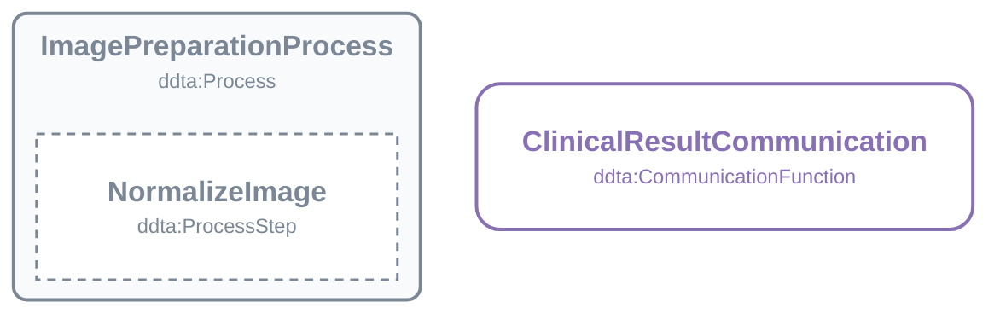

### 1.6 Esempi grafici e responsabilità delle schede

I diagrammi Mermaid illustrano l’applicazione delle convenzioni grafiche. Le definizioni normative risiedono nei blocchi `yaml ddta-visualization` e nelle regole testuali delle rispettive schede. Il Turtle dell’esempio integrato nella sezione 29 documenta le identità e le relazioni RDF utilizzate in quella rappresentazione.

**Principio redazionale:** la forma, il colore, il bordo, il testo e le icone di una **classe** sono definiti esclusivamente nella sua scheda `class-style`; la resa di una **relazione** è definita esclusivamente nella sua scheda `relation-style` o `grouped-relations-style`. Le altre schede possono mostrare istanze di quelle classi negli esempi e richiamare la scheda pertinente, ma non ridichiararne le caratteristiche. I gruppi puramente grafici restano descritti nella scheda della relazione o del raggruppamento che li produce.

## 2. Convenzioni generali delle schede

Ogni scheda distingue:

1. **Riferimento ontologico:** classe o proprietà, identificata mediante IRI.
2. **Risultato visivo:** forma, colori, bordi, posizione e significato.
3. **Dichiarazione YAML:** blocco `yaml ddta-visualization`, destinato all’interpretazione automatica delle regole grafiche.
4. **Traduzione Mermaid:** comportamento richiesto al renderer Python.
5. **Regole di proiezione:** condizioni, limiti ed errori relativi alla *vista*, non nuovi vincoli OWL.

**Principio di separazione:** le query SPARQL selezionano le istanze e le relazioni da rappresentare. La configurazione grafica definisce **come** rappresentare il sottografo selezionato. Il renderer non deve inventare nodi o asserzioni ontologiche per migliorare il layout.

**Validità dello YAML:** ciascun blocco `yaml ddta-visualization` descrive la regola grafica della relativa scheda. I metadati redazionali sullo stato della regola non fanno parte della specifica.

**Etichette dei blocchi ontologici:** applicare la convenzione globale della sezione 1.5: **nome in grassetto e grande sulla prima riga; tipo `ddta:` piccolo e normale nella riga sottostante**, entrambi centrati. I gruppi puramente grafici sono intestazioni di layout e non richiedono un tipo ontologico.

## 3. Scheda grafica — `ddta:Function`

### 3.1 Identificazione

- **Tipo:** classe ontologica CORE.
- **IRI:** `ddta:Function`.

### 3.2 Rappresentazione

Una funzione è rappresentata da un **rettangolo arrotondato**, con **sfondo bianco**, **bordo continuo grigio scuro** e testo scuro. Non richiede un'icona.

Se la query seleziona almeno una relazione `hasSubFunction` in uscita dalla funzione, la funzione deve diventare un **contenitore** per le sottofunzioni visibili; la stessa regola si applica a contratti di ingresso e uscita selezionati. Il contenitore conserva semanticamente e cromaticamente l'identità di `Function`: sfondo bianco e bordo continuo. **Il contenitore deve conservare anche gli angoli arrotondati**: la funzione padre non può diventare un rettangolo ad angoli retti solo perché è rappresentata come `subgraph`. La traduzione Mermaid del contenitore usa `rx:14px,ry:14px`, verificata nella preview VS Code del caso di studio; il generatore deve emettere questi attributi.

La presenza di relazioni selezionate può rendere la `Function` un contenitore grafico. **Questa scheda definisce esclusivamente forma e stile di `Function`.** La rappresentazione di `hasSubFunction` è definita nella scheda 4; l'organizzazione dei gruppi grafici `Subfunctions` e `Contracts`, i ruoli **INPUT/OUTPUT** e le rispettive relazioni sono definiti nella scheda 18. La forma e i colori di `Contract` e `ContractElement` sono definiti esclusivamente nelle schede 15 e 16; la composizione del contratto nella scheda 17. Nessuno di questi gruppi introduce nuovi individui RDF.

Una funzione priva sia di sottofunzioni sia di contratti **visibili nella vista selezionata** rimane un normale nodo arrotondato, anche se altrove nel grafo sono dichiarate tali relazioni.

Le eventuali specializzazioni utilizzano le proprie regole `class-style`: per `CommunicationFunction` vedere esclusivamente la scheda 12.

### 3.3 Dichiarazione YAML

```yaml ddta-visualization
record: class-style
module: core
target: ddta:Function

node:
  shape: rounded
  style: function

style:
  fill: "#FFFFFF"
  stroke: "#374151"
  color: "#374151"
  strokeWidth: 1.5
  strokePattern: solid

container:
  when: visible-children
  visibleChildRelations:
    - ddta:hasSubFunction
    - ddta:hasInputContract
    - ddta:hasOutputContract
  renderer: mermaid-subgraph
  shape: rounded
  cornerRadius: 14  # px
```

### 3.4 Traduzione Mermaid

**Funzione senza figli selezionati:** nodo con forma `rounded`, tradotto dal generatore secondo la regola YAML di questa scheda.

<!-- DDTA-EXAMPLE-02 -->

**Turtle sorgente dell’esempio 02 (dati illustrativi).**

```turtle
@prefix ddta: <https://w3id.org/ddta/core#> .
@prefix ex: <https://example.org/ddta/core-visualization#> .

ex:FunzioneA a ddta:Function .
```

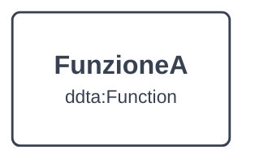

**Funzione con figli selezionati:** il contenitore mantiene lo stile di `Function`; i figli e i gruppi nell'esempio derivano dalle proprie regole di relazione (schede 4 e 18). Il generatore applica `container.cornerRadius` dello YAML della classe.

<!-- DDTA-EXAMPLE-03 -->

**Turtle sorgente dell’esempio 03 (dati illustrativi).**

```turtle
@prefix ddta: <https://w3id.org/ddta/core#> .
@prefix ex: <https://example.org/ddta/core-visualization#> .

ex:FunzionePadre a ddta:Function ; ddta:hasSubFunction ex:SottofunzioneA, ex:SottofunzioneB .
ex:SottofunzioneA a ddta:Function .
ex:SottofunzioneB a ddta:Function .
```

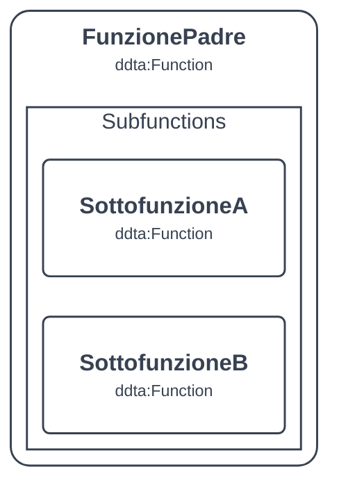

**Precisazione dell’esempio:** il riquadro `Subfunctions` ha funzione esclusivamente grafica; riunisce le sottofunzioni visibili, anche in assenza di contratti. La sua presenza non modifica la semantica di `ddta:hasSubFunction`.

**Nota tecnica:** un `subgraph` non eredita automaticamente gli angoli arrotondati di un nodo. La forma del contenitore della `Function` deriva dal proprio YAML; per la composizione con i contratti e le sottofunzioni vedere la **scheda 18**.

## 4. Scheda grafica — `ddta:hasSubFunction`

### 4.1 Identificazione

- **Tipo:** proprietà oggetto CORE.
- **IRI:** `ddta:hasSubFunction`.
- **Dominio/range:** `ddta:Function` → `ddta:Function`.

### 4.2 Rappresentazione

Per ogni tripla selezionata `Padre ddta:hasSubFunction Figlia`, la funzione **Figlia** è disegnata **dentro** la funzione **Padre**. Non viene disegnata anche una freccia con etichetta `hasSubFunction`, poiché il contenimento esprime già la relazione. Il contenimento può essere annidato ricorsivamente.

### 4.3 Dichiarazione YAML

```yaml ddta-visualization
record: relation-style
module: core
target: ddta:hasSubFunction

representation:
  type: containment
  parent: subject
  child: object
  renderer: mermaid-subgraph
  drawEdge: false
  recursive: true

validation:
  rejectCycles: true
  multipleParents: error
```

### 4.4 Comportamento richiesto al renderer

| Condizione nel sottografo selezionato | Comportamento grafico |
|---|---|
| Nessuna sottofunzione visibile | Nodo `Function` arrotondato |
| Almeno una sottofunzione visibile | Contenitore `subgraph` del padre |
| Decomposizione a più livelli | `subgraph` annidati |
| Relazione `hasSubFunction` | Solo contenimento; nessuna freccia |
| Ciclo di contenimento | Errore di proiezione |
| Stessa istanza con più padri visibili | Errore di proiezione provvisorio, senza affermare invalidità ontologica |

**Nota di proiezione:** il contenimento tramite `subgraph` non altera le triple RDF. Il controllo di più padri riguarda la rappresentabilità della vista, non la validità ontologica della relazione.

## 5. Scheda grafica — `ddta:System`

### 5.1 Identificazione

- **Tipo:** classe ontologica CORE.
- **IRI:** `ddta:System`.

### 5.2 Rappresentazione

Un sistema è un **rettangolo ad angoli retti**, con **sfondo azzurro chiaro**, **bordo blu continuo** e testo blu scuro. Non richiede un’icona.

Nelle viste che selezionano funzioni primarie o di supporto, il sistema può diventare un contenitore Mermaid `subgraph` mantenendo **la medesima forma e gli stessi colori**. Al suo interno le funzioni sono organizzate in due aree: **Primary Functions** a sinistra e **Support Functions** a destra. Solo quando una funzione è collegata esclusivamente tramite la proprietà generale `providesFunction`, senza un ruolo specifico disponibile nella vista, si aggiunge il contenitore diagnostico **Not Yet Defined**. Tutte le aree sono contenitori *grafici*, non individui RDF; le funzioni conservano lo stesso stile e si distinguono per posizione, non per un nuovo tipo visivo.

Nella vista di un `Boundary` associato tramite `hasBoundary`, **l'intero System (con gli eventuali gruppi funzionali)** è disegnato *all'interno* del rettangolo rosso tratteggiato del `Boundary`, senza la freccia `hasBoundary`. Questa è una **scelta di proiezione**, in attesa di una successiva revisione della modellazione ontologica: non aggiunge un'asserzione `encloses` relativa al System, né modifica dominio/range delle proprietà.

Ogni `Function` interna conserva il proprio stile di classe (scheda 3), indipendentemente dal contenitore `System`. Le regole grafiche dei gruppi funzionali appartengono alla scheda 6.

### 5.3 Dichiarazione YAML

```yaml ddta-visualization
record: class-style
module: core
target: ddta:System

node:
  shape: rectangle
  style: system

style:
  fill: "#E8F1FF"
  stroke: "#2563EB"
  color: "#2563EB"
  strokeWidth: 1.5
  strokePattern: solid

container:
  when: visible-functional-groups
  renderer: mermaid-subgraph
  shape: rectangle
```

### 5.4 Traduzione Mermaid

Quando nessun gruppo funzionale è selezionato, `System` viene rappresentato come nodo rettangolare:

<!-- DDTA-EXAMPLE-04 -->

**Turtle sorgente dell’esempio 04 (dati illustrativi).**

```turtle
@prefix ddta: <https://w3id.org/ddta/core#> .
@prefix ex: <https://example.org/ddta/core-visualization#> .

ex:SistemaEsempio a ddta:System .
```

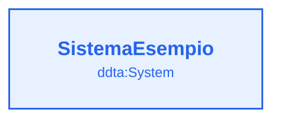

Quando sono selezionate le funzioni primarie e di supporto, il renderer utilizza `subgraph` annidati secondo la regola della scheda seguente.

## 6. Scheda grafica — raggruppamento di `hasPrimaryFunction`, `hasSupportFunction` e caso non definito di `providesFunction`

### 6.1 Identificazione

- **Proprietà CORE:** `ddta:providesFunction`, `ddta:hasPrimaryFunction` e `ddta:hasSupportFunction`.
- **Dominio/range:** `ddta:System` → `ddta:Function` per tutte e tre le proprietà.
- **Natura della regola:** raggruppamento grafico per ruolo funzionale, non relazione ontologica di composizione.

### 6.2 Rappresentazione

Quando la query restituisce le relative relazioni per un sistema:

- le funzioni collegate da `hasPrimaryFunction` compaiono nel gruppo **Primary Functions**;
- le funzioni collegate da `hasSupportFunction` compaiono nel gruppo **Support Functions**;
- quando una funzione è collegata da un'asserzione generale `providesFunction`, ma nel sottografo RDF selezionato non risulta né `hasPrimaryFunction` né `hasSupportFunction` per quella coppia System–Function, la funzione compare in un **rettangolo diagnostico** **Not Yet Defined**, *non* in una terza categoria funzionale; il nome del gruppo è un'etichetta grafica temporanea;
- i gruppi sono **affiancati orizzontalmente**, con **Primary Functions a sinistra**, **Support Functions a destra** e, *solo se necessario*, **Not Yet Defined** più a destra;
- **tutti i gruppi ereditano lo sfondo azzurro e il colore del bordo blu del System padre**;
- il bordo dei **gruppi è blu tratteggiato**, mentre quello esterno del sistema è **blu continuo**;
- ogni `Function` conserva lo stile definito nella propria scheda 3;
- non vengono aggiunte frecce `hasPrimaryFunction`, `hasSupportFunction` o `providesFunction`: le prime due relazioni sono visualizzate dalla posizione della Function e la terza, in assenza di ruolo specifico selezionato, dal riquadro diagnostico.

**Politica di selezione:** `hasPrimaryFunction` e `hasSupportFunction` sono sottoproprietà di `providesFunction`, perciò le loro asserzioni comportano anche la relazione generale. Il renderer assegna priorità al ruolo specifico, senza duplicare l'individuo nel gruppo diagnostico per effetto dell'inferenza RDFS. Il gruppo *Not Yet Defined* segnala soltanto **un ruolo non specificato nel sottografo selezionato**, non l'assenza assoluta del ruolo nell'ontologia (Open World) e non un nuovo stato ontologico. Nel normale authoring DDTA questa situazione dovrebbe essere risolta specificando il ruolo.

L'ereditarietà si riferisce **soltanto allo stile grafico del contenitore**. Non implica proprietà OWL ereditate o contenimento semantico.

### 6.3 Dichiarazione YAML

```yaml ddta-visualization
record: grouped-relations-style
module: core
subjectClass: ddta:System

groups:
  - id: primary-functions
    label: "Primary Functions"
    property: ddta:hasPrimaryFunction
    representation: containment-group
    style: system-function-group
  - id: support-functions
    label: "Support Functions"
    property: ddta:hasSupportFunction
    representation: containment-group
    style: system-function-group
  - id: role-not-yet-defined
    label: "Not Yet Defined"
    property: ddta:providesFunction
    representation: containment-group
    style: system-function-group
    displayWhen: generic-relation-without-selected-specific-role
    presentationOnly: true

resolution:
  genericProperty: ddta:providesFunction
  specificRoleProperties:
    - ddta:hasPrimaryFunction
    - ddta:hasSupportFunction
  applyTo: selected-rdf-subgraph
  preferSpecificRoles: true
  doNotDuplicateEntailedGenericRelation: true
  diagnosticGroupDoesNotAssertOntologyStatus: true
  ifSameIndividualInMultipleGroups: projection-error

styles:
  system-function-group:
    inheritsFrom: system
    strokePattern: dashed
    strokeWidth: 1.5

layout:
  direction: LR
  arrangement: horizontal-groups
  enforceGroupOrder: true
  groupOrder:
    - primary-functions
    - support-functions
    - role-not-yet-defined
  mermaidLayoutConstraint:
    type: invisible-link
    from: primary-functions
    to: support-functions
    optionalNextGroup: role-not-yet-defined
    semantic: false  # solo impaginazione, non tripla RDF
```

**Regola di risoluzione dello stile:** `inheritsFrom: system` copia le proprietà cromatiche e di testo dello stile `System`; `strokePattern: dashed` sostituisce **solo** il tipo di bordo. Il gruppo non eredita la forma delle singole `Function`.

### 6.4 Traduzione Mermaid: esempio integrato

L'esempio è **illustrativo** e non dichiara nuove istanze RDF. Il collegamento invisibile `PRIMARY ~~~ SUPPORT`, nel contenitore con `direction LR`, è un vincolo di disposizione sinistra → destra, senza significato ontologico. La funzione composta conserva gli angoli arrotondati grazie a `rx/ry`.

<!-- DDTA-EXAMPLE-05 -->

**Turtle sorgente dell’esempio 05 (dati illustrativi).**

```turtle
@prefix ddta: <https://w3id.org/ddta/core#> .
@prefix ex: <https://example.org/ddta/core-visualization#> .

ex:SistemaEsempio a ddta:System ;
    ddta:hasPrimaryFunction ex:FunzionePrimaria ;
    ddta:hasSupportFunction ex:FunzioneSupporto .
ex:FunzionePrimaria a ddta:Function ;
    ddta:hasSubFunction ex:SottofunzioneA, ex:SottofunzioneB .
ex:FunzioneSupporto a ddta:Function .
ex:SottofunzioneA a ddta:Function .
ex:SottofunzioneB a ddta:Function .
```

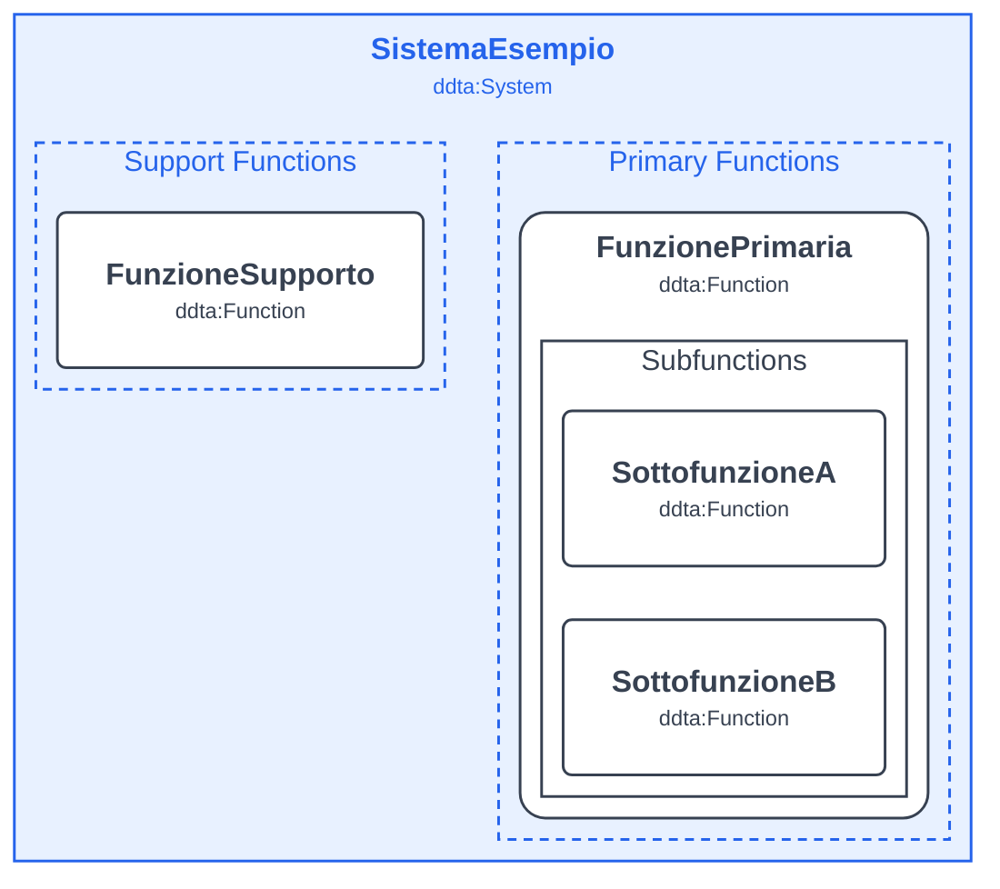

I gruppi e il loro ordine derivano dalla configurazione grafica, non sono individui RDF. I collegamenti di impaginazione Mermaid, come `~~~`, non sono archi del modello né appartengono ai risultati delle query SPARQL.

**Esempio ridotto del caso `providesFunction` senza ruolo specifico selezionato:** il riquadro *Not Yet Defined* usa **gli stessi colori e bordi dei gruppi funzionali**; la funzione conserva nome, tipo e stile abituale.

<!-- DDTA-EXAMPLE-06 -->

**Turtle sorgente dell’esempio 06 (dati illustrativi).**

```turtle
@prefix ddta: <https://w3id.org/ddta/core#> .
@prefix ex: <https://example.org/ddta/core-visualization#> .

ex:SistemaEsempio a ddta:System ;
    ddta:providesFunction ex:FunzioneSenzaRuoloEsplicito .
ex:FunzioneSenzaRuoloEsplicito a ddta:Function .
```

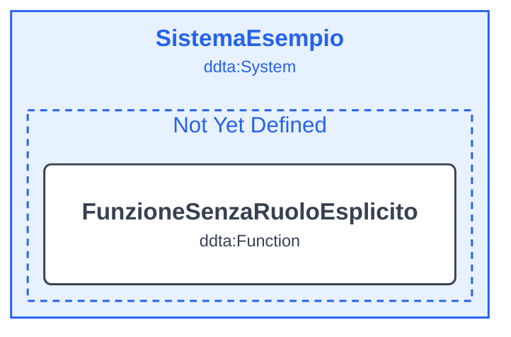

### 6.5 Limiti di proiezione

- `ddta:providesFunction` senza un ruolo specifico nel sottografo selezionato viene mostrata nel **riquadro grafico Not Yet Defined**, che segnala una descrizione da completare senza inventare una terza categoria ontologica. Le funzioni già classificate come primarie o di supporto non devono ricomparire nel riquadro per effetto di `rdfs:subPropertyOf`.
- I gruppi grafici interpretano `grouped-relations-style` e `inheritsFrom` secondo le regole della scheda: il riuso dello stile riguarda esclusivamente la rappresentazione, non le proprietà RDF.
- Se la stessa istanza dovesse comparire in più gruppi o sotto più contenitori nella stessa vista, serve una politica di rappresentazione delle identità condivise. Finché non è definita, il renderer non deve duplicarla silenziosamente.
- L'ordine **sinistra → destra** è richiesto dalla regola, ma il solo `direction LR` non lo garantisce in tutte le combinazioni di subgraph e collegamenti esterni. `PRIMARY ~~~ SUPPORT` è un vincolo di impaginazione invisibile, non una tripla RDF. La verifica in VS Code dell'esempio completo è obbligatoria; se Mermaid riordina i gruppi, il renderer dovrà adottare un vincolo di layout più robusto.
- Le etichette degli individui seguono la regola tipografica generale della sezione 1.5: nome, tipo RDF, dimensioni del testo e comportamento in caso di troncamento.

## 7. Scheda grafica — `ddta:Environment`

### 7.1 Identificazione

- **Classe CORE:** `ddta:Environment`.
- **Relazioni CORE utilizzate dalla vista:** `ddta:hasOperationalEnvironment` (letta in senso inverso per trovare i sistemi associati), `ddta:makesAvailable` (per ottenere le risorse disponibili).
- **Natura del layout:** organizzazione grafica del contesto operativo, non affermazione di contenimento fisico o di effettiva esecuzione dei sistemi.

### 7.2 Rappresentazione concordata

`Environment` è un contenitore **verde molto chiaro**, ad **angoli retti**, con **bordo esterno verde continuo**. L'etichetta riporta il nome dell'ambiente e sotto il tipo `ddta:Environment`.

Il contenitore è suddiviso **verticalmente**, dall'alto verso il basso:

- **Associated Systems**, rettangolo verde con **bordo verde continuo**, come l'`Environment`: contiene i `System` associati tramite l'inversa di `hasOperationalEnvironment`. Ogni `System` e ogni `Function` applicano i rispettivi stili di classe (schede 5 e 3) e le regole dei gruppi funzionali (scheda 6).
- **Available Resources**, rettangolo verde con **bordo verde continuo**, come l'`Environment`: contiene le risorse ottenute da `makesAvailable`, ordinate in tre sottogruppi **uno sopra l'altro**: **Communication Channels**, **Stores**, **Other Resources**.

Ogni sottogruppo di `Available Resources` ha **sfondo verde e bordo verde tratteggiato**, contiene le **risorse nella parte superiore**, quindi **l'icona monocromatica verde e il nome del gruppo nella parte inferiore**. Le icone di rete, database e server/risorsa hanno **colore `#45845B`**, uguale al bordo dell'ambiente. I disegni di riferimento sono i file vettoriali locali in `icons/`; l'esempio Mermaid incorpora esattamente questi SVG come immagini `data:image/svg+xml;base64,...`, senza dipendere da Font Awesome. **Non** utilizzare emoji colorate o numerazione. I gruppi vuoti non vengono mostrati.

Le risorse conservano lo stile della **propria classe**, senza ridefinizioni in questa scheda: `CommunicationChannel` (scheda 11), `Store` (scheda 8), `Resource` (scheda 19) e `CommunicationFunction` (scheda 12). La classificazione nei gruppi è determinata dal tipo RDF, non dal nome. Questa scheda definisce soltanto **raggruppamento, ordine e stile grafico dei gruppi** dell'`Environment`.

La resa concettuale è quindi:

```text
Environment (verde, bordo continuo)
  Associated Systems (verde, bordo continuo)
    System (azzurro, bordo continuo)
      [Primary Functions]  [Support Functions]  <- sinistra / destra
  Available Resources (verde, bordo continuo)
    Communication Channels (verde, tratteggiato)
      [Channel A · ddta:CommunicationChannel] [Channel B · ddta:CommunicationChannel]
      [icona rete verde] Communication Channels <- icona e titolo in basso
    Stores (verde, tratteggiato)
      [Store A grigio + icona] [Store B grigio + icona]
      [icona database verde] Stores
    Other Resources (verde, tratteggiato)
      [Resource A]
      [icona server verde] Other Resources
```

### 7.3 Dichiarazione YAML — classe `Environment`

```yaml ddta-visualization
record: class-style
module: core
target: ddta:Environment

node:
  shape: rectangle
  style: environment

style:
  fill: "#EAF5EC"
  stroke: "#45845B"
  color: "#45845B"
  strokeWidth: 1.5
  strokePattern: solid

container:
  when: visible-associated-systems-or-resources
  renderer: mermaid-subgraph
  shape: rectangle
```

### 7.4 Dichiarazione YAML — raggruppamento di relazioni

```yaml ddta-visualization
record: grouped-relations-style
module: core
subjectClass: ddta:Environment

groups:
  - id: associated-systems
    label: "Associated Systems"
    inverseProperty: ddta:hasOperationalEnvironment
    style: environment-section

  - id: available-resources
    label: "Available Resources"
    property: ddta:makesAvailable
    style: environment-section
    subgroups:
      - id: communication-channels
        label: "Communication Channels"
        class: ddta:CommunicationChannel
        style: environment-resource-group
        icon: network
      - id: stores
        label: "Stores"
        class: ddta:Store
        style: environment-resource-group
        icon: database
      - id: other-resources
        label: "Other Resources"
        class: ddta:Resource
        excludeSubclassesAlreadyGrouped: true
        style: environment-resource-group
        icon: server

styles:
  environment-section:
    inheritsFrom: environment
    strokePattern: solid
    strokeWidth: 1.5
  environment-resource-group:
    inheritsFrom: environment
    strokePattern: dashed
    strokeWidth: 1.5

layout:
  direction: TB
  arrangement: vertical-stack
  enforceGroupOrder: true
  groupOrder:
    - associated-systems
    - available-resources
  resourceGroupOrder:
    - communication-channels
    - stores
    - other-resources
  resourceGroupCaption:
    position: bottom
    iconPosition: before-label
    iconColor: "#45845B"
    iconStyle: monochrome-outline
  hideEmptyGroups: true

icons:
  network:
    svg: icons/network.svg
    mermaid:
      representation: image-node
      encoding: data-uri-base64
      height: 32
      constraint: "on"
  database:
    svg: icons/database.svg
    mermaid:
      representation: image-node
      encoding: data-uri-base64
      height: 32
      constraint: "on"
  server:
    svg: icons/server.svg
    mermaid:
      representation: image-node
      encoding: data-uri-base64
      height: 32
      constraint: "on"
```

**Nota YAML:** `inverseProperty`, `subgroups`, `resourceGroupCaption`, `inheritsFrom` e `icons` definiscono la composizione della vista. Le icone SVG locali indicate da `svg` vengono codificate come URI `data:` nei Mermaid. Le impostazioni `height: 32` e `constraint: "on"` specificano la resa dei nodi immagine. Non sono necessarie nuove classi OWL.

### 7.5 Traduzione Mermaid: esempio di vista `Environment`

I nomi sono illustrativi: non costituiscono individui o relazioni aggiunti al modello DDTA. I collegamenti `~~~` servono esclusivamente all'impaginazione. `Associated Systems` si trova sopra `Available Resources`; nel `System`, le funzioni primarie sono a sinistra e quelle di supporto a destra. **Per forma e stile di ciascuna `Function` interna si applica la scheda 3, senza ridefinirli in `Environment`.** I due gruppi principali dell'ambiente hanno bordo **continuo**, mentre i sottogruppi di risorse hanno bordo **tratteggiato**.

Le icone nel codice sottostante derivano dai tre SVG locali del catalogo. I canali e gli Store dell'esempio utilizzano rispettivamente le regole grafiche delle schede 11 e 8. Il gruppo `Stores` conserva l’icona verde **in basso**, distinta dalle icone grigie dei singoli Store. Il generatore deve inserirle mediante `@{ img: "data:image/svg+xml;base64,...", h: 32, constraint: "on" }`. Per evitare sfondi neri, l'esempio dichiara il tema `base` e stili espliciti per i nodi immagine e le didascalie. Gli SVG non sono incorporati nell'ontologia RDF: sono contenuti **soltanto nel Mermaid generato**.

<!-- DDTA-EXAMPLE-07 -->

**Turtle sorgente dell’esempio 07 (dati illustrativi).**

```turtle
@prefix ddta: <https://w3id.org/ddta/core#> .
@prefix ex: <https://example.org/ddta/core-visualization#> .

ex:ExampleEnvironment a ddta:Environment ;
    ddta:makesAvailable ex:Channel_A, ex:Channel_B, ex:Store_A, ex:Store_B, ex:Resource_A .
ex:ExampleSystem a ddta:System ;
    ddta:hasOperationalEnvironment ex:ExampleEnvironment ;
    ddta:hasPrimaryFunction ex:PrimaryFunction ;
    ddta:hasSupportFunction ex:SupportFunction .
ex:PrimaryFunction a ddta:Function ;
    ddta:hasSubFunction ex:SubFunction_A, ex:SubFunction_B .
ex:SupportFunction a ddta:Function .
ex:SubFunction_A a ddta:Function .
ex:SubFunction_B a ddta:Function .
ex:Channel_A a ddta:CommunicationChannel .
ex:Channel_B a ddta:CommunicationChannel .
ex:Store_A a ddta:Store .
ex:Store_B a ddta:Store .
ex:Resource_A a ddta:Resource .
```

```mermaid
%%{init: {"htmlLabels":true,"theme":"base","layout":"elk"}}%%
flowchart TB
    subgraph O_e307dd9f64b555["<div style='display:inline-block;text-align:center;white-space:nowrap;line-height:1.4;padding:8px 12px;background:transparent;opacity:1;color:#45845B'><span style='display:block;text-align:center;font-size:17px;font-weight:700;color:#45845B'>ExampleEnvironment</span><span style='display:block;text-align:center;font-size:12px;font-weight:400;color:#45845B'>ddta:Environment</span></div>"]
        direction TB
        subgraph G_646f4b97d2a998["Associated Systems"]
            direction TB
            subgraph O_889b68b43ec992["<div style='display:inline-block;text-align:center;white-space:nowrap;line-height:1.4;padding:8px 12px;background:transparent;opacity:1;color:#2563EB'><span style='display:block;text-align:center;font-size:17px;font-weight:700;color:#2563EB'>ExampleSystem</span><span style='display:block;text-align:center;font-size:12px;font-weight:400;color:#2563EB'>ddta:System</span></div>"]
                direction LR
                subgraph G_34a527d4454da7["Primary Functions"]
                    direction LR
                    subgraph O_8c680782e96d8e["<div style='display:inline-block;text-align:center;white-space:nowrap;line-height:1.4;padding:8px 12px;background:transparent;opacity:1;color:#374151'><span style='display:block;text-align:center;font-size:17px;font-weight:700;color:#374151'>PrimaryFunction</span><span style='display:block;text-align:center;font-size:12px;font-weight:400;color:#374151'>ddta:Function</span></div>"]
                        direction TB
                        subgraph G_c98072a3174c26["Subfunctions"]
                            direction TB
                            O_173eeb5f6c9807("<div style='display:inline-block;text-align:center;white-space:nowrap;line-height:1.4;padding:8px 12px;background:transparent;opacity:1;color:#374151'><span style='display:block;text-align:center;font-size:17px;font-weight:700;color:#374151'>SubFunction_A</span><span style='display:block;text-align:center;font-size:12px;font-weight:400;color:#374151'>ddta:Function</span></div>")
                            O_b83284f66a2f7c("<div style='display:inline-block;text-align:center;white-space:nowrap;line-height:1.4;padding:8px 12px;background:transparent;opacity:1;color:#374151'><span style='display:block;text-align:center;font-size:17px;font-weight:700;color:#374151'>SubFunction_B</span><span style='display:block;text-align:center;font-size:12px;font-weight:400;color:#374151'>ddta:Function</span></div>")
                        end
                    end
                end
                subgraph G_bad0d65f041af1["Support Functions"]
                    direction LR
                    O_417dc6ec5ccb86("<div style='display:inline-block;text-align:center;white-space:nowrap;line-height:1.4;padding:8px 12px;background:transparent;opacity:1;color:#374151'><span style='display:block;text-align:center;font-size:17px;font-weight:700;color:#374151'>SupportFunction</span><span style='display:block;text-align:center;font-size:12px;font-weight:400;color:#374151'>ddta:Function</span></div>")
                end
            end
        end
        subgraph G_a95eb6495b4a43["Available Resources"]
            direction TB
            subgraph G_3f4ad27c3e8c41[" "]
                direction TB
                O_8349ace9b43148("<div style='display:inline-block;text-align:center;white-space:nowrap;line-height:1.4;padding:8px 12px;background:transparent;opacity:1;color:#8870B5'><span style='display:block;text-align:center;font-size:17px;font-weight:700;color:#8870B5'>Channel_A</span><span style='display:block;text-align:center;font-size:12px;font-weight:400;color:#8870B5'>ddta:CommunicationChannel</span></div>")
                O_716c25dac34739("<div style='display:inline-block;text-align:center;white-space:nowrap;line-height:1.4;padding:8px 12px;background:transparent;opacity:1;color:#8870B5'><span style='display:block;text-align:center;font-size:17px;font-weight:700;color:#8870B5'>Channel_B</span><span style='display:block;text-align:center;font-size:12px;font-weight:400;color:#8870B5'>ddta:CommunicationChannel</span></div>")
                G_92531a85164d92["<img src='data:image/svg+xml;base64,PHN2ZyB4bWxucz0iaHR0cDovL3d3dy53My5vcmcvMjAwMC9zdmciIHdpZHRoPSIyOCIgaGVpZ2h0PSIyOCIgdmlld0JveD0iMCAwIDI0IDI0IiBmaWxsPSJub25lIiBzdHJva2U9IiM0NTg0NUIiIHN0cm9rZS13aWR0aD0iMS43NSIgc3Ryb2tlLWxpbmVjYXA9InJvdW5kIiBzdHJva2UtbGluZWpvaW49InJvdW5kIj48cmVjdCB4PSI5IiB5PSIyIiB3aWR0aD0iNiIgaGVpZ2h0PSI2IiByeD0iMSIvPjxyZWN0IHg9IjIiIHk9IjE2IiB3aWR0aD0iNiIgaGVpZ2h0PSI2IiByeD0iMSIvPjxyZWN0IHg9IjE2IiB5PSIxNiIgd2lkdGg9IjYiIGhlaWdodD0iNiIgcng9IjEiLz48cGF0aCBkPSJNMTIgOHY0TTUgMTZ2LTRoMTR2NCIvPjwvc3ZnPg==' width='32' height='32'/>Communication Channels"]
                O_716c25dac34739 ~~~ G_92531a85164d92
            end
            subgraph G_d3e1b6bb1ae829[" "]
                direction TB
                O_9c9e716ed63da2("<div style='display:inline-block;text-align:center;white-space:nowrap;line-height:1.4;padding:8px 12px;background:transparent;opacity:1;color:#64748B'><span style='display:block;text-align:center;font-size:17px;font-weight:700;color:#64748B'>Store_A</span><span style='display:block;text-align:center;font-size:12px;font-weight:400;color:#64748B'>ddta:Store</span></div>")
                O_3b68a35d6e5291("<div style='display:inline-block;text-align:center;white-space:nowrap;line-height:1.4;padding:8px 12px;background:transparent;opacity:1;color:#64748B'><span style='display:block;text-align:center;font-size:17px;font-weight:700;color:#64748B'>Store_B</span><span style='display:block;text-align:center;font-size:12px;font-weight:400;color:#64748B'>ddta:Store</span></div>")
                G_d68c3997431263["<img src='data:image/svg+xml;base64,PHN2ZyB4bWxucz0iaHR0cDovL3d3dy53My5vcmcvMjAwMC9zdmciIHdpZHRoPSIyOCIgaGVpZ2h0PSIyOCIgdmlld0JveD0iMCAwIDI0IDI0IiBmaWxsPSJub25lIiBzdHJva2U9IiM0NTg0NUIiIHN0cm9rZS13aWR0aD0iMS43NSIgc3Ryb2tlLWxpbmVjYXA9InJvdW5kIiBzdHJva2UtbGluZWpvaW49InJvdW5kIj48ZWxsaXBzZSBjeD0iMTIiIGN5PSI1IiByeD0iOSIgcnk9IjMiLz48cGF0aCBkPSJNMyA1djE0YzAgMS42NiA0LjAzIDMgOSAzczktMS4zNCA5LTNWNSIvPjxwYXRoIGQ9Ik0zIDEyYzAgMS42NiA0LjAzIDMgOSAzczktMS4zNCA5LTMiLz48L3N2Zz4=' width='32' height='32'/>Stores"]
                O_3b68a35d6e5291 ~~~ G_d68c3997431263
            end
            subgraph G_bc610efb19361e[" "]
                direction TB
                O_ec4bac6e648ec0["<div style='display:inline-block;text-align:center;white-space:nowrap;line-height:1.4;padding:8px 12px;background:transparent;opacity:1;color:#111827'><span style='display:block;text-align:center;font-size:17px;font-weight:700;color:#111827'>Resource_A</span><span style='display:block;text-align:center;font-size:12px;font-weight:400;color:#111827'>ddta:Resource</span></div>"]
                G_d78031c40b1390["<img src='data:image/svg+xml;base64,PHN2ZyB4bWxucz0iaHR0cDovL3d3dy53My5vcmcvMjAwMC9zdmciIHdpZHRoPSIyOCIgaGVpZ2h0PSIyOCIgdmlld0JveD0iMCAwIDI0IDI0IiBmaWxsPSJub25lIiBzdHJva2U9IiM0NTg0NUIiIHN0cm9rZS13aWR0aD0iMS43NSIgc3Ryb2tlLWxpbmVjYXA9InJvdW5kIiBzdHJva2UtbGluZWpvaW49InJvdW5kIj48cmVjdCB4PSIzIiB5PSIyLjUiIHdpZHRoPSIxOCIgaGVpZ2h0PSI4IiByeD0iMS41Ii8+PHJlY3QgeD0iMyIgeT0iMTMuNSIgd2lkdGg9IjE4IiBoZWlnaHQ9IjgiIHJ4PSIxLjUiLz48Y2lyY2xlIGN4PSI2LjUiIGN5PSI2LjUiIHI9Ii42IiBmaWxsPSIjNDU4NDVCIiBzdHJva2U9Im5vbmUiLz48Y2lyY2xlIGN4PSI2LjUiIGN5PSIxNy41IiByPSIuNiIgZmlsbD0iIzQ1ODQ1QiIgc3Ryb2tlPSJub25lIi8+PHBhdGggZD0iTTEwIDYuNWg3TTEwIDE3LjVoNyIvPjwvc3ZnPg==' width='32' height='32'/>Other Resources"]
                O_ec4bac6e648ec0 ~~~ G_d78031c40b1390
            end
        end
    end
    classDef DDTA_C_ec3c1934ce4a fill:#E8F1FF,stroke:#2563EB,color:#2563EB,stroke-width:1.5px
    class O_889b68b43ec992 DDTA_C_ec3c1934ce4a
    classDef DDTA_C_764b3983e628 fill:#E8F1FF,stroke:#2563EB,color:#2563EB,stroke-width:1.5px,stroke-dasharray:5 4
    class G_34a527d4454da7,G_bad0d65f041af1 DDTA_C_764b3983e628
    classDef DDTA_C_47a0c203a3c4 fill:#EAF5EC,stroke:#45845B,color:#45845B,stroke-width:1.5px
    class G_646f4b97d2a998,G_a95eb6495b4a43,O_e307dd9f64b555 DDTA_C_47a0c203a3c4
    classDef DDTA_C_f87c22e49ae1 fill:#EAF5EC,stroke:#45845B,color:#45845B,stroke-width:1.5px,stroke-dasharray:5 4
    class G_3f4ad27c3e8c41,G_bc610efb19361e,G_d3e1b6bb1ae829 DDTA_C_f87c22e49ae1
    classDef DDTA_C_1ae4e3c918ad fill:#F0EBFA,stroke:#8870B5,color:#8870B5,stroke-width:1.5px,rx:12px,ry:12px
    class O_716c25dac34739,O_8349ace9b43148 DDTA_C_1ae4e3c918ad
    classDef DDTA_C_2c6e0269ee60 fill:#F1F5F9,stroke:#64748B,color:#64748B,stroke-width:1.5px
    class O_3b68a35d6e5291,O_9c9e716ed63da2 DDTA_C_2c6e0269ee60
    classDef DDTA_C_069d7d57acd8 fill:#FFFFFF,stroke:#111827,color:#111827,stroke-width:1.5px
    class O_ec4bac6e648ec0 DDTA_C_069d7d57acd8
    classDef DDTA_C_1a97e3c85c24 fill:#FFFFFF,stroke:#374151,color:#374151,stroke-width:1.5px
    class G_c98072a3174c26,O_173eeb5f6c9807,O_417dc6ec5ccb86,O_b83284f66a2f7c DDTA_C_1a97e3c85c24
    classDef DDTA_C_bfb810e84373 fill:#FFFFFF,stroke:#374151,color:#374151,stroke-width:1.5px,rx:14px,ry:14px
    class O_8c680782e96d8e DDTA_C_bfb810e84373
    classDef DDTA_C_dd44c4d967c8 fill:transparent,stroke:transparent,stroke-width:0px
    class G_92531a85164d92,G_d68c3997431263,G_d78031c40b1390 DDTA_C_dd44c4d967c8
    linkStyle 0 stroke:transparent,stroke-width:0px,opacity:0
    linkStyle 1 stroke:transparent,stroke-width:0px,opacity:0
    linkStyle 2 stroke:transparent,stroke-width:0px,opacity:0
```

**Compatibilità:** per la resa delle icone SVG incorporate si utilizzano `constraint: "on"`, altezza 32 e stili espliciti. Nelle viste `Environment` l’ordinamento dei sottogruppi è una convenzione di proiezione, non una proprietà dell’ontologia.


## 8. Scheda grafica — `ddta:Store`

### 8.1 Identificazione

- **Tipo:** classe ontologica CORE, specializzazione di `ddta:Resource`.
- **IRI:** `ddta:Store`.

### 8.2 Rappresentazione

Nelle viste di contenimento, uno `Store` è rappresentato da un **riquadro con angoli arrotondati**, **sfondo grigio chiaro** e **bordo grigio continuo**. Nell'intestazione compare il nome dello Store, accompagnato dall'**icona database**. L'icona riprende il colore del bordo del contenitore grafico che la ospita. Non si usano frecce `stores` in questa vista.

Uno Store che contiene altri Store o contenuti visibili diventa un **`subgraph` Mermaid**; gli Store figli sono altri contenitori dello stesso tipo, annidati ricorsivamente. Uno Store semplice, senza figli visibili, mantiene **lo stesso sfondo grigio chiaro e il bordo arrotondato**, come nella vista `Environment`. Non si utilizza il cilindro in queste viste: il contenimento semplice è la scelta approvata per mantenere i diagrammi Mermaid facilmente riutilizzabili nei documenti.

**Intestazione separata:** il nome e l'icona database compaiono **insieme nella fascia superiore**, rispettivamente a destra e a sinistra. La fascia non contiene `StoredContent`. Il layout dispone gli Store figli **orizzontalmente, da sinistra a destra**, quando lo spazio lo permette; i `StoredContent` restano all'interno del proprio Store, sotto l'intestazione.

Lo stile dei `ddta:StoredContent` è definito esclusivamente nella scheda 10. La relazione `stores` e il relativo contenimento sono definiti nella scheda 9.

### 8.3 Dichiarazione YAML

```yaml ddta-visualization
record: class-style
module: core
target: ddta:Store

node:
  shape: rounded
  style: store

style:
  fill: "#F1F5F9"
  stroke: "#64748B"
  color: "#64748B"
  strokeWidth: 1.5
  strokePattern: solid

container:
  when: visible-stored-children
  renderer: mermaid-subgraph
  shape: rounded
  cornerRadius: 12
  style: store-container
  icon: database
  iconPosition: header-left
  iconColor: hosting-container-border
  header:
    renderer: mermaid-subgraph
    direction: LR
    iconBeforeTitle: true
    separateFromContent: true
  childrenLayout:
    direction: LR
    arrangement: horizontal-groups
    preferSingleRow: true

styles:
  store-container:
    fill: "#F1F5F9"
    stroke: "#64748B"
    color: "#64748B"
    strokeWidth: 1.5
    strokePattern: solid
  nested-store-container:
    fill: "#F8FAFC"
    stroke: "#64748B"
    color: "#64748B"
    strokeWidth: 1.5
    strokePattern: solid
```

I valori `visible-stored-children`, `header`, `childrenLayout`, `iconPosition` e `iconColor` fanno parte della **specifica YAML grafica**. `database` fa riferimento al medesimo SVG locale già utilizzato per il gruppo `Stores` dell'Environment, **senza creare una seconda icona**. Il generatore colorizza la copia incorporata nell’output Mermaid in base al bordo del contenitore, lasciando invariato il file SVG sorgente.

## 9. Scheda grafica — `ddta:stores`

### 9.1 Identificazione

- **Tipo:** proprietà oggetto CORE.
- **IRI:** `ddta:stores`.
- **Dominio:** `ddta:Store`.
- **Range:** unione di `ddta:Store` e `ddta:StoredContent`.

### 9.2 Rappresentazione

La proprietà `stores` è proiettata mediante **contenimento**, distinguendo il tipo RDF dell'oggetto:

| Oggetto della tripla `stores` | Rappresentazione nella vista di contenimento |
|---|---|
| `ddta:Store` | Contenimento nello Store padre; lo stile del figlio deriva dalla scheda 8 |
| `ddta:StoredContent` | Contenimento nello Store padre; lo stile del contenuto deriva dalla scheda 10 |

Non sono disegnate frecce `stores`: la struttura è già espressa dalla disposizione dei contenitori. L'annidamento può essere ricorsivo, ma **non rende transitiva** la proprietà OWL `stores` e non implica operazioni effettive di lettura o scrittura.

### 9.3 Dichiarazione YAML

```yaml ddta-visualization
record: relation-style
module: core
target: ddta:stores

representation:
  type: containment
  parent: subject
  child: object
  renderer: mermaid-subgraph
  drawEdge: false
  recursive: true

layout:
  nestedStores:
    direction: LR
    preferSingleRow: true
  storedContent:
    position: below-store-header

children:
  ddta:Store:
    representation: nested-store
    style: nested-store-container
  ddta:StoredContent:
    representation: node
    style: stored-content
    showIcon: false

validation:
  rejectCycles: true
  multipleParents: error
```

Il controllo `multipleParents: error` è **solo un limite prudenziale di proiezione**: un contenuto può essere collegato ontologicamente a più Store. Se lo stesso individuo deve comparire in più contenitori, il renderer non deve duplicarne l'identità RDF o inventare copie; finché non è definita una strategia visiva, segnala l'ambiguità.

### 9.4 Traduzione Mermaid — Store annidati e contenuti

Il codice seguente mostra **MainStore**, due Store figli affiancati e quattro `StoredContent`. Ogni Store usa un piccolo **subgraph di intestazione**, che mantiene l'icona database sulla sinistra e il nome sulla destra, sempre **sopra i contenuti**. Il layout `direction LR` insieme al collegamento invisibile `IMAGES ~~~ MODELS` favorisce l'ordine orizzontale dei sottostore, senza attribuire una relazione RDF tra loro. Le icone sono incorporate dal file SVG locale, con colore adattato al bordo grigio (`#64748B`) e proporzioni preservate mediante `constraint: "on"`. Il colore nello SVG incorporato riguarda soltanto l'aspetto grafico: **non** modifica l'icona sorgente né l'ontologia.

<!-- DDTA-EXAMPLE-08 -->

**Turtle sorgente dell’esempio 08 (dati illustrativi).**

```turtle
@prefix ddta: <https://w3id.org/ddta/core#> .
@prefix ex: <https://example.org/ddta/core-visualization#> .

ex:MainStore a ddta:Store ; ddta:stores ex:ImagesStore, ex:ModelsStore .
ex:ImagesStore a ddta:Store ; ddta:stores ex:Image001, ex:Image002, ex:Image003 .
ex:ModelsStore a ddta:Store ; ddta:stores ex:Weights .
ex:Image001 a ddta:StoredContent .
ex:Image002 a ddta:StoredContent .
ex:Image003 a ddta:StoredContent .
ex:Weights a ddta:StoredContent .
```

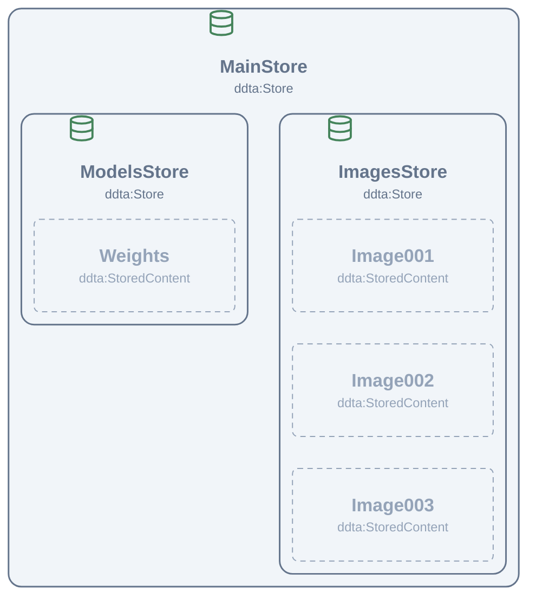

I collegamenti invisibili `~~~` sono **soltanto ausili di layout**: mantengono le intestazioni sopra i contenuti e provano a disporre i sottostore affiancati. Non aggiungono triple RDF né una relazione semantica di precedenza. Il motore di layout di Mermaid può riorganizzare gli elementi: **la disposizione va verificata in VS Code**, senza considerarla una garanzia assoluta. Gli oggetti `StoredContent` appaiono come nodi distinti, non come elenchi puntati. La visualizzazione complessiva di questo esempio deve essere verificata in VS Code prima di considerare collaudata la traduzione automatica.

## 10. Scheda grafica — `ddta:StoredContent`

### 10.1 Identificazione

- **Tipo:** classe ontologica CORE.
- **IRI:** `ddta:StoredContent`.
- **Distinzione:** **non** è una sottoclasse di `ddta:Resource` e **non** è uno `Store`.

### 10.2 Rappresentazione

Nella vista di contenimento uno `StoredContent` è un **rettangolo individuale** con **sfondo grigio molto chiaro**, **bordo grigio tratteggiato** e **nessuna icona**. I contenuti sono disegnati nel contenitore dello Store che li memorizza, quando la tripla `stores` è selezionata dalla query.

Il tratteggio identifica qui la **convenzione grafica per `StoredContent`**, non una cardinalità facoltativa: un contenuto rappresentato non è automaticamente opzionale o incompleto. Nome o etichetta dell'individuo non ne sostituiscono l'IRI RDF.

### 10.3 Dichiarazione YAML

```yaml ddta-visualization
record: class-style
module: core
target: ddta:StoredContent

node:
  shape: rectangle
  style: stored-content

style:
  fill: "#F1F5F9"
  stroke: "#94A3B8"
  color: "#94A3B8"
  strokeWidth: 1.0
  strokePattern: dashed
  cornerRadius: 5

icon:
  enabled: false
```

### 10.4 Traduzione Mermaid — singolo elemento

<!-- DDTA-EXAMPLE-09 -->

**Turtle sorgente dell’esempio 09 (dati illustrativi).**

```turtle
@prefix ddta: <https://w3id.org/ddta/core#> .
@prefix ex: <https://example.org/ddta/core-visualization#> .

ex:Image001 a ddta:StoredContent .
```


Lo stesso stile è applicato nel diagramma della scheda `ddta:stores`. In una vista diversa, la query può selezionare uno `StoredContent` anche senza mostrare lo Store: il nodo rimane distinguibile grazie alla propria classe.

## 11. Scheda grafica — `ddta:CommunicationChannel`

### 11.1 Identificazione

- **Tipo:** classe ontologica CORE, sottoclasse di `ddta:Resource`.
- **IRI:** `ddta:CommunicationChannel`.
- **Proprietà coinvolte nella vista:** `ddta:hasSource`, `ddta:hasDestination`; eventualmente `ddta:usesChannel` quando la query mostra le funzioni associate.
- **Ambito:** esclusivamente rappresentazione grafica, non definizione del comportamento di comunicazione.

### 11.2 Rappresentazione concordata

Il canale è un **rettangolo ad angoli arrotondati**, con **sfondo viola molto chiaro** (`#F0EBFA`), **bordo viola più scuro continuo** (`#8870B5`) e **testo nel colore del bordo** (`#8870B5`). Il nome dell'individuo è accompagnato dal tipo **`ddta:CommunicationChannel`**. Il raggio d'angolo previsto è **12 px**.

Il canale è un **blocco autonomo**: non viene sostituito da una freccia etichettata. Può essere collegato da più frecce in ingresso e in uscita, conservando una sola identità grafica nella stessa vista. Per il caso illustrativo con due estremità, si collocano **Sorgente a sinistra**, **Canale al centro** e **Destinazione a destra**; questi sono ruoli esemplificativi e nei grafici reali vengono mostrati i nomi delle risorse interrogate. Anche i blocchi delle estremità riportano il loro tipo `ddta:`.

La relazione `hasSource` appare come una **freccia entrante nel canale** dalla Resource sorgente, con la scritta **INPUT in un nodo grafico intermedio a stadio viola chiaro**. La relazione `hasDestination` appare come una **freccia uscente dal canale** verso la Resource destinazione, con la scritta **OUTPUT in uno stadio viola chiaro**. Gli stadi hanno fondo `#F0EBFA`, bordo `#8870B5` e testo `#8870B5`; sono etichette di presentazione, non nuovi individui RDF. Le etichette sono convenzioni **grafiche per le estremità del canale**, non i contratti funzionali `hasInputContract` e `hasOutputContract`: non si deduce l'esistenza di dati scambiati né di un evento di comunicazione. Il verso grafico di INPUT inverte l'orientamento soggetto→oggetto della tripla `Channel hasSource Resource`, senza invertirne il significato.

**Canale composto:** nelle viste in cui una distinta regola di proiezione definisce elementi interni al canale, il canale può diventare un `subgraph` Mermaid mantenendo **gli stessi colori e angoli arrotondati**. La presente scheda non introduce autonomamente relazioni di composizione interna.

**Icone di sicurezza:** eventuali simboli aggiuntivi possono essere collocati **sotto nome e tipo**, all’interno del canale, solo se previsti da regole grafiche specifiche dell’ontologia di sicurezza. Le emoji non fanno parte della rappresentazione standard del CORE e non sono dichiarate nello YAML di questa scheda.

### 11.3 Dichiarazione YAML

```yaml ddta-visualization
record: class-style
module: core
target: ddta:CommunicationChannel

node:
  shape: rounded
  style: communication-channel

style:
  fill: "#F0EBFA"
  stroke: "#8870B5"
  color: "#8870B5"
  strokeWidth: 1.5
  strokePattern: solid
  cornerRadius: 12

label:
  showName: true
  showType: true
  typeText: "ddta:CommunicationChannel"

container:
  when: visible-children
  renderer: mermaid-subgraph
  shape: rounded
  cornerRadius: 12
```

`showName`, `showType`, `typeText`, `visible-children` e `cornerRadius` sono parametri della **specifica grafica**. Il tipo visualizzato non è una nuova asserzione RDF.

**Dichiarazioni YAML per le due estremità direzionali** (le proprietà RDF sono definite esclusivamente nell'ontologia CORE):

```yaml ddta-visualization
record: relation-style
module: core
target: ddta:hasSource
representation:
  type: directed-edge
  drawEdge: true
  source: object       # Resource sorgente della comunicazione
  destination: subject # CommunicationChannel
  arrowhead: target
  semanticProjection: source-resource-to-channel
line:
  stroke: "#8870B5"
  strokeWidth: 1.5
  strokePattern: solid
label:
  text: INPUT
  representation: rounded-inline-node
  shape: rounded
  fill: "#F0EBFA"
  stroke: "#8870B5"
  color: "#8870B5"
  strokeWidth: 1.5
  cornerRadius: 12
  placement: on-edge
projection:
  invertRdfSubjectObjectForVisualFlow: true
  preserveOriginalRdfTriple: true
```

```yaml ddta-visualization
record: relation-style
module: core
target: ddta:hasDestination
representation:
  type: directed-edge
  drawEdge: true
  source: subject      # CommunicationChannel
  destination: object  # Resource destinataria
  arrowhead: target
  semanticProjection: channel-to-destination-resource
line:
  stroke: "#8870B5"
  strokeWidth: 1.5
  strokePattern: solid
label:
  text: OUTPUT
  representation: rounded-inline-node
  shape: rounded
  fill: "#F0EBFA"
  stroke: "#8870B5"
  color: "#8870B5"
  strokeWidth: 1.5
  cornerRadius: 12
  placement: on-edge
projection:
  invertRdfSubjectObjectForVisualFlow: false
  preserveOriginalRdfTriple: true
```

### 11.4 Traduzione Mermaid — canale fra sorgente e destinazione

La posizione centrale, gli stadi viola INPUT/OUTPUT e i segmenti delle frecce sono una **proiezione grafica** delle estremità selezionate con `hasSource` e `hasDestination`; non costituiscono nuovi individui RDF né una nuova relazione RDF `Sorgente → Canale` o `Canale → Destinazione`. I nomi sono illustrativi. In una vista con molte comunicazioni, lo stesso nodo del canale può essere riutilizzato da più collegamenti.

<!-- DDTA-EXAMPLE-10 -->

**Turtle sorgente dell’esempio 10 (dati illustrativi).**

```turtle
@prefix ddta: <https://w3id.org/ddta/core#> .
@prefix ex: <https://example.org/ddta/core-visualization#> .

ex:ClinicalCommunicationChannel a ddta:CommunicationChannel ;
    ddta:hasSource ex:Sorgente ;
    ddta:hasDestination ex:Destinazione .
ex:Sorgente a ddta:Resource .
ex:Destinazione a ddta:Resource .
```

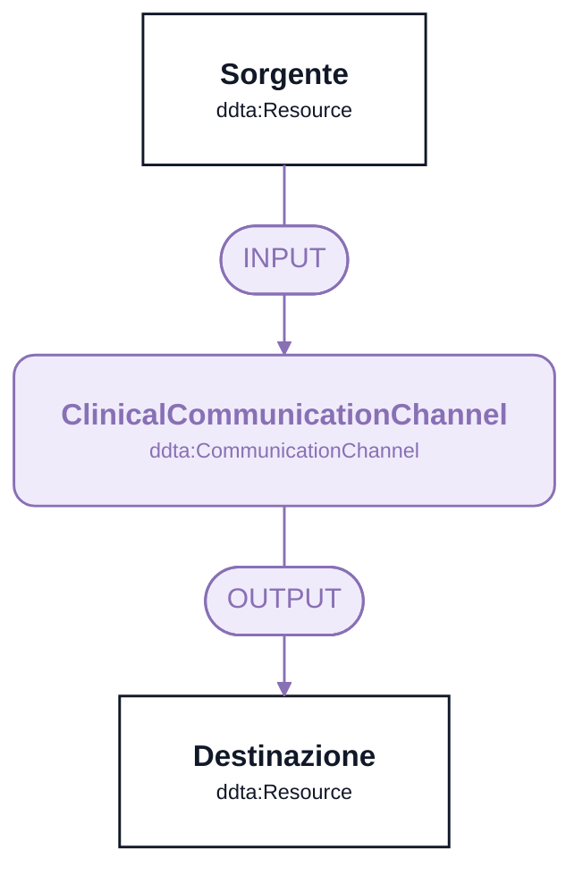

La traduzione deve essere coerente con la scheda `Environment`: quando un canale compare nel sottogruppo **Communication Channels**, il suo nodo mantiene **il viola pastello e gli angoli arrotondati**, mentre **il contenitore grafico del gruppo** rimane verde con bordo tratteggiato e icona di rete verde in basso.

---

## 12. Scheda grafica — `ddta:CommunicationFunction`

### 12.1 Identificazione

- **Tipo:** classe ontologica CORE, specializzazione di `ddta:Function`.
- **IRI:** `ddta:CommunicationFunction`.
- **Relazione da rappresentare separatamente:** `ddta:usesChannel`.

### 12.2 Rappresentazione concordata

`CommunicationFunction` mantiene la **forma arrotondata e il riempimento bianco** di `Function`, ma adotta **bordo viola scuro** (`#8870B5`), continuo, e testo dello stesso viola (`#8870B5`) . Lo spessore concordato per il bordo è **2 px**, con **angoli arrotondati a 14 px**. Nome e tipo `ddta:CommunicationFunction` sono sempre leggibili nello stesso blocco.

Nella vista che seleziona sottofunzioni, la funzione composta conserva il medesimo trattamento come contenitore `subgraph`: fondo bianco, bordo viola e angoli arrotondati. Le sottofunzioni mantengono **il proprio** stile di classe; non diventano viola soltanto perché sono contenute in una `CommunicationFunction`.

Non si aggiunge un'icona specifica alla `CommunicationFunction`: la combinazione tra tipo visibile e bordo viola è sufficiente per riconoscerla. La presenza di un canale eventualmente associato non cambia la forma del nodo funzionale. **Anche `CommunicationFunction` contiene graficamente i propri contratti INPUT/OUTPUT** quando la vista seleziona `hasInputContract` e/o `hasOutputContract`: la funzione composta conserva il bordo viola, mentre i contratti restano gialli. La convenzione è comune a tutte le `Function` (scheda 18).

### 12.3 Dichiarazione YAML

```yaml ddta-visualization
record: class-style
module: core
target: ddta:CommunicationFunction

inheritsVisualFormFrom: ddta:Function

node:
  shape: rounded
  style: communication-function

style:
  fill: "#FFFFFF"
  stroke: "#8870B5"
  color: "#8870B5"
  strokeWidth: 2
  strokePattern: solid
  cornerRadius: 14

label:
  showName: true
  showType: true
  typeText: "ddta:CommunicationFunction"

container:
  when: visible-children
  renderer: mermaid-subgraph
  shape: rounded
  cornerRadius: 14
```

`inheritsVisualFormFrom` è una relazione di riuso **grafico**, distinta da `rdfs:subClassOf`: riusa le convenzioni di `Function` senza imporre al renderer inferenze RDF nuove. La precedenza dello stile specifico è esplicita: **bordo viola per `CommunicationFunction`**, anche se visualizzata dentro un `System` o un `Environment`.

### 12.4 Traduzione Mermaid — funzione di comunicazione

<!-- DDTA-EXAMPLE-11 -->

**Turtle sorgente dell’esempio 11 (dati illustrativi).**

```turtle
@prefix ddta: <https://w3id.org/ddta/core#> .
@prefix ex: <https://example.org/ddta/core-visualization#> .

ex:ClinicalResultCommunication a ddta:CommunicationFunction .
```


Se sono visibili sottofunzioni **e/o contratti**, il generatore applica al `subgraph` della funzione composta `rx:14px,ry:14px`, come per la scheda generale `Function`, mantenendo però il bordo viola anziché grigio.

---

## 13. Scheda grafica — `ddta:usesChannel`

### 13.1 Identificazione

- **Tipo:** Object Property CORE.
- **IRI:** `ddta:usesChannel`.
- **Dominio e range:** `ddta:Function` → `ddta:CommunicationChannel`.
- **Convenzioni visive:** `usesChannel` esprime la sola associazione, senza direzione di flusso. Le nuove sottoproprietà `usesChannelForInput` e `usesChannelForOutput` determinano le frecce `INPUT` e `OUTPUT` della §13.5.

### 13.2 Rappresentazione concordata

**Vista delle relazioni (proiezione dell'associazione):** la relazione `usesChannel` appare come una **freccia orientata dalla funzione di comunicazione verso il canale**, con **linea e punta viola scuro** (`#8870B5`, 2 px). Sulla freccia è posizionata una **piccola etichetta arrotondata** che contiene la scritta `usesChannel`, con **sfondo viola chiaro** (`#F0EBFA`), **bordo viola scuro** (`#8870B5`) e testo `#58447D`.

Mermaid consente di ottenere in modo controllabile questo aspetto mediante un **nodo di etichetta intermedio**. Tale nodo è **esclusivamente grafico**: non è un individuo RDF, non deve essere esportato nelle query e non comporta la creazione di due proprietà. Il legame ontologico resta la singola tripla `Function ddta:usesChannel CommunicationChannel`.

L'etichetta del collegamento non ha un proprio tipo `ddta:` perché è una rappresentazione della **proprietà**, non un blocco che identifica un individuo. I due nodi RDF di estremità conservano **nome e tipo espliciti**.

**Vista di flusso funzionale:** la sola relazione `usesChannel` non autorizza alcun verso. Sono le dichiarazioni esplicite `usesChannelForOutput` e `usesChannelForInput` a generare, rispettivamente, `OUTPUT` e `INPUT`; in questa vista i loro archi di associazione vengono sostituiti dagli archi funzionali. La mancanza della qualifica viene diagnosticata senza inventare frecce.

### 13.3 Dichiarazione YAML

```yaml ddta-visualization
record: relation-style
module: core
target: ddta:usesChannel

representation:
  type: directed-edge
  source: subject
  destination: object
  drawEdge: true
  renderer: mermaid-intermediate-label-node
  arrowAtDestination: true

line:
  stroke: "#8870B5"
  strokeWidth: 2
  strokePattern: solid

label:
  text: usesChannel
  shape: rounded
  fill: "#F0EBFA"
  stroke: "#8870B5"
  color: "#8870B5"
  strokeWidth: 1.5
  placement: on-edge

projection:
  intermediateNodeIsPresentationOnly: true
  preserveSingleRdfTriple: true
```

`mermaid-intermediate-label-node`, `arrowAtDestination`, `placement` e i campi di `projection` descrivono la traduzione Mermaid della relazione. Le etichette grafiche utilizzano identificativi Mermaid stabili, evitando collisioni quando sono visibili più relazioni `usesChannel` e preservando l’identità delle risorse RDF.

### 13.3.1 Proprietà direzionali — regole YAML

Le sottoproprietà RDF `ddta:usesChannelForInput` e `ddta:usesChannelForOutput` hanno dominio `ddta:Function`, range `ddta:CommunicationChannel` e sono entrambe `rdfs:subPropertyOf ddta:usesChannel`. **Non** si richiede che una Function sia tipizzata come `CommunicationFunction` per utilizzare un canale. La vista associativa mostra il predicato esplicito; la vista funzionale mostra INPUT/OUTPUT. Gli stessi colori e forma della §13.3 vengono dichiarati qui senza costanti cromatiche Python.

```yaml ddta-visualization
record: relation-style
module: core
target: ddta:usesChannelForInput
representation:
  type: directed-edge
  source: subject
  destination: object
  drawEdge: true
  renderer: mermaid-intermediate-label-node
  arrowAtDestination: true
line:
  stroke: "#8870B5"
  strokeWidth: 2
  strokePattern: solid
label:
  text: usesChannelForInput
  shape: rounded
  fill: "#F0EBFA"
  stroke: "#8870B5"
  color: "#8870B5"
  strokeWidth: 1.5
  placement: on-edge
projection:
  intermediateNodeIsPresentationOnly: true
  preserveSingleRdfTriple: true
```

```yaml ddta-visualization
record: relation-style
module: core
target: ddta:usesChannelForOutput
representation:
  type: directed-edge
  source: subject
  destination: object
  drawEdge: true
  renderer: mermaid-intermediate-label-node
  arrowAtDestination: true
line:
  stroke: "#8870B5"
  strokeWidth: 2
  strokePattern: solid
label:
  text: usesChannelForOutput
  shape: rounded
  fill: "#F0EBFA"
  stroke: "#8870B5"
  color: "#8870B5"
  strokeWidth: 1.5
  placement: on-edge
projection:
  intermediateNodeIsPresentationOnly: true
  preserveSingleRdfTriple: true
```

### 13.4 Traduzione Mermaid

L’esempio rappresenta: funzione bianca con bordo viola, etichetta `usesChannel` viola chiaro sul collegamento e canale viola pastello.

<!-- DDTA-EXAMPLE-12 -->

**Turtle sorgente dell’esempio 12 (dati illustrativi).**

```turtle
@prefix ddta: <https://w3id.org/ddta/core#> .
@prefix ex: <https://example.org/ddta/core-visualization#> .

ex:ClinicalResultCommunication a ddta:CommunicationFunction ;
    ddta:usesChannel ex:ClinicalChannel .
ex:ClinicalChannel a ddta:CommunicationChannel .
```

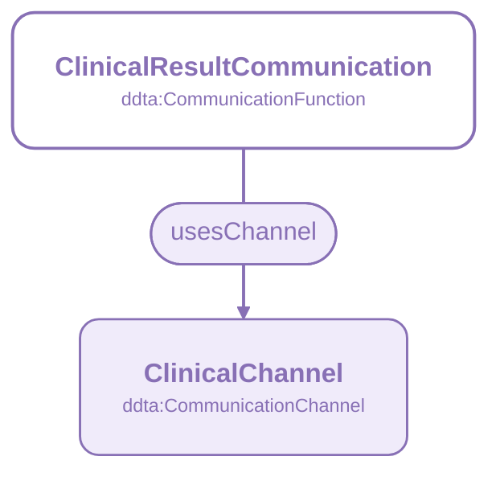

In questa traduzione `F --- REL --> C` corrisponde a **un'unica relazione `usesChannel`**. Il nodo `REL` e i due segmenti di linea appartengono soltanto alla vista Mermaid. Per altre relazioni, il generatore utilizzerà lo stile previsto dalla rispettiva scheda; **il colore viola del collegamento è specifico di `usesChannel`**.


### 13.5 Proiezione funzionale deterministica — direzione dichiarata

Questa regola si applica alle **viste di flusso funzionale**. Per ogni tripla RDF `Function ddta:usesChannelForOutput Channel` il renderer disegna **Function → OUTPUT → Channel**; per ogni tripla `Function ddta:usesChannelForInput Channel` disegna **Channel → INPUT → Function**. Non interpreta i nomi degli individui né deduce i versi da `hasInputContract` o `hasOutputContract`. I due versi possono essere dichiarati sulla stessa funzione e sullo stesso canale, oppure su canali diversi.

I contratti continuano a essere dichiarati con `hasInputContract` e `hasOutputContract`, ma il loro accoppiamento con un particolare canale resta fuori dal livello di dettaglio CORE attuale. Un contratto condiviso non è una prova di trasmissione, e un output senza `usesChannelForOutput` **non** viene associato ad alcun canale nella vista. L'assenza della dichiarazione non equivale a negare l'esistenza del canale (Open World Assumption).

`usesChannel` generico resta valido per la sola associazione e appare nella vista associativa; se viene usato senza alcuna qualifica direzionale, la vista funzionale produce il diagnostico `COMMUNICATION_CHANNEL_ROLE_UNSPECIFIED` e non disegna frecce. Anche se non sono presenti contratti, le dichiarazioni direzionali determinano le frecce: la direzione viene dal Turtle, non dalle proprietà di contratto.

Le etichette `OUTPUT` e `INPUT` sono nodi grafici intermedi arrotondati, **non** individui RDF. Palette e geometria derivano esclusivamente dal blocco YAML sottostante. Si mantengono un solo individuo RDF per ciascuna funzione e canale e le normali regole di occorrenza grafica in più contenitori.

#### 13.5.1 Dichiarazione YAML

```yaml ddta-visualization
record: projection-rule
module: core
target: ddta:CommunicationChannel
id: communication-functional-flow-directional
view: communication-functional-flow
inputs:
  association: ddta:usesChannel
  functionClass: ddta:Function
  outputAssociation: ddta:usesChannelForOutput
  inputAssociation: ddta:usesChannelForInput
conditions:
  directionFromExplicitPropertyOnly: true
  allowBothRolesPerFunctionPerChannel: true
  requireContractMatch: false
render:
  outputEdge:
    from: function
    to: declared-channel
    label: OUTPUT
    direction: forward
  inputEdge:
    from: declared-channel
    to: function
    label: INPUT
    direction: forward
  line:
    stroke: "#8870B5"
    strokeWidth: 2
    strokePattern: solid
  labelStyle:
    representation: rounded-inline-node
    shape: rounded
    fill: "#F0EBFA"
    stroke: "#8870B5"
    color: "#8870B5"
    strokeWidth: 1.5
    cornerRadius: 12
  suppressAssociationEdgeInThisView:
    - ddta:usesChannel
    - ddta:usesChannelForInput
    - ddta:usesChannelForOutput
  preserveRdfIndividualIdentity: true
validation:
  unqualifiedAssociation: warn-without-direction
```

#### 13.5.2 Esempio minimo di proiezione

In questo esempio `SendUsernameAndPassword` dichiara `usesChannelForOutput` e `CheckUsernameAndPassword` dichiara `usesChannelForInput` verso `CredentialCheckChannel`. **`CredentialContract` è un unico individuo RDF**, ma la direzione non deriva dall'identità condivisa del contratto.

<!-- DDTA-EXAMPLE-13 -->

**Turtle sorgente dell’esempio 13 (dati illustrativi).**

```turtle
@prefix ddta: <https://w3id.org/ddta/core#> .
@prefix ex: <https://example.org/ddta/authentication#> .

ex:SendUsernameAndPassword a ddta:CommunicationFunction ;
    ddta:usesChannelForOutput ex:CredentialCheckChannel ;
    ddta:hasOutputContract ex:CredentialContract .
ex:CheckUsernameAndPassword a ddta:CommunicationFunction ;
    ddta:usesChannelForInput ex:CredentialCheckChannel ;
    ddta:hasInputContract ex:CredentialContract .
ex:CredentialCheckChannel a ddta:CommunicationChannel .
ex:CredentialContract a ddta:Contract .
```

```mermaid
%%{init: {"htmlLabels":true,"theme":"base","layout":"elk"}}%%
flowchart TB
    subgraph O_504e9d3f1dcc09["<div style='display:inline-block;text-align:center;white-space:nowrap;line-height:1.4;padding:8px 12px;background:transparent;opacity:1;color:#8870B5'><span style='display:block;text-align:center;font-size:17px;font-weight:700;color:#8870B5'>CheckUsernameAndPassword</span><span style='display:block;text-align:center;font-size:12px;font-weight:400;color:#8870B5'>ddta:CommunicationFunction</span></div>"]
        direction TB
        subgraph G_251935f0a45dcd["Contracts"]
            direction LR
            O_135e6a7473736b("<img src='data:image/svg+xml;base64,PHN2ZyB4bWxucz0iaHR0cDovL3d3dy53My5vcmcvMjAwMC9zdmciIHdpZHRoPSIyOCIgaGVpZ2h0PSIyOCIgdmlld0JveD0iMCAwIDI4IDI4IiBmaWxsPSJub25lIiBzdHJva2U9IiNDNkEzNEQiIHN0cm9rZS13aWR0aD0iMS44IiBzdHJva2UtbGluZWNhcD0icm91bmQiIHN0cm9rZS1saW5lam9pbj0icm91bmQiPjxwYXRoIGQ9Ik03IDIuN2gxMGw1IDV2MTcuNUg3YTIgMiAwIDAgMS0yLTJWNC43YTIgMiAwIDAgMSAyLTJaIi8+PHBhdGggZD0iTTE3IDIuN3Y1aDVNOSAxM2g4TTkgMTdoNE0xNC41IDIxbDIgMiA0LTQiLz48L3N2Zz4=' width='27' height='27'/><div style='display:inline-block;text-align:center;white-space:nowrap;line-height:1.4;padding:8px 12px;background:transparent;opacity:1;color:#C6A34D'><span style='display:block;text-align:center;font-size:17px;font-weight:700;color:#C6A34D'>CredentialContract</span><span style='display:block;text-align:center;font-size:12px;font-weight:400;color:#C6A34D'>ddta:Contract · INPUT</span></div>")
        end
    end
    O_d64f861141550f("<div style='display:inline-block;text-align:center;white-space:nowrap;line-height:1.4;padding:8px 12px;background:transparent;opacity:1;color:#8870B5'><span style='display:block;text-align:center;font-size:17px;font-weight:700;color:#8870B5'>CredentialCheckChannel</span><span style='display:block;text-align:center;font-size:12px;font-weight:400;color:#8870B5'>ddta:CommunicationChannel</span></div>")
    subgraph O_03b66b6e5f09c2["<div style='display:inline-block;text-align:center;white-space:nowrap;line-height:1.4;padding:8px 12px;background:transparent;opacity:1;color:#8870B5'><span style='display:block;text-align:center;font-size:17px;font-weight:700;color:#8870B5'>SendUsernameAndPassword</span><span style='display:block;text-align:center;font-size:12px;font-weight:400;color:#8870B5'>ddta:CommunicationFunction</span></div>"]
        direction TB
        subgraph G_8189ea9db002e8["Contracts"]
            direction LR
            O_b3688dda706807("<img src='data:image/svg+xml;base64,PHN2ZyB4bWxucz0iaHR0cDovL3d3dy53My5vcmcvMjAwMC9zdmciIHdpZHRoPSIyOCIgaGVpZ2h0PSIyOCIgdmlld0JveD0iMCAwIDI4IDI4IiBmaWxsPSJub25lIiBzdHJva2U9IiNDNkEzNEQiIHN0cm9rZS13aWR0aD0iMS44IiBzdHJva2UtbGluZWNhcD0icm91bmQiIHN0cm9rZS1saW5lam9pbj0icm91bmQiPjxwYXRoIGQ9Ik03IDIuN2gxMGw1IDV2MTcuNUg3YTIgMiAwIDAgMS0yLTJWNC43YTIgMiAwIDAgMSAyLTJaIi8+PHBhdGggZD0iTTE3IDIuN3Y1aDVNOSAxM2g4TTkgMTdoNE0xNC41IDIxbDIgMiA0LTQiLz48L3N2Zz4=' width='27' height='27'/><div style='display:inline-block;text-align:center;white-space:nowrap;line-height:1.4;padding:8px 12px;background:transparent;opacity:1;color:#C6A34D'><span style='display:block;text-align:center;font-size:17px;font-weight:700;color:#C6A34D'>CredentialContract</span><span style='display:block;text-align:center;font-size:12px;font-weight:400;color:#C6A34D'>ddta:Contract · OUTPUT</span></div>")
        end
    end
    G_6fa855a04236b6(["INPUT"])
    O_d64f861141550f --- G_6fa855a04236b6 --> O_504e9d3f1dcc09
    G_adbae8c74decbe(["OUTPUT"])
    O_03b66b6e5f09c2 --- G_adbae8c74decbe --> O_d64f861141550f
    classDef DDTA_C_1ae4e3c918ad fill:#F0EBFA,stroke:#8870B5,color:#8870B5,stroke-width:1.5px,rx:12px,ry:12px
    class G_6fa855a04236b6,G_adbae8c74decbe,O_d64f861141550f DDTA_C_1ae4e3c918ad
    classDef DDTA_C_79f0ec56fa96 fill:#FFF8DE,stroke:#C6A34D,color:#C6A34D,stroke-width:1.5px,rx:12px,ry:12px
    class O_135e6a7473736b,O_b3688dda706807 DDTA_C_79f0ec56fa96
    classDef DDTA_C_64f33d7120fc fill:#FFF8DE,stroke:#C6A34D,color:#C6A34D,stroke-width:1.5px,rx:8px,ry:8px
    class G_251935f0a45dcd,G_8189ea9db002e8 DDTA_C_64f33d7120fc
    classDef DDTA_C_8f7a37e1c601 fill:#FFFFFF,stroke:#8870B5,color:#8870B5,stroke-width:2px,rx:14px,ry:14px
    class O_03b66b6e5f09c2,O_504e9d3f1dcc09 DDTA_C_8f7a37e1c601
    linkStyle 0,1 stroke:#8870B5,stroke-width:2px
    linkStyle 2,3 stroke:#8870B5,stroke-width:2px
```

Il contratto condiviso compare in due contesti grafici, ma mantiene **un solo IRI RDF**. La sua composizione è descritta nelle schede dedicate; le etichette viola sulle frecce sono elementi grafici distinti dai ruoli INPUT/OUTPUT mostrati all’interno dei contratti.

---


## 14. Scheda grafica — `ddta:Boundary`

### 14.1 Identificazione

- **Tipo:** classe ontologica CORE.
- **IRI:** `ddta:Boundary`.
- **Relazioni della vista:** `ddta:hasBoundary` (`System` → `Boundary`) e `ddta:encloses` (`Boundary` → `Resource`).

### 14.2 Rappresentazione concordata

Il `Boundary` è un **contenitore rettangolare con angoli arrotondati**, **bordo rosso tenue tratteggiato** (`#B85C5C`) e fondo chiaro neutro (`#FFFFFF`). L'intestazione mostra sempre **nome e tipo `ddta:Boundary`**, con un'icona scudo monocromatica rossa posta accanto al nome. Gli individui racchiusi mantengono lo stile definito **nelle rispettive schede** (`Store`: 8; `CommunicationChannel`: 11; `Resource`: 19); il bordo del `Boundary` non ne modifica il colore.

La relazione `encloses` è proiettata come **contenimento grafico**, senza frecce. **Anche `hasBoundary` viene rappresentata come contenimento grafico:** il `System` soggetto della relazione è mostrato **dentro** il `Boundary` oggetto, conservando i suoi colori azzurri e le funzioni eventualmente contenute. **Non si disegna una freccia `hasBoundary`**. Questa scelta è *provvisoria sul piano ontologico* e sarà riesaminata: **non** implica una nuova tripla `Boundary encloses System`, né estende il range di `encloses` a `System`. Un `Boundary` con un System o risorse visibili è un contenitore; senza elementi interni visibili può essere mostrato come nodo semplice con lo stesso bordo tratteggiato.

Un individuo `Resource` può appartenere a più Boundary e un System può avere più Boundary associati. Poiché un nodo Mermaid non può risiedere direttamente in due `subgraph` contemporaneamente, la gestione di Boundary sovrapposti o di un System con più confini visualizzati simultaneamente richiede una vista dedicata; il renderer non deve duplicare silenziosamente l'identità RDF, dedurre appartenenze o simulare gerarchie fra Boundary.

### 14.3 Dichiarazione YAML

```yaml ddta-visualization
record: class-style
module: core
target: ddta:Boundary

node:
  shape: rounded
  style: boundary

style:
  fill: "#FFFFFF"
  stroke: "#B85C5C"
  color: "#B85C5C"
  strokeWidth: 2
  strokePattern: dashed
  cornerRadius: 12

label:
  showName: true
  showType: true
  typeText: "ddta:Boundary"

icon:
  id: boundary
  source: icons/boundary.svg
  placement: header-before-name
  colorFrom: own-border
  mermaid:
    representation: image-node
    encoding: data-uri-base64
    height: 27
    constraint: "on"

container:
  when: visible-boundary-members
  triggerRelations:
    - ddta:hasBoundary
    - ddta:encloses
  renderer: mermaid-subgraph
  shape: rounded
  cornerRadius: 12
```

### 14.4 Dichiarazione YAML — `ddta:hasBoundary`

```yaml ddta-visualization
record: relation-style
module: core
target: ddta:hasBoundary

representation:
  type: containment
  parent: object     # Boundary
  child: subject     # System
  renderer: mermaid-subgraph
  drawEdge: false
  recursive: false

projection:
  containmentIsPresentationOnly: true
  doesNotImplyEncloses: true
  preserveOriginalRdfTriple: true

validation:
  multipleParents: alternate-view
  # Un System con più Boundary associati non è duplicato silenziosamente.
```

### 14.5 Dichiarazione YAML — `ddta:encloses`

```yaml ddta-visualization
record: relation-style
module: core
target: ddta:encloses

representation:
  type: containment
  parent: subject
  child: object
  renderer: mermaid-subgraph
  drawEdge: false
  recursive: false

validation:
  multipleParents: alternate-view
  # Un Resource può appartenere a più Boundary: non duplicare individui RDF.
```

### 14.6 Traduzione Mermaid — Boundary, System e risorse

Il `System` è mostrato **all'interno** del confine per la relazione `hasBoundary`; le due risorse sono dentro il confine per effetto di `encloses`. Questi due criteri di inclusione grafica **restano distinti** e non producono nuove triple RDF. L'intestazione con scudo è puramente grafica.

<!-- DDTA-EXAMPLE-14 -->

**Turtle sorgente dell’esempio 14 (dati illustrativi).**

```turtle
@prefix ddta: <https://w3id.org/ddta/core#> .
@prefix ex: <https://example.org/ddta/core-visualization#> .

ex:ClinicalSystem a ddta:System ; ddta:hasBoundary ex:ClinicalDataBoundary .
ex:ClinicalDataBoundary a ddta:Boundary ;
    ddta:encloses ex:ClinicalChannel, ex:ClinicalImagesStore .
ex:ClinicalChannel a ddta:CommunicationChannel .
ex:ClinicalImagesStore a ddta:Store .
```

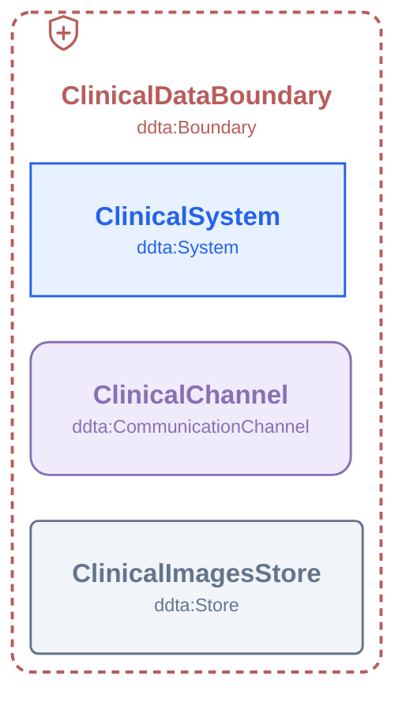

I collegamenti `~~~` servono unicamente a disporre i blocchi interni. In caso di Boundary multipli o intersecanti occorre una strategia grafica esplicita; non è prevista una gerarchia implicita di confini.

---

## 15. Scheda grafica — `ddta:Contract`

### 15.1 Identificazione

- **Tipo:** classe ontologica CORE (non sottoclasse di `Resource`).
- **IRI:** `ddta:Contract`.
- **Relazione di composizione:** `ddta:hasContractElement`.
- **Relazioni verso la funzione:** `ddta:hasInputContract` e `ddta:hasOutputContract`, entrambe definite in `ddta:Function`.

### 15.2 Rappresentazione concordata

Un contratto usa un **rettangolo giallo pastello arrotondato**, con **sfondo `#FFF8DE`**, **bordo continuo `#C6A34D`**, testo marrone scuro `#6F541A` e angoli arrotondati (12 px). L'intestazione riporta nome, tipo `ddta:Contract` e, per i contratti composti, una piccola icona locale di documento con segno di spunta, nel colore del bordo.

Quando nella vista sono presenti `ContractElement`, il contratto viene rappresentato da un `subgraph` che **contiene gli elementi** (vedere le schede 16 e 17), senza frecce `hasContractElement`. In assenza di elementi visibili rimane un nodo giallo arrotondato; il contenimento è applicato solo ai dati recuperati dalla query.

Un contratto rappresentato all'interno di una `Function` conserva **sempre lo stile giallo**, indipendentemente dal colore del bordo della funzione ospitante. Il ruolo **INPUT** o **OUTPUT** è un'etichetta grafica derivata rispettivamente da `hasInputContract` o `hasOutputContract` e non determina una sottoclasse di `Contract`.

### 15.3 Dichiarazione YAML

```yaml ddta-visualization
record: class-style
module: core
target: ddta:Contract

node:
  shape: rounded
  style: contract

style:
  fill: "#FFF8DE"
  stroke: "#C6A34D"
  color: "#C6A34D"
  strokeWidth: 1.5
  strokePattern: solid
  cornerRadius: 12

label:
  showName: true
  showType: true
  typeText: "ddta:Contract"

icon:
  id: contract
  source: icons/contract.svg
  placement: header-before-name
  colorFrom: own-border
  mermaid:
    representation: image-node
    encoding: data-uri-base64
    height: 27
    constraint: "on"

container:
  when: visible-contract-elements
  renderer: mermaid-subgraph
  shape: rounded
  cornerRadius: 12
```

### 15.4 Traduzione Mermaid — contratto isolato

<!-- DDTA-EXAMPLE-15 -->

**Turtle sorgente dell’esempio 15 (dati illustrativi).**

```turtle
@prefix ddta: <https://w3id.org/ddta/core#> .
@prefix ex: <https://example.org/ddta/core-visualization#> .

ex:ImageInputContract a ddta:Contract .
```


Nella vista composta il medesimo individuo è rappresentato con `subgraph` anziché con un nodo aggiuntivo: nome e tipo compaiono nell'intestazione; l'icona è posizionata accanto, e non tra gli elementi contrattuali.

---

## 16. Scheda grafica — `ddta:ContractElement`

### 16.1 Identificazione

- **Tipo:** classe ontologica CORE.
- **IRI:** `ddta:ContractElement`.
- **Proprietà già definite nel CORE:** `ddta:minOccurs`, `ddta:maxOccurs`.

### 16.2 Rappresentazione concordata

Ogni `ContractElement` è un piccolo rettangolo **giallo molto chiaro** (`#FFFCF0`), arrotondato, **senza icona**, con nome, tipo `ddta:ContractElement` e cardinalità quando dichiarata.

La forma del bordo dipende da `minOccurs`, se dichiarato:

| Cardinalità dichiarata | Bordo | Dicitura |
|---|---|---|
| `1..1`, o `minOccurs > 0` | **Continuo** giallo scuro | `1..1`, `1..3`, ecc. |
| `0..1`, o `minOccurs = 0` | **Tratteggiato** giallo scuro | `0..1`, `0..3`, ecc. |
| `minOccurs` non dichiarato | **Neutro continuo** `#9CA3AF` | Nessun limite minimo viene dedotto |

Se `maxOccurs` non è dichiarato, il grafico **non** deve sostituirlo con un massimo illimitato: può mostrare la sola indicazione `min: 1` o `min: 0`. Se manca `minOccurs`, può mostrare `max: 3`. Se non è dichiarato alcun limite, non viene mostrata alcuna cardinalità. Il bordo neutro non significa che l'elemento sia facoltativo.

### 16.3 Dichiarazione YAML

```yaml ddta-visualization
record: class-style
module: core
target: ddta:ContractElement

node:
  shape: rounded
  style: contract-element

style:
  fill: "#FFFCF0"
  stroke: "#9CA3AF"
  color: "#9CA3AF"
  strokeWidth: 1.2
  strokePattern: solid
  cornerRadius: 7

label:
  showName: true
  showType: true
  typeText: "ddta:ContractElement"
  showDeclaredCardinality: true
  omitUndeclaredCardinality: true

conditionalStyles:
  - when:
      property: ddta:minOccurs
      operator: equals
      value: 0
    stroke: "#C6A34D"
    strokePattern: dashed
  - when:
      property: ddta:minOccurs
      operator: greater-than
      value: 0
    stroke: "#C6A34D"
    strokePattern: solid
```

### 16.4 Traduzione Mermaid — due elementi

<!-- DDTA-EXAMPLE-16 -->

**Turtle sorgente dell’esempio 16 (dati illustrativi).**

```turtle
@prefix ddta: <https://w3id.org/ddta/core#> .
@prefix ex: <https://example.org/ddta/core-visualization#> .

@prefix xsd: <http://www.w3.org/2001/XMLSchema#> .
ex:CroppingRegion a ddta:ContractElement ;
    ddta:minOccurs 0 ; ddta:maxOccurs 1 .
ex:LesionImage a ddta:ContractElement ;
    ddta:minOccurs 1 ; ddta:maxOccurs 1 .
```

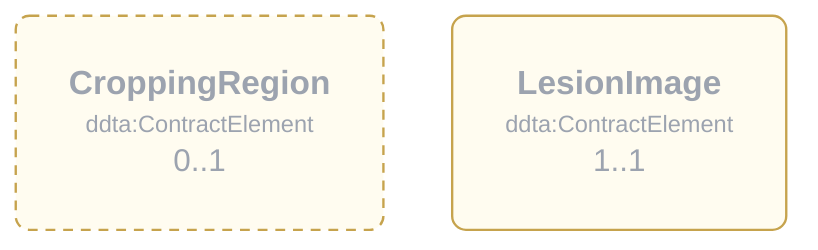

Qui `~~~` non è la relazione `hasContractElement`: è soltanto un vincolo di impaginazione.

---

## 17. Scheda grafica — `ddta:hasContractElement`

### 17.1 Identificazione

- **Tipo:** Object Property CORE.
- **IRI:** `ddta:hasContractElement`.
- **Dominio/range:** `ddta:Contract` → `ddta:ContractElement`.

### 17.2 Rappresentazione

Ogni tripla selezionata `Contratto ddta:hasContractElement Elemento` viene rappresentata inserendo il `ContractElement` **all'interno del contenitore `Contract`**, senza frecce. `Contract` e `ContractElement` mantengono gli stili definiti **solo** nelle rispettive schede 15 e 16. La proprietà non è ricorsiva nel CORE attuale: questa visualizzazione non presuppone una relazione `hasPart` tra ContractElement.

### 17.3 Dichiarazione YAML

```yaml ddta-visualization
record: relation-style
module: core
target: ddta:hasContractElement

representation:
  type: containment
  parent: subject
  child: object
  renderer: mermaid-subgraph
  drawEdge: false
  recursive: false

layout:
  direction: LR
  preferSingleRow: true

validation:
  multipleParents: alternate-view
  # Un ContractElement può essere condiviso tra contratti con lo stesso requisito.
```

### 17.4 Traduzione Mermaid — contratto con elementi

<!-- DDTA-EXAMPLE-17 -->

**Turtle sorgente dell’esempio 17 (dati illustrativi).**

```turtle
@prefix ddta: <https://w3id.org/ddta/core#> .
@prefix ex: <https://example.org/ddta/core-visualization#> .

ex:ImageInputContract a ddta:Contract ;
    ddta:hasContractElement ex:CroppingRegion, ex:LesionImage .
ex:CroppingRegion a ddta:ContractElement ; ddta:minOccurs 0 ; ddta:maxOccurs 1 .
ex:LesionImage a ddta:ContractElement ; ddta:minOccurs 1 ; ddta:maxOccurs 1 .
```

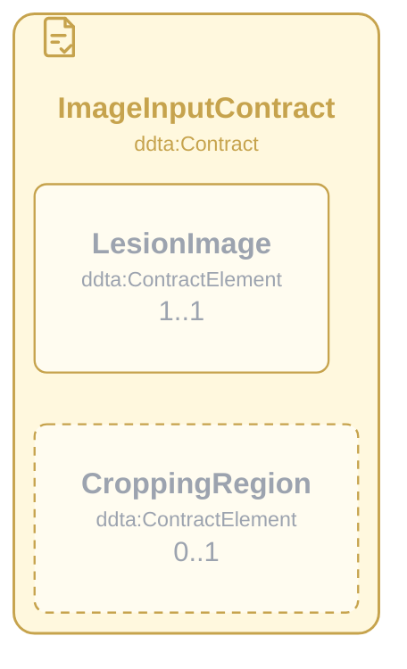

---

## 18. Scheda grafica — `ddta:hasInputContract` e `ddta:hasOutputContract`

### 18.1 Identificazione

- **Tipo:** due Object Properties definite nella classe CORE **`ddta:Function`**.
- **IRI:** `ddta:hasInputContract`, `ddta:hasOutputContract`.
- **Dominio/range:** `ddta:Function` → `ddta:Contract`.
- **Applicazione:** qualunque `Function`, comprese le sottoclassi come `ddta:CommunicationFunction`.

### 18.2 Rappresentazione concordata

Le due relazioni vengono rappresentate come **contenimento grafico** del `Contract` nella `Function`, **senza frecce**. Il ruolo del contratto è indicato graficamente come **INPUT** per `hasInputContract` e **OUTPUT** per `hasOutputContract`, conservando sempre **nome e tipo `ddta:Contract`**. Non viene inventato un tipo ontologico distinto `InputContract` o `OutputContract`.

`Function`, `CommunicationFunction`, `Contract` e `ContractElement` applicano esclusivamente i propri stili di classe (schede 3, 12, 15 e 16). Questa scheda specifica i **ruoli INPUT/OUTPUT e i gruppi di contenimento**, non i colori o le forme dei singoli elementi. Quando la stessa funzione ha anche sottofunzioni visibili, due **gruppi di layout distinti** (`Contracts`, `Subfunctions`) tengono leggibili entrambe le parti, senza duplicare la funzione. Il gruppo **Contracts** usa sfondo giallo chiaro `#FFF8DE` e bordo **continuo** giallo scuro `#C6A34D`, non un bordo grigio tratteggiato; il gruppo **Subfunctions** rimane invariato. Entrambi i gruppi sono elementi di layout, non istanze RDF.

Questa regola riguarda **tutte** le `Function`: anche una funzione non specializzata come `CommunicationFunction` può associare canali INPUT/OUTPUT mediante le sottoproprietà direzionali di `usesChannel`.

### 18.3 Dichiarazione YAML

```yaml ddta-visualization
record: grouped-relations-style
module: core
subjectClass: ddta:Function

groups:
  - id: contracts
    label: "Contracts"
    representation: containment-group
    style:
      fill: "#FFF8DE"
      stroke: "#C6A34D"
      color: "#C6A34D"
      strokeWidth: 1.5
      strokePattern: solid
      cornerRadius: 8
    relations:
      - property: ddta:hasInputContract
        roleLabel: INPUT
        targetClass: ddta:Contract
      - property: ddta:hasOutputContract
        roleLabel: OUTPUT
        targetClass: ddta:Contract
    drawEdges: false
  - id: subfunctions
    label: "Subfunctions"
    representation: containment-group
    relations:
      - property: ddta:hasSubFunction
        targetClass: ddta:Function
    drawEdges: false

layout:
  direction: TB
  groupOrder:
    - contracts
    - subfunctions
  contractOrder:
    - INPUT
    - OUTPUT
  contractsSideBySide: true
  hideEmptyGroups: true

inheritFunctionContainerStyle: true
inheritSubclassContainerStyle: true

validation:
  multipleParents: alternate-view
  # I contratti possono essere riusati da più Function: non duplicare individui RDF.
```

### 18.4 Traduzione Mermaid — Function con contratti e sottofunzioni

L'esempio seguente riunisce **entrambe le tipologie di contenimento** nella stessa `Function`, senza frecce contrattuali e senza frecce di decomposizione. I due gruppi `Contracts` e `Subfunctions` sono **solo impaginazione**; non rappresentano istanze RDF. Tutti i blocchi ontologici mostrano il tipo `ddta:`.

<!-- DDTA-EXAMPLE-18 -->

**Turtle sorgente dell’esempio 18 (dati illustrativi).**

```turtle
@prefix ddta: <https://w3id.org/ddta/core#> .
@prefix ex: <https://example.org/ddta/core-visualization#> .

ex:ImagePreparation a ddta:Function ;
    ddta:hasInputContract ex:InputContract ;
    ddta:hasOutputContract ex:OutputContract ;
    ddta:hasSubFunction ex:ImageNormalization, ex:ImageValidation .
ex:ImageNormalization a ddta:Function .
ex:ImageValidation a ddta:Function .
ex:InputContract a ddta:Contract ; ddta:hasContractElement ex:Image, ex:CropRegion .
ex:OutputContract a ddta:Contract ; ddta:hasContractElement ex:PreparedImage .
ex:Image a ddta:ContractElement ; ddta:minOccurs 1 ; ddta:maxOccurs 1 .
ex:CropRegion a ddta:ContractElement ; ddta:minOccurs 0 ; ddta:maxOccurs 1 .
ex:PreparedImage a ddta:ContractElement ; ddta:minOccurs 1 ; ddta:maxOccurs 1 .
```

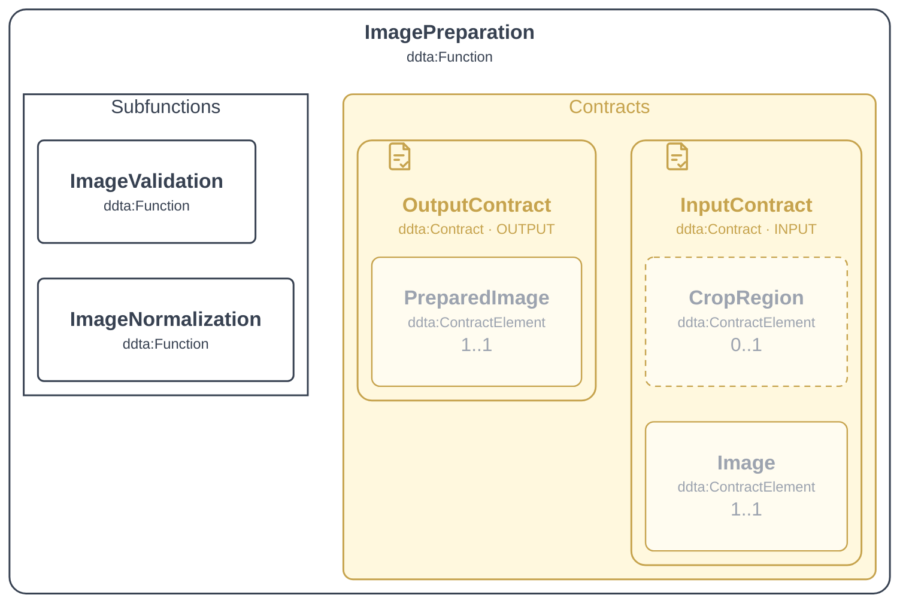

### 18.5 Traduzione Mermaid — CommunicationFunction con contratti e `usesChannel`

Anche la funzione di comunicazione contiene i contratti. **Questo esempio mostra la vista dell'associazione**, nella quale `usesChannel` rimane una freccia viola con etichetta arrotondata, come nella §13.4. **Nella vista di flusso funzionale** le frecce `OUTPUT` e `INPUT` si disegnano soltanto quando sono dichiarate rispettivamente `usesChannelForOutput` e `usesChannelForInput`. La funzione, i contratti e il canale utilizzano i propri stili di classe (schede 12, 15 e 11).

<!-- DDTA-EXAMPLE-19 -->

**Turtle sorgente dell’esempio 19 (dati illustrativi).**

```turtle
@prefix ddta: <https://w3id.org/ddta/core#> .
@prefix ex: <https://example.org/ddta/core-visualization#> .

ex:SendClinicalResult a ddta:CommunicationFunction ;
    ddta:hasInputContract ex:InputContract ;
    ddta:hasOutputContract ex:OutputContract ;
    ddta:usesChannel ex:ClinicalChannel .
ex:InputContract a ddta:Contract .
ex:OutputContract a ddta:Contract .
ex:ClinicalChannel a ddta:CommunicationChannel .
```

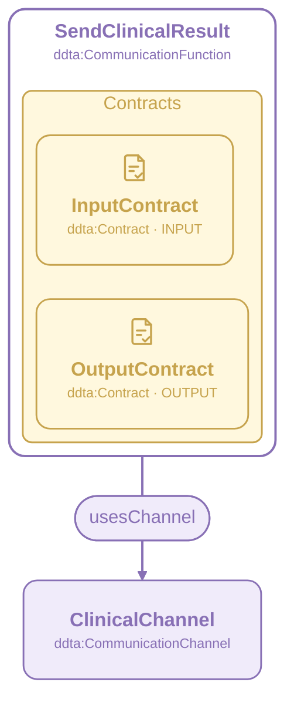

I nodi intermedi di etichetta e i collegamenti invisibili `~~~` **non** diventano individui o proprietà RDF. La vista di contenimento mostra una singola funzione e i contratti selezionati; quando la stessa istanza di contratto è condivisa da più funzioni, la vista va suddivisa o rappresentata diversamente senza spacciare copie visive per nuove identità.

---

## 19. Scheda grafica — `ddta:Resource`

### 19.1 Identificazione

- **Tipo:** classe ontologica CORE.
- **IRI:** `ddta:Resource`.

### 19.2 Rappresentazione

Una `Resource` generica è un **semplice rettangolo ad angoli retti**, con **interno bianco** (`#FFFFFF`), **bordo nero continuo** (`#111827`) e testo scuro. L'etichetta mostra **nome e tipo `ddta:Resource`**. Nessuna icona è richiesta per il singolo nodo generico.

Le specializzazioni (`ddta:Store`, `ddta:CommunicationChannel`) **sostituiscono** questo stile con quello definito nelle proprie schede. La stessa regola si applica nella vista `Environment`: il gruppo `Other Resources` rimane verde, ma le `Resource` generiche al suo interno sono rettangoli bianchi con bordo nero; l'eventuale icona di gruppo resta verde.

### 19.3 Dichiarazione YAML

```yaml ddta-visualization
record: class-style
module: core
target: ddta:Resource

node:
  shape: rectangle
  style: resource

style:
  fill: "#FFFFFF"
  stroke: "#111827"
  color: "#111827"
  strokeWidth: 1.5
  strokePattern: solid

icon:
  required: false

specializations:
  preferSpecificClassStyle: true
```

### 19.4 Traduzione Mermaid

<!-- DDTA-EXAMPLE-20 -->

**Turtle sorgente dell’esempio 20 (dati illustrativi).**

```turtle
@prefix ddta: <https://w3id.org/ddta/core#> .
@prefix ex: <https://example.org/ddta/core-visualization#> .

ex:ExampleResource a ddta:Resource .
```

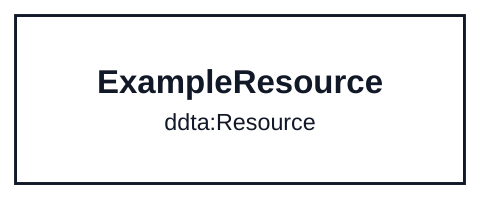

---

## 20. Scheda grafica — `ddta:mustPrecede`

### 20.1 Identificazione

- **Tipo:** Object Property CORE.
- **IRI:** `ddta:mustPrecede`.
- **Dominio/range:** `ddta:Function` → `ddta:Function`.

### 20.2 Rappresentazione

`mustPrecede` è una **freccia direzionale tratteggiata grigio scuro** (`#374151`) **dalla funzione che deve precedere alla funzione successiva**. L'etichetta `mustPrecede` è un piccolo rettangolo **arrotondato**, con **interno grigio chiaro** (`#F3F4F6`), **bordo grigio scuro** (`#374151`) e **scritta dello stesso grigio scuro**. Non impiegare azzurro o blu.

La freccia rappresenta una relazione distinta da `hasSubFunction`: la precedenza tra due `ddta:Function` è rappresentata esclusivamente quando la tripla `ddta:mustPrecede` è selezionata nel sottografo RDF, anche se le funzioni appartengono a sistemi, ambienti o composizioni funzionali differenti. La collocazione grafica non crea precedenze implicite. La relazione non implica attivazione obbligatoria della funzione successiva, trasferimento di dati né esecuzione immediatamente successiva. `mustPrecede` non è dichiarata transitiva; il vincolo deve essere interpretato nel contesto funzionale pertinente.

### 20.3 Dichiarazione YAML

```yaml ddta-visualization
record: relation-style
module: core
target: ddta:mustPrecede

representation:
  type: directed-edge
  drawEdge: true
  direction: subject-to-object
  stroke: "#374151"
  strokeWidth: 1.8
  strokePattern: dashed
  dashArray: "6 4"
  arrowhead: target

label:
  text: mustPrecede
  representation: rounded-inline-node
  fill: "#F3F4F6"
  stroke: "#374151"
  color: "#374151"
  cornerRadius: 12

scope:
  subjectClass: ddta:Function
  objectClass: ddta:Function
```

### 20.4 Traduzione Mermaid — precedenza tra funzioni

Il nodo centrale `MP` rappresenta **soltanto l'etichetta grafica** della relazione. Le due porzioni tratteggiate sono rese con una sola punta di freccia verso la funzione successiva; `MP` non corrisponde a un individuo RDF. La direzione del diagramma non sostituisce l'esistenza di `mustPrecede` nel grafo.

<!-- DDTA-EXAMPLE-21 -->

**Turtle sorgente dell’esempio 21 (dati illustrativi).**

```turtle
@prefix ddta: <https://w3id.org/ddta/core#> .
@prefix ex: <https://example.org/ddta/core-visualization#> .

ex:ImagePreparation a ddta:Function ;
    ddta:hasSubFunction ex:ImageValidation, ex:ImageNormalization .
ex:ImageValidation a ddta:Function ; ddta:mustPrecede ex:ImageNormalization .
ex:ImageNormalization a ddta:Function .
```

```mermaid
%%{init: {"htmlLabels":true,"theme":"base","layout":"elk"}}%%
flowchart TB
    subgraph O_c280010220776d["<div style='display:inline-block;text-align:center;white-space:nowrap;line-height:1.4;padding:8px 12px;background:transparent;opacity:1;color:#374151'><span style='display:block;text-align:center;font-size:17px;font-weight:700;color:#374151'>ImagePreparation</span><span style='display:block;text-align:center;font-size:12px;font-weight:400;color:#374151'>ddta:Function</span></div>"]
        direction TB
        subgraph G_0fed4b61bf9bde["Subfunctions"]
            direction TB
            O_c9fc1acf8e6578("<div style='display:inline-block;text-align:center;white-space:nowrap;line-height:1.4;padding:8px 12px;background:transparent;opacity:1;color:#374151'><span style='display:block;text-align:center;font-size:17px;font-weight:700;color:#374151'>ImageNormalization</span><span style='display:block;text-align:center;font-size:12px;font-weight:400;color:#374151'>ddta:Function</span></div>")
            O_36b3ed9d75b50d("<div style='display:inline-block;text-align:center;white-space:nowrap;line-height:1.4;padding:8px 12px;background:transparent;opacity:1;color:#374151'><span style='display:block;text-align:center;font-size:17px;font-weight:700;color:#374151'>ImageValidation</span><span style='display:block;text-align:center;font-size:12px;font-weight:400;color:#374151'>ddta:Function</span></div>")
    G_db1c875aaad508(["mustPrecede"])
    O_36b3ed9d75b50d --- G_db1c875aaad508 --> O_c9fc1acf8e6578
        end
    end
    classDef DDTA_C_e3db535a2f49 fill:#F3F4F6,stroke:#374151,color:#374151,rx:12px,ry:12px
    class G_db1c875aaad508 DDTA_C_e3db535a2f49
    classDef DDTA_C_1a97e3c85c24 fill:#FFFFFF,stroke:#374151,color:#374151,stroke-width:1.5px
    class G_0fed4b61bf9bde,O_36b3ed9d75b50d,O_c9fc1acf8e6578 DDTA_C_1a97e3c85c24
    classDef DDTA_C_bfb810e84373 fill:#FFFFFF,stroke:#374151,color:#374151,stroke-width:1.5px,rx:14px,ry:14px
    class O_c280010220776d DDTA_C_bfb810e84373
    linkStyle 0,1 stroke:#374151,stroke-width:1.8px,stroke-dasharray:6 4
```

---

## 21. Scheda grafica — `ddta:Process`

### 21.1 Identificazione

- **Tipo:** classe ontologica CORE.
- **IRI:** `ddta:Process`.

### 21.2 Rappresentazione

`Process` si distingue dalla `Function` senza ricorrere a colori forti: **sfondo grigio quasi bianco** (`#F8FAFC`), **bordo grigio medio continuo** (`#7B8794`) e testo grigio scuro (`#334155`). Il contenitore ha angoli **leggermente arrotondati** (`rx:8px,ry:8px`); mostra sempre nome e tipo `ddta:Process`.

Quando sono selezionati i `ProcessStep` collegati tramite `ddta:hasStep`, il `Process` è un **contenitore Mermaid `subgraph`**. Gli Step vengono collocati all'interno, senza frecce `hasStep`. Se non sono selezionati Step, il processo è un semplice rettangolo arrotondato con lo stesso stile.

`Process` e `Function` sono identità distinte. La resa grafica di `realizesFunction`, inclusi simbolo e vincoli di disposizione, è definita **solo nella scheda 24**. Un processo senza tale relazione nella vista non genera una funzione aggiuntiva.

### 21.3 Dichiarazione YAML

```yaml ddta-visualization
record: class-style
module: core
target: ddta:Process

node:
  shape: rounded
  style: process

style:
  fill: "#F8FAFC"
  stroke: "#7B8794"
  color: "#7B8794"
  strokeWidth: 2
  strokePattern: solid

container:
  when: visible-children
  visibleChildRelations:
    - ddta:hasStep
  renderer: mermaid-subgraph
  shape: rounded
  cornerRadius: 8
  drawContainmentEdges: false

layout:
  childrenDirection: LR
```

### 21.4 Traduzione Mermaid — Process con Step

<!-- DDTA-EXAMPLE-22 -->

**Turtle sorgente dell’esempio 22 (dati illustrativi).**

```turtle
@prefix ddta: <https://w3id.org/ddta/core#> .
@prefix ex: <https://example.org/ddta/core-visualization#> .

ex:ImagePreparationProcess a ddta:Process ;
    ddta:hasStep ex:ReadImage, ex:NormalizeImage, ex:SaveImage .
ex:ReadImage a ddta:ProcessStep ; ddta:hasNextStep ex:NormalizeImage .
ex:NormalizeImage a ddta:ProcessStep ; ddta:hasNextStep ex:SaveImage .
ex:SaveImage a ddta:ProcessStep .
```

```mermaid
%%{init: {"htmlLabels":true,"theme":"base","layout":"elk"}}%%
flowchart TB
    subgraph O_cfededaf0e4b6b["<div style='display:inline-block;text-align:center;white-space:nowrap;line-height:1.4;padding:8px 12px;background:transparent;opacity:1;color:#7B8794'><span style='display:block;text-align:center;font-size:17px;font-weight:700;color:#7B8794'>ImagePreparationProcess</span><span style='display:block;text-align:center;font-size:12px;font-weight:400;color:#7B8794'>ddta:Process</span></div>"]
        direction LR
        O_08d5a684b7a373["<div style='display:inline-block;text-align:center;white-space:nowrap;line-height:1.4;padding:8px 12px;background:transparent;opacity:1;color:#7B8794'><span style='display:block;text-align:center;font-size:17px;font-weight:700;color:#7B8794'>NormalizeImage</span><span style='display:block;text-align:center;font-size:12px;font-weight:400;color:#7B8794'>ddta:ProcessStep</span></div>"]
        O_ec610dd6724f02["<div style='display:inline-block;text-align:center;white-space:nowrap;line-height:1.4;padding:8px 12px;background:transparent;opacity:1;color:#7B8794'><span style='display:block;text-align:center;font-size:17px;font-weight:700;color:#7B8794'>ReadImage</span><span style='display:block;text-align:center;font-size:12px;font-weight:400;color:#7B8794'>ddta:ProcessStep</span></div>"]
        O_8df8be1f3f7b04["<div style='display:inline-block;text-align:center;white-space:nowrap;line-height:1.4;padding:8px 12px;background:transparent;opacity:1;color:#7B8794'><span style='display:block;text-align:center;font-size:17px;font-weight:700;color:#7B8794'>SaveImage</span><span style='display:block;text-align:center;font-size:12px;font-weight:400;color:#7B8794'>ddta:ProcessStep</span></div>"]
    G_13d59556f18fcb(["hasNextStep"])
    O_08d5a684b7a373 --- G_13d59556f18fcb --> O_8df8be1f3f7b04
    G_14bde2aaf46355(["hasNextStep"])
    O_ec610dd6724f02 --- G_14bde2aaf46355 --> O_08d5a684b7a373
    end
    classDef DDTA_C_a6bdc037a9c8 fill:#F8FAFC,stroke:#7B8794,color:#7B8794,stroke-width:2px,rx:8px,ry:8px
    class O_cfededaf0e4b6b DDTA_C_a6bdc037a9c8
    classDef DDTA_C_c5903718b18b fill:#FFFFFF,stroke:#7B8794,color:#7B8794,rx:12px,ry:12px
    class G_13d59556f18fcb,G_14bde2aaf46355 DDTA_C_c5903718b18b
    classDef DDTA_C_a6141e99742b fill:#FFFFFF,stroke:#7B8794,color:#7B8794,stroke-width:1.5px,stroke-dasharray:5 4
    class O_08d5a684b7a373,O_8df8be1f3f7b04,O_ec610dd6724f02 DDTA_C_a6141e99742b
    linkStyle 0,1 stroke:#7B8794,stroke-width:1.5px
    linkStyle 2,3 stroke:#7B8794,stroke-width:1.5px
```

In questo esempio **ogni** relazione `hasNextStep` presente nel grafo RDF è rappresentata nella **forma estesa unica**, con nodo-etichetta arrotondato (`NX1`, `NX2`), interno bianco, bordo e testo `#7B8794` e freccia continua grigia. Il nodo-etichetta è soltanto un artificio grafico e non un individuo RDF. Non usare la forma abbreviata `A --> B` per `hasNextStep`, neppure negli esempi integrati. Le frecce non rappresentano implicitamente il passaggio di dati.

---

## 22. Scheda grafica — `ddta:ProcessStep`

### 22.1 Identificazione

- **Tipo:** classe ontologica CORE.
- **IRI:** `ddta:ProcessStep`.

### 22.2 Rappresentazione

`ProcessStep` è un **rettangolo bianco** (`#FFFFFF`), con **bordo grigio tratteggiato** (`#7B8794`) e testo grigio scuro (`#334155`). Il bordo mantiene l'identità grafica del processo, ma si distingue mediante il tratteggio. Il nodo mostra sempre **nome e tipo `ddta:ProcessStep`**.

Nelle viste strutturali gli Step vengono rappresentati **dentro il Process** al quale appartengono in base a `ddta:hasStep`, senza frecce di contenimento. Le eventuali relazioni di flusso tra Step, come `hasNextStep`, sono rappresentate separatamente. Lo Step non diventa una `Function` per esigenze grafiche.

### 22.3 Dichiarazione YAML

```yaml ddta-visualization
record: class-style
module: core
target: ddta:ProcessStep

node:
  shape: rectangle
  style: process-step

style:
  fill: "#FFFFFF"
  stroke: "#7B8794"
  color: "#7B8794"
  strokeWidth: 1.5
  strokePattern: dashed
  dashArray: "5 4"

placement:
  parentRelation: ddta:hasStep
  representation: containment
  drawParentEdge: false
  parentClass: ddta:Process
```

### 22.4 Traduzione Mermaid — singolo Step

<!-- DDTA-EXAMPLE-23 -->

**Turtle sorgente dell’esempio 23 (dati illustrativi).**

```turtle
@prefix ddta: <https://w3id.org/ddta/core#> .
@prefix ex: <https://example.org/ddta/core-visualization#> .

ex:ReadImage a ddta:ProcessStep .
```

```mermaid
%%{init: {"htmlLabels":true,"theme":"base","layout":"elk"}}%%
flowchart TB
    O_0528e61fe086d6["<div style='display:inline-block;text-align:center;white-space:nowrap;line-height:1.4;padding:8px 12px;background:transparent;opacity:1;color:#7B8794'><span style='display:block;text-align:center;font-size:17px;font-weight:700;color:#7B8794'>ReadImage</span><span style='display:block;text-align:center;font-size:12px;font-weight:400;color:#7B8794'>ddta:ProcessStep</span></div>"]
    classDef DDTA_C_a6141e99742b fill:#FFFFFF,stroke:#7B8794,color:#7B8794,stroke-width:1.5px,stroke-dasharray:5 4
    class O_0528e61fe086d6 DDTA_C_a6141e99742b
```

---

## 23. Scheda grafica — `ddta:hasNextStep`

### 23.1 Identificazione

- **Tipo:** Object Property CORE.
- **IRI:** `ddta:hasNextStep`.
- **Dominio/range:** `ddta:ProcessStep` → `ddta:ProcessStep`.

### 23.2 Rappresentazione

`hasNextStep` si disegna **sempre e soltanto nella forma estesa**: una **freccia direzionale continua** fra due Step, con **tratto grigio `#7B8794`**, coerente con il bordo di `Process`, e un nodo-etichetta **arrotondato** `hasNextStep` inserito nel collegamento. L'etichetta ha **interno bianco** `#FFFFFF` come `ProcessStep`, **bordo grigio `#7B8794`** e testo dello stesso colore. Non utilizzare blu o azzurro. La direzione è dallo Step precedente allo Step successivo dichiarato. **Non è ammessa la variante senza etichetta** negli esempi, nelle proiezioni o nel codice generato.

Questa relazione rappresenta una possibile successione operativa: **non identifica i dati prodotti, consumati o trasferiti**. La modellazione dei contratti o degli scambi di dati tra Step appartiene all’ontologia DDTA PROCESS e non a questa guida grafica CORE.

### 23.3 Dichiarazione YAML

```yaml ddta-visualization
record: relation-style
module: core
target: ddta:hasNextStep

representation:
  type: directed-edge
  drawEdge: true
  direction: subject-to-object
  stroke: "#7B8794"
  strokeWidth: 1.5
  strokePattern: solid
  arrowhead: target

label:
  text: hasNextStep
  representation: rounded-inline-node
  fill: "#FFFFFF"
  stroke: "#7B8794"
  color: "#7B8794"
  cornerRadius: 12

scope:
  subjectClass: ddta:ProcessStep
  objectClass: ddta:ProcessStep
```

### 23.4 Traduzione Mermaid — passo successivo

Il nodo `NX` esiste **solo per disegnare l'etichetta**: non è un nuovo Step né un individuo dell'ontologia.

<!-- DDTA-EXAMPLE-24 -->

**Turtle sorgente dell’esempio 24 (dati illustrativi).**

```turtle
@prefix ddta: <https://w3id.org/ddta/core#> .
@prefix ex: <https://example.org/ddta/core-visualization#> .

ex:ImagePreparationProcess a ddta:Process ;
    ddta:hasStep ex:ReadImage, ex:NormalizeImage .
ex:ReadImage a ddta:ProcessStep ; ddta:hasNextStep ex:NormalizeImage .
ex:NormalizeImage a ddta:ProcessStep .
```

```mermaid
%%{init: {"htmlLabels":true,"theme":"base","layout":"elk"}}%%
flowchart TB
    subgraph O_cfededaf0e4b6b["<div style='display:inline-block;text-align:center;white-space:nowrap;line-height:1.4;padding:8px 12px;background:transparent;opacity:1;color:#7B8794'><span style='display:block;text-align:center;font-size:17px;font-weight:700;color:#7B8794'>ImagePreparationProcess</span><span style='display:block;text-align:center;font-size:12px;font-weight:400;color:#7B8794'>ddta:Process</span></div>"]
        direction LR
        O_08d5a684b7a373["<div style='display:inline-block;text-align:center;white-space:nowrap;line-height:1.4;padding:8px 12px;background:transparent;opacity:1;color:#7B8794'><span style='display:block;text-align:center;font-size:17px;font-weight:700;color:#7B8794'>NormalizeImage</span><span style='display:block;text-align:center;font-size:12px;font-weight:400;color:#7B8794'>ddta:ProcessStep</span></div>"]
        O_ec610dd6724f02["<div style='display:inline-block;text-align:center;white-space:nowrap;line-height:1.4;padding:8px 12px;background:transparent;opacity:1;color:#7B8794'><span style='display:block;text-align:center;font-size:17px;font-weight:700;color:#7B8794'>ReadImage</span><span style='display:block;text-align:center;font-size:12px;font-weight:400;color:#7B8794'>ddta:ProcessStep</span></div>"]
    G_14bde2aaf46355(["hasNextStep"])
    O_ec610dd6724f02 --- G_14bde2aaf46355 --> O_08d5a684b7a373
    end
    classDef DDTA_C_a6bdc037a9c8 fill:#F8FAFC,stroke:#7B8794,color:#7B8794,stroke-width:2px,rx:8px,ry:8px
    class O_cfededaf0e4b6b DDTA_C_a6bdc037a9c8
    classDef DDTA_C_c5903718b18b fill:#FFFFFF,stroke:#7B8794,color:#7B8794,rx:12px,ry:12px
    class G_14bde2aaf46355 DDTA_C_c5903718b18b
    classDef DDTA_C_a6141e99742b fill:#FFFFFF,stroke:#7B8794,color:#7B8794,stroke-width:1.5px,stroke-dasharray:5 4
    class O_08d5a684b7a373,O_ec610dd6724f02 DDTA_C_a6141e99742b
    linkStyle 0,1 stroke:#7B8794,stroke-width:1.5px
```

---

## 24. Scheda grafica — `ddta:realizesFunction`

### 24.1 Identificazione

- **Tipo:** Object Property CORE.
- **IRI:** `ddta:realizesFunction`.
- **Dominio/range:** `ddta:Process` → `ddta:Function`.

### 24.2 Rappresentazione

Nel caso illustrativo con una Function e un Process, il **blocco Function è collocato sopra il blocco Process**. La relazione `realizesFunction` è rappresentata da una **icona grigia con freccia rivolta verso l’alto** (`#7B8794`), collocata fra i due e accompagnata dalla relativa etichetta. Il tutto è racchiuso in un contenitore esterno neutro, esclusivamente grafico; la direzione RDF resta dal processo alla funzione.

`Function`, `Contract`, `Process` e `ProcessStep` mantengono i propri stili di classe, definiti nelle schede 3, 15, 21 e 22; i contratti e la sequenza tra Step seguono le schede 18 e 23. Questa scheda definisce esclusivamente **il simbolo, il contenitore di realizzazione e il loro layout**. Un processo senza `realizesFunction` selezionata non genera una funzione di riempimento.

### 24.3 Dichiarazione YAML

```yaml ddta-visualization
record: relation-style
module: core
target: ddta:realizesFunction

representation:
  type: semantic-relation-with-visual-symbol
  rdfDirection: subject-to-object
  semanticSubject: ddta:Process
  semanticObject: ddta:Function
  symbol: realizes-function
  symbolShape: up-arrow
  symbolColor: "#7B8794"
  symbolSource: icons/realizes-function.svg
  symbolEmbedding: data-uri-base64
  drawRedundantEdge: false

label:
  text: realizesFunction
  fill: "#FFFFFF"
  color: "#7B8794"

layout:
  preferredDirection: BT
  subjectBelowObject: true
  graphicalOuterContainer: true
  graphicalContainerIsRdfIndividual: false
  preserveUniqueRdfIdentities: true
  multiToMultiArrangement: pending-validation
```

### 24.4 Traduzione Mermaid — Function, contratti e Process realizzativo

Questo esempio rappresenta **tutti gli elementi e le relazioni CORE del caso illustrato**: una `Function` con due contratti, un `Process` con tre Step e la relazione `realizesFunction`. Un **contenitore esterno neutro**, puramente grafico, racchiude Function, simbolo di realizzazione e Process. Non rappresenta una nuova classe DDTA.

Il simbolo fra i due è una **freccia verso l'alto in formato SVG locale**, collocata al centro e accompagnata dall'etichetta `realizesFunction`. I collegamenti invisibili `~~~` servono solo al layout; **non generano triple RDF e non rappresentano trasferimenti di dati**. Le relazioni tra Step adottano sempre la **forma estesa** di `hasNextStep` (etichetta arrotondata bianca, bordo/testo e freccia grigi), anche in questo esempio integrato. La relazione semantica resta `Process → realizesFunction → Function`. Contratti e Step mantengono i rispettivi contenimenti.

<!-- DDTA-EXAMPLE-25 -->

**Turtle sorgente dell’esempio 25 (dati illustrativi).**

```turtle
@prefix ddta: <https://w3id.org/ddta/core#> .
@prefix ex: <https://example.org/ddta/core-visualization#> .

ex:ImagePreparation a ddta:Function ;
    ddta:hasInputContract ex:ImageInputContract ;
    ddta:hasOutputContract ex:PreparedImageContract .
ex:ImageInputContract a ddta:Contract .
ex:PreparedImageContract a ddta:Contract .
ex:ImagePreparationProcess a ddta:Process ;
    ddta:realizesFunction ex:ImagePreparation ;
    ddta:hasStep ex:ReadImage, ex:NormalizeImage, ex:SaveImage .
ex:ReadImage a ddta:ProcessStep ; ddta:hasNextStep ex:NormalizeImage .
ex:NormalizeImage a ddta:ProcessStep ; ddta:hasNextStep ex:SaveImage .
ex:SaveImage a ddta:ProcessStep .
```

```mermaid
%%{init: {"htmlLabels":true,"theme":"base","layout":"elk"}}%%
flowchart TB
    subgraph G_9859d06996e5fa[" "]
        direction TB
        subgraph O_c280010220776d["<div style='display:inline-block;text-align:center;white-space:nowrap;line-height:1.4;padding:8px 12px;background:transparent;opacity:1;color:#374151'><span style='display:block;text-align:center;font-size:17px;font-weight:700;color:#374151'>ImagePreparation</span><span style='display:block;text-align:center;font-size:12px;font-weight:400;color:#374151'>ddta:Function</span></div>"]
            direction TB
            subgraph G_c61975b1657cb2["Contracts"]
                direction LR
                O_cb61daef54b698("<div style='display:inline-block;text-align:center;white-space:nowrap;line-height:1.4;padding:8px 12px;background:transparent;opacity:1;color:#C6A34D'><span style='display:block;text-align:center;font-size:17px;font-weight:700;color:#C6A34D'>ImageInputContract</span><span style='display:block;text-align:center;font-size:12px;font-weight:400;color:#C6A34D'>ddta:Contract · INPUT</span></div>")
                O_b774b0fca9fd2b("<div style='display:inline-block;text-align:center;white-space:nowrap;line-height:1.4;padding:8px 12px;background:transparent;opacity:1;color:#C6A34D'><span style='display:block;text-align:center;font-size:17px;font-weight:700;color:#C6A34D'>PreparedImageContract</span><span style='display:block;text-align:center;font-size:12px;font-weight:400;color:#C6A34D'>ddta:Contract · OUTPUT</span></div>")
            end
        end
        subgraph G_1b084da4493e52[" "]
            direction TB
            G_e24c7c9cc80109@{ img: "", h: 42, constraint: "on" }
            G_9bb97e6c4b0f32(["realizesFunction"])
            G_e24c7c9cc80109 ~~~ G_9bb97e6c4b0f32
        end
        subgraph O_cfededaf0e4b6b["<div style='display:inline-block;text-align:center;white-space:nowrap;line-height:1.4;padding:8px 12px;background:transparent;opacity:1;color:#7B8794'><span style='display:block;text-align:center;font-size:17px;font-weight:700;color:#7B8794'>ImagePreparationProcess</span><span style='display:block;text-align:center;font-size:12px;font-weight:400;color:#7B8794'>ddta:Process</span></div>"]
            direction LR
            O_08d5a684b7a373["<div style='display:inline-block;text-align:center;white-space:nowrap;line-height:1.4;padding:8px 12px;background:transparent;opacity:1;color:#7B8794'><span style='display:block;text-align:center;font-size:17px;font-weight:700;color:#7B8794'>NormalizeImage</span><span style='display:block;text-align:center;font-size:12px;font-weight:400;color:#7B8794'>ddta:ProcessStep</span></div>"]
            O_ec610dd6724f02["<div style='display:inline-block;text-align:center;white-space:nowrap;line-height:1.4;padding:8px 12px;background:transparent;opacity:1;color:#7B8794'><span style='display:block;text-align:center;font-size:17px;font-weight:700;color:#7B8794'>ReadImage</span><span style='display:block;text-align:center;font-size:12px;font-weight:400;color:#7B8794'>ddta:ProcessStep</span></div>"]
            O_8df8be1f3f7b04["<div style='display:inline-block;text-align:center;white-space:nowrap;line-height:1.4;padding:8px 12px;background:transparent;opacity:1;color:#7B8794'><span style='display:block;text-align:center;font-size:17px;font-weight:700;color:#7B8794'>SaveImage</span><span style='display:block;text-align:center;font-size:12px;font-weight:400;color:#7B8794'>ddta:ProcessStep</span></div>"]
    G_13d59556f18fcb(["hasNextStep"])
    O_08d5a684b7a373 --- G_13d59556f18fcb --> O_8df8be1f3f7b04
    G_14bde2aaf46355(["hasNextStep"])
    O_ec610dd6724f02 --- G_14bde2aaf46355 --> O_08d5a684b7a373
        end
        O_c280010220776d ~~~ G_1b084da4493e52
        G_1b084da4493e52 ~~~ O_cfededaf0e4b6b
    end
    classDef DDTA_C_a6bdc037a9c8 fill:#F8FAFC,stroke:#7B8794,color:#7B8794,stroke-width:2px,rx:8px,ry:8px
    class O_cfededaf0e4b6b DDTA_C_a6bdc037a9c8
    classDef DDTA_C_79f0ec56fa96 fill:#FFF8DE,stroke:#C6A34D,color:#C6A34D,stroke-width:1.5px,rx:12px,ry:12px
    class O_b774b0fca9fd2b,O_cb61daef54b698 DDTA_C_79f0ec56fa96
    classDef DDTA_C_64f33d7120fc fill:#FFF8DE,stroke:#C6A34D,color:#C6A34D,stroke-width:1.5px,rx:8px,ry:8px
    class G_c61975b1657cb2 DDTA_C_64f33d7120fc
    classDef DDTA_C_bfb810e84373 fill:#FFFFFF,stroke:#374151,color:#374151,stroke-width:1.5px,rx:14px,ry:14px
    class O_c280010220776d DDTA_C_bfb810e84373
    classDef DDTA_C_c5903718b18b fill:#FFFFFF,stroke:#7B8794,color:#7B8794,rx:12px,ry:12px
    class G_13d59556f18fcb,G_14bde2aaf46355 DDTA_C_c5903718b18b
    classDef DDTA_C_a6141e99742b fill:#FFFFFF,stroke:#7B8794,color:#7B8794,stroke-width:1.5px,stroke-dasharray:5 4
    class O_08d5a684b7a373,O_8df8be1f3f7b04,O_ec610dd6724f02 DDTA_C_a6141e99742b
    classDef DDTA_C_8158d1a47075 fill:#FFFFFF,stroke:transparent,color:#7B8794,stroke-width:0px
    class G_9bb97e6c4b0f32 DDTA_C_8158d1a47075
    classDef DDTA_C_dd44c4d967c8 fill:transparent,stroke:transparent,stroke-width:0px
    class G_1b084da4493e52,G_9859d06996e5fa,G_e24c7c9cc80109 DDTA_C_dd44c4d967c8
    linkStyle 0 stroke:transparent,stroke-width:0px,opacity:0
    linkStyle 1,2 stroke:#7B8794,stroke-width:1.5px
    linkStyle 3,4 stroke:#7B8794,stroke-width:1.5px
    linkStyle 5 stroke:transparent,stroke-width:0px,opacity:0
    linkStyle 6 stroke:transparent,stroke-width:0px,opacity:0
```

**Limiti:** le frecce fra gli Step indicano solo `hasNextStep`; non descrivono scambi di dati. La definizione di eventuali contratti fra Step appartiene alla documentazione di `DDTA_PROCESS.md`, non a questa guida grafica CORE. Il caso illustrato contiene **una sola coppia** Function/Process: quando più processi realizzano più funzioni condivise, il renderer dovrà mantenere gli identificativi RDF unici e tutti i collegamenti selezionati, senza duplicare gli elementi nei contenitori. Il caso molti-a-molti richiede un criterio di proiezione esplicito per mantenere riconoscibili le identità e le relazioni RDF senza duplicazioni.

---

## 25. Regole di proiezione e limiti per `Environment`

- `hasOperationalEnvironment` è diretta da **System a Environment**; il gruppo Associated Systems è una **vista inversa**, non una nuova proprietà OWL. Il posizionamento grafico non implica che il System sia una parte fisica dell'ambiente.
- `makesAvailable` permette di mostrare `Resource`, `Store` (sottoclasse di Resource) e `CommunicationChannel` (sottoclasse di Resource). Il canale mantiene lo stile viola anche dentro il gruppo verde `Communication Channels`; le `CommunicationFunction` selezionate nei gruppi funzionali mantengono il fondo bianco e il bordo viola della propria scheda. `StoredContent` **non** è sottoclasse di `Resource` e non compare direttamente tramite questa proprietà; può essere rappresentato come contenuto di uno Store in una vista dedicata.
- Una funzione che legge da Store **non** implica automaticamente l'uso di un CommunicationChannel; i collegamenti devono provenire da relazioni esplicitamente documentate o da una proiezione formalmente dichiarata.
- Se lo stesso System è associato a più Environment, o una Resource è resa disponibile da più Environment, non si può duplicare l'identità RDF per soddisfare il contenimento grafico. Il renderer deve gestire la vista oppure rifiutare il contenimento ambiguo fino a quando non sia definita una strategia di riferimenti grafici.
- La posizione dei contenitori e delle icone è solo presentazione. Nessun collegamento invisibile `~~~` viene aggiunto al grafo RDF.

## 26. Interpretazione del catalogo grafico

I blocchi `yaml ddta-visualization` costituiscono il catalogo normativo delle convenzioni grafiche. Le schede specificano la rappresentazione delle classi, delle relazioni e dei raggruppamenti puramente grafici, compresi i casi di contenimento, le frecce etichettate, il flusso di comunicazione e la realizzazione di funzioni mediante processi.

Il generatore applica le regole al sottografo selezionato, preservando le identità RDF. `Boundary`/`encloses`, `Contract`/`ContractElement`, `hasContractElement`, i gruppi INPUT/OUTPUT, il riquadro diagnostico `Not Yet Defined`, le precedenze `mustPrecede`, gli Step collegati da `hasNextStep` e il simbolo `realizesFunction` mantengono il significato definito nelle rispettive schede.

I gruppi, le etichette ausiliarie, le icone e i collegamenti invisibili introdotti per il layout **non sono triple RDF**. La presenza di un elemento in un contenitore grafico non autorizza a dedurre relazioni ontologiche aggiuntive.

## 27. Collocazione

Questo file affianca `DDTA_CORE.md` nella cartella dell'ontologia. Le icone SVG sono relative al Markdown:

```text
ontologies/
  core/
    DDTA_CORE.md
    DDTA_CORE_VISUALIZATION.md
    icons/
      network.svg
      database.svg
      database-gray.svg   # sola anteprima cromatica del catalogo
      server.svg
      boundary.svg
      contract.svg
      realizes-function.svg
```

Le convenzioni grafiche delle ontologie specializzate sono documentate nelle rispettive guide. Gli SVG locali costituiscono le sorgenti delle icone e vengono incorporati nei Mermaid durante la generazione.

## 28. Catalogo delle icone adottate

Questa tabella registra le icone previste dalle schede grafiche CORE, **senza duplicare le definizioni OWL**. Le prime tre associazioni riguardano **gruppi grafici**. Per `ddta:Store` composto la tabella mostra l'icona database **grigia `#64748B`**, coerente con il suo bordo; per il gruppo `Stores` di `Environment` la stessa forma è **verde `#45845B`**. Il sorgente logico rimane `database.svg`; `database-gray.svg` è esclusivamente una **anteprima cromatica derivata per il Markdown** e non un secondo simbolo ontologico o una regola di generazione distinta.

| Elemento grafico | Associazione | Icona SVG locale | Identificativo YAML | File sorgente |
|---|---|:---:|---|---|
| Communication Channels | Gruppo grafico di `Environment` |  | `network` | `icons/network.svg` |
| Stores | Gruppo grafico di `Environment` |  | `database` | `icons/database.svg` |
| Other Resources | Gruppo grafico di `Environment` |  | `server` | `icons/server.svg` |
| `ddta:Store` composto | Classe ontologica, icona nell'intestazione del contenitore |  | `database` | `icons/database.svg` |
| `ddta:Boundary` | Classe ontologica, intestazione con scudo rosso |  | `boundary` | `icons/boundary.svg` |
| `ddta:Contract` composto | Classe ontologica, intestazione con icona documento gialla |  | `contract` | `icons/contract.svg` |
| `ddta:realizesFunction` | Simbolo grafico di realizzazione, freccia verso l’alto tra Process e Function |  | `realizes-function` | `icons/realizes-function.svg` |

L'icona `realizes-function` è un simbolo di relazione, non una classe RDF né un elemento che produce dati. Le icone `boundary` e `contract` ereditano nella rispettiva rappresentazione il colore del bordo **del contenitore che le ospita** (rosso e giallo). Le icone all'interno di gruppi grafici di `Environment` conservano invece il colore verde del gruppo, senza cambiare lo stile dei nodi RDF. L'anteprima `icons/database-gray.svg` nel catalogo è derivata da `icons/database.svg` soltanto per mostrare il grigio degli Store; il generatore continua a risolvere l'identificativo YAML `database` alla sorgente canonica e ad applicare il colore del contesto.

**Regola di aggiornamento:** aggiungere una riga soltanto quando l'icona e la relativa associazione grafica sono state concordate; mantenerne disponibile il corrispondente file SVG locale. Le icone nei grafi Mermaid derivano da questi file, non da una seconda copia indipendente.


---

## 29. Esempio integrato — autenticazione client/server

L'esempio illustra l'applicazione congiunta delle regole CORE a un sistema di autenticazione client/server. Non introduce classi o proprietà nell'ontologia: tutti gli individui e le relazioni utilizzati dal diagramma sono dichiarati nel Turtle sottostante.

### 29.1 Ambito dell'esempio

Il grafo RDF comprende due ambienti, due sistemi con i rispettivi Boundary, due canali di comunicazione, un database disponibile nell'ambiente server, funzioni e sottofunzioni, contratti INPUT/OUTPUT, precedenze e un processo di verifica composto da due Step. I canali sono associati alle funzioni tramite `usesChannelForInput` e `usesChannelForOutput` (sottoproprietà di `usesChannel`); il flusso si basa sui ruoli dichiarati, non sull'identità dei contratti condivisi.

Il grafo **non introduce risorse Endpoint** né asserzioni `hasSource`/`hasDestination` per questi due canali; le regole generali per tali proprietà rimangono definite nelle rispettive schede. Il modello non specifica operazioni di lettura dal database o proprietà di sicurezza. I nomi `MD5` e `SHA` identificano soltanto gli Step illustrati, senza costituire raccomandazioni implementative. Gli elementi dei contratti descrivono requisiti informativi, non le singole occorrenze dei dati.

### 29.2 Modello Turtle — individui raggruppati per classe CORE

<!-- DDTA-EXAMPLE-26: sorgente Turtle integrata nella sezione 29.2 -->
```turtle
@prefix ddta: <https://w3id.org/ddta/core#> .
@prefix ex: <https://example.org/ddta/authentication#> .

# Individui raggruppati secondo la relativa classe CORE.
# Ciascun individuo è dichiarato una sola volta, insieme alle sue proprietà.
# I riferimenti ai medesimi IRI mantengono le identità RDF condivise.

# 1. ddta:System
ex:AuthenticationServer a ddta:System ;
    ddta:hasOperationalEnvironment ex:ServerEnvironment ;
    ddta:hasBoundary ex:ServerBoundary ;
    ddta:hasPrimaryFunction ex:HandleAuthentication .

ex:ClientSystem a ddta:System ;
    ddta:hasOperationalEnvironment ex:ClientEnvironment ;
    ddta:hasBoundary ex:ClientBoundary ;
    ddta:hasPrimaryFunction ex:ReceiveAuthenticationResponse, ex:SendUsernameAndPassword .

# 2. ddta:Function
ex:HandleAuthentication a ddta:Function ;
    ddta:hasSubFunction ex:ReceiveCredentialCheckRequest, ex:VerifyCredentials, ex:SendAuthenticationResponse .

ex:ReadUserRecord a ddta:Function ;
    ddta:hasInputContract ex:ReadUserRecordContract ;
    ddta:hasOutputContract ex:ReadUserRecordOutputContract ;
    ddta:mustPrecede ex:VerifyPasswordHash .

ex:VerifyCredentials a ddta:Function ;
    ddta:hasInputContract ex:UsernamePasswordContract ;
    ddta:hasOutputContract ex:AuthenticationResponseContract ;
    ddta:hasSubFunction ex:ReadUserRecord, ex:VerifyPasswordHash ;
    ddta:mustPrecede ex:SendAuthenticationResponse .

ex:VerifyPasswordHash a ddta:Function ;
    ddta:hasInputContract ex:PasswordVerificationInputContract ;
    ddta:hasOutputContract ex:HashComparisonResultContract .

# 3. ddta:Environment
ex:ClientEnvironment a ddta:Environment .

ex:ServerEnvironment a ddta:Environment ;
    ddta:makesAvailable ex:UserDatabase .

# 4. ddta:Contract
ex:AuthenticationResponseContract a ddta:Contract ;
    ddta:hasContractElement ex:AuthenticationStatus, ex:AccessToken .

ex:HashComparisonResultContract a ddta:Contract ;
    ddta:hasContractElement ex:HashComparisonResult .

ex:PasswordVerificationInputContract a ddta:Contract ;
    ddta:hasContractElement ex:Password, ex:StoredSHAHash, ex:StoredMD5Hash .

ex:ReadUserRecordContract a ddta:Contract ;
    ddta:hasContractElement ex:Username .

ex:ReadUserRecordOutputContract a ddta:Contract ;
    ddta:hasContractElement ex:StoredSHAHash, ex:StoredMD5Hash .

ex:UsernamePasswordContract a ddta:Contract ;
    ddta:hasContractElement ex:Username, ex:Password .

# 5. ddta:ContractElement
ex:AccessToken a ddta:ContractElement ;
    ddta:minOccurs 0 ;
    ddta:maxOccurs 1 .

ex:AuthenticationStatus a ddta:ContractElement ;
    ddta:minOccurs 1 ;
    ddta:maxOccurs 1 .

ex:HashComparisonResult a ddta:ContractElement ;
    ddta:minOccurs 1 ;
    ddta:maxOccurs 1 .

ex:Password a ddta:ContractElement ;
    ddta:minOccurs 1 ;
    ddta:maxOccurs 1 .

ex:StoredMD5Hash a ddta:ContractElement ;
    ddta:minOccurs 1 ;
    ddta:maxOccurs 1 .

ex:StoredSHAHash a ddta:ContractElement ;
    ddta:minOccurs 1 ;
    ddta:maxOccurs 1 .

ex:Username a ddta:ContractElement ;
    ddta:minOccurs 1 ;
    ddta:maxOccurs 1 .

# 6. ddta:Store
ex:UserDatabase a ddta:Store .

# 7. ddta:Boundary
ex:ClientBoundary a ddta:Boundary .

ex:ServerBoundary a ddta:Boundary .

# 8. ddta:CommunicationFunction
ex:ReceiveAuthenticationResponse a ddta:CommunicationFunction ;
    ddta:usesChannelForInput ex:AuthenticationResponseChannel ;
    ddta:hasInputContract ex:AuthenticationResponseContract .

ex:ReceiveCredentialCheckRequest a ddta:CommunicationFunction ;
    ddta:usesChannelForInput ex:CredentialCheckChannel ;
    ddta:hasInputContract ex:UsernamePasswordContract ;
    ddta:hasOutputContract ex:UsernamePasswordContract ;
    ddta:mustPrecede ex:VerifyCredentials .

ex:SendAuthenticationResponse a ddta:CommunicationFunction ;
    ddta:usesChannelForOutput ex:AuthenticationResponseChannel ;
    ddta:hasOutputContract ex:AuthenticationResponseContract .

ex:SendUsernameAndPassword a ddta:CommunicationFunction ;
    ddta:usesChannelForOutput ex:CredentialCheckChannel ;
    ddta:hasOutputContract ex:UsernamePasswordContract .

# 9. ddta:CommunicationChannel
ex:AuthenticationResponseChannel a ddta:CommunicationChannel .

ex:CredentialCheckChannel a ddta:CommunicationChannel .

# 10. ddta:Process
ex:PasswordHashVerificationProcess a ddta:Process ;
    ddta:realizesFunction ex:VerifyPasswordHash ;
    ddta:hasStep ex:MD5HashStep, ex:SHAHashStep .

# 11. ddta:ProcessStep
ex:MD5HashStep a ddta:ProcessStep ;
    ddta:hasNextStep ex:SHAHashStep .

ex:SHAHashStep a ddta:ProcessStep .
```

### 29.3 Rappresentazione Mermaid integrata

```mermaid
%%{init: {"htmlLabels":true,"theme":"base","layout":"elk"}}%%
flowchart TB
    O_d82b80ad03adfe("<div style='display:inline-block;text-align:center;white-space:nowrap;line-height:1.4;padding:8px 12px;background:transparent;opacity:1;color:#8870B5'><span style='display:block;text-align:center;font-size:17px;font-weight:700;color:#8870B5'>AuthenticationResponseChannel</span><span style='display:block;text-align:center;font-size:12px;font-weight:400;color:#8870B5'>ddta:CommunicationChannel</span></div>")
    subgraph O_e7333e435145d4["<div style='display:inline-block;text-align:center;white-space:nowrap;line-height:1.4;padding:8px 12px;background:transparent;opacity:1;color:#45845B'><span style='display:block;text-align:center;font-size:17px;font-weight:700;color:#45845B'>ClientEnvironment</span><span style='display:block;text-align:center;font-size:12px;font-weight:400;color:#45845B'>ddta:Environment</span></div>"]
        direction TB
        subgraph G_e22d81ebfd8e87["Associated Systems"]
            direction TB
            subgraph O_d47c3dbf429e64["<div style='display:inline-block;text-align:center;white-space:nowrap;line-height:1.4;padding:8px 12px;background:transparent;opacity:1;color:#B85C5C'><span style='display:block;text-align:center;font-size:17px;font-weight:700;color:#B85C5C'>ClientBoundary</span><span style='display:block;text-align:center;font-size:12px;font-weight:400;color:#B85C5C'>ddta:Boundary</span></div>"]
                direction TB
                subgraph O_2649054f19bb91["<div style='display:inline-block;text-align:center;white-space:nowrap;line-height:1.4;padding:8px 12px;background:transparent;opacity:1;color:#2563EB'><span style='display:block;text-align:center;font-size:17px;font-weight:700;color:#2563EB'>ClientSystem</span><span style='display:block;text-align:center;font-size:12px;font-weight:400;color:#2563EB'>ddta:System</span></div>"]
                    direction LR
                    subgraph G_73de691b5ac8b7["Primary Functions"]
                        direction LR
                        subgraph O_27bb9b34c1fe27["<div style='display:inline-block;text-align:center;white-space:nowrap;line-height:1.4;padding:8px 12px;background:transparent;opacity:1;color:#8870B5'><span style='display:block;text-align:center;font-size:17px;font-weight:700;color:#8870B5'>ReceiveAuthenticationResponse</span><span style='display:block;text-align:center;font-size:12px;font-weight:400;color:#8870B5'>ddta:CommunicationFunction</span></div>"]
                            direction TB
                            subgraph G_8c72adf93a227f["Contracts"]
                                direction LR
                                subgraph O_03f3500b1ee7b6["<div style='display:inline-block;text-align:center;white-space:nowrap;line-height:1.4;padding:8px 12px;background:transparent;opacity:1;color:#C6A34D'><span style='display:block;text-align:center;font-size:17px;font-weight:700;color:#C6A34D'>AuthenticationResponseContract</span><span style='display:block;text-align:center;font-size:12px;font-weight:400;color:#C6A34D'>ddta:Contract · INPUT</span></div>"]
                                    direction TB
                                    O_0180186d972b76("<div style='display:inline-block;text-align:center;white-space:nowrap;line-height:1.4;padding:8px 12px;background:transparent;opacity:1;color:#C6A34D'><span style='display:block;text-align:center;font-size:17px;font-weight:700;color:#C6A34D'>AccessToken</span><span style='display:block;text-align:center;font-size:12px;font-weight:400;color:#C6A34D'>ddta:ContractElement</span><span style='display:block;text-align:center;font-size:12px'>0..1</span></div>")
                                    O_b21f511b470624("<div style='display:inline-block;text-align:center;white-space:nowrap;line-height:1.4;padding:8px 12px;background:transparent;opacity:1;color:#C6A34D'><span style='display:block;text-align:center;font-size:17px;font-weight:700;color:#C6A34D'>AuthenticationStatus</span><span style='display:block;text-align:center;font-size:12px;font-weight:400;color:#C6A34D'>ddta:ContractElement</span><span style='display:block;text-align:center;font-size:12px'>1..1</span></div>")
                                end
                            end
                        end
                        subgraph O_98884447bd7d2b["<div style='display:inline-block;text-align:center;white-space:nowrap;line-height:1.4;padding:8px 12px;background:transparent;opacity:1;color:#8870B5'><span style='display:block;text-align:center;font-size:17px;font-weight:700;color:#8870B5'>SendUsernameAndPassword</span><span style='display:block;text-align:center;font-size:12px;font-weight:400;color:#8870B5'>ddta:CommunicationFunction</span></div>"]
                            direction TB
                            subgraph G_a719d936a1e540["Contracts"]
                                direction LR
                                subgraph O_5aa2eb64dbdec8["<div style='display:inline-block;text-align:center;white-space:nowrap;line-height:1.4;padding:8px 12px;background:transparent;opacity:1;color:#C6A34D'><span style='display:block;text-align:center;font-size:17px;font-weight:700;color:#C6A34D'>UsernamePasswordContract</span><span style='display:block;text-align:center;font-size:12px;font-weight:400;color:#C6A34D'>ddta:Contract · OUTPUT</span></div>"]
                                    direction TB
                                    O_a26af3d3387fe5("<div style='display:inline-block;text-align:center;white-space:nowrap;line-height:1.4;padding:8px 12px;background:transparent;opacity:1;color:#C6A34D'><span style='display:block;text-align:center;font-size:17px;font-weight:700;color:#C6A34D'>Password</span><span style='display:block;text-align:center;font-size:12px;font-weight:400;color:#C6A34D'>ddta:ContractElement</span><span style='display:block;text-align:center;font-size:12px'>1..1</span></div>")
                                    O_412450a9239237("<div style='display:inline-block;text-align:center;white-space:nowrap;line-height:1.4;padding:8px 12px;background:transparent;opacity:1;color:#C6A34D'><span style='display:block;text-align:center;font-size:17px;font-weight:700;color:#C6A34D'>Username</span><span style='display:block;text-align:center;font-size:12px;font-weight:400;color:#C6A34D'>ddta:ContractElement</span><span style='display:block;text-align:center;font-size:12px'>1..1</span></div>")
                                end
                            end
                        end
                    end
                end
            end
        end
    end
    O_d64f861141550f("<div style='display:inline-block;text-align:center;white-space:nowrap;line-height:1.4;padding:8px 12px;background:transparent;opacity:1;color:#8870B5'><span style='display:block;text-align:center;font-size:17px;font-weight:700;color:#8870B5'>CredentialCheckChannel</span><span style='display:block;text-align:center;font-size:12px;font-weight:400;color:#8870B5'>ddta:CommunicationChannel</span></div>")
    subgraph O_0aca552ef489c2["<div style='display:inline-block;text-align:center;white-space:nowrap;line-height:1.4;padding:8px 12px;background:transparent;opacity:1;color:#45845B'><span style='display:block;text-align:center;font-size:17px;font-weight:700;color:#45845B'>ServerEnvironment</span><span style='display:block;text-align:center;font-size:12px;font-weight:400;color:#45845B'>ddta:Environment</span></div>"]
        direction TB
        subgraph G_b41e04612462ac["Associated Systems"]
            direction TB
            subgraph O_83cca3e27d0e76["<div style='display:inline-block;text-align:center;white-space:nowrap;line-height:1.4;padding:8px 12px;background:transparent;opacity:1;color:#B85C5C'><span style='display:block;text-align:center;font-size:17px;font-weight:700;color:#B85C5C'>ServerBoundary</span><span style='display:block;text-align:center;font-size:12px;font-weight:400;color:#B85C5C'>ddta:Boundary</span></div>"]
                direction TB
                subgraph O_c6db4cadbcdf68["<div style='display:inline-block;text-align:center;white-space:nowrap;line-height:1.4;padding:8px 12px;background:transparent;opacity:1;color:#2563EB'><span style='display:block;text-align:center;font-size:17px;font-weight:700;color:#2563EB'>AuthenticationServer</span><span style='display:block;text-align:center;font-size:12px;font-weight:400;color:#2563EB'>ddta:System</span></div>"]
                    direction LR
                    subgraph G_0059f57b11ffe0["Primary Functions"]
                        direction LR
                        subgraph O_1f33af3168223b["<div style='display:inline-block;text-align:center;white-space:nowrap;line-height:1.4;padding:8px 12px;background:transparent;opacity:1;color:#374151'><span style='display:block;text-align:center;font-size:17px;font-weight:700;color:#374151'>HandleAuthentication</span><span style='display:block;text-align:center;font-size:12px;font-weight:400;color:#374151'>ddta:Function</span></div>"]
                            direction TB
                            subgraph G_48d74b80c5f154["Subfunctions"]
                                direction TB
                                subgraph O_b511529fa31167["<div style='display:inline-block;text-align:center;white-space:nowrap;line-height:1.4;padding:8px 12px;background:transparent;opacity:1;color:#8870B5'><span style='display:block;text-align:center;font-size:17px;font-weight:700;color:#8870B5'>ReceiveCredentialCheckRequest</span><span style='display:block;text-align:center;font-size:12px;font-weight:400;color:#8870B5'>ddta:CommunicationFunction</span></div>"]
                                    direction TB
                                    subgraph G_5f203e3df1b554["Contracts"]
                                        direction LR
                                        subgraph O_e4a643a0e735aa["<div style='display:inline-block;text-align:center;white-space:nowrap;line-height:1.4;padding:8px 12px;background:transparent;opacity:1;color:#C6A34D'><span style='display:block;text-align:center;font-size:17px;font-weight:700;color:#C6A34D'>UsernamePasswordContract</span><span style='display:block;text-align:center;font-size:12px;font-weight:400;color:#C6A34D'>ddta:Contract · INPUT</span></div>"]
                                            direction TB
                                            O_b4d36c41e5721b("<div style='display:inline-block;text-align:center;white-space:nowrap;line-height:1.4;padding:8px 12px;background:transparent;opacity:1;color:#C6A34D'><span style='display:block;text-align:center;font-size:17px;font-weight:700;color:#C6A34D'>Password</span><span style='display:block;text-align:center;font-size:12px;font-weight:400;color:#C6A34D'>ddta:ContractElement</span><span style='display:block;text-align:center;font-size:12px'>1..1</span></div>")
                                            O_63edcecebd4e1d("<div style='display:inline-block;text-align:center;white-space:nowrap;line-height:1.4;padding:8px 12px;background:transparent;opacity:1;color:#C6A34D'><span style='display:block;text-align:center;font-size:17px;font-weight:700;color:#C6A34D'>Username</span><span style='display:block;text-align:center;font-size:12px;font-weight:400;color:#C6A34D'>ddta:ContractElement</span><span style='display:block;text-align:center;font-size:12px'>1..1</span></div>")
                                        end
                                        subgraph O_8ec9d7601bf682["<div style='display:inline-block;text-align:center;white-space:nowrap;line-height:1.4;padding:8px 12px;background:transparent;opacity:1;color:#C6A34D'><span style='display:block;text-align:center;font-size:17px;font-weight:700;color:#C6A34D'>UsernamePasswordContract</span><span style='display:block;text-align:center;font-size:12px;font-weight:400;color:#C6A34D'>ddta:Contract · OUTPUT</span></div>"]
                                            direction TB
                                            O_ae698912deefe0("<div style='display:inline-block;text-align:center;white-space:nowrap;line-height:1.4;padding:8px 12px;background:transparent;opacity:1;color:#C6A34D'><span style='display:block;text-align:center;font-size:17px;font-weight:700;color:#C6A34D'>Password</span><span style='display:block;text-align:center;font-size:12px;font-weight:400;color:#C6A34D'>ddta:ContractElement</span><span style='display:block;text-align:center;font-size:12px'>1..1</span></div>")
                                            O_121465c1f4cae5("<div style='display:inline-block;text-align:center;white-space:nowrap;line-height:1.4;padding:8px 12px;background:transparent;opacity:1;color:#C6A34D'><span style='display:block;text-align:center;font-size:17px;font-weight:700;color:#C6A34D'>Username</span><span style='display:block;text-align:center;font-size:12px;font-weight:400;color:#C6A34D'>ddta:ContractElement</span><span style='display:block;text-align:center;font-size:12px'>1..1</span></div>")
                                        end
                                    end
                                end
                                subgraph O_5c547454555191["<div style='display:inline-block;text-align:center;white-space:nowrap;line-height:1.4;padding:8px 12px;background:transparent;opacity:1;color:#8870B5'><span style='display:block;text-align:center;font-size:17px;font-weight:700;color:#8870B5'>SendAuthenticationResponse</span><span style='display:block;text-align:center;font-size:12px;font-weight:400;color:#8870B5'>ddta:CommunicationFunction</span></div>"]
                                    direction TB
                                    subgraph G_ed92e7f0ae565d["Contracts"]
                                        direction LR
                                        subgraph O_8a936fbf09f036["<div style='display:inline-block;text-align:center;white-space:nowrap;line-height:1.4;padding:8px 12px;background:transparent;opacity:1;color:#C6A34D'><span style='display:block;text-align:center;font-size:17px;font-weight:700;color:#C6A34D'>AuthenticationResponseContract</span><span style='display:block;text-align:center;font-size:12px;font-weight:400;color:#C6A34D'>ddta:Contract · OUTPUT</span></div>"]
                                            direction TB
                                            O_f2563f6191e79f("<div style='display:inline-block;text-align:center;white-space:nowrap;line-height:1.4;padding:8px 12px;background:transparent;opacity:1;color:#C6A34D'><span style='display:block;text-align:center;font-size:17px;font-weight:700;color:#C6A34D'>AccessToken</span><span style='display:block;text-align:center;font-size:12px;font-weight:400;color:#C6A34D'>ddta:ContractElement</span><span style='display:block;text-align:center;font-size:12px'>0..1</span></div>")
                                            O_e22d29b91e8e94("<div style='display:inline-block;text-align:center;white-space:nowrap;line-height:1.4;padding:8px 12px;background:transparent;opacity:1;color:#C6A34D'><span style='display:block;text-align:center;font-size:17px;font-weight:700;color:#C6A34D'>AuthenticationStatus</span><span style='display:block;text-align:center;font-size:12px;font-weight:400;color:#C6A34D'>ddta:ContractElement</span><span style='display:block;text-align:center;font-size:12px'>1..1</span></div>")
                                        end
                                    end
                                end
                                subgraph O_cc70c019588747["<div style='display:inline-block;text-align:center;white-space:nowrap;line-height:1.4;padding:8px 12px;background:transparent;opacity:1;color:#374151'><span style='display:block;text-align:center;font-size:17px;font-weight:700;color:#374151'>VerifyCredentials</span><span style='display:block;text-align:center;font-size:12px;font-weight:400;color:#374151'>ddta:Function</span></div>"]
                                    direction TB
                                    subgraph G_256e346c3a801e["Contracts"]
                                        direction LR
                                        subgraph O_c47d458e764def["<div style='display:inline-block;text-align:center;white-space:nowrap;line-height:1.4;padding:8px 12px;background:transparent;opacity:1;color:#C6A34D'><span style='display:block;text-align:center;font-size:17px;font-weight:700;color:#C6A34D'>UsernamePasswordContract</span><span style='display:block;text-align:center;font-size:12px;font-weight:400;color:#C6A34D'>ddta:Contract · INPUT</span></div>"]
                                            direction TB
                                            O_d55c6bd99a98ca("<div style='display:inline-block;text-align:center;white-space:nowrap;line-height:1.4;padding:8px 12px;background:transparent;opacity:1;color:#C6A34D'><span style='display:block;text-align:center;font-size:17px;font-weight:700;color:#C6A34D'>Password</span><span style='display:block;text-align:center;font-size:12px;font-weight:400;color:#C6A34D'>ddta:ContractElement</span><span style='display:block;text-align:center;font-size:12px'>1..1</span></div>")
                                            O_168d539e1c6f40("<div style='display:inline-block;text-align:center;white-space:nowrap;line-height:1.4;padding:8px 12px;background:transparent;opacity:1;color:#C6A34D'><span style='display:block;text-align:center;font-size:17px;font-weight:700;color:#C6A34D'>Username</span><span style='display:block;text-align:center;font-size:12px;font-weight:400;color:#C6A34D'>ddta:ContractElement</span><span style='display:block;text-align:center;font-size:12px'>1..1</span></div>")
                                        end
                                        subgraph O_5d6bdc775f923a["<div style='display:inline-block;text-align:center;white-space:nowrap;line-height:1.4;padding:8px 12px;background:transparent;opacity:1;color:#C6A34D'><span style='display:block;text-align:center;font-size:17px;font-weight:700;color:#C6A34D'>AuthenticationResponseContract</span><span style='display:block;text-align:center;font-size:12px;font-weight:400;color:#C6A34D'>ddta:Contract · OUTPUT</span></div>"]
                                            direction TB
                                            O_99cba1d2e231b1("<div style='display:inline-block;text-align:center;white-space:nowrap;line-height:1.4;padding:8px 12px;background:transparent;opacity:1;color:#C6A34D'><span style='display:block;text-align:center;font-size:17px;font-weight:700;color:#C6A34D'>AccessToken</span><span style='display:block;text-align:center;font-size:12px;font-weight:400;color:#C6A34D'>ddta:ContractElement</span><span style='display:block;text-align:center;font-size:12px'>0..1</span></div>")
                                            O_6e7a652148be72("<div style='display:inline-block;text-align:center;white-space:nowrap;line-height:1.4;padding:8px 12px;background:transparent;opacity:1;color:#C6A34D'><span style='display:block;text-align:center;font-size:17px;font-weight:700;color:#C6A34D'>AuthenticationStatus</span><span style='display:block;text-align:center;font-size:12px;font-weight:400;color:#C6A34D'>ddta:ContractElement</span><span style='display:block;text-align:center;font-size:12px'>1..1</span></div>")
                                        end
                                    end
                                    subgraph G_81bfa843d8d9fd["Subfunctions"]
                                        direction TB
                                        subgraph O_078813b93be1f3["<div style='display:inline-block;text-align:center;white-space:nowrap;line-height:1.4;padding:8px 12px;background:transparent;opacity:1;color:#374151'><span style='display:block;text-align:center;font-size:17px;font-weight:700;color:#374151'>ReadUserRecord</span><span style='display:block;text-align:center;font-size:12px;font-weight:400;color:#374151'>ddta:Function</span></div>"]
                                            direction TB
                                            subgraph G_b6fd33dac62fbf["Contracts"]
                                                direction LR
                                                subgraph O_38f470c4b0377b["<div style='display:inline-block;text-align:center;white-space:nowrap;line-height:1.4;padding:8px 12px;background:transparent;opacity:1;color:#C6A34D'><span style='display:block;text-align:center;font-size:17px;font-weight:700;color:#C6A34D'>ReadUserRecordContract</span><span style='display:block;text-align:center;font-size:12px;font-weight:400;color:#C6A34D'>ddta:Contract · INPUT</span></div>"]
                                                    direction TB
                                                    O_0549c1fdff12fb("<div style='display:inline-block;text-align:center;white-space:nowrap;line-height:1.4;padding:8px 12px;background:transparent;opacity:1;color:#C6A34D'><span style='display:block;text-align:center;font-size:17px;font-weight:700;color:#C6A34D'>Username</span><span style='display:block;text-align:center;font-size:12px;font-weight:400;color:#C6A34D'>ddta:ContractElement</span><span style='display:block;text-align:center;font-size:12px'>1..1</span></div>")
                                                end
                                                subgraph O_8dc00c82cf0936["<div style='display:inline-block;text-align:center;white-space:nowrap;line-height:1.4;padding:8px 12px;background:transparent;opacity:1;color:#C6A34D'><span style='display:block;text-align:center;font-size:17px;font-weight:700;color:#C6A34D'>ReadUserRecordOutputContract</span><span style='display:block;text-align:center;font-size:12px;font-weight:400;color:#C6A34D'>ddta:Contract · OUTPUT</span></div>"]
                                                    direction TB
                                                    O_fe58d5963b8789("<div style='display:inline-block;text-align:center;white-space:nowrap;line-height:1.4;padding:8px 12px;background:transparent;opacity:1;color:#C6A34D'><span style='display:block;text-align:center;font-size:17px;font-weight:700;color:#C6A34D'>StoredMD5Hash</span><span style='display:block;text-align:center;font-size:12px;font-weight:400;color:#C6A34D'>ddta:ContractElement</span><span style='display:block;text-align:center;font-size:12px'>1..1</span></div>")
                                                    O_6fb9587642d91c("<div style='display:inline-block;text-align:center;white-space:nowrap;line-height:1.4;padding:8px 12px;background:transparent;opacity:1;color:#C6A34D'><span style='display:block;text-align:center;font-size:17px;font-weight:700;color:#C6A34D'>StoredSHAHash</span><span style='display:block;text-align:center;font-size:12px;font-weight:400;color:#C6A34D'>ddta:ContractElement</span><span style='display:block;text-align:center;font-size:12px'>1..1</span></div>")
                                                end
                                            end
                                        end
                                        subgraph G_4606c6eb19374e[" "]
                                            direction TB
                                            subgraph O_8be3aa0b1d2963["<div style='display:inline-block;text-align:center;white-space:nowrap;line-height:1.4;padding:8px 12px;background:transparent;opacity:1;color:#374151'><span style='display:block;text-align:center;font-size:17px;font-weight:700;color:#374151'>VerifyPasswordHash</span><span style='display:block;text-align:center;font-size:12px;font-weight:400;color:#374151'>ddta:Function</span></div>"]
                                                direction TB
                                                subgraph G_3edd0ecf81c504["Contracts"]
                                                    direction LR
                                                    subgraph O_27703dbd1488ae["<div style='display:inline-block;text-align:center;white-space:nowrap;line-height:1.4;padding:8px 12px;background:transparent;opacity:1;color:#C6A34D'><span style='display:block;text-align:center;font-size:17px;font-weight:700;color:#C6A34D'>PasswordVerificationInputContract</span><span style='display:block;text-align:center;font-size:12px;font-weight:400;color:#C6A34D'>ddta:Contract · INPUT</span></div>"]
                                                        direction TB
                                                        O_519726d8680f7c("<div style='display:inline-block;text-align:center;white-space:nowrap;line-height:1.4;padding:8px 12px;background:transparent;opacity:1;color:#C6A34D'><span style='display:block;text-align:center;font-size:17px;font-weight:700;color:#C6A34D'>Password</span><span style='display:block;text-align:center;font-size:12px;font-weight:400;color:#C6A34D'>ddta:ContractElement</span><span style='display:block;text-align:center;font-size:12px'>1..1</span></div>")
                                                        O_fdbfbe621836c2("<div style='display:inline-block;text-align:center;white-space:nowrap;line-height:1.4;padding:8px 12px;background:transparent;opacity:1;color:#C6A34D'><span style='display:block;text-align:center;font-size:17px;font-weight:700;color:#C6A34D'>StoredMD5Hash</span><span style='display:block;text-align:center;font-size:12px;font-weight:400;color:#C6A34D'>ddta:ContractElement</span><span style='display:block;text-align:center;font-size:12px'>1..1</span></div>")
                                                        O_7e7cff3c53847f("<div style='display:inline-block;text-align:center;white-space:nowrap;line-height:1.4;padding:8px 12px;background:transparent;opacity:1;color:#C6A34D'><span style='display:block;text-align:center;font-size:17px;font-weight:700;color:#C6A34D'>StoredSHAHash</span><span style='display:block;text-align:center;font-size:12px;font-weight:400;color:#C6A34D'>ddta:ContractElement</span><span style='display:block;text-align:center;font-size:12px'>1..1</span></div>")
                                                    end
                                                    subgraph O_dbb04df1b2b05c["<div style='display:inline-block;text-align:center;white-space:nowrap;line-height:1.4;padding:8px 12px;background:transparent;opacity:1;color:#C6A34D'><span style='display:block;text-align:center;font-size:17px;font-weight:700;color:#C6A34D'>HashComparisonResultContract</span><span style='display:block;text-align:center;font-size:12px;font-weight:400;color:#C6A34D'>ddta:Contract · OUTPUT</span></div>"]
                                                        direction TB
                                                        O_3943f3c108760d("<div style='display:inline-block;text-align:center;white-space:nowrap;line-height:1.4;padding:8px 12px;background:transparent;opacity:1;color:#C6A34D'><span style='display:block;text-align:center;font-size:17px;font-weight:700;color:#C6A34D'>HashComparisonResult</span><span style='display:block;text-align:center;font-size:12px;font-weight:400;color:#C6A34D'>ddta:ContractElement</span><span style='display:block;text-align:center;font-size:12px'>1..1</span></div>")
                                                    end
                                                end
                                            end
                                            subgraph G_2c39fe432b42b5[" "]
                                                direction TB
                                                G_a680590dcbe8f8@{ img: "", h: 42, constraint: "on" }
                                                G_95f9b8a109b032(["realizesFunction"])
                                                G_a680590dcbe8f8 ~~~ G_95f9b8a109b032
                                            end
                                            subgraph O_19fca85bb8f64e["<div style='display:inline-block;text-align:center;white-space:nowrap;line-height:1.4;padding:8px 12px;background:transparent;opacity:1;color:#7B8794'><span style='display:block;text-align:center;font-size:17px;font-weight:700;color:#7B8794'>PasswordHashVerificationProcess</span><span style='display:block;text-align:center;font-size:12px;font-weight:400;color:#7B8794'>ddta:Process</span></div>"]
                                                direction LR
                                                O_7a95db6ca13bb2["<div style='display:inline-block;text-align:center;white-space:nowrap;line-height:1.4;padding:8px 12px;background:transparent;opacity:1;color:#7B8794'><span style='display:block;text-align:center;font-size:17px;font-weight:700;color:#7B8794'>MD5HashStep</span><span style='display:block;text-align:center;font-size:12px;font-weight:400;color:#7B8794'>ddta:ProcessStep</span></div>"]
                                                O_fa9ba6cbeb0612["<div style='display:inline-block;text-align:center;white-space:nowrap;line-height:1.4;padding:8px 12px;background:transparent;opacity:1;color:#7B8794'><span style='display:block;text-align:center;font-size:17px;font-weight:700;color:#7B8794'>SHAHashStep</span><span style='display:block;text-align:center;font-size:12px;font-weight:400;color:#7B8794'>ddta:ProcessStep</span></div>"]
    G_e9b0317a4cff2e(["hasNextStep"])
    O_7a95db6ca13bb2 --- G_e9b0317a4cff2e --> O_fa9ba6cbeb0612
                                            end
                                            O_8be3aa0b1d2963 ~~~ G_2c39fe432b42b5
                                            G_2c39fe432b42b5 ~~~ O_19fca85bb8f64e
                                        end
    G_0c90b8514c5ced(["mustPrecede"])
    O_078813b93be1f3 --- G_0c90b8514c5ced --> O_8be3aa0b1d2963
                                    end
                                end
    G_9c4ba6b42d5777(["mustPrecede"])
    O_b511529fa31167 --- G_9c4ba6b42d5777 --> O_cc70c019588747
    G_8b444d030dbb35(["mustPrecede"])
    O_cc70c019588747 --- G_8b444d030dbb35 --> O_5c547454555191
                            end
                        end
                    end
                end
            end
        end
        subgraph G_d380767e167d8e["Available Resources"]
            direction TB
            subgraph G_1ed2f8b3ae4d26[" "]
                direction TB
                O_64be70db9b96b1("<div style='display:inline-block;text-align:center;white-space:nowrap;line-height:1.4;padding:8px 12px;background:transparent;opacity:1;color:#64748B'><span style='display:block;text-align:center;font-size:17px;font-weight:700;color:#64748B'>UserDatabase</span><span style='display:block;text-align:center;font-size:12px;font-weight:400;color:#64748B'>ddta:Store</span></div>")
                G_41e3372971801b["Stores"]
                O_64be70db9b96b1 ~~~ G_41e3372971801b
            end
        end
    end
    G_ecc44001ed852c(["INPUT"])
    O_d82b80ad03adfe --- G_ecc44001ed852c --> O_27bb9b34c1fe27
    G_6311d1515bbed4(["INPUT"])
    O_d64f861141550f --- G_6311d1515bbed4 --> O_b511529fa31167
    G_538342bbe89de7(["OUTPUT"])
    O_5c547454555191 --- G_538342bbe89de7 --> O_d82b80ad03adfe
    G_5b922c429e9196(["OUTPUT"])
    O_98884447bd7d2b --- G_5b922c429e9196 --> O_d64f861141550f
    classDef DDTA_C_ec3c1934ce4a fill:#E8F1FF,stroke:#2563EB,color:#2563EB,stroke-width:1.5px
    class O_2649054f19bb91,O_c6db4cadbcdf68 DDTA_C_ec3c1934ce4a
    classDef DDTA_C_764b3983e628 fill:#E8F1FF,stroke:#2563EB,color:#2563EB,stroke-width:1.5px,stroke-dasharray:5 4
    class G_0059f57b11ffe0,G_73de691b5ac8b7 DDTA_C_764b3983e628
    classDef DDTA_C_47a0c203a3c4 fill:#EAF5EC,stroke:#45845B,color:#45845B,stroke-width:1.5px
    class G_b41e04612462ac,G_d380767e167d8e,G_e22d81ebfd8e87,O_0aca552ef489c2,O_e7333e435145d4 DDTA_C_47a0c203a3c4
    classDef DDTA_C_f87c22e49ae1 fill:#EAF5EC,stroke:#45845B,color:#45845B,stroke-width:1.5px,stroke-dasharray:5 4
    class G_1ed2f8b3ae4d26 DDTA_C_f87c22e49ae1
    classDef DDTA_C_1ae4e3c918ad fill:#F0EBFA,stroke:#8870B5,color:#8870B5,stroke-width:1.5px,rx:12px,ry:12px
    class G_538342bbe89de7,G_5b922c429e9196,G_6311d1515bbed4,G_ecc44001ed852c,O_d64f861141550f,O_d82b80ad03adfe DDTA_C_1ae4e3c918ad
    classDef DDTA_C_2c6e0269ee60 fill:#F1F5F9,stroke:#64748B,color:#64748B,stroke-width:1.5px
    class O_64be70db9b96b1 DDTA_C_2c6e0269ee60
    classDef DDTA_C_e3db535a2f49 fill:#F3F4F6,stroke:#374151,color:#374151,rx:12px,ry:12px
    class G_0c90b8514c5ced,G_8b444d030dbb35,G_9c4ba6b42d5777 DDTA_C_e3db535a2f49
    classDef DDTA_C_a6bdc037a9c8 fill:#F8FAFC,stroke:#7B8794,color:#7B8794,stroke-width:2px,rx:8px,ry:8px
    class O_19fca85bb8f64e DDTA_C_a6bdc037a9c8
    classDef DDTA_C_79f0ec56fa96 fill:#FFF8DE,stroke:#C6A34D,color:#C6A34D,stroke-width:1.5px,rx:12px,ry:12px
    class O_03f3500b1ee7b6,O_27703dbd1488ae,O_38f470c4b0377b,O_5aa2eb64dbdec8,O_5d6bdc775f923a,O_8a936fbf09f036,O_8dc00c82cf0936,O_8ec9d7601bf682,O_c47d458e764def,O_dbb04df1b2b05c,O_e4a643a0e735aa DDTA_C_79f0ec56fa96
    classDef DDTA_C_64f33d7120fc fill:#FFF8DE,stroke:#C6A34D,color:#C6A34D,stroke-width:1.5px,rx:8px,ry:8px
    class G_256e346c3a801e,G_3edd0ecf81c504,G_5f203e3df1b554,G_8c72adf93a227f,G_a719d936a1e540,G_b6fd33dac62fbf,G_ed92e7f0ae565d DDTA_C_64f33d7120fc
    classDef DDTA_C_963300b37fb7 fill:#FFFCF0,stroke:#C6A34D,color:#9CA3AF,stroke-width:1.2px,rx:7px,ry:7px
    class O_0549c1fdff12fb,O_121465c1f4cae5,O_168d539e1c6f40,O_3943f3c108760d,O_412450a9239237,O_519726d8680f7c,O_63edcecebd4e1d,O_6e7a652148be72,O_6fb9587642d91c,O_7e7cff3c53847f,O_a26af3d3387fe5,O_ae698912deefe0,O_b21f511b470624,O_b4d36c41e5721b,O_d55c6bd99a98ca,O_e22d29b91e8e94,O_fdbfbe621836c2,O_fe58d5963b8789 DDTA_C_963300b37fb7
    classDef DDTA_C_81f47a4bec6f fill:#FFFCF0,stroke:#C6A34D,color:#9CA3AF,stroke-width:1.2px,stroke-dasharray:5 4,rx:7px,ry:7px
    class O_0180186d972b76,O_99cba1d2e231b1,O_f2563f6191e79f DDTA_C_81f47a4bec6f
    classDef DDTA_C_1a97e3c85c24 fill:#FFFFFF,stroke:#374151,color:#374151,stroke-width:1.5px
    class G_48d74b80c5f154,G_81bfa843d8d9fd DDTA_C_1a97e3c85c24
    classDef DDTA_C_bfb810e84373 fill:#FFFFFF,stroke:#374151,color:#374151,stroke-width:1.5px,rx:14px,ry:14px
    class O_078813b93be1f3,O_1f33af3168223b,O_8be3aa0b1d2963,O_cc70c019588747 DDTA_C_bfb810e84373
    classDef DDTA_C_c5903718b18b fill:#FFFFFF,stroke:#7B8794,color:#7B8794,rx:12px,ry:12px
    class G_e9b0317a4cff2e DDTA_C_c5903718b18b
    classDef DDTA_C_a6141e99742b fill:#FFFFFF,stroke:#7B8794,color:#7B8794,stroke-width:1.5px,stroke-dasharray:5 4
    class O_7a95db6ca13bb2,O_fa9ba6cbeb0612 DDTA_C_a6141e99742b
    classDef DDTA_C_8f7a37e1c601 fill:#FFFFFF,stroke:#8870B5,color:#8870B5,stroke-width:2px,rx:14px,ry:14px
    class O_27bb9b34c1fe27,O_5c547454555191,O_98884447bd7d2b,O_b511529fa31167 DDTA_C_8f7a37e1c601
    classDef DDTA_C_14ee534bd087 fill:#FFFFFF,stroke:#B85C5C,color:#B85C5C,stroke-width:2px,stroke-dasharray:5 4,rx:12px,ry:12px
    class O_83cca3e27d0e76,O_d47c3dbf429e64 DDTA_C_14ee534bd087
    classDef DDTA_C_8158d1a47075 fill:#FFFFFF,stroke:transparent,color:#7B8794,stroke-width:0px
    class G_95f9b8a109b032 DDTA_C_8158d1a47075
    classDef DDTA_C_dd44c4d967c8 fill:transparent,stroke:transparent,stroke-width:0px
    class G_2c39fe432b42b5,G_41e3372971801b,G_4606c6eb19374e,G_a680590dcbe8f8 DDTA_C_dd44c4d967c8
    linkStyle 0 stroke:transparent,stroke-width:0px,opacity:0
    linkStyle 1,2 stroke:#7B8794,stroke-width:1.5px
    linkStyle 3 stroke:transparent,stroke-width:0px,opacity:0
    linkStyle 4 stroke:transparent,stroke-width:0px,opacity:0
    linkStyle 5,6 stroke:#374151,stroke-width:1.8px,stroke-dasharray:6 4
    linkStyle 7,8 stroke:#374151,stroke-width:1.8px,stroke-dasharray:6 4
    linkStyle 9,10 stroke:#374151,stroke-width:1.8px,stroke-dasharray:6 4
    linkStyle 11 stroke:transparent,stroke-width:0px,opacity:0
    linkStyle 12,13 stroke:#8870B5,stroke-width:2px
    linkStyle 14,15 stroke:#8870B5,stroke-width:2px
    linkStyle 16,17 stroke:#8870B5,stroke-width:2px
    linkStyle 18,19 stroke:#8870B5,stroke-width:2px
```
