# DDTA — Regole grafiche dell'ontologia DATA

**Fonte semantica:** `DDTA_DATA.md` (modulo `data`), con riuso di `DDTA_CORE.md`.  
**Documento:** `DDTA_DATA_VISUALIZATION.md`.  
**Ambito:** `StableStore`, `RunningStore`, `StoredContent` composto, `DataBlock`, `hasDataBlock`.  
**Riferimento grafico:** pipeline integrata CORE + PROCESS + DATA, revisione R2, esempio plate-gate, passo 15.

## 1. Principi di rappresentazione

La guida disciplina esclusivamente la rappresentazione grafica degli elementi DATA. Le classi e le proprietà, con il loro significato, appartengono alle ontologie DDTA. La query seleziona il sottografo RDF; le regole grafiche determinano la forma, il colore, il contenimento e le etichette degli elementi selezionati. Non si aggiungono triple RDF per ottenere una particolare disposizione grafica.

Le specializzazioni riutilizzano la forma grafica della classe CORE di riferimento, mantenendo visibile la classe RDF effettiva selezionata per l'individuo. In particolare, uno `StableStore` o un `RunningStore` non è etichettato semplicemente come `ddta:Store`.

La relazione CORE `ddta:stores` conserva la propria rappresentazione mediante contenimento. DATA aggiunge un ulteriore livello di contenimento per i blocchi di dati identificabili all'interno di uno `StoredContent`. Non sono disegnate frecce per le relazioni di contenimento.

Il riferimento di regressione è il Mermaid integrato R2 approvato visivamente. Le schede seguenti formalizzano le regole di quella revisione. Il caricamento dichiarativo delle regole DATA è stato verificato nella revisione R3 mediante rigenerazione e confronto con tale riferimento (30 output identici). In particolare, le dichiarazioni di ereditarietà grafica devono essere risolte copiando la forma CORE, e l'estensione di `StoredContent` deve essere applicata senza duplicare la scheda CORE.

---

## 2. Scheda grafica — `data:StableStore`

### 2.1 Identificazione

- **Tipo:** classe ontologica DATA.
- **IRI:** `data:StableStore`.
- **Specializzazione:** `ddta:Store`.

### 2.2 Rappresentazione

Si riutilizzano forma, palette, bordi, geometria, disposizione dei figli e icona database dello `ddta:Store` secondo la guida CORE. Non si introduce un'icona separata per gli Store stabili. In presenza di contenuti visibili, lo Store è rappresentato mediante un contenitore; senza figli visibili rimane un nodo arrotondato, secondo CORE.

L'etichetta presenta il nome dell'individuo e, sotto di esso, `data:StableStore`. Se l'individuo è esplicitamente tipizzato anche come `ddta:Store`, si mostra la specializzazione.

### 2.3 Dichiarazione YAML

```yaml ddta-visualization
record: class-style
module: data
target: data:StableStore
inheritsVisualFormFrom: ddta:Store
displayType: data:StableStore
```

La forma è risolta a partire dalla scheda CORE: i campi grafici ereditati non sono ridefiniti qui. L'etichetta della classe specializzata è mantenuta.

---

## 3. Scheda grafica — `data:RunningStore`

### 3.1 Identificazione

- **Tipo:** classe ontologica DATA.
- **IRI:** `data:RunningStore`.
- **Specializzazione:** `ddta:Store`.

### 3.2 Rappresentazione

Si applicano le medesime regole grafiche CORE di `ddta:Store`, senza introdurre una palette o un'icona diversa da `StableStore`. L'etichetta presenta il nome dell'individuo e, sotto di esso, `data:RunningStore`.

L'eventuale contenimento di `StoredContent` è determinato dalla selezione delle triple `ddta:stores`, non dal nome dell'individuo o dal suo ruolo operativo.

### 3.3 Dichiarazione YAML

```yaml ddta-visualization
record: class-style
module: data
target: data:RunningStore
inheritsVisualFormFrom: ddta:Store
displayType: data:RunningStore
```

---

## 4. Scheda grafica — `ddta:StoredContent` composto (estensione DATA)

### 4.1 Identificazione

- **Tipo:** estensione grafica di una classe CORE, non una nuova classe ontologica.
- **IRI della classe:** `ddta:StoredContent`.
- **Relazione DATA coinvolta:** `data:hasDataBlock`.

### 4.2 Rappresentazione

Un `StoredContent` senza DataBlock selezionati mantiene la rappresentazione individuale CORE: rettangolo con sfondo `#F1F5F9`, bordo grigio `#94A3B8` tratteggiato, spessore 1, raggio 5, testo `#94A3B8`, senza icona.

Quando il sottografo selezionato comprende i DataBlock collegati mediante `data:hasDataBlock`, lo stesso individuo diventa un contenitore Mermaid (`subgraph`). Il nome e la classe `ddta:StoredContent` rimangono nell'intestazione; i DataBlock sono disposti al suo interno, sotto l'intestazione, in direzione TB. La forma mantiene il bordo tratteggiato, la palette e l'assenza di icona CORE. Non si introduce un nuovo individuo per il contenitore.

L'assenza di figli nella vista non implica che il contenuto sia privo di struttura nell'ontologia o nel sistema.

### 4.3 Dichiarazione YAML

```yaml ddta-visualization
record: projection-rule
module: data
target: ddta:StoredContent
id: data-stored-content-container
render:
  classStyleExtension:
    container:
      renderer: mermaid-subgraph
      cornerRadius: 5
    layout:
      childrenDirection: TB
```

Il record estende la scheda `class-style` CORE esistente, mantenendo gli altri campi invariati. `classStyleExtension` è la forma dichiarativa utilizzata dalla pipeline: corrisponde ai due campi `container` e `layout` impostati dal renderer R2. Non costituisce una seconda definizione `class-style` per `ddta:StoredContent`. La proiezione a contenitore dipende dalla presenza di figli visibili tramite la regola di contenimento della sezione 6.

---

## 5. Scheda grafica — `data:DataBlock`

### 5.1 Identificazione

- **Tipo:** classe ontologica DATA.
- **IRI:** `data:DataBlock`.

### 5.2 Rappresentazione

Un DataBlock è un rettangolo individuale con sfondo bianco, bordo grigio continuo di spessore 1 e senza icona. L'etichetta segue la convenzione globale CORE: nome in grassetto e classe `data:DataBlock` sotto il nome.

Quando è selezionata la relazione `data:hasDataBlock`, il nodo compare all'interno dello `StoredContent` corrispondente. Non è rappresentato come uno Store né come una risorsa autonoma. Il bordo continuo lo distingue dal bordo tratteggiato dello `StoredContent` che lo contiene.

### 5.3 Dichiarazione YAML

```yaml ddta-visualization
record: class-style
module: data
target: data:DataBlock
node:
  shape: rectangle
style:
  fill: "#FFFFFF"
  stroke: "#94A3B8"
  color: "#64748B"
  strokeWidth: 1.0
  strokePattern: solid
```

I valori corrispondono alla regola R2; la generazione delle etichette rimane quella del renderer condiviso con CORE.

---

## 6. Scheda grafica — `data:hasDataBlock`

### 6.1 Identificazione

- **Tipo:** Object Property DATA.
- **IRI:** `data:hasDataBlock`.
- **Dominio:** `ddta:StoredContent`.
- **Range:** `data:DataBlock`.

### 6.2 Rappresentazione

La proprietà è proiettata mediante contenimento: il soggetto è il contenitore e l'oggetto è il nodo contenuto. Non si disegna una freccia `hasDataBlock` e non si aggiunge un nodo intermedio per la relazione. Il contenimento non rappresenta una lettura, una scrittura o un trasferimento.

La proiezione conserva l'identità RDF del soggetto e dell'oggetto. Non si deducono DataBlock dal contenuto del nome, da un file o da altre relazioni non selezionate.

### 6.3 Dichiarazione YAML

```yaml ddta-visualization
record: relation-style
module: data
target: data:hasDataBlock
representation:
  type: containment
  parent: subject
  child: object
  renderer: mermaid-subgraph
  drawEdge: false
```

---

## 7. Esempio integrativo — Store e DataBlock (plate-gate)

L'esempio seleziona le triple DATA del passo 15 necessarie a esercitare le cinque schede. Non aggiunge nuove identità né relazioni rispetto al TTL R2. Lo Store storico è rappresentato senza contenuti selezionati. La configurazione e lo stato operativo sono `StoredContent` distinti, ciascuno con il proprio DataBlock.

**Turtle sorgente dell'esempio:**


```turtle
@prefix ddta: <https://w3id.org/ddta/core#> .
@prefix data: <https://w3id.org/ddta/data#> .
@prefix ex: <https://example.org/ddta/plate-gate#> .

ex:OCRConfigurationStableStore a data:StableStore ;
    ddta:stores ex:OCRRetrainingConfigurationFile .
ex:OCRRetrainingConfigurationFile a ddta:StoredContent .
ex:OCRDisagreementHistoryStore a ddta:Store, data:StableStore .
ex:OCRRunningStore a data:RunningStore ;
    ddta:stores ex:OCRRetrainingConfigurationRuntime, ex:OCRRuntimeState .
ex:OCRRetrainingConfigurationRuntime a ddta:StoredContent ;
    data:hasDataBlock ex:OCRRetrainingThresholdRuntime .
ex:OCRRuntimeState a ddta:StoredContent ;
    data:hasDataBlock ex:OCRDisagreementCounterRuntime .
ex:OCRRetrainingThresholdRuntime a data:DataBlock .
ex:OCRDisagreementCounterRuntime a data:DataBlock .
```

**Mermaid generato dalla pipeline R2 (`--experimental-data`):**

```mermaid
%%{init: {"htmlLabels":true,"theme":"base","layout":"elk"}}%%
flowchart TB
    subgraph O_0afeb03793f0e9["<img src='data:image/svg+xml;base64,PHN2ZyB4bWxucz0iaHR0cDovL3d3dy53My5vcmcvMjAwMC9zdmciIHdpZHRoPSIyOCIgaGVpZ2h0PSIyOCIgdmlld0JveD0iMCAwIDI0IDI0IiBmaWxsPSJub25lIiBzdHJva2U9IiM0NTg0NUIiIHN0cm9rZS13aWR0aD0iMS43NSIgc3Ryb2tlLWxpbmVjYXA9InJvdW5kIiBzdHJva2UtbGluZWpvaW49InJvdW5kIj48ZWxsaXBzZSBjeD0iMTIiIGN5PSI1IiByeD0iOSIgcnk9IjMiLz48cGF0aCBkPSJNMyA1djE0YzAgMS42NiA0LjAzIDMgOSAzczktMS4zNCA5LTNWNSIvPjxwYXRoIGQ9Ik0zIDEyYzAgMS42NiA0LjAzIDMgOSAzczktMS4zNCA5LTMiLz48L3N2Zz4=' width='27' height='27'/><div style='display:inline-block;text-align:center;white-space:nowrap;line-height:1.4;padding:8px 12px;background:transparent;opacity:1;color:#64748B'><span style='display:block;text-align:center;font-size:17px;font-weight:700;color:#64748B'>OCRConfigurationStableStore</span><span style='display:block;text-align:center;font-size:12px;font-weight:400;color:#64748B'>data:StableStore</span></div>"]
        direction TB
        O_80c494aff3e991["<div style='display:inline-block;text-align:center;white-space:nowrap;line-height:1.4;padding:8px 12px;background:transparent;opacity:1;color:#94A3B8'><span style='display:block;text-align:center;font-size:17px;font-weight:700;color:#94A3B8'>OCRRetrainingConfigurationFile</span><span style='display:block;text-align:center;font-size:12px;font-weight:400;color:#94A3B8'>ddta:StoredContent</span></div>"]
    end
    O_85fb459ad388eb("<div style='display:inline-block;text-align:center;white-space:nowrap;line-height:1.4;padding:8px 12px;background:transparent;opacity:1;color:#64748B'><span style='display:block;text-align:center;font-size:17px;font-weight:700;color:#64748B'>OCRDisagreementHistoryStore</span><span style='display:block;text-align:center;font-size:12px;font-weight:400;color:#64748B'>data:StableStore</span></div>")
    subgraph O_68abdc56045371["<img src='data:image/svg+xml;base64,PHN2ZyB4bWxucz0iaHR0cDovL3d3dy53My5vcmcvMjAwMC9zdmciIHdpZHRoPSIyOCIgaGVpZ2h0PSIyOCIgdmlld0JveD0iMCAwIDI0IDI0IiBmaWxsPSJub25lIiBzdHJva2U9IiM0NTg0NUIiIHN0cm9rZS13aWR0aD0iMS43NSIgc3Ryb2tlLWxpbmVjYXA9InJvdW5kIiBzdHJva2UtbGluZWpvaW49InJvdW5kIj48ZWxsaXBzZSBjeD0iMTIiIGN5PSI1IiByeD0iOSIgcnk9IjMiLz48cGF0aCBkPSJNMyA1djE0YzAgMS42NiA0LjAzIDMgOSAzczktMS4zNCA5LTNWNSIvPjxwYXRoIGQ9Ik0zIDEyYzAgMS42NiA0LjAzIDMgOSAzczktMS4zNCA5LTMiLz48L3N2Zz4=' width='27' height='27'/><div style='display:inline-block;text-align:center;white-space:nowrap;line-height:1.4;padding:8px 12px;background:transparent;opacity:1;color:#64748B'><span style='display:block;text-align:center;font-size:17px;font-weight:700;color:#64748B'>OCRRunningStore</span><span style='display:block;text-align:center;font-size:12px;font-weight:400;color:#64748B'>data:RunningStore</span></div>"]
        direction TB
        subgraph O_b6bf347df42999["<div style='display:inline-block;text-align:center;white-space:nowrap;line-height:1.4;padding:8px 12px;background:transparent;opacity:1;color:#94A3B8'><span style='display:block;text-align:center;font-size:17px;font-weight:700;color:#94A3B8'>OCRRetrainingConfigurationRuntime</span><span style='display:block;text-align:center;font-size:12px;font-weight:400;color:#94A3B8'>ddta:StoredContent</span></div>"]
            direction TB
            O_4473024364fdd7["<div style='display:inline-block;text-align:center;white-space:nowrap;line-height:1.4;padding:8px 12px;background:transparent;opacity:1;color:#94A3B8'><span style='display:block;text-align:center;font-size:17px;font-weight:700;color:#94A3B8'>OCRRetrainingThresholdRuntime</span><span style='display:block;text-align:center;font-size:12px;font-weight:400;color:#94A3B8'>data:DataBlock</span></div>"]
        end
        subgraph O_453bef1914d18c["<div style='display:inline-block;text-align:center;white-space:nowrap;line-height:1.4;padding:8px 12px;background:transparent;opacity:1;color:#94A3B8'><span style='display:block;text-align:center;font-size:17px;font-weight:700;color:#94A3B8'>OCRRuntimeState</span><span style='display:block;text-align:center;font-size:12px;font-weight:400;color:#94A3B8'>ddta:StoredContent</span></div>"]
            direction TB
            O_a5044a52402339["<div style='display:inline-block;text-align:center;white-space:nowrap;line-height:1.4;padding:8px 12px;background:transparent;opacity:1;color:#94A3B8'><span style='display:block;text-align:center;font-size:17px;font-weight:700;color:#94A3B8'>OCRDisagreementCounterRuntime</span><span style='display:block;text-align:center;font-size:12px;font-weight:400;color:#94A3B8'>data:DataBlock</span></div>"]
        end
    end
    classDef DDTA_C_2c6e0269ee60 fill:#F1F5F9,stroke:#64748B,color:#64748B,stroke-width:1.5px
    class O_85fb459ad388eb DDTA_C_2c6e0269ee60
    classDef DDTA_C_9c53de845317 fill:#F1F5F9,stroke:#64748B,color:#64748B,stroke-width:1.5px,rx:12px,ry:12px
    class O_0afeb03793f0e9,O_68abdc56045371 DDTA_C_9c53de845317
    classDef DDTA_C_51a0b50eca1f fill:#F1F5F9,stroke:#94A3B8,color:#94A3B8,stroke-width:1.0px,stroke-dasharray:5 4,rx:5px,ry:5px
    class O_453bef1914d18c,O_80c494aff3e991,O_b6bf347df42999 DDTA_C_51a0b50eca1f
    classDef DDTA_C_d75aabb7f485 fill:#FFFFFF,stroke:#94A3B8,color:#64748B,stroke-width:1.0px
    class O_4473024364fdd7,O_a5044a52402339 DDTA_C_d75aabb7f485
```



L'esempio Mermaid è un output effettivo della pipeline R2 sul sottografo Turtle precedente; non è stato riscritto manualmente. La R3 carica le dichiarazioni YAML della presente guida mediante `--data-guide`. Il confronto del grafico cumulativo con la R2 ha restituito output identici.
