# DDTA PROCESS — Guida di visualizzazione R6 (candidata, deterministica)

Questa guida proietta gli individui RDF e le relazioni dichiarate in ontologia PROCESS R6 attraverso regole YAML. Mantiene le convenzioni visive PROCESS R7.9 per gli elementi ancora attivi e **riutilizza le regole CORE** per `Contract`, `ContractElement` e `ProcessStep`. Nessuna icona, contenimento o relazione viene dedotta dai nomi degli individui.

## Decisioni grafiche rappresentate

- `AtomicCondition` è un contenitore giallo con due `Operand` e un operatore EQ/NE/LT/LE/GT/GE grafico, non un individuo RDF.
- I rami TRUE/FALSE di `XOR_SPLIT` sono tracciati dal TTL (`hasTrueNextStep` / `hasFalseNextStep`) e colorati con i valori del YAML. Non sono duplicati da triple `hasNextStep` esplicite.
- Un `CONCURRENT_SPLIT` composto è un **unico** `ControlNode`; i partecipanti vengono scelti soltanto da `hasParticipantStep`; policy e criterio di completamento sono attributi dello stesso nodo.
- Gli archi `hasParticipantStep` sono relazioni di partecipazione, non flussi di controllo né trasferimenti dati.
- I contratti interni sono mostrati come contenimento nello Step; i contratti della funzione CORE restano immutati e sono riutilizzati per identità.
- `referencesStoredContent` collega un Operand all’occorrenza CORE di un contenuto, anche se specializzata da un modulo esterno; non crea una seconda occorrenza.
- Le risorse implementative compaiono tramite `implementedBy`; non vengono modellate posizioni in Store o modalità di caricamento.
- I rami senza provenienza RDF dichiarata non vengono inventati. Le regole della vista candidata non impongono nuove semantiche di attacco o memorizzazione.

**Limiti della candidata:** l'output Python conserva il renderer di composizione CORE+PROCESS R4.5 aggiornato, non un motore IR unificato futuro. In modalità offline la vista CORE deriva da uno snapshot immutato. Il layout finale dipende anche dalla versione e dal motore Mermaid dell'editor.

## Dichiarazioni YAML della proiezione


## Esempi Turtle/Mermaid per ciascuna regola

Ogni esempio qui sotto è **autonomo** ed è collocato direttamente dopo la sua regola YAML.
Il blocco Turtle è il **sorgente RDF** della rappresentazione; il blocco Mermaid è
prodotto dal renderer Python PROCESS, che legge anche la guida CORE per gli stili
riutilizzati (`ProcessStep`, `Contract`, `ContractElement`). Non vengono
introdotte relazioni per completare il disegno.

Questi sono esempi **isolati** di regole grafiche, non la ricostruzione dello
scenario integrato *RecognizePlateProcess*. In questa serie, il renderer CORE è
eseguito con un Turtle esplicitamente vuoto (zero triple) per non introdurre
System, Environment o Function fittizi nel diagramma. I casi integrati CORE+PROCESS sono trattati separatamente: la sezione finale contiene un esempio integrato autonomo per referencesStoredContent. I 17 esempi isolati rimangono invariati.

Le rappresentazioni qui incorporate sono **candidate per revisione visiva**:
non aggiornare gli snapshot del pilota prima dell'approvazione. Il programma
`regenerate_process_guide_examples.py` ricostruisce i 17 grafici isolati dal Turtle,
controlla il determinismo e confronta i Mermaid con la guida.


### process:AtomicCondition

```yaml ddta-visualization
record: class-style
module: process
target: process:AtomicCondition
node:
  shape: rectangle
  style: condition
style:
  fill: "#FFFFFF"
  stroke: "#D6A100"
  color: "#A67C00"
  strokeWidth: 2
  strokePattern: solid
container:
  when: visible
  renderer: mermaid-subgraph
  layoutDirection: LR
  externalFlowAttachment: container-border
  parts:
    left:
      relation: process:hasLeftOperand
      renderUsingClass: process:Operand
    operator:
      property: process:comparisonOperator
      values: [EQ, NE, LT, LE, GT, GE]
      graphic: diamond
      rdfIndividual: false
      fill: "#FFFFFF"
      stroke: "#D6A100"
    right:
      relation: process:hasRightOperand
      renderUsingClass: process:Operand
  layoutOnlyBetweenParts: true
```

<!-- DDTA-PROCESS-EXAMPLE-01 rule="process:AtomicCondition" -->
**Esempio 01 — `process:AtomicCondition`.** Un confronto binario GE è contenuto nella condizione del controllo XOR.

**Turtle (sorgente RDF dell’esempio)**

```turtle
@prefix ddta: <https://w3id.org/ddta/core#> .
@prefix process: <https://w3id.org/ddta/process#> .
@prefix ex: <https://example.org/ddta/process-examples#> .
@prefix rdfs: <http://www.w3.org/2000/01/rdf-schema#> .
@prefix xsd: <http://www.w3.org/2001/XMLSchema#> .

ex:ExampleProcess a ddta:Process ;
  ddta:hasStep ex:Decision, ex:OnTrue, ex:OnFalse ;
  process:hasInitialStep ex:Decision .

ex:Decision a process:ControlNode, ddta:ProcessStep ;
  process:controlKind "XOR_SPLIT" ;
  process:evaluatesCondition ex:CheckValue ;
  process:hasTrueNextStep ex:OnTrue ;
  process:hasFalseNextStep ex:OnFalse .
ex:OnTrue a ddta:ProcessStep .
ex:OnFalse a ddta:ProcessStep .
ex:CheckValue a process:AtomicCondition ;
  process:comparisonOperator "GE" ;
  process:hasLeftOperand ex:CurrentValue ;
  process:hasRightOperand ex:Threshold .
ex:CurrentValue a process:Operand ; process:literalValue 8 .
ex:Threshold a process:Operand ; process:literalValue 5 .
```

**Mermaid (output generato da Python CORE + PROCESS)**


### process:Operand

```yaml ddta-visualization
record: class-style
module: process
target: process:Operand
node:
  shape: rectangle
  style: component
style:
  fill: "#FFFFFF"
  stroke: "#7B8794"
  color: "#334155"
  strokeWidth: 1.5
  strokePattern: solid
projection:
  defaultView: inside-selected-atomic-condition
  externalReferencesVisibleOnlyWhenSelected: true
  doNotInferDataFlow: true
```

<!-- DDTA-PROCESS-EXAMPLE-02 rule="process:Operand" -->
**Esempio 02 — `process:Operand`.** I due Operand sono visualizzati dentro AtomicCondition; uno dei valori è letterale.

**Turtle (sorgente RDF dell’esempio)**

```turtle
@prefix ddta: <https://w3id.org/ddta/core#> .
@prefix process: <https://w3id.org/ddta/process#> .
@prefix ex: <https://example.org/ddta/process-examples#> .
@prefix rdfs: <http://www.w3.org/2000/01/rdf-schema#> .
@prefix xsd: <http://www.w3.org/2001/XMLSchema#> .

ex:ExampleProcess a ddta:Process ;
  ddta:hasStep ex:Decision, ex:OnTrue, ex:OnFalse ;
  process:hasInitialStep ex:Decision .

ex:Decision a process:ControlNode, ddta:ProcessStep ;
  process:controlKind "XOR_SPLIT" ;
  process:evaluatesCondition ex:CompareCounters ;
  process:hasTrueNextStep ex:OnTrue ;
  process:hasFalseNextStep ex:OnFalse .
ex:OnTrue a ddta:ProcessStep .
ex:OnFalse a ddta:ProcessStep .
ex:CompareCounters a process:AtomicCondition ;
  process:comparisonOperator "NE" ;
  process:hasLeftOperand ex:ObservedCounter ;
  process:hasRightOperand ex:ExpectedCount .
ex:ObservedCounter a process:Operand ; process:referencesResource ex:CounterStore .
ex:CounterStore a ddta:Store .
ex:ExpectedCount a process:Operand ; process:literalValue 5 .
```

**Mermaid (output generato da Python CORE + PROCESS)**


### process-step-internal-contracts

```yaml ddta-visualization
record: projection-rule
module: process
id: process-step-internal-contracts
target: ddta:ProcessStep
selection:
  inputRelation: process:declaresInputContract
  outputRelation: process:declaresOutputContract
  contractClass: ddta:Contract
  elementRelation: ddta:hasContractElement
  elementClass: ddta:ContractElement
projection:
  view: step-local-detail
  renderOnlyDeclaredContracts: true
  hostContainment: step-subgraph
  reuseCoreClassStyles: [ddta:ProcessStep, ddta:Contract, ddta:ContractElement]
  reuseCoreRelationRule: ddta:hasContractElement
  reuseCoreGroupedLayout:
    subjectClass: ddta:Function
    groupId: contracts
  layout:
    contractGroupDirection: LR
    roleOrder: [INPUT, OUTPUT]
  roles:
    INPUT: process:declaresInputContract
    OUTPUT: process:declaresOutputContract
  noEdgesForContainment: true
  stableOrder: iri
  preserveRdfIdentity: true
  noAutomaticDataFlowBetweenSteps: true
  doNotDuplicateFunctionContracts: true
```

<!-- DDTA-PROCESS-EXAMPLE-03 rule="process-step-internal-contracts" -->
**Esempio 03 — `process-step-internal-contracts`.** Contratti INPUT e OUTPUT dichiarati nello Step: riuso degli stili CORE.

**Turtle (sorgente RDF dell’esempio)**

```turtle
@prefix ddta: <https://w3id.org/ddta/core#> .
@prefix process: <https://w3id.org/ddta/process#> .
@prefix ex: <https://example.org/ddta/process-examples#> .
@prefix rdfs: <http://www.w3.org/2000/01/rdf-schema#> .
@prefix xsd: <http://www.w3.org/2001/XMLSchema#> .

ex:ExampleProcess a ddta:Process ;
  ddta:hasStep ex:StartStep ;
  process:hasInitialStep ex:StartStep .

ex:StartStep a ddta:ProcessStep ;
  process:declaresInputContract ex:InputContract ;
  process:declaresOutputContract ex:OutputContract .
ex:InputContract a ddta:Contract ; ddta:hasContractElement ex:InputElement .
ex:InputElement a ddta:ContractElement ; ddta:minOccurs 1 ; ddta:maxOccurs 1 .
ex:OutputContract a ddta:Contract ; ddta:hasContractElement ex:OutputElement .
ex:OutputElement a ddta:ContractElement ; ddta:minOccurs 1 ; ddta:maxOccurs 1 .
```

**Mermaid (output generato da Python CORE + PROCESS)**

```mermaid
%%{init: {"htmlLabels":true,"theme":"base","layout":"elk"}}%%
flowchart TB

    %% DDTA PROCESS: modular RDF projection (independent of CORE renderer)
    subgraph PX_1e9cb7035a8e["<div style='display:inline-block;text-align:center;white-space:nowrap;line-height:1.4;padding:6px 10px;background:transparent'><span style='display:block;font-size:16px;font-weight:700;color:#334155'>ExampleProcess</span><span style='display:block;font-size:11px;color:#334155'>ddta:Process</span></div>"]
        direction TB
        subgraph PX_2d8fe146aadd["<div style='display:inline-block;text-align:center;white-space:nowrap;line-height:1.4;padding:6px 10px;background:transparent'><span style='display:block;font-size:16px;font-weight:700;color:#334155'>StartStep</span><span style='display:block;font-size:11px;color:#334155'>ddta:ProcessStep</span></div>"]
            direction TB
            subgraph PX_b856910bc57f["Contracts"]
                direction LR
                subgraph PX_611ba9fb247a["<img src='data:image/svg+xml;base64,PHN2ZyB4bWxucz0iaHR0cDovL3d3dy53My5vcmcvMjAwMC9zdmciIHdpZHRoPSIyOCIgaGVpZ2h0PSIyOCIgdmlld0JveD0iMCAwIDI4IDI4IiBmaWxsPSJub25lIiBzdHJva2U9IiNDNkEzNEQiIHN0cm9rZS13aWR0aD0iMS44IiBzdHJva2UtbGluZWNhcD0icm91bmQiIHN0cm9rZS1saW5lam9pbj0icm91bmQiPjxwYXRoIGQ9Ik03IDIuN2gxMGw1IDV2MTcuNUg3YTIgMiAwIDAgMS0yLTJWNC43YTIgMiAwIDAgMSAyLTJaIi8+PHBhdGggZD0iTTE3IDIuN3Y1aDVNOSAxM2g4TTkgMTdoNE0xNC41IDIxbDIgMiA0LTQiLz48L3N2Zz4=' width='27' height='27'/><div style='display:inline-block;text-align:center;line-height:1.4;padding:6px 10px;color:#C6A34D'><span style='display:block;font-size:11px;color:#C6A34D'>INPUT</span><span style='display:block;font-size:16px;font-weight:700;color:#C6A34D'>InputContract</span><span style='display:block;font-size:11px;color:#C6A34D'>ddta:Contract</span></div>"]
                    direction TB
                    PX_a1cecdc77622["<div style='display:inline-block;text-align:center;white-space:nowrap;line-height:1.4;padding:6px 10px;background:transparent'><span style='display:block;font-size:16px;font-weight:700;color:#9CA3AF'>InputElement</span><span style='display:block;font-size:11px;color:#9CA3AF'>ddta:ContractElement</span></div>"]
                    style PX_a1cecdc77622 fill:#FFFCF0,stroke:#C6A34D,color:#9CA3AF,stroke-width:1.2px,rx:7px,ry:7px
                end
                subgraph PX_37f4bb458495["<img src='data:image/svg+xml;base64,PHN2ZyB4bWxucz0iaHR0cDovL3d3dy53My5vcmcvMjAwMC9zdmciIHdpZHRoPSIyOCIgaGVpZ2h0PSIyOCIgdmlld0JveD0iMCAwIDI4IDI4IiBmaWxsPSJub25lIiBzdHJva2U9IiNDNkEzNEQiIHN0cm9rZS13aWR0aD0iMS44IiBzdHJva2UtbGluZWNhcD0icm91bmQiIHN0cm9rZS1saW5lam9pbj0icm91bmQiPjxwYXRoIGQ9Ik03IDIuN2gxMGw1IDV2MTcuNUg3YTIgMiAwIDAgMS0yLTJWNC43YTIgMiAwIDAgMSAyLTJaIi8+PHBhdGggZD0iTTE3IDIuN3Y1aDVNOSAxM2g4TTkgMTdoNE0xNC41IDIxbDIgMiA0LTQiLz48L3N2Zz4=' width='27' height='27'/><div style='display:inline-block;text-align:center;line-height:1.4;padding:6px 10px;color:#C6A34D'><span style='display:block;font-size:11px;color:#C6A34D'>OUTPUT</span><span style='display:block;font-size:16px;font-weight:700;color:#C6A34D'>OutputContract</span><span style='display:block;font-size:11px;color:#C6A34D'>ddta:Contract</span></div>"]
                    direction TB
                    PX_5fec0fe7a7b9["<div style='display:inline-block;text-align:center;white-space:nowrap;line-height:1.4;padding:6px 10px;background:transparent'><span style='display:block;font-size:16px;font-weight:700;color:#9CA3AF'>OutputElement</span><span style='display:block;font-size:11px;color:#9CA3AF'>ddta:ContractElement</span></div>"]
                    style PX_5fec0fe7a7b9 fill:#FFFCF0,stroke:#C6A34D,color:#9CA3AF,stroke-width:1.2px,rx:7px,ry:7px
                end
            end
        end
        PX_afc138daecab(["START"])
        style PX_afc138daecab fill:#F3F5F7,stroke:#B6BEC8,color:#596674
        PX_afc138daecab --> PX_2d8fe146aadd
    end
    classDef PROC_process fill:#F8FAFC,stroke:#7B8794,color:#334155,stroke-width:2px,rx:8px,ry:8px
    class PX_1e9cb7035a8e PROC_process
    classDef PROC_coreContract fill:#FFF8DE,stroke:#C6A34D,color:#C6A34D,stroke-width:1.5px,rx:12px,ry:12px
    class PX_37f4bb458495,PX_611ba9fb247a PROC_coreContract
    classDef PROC_coreContractElement fill:#FFFCF0,stroke:#9CA3AF,color:#9CA3AF,stroke-width:1.2px,rx:7px,ry:7px
    class PX_5fec0fe7a7b9,PX_a1cecdc77622 PROC_coreContractElement
    classDef PROC_coreContractGroup fill:#FFF8DE,stroke:#C6A34D,color:#C6A34D,stroke-width:1.5px,rx:8px,ry:8px
    class PX_b856910bc57f PROC_coreContractGroup
    classDef PROC_coreProcessStep fill:#FFFFFF,stroke:#7B8794,color:#7B8794,stroke-width:1.5px,stroke-dasharray:5 4
    class PX_2d8fe146aadd PROC_coreProcessStep
```


### ddta:hasNextStep — stile coerente con CORE `mustPrecede`

La relazione RDF `ddta:hasNextStep` mantiene il significato di successione pianificata.
La resa PROCESS riprende fedelmente la forma e la tavolozza di `ddta:mustPrecede`
(CORE §20): due segmenti direzionali tratteggiati e un riquadro-label arrotondato,
che NON è un individuo RDF. L'IRI della relazione rimane `ddta:hasNextStep`.

```yaml ddta-visualization
record: relation-style
module: process
target: ddta:hasNextStep
representation:
  type: directed-edge-via-label-node
  drawEdge: true
  direction: subject-to-object
  sourceSegment: "---"
  targetSegment: "-->"
  stroke: "#374151"
  strokeWidth: 1.8
  strokePattern: dashed
  dashArray: "6 4"
  arrowhead: target
  # When the selected branch already hosts both endpoints, emit there;
  # otherwise emit the complete link inside the owning Process subgraph.
  # Edges to a ControlNode use its external boundary, never an inner marker.
  layoutPlacement: selected-branch-else-owning-process
label:
  text: hasNextStep
  representation: rounded-inline-node
  rdfIndividual: false
  fill: "#F3F4F6"
  stroke: "#374151"
  color: "#374151"
  cornerRadius: 12
```

<!-- DDTA-PROCESS-EXAMPLE-04 rule="ddta:hasNextStep" -->
**Esempio 04 — `ddta:hasNextStep`.** Successione dichiarata tra due passi, con etichetta grafica esplicita.

**Turtle (sorgente RDF dell’esempio)**

```turtle
@prefix ddta: <https://w3id.org/ddta/core#> .
@prefix process: <https://w3id.org/ddta/process#> .
@prefix ex: <https://example.org/ddta/process-examples#> .
@prefix rdfs: <http://www.w3.org/2000/01/rdf-schema#> .
@prefix xsd: <http://www.w3.org/2001/XMLSchema#> .

ex:ExampleProcess a ddta:Process ;
  ddta:hasStep ex:StartStep, ex:NextStep ;
  process:hasInitialStep ex:StartStep .

ex:StartStep a ddta:ProcessStep ; ddta:hasNextStep ex:NextStep .
ex:NextStep a ddta:ProcessStep .
```

**Mermaid (output generato da Python CORE + PROCESS)**

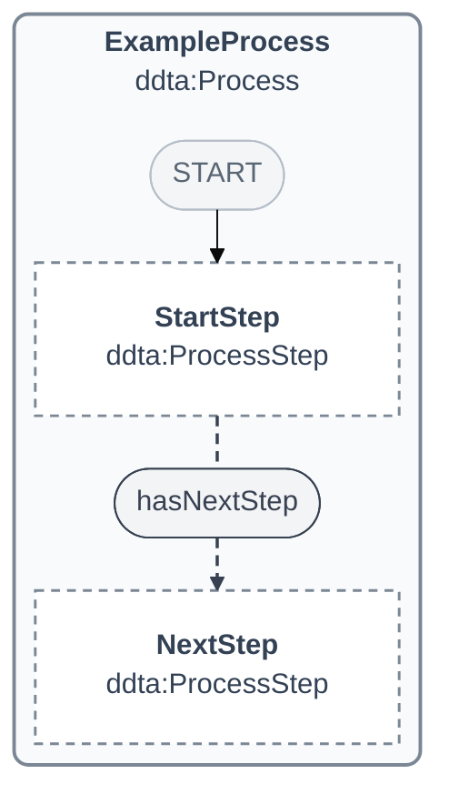


### process:referencesContractElement — incorporazione grafica nel `Operand`

La proprietà RDF **rimane invariata**; si elimina soltanto l'arco
`referencesContractElement` dal diagramma. Il suo ContractElement viene
risolto al contratto **INPUT dichiarato dal medesimo ControlNode** mediante
`process:declaresInputContract` + `ddta:hasContractElement`, senza dedurre
flussi, senza creare individui e senza confondere provenienza e tipo.

```yaml ddta-visualization
record: relation-style
module: process
target: process:referencesContractElement
representation:
  type: nested-contract-reference
  drawEdge: false
  direction: subject-to-object
  preserveRdfPredicate: true
  noImplicitDataTransfer: true
```

<!-- DDTA-PROCESS-EXAMPLE-05 rule="process:referencesContractElement" -->
**Esempio 05 — `process:referencesContractElement`.** Un riferimento RDF a ContractElement proiettato nel contratto INPUT del controllo.

**Turtle (sorgente RDF dell’esempio)**

```turtle
@prefix ddta: <https://w3id.org/ddta/core#> .
@prefix process: <https://w3id.org/ddta/process#> .
@prefix ex: <https://example.org/ddta/process-examples#> .
@prefix rdfs: <http://www.w3.org/2000/01/rdf-schema#> .
@prefix xsd: <http://www.w3.org/2001/XMLSchema#> .

ex:ExampleProcess a ddta:Process ;
  ddta:hasStep ex:Decision, ex:OnTrue, ex:OnFalse ;
  process:hasInitialStep ex:Decision .

ex:Decision a process:ControlNode, ddta:ProcessStep ;
  process:controlKind "XOR_SPLIT" ;
  process:declaresInputContract ex:ValueContract ;
  process:evaluatesCondition ex:CheckValue ;
  process:hasTrueNextStep ex:OnTrue ;
  process:hasFalseNextStep ex:OnFalse .
ex:OnTrue a ddta:ProcessStep .
ex:OnFalse a ddta:ProcessStep .
ex:CheckValue a process:AtomicCondition ;
  process:comparisonOperator "GE" ;
  process:hasLeftOperand ex:ValueOperand ;
  process:hasRightOperand ex:LimitOperand .
ex:ValueOperand a process:Operand ; process:referencesContractElement ex:ValueElement .
ex:LimitOperand a process:Operand ; process:literalValue 10 .
ex:ValueContract a ddta:Contract ; ddta:hasContractElement ex:ValueElement .
ex:ValueElement a ddta:ContractElement ; ddta:minOccurs 1 ; ddta:maxOccurs 1 .
```

**Mermaid (output generato da Python CORE + PROCESS)**

```mermaid
%%{init: {"htmlLabels":true,"theme":"base","layout":"elk"}}%%
flowchart TB

    %% DDTA PROCESS: modular RDF projection (independent of CORE renderer)
    subgraph PX_1e9cb7035a8e["<div style='display:inline-block;text-align:center;white-space:nowrap;line-height:1.4;padding:6px 10px;background:transparent'><span style='display:block;font-size:16px;font-weight:700;color:#334155'>ExampleProcess</span><span style='display:block;font-size:11px;color:#334155'>ddta:Process</span></div>"]
        direction TB
        subgraph PX_228d1dfbb135["<div style='display:inline-block;text-align:center;white-space:nowrap;line-height:1.4;padding:6px 10px;background:transparent'><span style='display:block;font-size:16px;font-weight:700;color:#2563EB'>Decision</span><span style='display:block;font-size:11px;color:#2563EB'>process:ControlNode</span></div>"]
            direction TB
            subgraph PX_1449fd182fb8["<div style='display:inline-block;text-align:center;white-space:nowrap;line-height:1.4;padding:6px 10px;background:transparent'><span style='display:block;font-size:16px;font-weight:700;color:#A67C00'>CheckValue</span><span style='display:block;font-size:11px;color:#A67C00'>process:AtomicCondition</span></div>"]
                direction LR
                PX_508cde8bc12d{"GE"}
                subgraph PX_1641e764bff2["<div style='display:inline-block;text-align:center;white-space:nowrap;line-height:1.4;padding:6px 10px;background:transparent'><span style='display:block;font-size:16px;font-weight:700;color:#334155'>ValueOperand</span><span style='display:block;font-size:11px;color:#334155'>process:Operand</span></div>"]
                    direction TB
                    PX_b02909bad230["<img src='data:image/svg+xml;base64,PHN2ZyB4bWxucz0iaHR0cDovL3d3dy53My5vcmcvMjAwMC9zdmciIHdpZHRoPSIyOCIgaGVpZ2h0PSIyOCIgdmlld0JveD0iMCAwIDI4IDI4IiBmaWxsPSJub25lIiBzdHJva2U9IiNDNkEzNEQiIHN0cm9rZS13aWR0aD0iMS44IiBzdHJva2UtbGluZWNhcD0icm91bmQiIHN0cm9rZS1saW5lam9pbj0icm91bmQiPjxwYXRoIGQ9Ik03IDIuN2gxMGw1IDV2MTcuNUg3YTIgMiAwIDAgMS0yLTJWNC43YTIgMiAwIDAgMSAyLTJaIi8+PHBhdGggZD0iTTE3IDIuN3Y1aDVNOSAxM2g4TTkgMTdoNE0xNC41IDIxbDIgMiA0LTQiLz48L3N2Zz4=' width='27' height='27'/><div style='display:inline-block;text-align:center;line-height:1.4;padding:6px 10px;color:#C6A34D'><span style='display:block;font-size:11px;color:#C6A34D'>INPUT</span><span style='display:block;font-size:16px;font-weight:700;color:#C6A34D'>ValueContract</span><span style='display:block;font-size:11px;color:#C6A34D'>ddta:Contract</span></div>"]
                end
                PX_7c66dd092326["<div style='display:inline-block;text-align:center;white-space:nowrap;line-height:1.4;padding:6px 10px;background:transparent'><span style='display:block;font-size:16px;font-weight:700;color:#334155'>LimitOperand</span><span style='display:block;font-size:11px;color:#334155'>process:Operand</span></div>"]
                PX_1641e764bff2 ~~~ PX_508cde8bc12d ~~~ PX_7c66dd092326
            end
            subgraph PX_c768a4b1daf7[" "]
                direction LR
                subgraph PX_96762ccde4f1[" "]
                    direction TB
                    PX_a65b07e7ddad["<div style='display:inline-block;text-align:center;white-space:nowrap;line-height:1.4;padding:6px 10px;background:transparent'><span style='display:block;font-size:16px;font-weight:700;color:#334155'>OnTrue</span><span style='display:block;font-size:11px;color:#334155'>ddta:ProcessStep</span></div>"]
                end
                subgraph PX_38da389f1cc5[" "]
                    direction TB
                    PX_362b1dea0695["<div style='display:inline-block;text-align:center;white-space:nowrap;line-height:1.4;padding:6px 10px;background:transparent'><span style='display:block;font-size:16px;font-weight:700;color:#334155'>OnFalse</span><span style='display:block;font-size:11px;color:#334155'>ddta:ProcessStep</span></div>"]
                end
            end
        end
        PX_70130dabe01f(["START"])
        style PX_70130dabe01f fill:#F3F5F7,stroke:#B6BEC8,color:#596674
        PX_70130dabe01f --> PX_228d1dfbb135
    end
    PX_1449fd182fb8 --> PX_362b1dea0695
    PX_1449fd182fb8 --> PX_a65b07e7ddad
    classDef PROC_step fill:#FFFFFF,stroke:#7B8794,color:#334155,stroke-width:1.5px,stroke-dasharray:5 4
    class PX_362b1dea0695,PX_a65b07e7ddad PROC_step
    classDef PROC_process fill:#F8FAFC,stroke:#7B8794,color:#334155,stroke-width:2px,rx:8px,ry:8px
    class PX_1e9cb7035a8e PROC_process
    classDef PROC_region fill:#FFFFFF,stroke:#2563EB,color:#2563EB,stroke-width:2px,stroke-dasharray:6 4
    class PX_228d1dfbb135 PROC_region
    classDef PROC_branchdashed fill:#FFFFFF,stroke:#2563EB,color:#2563EB,stroke-width:1.5px,stroke-dasharray:6 4
    class PX_38da389f1cc5,PX_96762ccde4f1 PROC_branchdashed
    classDef PROC_invisible fill:transparent,stroke:transparent,stroke-width:0px
    class PX_c768a4b1daf7 PROC_invisible
    classDef PROC_condition fill:#FFFFFF,stroke:#D6A100,color:#A67C00,stroke-width:2px
    class PX_1449fd182fb8 PROC_condition
    classDef PROC_operator fill:#FFFFFF,stroke:#D6A100,color:#A67C00,stroke-width:1.5px
    class PX_508cde8bc12d PROC_operator
    classDef PROC_component fill:#FFFFFF,stroke:#7B8794,color:#334155,stroke-width:1.5px
    class PX_1641e764bff2,PX_7c66dd092326 PROC_component
    classDef PROC_coreContract fill:#FFF8DE,stroke:#C6A34D,color:#C6A34D,stroke-width:1.5px,rx:12px,ry:12px
    class PX_b02909bad230 PROC_coreContract

    linkStyle 3 stroke:#C62828,stroke-width:2.5px
    linkStyle 4 stroke:#238636,stroke-width:2.5px
```


### process-operand-contract-reference

```yaml ddta-visualization
record: projection-rule
module: process
id: process-operand-contract-reference
target: process:Operand
selection:
  sourceRelation: process:referencesContractElement
  targetClass: ddta:ContractElement
  controlContractRelation: process:declaresInputContract
  contractElementRelation: ddta:hasContractElement
  contractClass: ddta:Contract
  requireUniqueControlInputContract: true
  producerPath:
    - inverse: ddta:hasContractElement
    - inverse: process:declaresOutputContract
  requireUniqueProducer: false  # contratti condivisi; non attribuire automaticamente un produttore
projection:
  modes:
    compact:
      kind: nested-input-contract
      contractElementPresentation: suppress
      drawEdge: false
    extended:
      kind: nested-input-contract
      contractElementPresentation: suppress
      drawEdge: false
  hostContainment: operand-subgraph
  role: INPUT
  reuseCoreClassStyle: ddta:Contract
  preserveRdfIdentity: true
  noImplicitTransfer: true
  duplicateControlContractPresentation:
    scope: same-control
    when: input-contract-already-nested-in-operand
    action: suppress-control-contract-copy
    preserveRdfDeclaration: true
    preserveOtherInputContracts: true
    preserveOutputContracts: true
```

<!-- DDTA-PROCESS-EXAMPLE-06 rule="process-operand-contract-reference" -->
**Esempio 06 — `process-operand-contract-reference`.** La proiezione annidata del contratto in Operand evita la duplicazione nel controllo.

**Turtle (sorgente RDF dell’esempio)**

```turtle
@prefix ddta: <https://w3id.org/ddta/core#> .
@prefix process: <https://w3id.org/ddta/process#> .
@prefix ex: <https://example.org/ddta/process-examples#> .
@prefix rdfs: <http://www.w3.org/2000/01/rdf-schema#> .
@prefix xsd: <http://www.w3.org/2001/XMLSchema#> .

ex:ExampleProcess a ddta:Process ;
  ddta:hasStep ex:Decision, ex:OnTrue, ex:OnFalse ;
  process:hasInitialStep ex:Decision .

ex:Decision a process:ControlNode, ddta:ProcessStep ;
  process:controlKind "XOR_SPLIT" ;
  process:declaresInputContract ex:ValueContract, ex:OtherInputContract ;
  process:declaresOutputContract ex:DecisionOutputContract ;
  process:evaluatesCondition ex:CheckValue ;
  process:hasTrueNextStep ex:OnTrue ;
  process:hasFalseNextStep ex:OnFalse .
ex:OnTrue a ddta:ProcessStep .
ex:OnFalse a ddta:ProcessStep .
ex:CheckValue a process:AtomicCondition ;
  process:comparisonOperator "GE" ;
  process:hasLeftOperand ex:ValueOperand ;
  process:hasRightOperand ex:LimitOperand .
ex:ValueOperand a process:Operand ; process:referencesContractElement ex:ValueElement .
ex:LimitOperand a process:Operand ; process:literalValue 10 .
ex:ValueContract a ddta:Contract ; ddta:hasContractElement ex:ValueElement .
ex:ValueElement a ddta:ContractElement ; ddta:minOccurs 1 ; ddta:maxOccurs 1 .
ex:OtherInputContract a ddta:Contract ; ddta:hasContractElement ex:OtherElement .
ex:OtherElement a ddta:ContractElement ; ddta:minOccurs 0 ; ddta:maxOccurs 1 .
ex:DecisionOutputContract a ddta:Contract ; ddta:hasContractElement ex:DecisionElement .
ex:DecisionElement a ddta:ContractElement ; ddta:minOccurs 1 ; ddta:maxOccurs 1 .
```

**Mermaid (output generato da Python CORE + PROCESS)**

```mermaid
%%{init: {"htmlLabels":true,"theme":"base","layout":"elk"}}%%
flowchart TB

    %% DDTA PROCESS: modular RDF projection (independent of CORE renderer)
    subgraph PX_1e9cb7035a8e["<div style='display:inline-block;text-align:center;white-space:nowrap;line-height:1.4;padding:6px 10px;background:transparent'><span style='display:block;font-size:16px;font-weight:700;color:#334155'>ExampleProcess</span><span style='display:block;font-size:11px;color:#334155'>ddta:Process</span></div>"]
        direction TB
        subgraph PX_228d1dfbb135["<div style='display:inline-block;text-align:center;white-space:nowrap;line-height:1.4;padding:6px 10px;background:transparent'><span style='display:block;font-size:16px;font-weight:700;color:#2563EB'>Decision</span><span style='display:block;font-size:11px;color:#2563EB'>process:ControlNode</span></div>"]
            direction TB
            subgraph PX_1449fd182fb8["<div style='display:inline-block;text-align:center;white-space:nowrap;line-height:1.4;padding:6px 10px;background:transparent'><span style='display:block;font-size:16px;font-weight:700;color:#A67C00'>CheckValue</span><span style='display:block;font-size:11px;color:#A67C00'>process:AtomicCondition</span></div>"]
                direction LR
                PX_508cde8bc12d{"GE"}
                subgraph PX_1641e764bff2["<div style='display:inline-block;text-align:center;white-space:nowrap;line-height:1.4;padding:6px 10px;background:transparent'><span style='display:block;font-size:16px;font-weight:700;color:#334155'>ValueOperand</span><span style='display:block;font-size:11px;color:#334155'>process:Operand</span></div>"]
                    direction TB
                    PX_b02909bad230["<img src='data:image/svg+xml;base64,PHN2ZyB4bWxucz0iaHR0cDovL3d3dy53My5vcmcvMjAwMC9zdmciIHdpZHRoPSIyOCIgaGVpZ2h0PSIyOCIgdmlld0JveD0iMCAwIDI4IDI4IiBmaWxsPSJub25lIiBzdHJva2U9IiNDNkEzNEQiIHN0cm9rZS13aWR0aD0iMS44IiBzdHJva2UtbGluZWNhcD0icm91bmQiIHN0cm9rZS1saW5lam9pbj0icm91bmQiPjxwYXRoIGQ9Ik03IDIuN2gxMGw1IDV2MTcuNUg3YTIgMiAwIDAgMS0yLTJWNC43YTIgMiAwIDAgMSAyLTJaIi8+PHBhdGggZD0iTTE3IDIuN3Y1aDVNOSAxM2g4TTkgMTdoNE0xNC41IDIxbDIgMiA0LTQiLz48L3N2Zz4=' width='27' height='27'/><div style='display:inline-block;text-align:center;line-height:1.4;padding:6px 10px;color:#C6A34D'><span style='display:block;font-size:11px;color:#C6A34D'>INPUT</span><span style='display:block;font-size:16px;font-weight:700;color:#C6A34D'>ValueContract</span><span style='display:block;font-size:11px;color:#C6A34D'>ddta:Contract</span></div>"]
                end
                PX_7c66dd092326["<div style='display:inline-block;text-align:center;white-space:nowrap;line-height:1.4;padding:6px 10px;background:transparent'><span style='display:block;font-size:16px;font-weight:700;color:#334155'>LimitOperand</span><span style='display:block;font-size:11px;color:#334155'>process:Operand</span></div>"]
                PX_1641e764bff2 ~~~ PX_508cde8bc12d ~~~ PX_7c66dd092326
            end
            subgraph PX_0b5ef1db0f9d["Contracts"]
                direction LR
                subgraph PX_89fdf6a50e3d["<img src='data:image/svg+xml;base64,PHN2ZyB4bWxucz0iaHR0cDovL3d3dy53My5vcmcvMjAwMC9zdmciIHdpZHRoPSIyOCIgaGVpZ2h0PSIyOCIgdmlld0JveD0iMCAwIDI4IDI4IiBmaWxsPSJub25lIiBzdHJva2U9IiNDNkEzNEQiIHN0cm9rZS13aWR0aD0iMS44IiBzdHJva2UtbGluZWNhcD0icm91bmQiIHN0cm9rZS1saW5lam9pbj0icm91bmQiPjxwYXRoIGQ9Ik03IDIuN2gxMGw1IDV2MTcuNUg3YTIgMiAwIDAgMS0yLTJWNC43YTIgMiAwIDAgMSAyLTJaIi8+PHBhdGggZD0iTTE3IDIuN3Y1aDVNOSAxM2g4TTkgMTdoNE0xNC41IDIxbDIgMiA0LTQiLz48L3N2Zz4=' width='27' height='27'/><div style='display:inline-block;text-align:center;line-height:1.4;padding:6px 10px;color:#C6A34D'><span style='display:block;font-size:11px;color:#C6A34D'>INPUT</span><span style='display:block;font-size:16px;font-weight:700;color:#C6A34D'>OtherInputContract</span><span style='display:block;font-size:11px;color:#C6A34D'>ddta:Contract</span></div>"]
                    direction TB
                    PX_e1cb68944bd9["<div style='display:inline-block;text-align:center;white-space:nowrap;line-height:1.4;padding:6px 10px;background:transparent'><span style='display:block;font-size:16px;font-weight:700;color:#9CA3AF'>OtherElement</span><span style='display:block;font-size:11px;color:#9CA3AF'>ddta:ContractElement</span></div>"]
                    style PX_e1cb68944bd9 fill:#FFFCF0,stroke:#C6A34D,color:#9CA3AF,stroke-width:1.2px,stroke-dasharray:5 4,rx:7px,ry:7px
                end
                subgraph PX_d7778157ddfc["<img src='data:image/svg+xml;base64,PHN2ZyB4bWxucz0iaHR0cDovL3d3dy53My5vcmcvMjAwMC9zdmciIHdpZHRoPSIyOCIgaGVpZ2h0PSIyOCIgdmlld0JveD0iMCAwIDI4IDI4IiBmaWxsPSJub25lIiBzdHJva2U9IiNDNkEzNEQiIHN0cm9rZS13aWR0aD0iMS44IiBzdHJva2UtbGluZWNhcD0icm91bmQiIHN0cm9rZS1saW5lam9pbj0icm91bmQiPjxwYXRoIGQ9Ik03IDIuN2gxMGw1IDV2MTcuNUg3YTIgMiAwIDAgMS0yLTJWNC43YTIgMiAwIDAgMSAyLTJaIi8+PHBhdGggZD0iTTE3IDIuN3Y1aDVNOSAxM2g4TTkgMTdoNE0xNC41IDIxbDIgMiA0LTQiLz48L3N2Zz4=' width='27' height='27'/><div style='display:inline-block;text-align:center;line-height:1.4;padding:6px 10px;color:#C6A34D'><span style='display:block;font-size:11px;color:#C6A34D'>OUTPUT</span><span style='display:block;font-size:16px;font-weight:700;color:#C6A34D'>DecisionOutputContract</span><span style='display:block;font-size:11px;color:#C6A34D'>ddta:Contract</span></div>"]
                    direction TB
                    PX_72837debb703["<div style='display:inline-block;text-align:center;white-space:nowrap;line-height:1.4;padding:6px 10px;background:transparent'><span style='display:block;font-size:16px;font-weight:700;color:#9CA3AF'>DecisionElement</span><span style='display:block;font-size:11px;color:#9CA3AF'>ddta:ContractElement</span></div>"]
                    style PX_72837debb703 fill:#FFFCF0,stroke:#C6A34D,color:#9CA3AF,stroke-width:1.2px,rx:7px,ry:7px
                end
            end
            subgraph PX_c768a4b1daf7[" "]
                direction LR
                subgraph PX_96762ccde4f1[" "]
                    direction TB
                    PX_a65b07e7ddad["<div style='display:inline-block;text-align:center;white-space:nowrap;line-height:1.4;padding:6px 10px;background:transparent'><span style='display:block;font-size:16px;font-weight:700;color:#334155'>OnTrue</span><span style='display:block;font-size:11px;color:#334155'>ddta:ProcessStep</span></div>"]
                end
                subgraph PX_38da389f1cc5[" "]
                    direction TB
                    PX_362b1dea0695["<div style='display:inline-block;text-align:center;white-space:nowrap;line-height:1.4;padding:6px 10px;background:transparent'><span style='display:block;font-size:16px;font-weight:700;color:#334155'>OnFalse</span><span style='display:block;font-size:11px;color:#334155'>ddta:ProcessStep</span></div>"]
                end
            end
        end
        PX_70130dabe01f(["START"])
        style PX_70130dabe01f fill:#F3F5F7,stroke:#B6BEC8,color:#596674
        PX_70130dabe01f --> PX_228d1dfbb135
    end
    PX_1449fd182fb8 --> PX_362b1dea0695
    PX_1449fd182fb8 --> PX_a65b07e7ddad
    classDef PROC_step fill:#FFFFFF,stroke:#7B8794,color:#334155,stroke-width:1.5px,stroke-dasharray:5 4
    class PX_362b1dea0695,PX_a65b07e7ddad PROC_step
    classDef PROC_process fill:#F8FAFC,stroke:#7B8794,color:#334155,stroke-width:2px,rx:8px,ry:8px
    class PX_1e9cb7035a8e PROC_process
    classDef PROC_region fill:#FFFFFF,stroke:#2563EB,color:#2563EB,stroke-width:2px,stroke-dasharray:6 4
    class PX_228d1dfbb135 PROC_region
    classDef PROC_branchdashed fill:#FFFFFF,stroke:#2563EB,color:#2563EB,stroke-width:1.5px,stroke-dasharray:6 4
    class PX_38da389f1cc5,PX_96762ccde4f1 PROC_branchdashed
    classDef PROC_invisible fill:transparent,stroke:transparent,stroke-width:0px
    class PX_c768a4b1daf7 PROC_invisible
    classDef PROC_condition fill:#FFFFFF,stroke:#D6A100,color:#A67C00,stroke-width:2px
    class PX_1449fd182fb8 PROC_condition
    classDef PROC_operator fill:#FFFFFF,stroke:#D6A100,color:#A67C00,stroke-width:1.5px
    class PX_508cde8bc12d PROC_operator
    classDef PROC_component fill:#FFFFFF,stroke:#7B8794,color:#334155,stroke-width:1.5px
    class PX_1641e764bff2,PX_7c66dd092326 PROC_component
    classDef PROC_coreContract fill:#FFF8DE,stroke:#C6A34D,color:#C6A34D,stroke-width:1.5px,rx:12px,ry:12px
    class PX_89fdf6a50e3d,PX_b02909bad230,PX_d7778157ddfc PROC_coreContract
    classDef PROC_coreContractElement fill:#FFFCF0,stroke:#9CA3AF,color:#9CA3AF,stroke-width:1.2px,rx:7px,ry:7px
    class PX_72837debb703,PX_e1cb68944bd9 PROC_coreContractElement
    classDef PROC_coreContractGroup fill:#FFF8DE,stroke:#C6A34D,color:#C6A34D,stroke-width:1.5px,rx:8px,ry:8px
    class PX_0b5ef1db0f9d PROC_coreContractGroup

    linkStyle 3 stroke:#C62828,stroke-width:2.5px
    linkStyle 4 stroke:#238636,stroke-width:2.5px
```


**Regola di visualizzazione senza duplicazioni.** Se un `ddta:Contract`
INPUT di un `ControlNode` è già mostrato nel proprio `process:Operand`
tramite la relazione RDF `referencesContractElement`, lo stesso contratto
non viene disegnato una seconda volta nel gruppo `Contracts` del controllo.
I contratti INPUT non rappresentati negli operandi e tutti i contratti OUTPUT
restano visibili. Le triple RDF, gli elementi contrattuali e la tracciabilità
rimangono invariati: la soppressione riguarda una sola occorrenza **grafica**.

### process:ControlNode

```yaml ddta-visualization
record: class-style
module: process
target: process:ControlNode
node:
  shape: kind-dependent
  style: control-marker
style:
  fill: '#FFFFFF'
  stroke: '#2563EB'
  color: '#2563EB'
  strokeWidth: 2
  strokePattern: dashed
projection:
  kindProperty: process:controlKind
  # Connect a hasNextStep linking controls to the OUTER ControlNode borders,
  # not to the internal CONCURRENT_SPLIT marker or XOR condition/operands.
  # Mermaid subgraph identifiers are visualization endpoints, not RDF nodes.
  # TRUE/FALSE branch arrows retain their own condition-border semantics.
  externalFlowAttachment:
    relation: ddta:hasNextStep
    type: mermaid-subgraph-border
    controlKinds: [CONCURRENT_SPLIT, XOR_SPLIT]
    source: control-region-border
    destination: control-region-border
    doNotAttachToInternalMarker: true
    preserveXorBranchOrigin: true
    rdfIndividual: false
  recognizedKinds:
  - XOR_SPLIT
  - XOR_MERGE
  - CONCURRENT_SPLIT
  - WAIT
  - END_BRANCH
  - END_PROCESS
  terminalAndWaitingKinds:
  - WAIT
  - END_BRANCH
  - END_PROCESS
  terminalAndWaitingStyleRef: process-control-terminal-ellipse
  splitKinds:
  - XOR_SPLIT
  - CONCURRENT_SPLIT
  splitMarker:
    role: source-control-node-rdf-individual
    background: '#FFFFFF'
    inputArrows: 1
    outgoingArrows: from-declared-ddta-hasNextStep
    byKind:
      XOR_SPLIT:
        shape: rounded-rectangle
        text: XOR · 1 ramo
        meaning: exactly-one-selected-outgoing-branch
        strokePattern: dashed
      CONCURRENT_SPLIT:
        shape: circle
        text: ∥
        meaning: coordinate-explicit-hasParticipantStep-with-completion-policy
        strokePattern: solid
    doNotCreateSecondConditionDiamond: true
  branchRegion:
    renderer: mermaid-subgraph
    rdfIndividual: false
    anchoredTo: split-control-node
    fill: '#FFFFFF'
    stroke: '#2563EB'
    strokePattern: dashed
    layoutDirection: TB
    branchRow:
      direction: LR
      childrenDirection: TB
      count: from-selected-successor-branches
      doNotInventMembers: true
      rectangleIsRdfIndividual: false
    xorBranchStrokePattern: dashed
    concurrentBranchStrokePattern: solid
    xorMarkerStrokePattern: dashed
    concurrentMarkerStrokePattern: solid
  merge:
    requiresDeclaredControlOrSynchronizationNode: false
    xorMergeKind: XOR_MERGE
    xorMarkerStrokePattern: dashed
    requiresDeclaredControlNode: true
  trace:
    preserveSplitAndMergeAsDistinctRdfIndividuals: true
    groupDoesNotAssertContainment: true
  concurrentComposition:
    participantRelation: process:hasParticipantStep
    participantSource: explicit-rdf-only
    participantPresentation: inside-control-region
    memberRelationLabel: hasParticipantStep
    memberRelationStroke: dashed
    outgoingControlRelation: ddta:hasNextStep
    expectedOutgoingSuccessorCount: 1
    joinPolicyProperty: process:joinPolicy
    requiredCountProperty: process:requiredCount
    completionCriterionProperty: process:completionCriterion
    label:
      N_OF_M: '{requiredCount}/{participantCount}'
      ALL: ALL
      ANY: ANY
      showCompletionCriterion: true
    doNotInferParticipantOrder: true
    doNotInferDataTransfer: true
    doNotInferCancellation: true
    doNotCreateSynchronizationNode: true
```

<!-- DDTA-PROCESS-EXAMPLE-07 rule="process:ControlNode" -->
**Esempio 07 — `process:ControlNode`.** Un unico ControlNode concorrente con due partecipanti RDF espliciti.

**Turtle (sorgente RDF dell’esempio)**

```turtle
@prefix ddta: <https://w3id.org/ddta/core#> .
@prefix process: <https://w3id.org/ddta/process#> .
@prefix ex: <https://example.org/ddta/process-examples#> .
@prefix rdfs: <http://www.w3.org/2000/01/rdf-schema#> .
@prefix xsd: <http://www.w3.org/2001/XMLSchema#> .

ex:ExampleProcess a ddta:Process ;
  ddta:hasStep ex:Fork, ex:InspectA, ex:InspectB, ex:Done ;
  process:hasInitialStep ex:Fork .

ex:Fork a process:ControlNode, ddta:ProcessStep ;
  process:controlKind "CONCURRENT_SPLIT" ;
  process:hasParticipantStep ex:InspectA, ex:InspectB ;
  process:joinPolicy "ALL" ;
  process:completionCriterion "SUCCESS" ;
  ddta:hasNextStep ex:Done .
ex:InspectA a ddta:ProcessStep .
ex:InspectB a ddta:ProcessStep .
ex:Done a ddta:ProcessStep .
```

**Mermaid (output generato da Python CORE + PROCESS)**

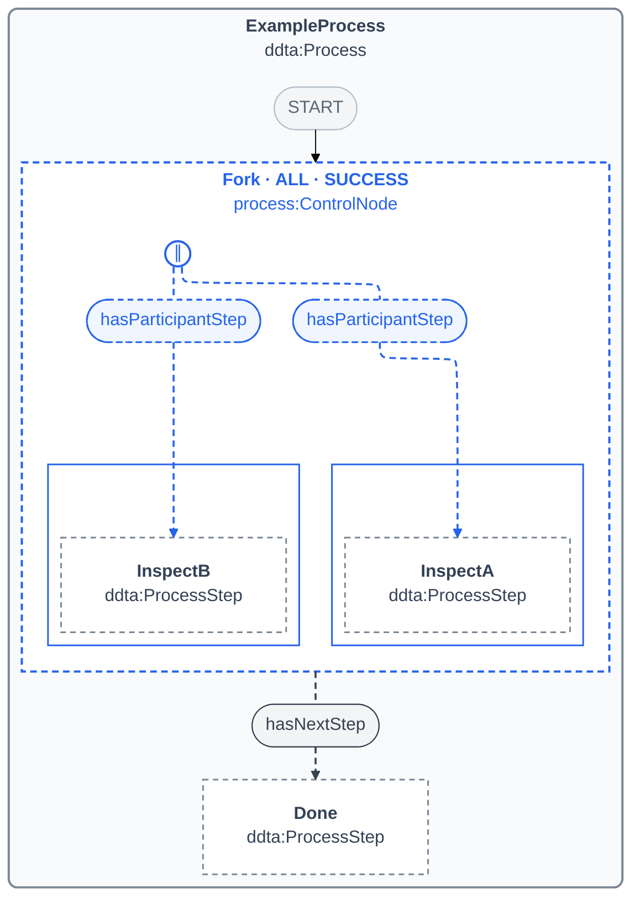


### conditional-xor-single-atomic-header

```yaml ddta-visualization
record: projection-rule
module: process
id: conditional-xor-single-atomic-header
target: process:ControlNode
selection:
  controlKind: XOR_SPLIT
  trueRelation: process:hasTrueNextStep
  falseRelation: process:hasFalseNextStep
  conditionRelation: process:evaluatesCondition
  conditionClass: process:AtomicCondition
  outgoingBranchCount: 2
projection:
  controlNodeRdfIdentity: xor-region-header
  splitMarker: suppressed-for-matched-condition-only
  headerCondition: positive-atomic-guard
  visibleConditionCount: 1
  negativeGuardRdfIdentityPreservedInTrace: false
  # `ddta:hasNextStep` enters the OUTER ControlNode boundary.
  # Branches TRUE/FALSE still originate from the AtomicCondition border.
  incomingToControlVisualization: control-region-border-for-hasNextStep
  branchOrigin: same-condition-container-border
  positiveColor: '#238636'
  negativeColor: '#C62828'
  noImplicitRdfConditionToStep: true
  noImplicitDataFlow: true
  # A Step->Step hasNextStep with both endpoint graphics within the same
  # selected branch MUST have its label and both line segments there.
  # This is layout grouping only; it is NOT an RDF hasSubStep assertion.
  nestedBranchFlow:
    relation: ddta:hasNextStep
    placement: within-selected-branch
    source: explicit-rdf-only
    includeRelationshipLabel: true
    drawOutsideBranchAgain: false
    groupDoesNotAssertStepComposition: true
  fallbackWhenNotMatched: process-control-node-default
```

<!-- DDTA-PROCESS-EXAMPLE-08 rule="conditional-xor-single-atomic-header" -->
**Esempio 08 — `conditional-xor-single-atomic-header`.** Un solo header per AtomicCondition e uscite TRUE/FALSE differenziate.

**Turtle (sorgente RDF dell’esempio)**

```turtle
@prefix ddta: <https://w3id.org/ddta/core#> .
@prefix process: <https://w3id.org/ddta/process#> .
@prefix ex: <https://example.org/ddta/process-examples#> .
@prefix rdfs: <http://www.w3.org/2000/01/rdf-schema#> .
@prefix xsd: <http://www.w3.org/2001/XMLSchema#> .

ex:ExampleProcess a ddta:Process ;
  ddta:hasStep ex:Decision, ex:OnTrue, ex:OnFalse ;
  process:hasInitialStep ex:Decision .

ex:Decision a process:ControlNode, ddta:ProcessStep ;
  process:controlKind "XOR_SPLIT" ;
  process:evaluatesCondition ex:CheckStatus ;
  process:hasTrueNextStep ex:OnTrue ;
  process:hasFalseNextStep ex:OnFalse .
ex:OnTrue a ddta:ProcessStep .
ex:OnFalse a ddta:ProcessStep .
ex:CheckStatus a process:AtomicCondition ;
  process:comparisonOperator "EQ" ;
  process:hasLeftOperand ex:ObservedStatus ;
  process:hasRightOperand ex:ExpectedStatus .
ex:ObservedStatus a process:Operand ; process:literalValue "READY" .
ex:ExpectedStatus a process:Operand ; process:literalValue "READY" .
```

**Mermaid (output generato da Python CORE + PROCESS)**

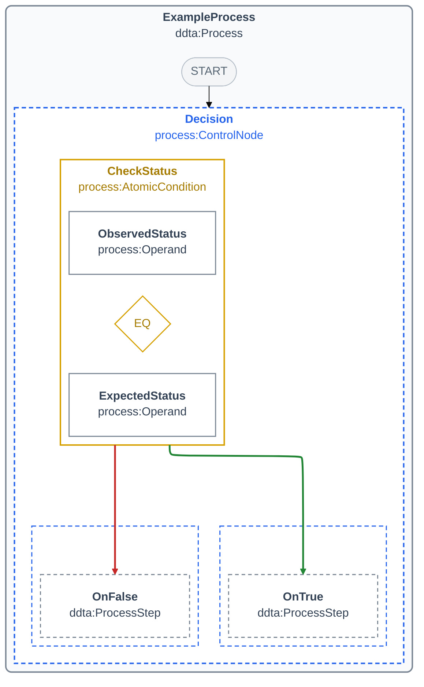


### process:CodeReference

```yaml ddta-visualization
record: class-style
module: process
target: process:CodeReference
node:
  shape: rectangle
  style: code-reference
style:
  fill: "#FFFFFF"
  stroke: "#79B991"
  color: "#263238"
  strokeWidth: 2
  strokePattern: dashed
  cornerRadius: 0
icon:
  required: true
  type: svg-file
  source: icons/file-code.svg
  colorSource: style.stroke
  placement: inside-node-label-before-title
  mermaidEncoding: data-uri-base64
  widthPx: 28
  heightPx: 28
label:
  compactFields: [displayName, rdfType, process:symbolIdentifier]
  optionalDetails: [process:repositoryLocator, process:sourcePath, process:codeElementKind, process:sourceRevision]
link:
  optional: true
  derivedFrom: [process:repositoryLocator, process:sourcePath, process:symbolIdentifier, process:sourceRevision]
  prefer: resolved-symbol-definition
  fallback: resolved-source-file
  unresolved: non-clickable
  needsResolverForSymbol: true
```

<!-- DDTA-PROCESS-EXAMPLE-09 rule="process:CodeReference" -->
**Esempio 09 — `process:CodeReference`.** Un riferimento identificabile al codice, senza inventare risorse o link.

**Turtle (sorgente RDF dell’esempio)**

```turtle
@prefix ddta: <https://w3id.org/ddta/core#> .
@prefix process: <https://w3id.org/ddta/process#> .
@prefix ex: <https://example.org/ddta/process-examples#> .
@prefix rdfs: <http://www.w3.org/2000/01/rdf-schema#> .
@prefix xsd: <http://www.w3.org/2001/XMLSchema#> .

ex:ExampleProcess a ddta:Process ;
  ddta:hasStep ex:StartStep ;
  process:hasInitialStep ex:StartStep .
ex:StartStep a ddta:ProcessStep .
ex:ExampleProcess process:hasCodeReference ex:ParserCall .

ex:ParserCall a process:CodeReference ;
  rdfs:label "parse_payload" ;
  process:repositoryLocator "https://example.org/repository" ;
  process:sourcePath "src/parse.py" ;
  process:symbolIdentifier "parse_payload" ;
  process:codeElementKind "function" ;
  process:sourceRevision "abc123" .
```

**Mermaid (output generato da Python CORE + PROCESS)**

```mermaid
%%{init: {"htmlLabels":true,"theme":"base","layout":"elk"}}%%
flowchart TB

    %% DDTA PROCESS: modular RDF projection (independent of CORE renderer)
    subgraph PX_1e9cb7035a8e["<div style='display:inline-block;text-align:center;white-space:nowrap;line-height:1.4;padding:6px 10px;background:transparent'><span style='display:block;font-size:16px;font-weight:700;color:#334155'>ExampleProcess</span><span style='display:block;font-size:11px;color:#334155'>ddta:Process</span></div>"]
        direction TB
        PX_2d8fe146aadd["<div style='display:inline-block;text-align:center;white-space:nowrap;line-height:1.4;padding:6px 10px;background:transparent'><span style='display:block;font-size:16px;font-weight:700;color:#334155'>StartStep</span><span style='display:block;font-size:11px;color:#334155'>ddta:ProcessStep</span></div>"]
        PX_afc138daecab(["START"])
        style PX_afc138daecab fill:#F3F5F7,stroke:#B6BEC8,color:#596674
        PX_afc138daecab --> PX_2d8fe146aadd
    end
    PX_b6ffe70f6728[" <span style=\"font-weight:700;color:#263238\">parse_payload</span><div style=\"font-size:11px;color:#263238\">process:CodeReference</div><div style=\"font-size:10px;color:#263238\">symbolIdentifier: parse_payload</div><div style=\"font-size:10px;color:#263238\">repositoryLocator: https://example.org/repository</div><div style=\"font-size:10px;color:#263238\">sourcePath: src/parse.py</div><div style=\"font-size:10px;color:#263238\">codeElementKind: function</div><div style=\"font-size:10px;color:#263238\">sourceRevision: abc123</div>"]
    style PX_b6ffe70f6728 fill:#FFFFFF,stroke:#79B991,color:#263238,stroke-width:2px,stroke-dasharray:5 4,rx:0px,ry:0px
    PX_8e694f6a56b8(["hasCodeReference"])
    style PX_8e694f6a56b8 fill:#EDF8F0,stroke:#79B991,color:#37694E,stroke-dasharray:5 4,rx:fullpx,ry:fullpx
    PX_1e9cb7035a8e -.-> PX_8e694f6a56b8 -.-> PX_b6ffe70f6728
    classDef PROC_step fill:#FFFFFF,stroke:#7B8794,color:#334155,stroke-width:1.5px,stroke-dasharray:5 4
    class PX_2d8fe146aadd PROC_step
    classDef PROC_process fill:#F8FAFC,stroke:#7B8794,color:#334155,stroke-width:2px,rx:8px,ry:8px
    class PX_1e9cb7035a8e PROC_process

    linkStyle 1 stroke:#79B991,stroke-width:2px,stroke-dasharray:8 5
    linkStyle 2 stroke:#79B991,stroke-width:2px,stroke-dasharray:8 5
```


### process:hasCodeReference

```yaml ddta-visualization
record: relation-style
module: process
target: process:hasCodeReference
representation:
  type: directed-edge
  drawEdge: true
  direction: subject-to-object
  stroke: "#79B991"
  strokeWidth: 2
  strokePattern: dashed
  dashArray: "8 5"
  arrowhead: target
label:
  text: hasCodeReference
  representation: ellipse-inline-node
  fill: "#EDF8F0"
  stroke: "#79B991"
  color: "#37694E"
  strokePattern: dashed
  cornerRadius: full
```

<!-- DDTA-PROCESS-EXAMPLE-10 rule="process:hasCodeReference" -->
**Esempio 10 — `process:hasCodeReference`.** Associazione esplicita dello Step a CodeReference.

**Turtle (sorgente RDF dell’esempio)**

```turtle
@prefix ddta: <https://w3id.org/ddta/core#> .
@prefix process: <https://w3id.org/ddta/process#> .
@prefix ex: <https://example.org/ddta/process-examples#> .
@prefix rdfs: <http://www.w3.org/2000/01/rdf-schema#> .
@prefix xsd: <http://www.w3.org/2001/XMLSchema#> .

ex:ExampleProcess a ddta:Process ;
  ddta:hasStep ex:StartStep ;
  process:hasInitialStep ex:StartStep .
ex:StartStep a ddta:ProcessStep ; process:hasCodeReference ex:ParserCall .

ex:ParserCall a process:CodeReference ;
  rdfs:label "parse_payload" ;
  process:repositoryLocator "https://example.org/repository" ;
  process:sourcePath "src/parse.py" ;
  process:symbolIdentifier "parse_payload" ;
  process:codeElementKind "function" ;
  process:sourceRevision "abc123" .
```

**Mermaid (output generato da Python CORE + PROCESS)**

```mermaid
%%{init: {"htmlLabels":true,"theme":"base","layout":"elk"}}%%
flowchart TB

    %% DDTA PROCESS: modular RDF projection (independent of CORE renderer)
    subgraph PX_1e9cb7035a8e["<div style='display:inline-block;text-align:center;white-space:nowrap;line-height:1.4;padding:6px 10px;background:transparent'><span style='display:block;font-size:16px;font-weight:700;color:#334155'>ExampleProcess</span><span style='display:block;font-size:11px;color:#334155'>ddta:Process</span></div>"]
        direction TB
        subgraph PX_c42a3f6353e2[" "]
            direction TB
            PX_2d8fe146aadd["<div style='display:inline-block;text-align:center;white-space:nowrap;line-height:1.4;padding:6px 10px;background:transparent'><span style='display:block;font-size:16px;font-weight:700;color:#334155'>StartStep</span><span style='display:block;font-size:11px;color:#334155'>ddta:ProcessStep</span></div>"]
            PX_76a6ef08645e[" <span style=\"font-weight:700;color:#263238\">parse_payload</span><div style=\"font-size:11px;color:#263238\">process:CodeReference</div><div style=\"font-size:10px;color:#263238\">symbolIdentifier: parse_payload</div><div style=\"font-size:10px;color:#263238\">repositoryLocator: https://example.org/repository</div><div style=\"font-size:10px;color:#263238\">sourcePath: src/parse.py</div><div style=\"font-size:10px;color:#263238\">codeElementKind: function</div><div style=\"font-size:10px;color:#263238\">sourceRevision: abc123</div>"]
            style PX_76a6ef08645e fill:#FFFFFF,stroke:#79B991,color:#263238,stroke-width:2px,stroke-dasharray:5 4,rx:0px,ry:0px
            PX_624bb3340ffd(["hasCodeReference"])
            style PX_624bb3340ffd fill:#EDF8F0,stroke:#79B991,color:#37694E,stroke-dasharray:5 4,rx:fullpx,ry:fullpx
            PX_2d8fe146aadd -.-> PX_624bb3340ffd -.-> PX_76a6ef08645e
        end
        PX_afc138daecab(["START"])
        style PX_afc138daecab fill:#F3F5F7,stroke:#B6BEC8,color:#596674
        PX_afc138daecab --> PX_2d8fe146aadd
    end
    classDef PROC_step fill:#FFFFFF,stroke:#7B8794,color:#334155,stroke-width:1.5px,stroke-dasharray:5 4
    class PX_2d8fe146aadd PROC_step
    classDef PROC_process fill:#F8FAFC,stroke:#7B8794,color:#334155,stroke-width:2px,rx:8px,ry:8px
    class PX_1e9cb7035a8e PROC_process
    classDef PROC_invisible fill:transparent,stroke:transparent,stroke-width:0px
    class PX_c42a3f6353e2 PROC_invisible

    linkStyle 0 stroke:#79B991,stroke-width:2px,stroke-dasharray:8 5
    linkStyle 1 stroke:#79B991,stroke-width:2px,stroke-dasharray:8 5
```


### process:hasSubProcess

```yaml ddta-visualization
record: relation-style
module: process
target: process:hasSubProcess
representation:
  type: containment
  parent: subject
  child: object
  renderer: mermaid-subgraph
  drawEdge: false
  recursive: true
  retainCoreClassStyle: ddta:Process
  visualCopiesAreNotRdfIndividuals: true
validation:
  rejectCycles: true
  multipleVisibleParents: require-identity-preserving-projection-or-diagnostic
```

<!-- DDTA-PROCESS-EXAMPLE-11 rule="process:hasSubProcess" -->
**Esempio 11 — `process:hasSubProcess`.** Composizione strutturale dichiarata, non invocazione.

**Turtle (sorgente RDF dell’esempio)**

```turtle
@prefix ddta: <https://w3id.org/ddta/core#> .
@prefix process: <https://w3id.org/ddta/process#> .
@prefix ex: <https://example.org/ddta/process-examples#> .
@prefix rdfs: <http://www.w3.org/2000/01/rdf-schema#> .
@prefix xsd: <http://www.w3.org/2001/XMLSchema#> .

ex:ParentProcess a ddta:Process ; process:hasSubProcess ex:ChildProcess .
ex:ChildProcess a ddta:Process ;
  ddta:hasStep ex:ChildStep ; process:hasInitialStep ex:ChildStep .
ex:ChildStep a ddta:ProcessStep .
```

**Mermaid (output generato da Python CORE + PROCESS)**

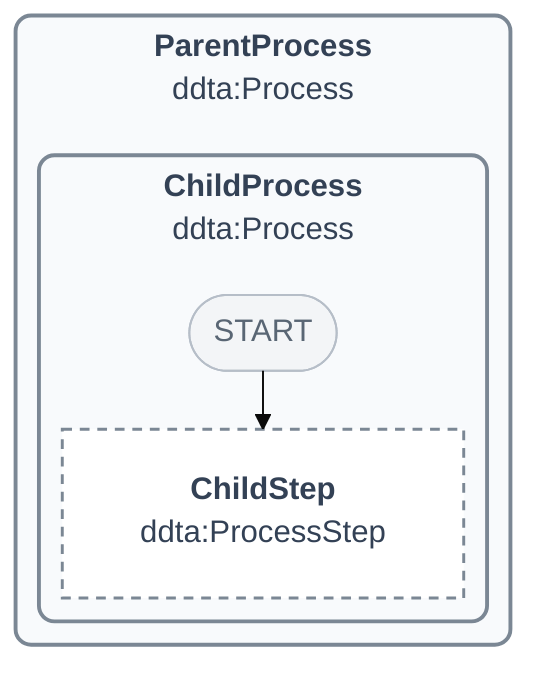


### process:invokesProcess

```yaml ddta-visualization
record: relation-style
module: process
target: process:invokesProcess
representation:
  type: directed-edge
  drawEdge: true
  direction: subject-to-object
  stroke: "#7B8794"
  strokeWidth: 1.8
  strokePattern: solid
  arrowhead: target
  destinationAttachment: process-container-border
  emitMermaidLinkStyle: false  # standard approved in the Appendix A
label:
  text: invokesProcess
  representation: ellipse-inline-node
  fill: "#EDF8F0"
  stroke: "#79B991"
  color: "#37694E"
  strokeWidth: 1.5
  strokePattern: dashed
  dashArray: "8 5"
semanticGuardrails:
  doNotInferProcessContainment: true
  doNotInferWaitingOrReturn: true
```

<!-- DDTA-PROCESS-EXAMPLE-12 rule="process:invokesProcess" -->
**Esempio 12 — `process:invokesProcess`.** Richiamo previsto di un processo da parte di uno Step; nessun flusso di ritorno inferito.

**Turtle (sorgente RDF dell’esempio)**

```turtle
@prefix ddta: <https://w3id.org/ddta/core#> .
@prefix process: <https://w3id.org/ddta/process#> .
@prefix ex: <https://example.org/ddta/process-examples#> .
@prefix rdfs: <http://www.w3.org/2000/01/rdf-schema#> .
@prefix xsd: <http://www.w3.org/2001/XMLSchema#> .

ex:ExampleProcess a ddta:Process ;
  ddta:hasStep ex:StartStep ;
  process:hasInitialStep ex:StartStep .

ex:StartStep a ddta:ProcessStep ; process:invokesProcess ex:Subroutine .
ex:Subroutine a ddta:Process .
```

**Mermaid (output generato da Python CORE + PROCESS)**

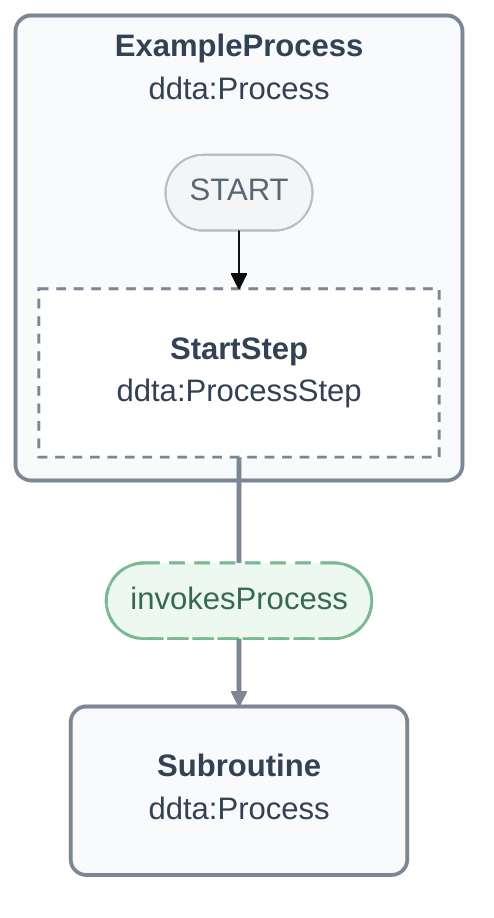


### process:hasInitialStep

```yaml ddta-visualization
record: relation-style
module: process
target: process:hasInitialStep
representation:
  type: derived-start-marker
  renderStartMarker: true
  markerShape: ellipse
  markerLabel: START
  markerFill: "#F3F5F7"
  markerStroke: "#B6BEC8"
  markerColor: "#596674"
  markerIsRdfIndividual: false
  direction: marker-to-selected-object
  multipleInitialSteps: render-one-marker-per-declared-entry
  noAutomaticStartFromGraphTopology: true
  retainStepCoreStyle: true
```

<!-- DDTA-PROCESS-EXAMPLE-13 rule="process:hasInitialStep" -->
**Esempio 13 — `process:hasInitialStep`.** Due ingressi dichiarati, quindi due marcatori START.

**Turtle (sorgente RDF dell’esempio)**

```turtle
@prefix ddta: <https://w3id.org/ddta/core#> .
@prefix process: <https://w3id.org/ddta/process#> .
@prefix ex: <https://example.org/ddta/process-examples#> .
@prefix rdfs: <http://www.w3.org/2000/01/rdf-schema#> .
@prefix xsd: <http://www.w3.org/2001/XMLSchema#> .

ex:ExampleProcess a ddta:Process ;
  ddta:hasStep ex:EntryA, ex:EntryB ;
  process:hasInitialStep ex:EntryA, ex:EntryB .

ex:EntryA a ddta:ProcessStep .
ex:EntryB a ddta:ProcessStep .
```

**Mermaid (output generato da Python CORE + PROCESS)**

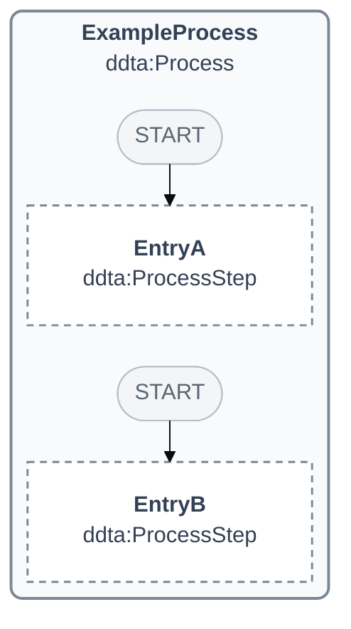


### process-control-terminal-ellipse

```yaml ddta-visualization
record: projection-rule
module: process
id: process-control-terminal-ellipse
target: process:ControlNode
selector:
  datatypeProperty: process:controlKind
  allowedValues: [WAIT, END_BRANCH, END_PROCESS]
node:
  shape: ellipse
  style: process-control-terminal-ellipse
style:
  fill: "#F1F5F9"
  stroke: "#7B8794"
  color: "#334155"
  strokeWidth: 1.5
  strokePattern: solid
label:
  textFrom: process:controlKind
  aligned: center
  fullIdentityVisibleInDetail: true
```

<!-- DDTA-PROCESS-EXAMPLE-14 rule="process-control-terminal-ellipse" -->
**Esempio 14 — `process-control-terminal-ellipse`.** Un ControlNode terminale con marcatura END_PROCESS.

**Turtle (sorgente RDF dell’esempio)**

```turtle
@prefix ddta: <https://w3id.org/ddta/core#> .
@prefix process: <https://w3id.org/ddta/process#> .
@prefix ex: <https://example.org/ddta/process-examples#> .
@prefix rdfs: <http://www.w3.org/2000/01/rdf-schema#> .
@prefix xsd: <http://www.w3.org/2001/XMLSchema#> .

ex:ExampleProcess a ddta:Process ;
  ddta:hasStep ex:EndStep ;
  process:hasInitialStep ex:EndStep .

ex:EndStep a process:ControlNode, ddta:ProcessStep ;
  process:controlKind "END_PROCESS" .
```

**Mermaid (output generato da Python CORE + PROCESS)**

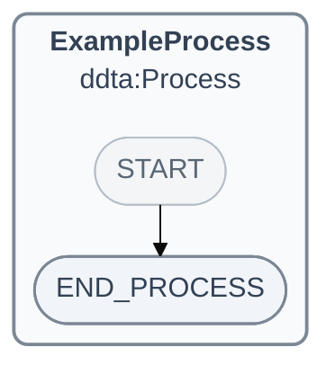


### process:implementedBy

```yaml ddta-visualization
record: relation-style
module: process
target: process:implementedBy
representation:
  type: directed-edge
  drawEdge: true
  direction: subject-to-object
  stroke: "#79B991"
  strokeWidth: 2
  strokePattern: dashed
  dashArray: "8 5"
  arrowhead: target
label:
  text: implementedBy
  representation: ellipse-inline-node
  fill: "#EDF8F0"
  stroke: "#79B991"
  color: "#37694E"
  strokePattern: dashed
objectPresentation:
  rdfClass: ddta:Resource
  context: process-implementation-reference-view
  shape: rectangle
  fill: "#FFFFFF"
  stroke: "#79B991"
  strokePattern: dashed
  cornerRadius: 0
  useCoreSpecializationIconWhenPresent: true
  clickTarget: none
  optionalLocation: only-if-documented
```

<!-- DDTA-PROCESS-EXAMPLE-15 rule="process:implementedBy" -->
**Esempio 15 — `process:implementedBy`.** Step collegato esplicitamente alla risorsa implementativa.

**Turtle (sorgente RDF dell’esempio)**

```turtle
@prefix ddta: <https://w3id.org/ddta/core#> .
@prefix process: <https://w3id.org/ddta/process#> .
@prefix ex: <https://example.org/ddta/process-examples#> .
@prefix rdfs: <http://www.w3.org/2000/01/rdf-schema#> .
@prefix xsd: <http://www.w3.org/2001/XMLSchema#> .

ex:ExampleProcess a ddta:Process ;
  ddta:hasStep ex:StartStep ;
  process:hasInitialStep ex:StartStep .

ex:StartStep a ddta:ProcessStep ; process:implementedBy ex:Worker .
ex:Worker a ddta:Resource ; rdfs:label "Worker A" .
```

**Mermaid (output generato da Python CORE + PROCESS)**

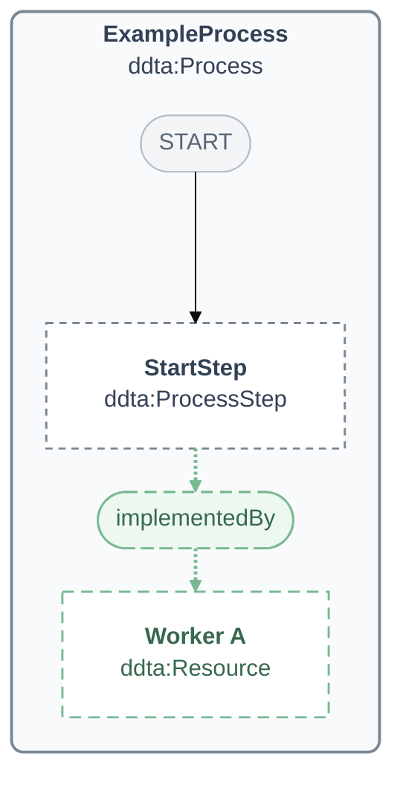


### process:usesConfiguration

```yaml ddta-visualization
record: relation-style
module: process
target: process:usesConfiguration
representation:
  type: directed-edge
  useDedicatedRenderer: true
  drawEdge: true
  direction: subject-to-object
  stroke: "#79B991"
  strokeWidth: 2
  strokePattern: dashed
  dashArray: "8 5"
  arrowhead: target
label:
  text: usesConfiguration
  representation: ellipse-inline-node
  fill: "#EDF8F0"
  stroke: "#79B991"
  color: "#37694E"
  strokePattern: dashed
objectPresentation:
  rdfClass: ddta:Resource
  context: process-configuration-reference-view
  shape: rectangle
  fill: "#FFFFFF"
  stroke: "#79B991"
  strokePattern: dashed
  cornerRadius: 0
  icon: icons/configuration-gear.svg
  iconColorSource: objectPresentation.stroke
  iconPlacement: inside-node-label-before-title
  iconMermaidEncoding: data-uri-base64
  iconMeaning: presentation-only-not-rdf-class
  clickTarget: none
  optionalLocation: only-if-documented
```

<!-- DDTA-PROCESS-EXAMPLE-16 rule="process:usesConfiguration" -->
**Esempio 16 — `process:usesConfiguration`.** Step collegato esplicitamente a una risorsa di configurazione.

**Turtle (sorgente RDF dell’esempio)**

```turtle
@prefix ddta: <https://w3id.org/ddta/core#> .
@prefix process: <https://w3id.org/ddta/process#> .
@prefix ex: <https://example.org/ddta/process-examples#> .
@prefix rdfs: <http://www.w3.org/2000/01/rdf-schema#> .
@prefix xsd: <http://www.w3.org/2001/XMLSchema#> .

ex:ExampleProcess a ddta:Process ;
  ddta:hasStep ex:StartStep ;
  process:hasInitialStep ex:StartStep .

ex:StartStep a ddta:ProcessStep ; process:usesConfiguration ex:Config .
ex:Config a ddta:Resource ; rdfs:label "Runtime configuration" .
```

**Mermaid (output generato da Python CORE + PROCESS)**

```mermaid
%%{init: {"htmlLabels":true,"theme":"base","layout":"elk"}}%%
flowchart TB

    %% DDTA PROCESS: modular RDF projection (independent of CORE renderer)
    subgraph PX_1e9cb7035a8e["<div style='display:inline-block;text-align:center;white-space:nowrap;line-height:1.4;padding:6px 10px;background:transparent'><span style='display:block;font-size:16px;font-weight:700;color:#334155'>ExampleProcess</span><span style='display:block;font-size:11px;color:#334155'>ddta:Process</span></div>"]
        direction TB
        subgraph PX_c42a3f6353e2[" "]
            direction TB
            PX_2d8fe146aadd["<div style='display:inline-block;text-align:center;white-space:nowrap;line-height:1.4;padding:6px 10px;background:transparent'><span style='display:block;font-size:16px;font-weight:700;color:#334155'>StartStep</span><span style='display:block;font-size:11px;color:#334155'>ddta:ProcessStep</span></div>"]
            PX_b3b27c11c81b(["usesConfiguration"])
            style PX_b3b27c11c81b fill:#EDF8F0,stroke:#79B991,color:#37694E,stroke-dasharray:5 4
            PX_dea15b2a68fb[" <span style=\"color:#79B991\">Runtime configuration</span><div style=\"font-size:11px;color:#79B991\">ddta:Resource</div>"]
            style PX_dea15b2a68fb fill:#FFFFFF,stroke:#79B991,stroke-dasharray:5 4,rx:0px,ry:0px
            PX_2d8fe146aadd -.-> PX_b3b27c11c81b -.-> PX_dea15b2a68fb
        end
        PX_afc138daecab(["START"])
        style PX_afc138daecab fill:#F3F5F7,stroke:#B6BEC8,color:#596674
        PX_afc138daecab --> PX_2d8fe146aadd
    end
    classDef PROC_step fill:#FFFFFF,stroke:#7B8794,color:#334155,stroke-width:1.5px,stroke-dasharray:5 4
    class PX_2d8fe146aadd PROC_step
    classDef PROC_process fill:#F8FAFC,stroke:#7B8794,color:#334155,stroke-width:2px,rx:8px,ry:8px
    class PX_1e9cb7035a8e PROC_process
    classDef PROC_invisible fill:transparent,stroke:transparent,stroke-width:0px
    class PX_c42a3f6353e2 PROC_invisible

    linkStyle 0 stroke:#79B991,stroke-width:2.5px
    linkStyle 1 stroke:#79B991,stroke-width:2.5px
```


### process:hasParticipantStep — partecipazione al controllo composto

Rappresenta soltanto la relazione RDF dichiarata tra il `ControlNode` e uno
`ProcessStep` partecipante. L'etichetta è un riquadro arrotondato **blu**, con
bordo **tratteggiato blu**. La linea ha i due segmenti del modello `mustPrecede`,
ma entrambi blu e tratteggiati; non è un `hasNextStep` né un trasferimento dati.

```yaml ddta-visualization
record: relation-style
module: process
target: process:hasParticipantStep
representation:
  type: directed-edge-via-label-node
  direction: subject-to-object
  sourceSegment: "---"
  targetSegment: "-->"
  stroke: "#2563EB"
  strokeWidth: 1.8
  strokePattern: dashed
  dashArray: "6 4"
  drawEdge: true
  arrowhead: target
  noControlFlowInference: true
  noDataTransferInference: true
label:
  text: hasParticipantStep
  representation: rounded-inline-node
  rdfIndividual: false
  fill: "#EFF6FF"
  stroke: "#2563EB"
  color: "#2563EB"
  strokeWidth: 1.5
  strokePattern: dashed
  dashArray: "5 4"
  cornerRadius: 12
```

<!-- DDTA-PROCESS-EXAMPLE-17 rule="process:hasParticipantStep" -->
**Esempio 17 — `process:hasParticipantStep`.** La partecipazione al controllo concorrente è distinta da hasNextStep.

**Turtle (sorgente RDF dell’esempio)**

```turtle
@prefix ddta: <https://w3id.org/ddta/core#> .
@prefix process: <https://w3id.org/ddta/process#> .
@prefix ex: <https://example.org/ddta/process-examples#> .
@prefix rdfs: <http://www.w3.org/2000/01/rdf-schema#> .
@prefix xsd: <http://www.w3.org/2001/XMLSchema#> .

ex:ExampleProcess a ddta:Process ;
  ddta:hasStep ex:Fork, ex:InspectA, ex:InspectB, ex:InspectC, ex:Done ;
  process:hasInitialStep ex:Fork .

ex:Fork a process:ControlNode, ddta:ProcessStep ;
  process:controlKind "CONCURRENT_SPLIT" ;
  process:hasParticipantStep ex:InspectA, ex:InspectB, ex:InspectC ;
  process:joinPolicy "N_OF_M" ;
  process:requiredCount "2"^^xsd:positiveInteger ;
  process:completionCriterion "SUCCESS" ;
  ddta:hasNextStep ex:Done .
ex:InspectA a ddta:ProcessStep .
ex:InspectB a ddta:ProcessStep .
ex:InspectC a ddta:ProcessStep .
ex:Done a ddta:ProcessStep .
```

**Mermaid (output generato da Python CORE + PROCESS)**

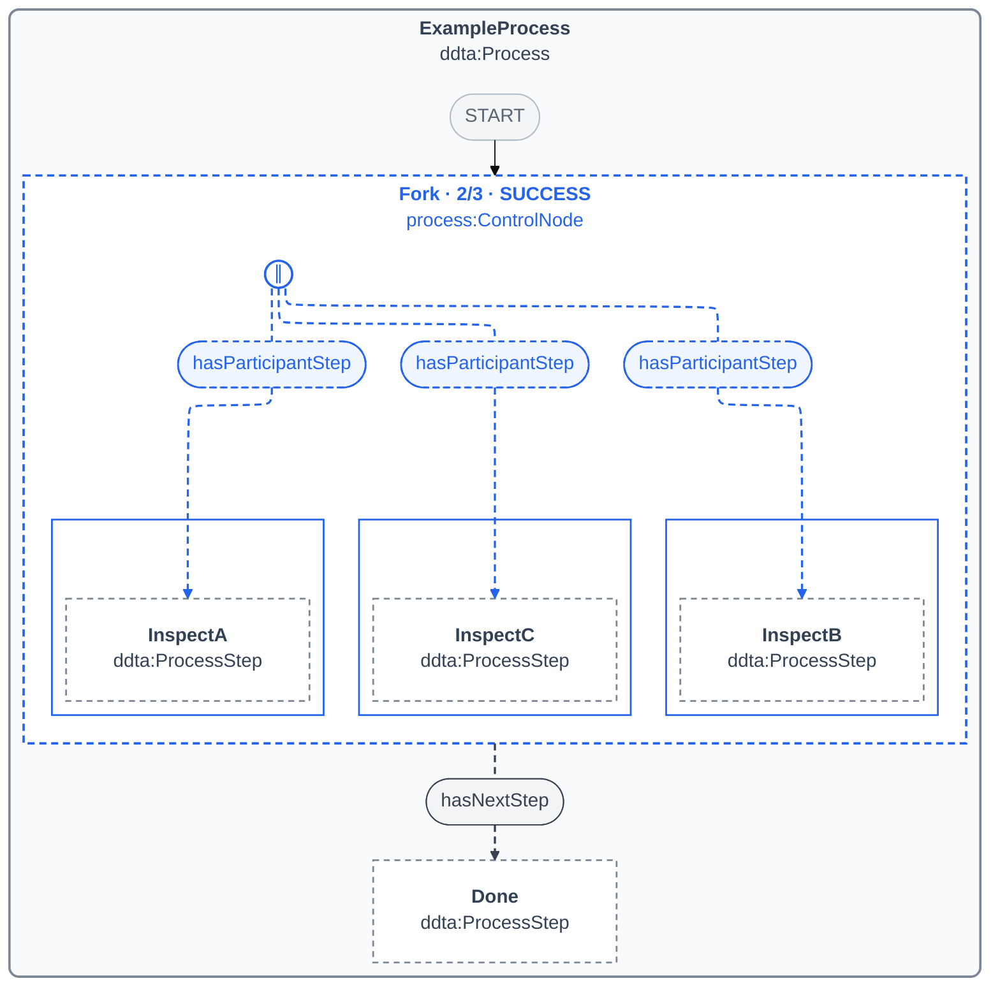


### process:referencesResource — Proposta grafica R2 da approvare

Questa regola candidata rende visibile **solo quando richiesto nella vista del processo**
il riferimento RDF dell’Operand a una risorsa operativa. Non indica caricamento,
lettura avvenuta o sincronizzazione con il supporto persistente.

```yaml ddta-visualization
record: relation-style
module: process
target: process:referencesResource
representation:
  type: directed-edge-via-label-node
  drawEdge: true
  direction: subject-to-object
  sourceSegment: "---"
  targetSegment: "-->"
  stroke: "#79B991"
  strokeWidth: 2
  strokePattern: dashed
  dashArray: "8 5"
label:
  text: referencesResource
  representation: rounded-inline-node
  rdfIndividual: false
  fill: "#EDF8F0"
  stroke: "#79B991"
  color: "#37694E"
  strokeWidth: 1.5
  strokePattern: dashed
  dashArray: "8 5"
objectPresentation:
  rdfClass: ddta:Resource
  shape: rectangle
  fill: "#FFFFFF"
  stroke: "#79B991"
  color: "#37694E"
  strokeWidth: 1.5
  strokePattern: dashed
  dashArray: "8 5"
```

### process:referencesStoredContent — Riferimento a un contenuto memorizzato

Il riferimento è rappresentato con una freccia grigia tratteggiata e un’etichetta intermedia grigia tratteggiata. La destinazione è l’occorrenza CORE del contenuto, anche quando il contenuto è specializzato o annidato. Non si crea un secondo nodo per il dato. Si rappresentano esclusivamente le triple selezionate, senza inferire una lettura o un trasferimento. La regola opera nella composizione integrata; un riferimento senza destinazione visibile o con più occorrenze ambigue viene segnalato.

```yaml ddta-visualization
record: relation-style
module: process
target: process:referencesStoredContent
representation:
  type: directed-edge-via-label-node
  drawEdge: true
  direction: subject-to-object
  sourceSegment: "-.->"
  targetSegment: "-.->"
  stroke: "#7B8794"
  strokeWidth: 1.5
  strokePattern: dashed
  dashArray: "5 4"
  targetOccurrence: existing-core-occurrence
label:
  text: referencesStoredContent
  representation: ellipse-inline-node
  rdfIndividual: false
  fill: "#F1F5F9"
  stroke: "#94A3B8"
  color: "#64748B"
  strokeWidth: 1
  strokePattern: dashed
  dashArray: "5 4"
```

<!-- DDTA-PROCESS-INTEGRATED-EXAMPLE-01 rule="process:referencesStoredContent" -->
**Esempio integrato 01 — CORE + PROCESS, senza DATA.**

```turtle
@prefix ddta: <https://w3id.org/ddta/core#> .
@prefix process: <https://w3id.org/ddta/process#> .
@prefix ex: <https://example.org/ddta/stored-reference-example#> .

ex:ExampleProcess a ddta:Process ;
    ddta:hasStep ex:Decision, ex:OnTrue, ex:OnFalse ;
    process:hasInitialStep ex:Decision .
ex:Decision a ddta:ProcessStep, process:ControlNode ;
    process:controlKind "XOR_SPLIT" ;
    process:evaluatesCondition ex:ThresholdCondition ;
    process:hasTrueNextStep ex:OnTrue ;
    process:hasFalseNextStep ex:OnFalse .
ex:OnTrue a ddta:ProcessStep .
ex:OnFalse a ddta:ProcessStep .
ex:ThresholdCondition a process:AtomicCondition ;
    process:comparisonOperator "GE" ;
    process:hasLeftOperand ex:CountOperand ;
    process:hasRightOperand ex:LimitOperand .
ex:CountOperand a process:Operand ;
    process:referencesStoredContent ex:Counter .
ex:LimitOperand a process:Operand ;
    process:referencesStoredContent ex:Threshold .
ex:RuntimeStore a ddta:Store ; ddta:stores ex:Counter, ex:Threshold .
ex:Counter a ddta:StoredContent .
ex:Threshold a ddta:StoredContent .
```

```mermaid
%%{init: {"htmlLabels":true,"theme":"base","layout":"elk"}}%%
flowchart TB
    subgraph O_febe12288a9e70["<div style='display:inline-block;text-align:center;white-space:nowrap;line-height:1.4;padding:6px 10px;background:transparent'><span style='display:block;font-size:16px;font-weight:700;color:#334155'>ExampleProcess</span><span style='display:block;font-size:11px;color:#334155'>ddta:Process</span></div>"]
        direction TB
        subgraph PX_65a8d3886f83["<div style='display:inline-block;text-align:center;white-space:nowrap;line-height:1.4;padding:6px 10px;background:transparent'><span style='display:block;font-size:16px;font-weight:700;color:#2563EB'>Decision</span><span style='display:block;font-size:11px;color:#2563EB'>process:ControlNode</span></div>"]
            direction TB
            subgraph PX_85906585a261["<div style='display:inline-block;text-align:center;white-space:nowrap;line-height:1.4;padding:6px 10px;background:transparent'><span style='display:block;font-size:16px;font-weight:700;color:#A67C00'>ThresholdCondition</span><span style='display:block;font-size:11px;color:#A67C00'>process:AtomicCondition</span></div>"]
                direction LR
                PX_4279ccf24f6a{"GE"}
                PX_a2da7ec708ea["<div style='display:inline-block;text-align:center;white-space:nowrap;line-height:1.4;padding:6px 10px;background:transparent'><span style='display:block;font-size:16px;font-weight:700;color:#334155'>CountOperand</span><span style='display:block;font-size:11px;color:#334155'>process:Operand</span></div>"]
                PX_dd42421d9f98["<div style='display:inline-block;text-align:center;white-space:nowrap;line-height:1.4;padding:6px 10px;background:transparent'><span style='display:block;font-size:16px;font-weight:700;color:#334155'>LimitOperand</span><span style='display:block;font-size:11px;color:#334155'>process:Operand</span></div>"]
                PX_a2da7ec708ea ~~~ PX_4279ccf24f6a ~~~ PX_dd42421d9f98
            end
            subgraph PX_17abbeac2139[" "]
                direction LR
                subgraph PX_1f8f1803a620[" "]
                    direction TB
                    PX_3ae930950058["<div style='display:inline-block;text-align:center;white-space:nowrap;line-height:1.4;padding:6px 10px;background:transparent'><span style='display:block;font-size:16px;font-weight:700;color:#334155'>OnTrue</span><span style='display:block;font-size:11px;color:#334155'>ddta:ProcessStep</span></div>"]
                end
                subgraph PX_8919784bd809[" "]
                    direction TB
                    PX_45ee5041881f["<div style='display:inline-block;text-align:center;white-space:nowrap;line-height:1.4;padding:6px 10px;background:transparent'><span style='display:block;font-size:16px;font-weight:700;color:#334155'>OnFalse</span><span style='display:block;font-size:11px;color:#334155'>ddta:ProcessStep</span></div>"]
                end
            end
        end
        PX_63be08c65a4f(["START"])
        style PX_63be08c65a4f fill:#F3F5F7,stroke:#B6BEC8,color:#596674
        PX_63be08c65a4f --> PX_65a8d3886f83
    end
    subgraph O_d341bddd5d352c["<img src='data:image/svg+xml;base64,PHN2ZyB4bWxucz0iaHR0cDovL3d3dy53My5vcmcvMjAwMC9zdmciIHdpZHRoPSIyOCIgaGVpZ2h0PSIyOCIgdmlld0JveD0iMCAwIDI0IDI0IiBmaWxsPSJub25lIiBzdHJva2U9IiM0NTg0NUIiIHN0cm9rZS13aWR0aD0iMS43NSIgc3Ryb2tlLWxpbmVjYXA9InJvdW5kIiBzdHJva2UtbGluZWpvaW49InJvdW5kIj48ZWxsaXBzZSBjeD0iMTIiIGN5PSI1IiByeD0iOSIgcnk9IjMiLz48cGF0aCBkPSJNMyA1djE0YzAgMS42NiA0LjAzIDMgOSAzczktMS4zNCA5LTNWNSIvPjxwYXRoIGQ9Ik0zIDEyYzAgMS42NiA0LjAzIDMgOSAzczktMS4zNCA5LTMiLz48L3N2Zz4=' width='27' height='27'/><div style='display:inline-block;text-align:center;white-space:nowrap;line-height:1.4;padding:8px 12px;background:transparent;opacity:1;color:#64748B'><span style='display:block;text-align:center;font-size:17px;font-weight:700;color:#64748B'>RuntimeStore</span><span style='display:block;text-align:center;font-size:12px;font-weight:400;color:#64748B'>ddta:Store</span></div>"]
        direction TB
        O_dd8bd0e381c86b["<div style='display:inline-block;text-align:center;white-space:nowrap;line-height:1.4;padding:8px 12px;background:transparent;opacity:1;color:#94A3B8'><span style='display:block;text-align:center;font-size:17px;font-weight:700;color:#94A3B8'>Counter</span><span style='display:block;text-align:center;font-size:12px;font-weight:400;color:#94A3B8'>ddta:StoredContent</span></div>"]
        O_464de984e54cbf["<div style='display:inline-block;text-align:center;white-space:nowrap;line-height:1.4;padding:8px 12px;background:transparent;opacity:1;color:#94A3B8'><span style='display:block;text-align:center;font-size:17px;font-weight:700;color:#94A3B8'>Threshold</span><span style='display:block;text-align:center;font-size:12px;font-weight:400;color:#94A3B8'>ddta:StoredContent</span></div>"]
    end
    PX_85906585a261 --> PX_45ee5041881f
    PX_85906585a261 --> PX_3ae930950058
    PX_98d2b5ca7ed1(["referencesStoredContent"])
    PX_a2da7ec708ea -.-> PX_98d2b5ca7ed1 -.-> O_dd8bd0e381c86b
    PX_581783c7ff75(["referencesStoredContent"])
    PX_dd42421d9f98 -.-> PX_581783c7ff75 -.-> O_464de984e54cbf
    classDef DDTA_C_9c53de845317 fill:#F1F5F9,stroke:#64748B,color:#64748B,stroke-width:1.5px,rx:12px,ry:12px
    class O_d341bddd5d352c DDTA_C_9c53de845317
    classDef DDTA_C_51a0b50eca1f fill:#F1F5F9,stroke:#94A3B8,color:#94A3B8,stroke-width:1.0px,stroke-dasharray:5 4,rx:5px,ry:5px
    class O_464de984e54cbf,O_dd8bd0e381c86b DDTA_C_51a0b50eca1f
    classDef DDTA_C_db520d489522 fill:#F8FAFC,stroke:#7B8794,color:#7B8794,stroke-width:2px
    classDef DDTA_C_a6bdc037a9c8 fill:#F8FAFC,stroke:#7B8794,color:#7B8794,stroke-width:2px,rx:8px,ry:8px
    class O_febe12288a9e70 DDTA_C_a6bdc037a9c8
    classDef PROC_step fill:#FFFFFF,stroke:#7B8794,color:#334155,stroke-width:1.5px,stroke-dasharray:5 4
    class PX_3ae930950058,PX_45ee5041881f PROC_step
    classDef PROC_process fill:#F8FAFC,stroke:#7B8794,color:#334155,stroke-width:2px,rx:8px,ry:8px
    classDef PROC_region fill:#FFFFFF,stroke:#2563EB,color:#2563EB,stroke-width:2px,stroke-dasharray:6 4
    class PX_65a8d3886f83 PROC_region
    classDef PROC_branchdashed fill:#FFFFFF,stroke:#2563EB,color:#2563EB,stroke-width:1.5px,stroke-dasharray:6 4
    class PX_1f8f1803a620,PX_8919784bd809 PROC_branchdashed
    classDef PROC_invisible fill:transparent,stroke:transparent,stroke-width:0px
    class PX_17abbeac2139 PROC_invisible
    classDef PROC_condition fill:#FFFFFF,stroke:#D6A100,color:#A67C00,stroke-width:2px
    class PX_85906585a261 PROC_condition
    classDef PROC_operator fill:#FFFFFF,stroke:#D6A100,color:#A67C00,stroke-width:1.5px
    class PX_4279ccf24f6a PROC_operator
    classDef PROC_component fill:#FFFFFF,stroke:#7B8794,color:#334155,stroke-width:1.5px
    class PX_a2da7ec708ea,PX_dd42421d9f98 PROC_component
    style PX_98d2b5ca7ed1 fill:#F1F5F9,stroke:#94A3B8,color:#64748B,stroke-width:1px,stroke-dasharray:5 4
    style PX_581783c7ff75 fill:#F1F5F9,stroke:#94A3B8,color:#64748B,stroke-width:1px,stroke-dasharray:5 4
    linkStyle 3 stroke:#C62828,stroke-width:2.5px
    linkStyle 4 stroke:#238636,stroke-width:2.5px
    linkStyle 5 stroke:#7B8794,stroke-width:1.5px,stroke-dasharray:5 4
    linkStyle 6 stroke:#7B8794,stroke-width:1.5px,stroke-dasharray:5 4
    linkStyle 7 stroke:#7B8794,stroke-width:1.5px,stroke-dasharray:5 4
    linkStyle 8 stroke:#7B8794,stroke-width:1.5px,stroke-dasharray:5 4
```
