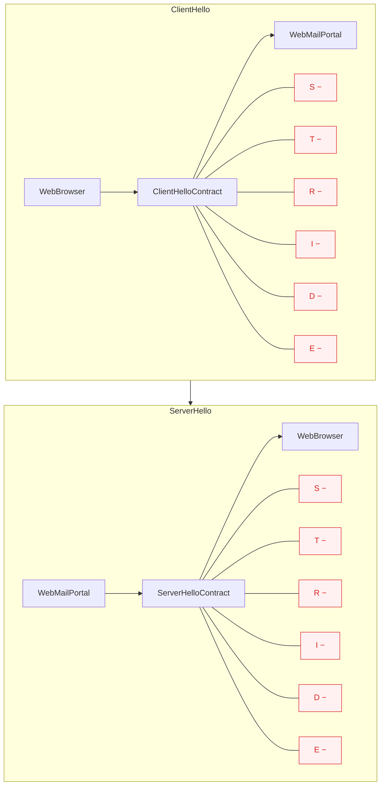
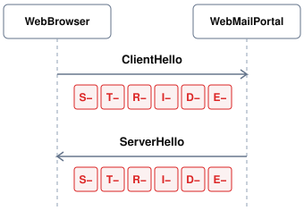

# DDTA — Security Analysis Methodology

**Stato:** proposta R3 per revisione metodologica — 28 novembre 2026. Le scelte di indirizzo condivise sono distinte dai costrutti candidati. Nessuna nuova classe, proprietà o regola eseguibile è approvata da questo documento.

## 1. Obiettivo

Documentation-Driven Threat Analysis (DDTA) mira a derivare valutazioni di sicurezza tracciabili, riproducibili e aggiornabili dalla documentazione ontologica di un sistema. La documentazione nasce durante la progettazione; la ricostruzione retrospettiva di sistemi esistenti costituisce un possibile esperimento di validazione, non il processo ordinario.

Il risultato atteso è una valutazione della copertura documentale delle proprietà di sicurezza, delle esposizioni, delle dipendenze, delle incompatibilità e delle informazioni mancanti. Non costituisce una prova della sicurezza dell'implementazione o del sistema operativo.

## 2. Modello e configurazione dell'analisi

CORE, PROCESS e DATA descrivono il sistema; il futuro modulo SECURITY ne descrive anzitutto le proprietà effettivamente supportate, le esposizioni, i meccanismi, i contributi e le condizioni. I requisiti di sicurezza appartengono a una successiva valutazione di conformità, non sono un prerequisito della descrizione. I risultati derivati sono separati dalle dichiarazioni originarie e riportano le regole e le evidenze utilizzate.

I selettori principali sono il tipo di analisi e una o più proprietà di sicurezza associate a STRIDE. In futuro un ulteriore selettore, AnalysisFramework, distinguerà STRIDE da STRIDE-AI senza duplicare il nucleo SECURITY. Il livello di dettaglio e il focus sono secondari. I tipi di analisi sono configurazioni metodologiche candidate, non necessariamente individui del sistema.

| Proprietà | STRIDE |
|---|---|
| Authentication | Spoofing |
| Integrity | Tampering |
| NonRepudiation | Repudiation |
| Confidentiality | Information Disclosure |
| Availability | Denial of Service |
| Authorization | Elevation of Privilege |

| Tipo | Oggetto |
|---|---|
| Communication | Scambi, direzioni, canali, confini, contenuto |
| DataStorage | Memorizzazione, collocazione, protezione a riposo |
| DataAccess | Lettura, scrittura, trasferimenti |
| Functional | Capacità e responsabilità funzionali |
| ProcessExecution | Sequenze, condizioni, esiti e stati |
| SystemArchitecture | Sistemi, ambienti, risorse, confini |
| Algorithm | Algoritmi, parametri, assunzioni e limiti |

La matrice completa tipo × proprietà dovrà definire per ogni cella applicabilità, informazioni necessarie, regole, proiezioni e risultati attesi. Nessuna proprietà è automaticamente richiesta per tutti gli elementi.

## 3. Dimensioni di una valutazione

Distinguere: oggetto e occorrenza protetta; proprietà; requisito; esposizione nel modello di minaccia; meccanismo e funzione realizzatrice; ruolo (prevenzione, rilevazione, risposta, recupero); evidenza e suo ambito; fase e condizioni; esito protetto; assunzioni; risultato dell'analisi.

Una proprietà richiesta non equivale a una proprietà garantita. Una capacità di un algoritmo non implica la sicurezza di ogni suo utilizzo. Una firma non implica che sia verificata, né che protegga ogni dato. Una verifica non implica che il suo fallimento impedisca l'accettazione. Una rilevazione di anomalia non attribuisce necessariamente un attacco a un soggetto.

La protezione può riguardare l'accettazione di un risultato e non l'impossibilità fisica di alterare un dato durante il transito. Perciò occorre distinguere integrità in transito, integrità verificata e rifiuto di un risultato alterato.

## 4. Procedura

1. Selezionare perimetro, tipo e proprietà; dichiarare modello di minaccia e fase.
2. Identificare individui e relazioni pertinenti, inclusi elementi di contesto.
3. Documentare le garanzie e le non-garanzie note, il loro ambito e le esposizioni; distinguere ciò che non è documentato. Solo in una successiva analisi di conformità confrontare con eventuali requisiti.
4. Ricostruire i meccanismi documentati, l'oggetto delle verifiche, le condizioni, le dipendenze e gli esiti.
5. Applicare regole dichiarative, distinguendo assenza di informazioni e contraddizioni.
6. Generare risultati tracciabili e proiezioni orientate all'analisi.
7. Rivalutare al cambiamento del modello, delle assunzioni o delle regole.

## 5. Risultati

| Esito candidato | Significato |
|---|---|
| Supported | Copertura documentale supportata dalle regole e dalle assunzioni esplicitate |
| Conditional | Copertura subordinata a condizioni non ancora stabilite |
| Violated | Informazioni esplicite incompatibili con un requisito |
| Undetermined | Informazioni insufficienti per decidere |
| NotApplicable | Non applicabile con motivazione documentata |

Esposizione, minaccia candidata, dipendenza critica, lacuna e incompatibilità sono tipi di segnalazioni, non necessariamente esiti mutuamente esclusivi. Una lacuna non dimostra l'assenza del meccanismo nel sistema reale. L'assenza di una tripla OWL non equivale alla sua negazione; i controlli documentali devono dichiarare il proprio perimetro di completezza.

## 6. Caso pilota TLS — passo 03

Baseline TESI a676514. Il caso CORE descrive ClientHelloContract e ServerHelloContract, selezione dei parametri e funzioni di invio/ricezione. I canali erano stati deliberatamente esclusi; non attribuire loro individui inesistenti. La valutazione qui è concettuale, non un risultato calcolato.

Scenario: handshake TLS 1.3 ordinario con certificato server, senza PSK né ECH; avversario attivo sul trasporto. Il ClientHello iniziale è osservabile e modificabile. L'integrità della negoziazione accettata è distinta dall'integrità immediata del messaggio. La riservatezza della chiave pubblica non è richiesta in questo scenario; altre informazioni richiedono valutazione esplicita.

Obiettivo candidato: non accettare una negoziazione alterata. Il successivo CertificateVerify contiene algoritmo e firma del transcript, non il transcript stesso. La verifica usa il transcript locale e la chiave pubblica di autenticazione; il certificato e l'identità attesa devono essere validati. Finished e le ulteriori verifiche previste dal protocollo contribuiscono al completamento sicuro. Il fallimento deve impedire l'accettazione. Il controllo può avvenire anche prima della firma, per esempio durante la verifica della protezione dei record.

Non attribuire queste funzioni al passo 03: sono ancora da modellare. Risultato atteso nel passo 03: copertura non determinabile dalla documentazione e lacune rispetto all'obiettivo di analisi. Il requisito non va confuso con una garanzia già ottenuta. Se il progettista documenta esplicitamente la non-garanzia nello scambio iniziale, il risultato descrittivo è NotGuaranteed, non Undocumented. Il solo TTL CORE non contiene ancora tali dichiarazioni.

## 7. Regole candidate e regressioni

| ID | Controllo candidato |
|---|---|
| SEC-T-01 | Requisito di integrità senza meccanismo documentato |
| SEC-T-02 | Evidenza prodotta senza verifica documentata |
| SEC-T-03 | Verifica senza ambito dei dati protetti |
| SEC-T-04 | Fallimento senza esito protettivo documentato |
| SEC-T-05 | Accettazione consentita prima delle verifiche richieste, o precedenza/condizione non determinabile |
| SEC-T-06 | Dichiarazione di copertura senza assunzioni o dipendenze necessarie |

Gli esiti vanno distinti: una precedenza assente è una lacuna; un percorso esplicitamente autorizzato che aggira il controllo può contraddire il requisito. Le regole devono essere generali e non dipendere dai nomi degli individui TLS. SHACL/SPARQL e un eventuale motore di regole sono opzioni da validare; non sono implementati da questo documento.

## 8. Visualizzazione

Un unico grafo RDF alimenta le viste. Tipo e proprietà selezionano elementi e relazioni rilevanti; il dettaglio espande o sintetizza. Le proiezioni non modificano il modello originale. Le relazioni grafiche aggregate sono distinguibili da quelle RDF e tracciabili alle fonti. Le informazioni richieste ma assenti sono segnalazioni, non individui inventati. Il renderer visualizza i risultati dell'analizzatore senza decidere autonomamente la sicurezza.

La vista association esistente resta compatibile. Le future regole grafiche saranno dichiarate nella guida grafica secondo il metodo DDTA.

## 9. Validazione sperimentale

Usare casi progressivi e mutazioni controllate: omissione di un controllo, ambito della firma incompleto, gestione del fallimento assente, accettazione prematura. Confrontare con un riferimento validato manualmente. Estendere a plate-gate e DermaTriage per verificare la generalità. Misurare precision, recall, F1, copertura, tracciabilità, riproducibilità, tempo di analisi e rilevazione delle regressioni. I risultati attesi non sono risultati sperimentali già conseguiti.

## 10. Decisioni aperte

Formalizzare per prime le dichiarazioni descrittive minime per Communication × STRIDE; discutere la distinzione tra tipo di contratto e occorrenza di scambio, ambito, evidenze, verifiche e condizioni di accettazione. Rinviare la formalizzazione dei requisiti. Definire le schede ontologiche solo dopo revisione. Mantenere separati metodologia, vocabolario, analizzatore e guida grafica. Nessun aggiornamento al repository è implicato da questa proposta.

## 11. Primo incremento SECURITY: descrivere prima di prescrivere

La prima analisi non chiede che cosa il sistema dovrebbe garantire, ma che cosa garantisce nella fase osservata, secondo la documentazione. L'analista non deve inventare requisiti per classificare una comunicazione. La valutazione di conformità, quando introdotta, sarà distinta dalla descrizione.

### 11.1 Stati delle proprietà e convenzione grafica

| Stato candidato | Simbolo | Colore | Significato |
|---|---|---|---|
| Guaranteed | + | Verde `#27865E` | Garanzia supportata nell'ambito e sotto le ipotesi dichiarate |
| NotGuaranteed | − | Rosso `#DC2626` | Non-garanzia esplicitamente documentata nell'ambito considerato |
| Conditional | ~ | Giallo `#D6A100` | Contributo o garanzia subordinata a condizioni o verifiche ancora da soddisfare |
| Undocumented | ? | Grigio `#909090` | Informazioni insufficienti per stabilire lo stato |
| NotApplicable | N/A | Neutro (da definire) | Proprietà non pertinente, con motivazione |

Il colore rosso non significa vulnerabilità; il verde non certifica la sicurezza del sistema reale. Il simbolo rende leggibile lo stato anche senza colore. Non confondere gli stati descrittivi con gli esiti di conformità della sezione 5. Una garanzia differita deve specificare l'esito protetto e non diventare retroattivamente una garanzia al momento della trasmissione.

### 11.2 Caso iniziale: Hello

Per la fase di trasmissione iniziale, nello scenario TLS delimitato nella sezione 6, proponiamo di documentare l'assenza di garanzie STRIDE offerte dallo scambio Hello isolato. Autorizzazione, disponibilità e non ripudio si intendono qui esclusivamente rispetto alle garanzie offerte da tale scambio, non a eventuali controlli esterni. L'applicabilità a singoli elementi deve essere precisata in seguito.

| Scambio | S | T | R | I | D | E |
|---|---|---|---|---|---|---|
| ClientHello | − | − | − | − | − | − |
| ServerHello | − | − | − | − | − | − |

Questi stati sono dichiarazioni da introdurre, non deduzioni dal TTL CORE attuale. Se non introdotte, il renderer mostra `?`. L'assenza di un canale dichiarato rimane una lacuna della vista Communication.

### 11.3 Obiettivo grafico Mermaid

Il seguente codice è un prototipo illustrativo, non un risultato della pipeline. Si usa un flowchart per permettere la colorazione indipendente degli indicatori; il sequenceDiagram resta un'alternativa da sperimentare. La disposizione esatta dipenderà dal motore di layout.

Le ripetizioni grafiche dei sistemi non implicano nuovi individui RDF. Le frecce sono una proiezione illustrativa degli scambi e delle precedenze, non nuove triple. Il futuro renderer deve ricostruire gli scambi senza ambiguità dalle relazioni documentate; in caso contrario deve segnalare l'informazione mancante.

### 11.3.1 Riferimenti grafici illustrativi (SVG)

Le figure seguenti fissano gli obiettivi visivi discussi. Sono mockup statici, non output della pipeline né regole grafiche normative. I colori e i simboli hanno il significato definito nella sezione 11.1.

*Figura 1 — Communication × STRIDE: scambio Hello iniziale con dichiarazioni esplicite di non-garanzia. Il rosso non equivale a una vulnerabilità. Il canale fisico non è rappresentato in questo mockup.*

*Figura 2 — Campione della convenzione cromatica per lo stato Conditional; non attribuisce tali stati ai messaggi Hello.*

La futura guida grafica dovrà tradurre questi obiettivi in regole dichiarative. I test del renderer dovranno verificare la generazione deterministica da TTL e la distinzione tra non-garanzia esplicita, informazione mancante e garanzia condizionata. Le figure non sostituiscono le dichiarazioni RDF.

### 11.4 Contributi alla sicurezza

Il successivo CertificateVerify fornisce un'evidenza, non esegue la verifica. La verifica della firma, la validazione dell'identità del server e la gestione del fallimento contribuiscono alla protezione dell'accettazione dell'handshake. Il ClientHello rimane osservabile e modificabile in transito. Distinguere il contributo di un elemento a una proprietà relativa a un altro elemento dalla garanzia complessiva derivata. La rilevazione di un'anomalia non dimostra da sola che un attacco sia in corso.

## 12. Estensione STRIDE-AI

Il nucleo SECURITY deve essere riutilizzabile per sistemi tradizionali e AI/ML. STRIDE e STRIDE-AI sono profili di analisi, non due descrizioni indipendenti dello stesso sistema. Le estensioni specializzate potranno introdurre asset, proprietà, assunzioni e regole specifiche del ciclo di vita ML. Non si presume che tutte le proprietà ML coincidano con le sei proprietà STRIDE.

| Dimensione | TLS | AI/ML |
|---|---|---|
| Oggetto | Messaggio | Dataset, modello, configurazione, input di inferenza |
| Proprietà | Integrity | Integrity; eventuale Robustness da discutere |
| Contributo | Verifica firma | Validazione modello o confronto di risultati |
| Condizione | Chiave e identità attendibili | Dati di verifica adeguati, ipotesi statistiche |
| Rilevazione | Verifica crittografica fallita | Disaccordo fra modelli o anomalia |
| Reazione | Interruzione handshake | Rifiuto risultato o adozione modello |

Un confronto tra modelli OCR può rilevare disaccordi ma non garantire correttezza: due modelli possono concordare su un errore. Occorre distinguere garanzie crittografiche, controlli deterministici ed evidenze empiriche o statistiche, senza attribuire loro automaticamente la stessa forza.

Riferimenti di partenza da esaminare per la specializzazione futura (non costituiscono ancora regole DDTA):

- *STRIDE-AI: An Approach to Identifying Vulnerabilities of Machine Learning Assets* (2021), https://ieeexplore.ieee.org/document/9527917
- *Modeling Threats to AI-ML Systems Using STRIDE* (2022), https://www.mdpi.com/1424-8220/22/17/6662
- TLS 1.3: RFC 8446, sezioni 4.1.3, 4.4.3, 4.4.4, https://www.rfc-editor.org/rfc/rfc8446.html

## 13. Piano di lavoro e criteri di accettazione

| Incremento | Risultato verificabile |
|---|---|
| 1. Metodologia | Revisione del presente documento |
| 2. Vocabolario minimo | Sei proprietà STRIDE, dichiarazioni di garanzia con ambito e condizioni; assenza distinta da negazione |
| 3. Caso Hello | TTL candidato che conserva la baseline CORE e documenta gli stati espliciti |
| 4. Visualizzazione | Mermaid colorato generato deterministicamente dal TTL; selezione delle proprietà; nessuna semantica inventata |
| 5. Contributi | CertificateVerify, verifica e reazione; distinzione fra protezione in transito e accettazione |
| 6. Analisi | Regole generali, risultati tracciabili, test di omissione e regressione |
| 7. Estensione | File, store, accessi, algoritmi e casi ML; confronto con profili STRIDE-AI |

Destinazione proposta: `tesiStabile/ontologies/security/DDTA_SECURITY_METHODOLOGY.md`. I futuri `DDTA_SECURITY.md` e `DDTA_SECURITY_VISUALIZATION.md` saranno creati solo dopo la discussione delle schede. Il toolkit resta quello esistente. Nessun aggiornamento del repository, nessun nuovo TTL SECURITY e nessun test di rendering sono effettuati da questa revisione.
