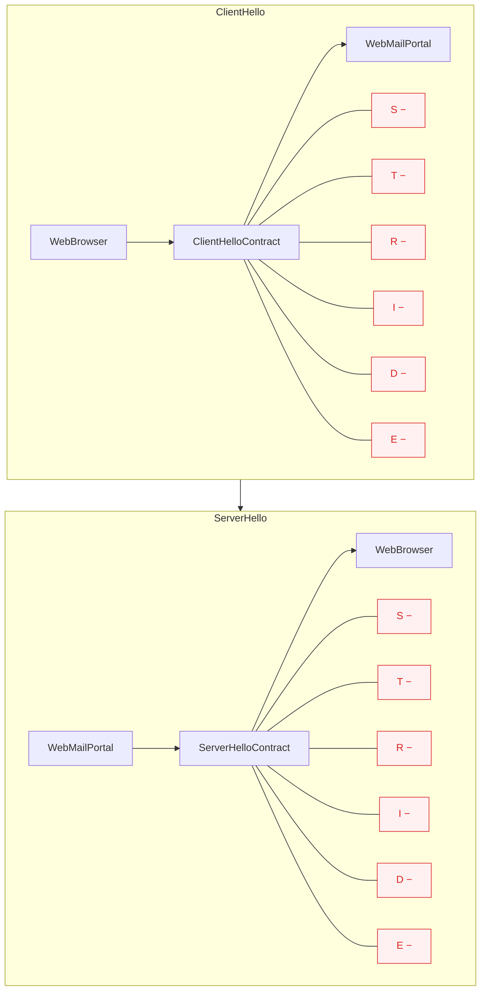
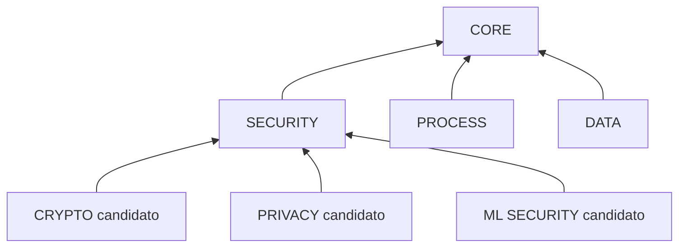

# DDTA — Security Analysis Methodology

**Stato:** proposta R5 per revisione metodologica — 28 novembre 2026. Le scelte di indirizzo condivise sono distinte dai costrutti candidati. È condivisa la scelta di rappresentare la dichiarazione di sicurezza come individuo autonomo (SecurityPropertyStatement, alternativa B); la sua formalizzazione, le cardinalità e le regole eseguibili restano da discutere.

## 1. Obiettivo

Documentation-Driven Threat Analysis (DDTA) mira a derivare valutazioni di sicurezza tracciabili, riproducibili e aggiornabili dalla documentazione ontologica di un sistema. La documentazione nasce durante la progettazione; la ricostruzione retrospettiva di sistemi esistenti costituisce un possibile esperimento di validazione, non il processo ordinario.

Il principio scientifico centrale è derivare, ove possibile, proprietà STRIDE da fatti tecnici semanticamente documentati, senza richiedere al progettista di anticipare tutte le conclusioni dell’analisi. I nomi degli individui RDF non costituiscono evidenza semantica. La caratterizzazione dei contenuti non equivale a una garanzia; la valutazione specialistica e le motivazioni delle Decision possono rimanere testuali, senza imporne la formalizzazione integrale. Le dichiarazioni esplicite di garanzia restano ammesse, ma non equivalgono a risultati derivati.

Il risultato atteso è una valutazione della copertura documentale delle proprietà di sicurezza, delle esposizioni, delle dipendenze, delle incompatibilità e delle informazioni mancanti. Non costituisce una prova della sicurezza dell'implementazione o del sistema operativo.

## 2. Modello e configurazione dell'analisi

CORE, PROCESS e DATA descrivono il sistema; il futuro modulo SECURITY ne descrive anzitutto le proprietà effettivamente supportate, le esposizioni, i meccanismi, i contributi e le condizioni. I requisiti di sicurezza appartengono a una successiva valutazione di conformità, non sono un prerequisito della descrizione. I risultati derivati sono separati dalle dichiarazioni originarie e riportano le regole e le evidenze utilizzate.

I selettori principali sono il tipo di analisi e una o più proprietà di sicurezza associate a STRIDE. Il perimetro e la granularità dell’analisi (sistema, funzione, comunicazione, contenuto, operazione o risorsa) sono distinti dai filtri grafici. La definizione dei livelli di espressività grafica è rinviata; nascondere un elemento non deve modificare il risultato dell’analisi. In futuro un ulteriore selettore, AnalysisFramework, distinguerà STRIDE da STRIDE-AI senza duplicare il nucleo SECURITY. Il livello di dettaglio e il focus sono secondari. I tipi di analisi sono configurazioni metodologiche candidate, non necessariamente individui del sistema.

| Proprietà | STRIDE |
|---|---|
| Authentication | Spoofing |
| Integrity | Tampering |
| NonRepudiation | Repudiation |
| Confidentiality | Information Disclosure |
| Availability | Denial of Service |
| Authorization | Elevation of Privilege |

| Tipo | Oggetto |
|---|---|
| Communication | Scambi, direzioni, canali, confini, contenuto |
| DataStorage | Memorizzazione, collocazione, protezione a riposo |
| DataAccess | Lettura, scrittura, trasferimenti |
| Functional | Capacità e responsabilità funzionali |
| ProcessExecution | Sequenze, condizioni, esiti e stati |
| SystemArchitecture | Sistemi, ambienti, risorse, confini |
| Algorithm | Algoritmi, parametri, assunzioni e limiti |

La matrice completa tipo × proprietà dovrà definire per ogni cella applicabilità, informazioni necessarie, regole, proiezioni e risultati attesi. Nessuna proprietà è automaticamente richiesta per tutti gli elementi.

## 3. Dimensioni di una valutazione

Distinguere: oggetto e occorrenza protetta; proprietà; requisito; esposizione nel modello di minaccia; meccanismo e funzione realizzatrice; ruolo (prevenzione, rilevazione, risposta, recupero); evidenza e suo ambito; fase e condizioni; esito protetto; assunzioni; risultato dell'analisi.

Una proprietà richiesta non equivale a una proprietà garantita. Una capacità di un algoritmo non implica la sicurezza di ogni suo utilizzo. Una firma non implica che sia verificata, né che protegga ogni dato. Una verifica non implica che il suo fallimento impedisca l'accettazione. Una rilevazione di anomalia non attribuisce necessariamente un attacco a un soggetto.

La protezione può riguardare l'accettazione di un risultato e non l'impossibilità fisica di alterare un dato durante il transito. Perciò occorre distinguere integrità in transito, integrità verificata e rifiuto di un risultato alterato.

## 4. Procedura

1. Selezionare perimetro, tipo e proprietà; dichiarare modello di minaccia e fase.
2. Identificare individui e relazioni pertinenti, inclusi elementi di contesto.
3. Documentare i fatti tecnici, la natura dei contenuti, le trasformazioni, le relazioni e le operazioni; ammettere dichiarazioni esplicite di garanzia e non-garanzia, qualificandone l’ambito e la provenienza. Distinguere ciò che non è documentato. Solo in una successiva analisi di conformità confrontare con eventuali requisiti.
4. Ricostruire i meccanismi documentati, l'oggetto delle verifiche, le condizioni, le dipendenze e gli esiti.
5. Applicare regole dichiarative ai fatti tecnici per derivare risultati di sicurezza, distinguendo assenza di informazioni, non-garanzie esplicite e contraddizioni.
6. Generare risultati tracciabili e proiezioni orientate all'analisi.
7. Rivalutare al cambiamento del modello, delle assunzioni o delle regole.

## 5. Risultati

| Esito candidato | Significato |
|---|---|
| Supported | Copertura documentale supportata dalle regole e dalle assunzioni esplicitate |
| Conditional | Copertura subordinata a condizioni non ancora stabilite |
| Violated | Informazioni esplicite incompatibili con un requisito |
| Undetermined | Informazioni insufficienti per decidere |
| NotApplicable | Non applicabile con motivazione documentata |

Esposizione, minaccia candidata, dipendenza critica, lacuna e incompatibilità sono tipi di segnalazioni, non necessariamente esiti mutuamente esclusivi. Una lacuna non dimostra l'assenza del meccanismo nel sistema reale. L'assenza di una tripla OWL non equivale alla sua negazione; i controlli documentali devono dichiarare il proprio perimetro di completezza.

## 6. Caso pilota TLS — passo 03

Baseline TESI a676514. Il caso CORE descrive ClientHelloContract e ServerHelloContract, selezione dei parametri e funzioni di invio/ricezione. I canali erano stati deliberatamente esclusi; non attribuire loro individui inesistenti. La valutazione qui è concettuale, non un risultato calcolato.

Scenario: handshake TLS 1.3 ordinario con certificato server, senza PSK né ECH; avversario attivo sul trasporto. Il ClientHello iniziale è osservabile e modificabile. L'integrità della negoziazione accettata è distinta dall'integrità immediata del messaggio. La riservatezza della chiave pubblica non è richiesta in questo scenario; altre informazioni richiedono valutazione esplicita.

Obiettivo candidato: non accettare una negoziazione alterata. Il successivo CertificateVerify contiene algoritmo e firma del transcript, non il transcript stesso. La verifica usa il transcript locale e la chiave pubblica di autenticazione; il certificato e l'identità attesa devono essere validati. Finished e le ulteriori verifiche previste dal protocollo contribuiscono al completamento sicuro. Il fallimento deve impedire l'accettazione. Il controllo può avvenire anche prima della firma, per esempio durante la verifica della protezione dei record.

Non attribuire queste funzioni al passo 03: sono ancora da modellare. Risultato atteso nel passo 03: copertura non determinabile dalla documentazione e lacune rispetto all'obiettivo di analisi. Il requisito non va confuso con una garanzia già ottenuta. Se il progettista documenta esplicitamente la non-garanzia nello scambio iniziale, il risultato descrittivo è NotGuaranteed, non Undocumented. Il solo TTL CORE non contiene ancora tali dichiarazioni.

## 7. Regole candidate e regressioni

| ID | Controllo candidato |
|---|---|
| SEC-T-01 | Requisito di integrità senza meccanismo documentato |
| SEC-T-02 | Evidenza prodotta senza verifica documentata |
| SEC-T-03 | Verifica senza ambito dei dati protetti |
| SEC-T-04 | Fallimento senza esito protettivo documentato |
| SEC-T-05 | Accettazione consentita prima delle verifiche richieste, o precedenza/condizione non determinabile |
| SEC-T-06 | Dichiarazione di copertura senza assunzioni o dipendenze necessarie |

Gli esiti vanno distinti: una precedenza assente è una lacuna; un percorso esplicitamente autorizzato che aggira il controllo può contraddire il requisito. Le regole devono essere generali e non dipendere dai nomi degli individui TLS. SHACL/SPARQL e un eventuale motore di regole sono opzioni da validare; non sono implementati da questo documento.

## 8. Visualizzazione

Un unico grafo RDF alimenta le viste. Tipo e proprietà selezionano elementi e relazioni rilevanti; il dettaglio espande o sintetizza. Le proiezioni non modificano il modello originale. Le relazioni grafiche aggregate sono distinguibili da quelle RDF e tracciabili alle fonti. Le informazioni richieste ma assenti sono segnalazioni, non individui inventati. Il renderer visualizza i risultati dell'analizzatore senza decidere autonomamente la sicurezza.

La vista association esistente resta compatibile. Le future regole grafiche saranno dichiarate nella guida grafica secondo il metodo DDTA.

## 9. Validazione sperimentale

Usare casi progressivi e mutazioni controllate: omissione di un controllo, ambito della firma incompleto, gestione del fallimento assente, accettazione prematura. Confrontare con un riferimento validato manualmente. Estendere a plate-gate e DermaTriage per verificare la generalità. Misurare precision, recall, F1, copertura, tracciabilità, riproducibilità, tempo di analisi e rilevazione delle regressioni. I risultati attesi non sono risultati sperimentali già conseguiti.

## 10. Decisioni aperte

Formalizzare per prime le dichiarazioni descrittive minime per Communication × STRIDE; discutere la distinzione tra tipo di contratto e occorrenza di scambio, ambito, evidenze, verifiche e condizioni di accettazione. Rinviare la formalizzazione dei requisiti. Definire le schede ontologiche solo dopo revisione. Mantenere separati metodologia, vocabolario, analizzatore e guida grafica. Nessun aggiornamento al repository è implicato da questa proposta.

## 11. Primo incremento SECURITY: descrivere prima di prescrivere

La prima analisi non chiede che cosa il sistema dovrebbe garantire, ma che cosa garantisce nella fase osservata, secondo la documentazione. L'analista non deve inventare requisiti per classificare una comunicazione. La valutazione di conformità, quando introdotta, sarà distinta dalla descrizione.

### 11.1 Stati delle proprietà e convenzione grafica

| Stato candidato | Simbolo | Colore | Significato |
|---|---|---|---|
| Guaranteed | + | Verde `#27865E` | Garanzia supportata nell'ambito e sotto le ipotesi dichiarate |
| NotGuaranteed | − | Rosso `#DC2626` | Non-garanzia esplicitamente documentata nell'ambito considerato |
| Conditional | ~ | Giallo `#D6A100` | Contributo o garanzia subordinata a condizioni o verifiche ancora da soddisfare |
| Undocumented | ? | Grigio `#909090` | Informazioni insufficienti per stabilire lo stato |
| NotApplicable | N/A | Neutro (da definire) | Proprietà non pertinente, con motivazione |

Il colore rosso non significa vulnerabilità; il verde non certifica la sicurezza del sistema reale. Il simbolo rende leggibile lo stato anche senza colore. Non confondere gli stati descrittivi con gli esiti di conformità della sezione 5. Una garanzia differita deve specificare l'esito protetto e non diventare retroattivamente una garanzia al momento della trasmissione.

### 11.2 Caso iniziale: Hello

Per la fase di trasmissione iniziale, nello scenario TLS delimitato nella sezione 6, proponiamo di documentare l'assenza di garanzie STRIDE offerte dallo scambio Hello isolato. Autorizzazione, disponibilità e non ripudio si intendono qui esclusivamente rispetto alle garanzie offerte da tale scambio, non a eventuali controlli esterni. L'applicabilità a singoli elementi deve essere precisata in seguito.

| Scambio | S | T | R | I | D | E |
|---|---|---|---|---|---|---|
| ClientHello | − | − | − | − | − | − |
| ServerHello | − | − | − | − | − | − |

Questi stati sono un riferimento illustrativo, non deduzioni dal TTL CORE attuale. Potranno essere ottenuti mediante dichiarazioni esplicite circoscritte oppure regole fondate su fatti tecnici sufficienti. In assenza di entrambe le fonti, il renderer mostra `?`. L'assenza di un canale dichiarato rimane una lacuna della vista Communication.

### 11.3 Obiettivo grafico Mermaid

Il seguente codice è un prototipo illustrativo, non un risultato della pipeline. Si usa un flowchart per permettere la colorazione indipendente degli indicatori; il sequenceDiagram resta un'alternativa da sperimentare. La disposizione esatta dipenderà dal motore di layout.

Le ripetizioni grafiche dei sistemi non implicano nuovi individui RDF. Le frecce sono una proiezione illustrativa degli scambi e delle precedenze, non nuove triple. Il futuro renderer deve ricostruire gli scambi senza ambiguità dalle relazioni documentate; in caso contrario deve segnalare l'informazione mancante.

### 11.3.1 Riferimenti grafici illustrativi (SVG)

Le figure seguenti fissano gli obiettivi visivi discussi. Sono mockup statici, non output della pipeline né regole grafiche normative. I colori e i simboli hanno il significato definito nella sezione 11.1.

*Figura 1 — Communication × STRIDE: scambio Hello iniziale con dichiarazioni esplicite di non-garanzia. Il rosso non equivale a una vulnerabilità. Il canale fisico non è rappresentato in questo mockup.*

*Figura 2 — Campione della convenzione cromatica per lo stato Conditional; non attribuisce tali stati ai messaggi Hello.*

La futura guida grafica dovrà tradurre questi obiettivi in regole dichiarative. I test del renderer dovranno verificare la generazione deterministica da TTL e la distinzione tra non-garanzia esplicita, informazione mancante e garanzia condizionata. Le figure non sostituiscono le dichiarazioni RDF.

### 11.4 Contributi alla sicurezza

Il successivo CertificateVerify fornisce un'evidenza, non esegue la verifica. La verifica della firma, la validazione dell'identità del server e la gestione del fallimento contribuiscono alla protezione dell'accettazione dell'handshake. Il ClientHello rimane osservabile e modificabile in transito. Distinguere il contributo di un elemento a una proprietà relativa a un altro elemento dalla garanzia complessiva derivata. La rilevazione di un'anomalia non dimostra da sola che un attacco sia in corso.

## 12. Estensione STRIDE-AI

Il nucleo SECURITY deve essere riutilizzabile per sistemi tradizionali e AI/ML. STRIDE e STRIDE-AI sono profili di analisi, non due descrizioni indipendenti dello stesso sistema. Le estensioni specializzate potranno introdurre asset, proprietà, assunzioni e regole specifiche del ciclo di vita ML. Non si presume che tutte le proprietà ML coincidano con le sei proprietà STRIDE.

| Dimensione | TLS | AI/ML |
|---|---|---|
| Oggetto | Messaggio | Dataset, modello, configurazione, input di inferenza |
| Proprietà | Integrity | Integrity; eventuale Robustness da discutere |
| Contributo | Verifica firma | Validazione modello o confronto di risultati |
| Condizione | Chiave e identità attendibili | Dati di verifica adeguati, ipotesi statistiche |
| Rilevazione | Verifica crittografica fallita | Disaccordo fra modelli o anomalia |
| Reazione | Interruzione handshake | Rifiuto risultato o adozione modello |

Un confronto tra modelli OCR può rilevare disaccordi ma non garantire correttezza: due modelli possono concordare su un errore. Occorre distinguere garanzie crittografiche, controlli deterministici ed evidenze empiriche o statistiche, senza attribuire loro automaticamente la stessa forza.

Riferimenti di partenza da esaminare per la specializzazione futura (non costituiscono ancora regole DDTA):

- *STRIDE-AI: An Approach to Identifying Vulnerabilities of Machine Learning Assets* (2021), https://ieeexplore.ieee.org/document/9527917
- *Modeling Threats to AI-ML Systems Using STRIDE* (2022), https://www.mdpi.com/1424-8220/22/17/6662
- TLS 1.3: RFC 8446, sezioni 4.1.3, 4.4.3, 4.4.4, https://www.rfc-editor.org/rfc/rfc8446.html

## 13. Architettura estensibile e derivazione da fatti tecnici

### 13.1 Separare descrizione, conoscenza specialistica e valutazione

Il progettista documenta il sistema: natura dei contenuti, trasformazioni, algoritmi, parametri, chiavi, oggetti interessati e operazioni effettivamente previste, al livello di dettaglio pertinente. Non tutte queste informazioni devono essere formalizzate in RDF: le Decision e la documentazione tecnica possono conservare motivazioni, scelte e valutazioni specialistiche. Un nome come `DigitalSignature` non autorizza alcuna inferenza crittografica. La natura di una firma deve essere dichiarata semanticamente; occorre poter identificare ciò che firma e le operazioni che la generano e la verificano.

SECURITY definisce il linguaggio comune delle proprietà, delle dichiarazioni, delle condizioni e dei risultati. Le estensioni specialistiche forniscono la conoscenza tecnica necessaria alle regole. Il motore di analisi deriva risultati motivati; il renderer li visualizza. Il modello non attribuisce automaticamente una garanzia per il solo fatto che sia presente un algoritmo.

| Livello | Responsabilità | Esempio |
|---|---|---|
| Strutturale | CORE, PROCESS, DATA | ContractElement, Function, StoredContent |
| Tecnico | Moduli specialistici | Firma digitale, chiave pubblica, anonimizzazione |
| Sicurezza | SECURITY | Integrità, riservatezza, condizioni e dichiarazioni |
| Analisi | Profili e regole versionate | STRIDE, STRIDE-AI, LINDDUN |
| Presentazione | Proiezioni e report | Indicatori colorati e motivazioni |

### 13.2 Moduli candidati e direzione delle dipendenze

Le frecce indicano una possibile direzione di dipendenza concettuale (estensione verso base), non un insieme già approvato di import OWL. Le dipendenze effettive di DATA e PROCESS rimangono quelle stabilite nelle rispettive guide; il diagramma è schematico. I moduli specialistici possono riferirsi ai moduli strutturali pertinenti, senza che CORE o SECURITY debbano importare tutte le estensioni. Le regole di integrazione possono operare su più moduli caricati insieme. Evitare dipendenze circolari e rendere opzionali le estensioni non necessarie allo scenario.

| Modulo candidato | Conoscenza specialistica |
|---|---|
| CRYPTO | Chiavi, firme, cifratura, hash, MAC, algoritmi, parametri, operazioni e condizioni crittografiche |
| PRIVACY | Natura identificativa dei dati, trasformazioni di anonimizzazione e pseudonimizzazione, correlabilità, contesto di trattamento |
| ML SECURITY | Asset ML, proprietà e assunzioni specifiche, evidenze di validazione e minacce del ciclo di vita |

La separazione in moduli autonomi è una scelta architetturale proposta, non implica ancora la creazione delle rispettive ontologie. CRYPTO può riutilizzare SECURITY senza diventare sinonimo di STRIDE; PRIVACY può introdurre proprietà e concetti ulteriori, non riducibili alla riservatezza STRIDE. STRIDE-AI e LINDDUN sono profili di analisi che possono utilizzare conoscenza condivisa da più moduli. La corrispondenza puntuale con la letteratura e le rispettive tassonomie va verificata in seguito.

### 13.3 Oggetto, contesto e applicabilità

Un contratto descrive le informazioni; un canale è la risorsa utilizzata; una funzione descrive l’operazione. La garanzia può riguardare un contenuto, una risorsa, un'operazione o una combinazione contestualizzata di questi elementi. Non si presume che tutte le proprietà STRIDE siano applicabili a ogni classe. Definire l’applicabilità separatamente dallo stato della garanzia, in funzione dell’analisi e del contesto. Un medesimo contratto può essere trasmesso in chiaro o attraverso un canale protetto; la protezione del canale non è una caratteristica intrinseca della struttura del contratto. Un contenuto cifrato separatamente può conservare protezione anche su un canale non protetto. Nessuna propagazione automatica delle garanzie per mero contenimento ontologico.

SecurityPropertyStatement, nella forma individuale condivisa, dovrà poter rappresentare proprietà, soggetto e ambito. Distinguere origine dichiarata e derivata, condizioni, riferimento alle evidenze e regola applicata. Il vocabolario definitivo e il modo di rappresentare il contesto restano da discutere. Il risultato derivato non deve sovrascrivere una dichiarazione originaria; eventuali incompatibilità sono segnalazioni tracciabili.

### 13.4 Esempio crittografico: dalla firma alla valutazione

| Fatti tecnici documentati progressivamente | Risultato atteso dell’analisi |
|---|---|
| Un ContractElement contiene una firma digitale | Evidenza crittografica identificata; nessuna garanzia automatica |
| È identificato il contenuto firmato | Ambito della firma determinabile |
| Sono documentati algoritmo, chiave e generazione | Dipendenze crittografiche identificabili |
| È documentata la verifica con chiave attendibile | Possibilità di verificare integrità e autenticità nell’ambito pertinente |
| È documentato il rifiuto in caso di fallimento, prima dell’accettazione | Copertura documentale della non-accettazione di contenuti alterati, condizionata alle assunzioni |

La firma può contribuire a integrità, autenticazione e, sotto condizioni ulteriori, non ripudio. La cifratura può contribuire alla riservatezza; la cifratura autenticata può contribuire anche all’integrità. Un hash non autenticato non costituisce da solo una protezione contro un attaccante attivo. L’idoneità dell’algoritmo, la protezione delle chiavi e la corretta implementazione restano condizioni da considerare. Non derivare automaticamente tutte le proprietà STRIDE da una caratteristica tecnica.

Per TLS, il messaggio Hello iniziale resta modificabile e osservabile. CertificateVerify e la successiva verifica possono contribuire alla garanzia relativa alla negoziazione accettata, senza cambiare retroattivamente le caratteristiche della trasmissione iniziale. Il riferimento grafico della sezione 11 resta valido per lo scambio isolato e le relative non-garanzie esplicite.

### 13.5 Esempio privacy: anonimizzazione

Un futuro modulo PRIVACY potrebbe descrivere quali attributi vengono rimossi, generalizzati o sostituiti, la trasformazione applicata, le informazioni ausiliarie disponibili, il contesto di rilascio e le ipotesi relative a chi osserva i dati. Un identificativo sostituito da uno pseudonimo non dimostra l’anonimato; la possibilità di correlare record o reidentificare persone dipende anche da altri dati e dal contesto. L’analisi LINDDUN potrebbe usare queste dichiarazioni insieme alle informazioni su canali, accessi e memorizzazione. La cifratura durante il transito non implica anonimizzazione del contenuto per il destinatario.

### 13.6 Verificabilità scientifica

Ogni risultato derivato dovrebbe indicare oggetto e ambito, proprietà, esito, fatti tecnici utilizzati, condizioni, identificativo e versione della regola. Le regole possono utilizzare OWL per inferenze logiche compatibili, SHACL per completezza e coerenza documentale, SPARQL o un motore di regole per valutazioni contestuali. La tecnologia definitiva non è ancora scelta. L’assenza di un fatto non consente di derivarne la negazione senza una regola di completezza esplicita e circoscritta.

Esperimenti candidati: rinominare gli individui senza modificare le relazioni (risultati equivalenti a meno degli identificativi); mantenere un nome evocativo eliminando la caratterizzazione tecnica (nessuna inferenza basata sul nome); rimuovere l’ambito della firma, la verifica o la gestione del fallimento (perdita motivata della copertura o lacuna); trasferire la stessa regola a un file firmato; confrontare un dato pseudonimizzato con una dichiarazione di anonimizzazione non supportata. Misurare i risultati secondo la sezione 9, distinguendo chiaramente inferenza documentale e prova della sicurezza operativa.

### 13.7 Caratterizzazione semantica estendibile nel CORE

È condiviso il principio di introdurre nel CORE un costrutto generale per caratterizzare i contenuti, riutilizzabile dalle ontologie specialistiche. La formalizzazione delle schede CORE resta da approvare. `ddta:ContentType` è la classe candidata per le categorie di contenuto; `ddta:hasContentType` è la relazione candidata, non funzionale e non transitiva, con cardinalità documentale 0..*. CRYPTO, PRIVACY e ML possono introdurre propri individui di ContentType senza ridefinire la relazione né imporre dipendenze inverse al CORE. Più caratterizzazioni possono coesistere sullo stesso elemento, se semanticamente compatibili e riferite al medesimo livello di rappresentazione.

La relazione può descrivere la natura, il significato o lo stato dichiarato del contenuto risultante da una trasformazione. Non rappresenta da sola la trasformazione, la sua provenienza, la sua efficacia o una proprietà STRIDE. La struttura funzionale, mediante contratti di input e output, può distinguere contenuti prima e dopo un trattamento; l'associazione puntuale fra elementi di contratti diversi può richiedere informazioni ulteriori se la funzione ha più input o output. Non dedurre automaticamente che un contenuto dichiarato anonimizzato non sia reidentificabile.

Esempio illustrativo, non ancora vocabolario approvato: una funzione AnonymizeText riceve TextA e restituisce TextA1. I due elementi hanno identità RDF distinte. TextA può essere caratterizzato come Text e PersonalData; TextA1 come Text e Anonymized (stato dichiarato del trattamento, non prova dell'anonimato). La funzione e i contratti descrivono l'operazione; la valutazione della sua efficacia rimane distinta.

| Costrutto candidato | Proposta |
|---|---|
| `ddta:ContentType` | Classe estendibile da vocabolari specialistici |
| `ddta:hasContentType` | Object Property, range ContentType, 0..* |
| Dominio iniziale, da approvare | Unione OWL di ContractElement e StoredContent |
| DataBlock | Applicabile tramite la specializzazione di StoredContent già definita in DATA |
| Store, System, Function, CommunicationChannel | Non soggetti diretti nel dominio iniziale; contengono, elaborano o trasmettono informazioni |

Il dominio proposto utilizza soltanto classi CORE, evitando dipendenze da DATA o altri moduli. Un futuro tipo informativo non riconducibile a queste classi richiederà di rivedere il dominio o introdurre una superclasse comune. Il dominio OWL ha semantica inferenziale, non costituisce da solo un controllo di validazione: un uso non appropriato va segnalato da controlli documentali espliciti. Non imporre una caratterizzazione a ogni contenuto. Non derivare garanzie dal semplice contenimento o dal nome di un individuo. Nessuna modifica normativa al CORE è effettuata in questa revisione.

### 13.8 Confine tra fatti, Decision e valutazione di sicurezza

Una funzione EncryptText può produrre un contenuto Ciphertext usando un cifrario di Cesare oppure AES-256-GCM. La caratterizzazione dell'output è identica, ma non implica Confidentiality Guaranteed in nessuno dei due casi. Anche con un algoritmo moderno la protezione dipende dalle chiavi, dai nonce, dall'implementazione e dallo scenario. Non è obiettivo del reasoner generale stabilire autonomamente l'adeguatezza crittografica di ogni algoritmo. L'algoritmo può essere formalizzato se utile all'analisi, ma non è obbligatorio rappresentarne ogni dettaglio nel grafo.

La Decision che sostituisce il cifrario di Cesare può documentare nel testo la scelta, la motivazione di sicurezza e le conseguenze tecniche. L'identità logica della funzione e la tipologia dell'output possono rimanere invariate. Non è necessario codificare ontologicamente il ragionamento della Decision. Se si desidera usare automaticamente il suo esito, occorre una dichiarazione strutturata esplicita, distinta dalla motivazione testuale; il riferimento alla Decision può consentire la tracciabilità. La forma di questo riferimento resta da definire.

| Livello | Esempio | Risultato |
|---|---|---|
| Fatto documentato | TextA1 è Ciphertext | Identificazione automatica della caratteristica dichiarata |
| Relazione documentata | TextA1 appartiene al contratto di output di EncryptText | Individuazione della funzione e dei percorsi documentati |
| Valutazione progettuale | Una Decision motiva la sostituzione del cifrario | Evidenza da consultare; non inferenza dal solo nome o testo |
| Garanzia di sicurezza | Riservatezza supportata sotto condizioni esplicite | Dichiarazione qualificata o risultato derivato da regole e fatti sufficienti |

DDTA deve rendere sistematica e ripetibile la ricerca delle informazioni rilevanti e delle lacune, senza sostituire necessariamente l'analista. Se manca un fatto necessario a una regola, l'esito resta indeterminato o condizionato secondo le informazioni effettive; non si attribuisce automaticamente una vulnerabilità. La caratterizzazione tecnica non basta a produrre un indicatore verde. La sicurezza operativa richiede verifiche ulteriori. Le Decision testuali non sono interpretate come fatti RDF da un reasoner.

Esperimento candidato: mantenere identiche le caratterizzazioni RDF di due soluzioni di cifratura e cambiare soltanto la Decision testuale. Il reasoner deve produrre lo stesso risultato a parità di fatti e regole; l'analista deve poter distinguere le valutazioni documentate. Solo un fatto strutturato o una valutazione esplicitamente acquisita può modificare il risultato automatico. Questo test delimita il contributo della semantica ontologica rispetto al giudizio specialistico.

## 14. Piano di lavoro e criteri di accettazione

| Incremento | Risultato verificabile |
|---|---|
| 1. Metodologia | Revisione del presente documento |
| 2. Vocabolario minimo | Discutere e approvare ContentType e hasContentType nel CORE; poi sei proprietà STRIDE, dichiarazioni individuali con ambito, applicabilità e provenienza; assenza distinta da negazione |
| 3. Caso Hello | TTL candidato che conserva la baseline CORE, caratterizza le comunicazioni e sperimenta i fatti tecnici minimi e gli stati espliciti |
| 4. Visualizzazione | Mermaid colorato generato deterministicamente dal TTL; selezione delle proprietà; nessuna semantica inventata |
| 5. Contributi | CertificateVerify, verifica e reazione; distinzione fra protezione in transito e accettazione |
| 6. Analisi | Derivazione da fatti tecnici, risultati tracciabili, test di rinomina, omissione e regressione |
| 7. Estensione | Valutare CRYPTO, PRIVACY e ML SECURITY; file, store, accessi, algoritmi, STRIDE-AI e LINDDUN |

Destinazione proposta: `tesiStabile/ontologies/security/DDTA_SECURITY_METHODOLOGY.md`. I futuri `DDTA_SECURITY.md` e `DDTA_SECURITY_VISUALIZATION.md` saranno creati solo dopo la discussione delle schede. Il toolkit resta quello esistente. Nessun aggiornamento del repository, nessun nuovo TTL SECURITY e nessun test di rendering sono effettuati da questa revisione.
