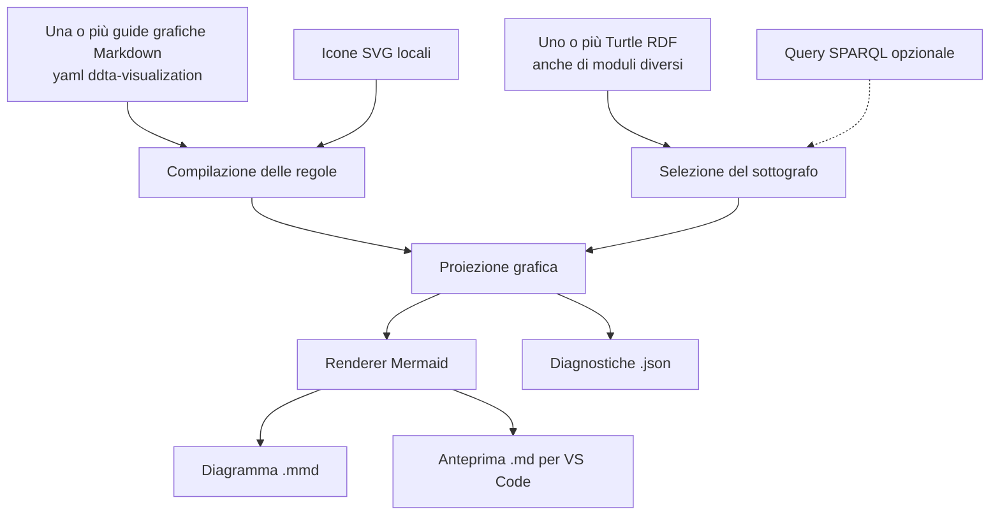
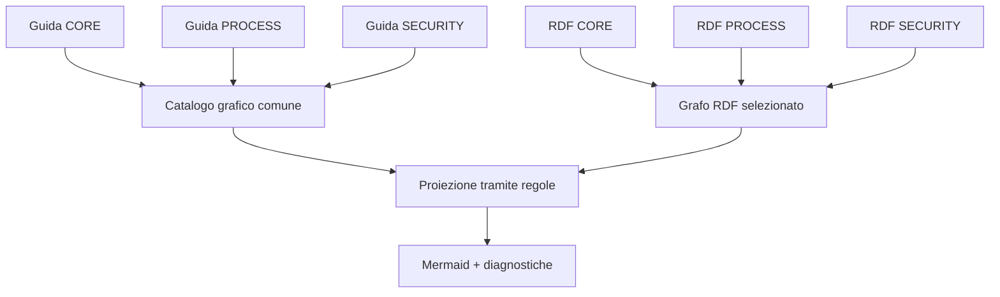
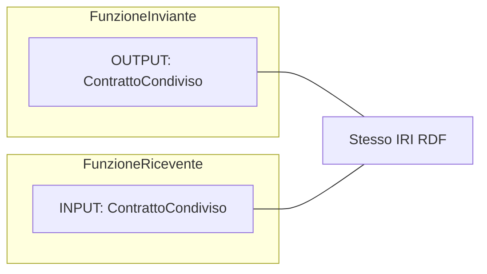

# DDTA — Guida al funzionamento del generatore grafico

## 1. Scopo

Il generatore produce diagrammi **Mermaid** da dati RDF e dalle regole di presentazione dichiarate nelle guide grafiche DDTA. Non crea nuove triple per disegnare i contenitori e non sostituisce il generatore ontologico Markdown → Turtle.

Le fonti autorevoli delle regole sono le **guide grafiche dei moduli DDTA selezionati**, collocate in `ontologies/<modulo>/`. Gli SVG di ogni modulo risiedono accanto alla sua guida. CORE è il primo modulo documentato, non un limite del programma: il motore non deve contenere copie delle regole né definizioni di classi specifiche.

I documenti `DDTA_PROCESS_VISUALIZATION.md` e `DDTA_SECURITY_VISUALIZATION.md` sono qui **nomi previsti per future guide**, non documenti già disponibili o approvati.

## 2. Ingressi e risultato



La query facoltativa deve selezionare le variabili **nell'ordine esatto** `?s ?p ?o`. Senza query vengono considerati tutti i dati RDF caricati.

Il parametro `--focus` seleziona una radice grafica di partenza; non modifica il Turtle. Il parametro `--view` sceglie la resa delle comunicazioni (`association` oppure `functional-flow`).

## 3. Uso con una o più ontologie

La pipeline espone già `--guides-md` e `--ttl` come parametri che accettano **più percorsi**. Il motore deve applicare alle risorse RDF le regole raccolte dai moduli selezionati, rispettando gli IRI e l'identità delle risorse indipendentemente dal file di origine. Una regola grafica appartiene al modulo dichiarato nel suo YAML, non al modulo per cui è stato originariamente sviluppato il codice.

**Stato della verifica:** la configurazione multiguida è prevista dalla CLI, ma la sua correttezza completa con ontologie diverse da CORE va dimostrata tramite test di integrazione. L'esistenza dei parametri non certifica ancora la risoluzione di conflitti o l'interoperabilità delle guide.



## 4. Esecuzione in PowerShell

Dalla radice di `tesiStabile`, una volta collocato il tool in `tools/visualization-tool/` e installate le dipendenze Python, il comando principale è:

```powershell
$repo = "$env:USERPROFILE\Documents\tesiStabile"
$tool = "$repo\tools\visualization-tool"
$guide = "$repo\ontologies\core\DDTA_CORE_VISUALIZATION.md"
$ttl = "C:\Percorso\ai\dati\sistema.ttl"
$output = "C:\Percorso\ai\risultati\diagramma"

python "$tool\scripts\pipeline.py" `
    --guides-md "$guide" `
    --ttl "$ttl" `
    --view association `
    --out-dir "$output"

code "$output\05_graph.md"
```

**Esempio di uso multiguida** (da eseguire soltanto quando le relative guide siano state definite e verificate):

```powershell
$guides = @(
    "$repo\ontologies\core\DDTA_CORE_VISUALIZATION.md",
    "$repo\ontologies\process\DDTA_PROCESS_VISUALIZATION.md",
    "$repo\ontologies\security\DDTA_SECURITY_VISUALIZATION.md"
)
$graphs = @("C:\Dati\core.ttl", "C:\Dati\process.ttl", "C:\Dati\security.ttl")
python "$tool\scripts\pipeline.py" --guides-md $guides --ttl $graphs --out-dir "$env:TEMP\ddta-mermaid"
```

Per una vista che usa soltanto CORE, selezionare solo la sua guida e i Turtle pertinenti. Le guide di più ontologie non devono essere caricate obbligatoriamente in ogni vista.

Per un diagramma più focalizzato, aggiungere `--query "C:\Percorso\vista.rq"` oppure `--focus "https://...#Individuo"`. Per una vista di comunicazione basata su contratti compatibili, usare `--view functional-flow`.

Con `--strict` le ambiguità e le altre condizioni classificate come **warning** bloccano la generazione. Le occorrenze grafiche lecite dello stesso IRI sono invece documentate come **info** e non bloccano `--strict`.

## 5. File prodotti

| File | Uso |
|---|---|
| `01_rules_extracted.yaml` | Regole estratte dal Markdown e riferimenti alle sorgenti |
| `02_rules_compiled.yaml` | Catalogo grafico compilato per la proiezione |
| `03_selected.ttl` | Dati RDF effettivamente rappresentati |
| `04_projection.json` | Modello grafico intermedio: identità, occorrenze, gruppi e archi |
| `05_graph.mmd` | Diagramma Mermaid puro |
| `05_graph.md` | Diagramma pronto per la preview Markdown di VS Code |
| `06_diagnostics.json` | Statistiche e diagnostiche di elaborazione |
| `icons/` | Copie tecniche degli SVG impiegati per il rendering |

I file di output sono artefatti rigenerabili; non costituiscono nuove dichiarazioni ontologiche. In VS Code: **Ctrl+Shift+V** apre l'anteprima Markdown.

## 6. Identità RDF e contenimento grafico

Lo stesso contratto può figurare in più funzioni. Ogni occorrenza ha un identificatore Mermaid diverso, ma conserva lo stesso IRI RDF:



I collegamenti dell'esempio precedente sono **soltanto esplicativi**: il renderer non introduce archi RDF di identità o proprietà aggiuntive. L'IRI comune è registrato nel JSON di proiezione, sia in `nodes` sia nelle `occurrences`.

Un normale annidamento (Function → Contract → ContractElement) non equivale a un individuo con due genitori RDF distinti. Le occorrenze duplicate sono informazioni utili alla tracciabilità, non errori di per sé.

## 7. Diagnostiche e limiti

- **info:** ripetizione lecita di un IRI RDF in più contesti grafici (`SHARED_RDF_INDIVIDUAL`, `MULTIPLE_GRAPHIC_PARENTS`).
- **warning:** mancanza di uno stile, collegamento non risolvibile, ambiguità di proiezione o altra condizione che richiede attenzione; `--strict` la rifiuta.
- **errore:** dati o regole incompatibili, ciclo di contenimento, restrizione di proiezione esplicitamente dichiarata come `multipleParents: error`.

La scelta di una occorrenza destinataria per un arco che collega individui ripetuti rimane governata dalle regole di layout del motore: non tutte le combinazioni complesse sono state dimostrate non ambigue. L'uguaglianza testuale del Mermaid con un esempio non sostituisce una verifica visiva.

## 8. Manutenzione ordinaria

Per modificare colori, forme e icone si interviene nella scheda grafica del modulo proprietario che definisce l'elemento e nel relativo blocco YAML. Il Python non deve contenere eccezioni basate sui nomi dei singoli sistemi o contratti. Per nuove primitive grafiche, invece, può essere necessaria un'estensione del renderer e dei relativi test.
