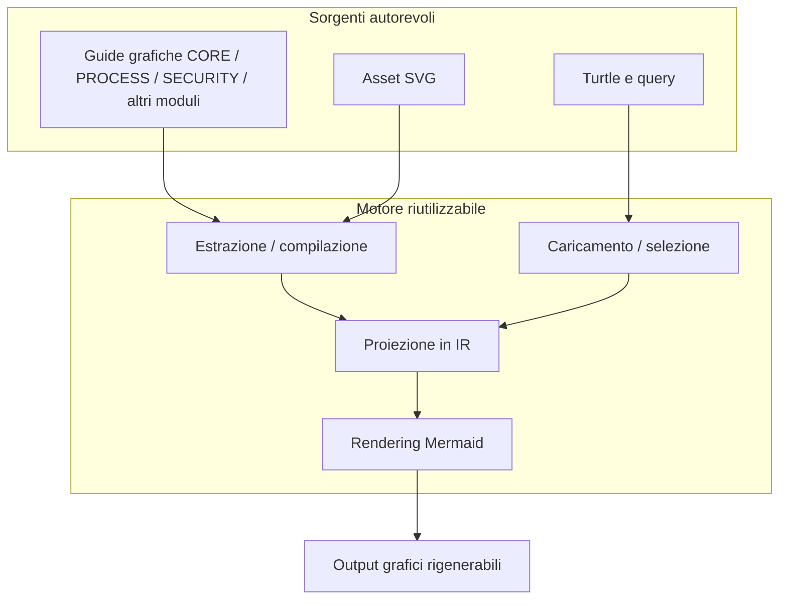
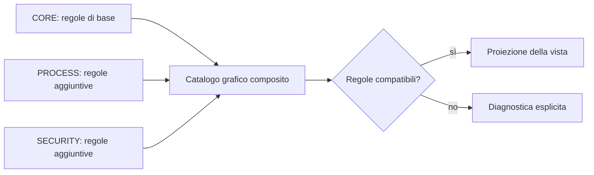
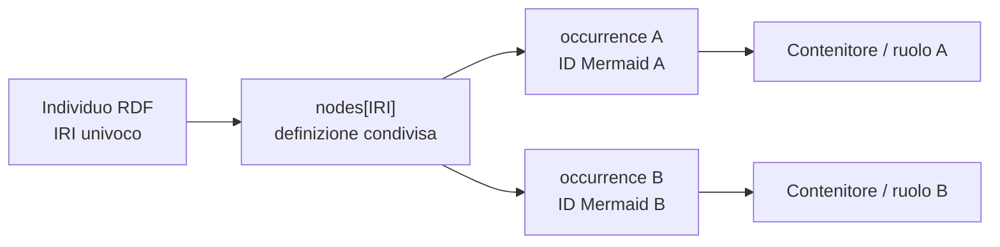
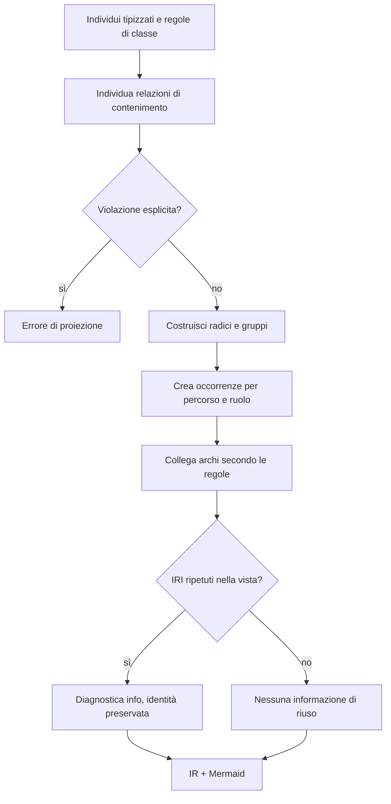
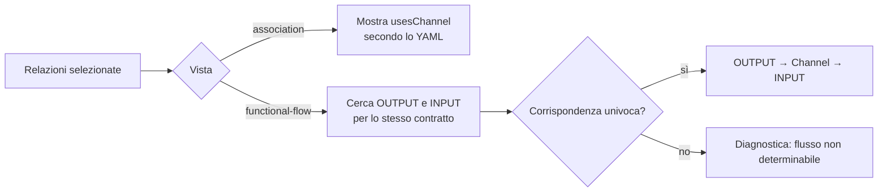

# DDTA — Logica e architettura di sviluppo del generatore grafico

## 1. Separazione delle responsabilità

Il motore grafico **interpreta** le regole dichiarate in una o più guide, anche appartenenti a ontologie differenti. Non decide i colori, le forme o le relazioni di un'ontologia in base a nomi presenti nel Python. La struttura RDF è il livello semantico; lo YAML definisce la proiezione e la presentazione; il Mermaid è l'output.

Non inserire nel repository del tool copie normative dei Markdown delle ontologie: i sorgenti si trovano in `ontologies/` e sono letti tramite percorsi CLI.

## 2. Generalità e composizione delle ontologie

Il motore è **indipendente dal nome dei moduli**: la libreria non deve contenere nomi codificati di classi CORE o di future classi PROCESS/SECURITY. Il blocco `yaml ddta-visualization` dichiara `module` e `target` (o `subjectClass`), e il catalogo combina regole provenienti da guide diverse. La stessa istanza RDF può essere interessata da relazioni definite in moduli differenti: si conserva il suo IRI, e le occorrenze visuali sono contestuali.

**Comportamento da consolidare prima dell'uso multiontologia stabile:**

1. **Identità e namespace.** Confrontare le regole mediante IRI risolti e riconoscere i conflitti fra prefissi/alias, non basarsi soltanto sulle stringhe QName.
2. **Una sola definizione effettiva per ogni stile.** Ogni classe o proprietà ha una scheda proprietaria; eventuali specializzazioni dichiarano esplicitamente l'ereditarietà grafica. Non modificare silenziosamente lo stile CORE importando PROCESS.
3. **Regole globali.** La versione attuale del catalogo ammette un unico `global-label-style`; quando si leggono più guide deve esistere una politica precisa per il riuso della regola comune, evitando duplicazioni.
4. **Asset SVG.** Due moduli possono avere entrambi `icons/database.svg`: devono essere risolti rispetto alla guida proprietaria senza sovrascriversi per omonimia. Il codice attuale segnala collisioni, ma la convenzione di composizione deve essere verificata.
5. **Relazioni tra ontologie.** Le viste possono mescolare entità CORE, PROCESS e SECURITY, ma archi e contenimenti devono dipendere da regole e dati selezionati, non dal nome del modulo.
6. **Estendibilità.** Nuove classi e relazioni che usano primitive già supportate richiedono YAML e test; nuove primitive di visualizzazione o nuove logiche di vista richiedono un'estensione esplicita del motore.

**Verifica della generalità:** i test coprono il caricamento di più guide con una seconda ontologia illustrativa. Il comportamento con regole globali, namespace o asset conflittuali richiede diagnosi esplicite e non è considerato automaticamente risolto.

## 3. Moduli Python da conservare

| Modulo `src/ddta_viz/` | Responsabilità stabile |
|---|---|
| `extract_guides.py` | Parsing dei blocchi `yaml ddta-visualization` e verifica SVG |
| `catalog.py` | Registro delle regole, ereditarietà grafica, riconoscimento di classi e relazioni |
| `compile_rules.py` | Unificazione e validazione del catalogo grafico, gestione asset |
| `common.py` | Serializzazione YAML/JSON, caricamento RDF, helper IRI |
| `load_graph.py` | Unificazione facoltativa di Turtle |
| `select_graph.py` | Applicazione di query `SELECT ?s ?p ?o` |
| `project_view.py` | Composizione di contenitori, gruppi, individui e archi nell'IR |
| `render_mermaid.py` | Emissione Mermaid da IR e catalogo, senza interrogare l'RDF |
| `pipeline.py` | Orchestrazione end-to-end e diagnostiche |
| `__init__.py` | Confine del pacchetto Python |

I sette script in `scripts/` sono punti d'ingresso e non duplicano la logica contenuta in `src/`.

## 4. Contratto del modello intermedio (IR)

L'IR usa `schema: ddta-graph-ir-v2` e distingue:

- `nodes`: **un record per IRI**; identifica il soggetto, il tipo RDF selezionato e gli attributi;
- `occurrences`: uno o più ID grafici per IRI, con percorso di contenimento e ruolo;
- `roots`: albero di oggetti visuali (`individual`, `group`, eventuali layout di realizzazione);
- `edges`: proprietà RDF rappresentabili o proiezioni grafiche esplicitamente dichiarate;
- `diagnostics`: criticità o informazioni sulla vista;
- `statistics`: quantità di triple, individui, occorrenze, radici e archi.

L'ID grafico è costruito in modo deterministico a partire da IRI, percorso e ruolo: **non** deve essere scambiato per un nuovo identificativo RDF.

## 5. Algoritmo di proiezione

La verifica `multipleParents: error` dichiarata da una **specifica relazione** resta vincolante; non va confusa con un normale riuso visuale di un contratto consentito dalla vista. I cicli di contenimento restano errori. Per le duplicazioni lecite, `--strict` non deve fallire.

### Contenitori annidati e riuso fra contesti

- **Annidamento:** una sola occorrenza grafica dell'elemento, sotto una gerarchia di contenitori.
- **Riuso di individuo:** almeno due occorrenze con stesso IRI sotto percorsi diversi, oppure sotto lo stesso padre con ruoli diversi.
- **RDF invariato:** nessun individuo nuovo, nessuna tripla aggiunta per soddisfare il disegno.

La rappresentazione di riferimenti ed endpoint di archi in grafi con molte occorrenze richiede controlli aggiuntivi: il renderer attuale sceglie coppie di occorrenze tramite prossimità nell'albero grafico e ordine deterministico. La scelta è riproducibile, ma non necessariamente semanticamente unica in ogni caso.

## 6. Due viste di comunicazione

L'associazione funzionale canale/contratto è una **proiezione dichiarata dallo YAML** e non un evento RDF aggiunto arbitrariamente.

## 7. Principi per modificare o estendere il codice

1. **Nuova classe con primitive già note:** aggiungere una `class-style` nella relativa guida e i test; non inserire nomi della classe nel Python.
2. **Nuova relazione con primitive già note:** aggiungere una `relation-style` o un raggruppamento; verificare il sottografo minimo e il rendering.
3. **Nuova primitiva grafica:** estendere il catalogo e il renderer, aggiungere un caso isolato e una regressione.
4. **Modifica di uno stile:** intervenire nella scheda proprietaria dello stile, poi verificare che l'output cambi senza modifiche al Python.
5. **Nuova vista:** definire il contratto della proiezione (input richiesti, criterio di univocità, archi emessi, diagnostiche), prima di implementarla.
6. **Gestione delle identità condivise:** controllare sempre IRI, percorsi e ruoli; non trasformare una comodità di layout in una restrizione ontologica.

## 8. Test di regressione da mantenere

| Famiglia di test | Aspettativa |
|---|---|
| Parsing e catalogo | YAML validi, riferimenti a SVG risolti, conflitti segnalati |
| Classi e relazioni | Stili e contenimenti determinati dalle regole, senza eccezioni sugli individui |
| Riuso RDF | Un IRI può avere più occorrenze; `--strict` accetta il caso se non ci sono problemi reali |
| Annidamenti e cicli | Annidamenti legittimi rappresentati, cicli rifiutati |
| Comunicazioni | Proiezioni solo con corrispondenze verificabili |
| Determinismo | Stesso Mermaid indipendentemente dall'ordine delle triple |
| Ambiguità | Warning bloccanti con `--strict`, info non bloccanti |
| Regole grafiche | Forma, sfondo, bordo, testo, icone, gruppi e archi confrontati con YAML e aspettative |
| Composizione multiontologia | Guide CORE e almeno un modulo indipendente, conflitti fra regole, namespace, ereditarietà grafica e SVG omonimi |
| Compatibilità futura | Nuova ontologia e nuovo `module` senza modifiche al codice quando usa primitive già esistenti |

La suite non deve dipendere da nomi di release, cartelle di output storiche o hash di una specifica revisione documentale.

## 9. Confini e questioni per la stabilizzazione

Non incorporare direttamente `out/`, release storiche, copie della guida o fixture legate a un singolo progetto applicativo. Gli script di audit esistenti richiedono un controllo delle dipendenze prima di essere inclusi come componenti stabili.

Prima dell'importazione nel repository definitivo occorre riallineare la descrizione della politica `alternate-view` delle guide al comportamento approvato di più occorrenze grafiche per lo stesso IRI. Resta da decidere separatamente se le regole `multipleParents: error` dichiarate da altre relazioni vadano mantenute o riformulate. Non introdurre una decisione normativa soltanto perché il Python è già capace di disegnare qualcosa.
