# DDTA — Regole grafiche dell'ontologia PROCESS

> **Stato R7.5 candidata per questa prova:** differenziazione grafica fra `XOR_SPLIT` (seleziona un solo ramo) e `CONCURRENT_SPLIT` (avvia tutti i rami). Questa modifica aggiorna la sezione 9 e non modifica `DDTA_PROCESS.md` né il CORE. Le condizioni visibili restano contenitori gialli con operatori interni. Non è una modifica approvata alla guida R7.4 originale.


**Fonte semantica:** `DDTA_PROCESS.md` (modulo `process`), estensione di `DDTA_CORE.md`.
**Guida grafica comune:** `../core/DDTA_CORE_VISUALIZATION.md`.
**Asset grafici:** icone in `assets/*.svg`, percorsi relativi a questo Markdown; la loro tinta deriva dal bordo associato nel blocco YAML. Le forme, gli archi e le etichette sono Mermaid.

**Stato della presente copia:** revisione candidata, non approvata e non applicata al repository. Gli stili ontologici non sono modificati.

Questo documento specifica le convenzioni grafiche per le classi e proprietà introdotte dall'ontologia PROCESS. Le identità `ddta:Process`, `ddta:ProcessStep`, `ddta:hasNextStep` e `ddta:realizesFunction` mantengono le definizioni e gli stili della guida CORE. Ogni nuova regola grafica si riferisce alle dichiarazioni ontologiche, senza creare nuove triple RDF.

**Ambito della guida completa PROCESS, revisione grafica R7.5 candidata (selezione XOR distinta da concorrenza):** incorpora le convenzioni approvate per `ProcessTransition`, `Condition`, `AtomicCondition`, `CompositeCondition`, `Operand`, `ControlNode`, `SynchronizationNode`, `CodeReference`, `hasSubProcess`, `invokesProcess`, `hasInitialStep`, `WAIT`/`END_BRANCH`/`END_PROCESS`, `implementedBy`, `usesConfiguration` e `hasActivationCondition`. Il documento descrive la **specifica grafica attesa**, non dichiara che il generatore Python la implementi già. L'ontologia e il CORE non sono modificati.

## 1. Principi di rappresentazione

1. Il grafo RDF è la sorgente delle identità e delle relazioni. La query SPARQL seleziona il sottografo della vista; la configurazione grafica ne definisce la presentazione.
2. Il flusso operativo del processo descrive attività, scelte e successioni previste, non un'esecuzione già avvenuta.
3. Il flusso logico dei dati fra funzioni rimane rappresentato a livello funzionale, mediante i contratti CORE. La rappresentazione operativa non aggiunge automaticamente connessioni a repository, servizi esterni o processi di altri ambienti.
4. La disponibilità dei dati e delle risorse nell'ambiente del processo sarà trattata separatamente, senza attribuire nuove proprietà all'ontologia prima che siano dichiarate.
5. La stessa identità RDF può partecipare a diverse occorrenze grafiche. Le occorrenze non costituiscono nuovi individui.
6. Gli stili delle classi sono definiti nelle rispettive schede; la proiezione delle relazioni è descritta nelle regole dedicate alle relazioni.

## 2. Convenzioni CORE riutilizzate

| Elemento | Convenzione |
|---|---|
| `ddta:Process` | Contenitore arrotondato; fondo `#F8FAFC`, bordo `#7B8794` continuo |
| `ddta:ProcessStep` | Rettangolo bianco; bordo `#7B8794` tratteggiato |
| `ddta:hasStep` | Contenimento dello Step nel Process, senza freccia |
| `ddta:hasNextStep` | Freccia continua grigia con etichetta arrotondata `hasNextStep` quando non sostituita nella vista |
| `ddta:realizesFunction` | Convenzione della guida CORE, senza ridefinizione |

Nome e tipo RDF, quando mostrati, rispettano la regola globale delle etichette della guida CORE. In particolare, nelle viste PROCESS il testo di `ddta:Process` e `ddta:ProcessStep` usa il **grigio scuro `#334155`** indicato dalla descrizione del CORE, mantenendo sfondi e bordi di origine. La presenza di `color: "#7B8794"` in alcuni esempi/YAML del CORE è una discrepanza da riallineare nella guida CORE, **non** l'autorizzazione a cambiare i colori strutturali di PROCESS. Le convenzioni delle etichette (nome in grassetto, tipo completo in piccolo) restano invariate.

## 3. Scheda grafica — `process:ProcessTransition`

### 3.1 Identificazione

- **Tipo:** classe ontologica PROCESS.
- **IRI:** `process:ProcessTransition`.
- **Significato:** collegamento operativo pianificato e identificabile tra due `ddta:ProcessStep`, eventualmente qualificato da una guardia.

### 3.2 Rappresentazione nella vista di flusso

Una transizione dichiarata tramite `process:fromStep` e `process:toStep` identifica precisamente il collegamento fra quei due Step. La vista di flusso disegna **una sola occorrenza** del collegamento: se è selezionato anche `ddta:hasNextStep` per la stessa coppia, la resa `hasNextStep` viene soppressa soltanto graficamente. Nessuna tripla RDF viene eliminata o creata.

Se la transizione possiede una guardia selezionata, nella vista con condizioni visibili il renderer collega le frecce **al bordo del contenitore giallo** della condizione. Non collega gli archi al rombo né ai membri interni. Il rombo è la rappresentazione grafica di un operatore o di un criterio, **non un individuo RDF**; l'IRI della transizione viene conservato nella tracciabilità dell'arco. La freccia Step → contenitore, quando necessaria per la leggibilità, è una proiezione grafica delle transizioni con guardia, non una tripla RDF. Le transizioni senza guardia non introducono condizioni fittizie.

Quando due transizioni sono dichiarate rispettivamente con una condizione e con la sua negazione **esplicita** (`CompositeCondition` + `NOT`), la vista condizionale usa una freccia **verde `#238636`** per il vero e una **rossa `#C62828`** per il falso, senza etichette `true` o `false`. La sola presenza di due uscite non dimostra che siano complementari.

Una transizione non dichiarata **non** viene costruita per completare visivamente la diramazione. Un eventuale simbolo `?` appartiene a una futura vista diagnostica esplicita, non alla vista normale.

### 3.3 Dichiarazione YAML — proiezione delle transizioni

```yaml ddta-visualization
record: projection-rule
module: process
id: process-transition-as-step-flow
target: process:ProcessTransition
selection:
  transitionClass: process:ProcessTransition
  ownerRelation: process:hasTransition
  sourceRelation: process:fromStep
  destinationRelation: process:toStep
  optionalGuardRelation: process:hasGuard
  coreLinkRelation: ddta:hasNextStep
projection:
  source: selected-rdf-statements
  output: directed-step-flow
  replaceCoreLink:
    when: same-source-and-destination
    preserveRdfTriples: true
    suppressOnlyVisualOccurrence: true
  preserveTransitionIriInTrace: true
  noGuard:
    showDecisionDiamond: false
  guarded:
    showConditionWrapperWhenSelected: true
    externalEdgesConnectTo: visible-condition-container-border
    innerOperatorDiamondIsRdfIndividual: false
    doNotDrawSecondExternalDiamond: true
    invisibleLayoutLinksDoNotImplyRdf: true
    guardValueInterpretation: declared-boolean-polarity-only
    positiveEdgeColor: "#238636"
    negativeEdgeColor: "#C62828"
    edgeLabels: false
    complement:
      requireExplicitNotCondition: true
      notClass: process:CompositeCondition
      notOperatorProperty: process:logicalOperator
      notOperatorValue: NOT
      componentRelation: process:hasCondition
  unresolvedBranch:
    inventEdges: false
    showGapByDefault: false
```

### 3.4 Regole di interpretazione

- `process:hasTransition` associa l'individuo `ProcessTransition` al processo che lo dichiara.
- `process:fromStep` identifica lo Step di partenza; `process:toStep` identifica lo Step di arrivo.
- `process:hasGuard` collega una transizione a una `Condition` o a una sua specializzazione.
- La corrispondenza con `hasNextStep` si calcola **per coppia ordinata di Step**; non si eliminano altre frecce uscenti dallo stesso Step.
- Più transizioni per la stessa coppia possono esistere come individui distinti: il renderer non deve unirne silenziosamente le guardie né perdere gli IRI.

### Regola di layout compatto per contenitori e condizioni

Le viste PROCESS applicano la convenzione tipografica e di contenimento del CORE (sezione 1.5): **il nome e il tipo RDF sono etichette del `subgraph` reale**, non nodi di impaginazione aggiuntivi. In particolare, `Process`, `Condition`, `AtomicCondition`, `CompositeCondition` e il gate di `hasActivationCondition` non devono introdurre nodi `*_HEAD`, subgraph `*_PARTS` o altre fasce invisibili che espandono il diagramma.

Quando titolo e rombo interferiscono, riservare soltanto il margine inferiore al titolo del contenitore: `subGraphTitleMargin` (`top: 12`, `bottom: 18`) e una **ridotta** spaziatura verticale interna all'etichetta. Per questi esempi il diagramma utilizza `nodeSpacing: 30` e `rankSpacing: 35`; i valori esatti dipendono dal renderer Mermaid, non rappresentano relazioni RDF. È vietato ottenere spazio aggiungendo individui grafici fittizi. Gli operandi o le condizioni componenti continuano a disporsi in orizzontale, con rombo letterale (`GE`, `AND`, ecc.) e archi invisibili `~~~` di sola impaginazione. Il contenitore di `Condition` resta bianco con bordo giallo.

Il gate contiene **una sola condizione** già rappresentata tramite la scheda `AtomicCondition` o `CompositeCondition`. L'icona SVG gialla rimane **dentro l'intestazione del gate**, a sinistra delle due righe di testo (nome grafico e proprietà `process:hasActivationCondition`); il gruppo completo è centrato orizzontalmente nel contenitore. Questa disposizione su due righe riduce l'altezza dell'intestazione senza introdurre nodi di impaginazione. L'icona non è un secondo box né un individuo RDF. La classe `ddta:Process` conserva sfondo `#F8FAFC`, bordo `#7B8794` e testo `#334155`, come nel CORE.

La configurazione è una **convenzione grafica candidata** da verificare nel renderer VS Code; se la versione di Mermaid non applica `subGraphTitleMargin`, bisogna adeguare il template di rendering mantenendo i grafi compatti, senza reintrodurre contenitori di impaginazione.

---

## 4. Scheda grafica — `process:Condition`

### 4.1 Identificazione

- **Tipo:** classe ontologica PROCESS.
- **IRI:** `process:Condition`.
- **Significato:** criterio identificabile valutabile per abilitare un comportamento previsto. La dichiarazione del criterio non registra il suo valore in una particolare esecuzione.

### 4.2 Rappresentazione

Quando la condizione è visibile come criterio di una diramazione, essa è un **contenitore rettangolare bianco**, con **bordo giallo `#D6A100`** e **testo giallo scuro `#A67C00`**. Il titolo riporta **nome** e **tipo RDF**. All'interno del contenitore compare un **rombo bianco con bordo giallo `#D6A100`**. Nelle condizioni formalizzate il rombo porta l'operatore RDF (`EQ`, `GE`, `AND` ecc.); in una `Condition` generale può rimanere privo di operatore. Il rombo non è un individuo RDF e **non è disegnato all'esterno del contenitore** quando la condizione è visibile.

Il contenitore comprende le eventuali parti grafiche della condizione e tiene vicini gli elementi nei grafi grandi. Le frecce esterne, **in entrata e in uscita**, terminano sul suo **bordo**, mai su operatore o operandi. La visibilità è controllata dalla query/proiezione: una vista esplicitamente compatta può nascondere il rettangolo e visualizzare un marcatore di decisione residuo, ma ciò non deve introdurre un **secondo** rombo nella vista con condizione visibile. La semantica delle polarità deve rimanere disponibile alla proiezione; non si deduce dal numero di uscite.

**La cornice di `Condition` non è un contratto.** Il fondo bianco evita la confusione con la convenzione grafica di `ddta:Contract`.

### 4.3 Dichiarazione YAML — stile di classe

```yaml ddta-visualization
record: class-style
module: process
target: process:Condition
node:
  shape: rectangle
  style: condition
style:
  fill: "#FFFFFF"
  stroke: "#D6A100"
  color: "#A67C00"
  strokeWidth: 2
  strokePattern: solid
container:
  when: selected-as-visible-decision-condition
  renderer: mermaid-subgraph
  innerGraphic:
    type: diamond
    rdfIndividual: false
    label: none
    fill: "#FFFFFF"
    stroke: "#D6A100"
    strokeWidth: 1.5
  externalFlowAttachment: container-border
  innerElementsAreNotExternalFlowEndpoints: true
  noSecondExternalDiamond: true
visibility:
  wrapperControlledByQueryOrProjection: true
  hiddenWrapperMayPreserveSingleDecisionMarker: true
  hiddenWrapperOnlyInExplicitCompactView: true
```

### 4.4 Distinzione dalla semantica di controllo

`process:Condition` e `process:ControlNode` sono identità differenti. Il rombo interno alla `Condition` è un simbolo di vista, **non** la dichiarazione implicita di un `ControlNode` o di un `XOR_SPLIT`. Analogamente il rombo con `AND` è l'operatore di una condizione composta, non un punto di diramazione del processo. La presentazione delle altre tipologie di controllo viene definita nelle rispettive schede PROCESS.

## 5. Esempio di regressione — MD5 e SHA

Il comportamento dell'esempio iniziale è preservato: `MD5Matches = vero` conduce a `ContinueWorkStep`, `MD5Matches = falso` conduce a `VerifySHAHashStep`, `SHAMatches = vero` conduce a `ContinueWorkStep`. Il caso `SHAMatches = falso` **non è documentato** e non compare. Si tratta di un caso di prova della proiezione, **non** di una raccomandazione di usare MD5 per la sicurezza.

### 5.1 Vista aggiornata con le frecce sul contenitore

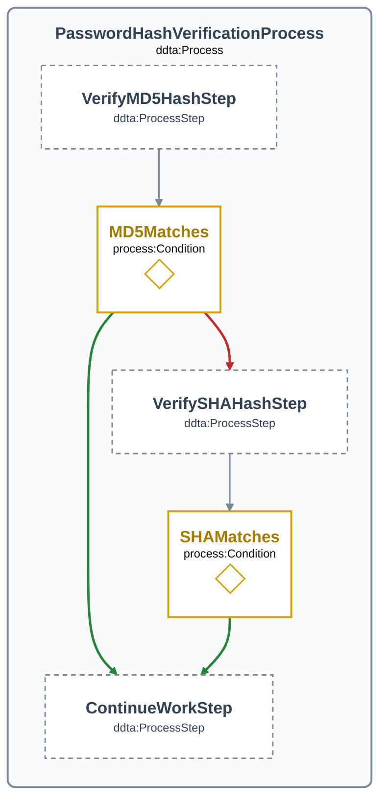

Il rombo è **interno** alla condizione. Le frecce **entranti e uscenti** arrivano al bordo giallo (`MD5 → C_MD5`, `C_MD5 → ...`). Le tre transizioni sono tracciate dagli IRI RDF; i segmenti di composizione grafica Step → Condition non sono triple `ddta:hasNextStep` addizionali. Il ramo rosso deriva da una condizione `NOT` **esplicitamente dichiarata**, non dalla semplice biforcazione del disegno.

### 5.2 Turtle di riferimento

Il file originale è preservato senza alterazioni in `../../examples/hash_legacy_current.ttl`. La rappresentazione è cambiata, il modello RDF no.

### 5.3 Vista con condizione non espansa

La vista compatta senza cornice gialla è una **proiezione separata ed esplicita**, non la modalità predefinita. Non inserire un secondo rombo esterno quando la `Condition` è visibile. È lecito mostrare il flusso fra gli Step senza rappresentare i dettagli interni, mantenendo disponibili le guardie per colorare gli archi.

## 6. Scheda grafica — `process:AtomicCondition`

### 6.1 Identificazione e semantica

`AtomicCondition` è sottoclasse di `process:Condition`. Ha esattamente un `process:hasLeftOperand`, un `process:hasRightOperand` e un `process:comparisonOperator` nel grafo validato. Operatori ammessi: **`EQ`, `NE`, `LT`, `LE`, `GT`, `GE`**. Gli operandi sono individui `process:Operand` e **non** vengono convertiti automaticamente in variabili di codice.

### 6.2 Rappresentazione

Un **unico contenitore giallo a fondo bianco** (stile ereditato da `Condition`) contiene, affiancati, i due operandi e **un rombo bianco a bordo giallo con l'operatore**: **A — rombo `EQ`/`NE`/`LT`/`LE`/`GT`/`GE` — B**. I due rettangoli degli operandi sono neutri, con stile definito esclusivamente dalla scheda `Operand`. Il rombo indica il valore letterale della proprietà `comparisonOperator`: **non è un nuovo individuo RDF**. I vincoli invisibili di Mermaid `~~~` sono layout, non collegamenti RDF né precedenza temporale.

Le frecce di processo si collegano **solo all'identificativo del subgraph giallo**, in entrata e in uscita.

### 6.3 YAML — classe e proiezione dell'operatore

```yaml ddta-visualization
record: class-style
module: process
target: process:AtomicCondition
node:
  shape: rectangle
  style: condition
style:
  fill: "#FFFFFF"
  stroke: "#D6A100"
  color: "#A67C00"
  strokeWidth: 2
  strokePattern: solid
container:
  when: visible
  renderer: mermaid-subgraph
  layoutDirection: LR
  externalFlowAttachment: container-border
  parts:
    left:
      relation: process:hasLeftOperand
      renderUsingClass: process:Operand
    operator:
      property: process:comparisonOperator
      values: [EQ, NE, LT, LE, GT, GE]
      graphic: diamond
      rdfIndividual: false
      fill: "#FFFFFF"
      stroke: "#D6A100"
    right:
      relation: process:hasRightOperand
      renderUsingClass: process:Operand
  layoutOnlyBetweenParts: true
```

### 6.4 Mermaid illustrativo

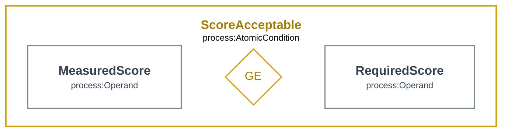

La condizione atomica isolata è documentata in `../../examples/condition_composite_and.ttl`. Il diagramma mostra solo i tre individui RDF effettivamente dichiarati; il rombo `GE` è il valore della proprietà `comparisonOperator`, e i due collegamenti invisibili sono soltanto vincoli di layout.

## 7. Scheda grafica — `process:CompositeCondition`

### 7.1 Identificazione e semantica

Una `CompositeCondition` combina altre `process:Condition` attraverso `process:hasCondition`; `process:logicalOperator` contiene **`AND`, `OR` o `NOT`**. `AND`/`OR` richiedono almeno due componenti, `NOT` una sola. La composizione è aciclica. Il disegno non introduce ordine di valutazione.

### 7.2 Rappresentazione unificata degli operatori

La convenzione per il rombo è **identica** a quella degli operatori atomici: sfondo bianco, bordo giallo, testo giallo scuro. La differenza fra `EQ` e `AND` è **nei tipi e nelle proprietà RDF**, non nella forma grafica.

- `AND`/`OR`: **Condizione A — rombo `AND`/`OR` — Condizione B** nello stesso rettangolo giallo; con più di due componenti, ripetere il rombo fra componenti nella vista lineare, senza creare operatori RDF aggiuntivi.
- `NOT`: **rombo `NOT` — Condizione A** nello stesso rettangolo giallo, senza inventare un secondo operando.
- Le condizioni componenti visibili dentro il contenitore composto sono **blocchi neutri**, non altri contenitori gialli obbligatori. Per il loro dettaglio atomico si usa una vista espansa separata; non si perde la tracciabilità delle identità.
- Le frecce esterne entrano ed escono **dal rettangolo giallo esterno**, mai dai componenti o dal rombo.

La forma A–AND–B descrive una **combinazione logica**, non `mustPrecede`, `hasNextStep`, ordine temporale o sequenza di esecuzione. Le posizioni degli elementi che non hanno un ordine RDF devono essere stabilizzate da una chiave deterministica (per esempio IRI) del generatore; la disposizione visiva non altera la semantica.

### 7.3 YAML — proiezione della composizione

```yaml ddta-visualization
record: class-style
module: process
target: process:CompositeCondition
node:
  shape: rectangle
  style: condition
style:
  fill: "#FFFFFF"
  stroke: "#D6A100"
  color: "#A67C00"
  strokeWidth: 2
  strokePattern: solid
container:
  when: visible
  renderer: mermaid-subgraph
  layoutDirection: LR
  externalFlowAttachment: container-border
  parts:
    componentsRelation: process:hasCondition
    componentsUse: neutral-component-box
    memberRdfIdentityPreserved: true
    operatorProperty: process:logicalOperator
    operators: [AND, OR, NOT]
    operatorGraphic: diamond
    operatorIsRdfIndividual: false
    operatorStroke: "#D6A100"
    operatorFill: "#FFFFFF"
    binaryForm: member-operator-member
    unaryNotForm: operator-member
    multiMemberForm: repeat-operator-for-layout-only
    componentOrder: stable-iri-order-not-evaluation-order
    layoutOnlyBetweenParts: true
```

### 7.4 Mermaid illustrativo — AND

```mermaid
%%{init: {"theme":"base","flowchart":{"htmlLabels":true,"subGraphTitleMargin":{"top":12,"bottom":18},"nodeSpacing":30,"rankSpacing":35}}}%%
flowchart LR
    S["<div style='display:inline-block;text-align:center;white-space:nowrap;line-height:1.4;padding:8px 12px;background:transparent;opacity:1;color:#7B8794'><span style='display:block;text-align:center;font-size:17px;font-weight:700;color:#334155'>VerifyRequirements</span><span style='display:block;text-align:center;font-size:12px;font-weight:400;color:#334155'>ddta:ProcessStep</span></div>"]
    subgraph CC["<div style='display:block;text-align:center;white-space:nowrap;line-height:1.25;padding:4px 8px 10px;background:transparent'><span style='display:block;text-align:center;font-size:17px;font-weight:700;color:#A67C00'>CanProceed</span><span style='display:block;text-align:center;font-size:12px;font-weight:400;color:#A67C00'>process:CompositeCondition</span></div>"]
        direction LR
        A["<div style='display:inline-block;text-align:center;white-space:nowrap;line-height:1.4;padding:8px 12px;background:transparent;opacity:1;color:#7B8794'><span style='display:block;text-align:center;font-size:17px;font-weight:700;color:#334155'>ScoreAcceptable</span><span style='display:block;text-align:center;font-size:12px;font-weight:400;color:#334155'>process:AtomicCondition</span></div>"]
        OP{"AND"}
        B["<div style='display:inline-block;text-align:center;white-space:nowrap;line-height:1.4;padding:8px 12px;background:transparent;opacity:1;color:#7B8794'><span style='display:block;text-align:center;font-size:17px;font-weight:700;color:#334155'>DataReady</span><span style='display:block;text-align:center;font-size:12px;font-weight:400;color:#334155'>process:AtomicCondition</span></div>"]
        A ~~~ OP ~~~ B
    end
    P["<div style='display:inline-block;text-align:center;white-space:nowrap;line-height:1.4;padding:8px 12px;background:transparent;opacity:1;color:#7B8794'><span style='display:block;text-align:center;font-size:17px;font-weight:700;color:#334155'>ContinueStep</span><span style='display:block;text-align:center;font-size:12px;font-weight:400;color:#334155'>ddta:ProcessStep</span></div>"]
    F["<div style='display:inline-block;text-align:center;white-space:nowrap;line-height:1.4;padding:8px 12px;background:transparent;opacity:1;color:#7B8794'><span style='display:block;text-align:center;font-size:17px;font-weight:700;color:#334155'>AlternativeStep</span><span style='display:block;text-align:center;font-size:12px;font-weight:400;color:#334155'>ddta:ProcessStep</span></div>"]
    S --> CC
    CC --> P
    CC --> F
    classDef step fill:#FFFFFF,stroke:#7B8794,color:#334155,stroke-width:1.5px,stroke-dasharray:5 4
    classDef component fill:#FFFFFF,stroke:#7B8794,color:#334155,stroke-width:1.5px
    class S,P,F step
    class A,B component
    style CC fill:#FFFFFF,stroke:#D6A100,color:#A67C00,stroke-width:2px
    style OP fill:#FFFFFF,stroke:#D6A100,color:#A67C00,stroke-width:1.5px
    linkStyle 2 stroke:#7B8794,stroke-width:1.5px
    linkStyle 3 stroke:#238636,stroke-width:2.5px
    linkStyle 4 stroke:#C62828,stroke-width:2.5px
```

La seconda `AtomicCondition` (`DataReady`) serve qui unicamente per la composizione grafica. Il criterio effettivo delle due guardie verde/rossa dovrebbe essere documentato con una `CompositeCondition` e una sua **negazione esplicita** se i due rami sono complementari; il file `../../examples/condition_composite_and.ttl` documenta tale negazione.

**Alternativa OR:** identica disposizione, sostituendo il testo del rombo con `OR` se e solo se `logicalOperator = "OR"` nel RDF. **NOT:** un solo elemento di tipo `Condition` con il rombo `NOT` interno. Non usare frecce di processo per rappresentare `hasCondition`.

## 8. Scheda grafica — `process:Operand`

### 8.1 Identificazione

Un `Operand` identifica un valore, un riferimento a `ddta:ContractElement`, una `ddta:Resource`, una costante (`literalValue`) o un localizzatore (`valueLocator`) secondo quanto **dichiarato**. Non è sottoclasse di `ContractElement` e non autorizza, da solo, a disegnare un flusso di dati fra funzioni.

### 8.2 Rappresentazione

All'interno della condizione atomica gli operandi sono **due rettangoli bianchi con bordo grigio `#7B8794`** e etichetta CORE (nome in grassetto, tipo completo sotto). Mantengono la propria identità RDF. Il rombo giallo fra essi deriva dal valore di `process:comparisonOperator` della condizione, senza essere un terzo operando.

La vista compatta espone `referencesContractElement` come testo nell’operando e la vista estesa come arco dichiarato (§8.5). `referencesResource` non è espanso automaticamente; nessuna variabile o servizio viene inventato.

### 8.3 YAML

```yaml ddta-visualization
record: class-style
module: process
target: process:Operand
node:
  shape: rectangle
  style: operand
style:
  fill: "#FFFFFF"
  stroke: "#7B8794"
  color: "#7B8794"
  strokeWidth: 1.5
  strokePattern: solid
projection:
  defaultView: inside-selected-atomic-condition
  externalReferencesVisibleOnlyWhenSelected: true
  doNotInferDataFlow: true
```

**Regola comune agli operatori:** `EQ`, `NE`, `LT`, `LE`, `GT`, `GE`, `AND`, `OR`, `NOT` usano **una sola primitiva grafica** (`diamond`, fondo bianco, bordo giallo), con arità e tipi dei membri determinati dall'ontologia. La semantica dei confronti non va confusa con la combinazione di condizioni.

### 8.4 Contratti interni dichiarati dagli Step — riuso grafico CORE

`process:declaresInputContract` e `process:declaresOutputContract` sono relazioni RDF
fra un `ddta:ProcessStep` e un `ddta:Contract`. La guida PROCESS **non** ridefinisce
lo stile delle classi CORE. Riusa dalla guida CORE le regole di `ddta:Contract`,
`ddta:ContractElement`, `ddta:hasContractElement` e il gruppo grafico `Contracts`
delle funzioni; cambia **solo** le proprietà RDF di selezione e l'host
(`ProcessStep` anziché `Function`).

Un `Contract` va dentro il proprio `ProcessStep`, i relativi elementi dentro il
contratto, senza frecce `declaresInputContract`, `declaresOutputContract` e
`hasContractElement`. `INPUT` / `OUTPUT` sono ruoli grafici, non nuove classi.
La stessa istanza RDF può essere visualizzata in più occorrenze quando condivisa;
non si deduce per questo un trasferimento di dati. La selezione usa gli IRI e
il gruppo di layout deriva da CORE, non da una palette PROCESS duplicata.

```yaml ddta-visualization
record: projection-rule
module: process
id: process-step-internal-contracts
target: ddta:ProcessStep
selection:
  inputRelation: process:declaresInputContract
  outputRelation: process:declaresOutputContract
  contractClass: ddta:Contract
  elementRelation: ddta:hasContractElement
  elementClass: ddta:ContractElement
projection:
  view: step-local-detail
  renderOnlyDeclaredContracts: true
  hostContainment: step-subgraph
  reuseCoreClassStyles: [ddta:ProcessStep, ddta:Contract, ddta:ContractElement]
  reuseCoreRelationRule: ddta:hasContractElement
  reuseCoreGroupedLayout:
    subjectClass: ddta:Function
    groupId: contracts
  layout:
    contractGroupDirection: LR
    roleOrder: [INPUT, OUTPUT]
  roles:
    INPUT: process:declaresInputContract
    OUTPUT: process:declaresOutputContract
  noEdgesForContainment: true
  stableOrder: iri
  preserveRdfIdentity: true
  noAutomaticDataFlowBetweenSteps: true
  doNotDuplicateFunctionContracts: true
```

### 8.5 Relazione fra Operand e ContractElement — estesa/compatta

`process:referencesContractElement` collega **Operand → ContractElement**.
Non rappresenta un trasferimento dati e non aggiunge nuove `ProcessTransition`.

- Vista **estesa**: relazione **Operand -.-> nodo-etichetta grigio tratteggiato
  `referencesContractElement` -.-> ContractElement**, con stile affine alla
  relazione CORE `mustPrecede`, ma etichetta e **entrambi i segmenti** tratteggiati
  e con freccia. Le due frecce esprimono la direzione dell'unica proprieta' RDF,
  **non** due trasferimenti di dati. Il nodo-etichetta non e' un individuo RDF.
  Il primo segmento e l'etichetta sono dentro un piccolo sottografo di layout,
  visivamente senza bordo, contenuto nella `AtomicCondition` assieme all'Operand:
  questo mantiene l'etichetta vicina all'Operand anche con il layout ELK.
  Il secondo segmento raggiunge il `ContractElement` dentro il contratto CORE.
- Vista **compatta**: nell'operando compare il nome dell'elemento referenziato,
  senza arco esterno, conservando l'IRI completo nel trace/IR.

La selezione dell'elemento produttore segue il cammino RDF
`Operand → referencesContractElement → ContractElement ← hasContractElement ← Contract ← declaresOutputContract ← ProcessStep`.
Se lo Step produttore non è risolvibile in modo univoco, una vista estesa
**non inventa la sorgente**: arresta la proiezione con diagnostica.

```yaml ddta-visualization
record: relation-style
module: process
target: process:referencesContractElement
representation:
  type: directed-edge-via-label-node
  direction: subject-to-object
  drawEdge: true
  sourceSegment: "-.->"
  targetSegment: "-.->"
  stroke: "#7B8794"
  strokeWidth: 1.5
  strokePattern: dashed
  arrowhead: target
label:
  text: referencesContractElement
  representation: ellipse-inline-node
  rdfIndividual: false
  fill: "#F3F4F6"
  stroke: "#7B8794"
  color: "#374151"
  strokeWidth: 1.5
  strokePattern: dashed
  dashArray: "5 4"
```

```yaml ddta-visualization
record: projection-rule
module: process
id: process-operand-contract-reference
target: process:Operand
selection:
  sourceRelation: process:referencesContractElement
  targetClass: ddta:ContractElement
  producerPath:
    - inverse: ddta:hasContractElement
    - inverse: process:declaresOutputContract
  requireUniqueProducer: true
projection:
  modes:
    compact:
      kind: inline-reference-label
      separator: " → "
      drawEdge: false
    extended:
      kind: directed-reference-edge
      labelPlacement: intermediate-node
      grouping:
        type: layout-only-subgraph
        scope: containing-atomic-condition
        members: [operand, reference-label]
        direction: TB
        visualBoundary: none
        rdfIndividual: false
      useRelationStyle: process:referencesContractElement
      drawEdge: true
  preserveRdfIdentity: true
  noImplicitTransfer: true
```

---

## 9. Scheda grafica — `process:ControlNode`

### 9.1 Identificazione e ambito

`ControlNode` è una sottoclasse di `ddta:ProcessStep`, con `process:controlKind` tra `XOR_SPLIT`, `XOR_MERGE`, `CONCURRENT_SPLIT`, `WAIT`, `END_BRANCH`, `END_PROCESS`. Il contenimento grafico dei rami **non è** una relazione `hasPart`, `hasStep` o altra asserzione RDF: è una proiezione della topologia delle transizioni selezionate.

### 9.2 Struttura grafica degli split

La convenzione concordata per **due rami** è:

1. **Contenitore esterno** bianco con bordo **blu `#2563EB` tratteggiato**, intestato al `ControlNode` che avvia lo split.
2. **Due rettangoli interni affiancati orizzontalmente** (due **colonne verticali**); gli Step di ciascun ramo si sviluppano **dall'alto verso il basso**.
3. **Marcatore di split** in alto, sfondo bianco, bordo blu (eccetto il caso speciale della §9.7): `XOR_SPLIT` usa un rettangolo arrotondato «XOR · 1 ramo», mentre `CONCURRENT_SPLIT` usa un cerchio «∥». Entrambi identificano il `ControlNode` RDF che avvia lo split, non un nuovo individuo.
4. **Cerchiolino di ricongiungimento** in basso, sfondo bianco, bordo blu: due frecce entranti dai rami e una freccia uscente verso la prosecuzione, **solo se esiste un nodo di merge/sincronizzazione dichiarato**.
5. Per `XOR_SPLIT` i **rettangoli interni e il marcatore «XOR · 1 ramo» hanno bordo blu tratteggiato**. Le condizioni selezionate governano i rami e conservano i propri operatori gialli interni, senza un ulteriore rombo esterno.
6. Per `CONCURRENT_SPLIT` i **rettangoli interni e il cerchio «∥» hanno bordo blu continuo**. Il **contenitore esterno rimane tratteggiato** in entrambe le varianti.
7. Con più di due rami documentati, la stessa convenzione si estende a **M colonne**, senza creare o perdere rami. La scelta iniziale di due colonne è l'esempio, non un vincolo ontologico.

Le frecce verso Step effettivi e verso i nodi di controllo derivano dalle `ProcessTransition` (o `hasNextStep` selezionati). Eventuali `~~~` sono vincoli di layout e **non** nuove relazioni. I colori verde/rosso si usano **solo** quando la polarità delle guardie è esplicitamente documentata; non sono associati automaticamente al numero o alla posizione dei rami XOR.

Il marcatore di split (quando presente) è l'occorrenza grafica del `ControlNode` RDF che lo avvia. Nel caso §9.7, l'identità è conservata nella testata della regione. Il cerchiolino di merge è l'occorrenza del **diverso individuo RDF** di tipo `ControlNode` con `controlKind = XOR_MERGE`, se dichiarato. Il contenitore esterno rappresenta la **regione grafica dello split**, associata al primo individuo: non implica che quest'ultimo contenga ontologicamente gli Step o il merge. Nome e tipo RDF del primo nodo appaiono nel titolo esterno; l'identità del merge viene preservata negli attributi/tracciabilità dell'occorrenza e, nelle viste dettagliate, tramite etichetta dedicata senza creare un secondo individuo.

### 9.3 Tabella degli stili

| Elemento | `XOR_SPLIT` | `CONCURRENT_SPLIT` |
|---|---|---|
| Contenitore esterno | Blu tratteggiato | Blu tratteggiato |
| Rettangoli dei rami | Blu tratteggiato | Blu continuo |
| Marcatore iniziale | Rettangolo arrotondato blu tratteggiato, «XOR · 1 ramo» | Cerchio blu continuo, «∥» |
| Cerchiolino di join, se selezionato | Blu tratteggiato (`XOR_MERGE`) | Blu continuo (`SynchronizationNode`) |
| Interno di rettangoli e cerchi | Bianco | Bianco |
| Posizione dei rami | Affiancati; contenuto verticale | Affiancati; contenuto verticale |

### 9.4 YAML — stile del nodo e della regione di controllo

```yaml ddta-visualization
record: class-style
module: process
target: process:ControlNode
node:
  shape: kind-dependent
  style: control-marker
style:
  fill: "#FFFFFF"
  stroke: "#2563EB"
  color: "#2563EB"
  strokeWidth: 2
  strokePattern: dashed
projection:
  kindProperty: process:controlKind
  recognizedKinds: [XOR_SPLIT, XOR_MERGE, CONCURRENT_SPLIT, WAIT, END_BRANCH, END_PROCESS]
  terminalAndWaitingKinds: [WAIT, END_BRANCH, END_PROCESS]
  terminalAndWaitingStyleRef: process-control-terminal-ellipse
  splitKinds: [XOR_SPLIT, CONCURRENT_SPLIT]
  splitMarker:
    role: source-control-node-rdf-individual
    background: "#FFFFFF"
    inputArrows: 1
    outgoingArrows: from-selected-rdf-transitions
    byKind:
      XOR_SPLIT:
        shape: rounded-rectangle
        text: "XOR · 1 ramo"
        meaning: exactly-one-selected-outgoing-branch
        strokePattern: dashed
      CONCURRENT_SPLIT:
        shape: circle
        text: "∥"
        meaning: all-declared-outgoing-branches
        strokePattern: solid
    doNotCreateSecondConditionDiamond: true
  branchRegion:
    renderer: mermaid-subgraph
    rdfIndividual: false
    anchoredTo: split-control-node
    fill: "#FFFFFF"
    stroke: "#2563EB"
    strokePattern: dashed
    layoutDirection: TB
    branchRow:
      direction: LR
      childrenDirection: TB
      count: from-selected-successor-branches
      doNotInventMembers: true
      rectangleIsRdfIndividual: false
    xorBranchStrokePattern: dashed
    concurrentBranchStrokePattern: solid
    xorMarkerStrokePattern: dashed
    concurrentMarkerStrokePattern: solid
  merge:
    requiresDeclaredControlOrSynchronizationNode: true
    xorMergeKind: XOR_MERGE
    xorMarkerStrokePattern: dashed
  trace:
    preserveSplitAndMergeAsDistinctRdfIndividuals: true
    groupDoesNotAssertContainment: true
```

`WAIT`, `END_BRANCH` e `END_PROCESS` **non** ricevono due rettangoli di ramo. Sono resi come **ellissi grigio chiaro con testo centrale**, secondo la scheda 15: la loro identità resta quella dei `ControlNode` dichiarati. Le due cornici dei rami si applicano soltanto ai tipi di split selezionati.

### 9.5 Esempio di `XOR_SPLIT` e `XOR_MERGE` — due rami affiancati

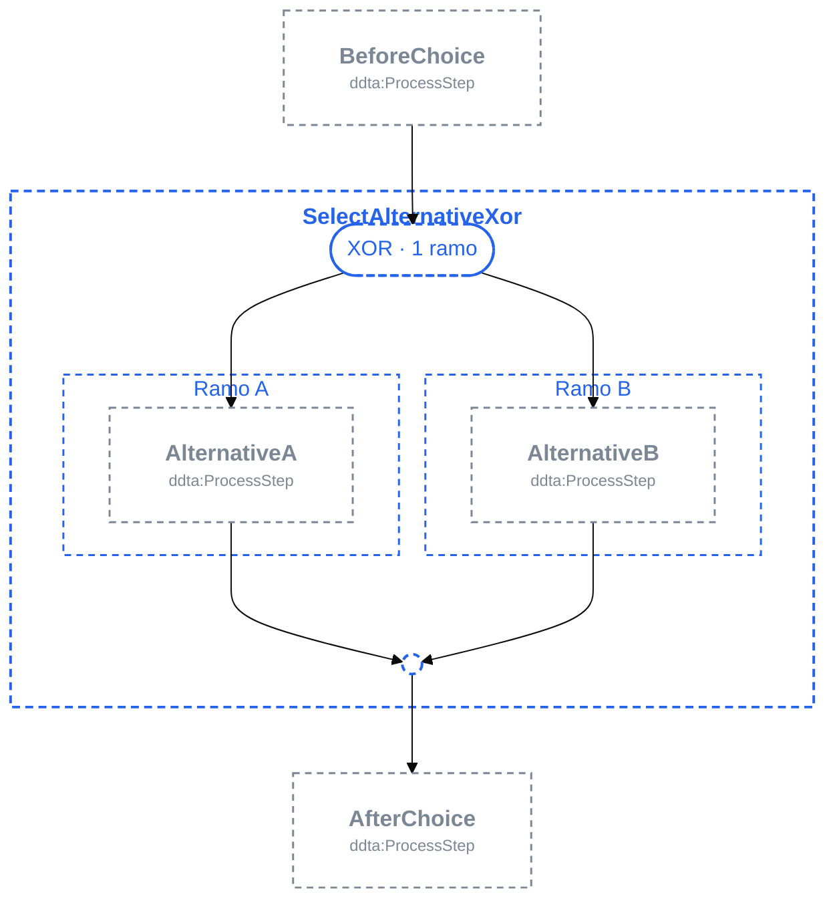

Il cerchiolino finale rappresenta **`XOR_MERGE`**, diverso dallo split iniziale. I rami sono percorsi alternativi; il merge non aspetta un ramo non selezionato. L'intestazione della regione mostra il nodo che avvia lo split, mentre l'identità del merge è conservata nella mappatura del renderer (e deve essere ispezionabile nella vista di dettaglio). Il file RDF di esempio è `../../examples/control_xor.ttl`.

### 9.6 Esempio di `CONCURRENT_SPLIT` — due rami e join ALL

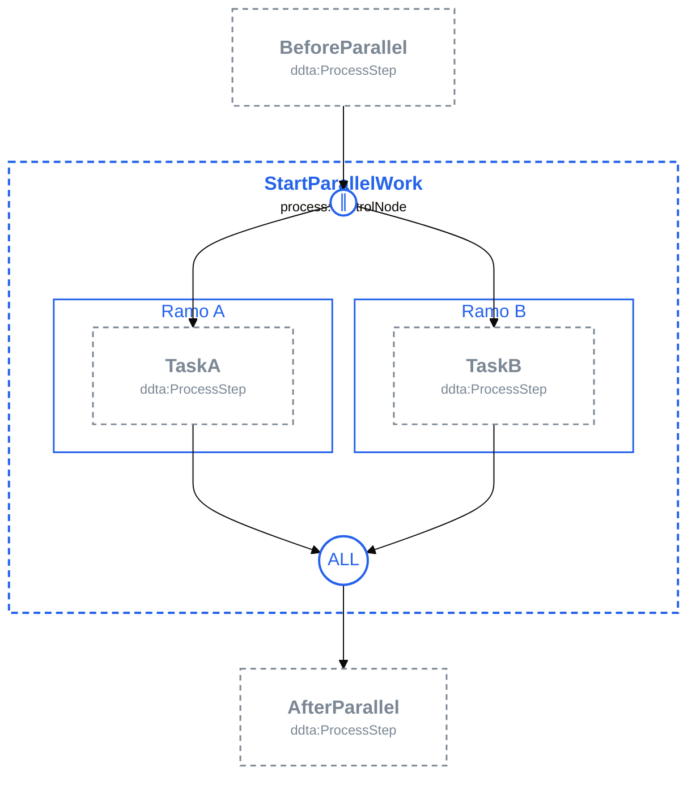

Il bordo **continuo dei rami e dei cerchiolini** distingue visivamente i percorsi concorrenti da quelli XOR. Non richiede esecuzione fisica simultanea; il join `ALL` è un individuo `SynchronizationNode` distinto, non una proprietà automatica dello split. Gli individui e le transizioni del disegno sono dichiarati in `../../examples/control_concurrent_all.ttl`.

### 9.7 XOR con una sola condizione visibile e guardie complementari — candidato R4

Per due transizioni RDF in uscita dallo stesso `process:ControlNode` con `controlKind = XOR_SPLIT`, si rappresenta **una sola `process:AtomicCondition`** in cima alla regione XOR soltanto se una guardia è quella condizione e l'altra è una `process:CompositeCondition` con `logicalOperator = NOT` e **un solo** `hasCondition` che punta alla prima. La condizione `NOT` non è cancellata dall'RDF: il renderer ne conserva IRI, operatore e riferimento nella trace.

In questo caso il marcatore arrotondato «XOR · 1 ramo» è soppresso **soltanto visivamente**: l'IRI `ModelAgreementXor` resta l'identità RDF cui si riferisce la testata del contenitore. L'arco entrante nella regione, appartenente ontologicamente al `ControlNode`, si aggancia visivamente alla condizione. Entrambe le frecce uscenti partono **dal bordo esterno dello stesso rettangolo giallo** e puntano agli Step dichiarati, verde per la guardia atomica, rosso per la negazione. Nessun rombo decisionale esterno e nessun arco `AtomicCondition → Step` viene creato nell'RDF.

Se le guardie non sono esattamente complementari, oppure le uscite non sono esattamente due, la regola **non** si applica: la vista usa il renderer di base di §9.4 e non inventa polarità. La testata XOR rimane una regione grafica, non una relazione `hasPart`.

```yaml ddta-visualization
record: projection-rule
module: process
id: conditional-xor-single-atomic-header
target: process:ControlNode
selection:
  controlKind: XOR_SPLIT
  outgoingTransitionCount: 2
  positiveGuardClass: process:AtomicCondition
  negativeGuardClass: process:CompositeCondition
  negativeOperatorProperty: process:logicalOperator
  negativeOperatorValue: NOT
  negativeMemberRelation: process:hasCondition
  negativeMemberCount: 1
  negativeMemberMustEqualPositiveGuard: true
projection:
  controlNodeRdfIdentity: xor-region-header
  splitMarker: suppressed-for-matched-condition-only
  headerCondition: positive-atomic-guard
  visibleConditionCount: 1
  negativeGuardRdfIdentityPreservedInTrace: true
  incomingToControlVisualization: condition-container-border
  branchOrigin: same-condition-container-border
  positiveColor: "#238636"
  negativeColor: "#C62828"
  noImplicitRdfConditionToStep: true
  noImplicitDataFlow: true
  fallbackWhenNotMatched: process-control-node-default
```

---

## 10. Scheda grafica — `process:SynchronizationNode`

### 10.1 Identificazione e regole RDF

`process:SynchronizationNode` è sottoclasse di `process:ControlNode`. I rami partecipanti sono identificati dalle **`ProcessTransition` entranti** al nodo. `process:joinPolicy` vale `ALL`, `ANY` o `N_OF_M`; per `N_OF_M`, `process:requiredCount` è il valore N. M si ricava dal numero di transizioni partecipanti nel grafo selezionato e validato. `process:completionCriterion` vale `TERMINATED` oppure `SUCCESS`, ma non è rappresentato nel cerchiolino compatto: rimane disponibile nella tracciabilità o in una vista dettagliata.

### 10.2 Rappresentazione

Il nodo è un **cerchiolino bianco con bordo blu continuo** e **due o più frecce entranti** (secondo i rami realmente dichiarati), e una freccia uscente **solo se documentata**. Il testo è:

| Dati selezionati e validati | Etichetta del cerchiolino |
|---|---|
| `joinPolicy = "ALL"` | `ALL` |
| `joinPolicy = "ANY"` | `ANY` |
| `joinPolicy = "N_OF_M"`, `requiredCount=3`, 4 transizioni partecipanti | `3/4` |
| `joinPolicy = "N_OF_M"`, M non ricostruibile | Diagnostica e `N/M` **solo** se richiesta una vista provvisoria; mai inventare M |

**Il ricongiungimento non implica cancellazione automatica degli altri rami, né terminazione o successo di esecuzioni avvenute.** `ALL`, `ANY` e `N_OF_M` dichiarano quando la continuazione può essere abilitata secondo la semantica prevista. Una falsa completezza del grafo non deve diventare un valore numerico presentato come certo.

### 10.3 YAML

```yaml ddta-visualization
record: class-style
module: process
target: process:SynchronizationNode
node:
  shape: circle
  style: synchronization-marker
style:
  fill: "#FFFFFF"
  stroke: "#2563EB"
  color: "#2563EB"
  strokeWidth: 2
  strokePattern: solid
projection:
  joinPolicyProperty: process:joinPolicy
  requiredCountProperty: process:requiredCount
  completionCriterionProperty: process:completionCriterion
  participatingTransitionClass: process:ProcessTransition
  participatingDestination: process:toStep
  sourceScope: same-declaring-process
  incomingCount: count-distinct-participating-transitions
  label:
    ALL: ALL
    ANY: ANY
    N_OF_M: "{requiredCount}/{participatingTransitionCount}"
    unresolvedDenominator:
      default: report-not-renderable
      diagnosticOnly: N/M
  allAndAnyDoNotUseRequiredCount: true
  doNotInferCancellationOfRemainingBranches: true
  showCompletionCriterionOnlyInDetails: true
  preserveIndividualIriInTrace: true
```

### 10.4 Esempio — `N_OF_M = 3/4`

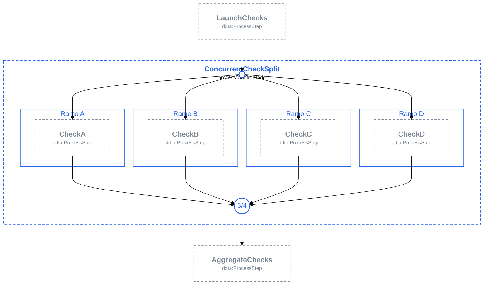

Nell'esempio `requiredCount=3` e ci sono **quattro `ProcessTransition` entranti** nel nodo di sincronizzazione, perciò il testo è `3/4`. Il criterio `SUCCESS` specifica che devono contare almeno tre completamenti ammissibili con successo; non dimostra che tali completamenti siano avvenuti. RDF di esempio in `../../examples/control_concurrent_3_of_4.ttl`.

## 11. Scheda grafica — `process:CodeReference` e `process:hasCodeReference`

### 11.1 Identificazione e proprietà RDF

`process:CodeReference` è un riferimento **identificabile al codice sorgente**, non una sottoclasse di `ddta:Resource`. La relazione `process:hasCodeReference` collega `ddta:Process` o `ddta:ProcessStep` a tale riferimento. Le proprietà descrittive del riferimento sono cinque: `repositoryLocator`, `sourcePath`, `symbolIdentifier`, `codeElementKind`, `sourceRevision`. Tutte possono essere visualizzate in una vista di dettaglio; non sono obbligatoriamente tutte presenti.

### 11.2 Rappresentazione: nodi e relazioni Mermaid, sola icona SVG

La convenzione cromatica e geometrica approvata R3 resta invariata; viene corretta la **tecnica di rappresentazione**. La forma del nodo e della relazione è generata da Mermaid, non da un disegno SVG che sostituisce il diagramma.

- **Nodo `CodeReference`:** rettangolo **Mermaid** bianco, ad angoli retti, bordo verde chiaro `#79B991` tratteggiato; contiene l'icona file **SVG** e i dati compatti.
- **Testo compatto:** nome o file, tipo RDF completo `process:CodeReference`, e `symbolIdentifier` se presente; non inventare campi assenti.
- **Relazione `hasCodeReference`:** ellisse **Mermaid** con nome della proprietà, bordo verde chiaro tratteggiato e collegamenti Mermaid verdi chiari tratteggiati; punta direzionale verso `CodeReference`. L'ellisse è solo la proiezione della proprietà, non un individuo RDF.
- **Icona:** **solo l'icona** è un asset SVG monocromatico. Il renderer applica `#79B991`, coerentemente con lo stile del nodo. Non usare il file SVG per disegnare la cornice, l'ellisse o le frecce. Se il colore dell'SVG è definito da `currentColor`, l'ereditarietà funziona quando l'SVG è inserito *inline*, non va presunta per un `` esterno.
- **Navigazione:** il nodo può avere un link soltanto quando il riferimento a file o simbolo è risolvibile. Preferire `symbolIdentifier` se il resolver trova la definizione; altrimenti aprire `sourcePath`. Un link non è una nuova relazione RDF.
- **Distinzione:** il riferimento al codice non prova che quella versione sia in esecuzione; `sourceRevision` può contribuire alla risoluzione quando dichiarata.

**Asset iconografico (soltanto icona file, non nodo/relazione SVG):**

`assets/file-code.svg` (icona sorgente, incorporata nel box Mermaid sottostante)

**Regola cromatica:** colore dell'icona = `style.stroke` del nodo. Il generatore `tools/build_process_icon_mermaid.py` esegue prima la sincronizzazione degli SVG con il bordo e poi include il risultato nel Mermaid, secondo la tecnica del CORE.

**Applicazione della regola CORE per le icone (revisione R5):** come negli esempi di `DDTA_CORE_VISUALIZATION.md`, il generatore legge l'SVG locale, ne materializza il colore a partire dal bordo YAML e incorpora l'immagine nell'etichetta **interna al nodo Mermaid** come `data:image/svg+xml;base64,...`. Non si usa un'immagine Markdown esterna per simulare il nodo, non si disegna la cornice in SVG e non si usa `` nella label Mermaid. Le tre icone del pacchetto sono soltanto sorgenti per la rigenerazione. Il `.md` e i `.mmd` consegnati incorporano già le icone e non richiedono l'accesso agli SVG a runtime. Per cambiare i colori, modificare il bordo nello YAML ed eseguire `python .\tools\build_process_icon_mermaid.py`.

### 11.3 YAML — classe e relazione

```yaml ddta-visualization
record: class-style
module: process
target: process:CodeReference
node:
  shape: rectangle
  style: code-reference
style:
  fill: "#FFFFFF"
  stroke: "#79B991"
  color: "#263238"
  strokeWidth: 2
  strokePattern: dashed
  cornerRadius: 0
icon:
  required: true
  type: svg-file
  source: assets/file-code.svg
  colorSource: style.stroke
  placement: inside-node-label-before-title
  mermaidEncoding: data-uri-base64
  widthPx: 28
  heightPx: 28
label:
  compactFields: [displayName, rdfType, process:symbolIdentifier]
  optionalDetails: [process:repositoryLocator, process:sourcePath, process:codeElementKind, process:sourceRevision]
link:
  optional: true
  derivedFrom: [process:repositoryLocator, process:sourcePath, process:symbolIdentifier, process:sourceRevision]
  prefer: resolved-symbol-definition
  fallback: resolved-source-file
  unresolved: non-clickable
  needsResolverForSymbol: true
```

```yaml ddta-visualization
record: relation-style
module: process
target: process:hasCodeReference
representation:
  type: directed-edge
  drawEdge: true
  direction: subject-to-object
  stroke: "#79B991"
  strokeWidth: 2
  strokePattern: dashed
  dashArray: "8 5"
  arrowhead: target
label:
  text: hasCodeReference
  representation: ellipse-inline-node
  fill: "#EDF8F0"
  stroke: "#79B991"
  color: "#37694E"
  strokePattern: dashed
  cornerRadius: full
```

### 11.4 Mermaid — icona file incorporata dentro il rettangolo

<!-- DDTA-R5:coderef:START -->

```mermaid
%%{init: {"htmlLabels":true,"theme":"base"}}%%
flowchart LR
    STEP["<div style='display:inline-block;text-align:center;white-space:nowrap;line-height:1.4;padding:8px 12px;background:transparent'><span style='display:block;text-align:center;font-size:17px;font-weight:700;color:#334155'>VerifyPasswordHash</span><span style='display:block;text-align:center;font-size:12px;font-weight:400;color:#334155'>ddta:ProcessStep</span></div>"]
    REL(["hasCodeReference"])
    REF["<img src='data:image/svg+xml;base64,PD94bWwgdmVyc2lvbj0nMS4wJyBlbmNvZGluZz0ndXRmLTgnPz4KPHN2ZyB4bWxucz0iaHR0cDovL3d3dy53My5vcmcvMjAwMC9zdmciIHZpZXdCb3g9IjAgMCAyNCAyNCIgd2lkdGg9IjMyIiBoZWlnaHQ9IjMyIiBmaWxsPSJub25lIiBzdHJva2U9ImN1cnJlbnRDb2xvciIgc3Ryb2tlLXdpZHRoPSIxLjgiIHN0cm9rZS1saW5lY2FwPSJyb3VuZCIgc3Ryb2tlLWxpbmVqb2luPSJyb3VuZCIgYXJpYS1sYWJlbD0iSWNvbmEgZmlsZSBjb24gY29kaWNlIiBzdHlsZT0iY29sb3I6Izc5Qjk5MSIgZGF0YS1kZHRhLWNvbG9yLXNvdXJjZT0iYm9yZGVyLXN0cm9rZSI+CiAgPHBhdGggZD0iTTEzIDIuNzVINi41QTIuNSAyLjUgMCAwIDAgNCA1LjI1djEzLjVhMi41IDIuNSAwIDAgMCAyLjUgMi41aDExYTIuNSAyLjUgMCAwIDAgMi41LTIuNVY5Ljc1WiIgLz4KICA8cGF0aCBkPSJNMTMgMi43NXY3aDciIC8+CiAgPHBhdGggZD0ibTkuMSAxMy4zLTIuMyAyLjIgMi4zIDIuMiIgLz4KICA8cGF0aCBkPSJtMTQuOSAxMy4zIDIuMyAyLjItMi4zIDIuMiIgLz4KICA8cGF0aCBkPSJtMTMuMyAxMi43NS0yLjYgNS41IiAvPgo8L3N2Zz4=' width='28' height='28'/><div style='display:inline-block;text-align:center;white-space:nowrap;line-height:1.4;padding:8px 12px;background:transparent'><span style='display:block;text-align:center;font-size:17px;font-weight:700;color:#263238'>hash.py</span><span style='display:block;text-align:center;font-size:12px;font-weight:400;color:#263238'>process:CodeReference</span><span style='display:block;text-align:center;font-size:12px;font-weight:400;color:#263238'>HashService.verify</span></div>"]
    STEP -.-> REL
    REL -.-> REF
    classDef step fill:#FFFFFF,stroke:#7B8794,color:#334155,stroke-width:1.5px,stroke-dasharray:5 4
    classDef relation fill:#EDF8F0,stroke:#79B991,color:#37694E,stroke-width:2px,stroke-dasharray:8 5
    classDef codeRef fill:#FFFFFF,stroke:#79B991,color:#263238,stroke-width:2px,stroke-dasharray:8 5
    class STEP step
    class REL relation
    class REF codeRef
    linkStyle 0,1 stroke:#79B991,stroke-width:2px,stroke-dasharray:8 5
```

<!-- DDTA-R5:coderef:END -->

Il campione è un **diagramma Mermaid**; `assets/file-code.svg` è l'icona del nodo `REF` **già incorporata nel box** come `data:`. Nessuna cornice o relazione è pre-renderizzata in SVG.

---

## 12. Scheda grafica — `process:hasSubProcess`

### 12.1 Significato

La relazione collega **un `ddta:Process` a un altro `ddta:Process`** che appartiene direttamente alla sua decomposizione strutturale. Non impone ordine di esecuzione e non equivale a `invokesProcess`.

### 12.2 Rappresentazione

Si usa il **contenimento**: il processo padre contiene graficamente i rettangoli dei sottoprocessi, anche ricorsivamente. **Non** si aggiunge una freccia o un nodo `hasSubProcess`. Ogni processo conserva lo stile della classe `ddta:Process` stabilito dal CORE, anche quando appare come `subgraph`; gli Step interni eventualmente selezionati rimangono contenuti nel proprio processo.

Se una stessa identità compare nella composizione di più processi, la vista deve mantenere la tracciabilità delle eventuali occorrenze grafiche o emettere diagnostica di layout; non deve affermare nuove appartenenze RDF. I cicli di composizione sono vietati dai controlli documentali dell'ontologia PROCESS.

### 12.3 YAML

```yaml ddta-visualization
record: relation-style
module: process
target: process:hasSubProcess
representation:
  type: containment
  parent: subject
  child: object
  renderer: mermaid-subgraph
  drawEdge: false
  recursive: true
  retainCoreClassStyle: ddta:Process
  visualCopiesAreNotRdfIndividuals: true
validation:
  rejectCycles: true
  multipleVisibleParents: require-identity-preserving-projection-or-diagnostic
```

### 12.4 Esempio Mermaid — contrasto CORE e contenimento invariato

La palette resta quella del CORE (`#F8FAFC` / `#7B8794` / `#334155`). I sottoprocessi non ricevono un colore diverso dal processo contenitore. **Nessuna freccia `hasSubProcess`** viene aggiunta.

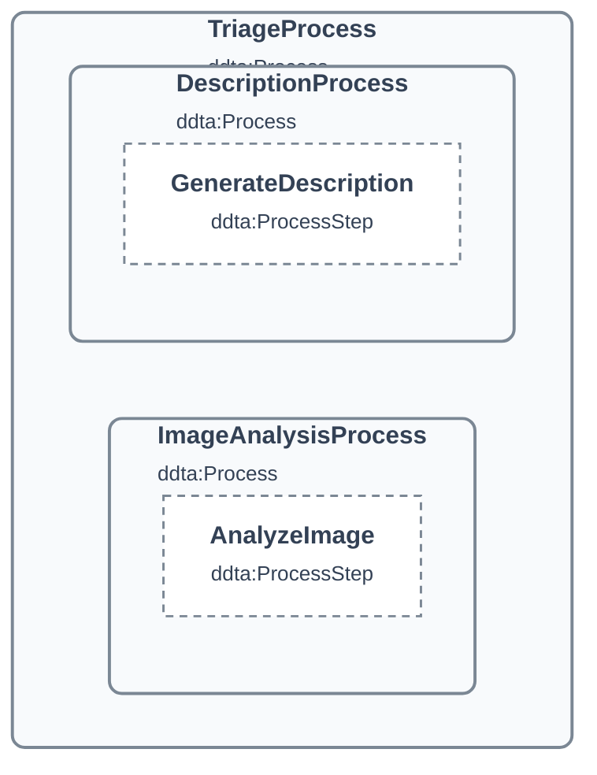

---

## 13. Scheda grafica — `process:invokesProcess`

### 13.1 Significato e confronto con `hasNextStep`

`process:invokesProcess` collega uno **Step** al **Process** che esso richiama nel flusso previsto, con cardinalità documentale **0..1 per Step**. Non impone che il processo chiamato sia un suo sottoprocesso e non indica, da solo, esecuzione già avvenuta, attesa del risultato, ritorno o modalità sincrona/asincroma.

`ddta:hasNextStep` collega invece due **Step** in possibile successione. La guardia di una transizione usa `process:hasGuard`; una condizione abilitante dello Step usa `process:hasActivationCondition`. Nessuna delle due è incorporata automaticamente nella proprietà `invokesProcess`.

### 13.2 Rappresentazione e YAML

Freccia **direzionale grigia** con nome `invokesProcess` in **ellisse intermedia** secondo la convenzione concordata per questa proprietà. La freccia parte dallo Step e raggiunge il **bordo del contenitore Process** richiamato, non uno Step interno. Non introdurre un colore specifico per la chiamata.

```yaml ddta-visualization
record: relation-style
module: process
target: process:invokesProcess
representation:
  type: directed-edge
  drawEdge: true
  direction: subject-to-object
  stroke: "#7B8794"
  strokeWidth: 1.8
  strokePattern: solid
  arrowhead: target
  destinationAttachment: process-container-border
label:
  text: invokesProcess
  representation: ellipse-inline-node
  fill: "#F3F4F6"
  stroke: "#7B8794"
  color: "#334155"
semanticGuardrails:
  doNotInferProcessContainment: true
  doNotInferWaitingOrReturn: true
```

### 13.3 Esempio Mermaid — chiamata e contrasto CORE

La freccia raggiunge il **contenitore** Process e non lo Step interno. Sfondi, bordi e geometrie derivano dal CORE; viene aumentato **soltanto** il contrasto delle scritte.

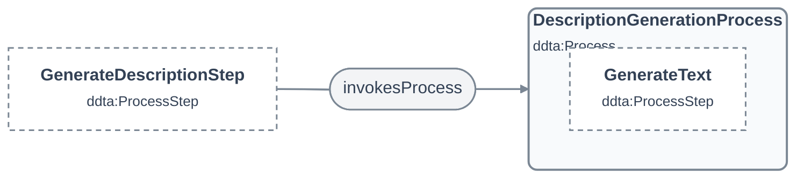

---

## 14. Scheda grafica — `process:hasInitialStep`

### 14.1 Identificazione

Il `Process` può dichiarare uno o più Step iniziali tramite `process:hasInitialStep` (0..*). Lo scopo è identificare l'ingresso anche quando la topologia è ciclica e **tutti gli Step hanno un predecessore**. L'assenza della dichiarazione non autorizza il renderer ad assumere arbitrariamente un punto d'ingresso; una ricerca dei nodi senza predecessori può costituire soltanto un'euristica esplicita su grafo completo.

### 14.2 Rappresentazione

Un piccolo marcatore **ellittico grigio chiaro `START`** precede **ogni** Step dichiarato iniziale. Il marcatore è **solo grafico** (nessuna nuova classe `START` e nessuna tripla RDF); lo Step conserva il proprio tipo e il proprio stile. L'eventuale freccia visiva dal marcatore allo Step è una proiezione di `hasInitialStep`, **non** un nuovo collegamento `hasNextStep`.

### 14.3 YAML e Mermaid

```yaml ddta-visualization
record: relation-style
module: process
target: process:hasInitialStep
representation:
  type: derived-start-marker
  markerShape: ellipse
  markerLabel: START
  markerFill: "#F3F5F7"
  markerStroke: "#B6BEC8"
  markerColor: "#596674"
  markerIsRdfIndividual: false
  direction: marker-to-selected-object
  multipleInitialSteps: render-one-marker-per-declared-entry
  noAutomaticStartFromGraphTopology: true
  retainStepCoreStyle: true
```

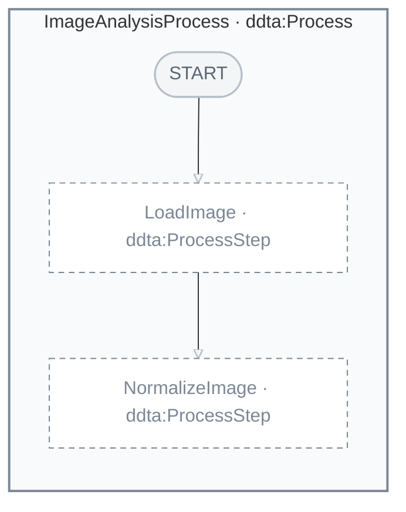

---

## 15. Scheda grafica — `WAIT`, `END_BRANCH`, `END_PROCESS`

### 15.1 Significato

I tre valori sono dichiarati tramite `process:controlKind` su individui `process:ControlNode`, che sono anche `ddta:ProcessStep`. A differenza del marcatore `START`, questi **sono Step RDF reali**.

- `WAIT`: sospensione intenzionale del comportamento previsto; non indica necessariamente uno stato operativo osservato. Durata, finestra temporale e politica di ripresa possono essere documentate tramite una risorsa `ddta:Resource` collegata con `process:usesConfiguration`.
- `END_BRANCH`: prescrive la conclusione di quel ramo, senza certificare la fine degli altri rami.
- `END_PROCESS`: prescrive la terminazione logica del processo; non certifica la cancellazione fisica dei worker.

### 15.2 Rappresentazione

**Ellisse grigio chiaro** con etichetta centrale `WAIT`, `END_BRANCH` o `END_PROCESS`, bordo grigio `#B6BEC8`, testo grigio scuro `#596674`. Nessuna cornice blu o doppio contenitore per questi tre tipi. Mostrare nome/IRI dell'individuo quando la vista di dettaglio è selezionata. Non aggiungere automaticamente un timeout, un ciclo di ripresa o un arco terminale non dichiarato.

### 15.3 YAML e esempio

```yaml ddta-visualization
record: projection-rule
module: process
id: process-control-terminal-ellipse
target: process:ControlNode
selector:
  datatypeProperty: process:controlKind
  allowedValues: [WAIT, END_BRANCH, END_PROCESS]
node:
  shape: ellipse
  style: process-control-terminal-ellipse
style:
  fill: "#F3F5F7"
  stroke: "#B6BEC8"
  color: "#596674"
  strokeWidth: 1.5
  strokePattern: solid
label:
  textFrom: process:controlKind
  aligned: center
  fullIdentityVisibleInDetail: true
```

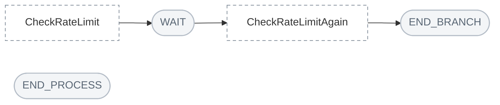

Il nodo `END_PROCESS` isolato è presente unicamente per mostrare la stessa forma senza inventare una transizione. Il percorso `CHECK → WAIT → RETRY → END_BRANCH` è soltanto un esempio astratto di **transizioni da dichiarare nei dati RDF**; `WAIT` non implica il ritorno a `RETRY` per definizione.

---

## 16. Scheda grafica — `process:implementedBy` e `process:usesConfiguration`

### 16.1 Semantica RDF e differenze

Entrambe le proprietà collegano un `ddta:Process` o `ddta:ProcessStep` a una `ddta:Resource`.

- `process:implementedBy` identifica la **risorsa tecnica che implementa** il processo o lo Step; è diversa da `ddta:realizesFunction` (Process → Function) e da `process:hasCodeReference` (Process/Step → CodeReference).
- `process:usesConfiguration` identifica una **risorsa usata come configurazione operativa** del processo o dello Step, per esempio un file di parametri o una configurazione di rate limiting. L'utilizzo previsto non prova che un parametro sia stato effettivamente applicato in un'esecuzione osservata.

Non si introduce `ConfigurationResource` nel CORE né nel PROCESS in questa revisione: il ruolo è già espresso da `usesConfiguration`, con destinazione `ddta:Resource`. La stessa `Resource` può eventualmente avere altri ruoli dichiarati altrove.

### 16.2 Convenzione grafica di associazione

**Stesso linguaggio visivo** della relazione `hasCodeReference` approvata R3:

- Ellisse della proprietà con **bordo verde chiaro `#79B991` tratteggiato** e riempimento `#EDF8F0`.
- Due tratti di collegamento **verdi chiari tratteggiati**, con direzione soggetto → oggetto e punta verso la risorsa.
- La destinazione è un **rettangolo bianco ad angoli retti con bordo verde chiaro tratteggiato** *in questa vista di associazione PROCESS*. L'identità rimane `ddta:Resource`; lo stile contestuale non cambia il suo stile generico nel CORE, dove la risorsa può apparire come rettangolo bianco con bordo nero.
- **`implementedBy`:** mantenere l'icona prevista dal CORE per la specifica classe della Resource, se presente; non assegnare l'icona file arbitrariamente a tutte le Resource. Un eventuale indirizzo di repository o spazio di memoria è riportato **solo come testo documentato**. **Nessun link cliccabile per ora**.
- **`usesConfiguration`:** inserire nell'elemento Resource un'**icona SVG a ingranaggio** verde chiaro, senza introdurre una nuova classe. Mostrare il nome della risorsa e il tipo RDF. L'eventuale percorso di configurazione compare soltanto se dichiarato in dati accessibili al renderer.

**Asset iconografico (solo ingranaggio SVG, non intero nodo):**

`assets/configuration-gear.svg` (icona sorgente, incorporata nella Resource Mermaid sottostante)

L'icona assume il colore effettivo del bordo `objectPresentation.stroke` ed è **incorporata dentro il nodo** `RateLimitConfiguration`. Il nodo `ddta:Resource`, l'ellisse relazionale e le frecce restano oggetti Mermaid.

### 16.3 YAML — due relazioni e decorazione contestuale

```yaml ddta-visualization
record: relation-style
module: process
target: process:implementedBy
representation:
  type: directed-edge
  drawEdge: true
  direction: subject-to-object
  stroke: "#79B991"
  strokeWidth: 2
  strokePattern: dashed
  dashArray: "8 5"
  arrowhead: target
label:
  text: implementedBy
  representation: ellipse-inline-node
  fill: "#EDF8F0"
  stroke: "#79B991"
  color: "#37694E"
  strokePattern: dashed
objectPresentation:
  rdfClass: ddta:Resource
  context: process-implementation-reference-view
  shape: rectangle
  fill: "#FFFFFF"
  stroke: "#79B991"
  strokePattern: dashed
  cornerRadius: 0
  useCoreSpecializationIconWhenPresent: true
  clickTarget: none
  optionalLocation: only-if-documented
```

```yaml ddta-visualization
record: relation-style
module: process
target: process:usesConfiguration
representation:
  type: directed-edge
  drawEdge: true
  direction: subject-to-object
  stroke: "#79B991"
  strokeWidth: 2
  strokePattern: dashed
  dashArray: "8 5"
  arrowhead: target
label:
  text: usesConfiguration
  representation: ellipse-inline-node
  fill: "#EDF8F0"
  stroke: "#79B991"
  color: "#37694E"
  strokePattern: dashed
objectPresentation:
  rdfClass: ddta:Resource
  context: process-configuration-reference-view
  shape: rectangle
  fill: "#FFFFFF"
  stroke: "#79B991"
  strokePattern: dashed
  cornerRadius: 0
  icon: assets/configuration-gear.svg
  iconColorSource: objectPresentation.stroke
  iconPlacement: inside-node-label-before-title
  iconMermaidEncoding: data-uri-base64
  iconMeaning: presentation-only-not-rdf-class
  clickTarget: none
  optionalLocation: only-if-documented
```

### 16.4 Esempio Mermaid — colori coerenti

<!-- DDTA-R5:configuration:START -->

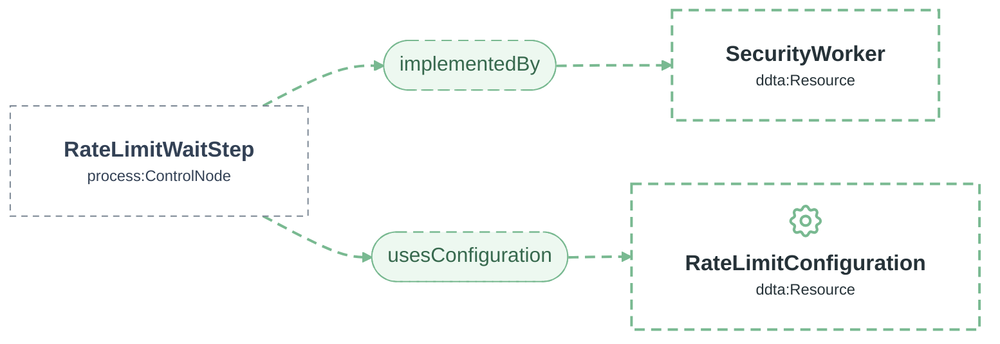

<!-- DDTA-R5:configuration:END -->

L'SVG rappresenta soltanto l'ingranaggio **incorporato nel box Mermaid**; il Mermaid rappresenta il nodo, la relazione e gli archi. La tecnica di generazione `data:` riprende il CORE. Le due proprietà non sono reciproche e non sono sotto-proprietà automatiche di `hasCodeReference`.

---

## 17. Scheda grafica — `process:hasActivationCondition`

### 17.1 Semantica ontologica

`process:hasActivationCondition` collega **un `ddta:Process` o `ddta:ProcessStep`** a **una `process:Condition`** abilitante, con cardinalità documentale **0..1**. Poiché `AtomicCondition` e `CompositeCondition` sono sottoclassi di `Condition`, il criterio può essere **semplice oppure composto** (`AND`, `OR`, `NOT`). Il cancello grafico non introduce una nuova classe ontologica.

La proprietà è **distinta** da `process:hasGuard`, che qualifica una singola `ProcessTransition`: una condizione di attivazione riguarda l'elemento stesso, non uno specifico arco del flusso. Una condizione non soddisfatta non implica automaticamente attesa, errore o ramo alternativo.

### 17.2 Rappresentazione del gate e riuso delle condizioni

La proiezione di `process:hasActivationCondition` introduce **soltanto un contenitore grafico esterno**, non un individuo RDF. All'interno viene renderizzata **la stessa condizione** che la query selezionerebbe usando le schede 4, 6, 7 e 8: nessuna grammatica grafica separata per le condizioni di attivazione.

- **Gate esterno Mermaid:** rettangolo ad angoli retti (`cornerRadius: 0`), sfondo grigio `#EDF0F3`, bordo continuo `#D6A100`; intestazione con icona SVG cancello **dentro il box** e dello stesso colore del bordo. Mostrare sempre su due righe **nome del gate** (identificativo grafico) e **IRI della proprietà** `process:hasActivationCondition`. In assenza di un nome grafico dichiarato, ricavarlo deterministicamente dal nome dell'elemento abilitato seguito da `ActivationGate` (nell'esempio `ImageRetrainingProcessActivationGate`). L'intestazione non introduce un tipo `process:Gate` né un individuo RDF aggiuntivo.
- **Condizione interna visibile:** rettangolo Mermaid **bianco**, bordo continuo `#D6A100`, titolo con nome e tipo RDF; non convertire tutta la condizione in una riga di testo nel gate.
- **Atomica:** due `process:Operand` neutri separati da un **rombo Mermaid** che riporta *il letterale* `EQ`, `NE`, `LT`, `LE`, `GT` oppure `GE`. `GE` non deve essere sostituito con il simbolo `≥`. I letterali numerici come `50` compaiono nel box dell'operando corrispondente.
- **Composta:** i blocchi neutri delle condizioni componenti e i rombi `AND`, `OR`, `NOT` adottano le regole della scheda 7; le condizioni atomiche componenti si possono espandere in una vista di dettaglio senza perdere identità RDF.
- **Posizione:** gate adiacente all'ingresso del `Process`/`ProcessStep` abilitato. L'eventuale collegamento fra gate e elemento serve a **proiettare la relazione** `hasActivationCondition`, non a rappresentare una `ProcessTransition`, `hasNextStep` o un evento di esecuzione.
- **Nessun secondo rombo** esterno: sono esclusi solo i rombi *aggiuntivi* di attivazione; i rombi interni della condizione sono obbligatori quando i rispettivi operatori RDF sono dichiarati.

Il colore delle icone deriva dal **bordo del relativo box**, non da un colore indipendente. `assets/gate-icon.svg` è solo l'asset iconografico: contorno, rettangolo e grafi sono generati in Mermaid. La tecnica `data:image/svg+xml;base64` segue il CORE ed è inclusa nei diagrammi del pacchetto.

### 17.3 YAML — proiezione della proprietà

```yaml ddta-visualization
record: relation-style
module: process
target: process:hasActivationCondition
representation:
  type: inline-activation-gate
  sourceClass: [ddta:Process, ddta:ProcessStep]
  conditionRelation: process:hasActivationCondition
  gateNear: target-process-or-step-entry-border
  gateIsRdfIndividual: false
  gateShape: rectangle
  gateCornerRadius: 0
  gateFill: "#EDF0F3"
  gateStroke: "#D6A100"
  gateStrokePattern: solid
  gateTextColor: "#865F00"
  gateIcon: assets/gate-icon.svg
  gateIconColorSource: gateStroke
  gateIconPlacement: inside-gate-header
  gateIconMermaidEncoding: data-uri-base64
  gateHeader:
    nameSource: target-display-name
    nameSuffix: ActivationGate
    nameMeaning: presentation-only-not-rdf-individual
    referenceLabel: process:hasActivationCondition
    referenceKind: rdf-object-property
  content:
    source: process:hasActivationCondition
    renderUsingClassStyle: true
    allowedClasses: [process:Condition, process:AtomicCondition, process:CompositeCondition]
    preserveConditionRdfIdentity: true
    reuseAtomicConditionRule: process:AtomicCondition
    reuseCompositeConditionRule: process:CompositeCondition
    reuseOperandRule: process:Operand
    doNotReplaceOperatorsWithMathematicalSymbols: true
  noAdditionalExternalDecisionDiamond: true
  preserveInternalOperatorDiamonds: true
  noImplicitWaitingOrAlternateBranch: true
  noImplicitProcessExecution: true
```

### 17.4 Esempio atomico — contatore immagini errate e operatore `GE`

**Layout compatto del gate (R7.4):** l'icona è affiancata alle due righe del titolo e solo i due diagrammi del gate usano `subGraphTitleMargin.bottom = 26`. La condizione annidata continua a usare la rappresentazione della scheda 6; non si aggiungono nodi o contenitori di layout. La soluzione resta da verificare nell'anteprima Mermaid di VS Code.

Il criterio di attivazione è `process:AtomicCondition` con operando sinistro `IncorrectImageCount`, operando destro `Threshold50` (`literalValue = 50`) e `process:comparisonOperator "GE"`. L'errore è stato già verificato ed è incluso nel conteggio, prima della valutazione della soglia; questa è un'assunzione dell'esempio, non una regola generale dell'ontologia.

**Intestazione del gate:** `ImageRetrainingProcessActivationGate` è il nome grafico derivato da `ImageRetrainingProcess`; `process:hasActivationCondition` è l'IRI della proprietà rappresentata, **non un rdf:type**. L'individuo effettivo della condizione mantiene il proprio nome `ErrorImageThresholdReached` e tipo `process:AtomicCondition`. Il rombo mantiene il valore letterale `GE`.

<!-- DDTA-R5:gate:START -->

```mermaid
%%{init: {"theme":"base","flowchart":{"htmlLabels":true,"subGraphTitleMargin":{"top":12,"bottom":26},"nodeSpacing":30,"rankSpacing":35}}}%%
flowchart LR
    subgraph G["<div style='display:inline-flex;align-items:center;justify-content:center;gap:7px;white-space:nowrap;line-height:1.2;padding:1px 6px;background:transparent'><img src='data:image/svg+xml;base64,PD94bWwgdmVyc2lvbj0nMS4wJyBlbmNvZGluZz0ndXRmLTgnPz4KPHN2ZyB4bWxucz0iaHR0cDovL3d3dy53My5vcmcvMjAwMC9zdmciIHZpZXdCb3g9IjAgMCAyNCAyNCIgd2lkdGg9IjMyIiBoZWlnaHQ9IjMyIiBmaWxsPSJub25lIiBzdHJva2U9ImN1cnJlbnRDb2xvciIgc3Ryb2tlLXdpZHRoPSIxLjgiIHN0cm9rZS1saW5lY2FwPSJyb3VuZCIgc3Ryb2tlLWxpbmVqb2luPSJyb3VuZCIgYXJpYS1sYWJlbD0iSWNvbmEgY2FuY2VsbG8gZGkgYXR0aXZhemlvbmUiIHN0eWxlPSJjb2xvcjojRDZBMTAwIiBkYXRhLWRkdGEtY29sb3Itc291cmNlPSJib3JkZXItc3Ryb2tlIj4KICA8cGF0aCBkPSJNNC41IDIxVjQuNWgzVjIxTTE2LjUgMjFWNC41aDNWMjEiIC8+CiAgPHBhdGggZD0iTTcuNSA4LjVoOU03LjUgMTJoOU03LjUgMTUuNWg5IiAvPgogIDxjaXJjbGUgY3g9IjYiIGN5PSIzLjIiIHI9IjEuMiIgLz4KICA8Y2lyY2xlIGN4PSIxOCIgY3k9IjMuMiIgcj0iMS4yIiAvPgo8L3N2Zz4=' width='24' height='24' style='display:block;flex-shrink:0'/><div style='display:block;text-align:center'><span style='display:block;text-align:center;font-size:16px;font-weight:700;color:#865F00'>ImageRetrainingProcessActivationGate</span><span style='display:block;text-align:center;font-size:12px;font-weight:400;color:#865F00'>process:hasActivationCondition</span></div></div>"]
        direction TB
        subgraph AC["<div style='display:block;text-align:center;white-space:nowrap;line-height:1.25;padding:4px 8px 10px;background:transparent'><span style='display:block;text-align:center;font-size:17px;font-weight:700;color:#A67C00'>ErrorImageThresholdReached</span><span style='display:block;text-align:center;font-size:12px;font-weight:400;color:#A67C00'>process:AtomicCondition</span></div>"]
            direction LR
            L["<div style='display:inline-block;text-align:center;white-space:nowrap;line-height:1.4;padding:8px 12px;background:transparent'><span style='display:block;text-align:center;font-size:17px;font-weight:700;color:#334155'>IncorrectImageCount</span><span style='display:block;text-align:center;font-size:12px;font-weight:400;color:#334155'>process:Operand</span></div>"]
            OP{"GE"}
            R["<div style='display:inline-block;text-align:center;white-space:nowrap;line-height:1.4;padding:8px 12px;background:transparent'><span style='display:block;text-align:center;font-size:17px;font-weight:700;color:#334155'>Threshold50</span><span style='display:block;text-align:center;font-size:12px;font-weight:400;color:#334155'>process:Operand</span><span style='display:block;text-align:center;font-size:12px;font-weight:400;color:#334155'>literalValue = 50</span></div>"]
            L ~~~ OP ~~~ R
        end
    end
    P["<div style='display:inline-block;text-align:center;white-space:nowrap;line-height:1.4;padding:8px 12px;background:transparent'><span style='display:block;text-align:center;font-size:17px;font-weight:700;color:#334155'>ImageRetrainingProcess</span><span style='display:block;text-align:center;font-size:12px;font-weight:400;color:#334155'>ddta:Process</span></div>"]
    G --- P
    classDef operand fill:#FFFFFF,stroke:#7B8794,color:#334155,stroke-width:1.5px
    class L,R operand
    style OP fill:#FFFFFF,stroke:#D6A100,color:#865F00,stroke-width:1.5px
    style AC fill:#FFFFFF,stroke:#D6A100,color:#865F00,stroke-width:2px
    style G fill:#EDF0F3,stroke:#D6A100,color:#865F00,stroke-width:2px,rx:0px,ry:0px
    style P fill:#F8FAFC,stroke:#7B8794,color:#334155,stroke-width:2px,rx:8px,ry:8px
    linkStyle 2 stroke:#7B8794,stroke-width:1.6px
```

<!-- DDTA-R5:gate:END -->

Il rettangolo esterno `G` è soltanto la cornice grafica della relazione; il rettangolo interno `AC` rappresenta l'individuo RDF `ErrorImageThresholdReached`, con gli operandi reali e il rombo letterale `GE`. Il segmento senza freccia fra `G` e `ImageRetrainingProcess` visualizza solo l'associazione `hasActivationCondition`: **non è una transizione o un ordine di esecuzione e non crea un nuovo individuo RDF**. `ddta:Process` mantiene la forma, il riempimento e i colori della guida CORE. Non è dichiarata alcuna esecuzione.

Turtle di esempio: `examples/retraining_activation_atomic.ttl`.

### 17.5 Esempio composto alternativo — `AND` fra due condizioni

Quando il requisito richiede **sia** che l'ultima analisi sia stata confermata errata, **sia** che il conteggio sia almeno 50, il criterio è `process:CompositeCondition` con `logicalOperator "AND"` e due condizioni atomiche. Questa è un'alternativa, non un'aggiunta automatica al criterio atomico.

<!-- DDTA-R6:gate-composite:START -->

```mermaid
%%{init: {"theme":"base","flowchart":{"htmlLabels":true,"subGraphTitleMargin":{"top":12,"bottom":26},"nodeSpacing":30,"rankSpacing":35}}}%%
flowchart LR
    subgraph G["<div style='display:inline-flex;align-items:center;justify-content:center;gap:7px;white-space:nowrap;line-height:1.2;padding:1px 6px;background:transparent'><img src='data:image/svg+xml;base64,PD94bWwgdmVyc2lvbj0nMS4wJyBlbmNvZGluZz0ndXRmLTgnPz4KPHN2ZyB4bWxucz0iaHR0cDovL3d3dy53My5vcmcvMjAwMC9zdmciIHZpZXdCb3g9IjAgMCAyNCAyNCIgd2lkdGg9IjMyIiBoZWlnaHQ9IjMyIiBmaWxsPSJub25lIiBzdHJva2U9ImN1cnJlbnRDb2xvciIgc3Ryb2tlLXdpZHRoPSIxLjgiIHN0cm9rZS1saW5lY2FwPSJyb3VuZCIgc3Ryb2tlLWxpbmVqb2luPSJyb3VuZCIgYXJpYS1sYWJlbD0iSWNvbmEgY2FuY2VsbG8gZGkgYXR0aXZhemlvbmUiIHN0eWxlPSJjb2xvcjojRDZBMTAwIiBkYXRhLWRkdGEtY29sb3Itc291cmNlPSJib3JkZXItc3Ryb2tlIj4KICA8cGF0aCBkPSJNNC41IDIxVjQuNWgzVjIxTTE2LjUgMjFWNC41aDNWMjEiIC8+CiAgPHBhdGggZD0iTTcuNSA4LjVoOU03LjUgMTJoOU03LjUgMTUuNWg5IiAvPgogIDxjaXJjbGUgY3g9IjYiIGN5PSIzLjIiIHI9IjEuMiIgLz4KICA8Y2lyY2xlIGN4PSIxOCIgY3k9IjMuMiIgcj0iMS4yIiAvPgo8L3N2Zz4=' width='24' height='24' style='display:block;flex-shrink:0'/><div style='display:block;text-align:center'><span style='display:block;text-align:center;font-size:16px;font-weight:700;color:#865F00'>ImageRetrainingProcessActivationGate</span><span style='display:block;text-align:center;font-size:12px;font-weight:400;color:#865F00'>process:hasActivationCondition</span></div></div>"]
        direction TB
        subgraph CC["<div style='display:block;text-align:center;white-space:nowrap;line-height:1.25;padding:4px 8px 10px;background:transparent'><span style='display:block;text-align:center;font-size:17px;font-weight:700;color:#A67C00'>NewErrorAndThreshold</span><span style='display:block;text-align:center;font-size:12px;font-weight:400;color:#A67C00'>process:CompositeCondition</span></div>"]
            direction LR
            A["<div style='display:inline-block;text-align:center;white-space:nowrap;line-height:1.4;padding:8px 12px;background:transparent'><span style='display:block;text-align:center;font-size:17px;font-weight:700;color:#334155'>LastImageAnalysisIncorrect</span><span style='display:block;text-align:center;font-size:12px;font-weight:400;color:#334155'>process:AtomicCondition</span></div>"]
            OP{"AND"}
            B["<div style='display:inline-block;text-align:center;white-space:nowrap;line-height:1.4;padding:8px 12px;background:transparent'><span style='display:block;text-align:center;font-size:17px;font-weight:700;color:#334155'>ErrorImageThresholdReached</span><span style='display:block;text-align:center;font-size:12px;font-weight:400;color:#334155'>process:AtomicCondition</span></div>"]
            A ~~~ OP ~~~ B
        end
    end
    P["<div style='display:inline-block;text-align:center;white-space:nowrap;line-height:1.4;padding:8px 12px;background:transparent'><span style='display:block;text-align:center;font-size:17px;font-weight:700;color:#334155'>ImageRetrainingProcess</span><span style='display:block;text-align:center;font-size:12px;font-weight:400;color:#334155'>ddta:Process</span></div>"]
    G --- P
    classDef member fill:#FFFFFF,stroke:#7B8794,color:#334155,stroke-width:1.5px
    class A,B member
    style OP fill:#FFFFFF,stroke:#D6A100,color:#865F00,stroke-width:1.5px
    style CC fill:#FFFFFF,stroke:#D6A100,color:#865F00,stroke-width:2px
    style G fill:#EDF0F3,stroke:#D6A100,color:#865F00,stroke-width:2px,rx:0px,ry:0px
    style P fill:#F8FAFC,stroke:#7B8794,color:#334155,stroke-width:2px,rx:8px,ry:8px
    linkStyle 2 stroke:#7B8794,stroke-width:1.6px
```

<!-- DDTA-R6:gate-composite:END -->

Il gate ha la stessa intestazione dell'esempio atomico, `ImageRetrainingProcessActivationGate` / `process:hasActivationCondition`: la differenza fra i due casi è **esclusivamente nel contenuto interno**, che qui è `NewErrorAndThreshold` di tipo `process:CompositeCondition`. Il diagramma usa due blocchi con identità `process:AtomicCondition` e un rombo `AND` **dentro** `process:CompositeCondition`, a sua volta **dentro** il gate. Per mostrare i confronti `EQ` e `GE` delle due condizioni componenti, usare le viste di dettaglio della scheda 6.

Turtle alternativo: `examples/retraining_activation_composite.ttl`. I due file Turtle rappresentano **due scenari alternativi** con lo stesso `ImageRetrainingProcess`: non vanno caricati congiuntamente come un'unica specifica perché `process:hasActivationCondition` ammette al massimo un valore per processo.

### 17.6 Limiti e verifica

La rappresentazione grafica è ora definita per le due classi di condizione; l'effettivo comportamento applicativo richiede ulteriori dettagli. Occorre ancora documentare cosa definisce un'analisi errata (ad esempio conferma clinica), chi aggiorna il contatore, se esiste un reset e a quale finestra temporale si riferisce. L'ontologia descrive il criterio che abilita il processo, **non prova che l'evento sia accaduto, che la condizione sia vera o che il processo sia partito**. Il nome di una condizione e l'espressione sono generati dai dati, non costanti imposte dalla guida.

---

## 18. Proiezione deterministica, validazioni e limiti di implementazione

### 18.1 Ordine delle operazioni

1. Selezionare gli individui RDF (`Process`, `ProcessStep`, `ProcessTransition`, `Condition`, `Operand`, `ControlNode`, `SynchronizationNode`, `CodeReference`, `Resource`) tramite query; risolvere eventuali sottoclassi soltanto secondo il profilo di inferenza dichiarato.
2. Validare nel grafo selezionato le cardinalità richieste dall'ontologia PROCESS (operandi 1+1, operatore 1; composizione AND/OR ≥2 e NOT=1; transizioni con una sorgente e destinazione; sincronizzazione e count coerenti).
3. Identificare il flusso Step→Step e le guardie, deduplicando **solo le occorrenze grafiche** `hasNextStep` già dettagliate da `ProcessTransition` per la stessa coppia ordinata.
4. Proiettare le condizioni come contenitori gialli: comporre all'interno gli individui dichiarati, gli operatori letterali e i soli vincoli di disposizione grafica. Collegare gli archi di flusso **al bordo**.
5. Proiettare una **regione di controllo** solo quando un `ControlNode` con `controlKind` corrispondente è dichiarato; ricavare colonne, Step e join dalle transizioni selezionate, non dal colore o dalla forma del diagramma. Se il layout richiesto non è ottenibile dal renderer, segnalare la limitazione senza cambiare la semantica.
6. Per i `SynchronizationNode`, calcolare M dal conteggio delle transizioni realmente partecipanti in ingresso, dopo la validazione; rappresentare l'etichetta senza assegnare valori mancanti.
7. Applicare le proiezioni delle relazioni e dei marcatori rimanenti: `hasSubProcess` come contenimento, `invokesProcess` come arco, START da `hasInitialStep`, WAIT/END come nodi reali, relazioni verdi ai riferimenti/risorse; per `hasActivationCondition`, aggiungere il contenitore gate giallo **attorno alla stessa condizione** già proiettata dalle schede 4/6/7, senza creare individui RDF grafici.
8. Generare Mermaid con ID deterministici, applicando **una sola volta** gli stili delle classi e senza trasformare i collegamenti `~~~` in dichiarazioni RDF.

### 18.2 Proprietà dei diagrammi di esempio

Gli esempi Mermaid di questa guida sono **specifiche visive per la revisione in VS Code**, non output attestati del generatore corrente. Le connessioni `subgraph → subgraph` e la combinazione `direction LR`/`direction TB` possono subire riordinamenti in alcune versioni di Mermaid, soprattutto nei grafi grandi. Il criterio di accettazione è il risultato effettivamente renderizzato: **due rami affiancati, attività interne in colonna, cerchi di split/join visibili**. Non si introducono Step RDF fittizi per forzare il layout.

La semantica del `ControlNode` come individuo RDF e la regione grafica che organizza i rami devono rimanere distinte. La forma del marcatore (XOR arrotondato oppure concurrent circolare) appartiene al nodo; la forma dei rettangoli dei rami appartiene alla proiezione topologica e non implica `hasPart`. Se un join è assente, non disegnare un cerchio finale fittizio. Se la polarità non è esplicita, non attribuire arbitrariamente verde/rosso.

### 18.3 Limiti di questa revisione

Le dichiarazioni `yaml ddta-visualization` estendono il catalogo delle regole. **Non si afferma che il generatore Python implementi già**: proiezione con operandi e operatori, attacco dei collegamenti al bordo, regioni XOR/concurrent, allineamento delle colonne, join numerici, distinzione dei marker, collegamenti cliccabili, icone SVG, cancelli di attivazione e selezione per query. Tali funzionalità andranno aggiunte e collaudate **prima** della promozione nel repository stabile.

Le nuove schede 11–17 dichiarano lo stile **atteso** e non una funzionalità già pronta del generatore: link simbolici, risoluzione di percorsi, icone SVG incorporate, ellissi relazionali, associazioni contestuali delle `Resource`, indicatori START e cancelli di attivazione richiedono implementazione e test. Tutte le proprietà PROCESS ora esaminate graficamente vanno confrontate con l'ontologia prima di consolidare la guida.

## 19. Inventario delle decisioni grafiche consolidate

| Identità / tema | Decisione |
|---|---|
| `ProcessTransition` | Proietta la transizione e sopprime solo graficamente `hasNextStep` per la medesima coppia |
| `Condition` | Contenitore giallo, fondo bianco; frecce **al bordo**; nessun secondo rombo esterno |
| `AtomicCondition` | Due `Operand` con rombo operatore di confronto al centro, nello stesso contenitore giallo |
| `CompositeCondition` | Condizioni membri e rombo `AND`/`OR` o `NOT` nello stesso contenitore giallo |
| Operatori | Unica forma per `EQ`, `NE`, `LT`, `LE`, `GT`, `GE`, `AND`, `OR`, `NOT` |
| `Operand` | Rettangolo neutro con identità RDF; non inferire automaticamente legami a codice o flussi funzionali |
| `XOR_SPLIT` | Esterno e colonne blu tratteggiate, indicatore iniziale arrotondato «XOR · 1 ramo»; eventuale merge distinto e dichiarato |
| `CONCURRENT_SPLIT` | Esterno blu tratteggiato, colonne interne **blu continue**, marcatore iniziale circolare «∥»; sincronizzazione distinta e dichiarata |
| Layout rami | Rettangoli **affiancati**, attività in verticale; due colonne nel caso binario |
| `XOR_MERGE` | Cerchiolino blu tratteggiato, nessuna barriera sui rami alternativi |
| `SynchronizationNode` | Cerchiolino blu continuo, testo `ALL`, `ANY` oppure `N/M` con valori reali come `3/4` se disponibili |
| `hasCodeReference` | Ellisse/frecce **Mermaid** verde chiaro tratteggiate; nodo **Mermaid** bianco con bordo verde chiaro tratteggiato; **solo icona file SVG**; link a sorgente se risolvibile |
| `hasSubProcess` | Contenimento ricorsivo dei `Process`, nessuna freccia addizionale |
| `invokesProcess` | Freccia direzionale grigia, ellisse con testo scuro `#334155`, verso il contenitore CORE del Process richiamato |
| `hasInitialStep` | Marcatore grafico `START` ellittico grigio chiaro davanti a ciascuno Step iniziale esplicitamente dichiarato |
| `WAIT`, `END_BRANCH`, `END_PROCESS` | Ellissi grigio chiaro, testo centrale; individui ControlNode reali |
| `implementedBy` | Come CodeReference per ellisse/frecce/verdi tratteggiati; verso Resource, senza link cliccabile |
| `usesConfiguration` | Come implementedBy, con icona ingranaggio verde sulla Resource; nessuna classe ConfigurationResource aggiunta |
| `hasActivationCondition` | Gate esterno a spigoli retti con icona SVG gialla interna, nome derivato dall'elemento destinatario e seconda riga `process:hasActivationCondition` (proprietà, non classe); al suo interno la stessa `AtomicCondition`/`CompositeCondition` delle schede 6/7 |
| Non documentato | Non creare transizioni, rami, join, polarità o individui RDF non dichiarati |

---

**Guida grafica PROCESS completa — revisione R7.5 candidata per verifica grafica Mermaid. Le schede 1–19 sono incluse; vengono corrette le proiezioni del gate e gli esempi iconografici. Nessuna modifica all’ontologia, alla guida CORE o a `tesiStabile`. Il generatore di anteprime non è ancora il generatore RDF→Mermaid definitivo.**


## 20. Piano di regressione incrociata — ontologia e grafica

I file `examples/retraining_activation_atomic.ttl` e `examples/retraining_activation_composite.ttl` sono **alternativi** (un solo `hasActivationCondition` per Process). Un terzo scenario (`examples/retraining_integration_case.ttl`) combina `hasSubProcess`, `hasInitialStep`, `ddta:hasNextStep`, `invokesProcess`, `hasCodeReference` e il gate atomico.

La verifica deve confrontare **identità RDF, predicati e cardinalità** con la proiezione grafica, senza dedurre nuove triple da icone o da vincoli di layout `~~~`. Gli esempi grafici integrati sono **costruiti per la revisione**, non generati automaticamente tramite SPARQL.

Controlli da eseguire: (i) sintassi Turtle; (ii) struttura/assenza di cicli di `hasSubProcess`; (iii) `hasInitialStep` riferito a uno Step diretto; (iv) `invokesProcess` distinto da `hasSubProcess`; (v) rappresentazione letterale degli operatori `GE`, `EQ`, `AND`; (vi) nessun gate/rombo aggiuntivo come individuo RDF; (vii) equivalenza cromatica icona/bordo; (viii) confronto visuale in VS Code della resa nested subgraph.

Per l'esecuzione di verifiche strutturali locali si fornisce `tools/check_process_examples.py` (richiede `rdflib`). I controlli implementati nello script **non sostituiscono** la validazione SHACL integrale dell'estensione PROCESS.
