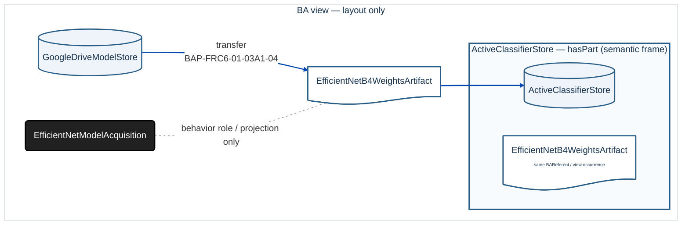
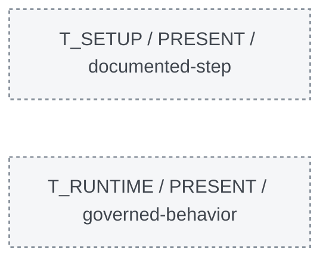

# DermaTriage — proiezione BA dinamica · `ActiveClassifierStore`

Query: `SELECT HISTORY FROM BA WHERE REFERENT = 'ActiveClassifierStore';`

> **PoC R2, non modifica della BA canonica.** Una proposition è inclusa solo se compare nei dati BA selezionati. Il diagramma non afferma la realizzazione di un evento operativo. Le relazioni mancanti non vengono inventate.

**2 BAProposition incluse · 4 BAReferent canonici coinvolti · 3 archi grafici (compresi eventuali helper di ruolo) · 0 proposition escluse per limite.**

## Tempo logico — diagramma SEPARATO, metadati non BA

Il seguente grafo rappresenta solo i contesti e le precedenze documentate: non è connesso alla topologia BA perché non sono BAProposition.

## Perché questi elementi sono inclusi

| BAProposition | Selezione | Semantica e ruoli | Stato | Contesti di occorrenza | Fonte BA |
|---|---|---|---|---|---|
| `BAP-FRC6-01-03A1-04` | diretta | **transfer** · behavior: `EfficientNetModelAcquisition`, source: `GoogleDriveModelStore`, content: `EfficientNetB4WeightsArtifact`, destination: `ActiveClassifierStore` | ACCEPTED | T_SETUP (DOCUMENTED_SETUP_ACTION) | DDTA pp.52-53 |
| `BAP-FRC6-01-03A1-08` | diretta | **hasPart** · whole: `ActiveClassifierStore`, part: `EfficientNetB4WeightsArtifact` | ACCEPTED | T_SETUP (DOCUMENTED_STRUCTURE) | DDTA p.53 |

**Regola di completezza:** tutti i ruoli di ciascuna BAProposition inclusa sono rappresentati; le ripetizioni grafiche entro i frame `hasPart` non rappresentano nuove identità BA.

## Relazioni non incluse

- Nessuna proposition scartata per il limite di nodi.
- `BAP-FRC6-01-03A1-07`: non raggiunta dai criteri della query (focus / hop / contesto).
- `BAP-FRC6-01-03A1-09`: non raggiunta dai criteri della query (focus / hop / contesto).
- `BAP-FR03-01-02`: non raggiunta dai criteri della query (focus / hop / contesto).
- `BAP-FR03-01-01`: non raggiunta dai criteri della query (focus / hop / contesto).
- `BAP-FRC7-07-01-03`: non raggiunta dai criteri della query (focus / hop / contesto).
- `BAP-FRC7-07-01-01`: non raggiunta dai criteri della query (focus / hop / contesto).
**Assenza dalla vista ≠ assenza dalla BA.**

## Tempo logico e informazioni contestuali

I contesti qui sotto qualificano occorrenze o fatti documentali: **non sono edges BA inventati**. `precedes` descrive solo l’ordine parziale esplicitato nel campione.

- Precedenze dichiarate: `T_SETUP` → `T_DEPLOY_CHECK`, `T_DEPLOY_CHECK` → `T_RUNTIME`, `T_SETUP` → `T_RETRAIN`, `T_RETRAIN` → `T_QUALIFY`.
- Sovrapposizioni dichiarate: nessuna (non implica serialità).

| Contesto | Esistenza focus | Fatto contestuale specifico (NON BAProposition) | Fonte |
|---|---|---|---|
| `PRE_BASELINE` | UNKNOWN (non e assenza) | — | — |
| `T_SETUP` | PRESENT (attestato nella vista) | — | — |
| `T_DEPLOY_CHECK` | UNKNOWN (non e assenza) | — | — |
| `T_RUNTIME` | PRESENT (attestato nella vista) | — | — |
| `T_RETRAIN` | UNKNOWN (non e assenza) | — | — |
| `T_QUALIFY` | UNKNOWN (non e assenza) | — | — |

## Interpretazione e limiti

- La selezione usa la co-partecipazione ai ruoli di una **BAProposition intera**, non un percorso di causalità automatico.
- Il grafo non collega automaticamente pesi, modello e retraining quando manca la BAProposition corrispondente.
- `produce` è la coppia di frecce nere continue `input -> actor -> result`, con BAProposition ID sull’arco actor -> result secondo lo stile del cumulativo R50; `realize` è la freccia grigia tratteggiata con etichetta realize. Gli archi `produce`, `transfer` e `realize` corrispondono a proposition selezionate; `hasPart` viene mostrato come frame. Gli archi grigi `precedes / NON BA` nel pannello temporale sono metadati di ordine logico, **non** BAProposition; l’eventuale arco grigio `behavior role / projection only` è un helper di visualizzazione.
- L’esistenza `UNKNOWN` indica che non ci sono prove sufficienti in questo dataset, non che l’elemento sia assente.
- Le versioni logiche non certificano uguaglianza crittografica fra copie di file.

