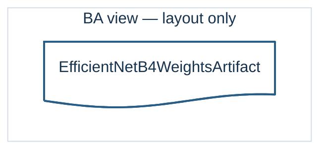
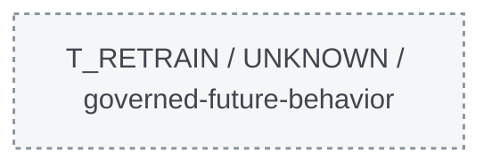

# DermaTriage — proiezione BA dinamica · `EfficientNetB4WeightsArtifact`

Query: `SELECT AT 'T_RETRAIN' FROM BA WHERE REFERENT = 'EfficientNetB4WeightsArtifact';`

> **PoC R2, non modifica della BA canonica.** Una proposition è inclusa solo se compare nei dati BA selezionati. Il diagramma non afferma la realizzazione di un evento operativo. Le relazioni mancanti non vengono inventate.

**0 BAProposition incluse · 1 BAReferent canonici coinvolti · 0 archi grafici (compresi eventuali helper di ruolo) · 0 proposition escluse per limite.**

## Tempo logico — diagramma SEPARATO, metadati non BA

Il seguente grafo rappresenta solo i contesti e le precedenze documentate: non è connesso alla topologia BA perché non sono BAProposition.

## Perché questi elementi sono inclusi

| BAProposition | Selezione | Semantica e ruoli | Stato | Contesti di occorrenza | Fonte BA |
|---|---|---|---|---|---|
| — | — | Nessuna proposition diretta selezionata | — | — | — |

**Regola di completezza:** tutti i ruoli di ciascuna BAProposition inclusa sono rappresentati; le ripetizioni grafiche entro i frame `hasPart` non rappresentano nuove identità BA.

## Relazioni non incluse

- Nessuna proposition scartata per il limite di nodi.
- `BAP-FRC6-01-03A1-04`: non raggiunta dai criteri della query (focus / hop / contesto).
- `BAP-FRC6-01-03A1-07`: non raggiunta dai criteri della query (focus / hop / contesto).
- `BAP-FRC6-01-03A1-08`: non raggiunta dai criteri della query (focus / hop / contesto).
- `BAP-FRC6-01-03A1-09`: non raggiunta dai criteri della query (focus / hop / contesto).
- `BAP-FR03-01-02`: non raggiunta dai criteri della query (focus / hop / contesto).
- `BAP-FR03-01-01`: non raggiunta dai criteri della query (focus / hop / contesto).
- `BAP-FRC7-07-01-03`: non raggiunta dai criteri della query (focus / hop / contesto).
- `BAP-FRC7-07-01-01`: non raggiunta dai criteri della query (focus / hop / contesto).
**Assenza dalla vista ≠ assenza dalla BA.**

## Tempo logico e informazioni contestuali

I contesti qui sotto qualificano occorrenze o fatti documentali: **non sono edges BA inventati**. `precedes` descrive solo l’ordine parziale esplicitato nel campione.

- Precedenze dichiarate: `T_SETUP` → `T_DEPLOY_CHECK`, `T_DEPLOY_CHECK` → `T_RUNTIME`, `T_SETUP` → `T_RETRAIN`, `T_RETRAIN` → `T_QUALIFY`.
- Sovrapposizioni dichiarate: nessuna (non implica serialità).

| Contesto | Esistenza focus | Fatto contestuale specifico (NON BAProposition) | Fonte |
|---|---|---|---|
| `PRE_BASELINE` | UNKNOWN (non e assenza) | <ul><li>EF02 [HISTORICAL_EVIDENCE]: Valutazione storica EfficientNet-B4 1.0.0 su test set; NON prova il controllo del file scaricato in installazione.</li></ul> | OR2 Model Test Report pp.1,3-4 |
| `T_SETUP` | PRESENT (derivato dalla presenza di una versione) | <ul><li>EF01 [DOCUMENTED_CONFIGURATION]: Pesi baseline 1.0.0 reperibili su Google Drive e posizionati in models/efficientnet_b4.pth.</li></ul> | OR4 Training Environment Config p.2-3; DDTA pp.52-53 |
| `T_DEPLOY_CHECK` | UNKNOWN (non e assenza) | <ul><li>EF03 [BOUNDARY_GAP]: Verifica operativita EfficientNet; integrita/autenticita dei pesi NOT SPECIFIED.</li></ul> | OR4 Training Environment Config p.3; OR5 Test Environment Setup p.2; DDTA p.53 |
| `T_RUNTIME` | PRESENT (derivato dalla presenza di una versione) | <ul><li>EF04 [DOCUMENTED_ROLE_NO_NEW_BAP]: Modello EfficientNet-B4 realizza ImageUrgencyAnalysis; il binding dei pesi attivi e models/efficientnet_b4.pth; nessun transfer inventato tra store e funzione.</li></ul> | OR2 Architecture Document p.1; OR4 Training Environment Config p.2; DDTA pp.7,52 |
| `T_RETRAIN` | UNKNOWN (non e assenza) | <ul><li>EF05 [GOVERNED_POTENTIAL_NOT_OBSERVED]: Protocollo di fine-tune degli ultimi due blocchi e classifier head, 10 epoche/ciclo; trigger a 50 disaccordi. Il retraining non era ancora attivato nello stato osservato.</li><li>EF06 [BA_RELATION_GAP]: Il contenuto preciso in ingresso al nuovo fine-tune, l ID/versione dei pesi nuovi e il transfer in uno store restano non formalizzati come BAProposition.</li></ul> | OR4 Training Cycles Report pp.3-4; DDTA p.31; DDTA p.31,37,52-53; OR4 Training Cycles Report p.3 |
| `T_QUALIFY` | UNKNOWN (non e assenza) | <ul><li>EF07 [GOVERNED_POLICY_NOT_OBSERVED]: Tre condizioni comparative obbligatorie (sensitivity non peggiora, false LOW non cresce, accuracy non diminuisce oltre 5%). Nessun candidate weights artifact concretamente osservato.</li><li>EF08 [BA_RELATION_GAP]: Il ramo di qualificazione di MR-04 ha identities candidate per result/evaluation; qui non si genera un BA transfer né una versione futura.</li></ul> | OR4 Training Cycles Report p.3; DDTA p.37; DDTA p.37 |

## Interpretazione e limiti

- La selezione usa la co-partecipazione ai ruoli di una **BAProposition intera**, non un percorso di causalità automatico.
- Il grafo non collega automaticamente pesi, modello e retraining quando manca la BAProposition corrispondente.
- `produce` è la coppia di frecce nere continue `input -> actor -> result`, con BAProposition ID sull’arco actor -> result secondo lo stile del cumulativo R50; `realize` è la freccia grigia tratteggiata con etichetta realize. Gli archi `produce`, `transfer` e `realize` corrispondono a proposition selezionate; `hasPart` viene mostrato come frame. Gli archi grigi `precedes / NON BA` nel pannello temporale sono metadati di ordine logico, **non** BAProposition; l’eventuale arco grigio `behavior role / projection only` è un helper di visualizzazione.
- L’esistenza `UNKNOWN` indica che non ci sono prove sufficienti in questo dataset, non che l’elemento sia assente.
- Le versioni logiche non certificano uguaglianza crittografica fra copie di file.

